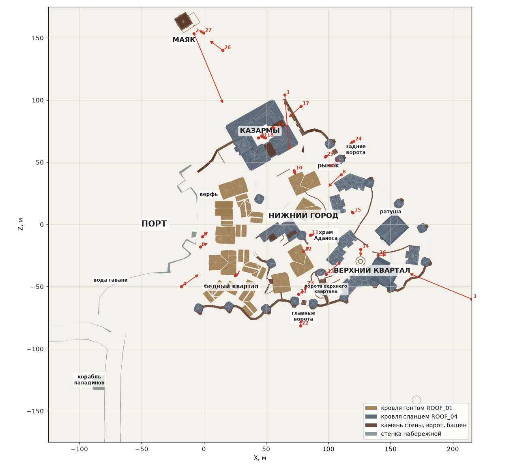
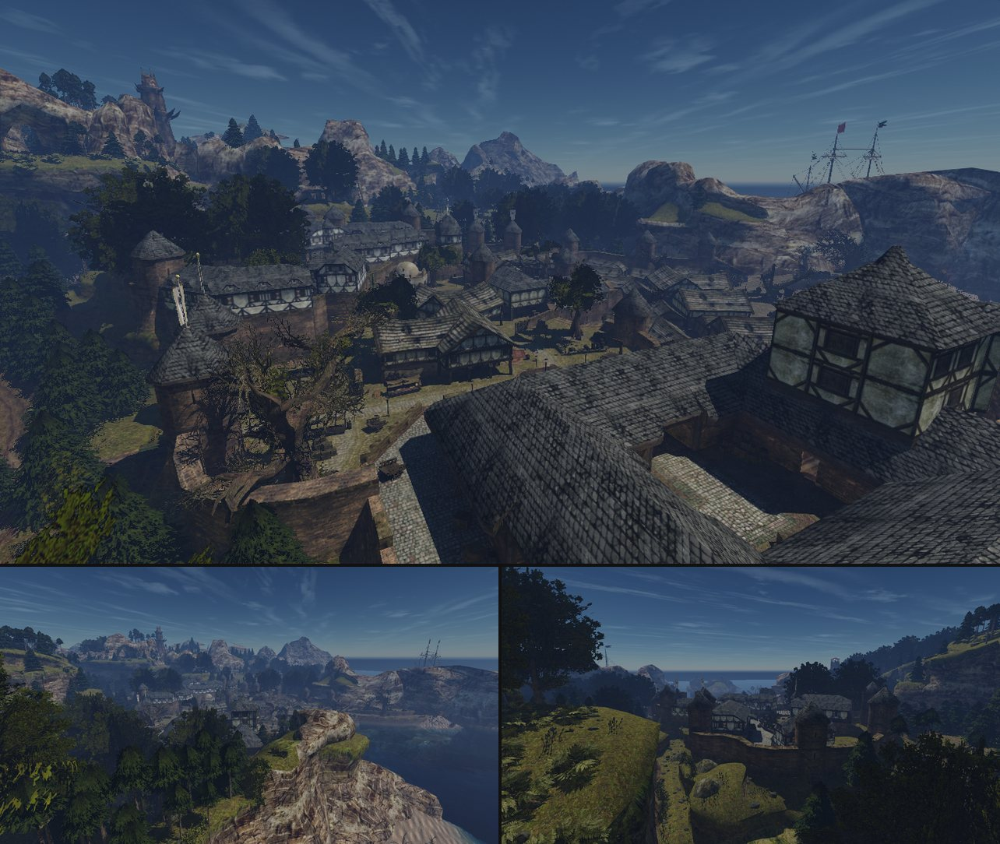
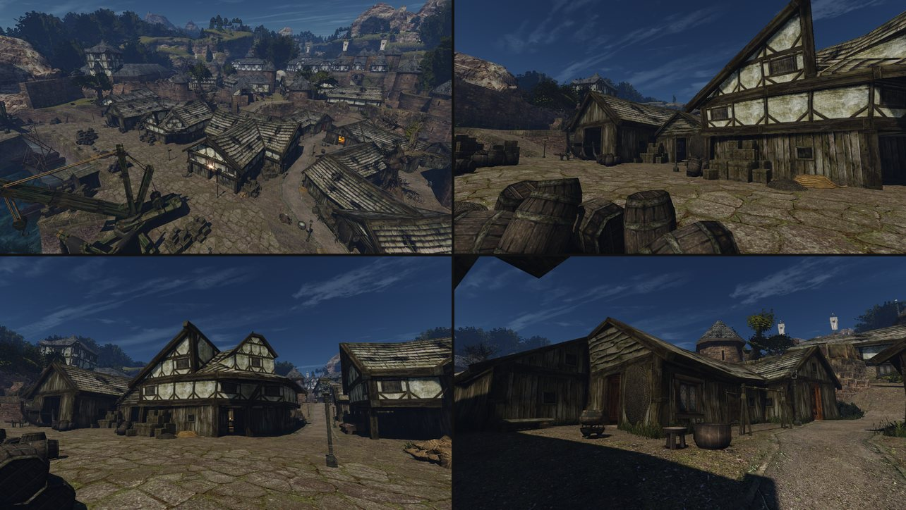
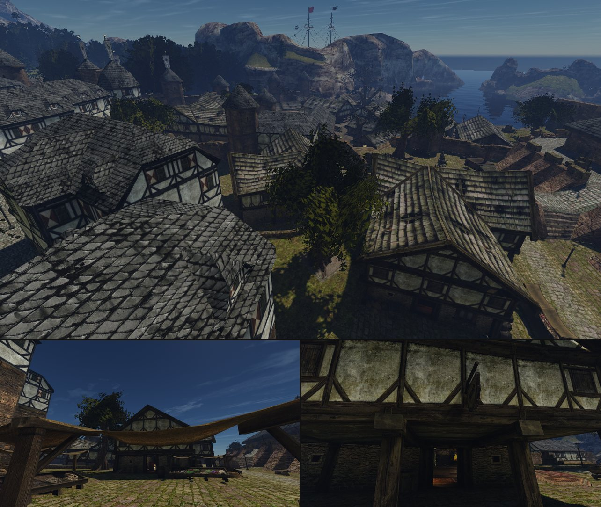
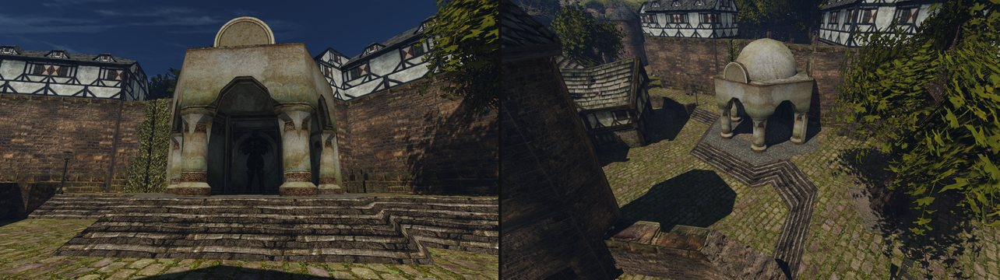
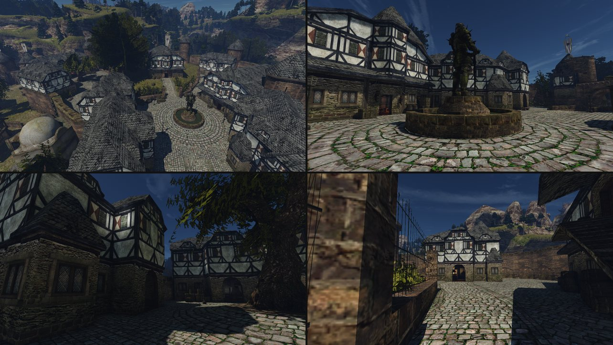
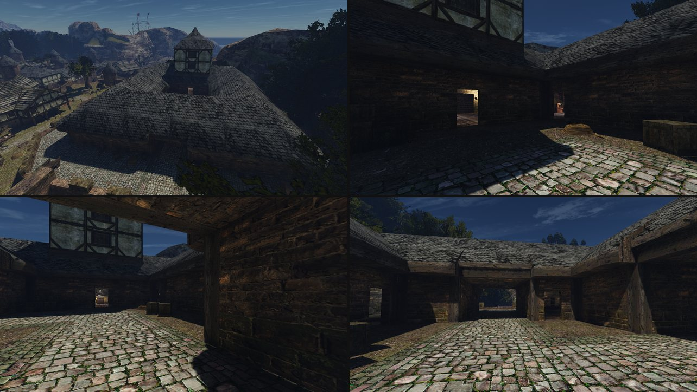
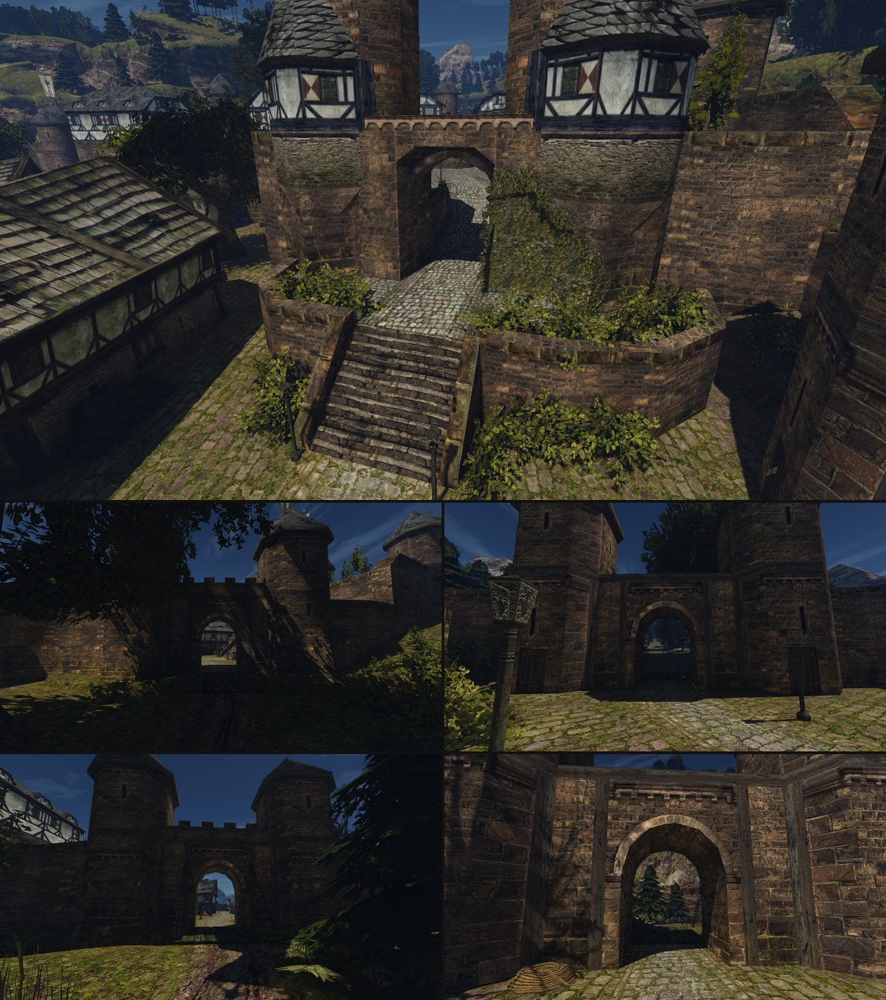
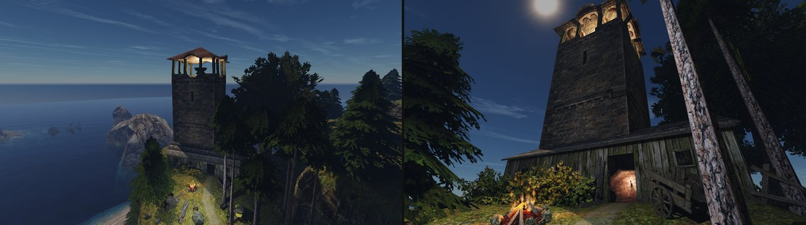

# Арт-библия Хориниса

Статус: принята пользователем 2026-10-21. Пользователь просил её так: «текстом оформить описание самого города, его кварталов, его настроение, его духа, то, что передают текстуры, что передают модели. И потом уже в работе над самими моделями использовать вот эту вот библию».

Библия описывает **замысел оригинала**: каким Хоринис задуман в Gothic II. Цель ремастера — «та же Готика, только лучше сделана» ([конвейер](remaster-pipeline.md)). Отсюда берутся настроение квартала и его правила, а форма и числа конкретной постройки — из её обмера. Общий стиль своего контента (палитра, износ, промпты) — в [библии стиля](content-style.md), прежние промахи — в [списке отклонённых дефолтов](remaster-defaults.md).

## Как пользоваться

- **Лист замысла** (`intent.md`, этап 1 конвейера). Раздел «Правила квартала» перечисляет правила отсюда по номерам, например `П1`, и не пересказывает их своими словами.
- **Концепция** (`concept.md`, этап 2) ссылается на квартал и на общий материал, к которому относится текстура.
- **Правило действует только в своей области.** У каждого правила названы постройки и текстуры. Текстура, общая для нескольких кварталов, правилами одного квартала не меняется (раздел «Общие материалы»).
- **Источник правила указан.** «Пользователь» — его слова. «Оригинал» — прочитано по кадрам и переписи. «Claude, подтверждено» — толкование Claude, которое пользователь подтвердил. Новое правило с источником «Claude» до подтверждения пользователя — гипотеза: его проверяют по кадрам ассета.
- **Числа — ограничители, а не цели** ([дефолт 10](remaster-defaults.md#метод)).
- **Добавлять можно, атмосферу — нельзя менять.** Детали и улучшения, которых нет в оригинале (объём, предметы, следы жизни, движение, свет), добавляются без отдельного согласия, если сохраняют настроение квартала и его правила. Пользователь, 2026-10-24: «мы можем улучшать разные аспекты сохраняя атмосферу. Различные детали и улучшения мы свободно можем добавлять». Что и где — [план проработки мира](world-detail-plan.md).
- Кадры ниже — оригинал. Их смотрят Claude и рецензент. Кадры в генератор не идут; текстуру оригинала подавать можно (решение пользователя 2026-10-23), такой ресурс — производная от оригинала.

## Город целиком



Карта — вид сверху по геометрии мира: X вправо, Z вверх. Красные стрелки — камеры кадров этого документа. Номера идут по порядку разделов, а внутри листа кадров — слева направо и сверху вниз.



Кадры 1–3: город со стены у казарм (большой кадр), от маяка, с холма за верхним кварталом.

**Место.** Хоринис — единственный город острова и его порт. Он лежит в чаше между скалами над бухтой и спускается к воде террасами. Высоты — медианы точек путей квартала, от уровня порта:

| Терраса | Над портом |
|---|---|
| огонь маяка | ≈ 45 м |
| подножие маяка, на скале за городом | ≈ 25 м |
| верхний квартал | ≈ 10,7 м |
| казармы | ≈ 9 м |
| нижний город и рынок | ≈ 4,2 м |
| храмовая площадь | ≈ 2,8 м |
| порт и набережная | 0 |
| канализация | ≈ −4,9 м |

Стена с башнями обходит город по суше от скал над портом до скал за верхним кварталом. Наружу ведут двое ворот: главные — к ферме Лобарта и вглубь острова, задние — к маяку и в лес. Внутренняя стена с воротами отделяет верхний квартал.

**Дух.** Бедный портовый город колонии на краю королевства, позднее средневековье. В городе стоят паладины короля, на воротах — стража, торговля скудеет. Всё старое, сделано руками и много раз чинено: сырость моря, дым очагов, грязь под ногами. Не открыточное средневековье и не глянцевое фэнтези.

**Лестница материалов.** Кто где живёт, видно по материалам: чем выше терраса, тем больше камня и тем меньше голого дерева.

| Квартал | Стены | Кровля | Под ногами |
|---|---|---|---|
| бедный квартал | доски | гонт | утоптанная земля |
| порт | доски внизу, фахверк наверху; камень набережной | гонт | крупные плиты набережной |
| нижний город | фахверк с тёплой грязно-белой штукатуркой на каменном цоколе | гонт и сланец примерно поровну | старая неровная брусчатка |
| верхний квартал | каменный низ, фахверк с холодной белой штукатуркой, почти чёрное дерево, красно-белые ромбы | сланец | ровная брусчатка кругами |
| казармы, стена, ворота | камень | сланец | брусчатка и земля |

Карта показывает это прямо: гонт `ROOF_01` лежит на порту и части нижнего города, сланец `ROOF_04` — на казармах, верхнем квартале, башнях стены и другой части нижнего города. В нижнем городе их примерно поровну: около 1 200 м² гонта и 1 100 м² сланца.

**Свет.** Кадры сняты в полдень. Небо глубокое синее, солнце жёсткое, тени густые и тёмные. Открыты набережная, рынок и площадь у фонтана. Узкие улицы верхнего квартала, двор казарм, проулки бедного квартала и храмовая площадь в полдень почти целиком в тени. Сами материалы тёмные: штукатурка — средне-серая с тёплым или холодным оттенком, дерево тёмное, кровля и земля темнее всего. Ночью — масляные фонари на столбах, факелы у ворот, тёплый свет из дверей таверн.

### Текстура, геометрия, модель: кто что говорит

У оригинала три слоя, и каждый говорит своё. Замену делаем в том же слое.

| Слой | Что несёт | Пример |
|---|---|---|
| Геометрия | силуэт, этажность, вынос верхнего этажа, кривизна, тяжёлые балки и стойки, крыши | просевший конёк хижины порта; дубовые стойки 40 × 40 см |
| Текстура | материал и возраст: доски, штукатурка, камень, мох, сырость, грязь; лёгкие стойки и подкосы; маленькие окна и проёмы | доски с тёмными щелями; маленький тёмный проём в `HAFEN_HOLZWAND_02` |
| Модель | детали, которые рассматривают вблизи и которые рассказывают о жителях: окна, двери, вывески, фонари, решётки, утварь, груз | большое свинцовое окно `NW_CITY_WINDOW_WOOD_OUT_01` перед стеной хижины; бочки, ящики, сети |

Нарисованное дерево не дублирует объёмное ([библия стиля](content-style.md#здание-прежде-текстуры)). Что нарисовано, а что стоит моделью, по кадру не угадывается: смотри превью текстуры и перепись моделей рядом ([дефолт 5a](remaster-defaults.md#форма-и-главная-деталь)).

## Кварталы

### Порт и бедный квартал



Кадры 4–7: порт сверху с крана, набережная у складов, таверна порта, хижины бедного квартала.

**Место.** Низ города, у воды. Набережная стоит на подпорной стене. Её стенка `HAFENKAI_MAUER_01` — самая большая поверхность города, 17 492 м². Вдоль набережной — склады, верфь, таверна, бордель. Длинный пирс уходит к кораблю паладинов. За набережной, под городской стеной, — бедный квартал: тесная кучка дощатых хижин на земляных проулках.

**Кто живёт.** Рыбаки, грузчики, матросы, бедняки, мелкие воры. Кабатчик, хозяин борделя, ростовщик, корабел, кузнец бедного квартала. Паладины сторожат корабль. Под портом, в канализации, — гильдия воров.

**Настроение.** С одной стороны открытое небо и вода, с другой — задний двор города. Всё сырое, просмолённое, пахнет рыбой. Порт — место работы, а не показа: груз лежит прямо на камнях. Бедность без запустения: здесь живут.

**Постройки и что они говорят.**
- **Дома набережной** — таверна, бордель, склады (блоки переписи B032, B034, B035). Низ — вертикальные доски `HAFEN_HOLZWAND_01`, верх — фахверк `WALL_03` с выносом над низом, высокие крыши гонтом `ROOF_01`. Говорят: деньги здесь проходят, но на вид не тратятся. Построено крепко, но давно и дёшево.
- **Хижины бедного квартала** (B031, B035–B037). Один этаж, всё из досок, конёк просел, карниз неровный ([лист замысла хижины](../reports/content/remaster/harbour-hut/intent.md)). В бедной стене — неожиданно нарядное большое окно со свинцовым переплётом (модель) рядом с маленьким тёмным проёмом без стекла (текстура). Говорят: самострой, чинили сами, живут бедно, но не опустились.
- **Набережная.** Подпорная стенка из грубой кладки с горизонтальным уступом, крупные неровные плиты, бордюр с мхом. Деревянные причалы на железных обвязках, деревянные краны.

**Материалы и как стареют.**
- Доски серо-оливковые. Лицевые стороны выбелены солнцем и солью, щели тёмные, низ темнее и мокрее, мох в щелях и нахлёстах.
- Гонт серо-бурый с оливковым, во мху. Дранки выпадают, на скатах видны дыры: кровлю латают, но не меняют.
- Камень набережной серо-бурый с оливковым. Швы тёмные и мокрые, верх плит истёрт ногами.
- Железа мало: редкие кованые полосы, ржавые потёки.
- Проулки — утоптанная тёмная земля, у краёв трава и мусор.

**Свет.** Самое открытое место города: днём набережная светлее всех, но стены домов остаются тёмными. Бедный квартал большую часть дня в тени стены. Ночью — фонари на столбах вдоль набережной и свет из дверей таверны.

**Предметы.** Бочки, ящики, сети, канаты, мешки, пушки на набережной, краны. Свалены как попало у стен и на камнях. Говорят: здесь грузят и ловят рыбу. Ящики — грубая сосна, оливковая от сырости, без железных уголков; на весь порт одна-две кованые полосы ([ящики порта](../reports/content/2026-10-crates-redesign/README.md)).

### Нижний город и рынок



Кадры 8–10: нижний город сверху (большой кадр), рыночная площадь под навесом прилавка, дом у рынка снизу.

**Место.** Средняя терраса, на 4 м выше набережной. Главная улица спускается от главных ворот к порту. Рынок — в другом конце нижнего города, у задних ворот. На границе с верхним кварталом — храмовая площадь.

**Кто живёт.** Ремесленники и торговцы: кузнец, лучник, алхимик, лавочники, торговцы с прилавками на рынке. Гостиница, таверна. По улицам ходит ополчение.

**Настроение.** Тесно и деловито, но спокойнее порта. Торговый, но не богатый город: дома ухожены, но потрёпаны сыростью.

**Постройки и что они говорят.** Двух- и трёхэтажные фахверковые дома: внизу каменный цоколь и лавка (`FACHWERKBASEMENT_*`), выше жилые этажи в дубовом каркасе с тёплой грязно-белой штукатуркой (`WALL_03`). Окна — маленькие закрытые ставни в своих рамах (`WINDOW_03`), ритм «окно, стена, окно». Верхний этаж вынесен на консолях над улицей, крыши высокие. Вывески на кронштейнах. Говорят: дом — это мастерская или лавка с жильём над ней ([лист замысла дома у рынка](../reports/content/remaster/market-house/intent.md)).

**Материалы и как стареют.**
- Штукатурка грязно-кремовая, в оливковых пятнах сырости. Светлее в середине поля, грязнее у балок и внизу. Узора кракелюра или лишайника нет ([дефолт 6](remaster-defaults.md#материал-и-поверхность)).
- Дуб каркаса тёмный, оливково-бурый, с трещинами вдоль волокна.
- Цоколь — бутовый камень с тёмными швами, внизу зеленоватый.
- Рыночная площадь — старая неровная брусчатка `NW_MISC_OLDSTONEPATH_01` с мхом и травой в швах.

**Свет.** Площадь рынка открыта. Улицы средней ширины, под выносом верхних этажей густая тень. Ночью — фонари, свет из таверны и гостиницы.

**Предметы.** Прилавки под провисшими навесами из охристой ткани. Товар даёт малые цветные пятна: зелень, ткани, горшки. Бочки с оружием, вывески, тележки, ковры у торговцев. Это единственное место города, где яркое уместно, и то малыми пятнами на товаре и ткани.

### Храмовая площадь



Кадры 11–12: храм Аданоса снизу от ступеней и площадь сверху.

**Место.** Между нижним городом и верхним кварталом. Площадь лежит чуть ниже рынка и окружена высокими подпорными стенами из бурого камня, над которыми стоят дома верхнего квартала.

**Кто бывает.** Храм Аданоса, у него проповедует маг воды. Сюда приходят бедняки и горожане.

**Настроение.** Тихий колодец посреди города, прохладно и тенисто, на стенах плющ.

**Постройки и что они говорят.** Открытая ротонда на восьмиугольном ступенчатом основании, купол, колонны с резными поясами, ступени уступами. Это единственная постройка внутри стены, сделанная на другом архитектурном языке: светлый камень, купол, резьба вместо фахверка. Говорит: храм старше и чужероднее домов вокруг.

**Материалы.** Светлый жёлто-серый камень с зеленоватыми потёками. Плющ на стенах площади (`IVY_*`). Пол внутри — `SHRINEFLOOR_01`, общий со святилищем монастыря и пещерой мага. Сам храм — модель, её текстур нет среди 78 городских.

**Свет.** Днём площадь большей частью в тени стен. Светлый храм выделяется на тёмном фоне.

### Верхний квартал



Кадры 13–16: верхний квартал сверху, площадь с фонтаном, улица, дом судьи.

**Место.** Самая высокая терраса, около 11 м над портом, за внутренней стеной. Вход — по лестнице через ворота между двумя башнями. Площадь с фонтаном и статуей воина в доспехах, ратуша, дом судьи, дома богатых купцов, сады за кованой решёткой.

**Кто живёт.** Наместник, судья, богатые купцы, алхимик. Лорд Хаген и паладины сидят в ратуше. Простых горожан у ворот заворачивает стража.

**Настроение.** Порядок, достаток, закрытость. Улицы — узкие высокие ущелья, днём в тени; площадь у фонтана светлая и просторная. Чисто по меркам Хориниса, но это тот же старый город колонии: штукатурка в пятнах, на сланце лишайник, в швах брусчатки мох.

**Постройки и что они говорят.**
- Первый этаж каменный, из тёсаных блоков; окна со свинцовым переплётом в каменных рамах.
- Выше два-три этажа фахверка с холодной белой штукатуркой (`RICH_WALL_*`) и почти чёрным деревом (`RICH_BLACKWOOD_01`).
- Под окнами — поля с красно-белыми ромбами (`RICH_WINDOW_01`). Это главный знак квартала: его же несут эркеры на башнях ворот верхнего квартала.
- Высокие сланцевые крыши `ROOF_04` с люкарнами, угловые эркеры-башенки.

Говорят: деньги и власть, но власть колонии, а не столицы. Богато по меркам острова.

**Материалы и как стареют.**
- Штукатурка холоднее и белее, чем в нижнем городе, но у каркаса грязная.
- Каркас темнее, почти чёрный.
- Камень цоколя серо-бурый, швы тёмные, местами мох.
- Сланец серый, мелкой чешуёй, в тёмных пятнах лишайника.
- Мостовая `PFLASTERSTEIN_01` ровнее рыночной, уложена кругами вокруг фонтана, мох в швах.

**Свет.** Площадь освещена, улицы между высокими домами в глубокой тени даже в полдень. Ночью — фонари на столбах, свет в окнах.

**Предметы.** Фонтан со статуей, кованые решётки садов, клумбы, плющ, флаги с гербом на башнях. Хлама мало: бочки и ящики стоят у стен, а не на площади.

### Казармы



Кадры 17–20: казармы сверху, двор, корпус, галерея у оружейной.

**Место.** Уступ над портом у городской стены, около 9 м над набережной.

**Кто живёт.** Ополчение под началом лорда Андре: новобранцы, учитель боя, оружейник. Здесь же камеры для арестованных.

**Настроение.** Крепость внутри города. Закрытый тёмный двор-колодец, тяжёлые галереи, всё практично и без украшений. Строгость и усталость.

**Постройки и что они говорят.** Огромная сланцевая крыша четырёхугольником вокруг двора, над ней один фахверковый мезонин со ставнями — тот же модуль `WINDOW_03`, что у домов рынка. Стены из мелких тёсаных блоков бурого камня. Открытые галереи на дубовых стойках с тяжёлыми прогонами. Двор вымощен брусчаткой, по краям утоптанная земля. Говорят: служба, а не жильё.

**Материалы и как стареют.** Бурый камень с тёмными швами, мох у земли. Дуб стоек тёмный и потёртый. Сланец с лишайником.

**Свет.** Самое тёмное открытое место города в полдень. Высокие стены и свесы оставляют во дворе одну полосу солнца. В галереях почти темно, в проёмах — тёплый свет комнат.

**Предметы.** Сундуки, мешки, оружейные стойки, ящики. Только то, что нужно службе.

### Городская стена и ворота



Кадры 21–25: ворота верхнего квартала с лестницей (большой кадр), главные ворота снаружи и изнутри, задние ворота снаружи и изнутри. Стена снаружи — кадр 3.

**Место.** Стена обходит город по суше. На ней круглые и квадратные башни со сланцевыми шатрами. Главные ворота стоят на дороге к ферме Лобарта и вглубь острова. Задние ведут к маяку и в лес, перед ними ров. Внутренние ворота верхнего квартала стоят наверху лестницы с каменными клумбами.

**Кто.** У каждых ворот стража ополчения ([ворота города](gates.md)).

**Настроение.** Граница: снаружи лес и дикость, внутри порядок. Стена старая, тяжёлая, тёмная, её не украшают.

**Постройки и что они говорят.** Кладка из тёсаных буро-серых блоков `NW_MISC_STRONG_STONEWALL_*`: полотно, угловые камни, пояса, арки и профили. Зубцы, щели бойниц, арочные проёмы. Башни ворот верхнего квартала увенчаны фахверковыми эркерами с красно-белыми ромбами: за ними начинается верхний квартал. Говорят: город держит оборону и пускает не всех.

**Материалы и как стареют.** Тёплый серо-бурый камень. Верх блоков светлее и стёрт, в швах грязь и мох, внизу сырость и мох сильнее.

**Свет.** Снаружи стена днём в тени деревьев и сама даёт тень. Проём ворот — тёмный провал, в котором светится улица. Ночью — факелы у ворот.

### Маяк



Кадры 26–27: маяк над морем и у подножия. Вид с маяка на город — кадр 2.

**Место.** За задними воротами, по лесной дороге вверх, на скале над морем, вне стены. Подножие на 25 м выше порта, огонь — на 45 м: его видно из всего порта.

**Кто.** Старый смотритель живёт теперь в порту. В башне хозяйничают бандиты.

**Настроение.** Одинокая высокая башня над морем, сосны, ветер. Старый страж порта.

**Постройки и что они говорят.** Квадратная, чуть сужающаяся кверху башня из тёмного тёсаного камня, того же, что городская стена. Узкие окна-щели. Наверху открытый фонарь на деревянных стойках (`WOOD_01`) с жаровней (`HARBOUR_CANON_01`) под красной шатровой крышей; эта крыша — не из 78 городских текстур. У подножия пристройка из тех же досок, что хижины порта (`HAFEN_HOLZWAND_01/02`, `HAFEN_GIEBEL_01`), под гонтом `ROOF_01`. Говорят: маяк — часть порта, вынесенная на скалу. Камень от города, доски от порта.

**Материалы и как стареют.** Как у стены и хижин порта. Морская сырость та же, что в порту.

**Свет.** Открытая скала: днём светло, башня тёмная на фоне неба. Ночью — огонь фонаря.

## Правила кварталов

Своя текстура квартала — та, у которой больше половины площади в этом квартале, а в другие кварталы города заходит не больше 15% и только в места того же характера (для порта — маяк и канализация под ним). Доли — в [таблице](../reports/content/2026-10-khorinis-bible/texture-districts.csv). Общие текстуры и правило для них — в следующем разделе.

### Город целиком

| № | Правило | Постройки и текстуры | Источник |
|---|---|---|---|
| Г1 | Палитра тёмная и тёплая, насыщенность низкая. Яркие цвета — только малыми пятнами на ткани, краске и товаре | все постройки; все 78 текстур [таблицы города](../data/content/city-materials.csv) | оригинал, [библия стиля](content-style.md#палитра) |
| Г2 | Всё старое, сделано руками и чинено. Ничего нового и ровного | все | оригинал, [библия стиля](content-style.md#износ) |
| Г3 | Темнота — часть замысла. Средний тон материала — цель оригинала, его не осветляют ради деталей | все | оригинал, [дефолты](remaster-defaults.md#ожидаемые-по-опыту-ремейков-пока-не-встречались) |
| Г4 | Лестница материалов держится. Гонт `ROOF_01` читается деревянным и бедным, сланец `ROOF_04` — каменным и богатым. Тёплая штукатурка нижнего города (`WALL_03`) отличается от холодной верхнего (`RICH_WALL_*`) | `city-roofs`, `market-house`, `upper-house` | Claude, подтверждено пользователем 2026-10-21 |

### Порт и бедный квартал

| № | Правило | Постройки и текстуры | Источник |
|---|---|---|---|
| П1 | Постоянная сырость. Мох и зелёный налёт в щелях, на кромках и в тени нахлёстов. Дерево с зеленоватым оттенком, торцы тёмные, низ мокрый, ржавые потёки. Мха не меньше, чем в оригинале | все постройки порта, бедного квартала и пристройка маяка. Свои текстуры: `HAFEN_HOLZWAND_01`, `_02`, `HAFEN_GIEBEL_01`, `WOODBEAM_01` (`harbour-hut`); `HAFENKAI_MAUER_01`, `HAFENKAI_BODEN_01`, `HAFENKAI_BODEN_TRANS_01` (его 19% таблица относит к казармам по точке пути, но лежат они на уровне порта, у подъёма к казармам), `HAFENRANDSTEIN_01`, `HARBOUR_WOOD_IRON_01` (`harbour-quay`); `DIRTYGROUND_WEG_02`, `_03`, `_END_01` (`streets`); `BODENDIELEN_DRECK_01` (`interiors`); `WOODBEAM_03` (`city-timber`, корабль); `ROPE_01`, `HARBOUR_ROPEWALL_01` (`harbour-rigging`); предметы порта | пользователь: «концепция портового квартала в том, что там постоянная сырость, влага, и это должно сказываться на всех строениях, которые там находятся» |
| П2 | Кривизна самостроя. Конёк просел, карниз неровный, доски, рамы и ставни неровные. Не выпрямлять ни геометрией, ни текстурой | хижины бедного квартала B031, B035–B037, пристройка маяка; текстуры `harbour-hut` | пользователь: «если мы много таких домов ровненьких поставим, то пропадет ощущение бедного квартала» |
| П3 | Бедная стена, нарядное окно. Большое свинцовое окно — модель `NW_CITY_WINDOW_WOOD_OUT_01`, в текстуре `HAFEN_HOLZWAND_02` — маленький тёмный проём без стекла. Главную деталь не уменьшать и не упрощать | хижины бедного квартала; `HAFEN_HOLZWAND_02`, модель окна | пользователь, [дефолты 1 и 5a](remaster-defaults.md#форма-и-главная-деталь) |
| П4 | Порт — склад под открытым небом. Груз свален неровно, дерево грубое, без краски и надписей, железа мало | предметы порта (этап 2), `harbour-rigging` | пользователь: «коробки из Counter-Strike» ([дефолт 4](remaster-defaults.md#форма-и-главная-деталь)) |

### Нижний город и рынок

| № | Правило | Постройки и текстуры | Источник |
|---|---|---|---|
| Н1 | Фахверк: тёмный дубовый каркас на тёплой грязно-белой штукатурке, каменный цоколь. Ритм «окно, стена, окно». Окна — маленькие закрытые ставни в верхней середине поля. Правило сырости порта сюда не относится | дома нижнего города и рынка (B048, B052, B053 и соседние). Свои текстуры: `WALL_04`, `WALL_05`, `FACHWERKBASEMENT_CHAIN_01`, `_WINDOW_01`. Общие: `WALL_03`, `WINDOW_03`, `FACHWERKBASEMENT_EMPTY_01` | оригинал, [лист замысла дома у рынка](../reports/content/remaster/market-house/intent.md) |
| Н2 | Рынок мощён старой неровной брусчаткой с мхом и травой в швах. Яркое — только товар и ткань навесов | рыночная площадь и проходы; `NW_MISC_OLDSTONEPATH_01`, `_WAY_01`; прилавки, навесы, товар | оригинал |

Штукатурка нижнего города грязная, как в оригинале: побелка пятнами поверх оливкового грунта, плесень под ригелями, потёки. Чистые белые стены — признак верхнего квартала (В1), они отличают его от нижнего города. Пользователь, 2026-10-23: «Белые стены у домов в верхнем квартале, это как бы отличает часть города». Прежнее отступление у `market-house` (побелка чище, 2026-10-21) этим отменено.

### Храмовая площадь

| № | Правило | Постройки и текстуры | Источник |
|---|---|---|---|
| Х1 | Храм — другой архитектурный язык: светлый камень, купол, колонны, резьба. Он светлее тёмных стен площади, а не наоборот | храм (модель, этап 2), стены площади; `SHRINEFLOOR_01` общий с монастырём | Claude, подтверждено пользователем 2026-10-21 |

### Верхний квартал

| № | Правило | Постройки и текстуры | Источник |
|---|---|---|---|
| В1 | Камень внизу, белый фахверк с почти чёрным деревом и красно-белыми ромбами выше, сланец сверху. Холоднее и чище нижнего города, но не новое и не глянцевое | дома верхнего квартала, ратуша, дом судьи. Свои текстуры: `RICH_WALL_HALF_01`, `RICH_WINDOW_01`, `RICH_BLACKWOOD_01`, `INSIDEWALL_11`, `_12`, `_13`. `RICH_WALL_01` — 71% площади на доме Онара; `RICH_WINDOW_01` и `RICH_BLACKWOOD_01` — по четверти там же. Лист замысла `upper-house` снимает и дом Онара | Claude, подтверждено пользователем 2026-10-21 |
| В2 | Улицы мощены ровнее рыночных, кругами вокруг фонтана; мох в швах | улицы и площади верхнего квартала, двор казарм; `PFLASTERSTEIN_01`, `PFLASTERSTEIN_BORDER_01` (верхний квартал 73% и 54%, казармы 26% и 46%) | оригинал |

### Казармы, стена, ворота, маяк

| № | Правило | Постройки и текстуры | Источник |
|---|---|---|---|
| К1 | Казармы — крепость: камень, сланец, тёмный двор, никаких украшений | корпус и двор казарм. Своих текстур нет, ближе всех `BROKENSTONE_01` (казармы 66%, порт 27%). Остальное общее: `ROOF_04`, `WINDOW_03`, `PFLASTERSTEIN_*` | Claude, подтверждено пользователем 2026-10-21 |
| С1 | Один камень на всю оборону города: тёсаные буро-серые блоки, верх стёрт, внизу сырость и мох | стена, башни, ворота, внутренняя стена верхнего квартала, каменные цоколи ратуши и дома судьи, башня маяка; `NW_MISC_STRONG_STONEWALL_01`, `_SIDE_01`, `_ENTRANCE_01`, `_BLOCKBORDER_01`, `_ROUNDBORDER_01` (`city-wall`) | оригинал, [таблица города](../data/content/city-materials.csv) |
| М1 | Маяк — камень стены и доски порта. Своих текстур в очереди у него нет: его снимают ассеты `city-wall` и `harbour-hut` как одно из своих мест | башня и пристройка маяка | оригинал |

## Общие материалы

Общий материал — текстура, которая стоит в нескольких кварталах или ещё и вне города. Это отдельный ассет [очереди](remaster-pipeline.md#очередь-переделки), а не часть постройки.

**Правило О1.** Общий материал делается по замыслу оригинала сразу для всех своих мест. Правило одного квартала его не двигает: мха не меньше и не больше, чем у оригинала. Его лист замысла снимает хотя бы по одному месту каждого вида, включая места вне города. Своих, более сырых текстур для порта на месте общих не делаем: кровля, балка и фахверк остаются едиными для порта и нижнего города, как у оригинала (пользователь, 2026-10-21: «оставляем»).

Доли площади по кварталам — из [таблицы](../reports/content/2026-10-khorinis-bible/texture-districts.csv); «вне» — вне города.

| Материал | Текстуры | Где стоит | Что передаёт |
|---|---|---|---|
| Кровля гонтом | `ROOF_01` | порт 62%, нижний город 31%, вне 6%; хижины, дома набережной, часть нижнего города, пристройка маяка | дерево, бедность, ремонт: мох, выпавшие дранки |
| Кровля сланцем | `ROOF_04` | верхний квартал 37%, казармы 24%, нижний город 12%, вне 24% (дом Онара, таверна Орлана, хижина у шахты); шатры башен стены | камень, достаток, власть: серая чешуя, лишайник |
| Изнанка кровли | `ROOF_INSIDE_01` | порт 35%, нижний город 15%, вне 48% (кухня и конюшня Онара, таверна, фермы) | пыль и копоть под крышей |
| Тяжёлая балка | `WOODBEAM_02` | порт 63%, нижний город 24%, вне 12% (таверна Орлана, будка стражи у Прохода) | тёмный оливково-бурый дуб с кованой обвязкой, трещины вдоль волокна |
| Дерево корабля | `WOODBEAM_03` | порт 100%, корабль паладинов | тёмно-красное дерево с обвязкой |
| Доски и планки | `WOOD_01`, `WOOD_ORNAMENT_01`, `_02` | `WOOD_01` — вне 81%, в городе ворота и фонарь маяка; `WOOD_ORNAMENT_02` — вне 48%, остальное по всем кварталам | грубое серо-бурое дерево деталей |
| Фахверк нижнего города | `WALL_03`, `WINDOW_03`, `FACHWERKBASEMENT_EMPTY_01` | `WALL_03`: нижний город 43%, порт 26% (таверна, бордель), казармы 9%, вне 22% (таверна Орлана); `WINDOW_03`: нижний город 39%, казармы 34% (мезонин), порт 12%; `FACHWERKBASEMENT_EMPTY_01`: верхний квартал 57%, нижний город 28% | тёплая штукатурка в дубовом каркасе на каменном цоколе |
| Мостовые | `HAFENKAI_BODEN_01`; `NW_MISC_OLDSTONEPATH_01`, `_WAY_01`; `PFLASTERSTEIN_01`, `_BORDER_01`; `DIRTYGROUND_02` | плиты — порт; старая брусчатка — рынок; ровная брусчатка — верхний квартал и казармы; земля — порт 52%, нижний город 17%, казармы 16% | под ногами та же лестница материалов, что на стенах |
| Камень стены | `NW_MISC_STRONG_STONEWALL_*` | стена, башни, ворота, цоколи верхнего квартала, башня маяка (`ROUNDBORDER_01` — 51% на маяке) | оборона города |
| Плющ | `IVY_BORDER_01`, `IVY_FULL_01` | верхний квартал около 50%, вне 35–48% (дом Онара), стены храмовой площади | старость камня, сады богатых |
| Интерьеры | `BODENDIELEN_*`, `INSIDEFLOOR_11`, `INSIDEWALL_*`, `DUNGEON*` | полы порта и корабля, стены домов верхнего квартала, канализация, монастырь | — описываются при работе над `interiors` |

## Напряжения, которые нельзя «чинить»

- **Бедность порта.** Хижины бедные, кривые, сырые, но обжитые: в стене нарядное окно, у двери утварь. Не прибирать и не делать заброшенными.
- **Кривизна самостроя.** Просевший конёк, неровный карниз, разные доски — замысел, его задаёт геометрия. Текстурой не выпрямлять.
- **Темнота.** Город тёмный в тени днём и ночью. Средний тон — цели оригинала. Не осветлять и не добавлять света, которого не было.
- **Сырость без запустения.** Мох и налёт — от моря, а не от брошенности.
- **Торговый, но не богатый.** Нижний город ухожен, но потрёпан.
- **Богатый, но старый.** Верхний квартал чище, но не глянцевый: пятна на штукатурке, лишайник на сланце.
- **Крепость, но обжитая.** Казармы суровы, но в них живут: мешки, сундуки, свет в проёмах.

## Чего не делать

Сжатый [список отклонённых дефолтов](remaster-defaults.md); причины и слова пользователя — там. Номера совпадают.

- **1.** Уменьшать и упрощать главную деталь постройки — у хижины порта это окно.
- **2.** Выпрямлять и прибирать бедное.
- **3.** Рисовать окно во всю ширину поля между балками, нарисованные балки толще объёмных.
- **4.** Повторять нарисованную рамку чистой ровной геометрией и добавлять железо от себя.
- **5.** Ставить меньше мха и сырости, чем в оригинале.
- **5a.** Рисовать в текстуре то, что в оригинале — отдельная модель.
- **6.** Давать штукатурке узор кракелюра или лишайника.
- **7.** Делать дерево имитацией: слишком сильные нормали, навес плитой вместо провисшей ткани.
- **8.** Красить дерево тёплого двора в серое чистое.
- **9.** Ставить яркие цветные пятна на крупных деталях.
- **10.** Гнать числа вместо цельного замысла.
- **11.** Делать текстуры по одной, без общего здания.
- **12.** Брать замощаемую общую штукатурку вместо модуля для места.
- **13.** Менять масштаб и направление рисунка против оригинала.

Ожидаемые по опыту ремейков: светлее и насыщеннее оригинала, «чисто и ярко»; свет показывает больше, чем показывал оригинал; «типичное фэнтези» вместо местной формы.

## Источники и как пересобрать

- **Кадры обзора, 19 штук:** `~/.local/share/gothic-ai/khorinis-survey/selected/`, камеры — `architecture-cameras.csv` там же. Оригинал, полдень, обычный FOV игры, NPC и эффекты скрыты.
- **Досъёмка, 8 кадров** (маяк, ворота, храм сверху): сценарий [`khorinis-bible.bench`](../scripts/content/khorinis-bible.bench), снято на Ryzen через `gq`, кадры в `~/.local/share/gothic-ai/khorinis-survey/captures/bible-02/original/`:
  ```sh
  QUALITY_PILOT_TASK=gothic-ai/remaster-khorinis-bible scripts/content/capture-quality-pilot.sh --prepare
  QUALITY_PILOT_TASK=gothic-ai/remaster-khorinis-bible scripts/content/capture-quality-pilot.sh \
    --capture original ~/.local/share/gothic-ai/khorinis-survey/captures/bible-02
  ```
- **Доли текстур по кварталам:** [`texture_districts.py`](../scripts/content/texture_districts.py) → [`texture-districts.csv`](../reports/content/2026-10-khorinis-bible/texture-districts.csv). Каждый участок текстуры относится к кварталу ближайшей точки пути; квартал точки — по её имени. 71 текстура `NW_CITY_`/`NW_HARBOUR_` считается по всему миру (`intent.json` из `scripts/content-textures.sh --intent`). Семь `NW_MISC_` — только в границах переписи города (`triangles.json` из `world-textures.cpp --triangles`): у стены и ворот доли грубые, потому что стена граничит со всеми кварталами.
  ```sh
  uv run --no-project --with numpy python scripts/content/texture_districts.py \
    --intent ~/.local/share/gothic-ai/texture-intent/intent.json \
    --triangles ~/.local/share/gothic-ai/harbour-house/triangles.json \
    --out reports/content/2026-10-khorinis-bible/texture-districts.csv
  ```
- **Карта:** [`khorinis_map.py`](../scripts/content/khorinis_map.py); команда — в её docstring.
- Перепись блоков [`census.csv`](../reports/content/2026-10-harbour-house/census.csv), [таблица города](../data/content/city-materials.csv), [задумка 71 текстуры](../reports/content/2026-10-city-intent/README.md), листы замысла ассетов `reports/content/remaster/*/intent.md`, [очередь переделки](remaster-pipeline.md#очередь-переделки).
- Высоты террас — медианы Y точек путей квартала от медианы порта (−1,03 м мира).

## Журнал поправок пользователя

Слова пользователя записываются дословно. Правило из поправки получает номер в своём квартале, у правила «Claude» после подтверждения меняется источник.

**2026-10-21** — черновик и кадры кварталов показаны пользователю. Ответы:
- описание кварталов верно: «да»;
- правила Г4, Х1, В1 и К1, выведенные Claude, подтверждены: «да»;
- общие кровля, балка и фахверк остаются едиными для порта и нижнего города, своих сырых текстур для порта не будет: «оставляем». Записано в правило О1.
