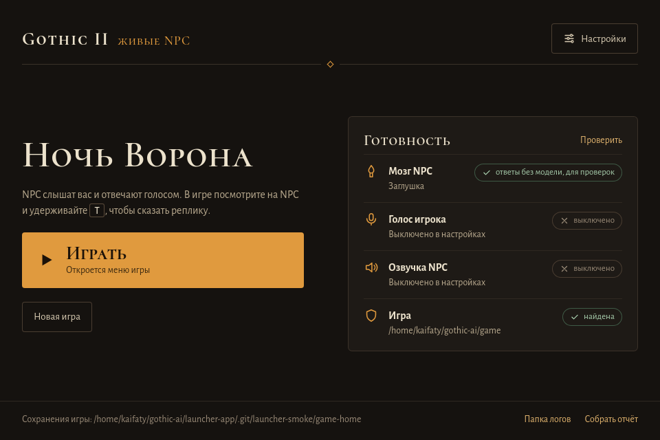

# Лаунчер

Статус: этапы L1–L3 сделаны 2026-10-11, лаунчером пользуются: приложение `Gothic AI.app` запускает ядро [`launcher/core`](../launcher/core/) (`gothic-launcher up`, `control`), а оно — сервисы и игру. После 11.10 ядро научилось передавать серверу адреса быстрых моделей и боевого тела (`llm.decider_url`, `llm.quick_url`, `llm.body_url` → `--decider-url`, `--quick-url`, `--body-url`), игре — HD-текстуры и кэш разрушений (`OPENGOTHIC_TEXTURES`, `OPENGOTHIC_FRACTURE`), а проверка Inworld смотрит и остаток кредитов. Пункты «Не проверено» в этапах ниже с 11.10 не перепроверяли. Тесты ядра — `cd launcher/core && uv run pytest -q`.

## Как работает сейчас

На Mac приложение `Gothic AI.app`, а на Ryzen Linux-приложение Tauri запускает Python-ядро, а оно — ASR, TTS, ИИ-сервер и игру. Окно на обеих системах показывает настройки, готовность сервисов и журнал, позволяет войти в ChatGPT через системный браузер, выбрать папку игры и проверить микрофон. Ядро выбирает свободные порты, ждёт `/health` сервисов и останавливает свои процессы после выхода из игры или лаунчера. Настройки — `~/.config/gothic-ai/settings.toml`, ключи — отдельный `secrets.toml`, вход ChatGPT — отдельный `chatgpt.json`. Логи Mac остаются в `~/Library/Logs/GothicAI/`, Linux — в `~/.local/state/gothic-ai/logs/`.

`game.dir` может указывать на каталог только с настройками: с готовой базой в `OPENGOTHIC_BASE` или указателе этого канонического пути `Data` не требуется. `gothic-launcher check` показывает «База игры готова» с отпечатком по метаданным базы и проверяет русскую локализацию по её библиотеке OU; `Data` и исходный `OU.BIN` при этом не читаются. Помощник выбора базы совпадает побайтно с сервером и TTS. Без базы сохраняются проверки установленной Gothic II NotR и русского `OU.BIN`, с пояснением: лаунчер подготовит базу перед запуском (несколько минут). Если нет ни базы, ни установки, нужно указать папку установленной Gothic II один раз.

Перед каждым запуском игры из окна, `gothic-launcher up` или `play` ядро после проверок запускает `content-convert resolve <game.dir>`: сначала готовит основную базу, затем ролики. Конвертер берётся рядом с выбранным исполняемым файлом игры (`paths.game_bin` или `default_game_bin`), в том числе из `Contents/MacOS/` dev-бандла; отдельной настройки нет. При непустом `OPENGOTHIC_BASE` подготовка пропускается; явный `OPENGOTHIC_BASE_FINGERPRINT` также пропускает её вне личного каталога Ryzen. Для `game-settings` Ryzen конвертер с сохранёнными отпечатками до сервисов выбирает готовые части и обновляет указатель для сервера/TTS, без импорта и обращения к установке. Сервисы и игра запускаются после успешной подготовки. Каждая строка stderr сохраняется в `prepare.log` сеанса и передаётся существующими событиями сервисов: строка статуса показывает «Подготовка базы игры» и последний прогресс, журнал — строки прогресса. Остановка сеанса завершает группу конвертера через SIGTERM, затем SIGKILL после паузы (на Windows — его job целиком) и не запускает игру. Ненулевой код останавливает сеанс с хвостом stderr; отсутствие исполняемого конвертера даёт ошибку с точным путём и командой `scripts/build-engine.sh` (на Windows — `content-convert.exe` и `scripts/build-engine.ps1`). Предупреждение о роликах с кодом 0 запуск не блокирует.

С П19в игровой бинарник выбирает только готовую базу и ролики: первый запуск и смену установки подготавливают лаунчер или `content-convert resolve <каталог игры>`. Если основной базы нет, игра пишет понятную ошибку в лог и завершается с ненулевым кодом; встроенного окна импорта больше нет. Отсутствующие ролики пропускаются с предупреждением.

`gothic-launcher prepare [DIR]` выполняет тот же шаг без сервисов и игры; по умолчанию берёт `game.dir`, возвращает код конвертера. `gothic-launcher up --no-game` подготовку не выполняет, `gothic-launcher check [DIR]` остаётся проверкой только для чтения.

Для стендов Ryzen `scripts/ryzen.sh setup` с Mac создаёт `~/gothic-ai/game-settings/` только с `system/Gothic.ini` и `system/SystemPack.ini`, переносит недостающие готовые части из кэша Mac в кэш Ryzen со сверкой и сохраняет отпечатки в `~/gothic-ai/game-base.json`. Если видео в указателе Mac нет, setup предупреждает и продолжает без роликов. Все стенды и личная игра используют этот каталог настроек. `ryzen-play.sh install|update` переводит `game.dir` на `~/gothic-ai/game-settings`; отпечатки для окружения игры читает общий `scripts/ryzen_game.py`, поэтому подготовка базы не требует установки и не запускает импорт. Без setup ранняя ошибка `Run scripts/ryzen.sh setup first` возникает до папок прогона, замков и заявок `gq`. Каталог `~/gothic-ai/game` больше не нужен; его удаление выполняется отдельно. Подробнее — [П18г](asset-migration.md#как-работает-сейчас).

Бой P30 по умолчанию считает движок: `llm.body_policy="engine"` передаётся серверу как `--body-policy engine`, адрес сервиса не нужен. Необязательный `llm.body_net` задаёт путь к `.bodynet` через `OPENGOTHIC_BODY_NET`; без него движок читает `~/.local/share/gothic-ai/body/nets/p30.bodynet` (на Windows `~` — `%USERPROFILE%`, как у `Path.home()`). `llm.body_url` задаёт запасной TCP-сервис, если сеть движка не загружена. Для постоянного выбора сервиса задайте `gothic-launcher config set llm.body_policy service` и `gothic-launcher config set llm.body_url tcp://HOST:PORT`. Без доступной сети и адреса сервиса бой ведёт родной ИИ. Смоук временно выбирает `service` без адреса, чтобы не запускать нейро-бой; сохранённые настройки не меняются.

Голос игрока по умолчанию распознаёт Inworld STT, запасной провайдер — ChatGPT. Voxtral остаётся вариантом на своём сервере; существующий явный `voice.provider = "voxtral"` сохраняется. Распознавание и озвучка Inworld используют один `secrets.inworld_api_key`: ядро передаёт его процессам ASR и TTS как `INWORLD_API_KEY`. Проверка обоих провайдеров Inworld проверяет ключ и кредиты без списаний; без ключа показывает «Ключ не задан». Для Voxtral проверяется `/health` своего сервера.

Оригинальные голоса NPC (`tts.original_voices = true` по умолчанию): ядро передаёт TTS папку игры, сервис сам в фоне готовит снапшоты без ffmpeg и клоны Inworld; до их готовности звучат придуманные голоса, прогресс виден в журнале TTS. Inworld клонирует не больше двух голосов в минуту: первая подготовка всех 36 занимает около 18–20 минут, при 429 сервис ждёт и повторяет тот же голос, не задерживая реплики.

### Ryzen (Linux)

Статус проверки Linux-окна — частичный: сборка и игровой смоук прошли в отдельном клоне `~/gothic-ai/launcher-app/`. Первый критерий готовности — реальный `scripts/ryzen-play.sh update` с Mac и открытие окна установленным ярлыком — **остаётся непроверенным**. Установленный `~/gothic-ai/play` и `gothic-ai.desktop` не менялись; unit-тесты с подменой сборки не заменяют эту проверку.

Установка и обновление запускаются с Mac через SSH-алиас `ryzen`:

```sh
scripts/ryzen-play.sh install
scripts/ryzen-play.sh update
```

После слияния пользователь должен выполнить эту проверку: убедиться через `scripts/gq status`, что заявки `ryzen-play` нет, закрыть лаунчер и запустить `scripts/ryzen-play.sh update` с Mac. Требуется код выхода 0: это проверит настоящий `__prepare`, включая сборки в общей заявке с пределом 30 минут. Затем проверить бинарник и строку ярлыка:

```sh
ssh ryzen 'test -x ~/gothic-ai/play/launcher/app/src-tauri/target/release/gothic-launcher && grep "^Exec=" ~/.local/share/applications/gothic-ai.desktop'
```

`Exec=` должен указывать на `target/release/gothic-launcher` без `ptyxis`. Последний шаг — открыть **Gothic AI** из приложений GNOME и увидеть окно. До этого первый критерий готовности не закрыт; реальный запасной путь после ошибки сборки окна (код 3) также покрыт только unit-тестами.

Общая очередь устанавливается отдельно явной командой `scripts/gq install ryzen` с Mac. Личный установщик не меняет `~/gothic-ai/bin/gq` и `gq.profile`: перед изменением клона он проверяет поддержку `--interactive` и при её отсутствии печатает эту команду.

Рабочий контент личной установки — `~/.local/share/gothic-ai/play-content`: `install/update` переносит с Mac из `~/.local/share/gothic-ai/content` только `materials/`, `meshes/` и `enabled.json` через `rsync --delete --checksum` в `play-content.incoming`, затем под `play.install.lock` заменяет папку переименованием и удаляет прежнюю `play-content.old`. Без исходного контента папка становится пустой. Linux-лаунчер передаёт её игре через `OPENGOTHIC_CONTENT`, только если есть `materials/materials.json`; явное значение переменной имеет приоритет, `OPENGOTHIC_CONTENT=` выключает контент. Каталог по умолчанию на Ryzen установщик не меняет; на Mac выбор контента остаётся прежним.

`install` повторяемый. В `~/gothic-ai/play/` создаётся git-клон `main` с тем же GitHub `origin`, что у репозитория на Mac; оба действия обновляют его через `git pull --ff-only`. Локальные изменения в клоне останавливают обновление с объяснением. Исходники игры берутся из этого клона. Сборка `RelWithDebInfo` в `OpenGothic/build` использует Vulkan SDK `~/gothic-ai/body-baseline/toolchain/vulkan-1.4.341.0`; Ninja пересобирает изменившиеся файлы. Также собирается существующая утилита `OpenGothic/ai_bridge/storygraph/build/storygraph`: без неё на свежей машине сервер отключает знания NPC и режиссёра. Обе сборки, release-сборка окна Tauri и `uv sync --locked` для `server`, `asr-service`, `tts-service`, `launcher/core` идут одной заявкой `gq quick`: 12 потоков, 12 ГБ RAM, до 30 минут, без окна. Системные пакеты установщик не ставит.

Если на Ryzen ещё нет `~/.config/gothic-ai/settings.toml`, установщик переносит из одноимённого файла Mac настройки провайдеров, `reasoning_effort` и адреса сервисов, включая `decider_url`, `body_url`, `voxtral_url`, `voxcpm_url`. Пути заменяются на `~/gothic-ai/game-settings`, `~/gothic-ai/play` и `~/.local/bin/uv`; `voice.mic_device` не переносится, используется системный микрофон Ryzen. В существующем файле `install/update` меняет только `game.dir` на каталог настроек; остальные значения и комментарии сохраняются. `secrets.toml` и `chatgpt.json` не читаются и не копируются.

Когда `game.dir` указывает на `~/gothic-ai/game-settings`, общее ядро лаунчера вызывает `scripts/ryzen_game.py --json` из своего репозитория и передаёт отпечатки в окружение игры. Этот путь общий для `gothic-launcher play` и окна Tauri и сохраняется после `update`. Перед сервисами подготовка П19б вызывает `content-convert resolve <game-settings>` с этими отпечатками: выбирает готовые части и обновляет указатель для сервера/TTS, без импорта и обращения к установке. Непустой явный `OPENGOTHIC_BASE` пропускает этот шаг. Каталог игры выбирает `game.dir` независимо от `GOTHIC_DIR` окружения; явные `OPENGOTHIC_BASE*` сохраняют приоритет. Установщик проверяет setup до синхронизации контента, создания каталогов и взятия замка.

Linux-ядро окна, сеанс игры и установщик используют общий `~/gothic-ai/play.install.lock`: пока лаунчер открыт, в том числе без игры или в трее, `install/update` завершается с просьбой закрыть его, до `git pull`, сборки и изменения окружений. Терминальный сеанс удерживает замок во время ожидания допуска и игры. Пока идёт установка или обновление, запуск ядра окна или игры тоже отклоняется с объяснением.

На Ryzen пользователь сам входит в ChatGPT и вводит ключи выбранных провайдеров:

```sh
cd ~/gothic-ai/play/launcher/core
~/.local/bin/uv run gothic-launcher login
~/.local/bin/uv run gothic-launcher config set secrets.inworld_api_key
# Если выбран OpenAI API:
~/.local/bin/uv run gothic-launcher config set secrets.openai_api_key
```

Ключ команда спрашивает скрытым вводом. Без нужного входа или ключа Linux-ядро перечисляет команды настройки и завершает запуск без трассы исключения. Для микрофона через `sounddevice` нужна системная библиотека, которую пользователь устанавливает сам на Ryzen: `sudo apt install libportaudio2`. Пока её нет, обёртка печатает эту команду и отключает только голосовой ввод на текущий запуск; звук игры остаётся включённым.

Значок **Gothic AI** с иконкой игры регистрируется в `~/.local/share/applications/gothic-ai.desktop` и доступен в приложениях GNOME. `install/update` собирает release-окно Tauri из клона через `scripts/build-launcher.sh`; при отсутствии Bun скачивается версия 1.4.3 с проверкой закреплённого SHA-256 до установки в `~/.local/bin`, `bun.lock` сохраняется. Несовпадение суммы останавливает установку Bun с объяснением. После успешной сборки значок открывает приложение. Пока бинарника нет или первая сборка окна не удалась, остаётся терминальный запуск через Ptyxis и [`scripts/ryzen-play-session.sh`](../scripts/ryzen-play-session.sh), чтобы игра была доступна. При ошибке запуска или ненулевом выходе игры терминал показывает причину и ждёт `Press Enter to close this terminal`, только если stdin — TTY; без TTY ожидания нет.

Окно работает в текущей GNOME-сессии Wayland/Xwayland, значок в трее — через AppIndicator. Во время запуска игры главное окно скрывается; меню значка позволяет открыть его и выйти. Закрытие главного окна на Linux во время игры спрашивает, остановить ли игру и выйти: подтверждение завершает лаунчер, игру, сервисы и заявку `gq`, отмена оставляет окно и игру открытыми. Без игры окно закрывается сразу; на Mac сохраняется прежний уход в строку меню. Выбор папки использует системный диалог, открытие папок — системный файловый менеджер, вход ChatGPT — системный браузер (Firefox на Ryzen).

Окно на Ryzen во время проверки с fake LLM, без голосового ввода и озвучки:



Кнопка «Играть» и терминальная обёртка используют общий механизм сеанса ядра: текущий `DISPLAY`, NVIDIA Vulkan ICD, включённый звук и проверку `libportaudio2`. Игра полноэкранная, звук идёт в вывод PipeWire по умолчанию; кнопка продолжения загружает последнее сохранение, если его нет — открывается меню. Настройки установки — `~/gothic-ai/game-settings`, готовые части базы выбираются по отпечаткам из `~/gothic-ai/game-base.json`; HD-текстуры — `~/gothic-ai/hd-textures/textures`, бинарник — `~/gothic-ai/play/OpenGothic/build/opengothic/Gothic2Notr`. Настройки игры и сохранения остаются в `~/.local/share/gothic-ai/game/`, логи сеанса — в `~/.local/state/gothic-ai/logs/<время>/`.

Пока идёт игра, заявка `gq quick --interactive --display-exclusive` держит все слоты окна (`окно=все`): 8 потоков, 8 ГБ RAM, 3 ГБ VRAM, до 6 часов. Она ждёт завершения текущих игр и показывает в окне или терминале, кого ждёт; фоновые `batch`, обучение и `quiet` без окна не задерживают старт. `CPUWeight=1000` даёт игре и её сервисам приоритет над обычными заявками, ядра live-сервисов `0,1,16,17` остаются свободными. Подробнее об исключении допуска — [очередь gq](compute.md#очередь-gq). Выход из игры, подтверждённый выход из лаунчера или его падение останавливает только процессы сеанса и освобождает заявку.

Проверка без запросов к моделям: на рабочем столе Ryzen запустить `~/gothic-ai/play/scripts/ryzen-play-session.sh --smoke`. Она вызывает `gothic-launcher play --smoke` и тот же `Control.session_start`, что окно: fake LLM, новая игра, без ASR/TTS, decider, быстрой модели и тела. Через `gothic-launcher control` этот запуск задаётся строкой `{"id":1,"method":"session.start","params":{"mode":"new","smoke":true}}`. Сохранённые настройки не меняются. Ядро сообщает адрес `/health` (`health_url` в событии сеанса); после соединения игры ответ содержит `"game": true`. Закрытие stdin `control` проверяет завершение оболочки. Дополнительно проверяются `scripts/gq status` с Mac и звуковой поток игры в `pw-dump` на Ryzen. Автотесты: `cd scripts/tests && python3 -m unittest -q test_ryzen_play test_ryzen` и `cd launcher/core && uv run pytest -q`.

### Windows

Статус: предварительная сборка — собирается и проходит модульные тесты в CI; игра, графика и микрофон на настоящем ПК не проверены. Проверка версии 0.1.1 на игровом ПК к этой сборке с подготовкой базы П19 не относится. Окна Tauri на Windows нет, только ядро. Сборку проверяет `.github/workflows/windows-release.yml` (вручную, `windows-2022`): `scripts/build-engine.ps1` собирает MSVC игру с мостом, рядом `content-convert.exe` (зависимость цели игры) и `storygraph.exe`; CI запускает `content-convert --self-test`, ждёт ненулевого кода и «no ready base» от `content-convert resolve` пустой папки, кода 2 от `setup --check` без жалоб на несобранную игру и JSON с кодом 1 от `gothic-launcher check` пустой папки. `scripts/windows/package.ps1` кладёт игру и конвертер с DLL сборки, C++ runtime рядом, исходниками и `uv.lock` сервисов, закреплённым `uv.exe` и лицензиями, проверяет x64 и импорт DLL. По умолчанию архив остаётся на раннере; только с `draft_release` архив, манифест и `SHA256SUMS` уходят в черновик релиза, который после проверки архива публикуется как prerelease. Игрок запускает `Setup-GothicAI.cmd` (Python и колёса через uv, папка игры из Steam или выбор, `gothic-launcher setup`: ChatGPT для мозга и распознавания, Inworld TTS-2 с оригинальными голосами, без запасных, без быстрой модели и тела; ключ Inworld скрытым вводом, вход ChatGPT в браузере) и `Start-GothicAI.cmd` (`setup --check`, затем `up --continue`; первая подготовка базы и роликов идёт до сервисов). Если в `Data` есть моды, `Prepare-GothicAI-Game.cmd "<папка Gothic II>"` (`scripts/windows/game_profile.py`) один раз делает профиль только с оригинальными архивами: жёсткие ссылки на них и junction на `_work`, `system`, `Miles` в `%LOCALAPPDATA%\GothicAI\profiles` (на другом диске — рядом с игрой), затем `game.dir` указывает на профиль; файлы игры и моды не меняются, сжатый или недостающий оригинальный архив называется явно. `Check-Microphone.cmd` только читает разрешение Windows на микрофон, mute и громкость устройства ввода по умолчанию и говорит, что исправить. [Инструкция игрока](../START_HERE.ru.md).

Отличия ядра на Windows: каждый процесс стартует приостановленным в своём job object с `KILL_ON_JOB_CLOSE` (`winproc.py`); остановка завершает job целиком, а смерть лаунчера, даже из диспетчера задач, завершает все деревья. Замок `launcher.json` и замок обновления токенов ChatGPT — `msvcrt.locking`; запись токенов повторяет `os.replace`, пока файл держит читатель. Ctrl-C приходит через `signal.signal`. Логи — `%LOCALAPPDATA%\GothicAI\Logs`, база движка — `%LOCALAPPDATA%\gothic-ai\base` (`basestore.cpp` на `LockFileEx`), настройки, вход и сохранения — в тех же `~/.config/gothic-ai` и `~/.local/share/gothic-ai` профиля; кэш разрушений и сеть боя по умолчанию движок тоже ищет под `%USERPROFILE%`. Ядро задаёт себе и всем своим процессам `OPENGOTHIC_BASE_CACHE` с физическим путём этой базы, если переменная не задана: иначе помощники выбора базы Python искали бы `~/.cache`. Указатель базы движок пишет в UTF-8 и в формате путей Windows, как его читают помощники; их аренда базы — общий `LockFileEx`, поэтому очистка кэша движком её не удаляет. Службам ядро передаёт `STORYGRAPH_TOOL` и `PYTHONUTF8=1`. Приложение из пакета MSIX (например, оболочка агента) может перенаправлять запись в `%LOCALAPPDATA%` в свою папку: тогда база, подготовленная из него, не видна запуску из Проводника. Устанавливать и запускать первый раз лучше из обычного окна, или задать обоим запускам одинаковый `OPENGOTHIC_BASE_CACHE`. Тесты: `cd launcher/core && uv run pytest -q` (Windows — `test_windows.py`, POSIX-тесты пропускаются), `cd libs/chatgpt-auth && uv run pytest -q` и `uv run --project launcher/core pytest -q scripts/tests/test_windows_game_profile.py`.

## Цель

Игра с ИИ запускается одной кнопкой, как обычное приложение. Не нужны терминалы, сборочные команды и правка `.env`. Настройки и ключи вводятся в окне, и там же видно, какие сервисы работают.

Ядро берёт на себя запуск `gothic-asr serve`, `gothic-tts serve`, `gothic-ai serve` и `Gothic2Notr -g …`.

## Принятые решения

| Вопрос | Решение |
|---|---|
| Для кого | Первая версия для автора: macOS на Apple Silicon. Windows и раздача другим игрокам позже |
| Оболочка | Tauri 2. Интерфейс на Vite, TypeScript и Svelte |
| Логика | Python-ядро `gothic-launcher` в `launcher/core`. Оно отвечает за настройки, проверки, запуск и остановку процессов. Оболочка (`launcher/app`) показывает окно и общается с ядром JSON-строками через stdin и stdout |
| Во время игры | Окно уходит в строку меню. Значок открывает панель с состоянием сервисов и журналом |
| Журнал | Реплики игрока и NPC, действия NPC, сбои голоса и озвучки, перезапуски сервисов. Сервер пишет их строками `JOURNAL {json}` (`serve --journal`) |
| Откуда берутся компоненты | Из репозитория. Сервисы запускаются через `uv run --project …`, игра — из `OpenGothic/build`. Правки кода подхватываются без пересборки лаунчера |
| Подпись | Личный сертификат Apple Development, его имя — в `GOTHIC_SIGNING_IDENTITY` в `.env`. Developer ID и нотаризация понадобятся, когда приложение будет нужно другим |
| Где настройки | `~/.config/gothic-ai/settings.toml`. Ключи лежат отдельно в `~/.config/gothic-ai/secrets.toml` с правами 600, рядом с токенами ChatGPT |
| Сервисы | Почти не меняются. Ядро передаёт им настройки флагами и переменными окружения, которые они уже понимают. `.env` остаётся для запуска из терминала |

## Почему так

- **Python-ядро.** Вход в ChatGPT, проверка LLM, проверка микрофона и разбор данных игры уже написаны на Python. Ядро вызывает этот код напрямую, а не повторяет его на Rust или TypeScript.
- **Tauri и подпись.**
  - macOS выдаёт доступ к микрофону приложению, которое запустило процесс. Поэтому сейчас разрешение просит терминал.
  - Микрофон пишет ИИ-сервер. Он потомок лаунчера, значит, разрешение получит лаунчер. Для этого в его `Info.plist` нужна строка `NSMicrophoneUsageDescription`, а для hardened runtime — право `com.apple.security.device.audio-input`.
  - Разрешение привязано к подписи. При ad-hoc подписи оно сбрасывается после каждой сборки. С сертификатом Apple Development или Developer ID оно сохраняется: macOS сверяет id приложения и сертификат, а не хеш сборки.
- **Компоненты из репозитория.** Игрок пока один, и у него свой Mac. Встроенный Python и сборка игры в CI ему ничего не дают, а это отдельный этап работы. Поиск компонентов собран в одном месте ядра, чтобы потом переключить его на встроенные.
- **stdin и stdout вместо HTTP.** Сетевой порт с токеном не нужен, и CSP окна ничего не открывает наружу. Если оболочка закрылась или упала, у ядра закрывается stdin, и оно останавливает игру и сервисы: отдельное слежение за родителем не нужно.
- **Ключи в файле.** Токены ChatGPT уже лежат в файле, так что Keychain только для ключей API почти ничего не добавляет. Если перейти на Keychain позже, ключи будет хранить оболочка: у неё постоянная подпись, а у Python, установленного через uv, она меняется с версией, и macOS снова спросит доступ.

## Устройство

```
Gothic AI.app / Gothic AI Linux (Tauri, launcher/app)
 ├─ окно: мастер первого запуска, главный экран, игра, ошибка запуска, настройки
 ├─ значок в строке меню и панель: состояние и журнал, пока окно скрыто
 ├─ системные функции: выбор папки, Finder / файловый менеджер Linux, одна копия на систему
 └─ gothic-launcher control: дочерний процесс, JSON-строки по stdin и stdout (control.py)
     ├─ настройки: settings.toml и secrets.toml, схема pydantic (по ней строятся поля окна)
     ├─ проверки: папка игры, провайдеры, ответ модели
     ├─ Linux: linux_session.py — общий сеанс gq для окна и play; ожидание допуска → процессы
     ├─ подготовка: соседний content-convert resolve <game.dir> → prepare.log и прогресс окна
     ├─ процессы: asr → tts → server → игра
     ├─ журнал: строки JOURNAL из вывода сервера
     └─ логи: ~/Library/Logs/GothicAI/ (Mac), ~/.local/state/gothic-ai/logs/ (Linux)
```

Ядро работает и без окна: `gothic-launcher up` подготавливает базу и поднимает всё одной командой из терминала (см. README); `gothic-launcher prepare [DIR]` только подготавливает базу и ролики.

### Кнопка «Играть»

1. Ядро выбирает свободные порты для трёх сервисов и после проверок подготавливает базу и ролики через соседний `content-convert resolve <game.dir>` (правила пропуска и ошибок — выше). Порты держатся до конца сеанса, чтобы перезапущенный сервис встал на прежний адрес.
2. Запускаются ASR и TTS, если они включены. Ядро ждёт, пока они будут готовы.
3. Запускается ИИ-сервер:
   - всегда с `--no-console`, `--port`, `--game-dir`, `--llm` и `--model`;
   - с `--asr-url` и `--tts-url`, когда голос и озвучка включены, иначе с `--no-voice` и `--no-tts`.
4. Запускается игра:
   - рабочая папка — `~/.local/share/gothic-ai/game/`, туда игра пишет `Gothic.ini`, `log.txt` и сохранения;
   - флаги `-g <папка игры>` и `GOTHIC_AI_URL`;
   - `OPENGOTHIC_TEXTURES`, если есть чёткие текстуры персонажей в `~/.local/share/gothic-ai/hd-textures/textures` (`scripts/hd-textures.sh`);
   - для «Продолжить» добавляется `-save N`, где N — самое свежее `save_slot_N.sav`;
   - `-devmode` только при включённом режиме разработчика.

   Только на Mac игра запускается через исполняемый файл внутри `OpenGothic Dev.app` (`scripts/make-dev-app.sh`, его вызывает и скрипт сборки лаунчера). Так у неё свои имя и значок OpenGothic в Dock. Если пакета нет, а также на Linux, запускается `Gothic2Notr` из сборки.
5. Если игра закрылась, ядро останавливает все сервисы. Если сервис упал во время игры, ядро перезапускает его с паузами 1, 2, 4… с, а игра переподключается сама: мост повторяет попытки каждые 0,5–3 с.
6. Если лаунчер остановили (Ctrl-C, закрытый терминал), он останавливает всех. Каждый процесс живёт в своей группе, сигнал уходит всей группе: так останавливается и сервис, который `uv run` запустил своим потомком.
7. Закрытие stdin при выходе или падении оболочки Tauri останавливает сеанс. Если убили само ядро (`kill -9`), следующий запуск находит оставшиеся группы в `~/.local/share/gothic-ai/launcher.json` и останавливает. Этот же файл, пока он заблокирован, не даёт запустить вторую копию.

**Готовность сервисов.** ASR, TTS и сервер отвечают на `GET /health` на своём порту (`process_request` в websockets):
- ASR: `{"ok": true, "service": "gothic-asr", "providers": [{"name": "inworld"}, {"name": "chatgpt"}]}`;
- TTS: то же, но у провайдера есть `"ok"`: `false`, пока упавший провайдер ждёт фоновой проверки;
- сервер: `{"ok": true, "service": "gothic-ai", "game": true}`, где `game` — подключена ли игра.

Ядро ждёт этих ответов перед запуском игры. Во время игры оно опрашивает их раз в 3 с и сообщает об изменениях: провайдер выпал или вернулся, игра подключилась или отключилась. Те же статусы покажет главный экран.

**PATH.** Приложениям из Dock достаётся PATH без Homebrew и `~/.local/bin`. Поэтому путь к `uv` ядро ищет явно (`~/.local/bin/uv`, `/opt/homebrew/bin/uv`) или берёт из настроек. Оболочка запускает ядро так же.

## Настройки

Все настройки описывает одна pydantic-схема в ядре. Окно строит по ней форму: схема отдаётся как JSON Schema с названиями, описаниями и пометкой «секрет». Новый параметр — это одна строка в схеме.

| Раздел | Поля | Что получает процесс |
|---|---|---|
| Игра | папка игры, режим разработчика, масштаб чата | `-g`, `--game-dir`, `-devmode`, `GOTHIC_AI_CHAT_SCALE` |
| Мозг NPC | бэкенд (`chatgpt`, `openai`, `local`), модель, адрес API, reasoning effort; адрес быстрой модели (decider); реплики в бою от Gemma (вкл/выкл, адрес; пусто — сервер decider); ключ OpenAI | `--llm`, `--model`, `--base-url`, `--reasoning-effort`, `--decider-url`, `--quick-url`, `--no-quick`, `OPENAI_API_KEY` |
| Голос игрока | вкл/выкл, провайдер (по умолчанию Inworld) и запасной (ChatGPT), общий с озвучкой ключ Inworld; адрес Voxtral на своём сервере, микрофон | `--provider`, `--fallback`, `INWORLD_API_KEY`, `GOTHIC_VOXTRAL_URL`, `--mic-device`, `--no-voice` |
| Озвучка NPC | вкл/выкл, провайдер и запасной, адрес VoxCPM2, громкость; ключ Inworld | `--provider`, `--fallback`, `GOTHIC_VOXCPM_URL`, `--loudness`, `INWORLD_API_KEY`, `--no-tts` |

При первом запуске ядро предлагает взять значения из `.env` в корне репозитория. Ключи вырезаются из логов и из отчётов об ошибках.

## Окно

**Мастер первого запуска.**
1. **Игра.** Лаунчер ищет игру в библиотеках Steam (`libraryfolders.vdf`) или просит указать папку. Затем проверяет, что есть `Data/*.vdf`, аддон «Ночь Ворона», скомпилированные скрипты и русская локализация. Без локализации нет кириллических шрифтов, а персоны строятся из русских реплик. Если чего-то не хватает, мастер подсказывает, что доставить.
2. **Мозг NPC.** Кнопка «Войти через ChatGPT» (вход в браузере) или ключ API. Кнопка «Проверить» отправляет одну реплику Ксардасу и показывает задержку.
3. **Голос игрока.** Варианты: выключен, Inworld (по умолчанию), Voxtral на своём сервере, ChatGPT, ключ OpenAI. Запасной по умолчанию — ChatGPT. Поле общего ключа Inworld показывается для распознавания и озвучки, когда выбран Inworld; адрес Voxtral — только при выборе его основным или запасным распознаванием. Выбор микрофона и индикатор уровня. Кнопка «Скажи фразу» показывает распознанный текст.
4. **Озвучка NPC.** Варианты: только субтитры, Inworld, VoxCPM2 на своём сервере. Кнопка «Послушать Ксардаса».

**Главный экран.**
- кнопки «Играть» и «Продолжить» с номером и временем последнего сохранения;
- три статуса: Мозг, Голос, Озвучка; у каждого видно, какой провайдер работает сейчас и какой запасной;
- ссылки на логи текущего запуска и кнопка «Собрать отчёт»: zip логов без ключей.

**Настройки** — те же шаги мастера, но вкладками. Там же раздел «Дополнительно»: режим разработчика, путь к `uv`, адреса своих серверов.

**Оформление.** Тёмный камень и пергамент. Шрифт с кириллицей и лицензией OFL (Cormorant, Old Standard TT) лежит в приложении. Фон можно брать из своей копии игры: текстуры меню из `Textures.vdf`.

## План и журнал

**2026-10-29 — П19б: подготовка перед запуском.** Окно Mac, сеанс Linux через допущенный `gq` worker и CLI используют общий шаг `content-convert resolve <game.dir>` до старта игры. Добавлена команда `gothic-launcher prepare [DIR]` без сервисов и игры. Прогресс stderr передаётся в существующие статус и журнал окна и сохраняется в `prepare.log`; ошибка и остановка подготовки не допускают запуск игры. Непустые `OPENGOTHIC_BASE`/`OPENGOTHIC_BASE_FINGERPRINT` пропускают шаг; `check` только читает и поясняет подготовку лаунчером. Проверки шага — фейковый соседний конвертер в `launcher/core/tests` и ручной `prepare` готовой базы без запуска игры.

Проверено П19б: `cd launcher/core && uv run pytest -q` — **112 passed**, **16,83 с**; `ruff check src tests` — код **0**. `bun run check` — **109 файлов, 0 ошибок и предупреждений**; `bun run build` — код **0**. Mac: `gothic-launcher prepare "/Volumes/DevSSD/Dev/games/Gothic II"` с собранным соседним конвертером — код **0**, **2,720 с**; основная база и ролики выбраны из обычного `~/.cache/gothic-ai/base`, без импорта. Sandbox запретил импорт и удаление данных кэша, `OPENGOTHIC_BASE_STORE=` отключил публикацию; размеры и mtime **111 665** файлов данных кэша до и после совпали. Два предупреждения очистки вызваны запретом sandbox обновлять mtime каталогов готовых частей; выбор обеих частей успешен. Игра и сервисы на Mac не запускались, настоящее хранилище не менялось.

**2026-10-29 — П18г: готовая база без установки.** `game.dir` допускает каталог только с настройками; `check` проверяет отпечаток и русский OU базы через побайтно одинаковый с сервером/TTS помощник. Установка без базы сохраняет первый импорт, отсутствие обоих источников даёт инструкцию указать установку один раз. Тесты ядра — **93 passed**, один запуск; strace `gothic-launcher check` — **1200** открытий всего, **0** внутри каталога игры. Ryzen/e2e и бенч с `game-settings` проверены отдельно в [журнале П18г](asset-migration.md#план-и-журнал); личная установка не менялась.

**2026-10-28 — P30 в движке по умолчанию.** Добавлены `llm.body_policy` (`engine`/`service`) и необязательный `llm.body_net`; настройки передаются серверу и игре. `llm.body_url` остаётся запасным режимом. Импорт `.env` понимает `GOTHIC_BODY_POLICY` и `OPENGOTHIC_BODY_NET`.

**2026-10-22 — рабочий контент личной установки Ryzen.** `install/update` синхронизирует включённый набор Mac в отдельную папку через incoming и замену под замком; Linux-ядро передаёт путь игре. Покрытие — тесты `content_env`, rsync и замены папки при свободном и занятом замке; живую установку проверяет пользователь.

21 октября 2026: Inworld добавлен в распознавание речи и выбран по умолчанию для голоса игрока с запасным ChatGPT. ASR получает общий с озвучкой ключ Inworld и ту же проверку ключа и кредитов; явные настройки Voxtral сохраняются. Мастер, настройки и моки обновлены, адрес Voxtral показывается только при его выборе основным или запасным провайдером.

21 октября 2026, защита от случайного закрытия: на Linux закрытие главного окна во время игры вызывает существующее подтверждение выхода. Отмена сохраняет сеанс; остановка игры, сервисов и заявки происходит после подтверждения. Поведение Mac не менялось. Прошли `cargo check` на Mac и release-сборка на Linux. GUI-смоук с fake LLM подтвердил: после `WM_DELETE_WINDOW` и отмены игра и та же заявка продолжают работать; после подтверждения — 0 из 13 процессов, заявка `cancelled`, сервер остановлен. Без игры закрытие оставило 0 из 6 процессов. OBS продолжил работать. [Снимок подтверждения](../launcher/app/screenshots/ryzen-close-confirm.png).

21 октября 2026, повторное ревью: существующий install-lock удерживается весь срок работы Linux-ядра окна, включая простой и остановку сервисов. Добавлены проверки перехода очереди через `Control` от ожидания к запуску и удержания замка во время сеанса. Статус Linux-проверки уточнён как частичный: настоящий `update` и запуск установленным ярлыком остаются за пользователем после слияния.

21 октября 2026, ревью лаунчера: восстановлено ожидание Enter в запасном терминальном запуске после ошибки; добавлены проверки занятого замка, ненулевого выхода, подсказки установки PortAudio и обычного режима `continue`. Скачивание Bun закреплено на версии 1.4.3 и SHA-256; повреждённый архив отклоняется до записи файлов. GUI-проверки не повторялись, установленный `play` и ярлык не менялись.

21 октября 2026, повторная проверка: в ветку влит свежий `main` с исправлениями X11 autorepeat (#339) и выхода игры (#342); конфликт журнала разрешён с сохранением обеих записей. В собственном клоне `launcher-app` на Ryzen заново собраны движок, `storygraph` и окно. Кнопка «Новая игра» в настоящем окне, с fake LLM и выключенными ASR/TTS, дала `game: true`; заявка держала `окно=все`, `CPUWeight=1000` и предел 6 часов. Поток PipeWire сопоставлен через `Node.client.id` с PID игры у `Client`. Штатное закрытие главного окна (`WM_DELETE_WINDOW`) остановило приложение, игру и сервер: 0 из 13 процессов, заявка отменена, файл состояния пуст, `/health` больше не отвечает. OBS продолжил работать с тем же PID. После слияния прошли 56 тестов ядра и 54 теста скриптов. [Снимок окна](../launcher/app/screenshots/ryzen.png) сохранён в репозитории; установленный `play` и его ярлык не менялись — `update` пользователь выполнит после слияния.

21 октября 2026: добавлено окно Tauri на Linux с AppIndicator, системными диалогами и файловым менеджером; сборка включена в личный `install/update` с терминальным запасным запуском. Окно и терминальная обёртка используют общий сеанс `gq`, показывают ожидание занятых окон и освобождают заявку при завершении оболочки. Проверены 55 тестов ядра, 9 тестов Linux-сеанса после доработки очистки, 54 теста скриптов, `cargo check` на Mac и release-сборки на Mac и Ryzen. Для локальной сборки Mac отключены Apple API-переменные окружения: иначе Tauri пытался нотариализировать ad-hoc-подпись. В отдельном клоне Ryzen окно запускается, смоук `control` с fake LLM подтвердил `game: true`, эксклюзивное окно, 6 часов и `CPUWeight=1000`. Проверку звука нужно повторить: PID нативного OpenAL-потока PipeWire находится у `Client` через `client.id`, а не обязательно у `Node`. Установка новой версии через `update`, полный смоук и снимок окна остались непроверенными: пользователь возобновил игровую сессию, поэтому новые окна не открывались. Установленный клон остаётся на `main`.

20 октября 2026: на Linux удержание клавиши (T для голоса) больше не превращается в поток коротких нажатий. X11 по умолчанию шлёт перед каждым автоповтором ложный KeyRelease, и игра печатала букву T вместо записи; Tempest включает `XkbSetDetectableAutoRepeat`, а без его поддержки отбрасывает пару KeyRelease/KeyPress с одним временем. Повтор приходит как KeyRepeat, как на macOS.

20 октября 2026, ревью личной установки: убрана запись общей очереди и её профиля, добавлены проверка `--interactive` и взаимное исключение обновления с игровым сеансом через существующий замок. Mac-микрофон не переносится в настройки Ryzen.

20 октября 2026: добавлены установка и обновление личной игры на Ryzen с Mac, значок GNOME с терминалом Ptyxis, Linux-пути ядра и проверка наличия входа/ключей. Сеанс держит интерактивную эксклюзивную заявку `gq`, играет со звуком и продолжает последнее сохранение. Для проверки без моделей добавлен `up --smoke`; при отсутствии PortAudio голос отключается на один запуск.

- **L1 «Одна команда».** 🟡 2026-10-11, работает с настоящей игрой, `launcher/core`. Осталась одна проверка (ниже).
  - Сделать:
    - ядро `gothic-launcher`: схема настроек, `settings.toml` и `secrets.toml`, импорт из `.env`;
    - запуск и остановка процессов с выбором портов, перезапуском и логами;
    - `GET /health` в ASR, TTS и сервере;
    - команда `gothic-launcher up`.
  - Готово, когда:
    - одна команда поднимает сервисы и игру с голосом и озвучкой;
    - после выхода из игры не остаётся ни одного процесса;
    - если убить TTS через `kill -9`, он перезапускается, и следующая реплика звучит;
    - автотест ядра проходит на фейковых сервисах.
  - Проверено:
    - 21 автотест ядра на процессах-заглушках: порядок запуска, перезапуск без остатков группы, отказ сервиса при старте, остановка с SIGKILL для тех, кто игнорирует SIGTERM, статусы, вторая копия, остатки убитого лаунчера;
    - `gothic-launcher up` с настоящими сервисами и заглушкой вместо игры. Сервисы готовы за 0,3–2 с. После `kill -9` питона TTS он перезапустился через 1 с. После выхода «игры», после Ctrl-C и после `kill -9` лаунчера со следующим запуском не осталось ни одного процесса. Ключ Inworld в логи не попал.
    - `gothic-launcher up --continue` с настоящей игрой. Сервисы готовы за 2 с, игра загрузила `save_slot_1.sav` из своей папки и подключилась через 3 с. Фраза распознана Voxtral за 0,49 с после отпускания клавиши. Ксардас ответил вслух голосом Inworld, первый звук через 0,26–0,51 с после реплики. После выхода из игры все сервисы остановились.
  - Не проверено: звук реплики после `kill -9` TTS посреди игры. Перезапуск TTS проверен с настоящим сервисом, но без игры.
- **L2 «Окно».** 🟡 2026-10-11, код готов, `launcher/app`. Осталась проверка с игрой (ниже).
  - Сделать:
    - API ядра: настройки, проверки, запуск, поток событий и логов;
    - приложение Tauri с мастером, главным экраном, настройками и логами.
  - Готово, когда:
    - с пустой `~/.config/gothic-ai/` (старую отложить) мастер доводит до игры без терминала;
    - статусы на главном экране меняются, если остановить GPU-сервер.
  - Сделано:
    - сервер пишет журнал (`serve --journal`), `llm-test --json`;
    - ядро: проверки папки игры (архивы, аддон, русские реплики в OU.BIN) и провайдеров (вход в ChatGPT, `/health` Voxtral, порт VoxCPM2, список голосов Inworld; лимит подписки не тратится), протокол `control`, отчёт об ошибке без ключей;
    - приложение: мастер из четырёх шагов, главный экран с готовностью, экран игры с журналом, экран ошибки запуска, настройки по вкладкам, значок и панель в строке меню; окно уходит в строку меню, когда стартует игра, и возвращается, когда она закрыта.
  - Проверено:
    - 26 автотестов ядра (5 из них — протокол `control` с сеансом на заглушках) и 50 тестов сервера;
    - собранный `Gothic AI.app` запускает ядро, главный экран показывает настоящие проверки: вход выполнен, Voxtral и Inworld доступны, игра найдена, сохранение 1;
    - после выхода из приложения не остаётся ни ядра, ни сервисов;
    - все экраны прокликаны в браузере с поддельным ядром (`src/lib/mock.ts`): мастер, запуск, журнал, переход озвучки на запасной, остановка, ошибка запуска, настройки, панель.
  - Не проверено:
    - игра через окно: старт, уход в строку меню, журнал с живыми репликами, возврат окна;
    - мастер с пустой `~/.config/gothic-ai/`;
    - статусы при остановленном GPU-сервере.
  - Перенесено в L2b: проверка микрофона и «Послушать Ксардаса» в мастере, поиск игры в библиотеках Steam.
- **L2b «Проверки в мастере».** 🟡 2026-10-11, код готов.
  - Сделано:
    - **Микрофон.** Выбор устройства (`gothic-ai mics`) и проверка: ядро поднимает временный ASR-сервис с теми же настройками, что в игре, и запускает `gothic-ai voice-test --json`. Окно показывает уровень сигнала по ходу записи, распознанный на лету текст, итог с провайдером и задержкой. Если записалась тишина, окно подсказывает, где разрешить микрофон. Микрофон пишет потомок лаунчера, поэтому macOS спрашивает доступ у «Gothic AI».
    - **«Послушать Ксардаса».** Временный TTS-сервис и `gothic-ai speech-test`: реплика синтезируется с тем же id и описанием голоса, что в игре, и играет по мере синтеза. Inworld не создаёт новый голос, а берёт уже готовый.
    - **Поиск игры.** Библиотеки Steam (`libraryfolders.vdf`), Steam и GOG в бутылках CrossOver и Whisky, `~/Games`, `/Applications`. Найденные копии мастер предлагает, пока папка не выбрана. Копию, положенную вручную в другое место, поиск не найдёт: её выбирают сами.
    - Временный сервис записывается в `launcher.json` так же, как сеанс: вторая копия не запустится, а остатки после убитого ядра остановит следующий запуск. Пока идёт игра, проверки не запускаются.
    - Исправлено: первый мастер закрывался, как только выбиралась папка игры.
  - Проверено: 30 тестов ядра (проверки голоса и озвучки на заглушках: события уровня, остановка временного сервиса, отказ во время игры и при выключенном голосе), 50 тестов сервера; `voice-test --json` с записью из тестов и поддельным ASR; `speech-test` с поддельным TTS; экраны в браузере с поддельным ядром.
  - Не проверено: запись настоящего микрофона и голос Inworld через окно.
- **L3 «Приложение».** 🟡 2026-10-11, код готов, приложение стоит в `/Applications`.
  - Сделать:
    - подпись Developer ID и hardened runtime с правом на микрофон;
    - значок, оформление, запрет второй копии;
    - скрипт сборки `scripts/build-launcher.sh`, установка в `/Applications`.
  - Готово, когда:
    - macOS спрашивает доступ к микрофону один раз, и после пересборки лаунчера разрешение остаётся;
    - после закрытия лаунчера не остаётся процессов, даже если закрыть его во время игры.
  - Сделано:
    - `scripts/build-launcher.sh`: release-сборка, подпись `GOTHIC_SIGNING_IDENTITY`, проверка подписи и права на микрофон, установка в `/Applications`. Если лаунчер запущен, скрипт его не заменяет, чтобы не оборвать игру;
    - hardened runtime с `com.apple.security.device.audio-input` (`Entitlements.plist`);
    - своё меню приложения: «Выйти» по Cmd+Q и команды правки для полей ввода; у значка в строке меню по правому клику меню «Открыть» и «Выйти»;
    - выход во время игры спрашивает: «Остановить игру и выйти?». Так происходит при Cmd+Q, из Dock и из меню значка;
    - игра запускается из `OpenGothic Dev.app` со значком OpenGothic;
    - release-профиль собирается без strip: dyld этой macOS не грузит обрезанные dylib процедурных макросов («mis-aligned LINKEDIT string pool»).
  - Проверено:
    - подпись: hardened runtime, право на микрофон. Designated requirement — id приложения и сертификат, без хеша сборки, поэтому разрешение macOS переживёт пересборку;
    - установленное приложение запускает ядро, проверки проходят;
    - если ядру посреди игры закрыть stdin (окно вышло или упало), оно за 0,2 с останавливает сервисы и игру и снимает блокировку. Проверено с настоящими сервисами и заглушкой вместо игры. SIGTERM ядру даёт то же.
  - Не проверено: что macOS не спросит микрофон второй раз после пересборки; диалог выхода во время настоящей игры; меню значка.

## Не входит (пока)

- Самодостаточная сборка. Она понадобится, когда игроков станет больше одного:
  - в приложение кладётся статический `uv`, который при первом запуске ставит Python и зависимости в Application Support;
  - игра собирается в CI;
  - Python-проекты объединяются в одно uv-окружение.
- Нотаризация, раздача другим игрокам, автообновление.
- Keychain.
- Окно Tauri на Windows: там пока ядро и терминальный запуск ([Windows](#windows)).

## Открытые вопросы

- Оставлять ли сервисы запущенными после выхода из игры, чтобы повторный запуск был быстрее? Пока план — останавливать сразу.
- Название и значок приложения.
