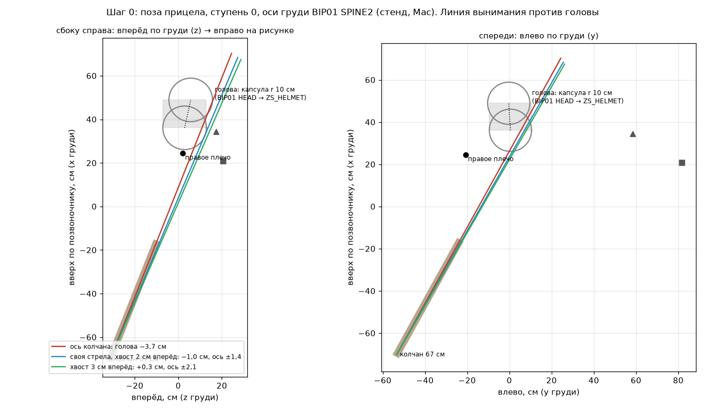

# Перезарядка из колчана — пилот

2026-11-05. Ветка `claude/quiver-reload`. Замысел, ключевые позы К0–К7 и приёмка — [исследование перезарядки](../2026-11-04-reload-from-quiver/README.md). Место колчана — [подвес](../2026-11-04-quiver-mount/README.md) и [уклонения](../2026-11-05-quiver-rolls/README.md).

**Статус (2026-11-11): круг 2 — свои клипы трёх ступеней сняты в игре, ждут приёмки пользователем по ролику (раздел «Круг 2» ниже).** Шаг 0 был остановлен: в позе прицела ось колчана, продолженная вверх, проходит сквозь правую половину корпуса; пользователь выбрал отклонение колчана в прицеле (шаг 1б).

## Круг 2 — клипы ступеней (2026-11-11)

Ветка влита с `main` (разнесённые `mdlvisual_*`, `testbench_*`, `npc_*`), черновик ключей от вечера 2026-11-05 вошёл в неё. Стенд — `lift.bench` и его укороченная копия (ступени 0–2 по две перезарядки, slowmo 4), Mac, лёгкая кожа, корень контента — рабочий контент игры плюс модель колчана и клипы. Перила — `rails.py` по 60 к/с игрового времени. Записи, ролик и таблицы — на хранилище `anim/2026-11-11-quiver-reload-r2/`.

**Что нашлось и что поправлено:**
- **Клипы были 25 к/с.** У быстрого лучника (ступень 2, ловкость 150, 575 мс) это 23 кадра; движок интерполирует между ними ломаной, и на остановках кисти скорость скачет на 30–50 см за кадр. Клипы теперь 50 к/с, длительности G2 те же (58 / 54 / 46 кадров).
- **Фазы.** Ступень 2 тратила на путь от колчана к луку 0,13 с (кисть до 12,8 м/с), а потом треть перезарядки стояла у тетивы. Полка (К5) у всех ступеней теперь на `p = 0,76`, тетива с 0,84 (`BowDraw::OwnShelf`, `StringFrom`). На наложение у самого быстрого лучника остаётся 104 мс, как требует замысел (не меньше 100). Ранние ключи ступеней 1–2 взяты со ступени 0: от уха перед подбородком, к правому боку, к колчану.
- **Старт клипа запоминался один раз за игру** (`ownStarted` не сбрасывался между перезарядками). Быстрый лучник начинал из точки первой перезарядки ступени 0: скачок 17 см в первом кадре. Теперь старт берётся заново в каждой перезарядке.
- **Колчан на линию вынимания поворачивался рывком.** При хвате он шёл из угла прицела (до 35°) на линию стрелы (20°) за первые 9 см хода, и кисть на поводке прыгала вместе с ним. Теперь поворот растянут на 40 см хода (`Quiver::LiftRamp`).
- **Поводок отпускался дважды.** Стрела, развёрнутая к луку, снова опускала остриё ниже плоскости устья (рядом с трубой), движок принимал это за «стрела в колчане» и снова вёл кисть за колчаном: 19–30 см за кадр. Теперь поводок, замороженный на выходе острия, держится до конца перезарядки. Перила `off_axis` считаются до первого выхода острия.
- **Подход к колчану** (К2) замедлен (`tension 0,35`), локоть на хвате и вынимании выше и наружу: предплечье вышло из бока.
- **Поворот кисти вокруг стрелы** выбирается по всей цепочке ключей (выворот запястья плюс поворот между соседями), а не жадно ключ за ключом: наибольший выворот 87° → 54°, скачков 90–180° между ключами нет.

**Перила, полный стенд** (худшее по дублю, см; `head_*`, `trunk_*` < 0 — внутри; прыжки — `|Δx(i) − Δx(i−1)|` кисти за 1/60 с):

| дубль | head_hand | trunk_hand | trunk_fore | trunk_arrow | off_axis | jump_K0 | jump_K2K3 | jump_aim | bd_nockgap |
|---|---|---|---|---|---|---|---|---|---|
| slow_A / slow_B (ступень 0) | 2,2 / 2,2 | 6,5 / 6,3 | −5,4 / −3,6 | 0,9 / −3,1 | 2,6 | 6,0 / 5,6 | 3,4 / 3,3 | 1,5 | 1,9 |
| fast_A / fast_B (ступень 2) | 7,4 / 7,4 | 4,4 / 5,5 | −5,5 / −5,8 | −1,6 / −3,0 | 2,7 | 10,3 / 10,2 | 15,3 / 15,1 | 7,3 | 6,7 |
| user_t0_game / side | 2,5 / 2,2 | −0,1 | −5,0 / −5,9 | −2,6 / −3,7 | 2,6 | 2,0 / 1,9 | 2,9 / 2,5 | 0,5 | 1,9 |
| до круга, первый прогон: slow_A / fast_A | −0,9 / −8,4 | −1,6 / −3,8 | −5,7 / −4,8 | −3,1 / −1,9 | 9,3 / 5,9 | 6,5 / 18,1 | 4,8 / 11,2 | 1,2 / 7,3 | 1,8 / 6,7 |
| перезарядка G2 на том же стенде: slow_A / fast_A | 0,7 / 5,0 | 6,0 / 9,1 | 4,7 / 7,1 | — | — | 1,3 / 0,6 | 0,3 / 1,4 | 15,2 / 8,5 | 1,8 / 6,7 |

Хват, стрела в руке и колчан на стрелу меньше — в один кадр. Колчан на вынимании: нога 0, полы до 0,95 см, линия стрелы в корпусе 0,5–3,5 см. Цена колчана в прицеле и перезарядке — как до круга: p95 44–60 мкс, наибольшая 111–118 мкс, один кадр 332 мкс в `up_t0`.

**Не выполнено (перила):**
- **Прыжки у быстрого лучника.** На К0 10 см, на хвате 15 см при пороге 5. Это ускорения пути в 575 мс: кисть проходит около 2,8 м. У ступени 0 — 3–6 см.
- **Предплечье у бедра на хвате** — до 5,9 см в мерке по точкам брони; глазом на кадрах не видно.
- **`bd_nockgap` 1,9 / 6,7 см** при пороге 1. С перезарядкой G2 на том же стенде то же самое: это конец перезарядки в прицеле, а не клип.
- **`manual-aim` до и после** не сверялся: клип не трогает линию выстрела, `BowDraw` ведёт кисть к тетиве по тем же правилам.

## Шаг 0 — замер до клипа

Стенд на Mac ([`bow-reload.bench`](../../../scripts/bench/bow-reload.bench), сейчас — только замер), герой в `ITAR_Leather_L`, лук `ItRw_Bow_L_01`, цель — NPC в 12 м, взгляд по горизонтали. Всё в осях груди `BIP01 SPINE2`: x — вверх по позвоночнику, y — влево, z — вперёд, см. Новые колонки `rq_*` пишет `BowDraw` (ниже, «Что уже сделано»).

| | ступень 0 | ступень 1 | ступень 2 |
|---|---|---|---|
| устье колчана `rq_m` | −15,7…−17,5; −21,4…−23,2; −9,7…−10,8 | −19,0…−19,7; −19,9…−20,8; −10,5…−11,1 | −18,9…−19,5; −20,1…−20,5; −10,5…−11,7 |
| ось ко дну `rq_a` | −0,83…−0,86; −0,38…−0,46; −0,33…−0,34 | −0,89…−0,90; −0,28…−0,32; −0,32…−0,33 | −0,89…−0,90; −0,30…−0,31; −0,32…−0,34 |
| голова `BIP01 HEAD` → `ZS_HELMET` | 36,1; 0,5; 2,9 → 48,9; −0,3; 5,7 | так же | так же |
| правое плечо `BIP01 R UPPERARM` | 24,5; −20,7; 2,1 | так же | так же |
| хват лука (середина кулака) | 20,7; 81,7; 20,7 | 18,1; 78,0; 30,8 | 17,8; 77,8; 31,1 |
| середина тетивы в покое | 34,3; 58,6; 17,5 | 29,0; 53,7; 26,6 | 28,7; 53,5; 26,8 |
| слот стрелы при натяжении | 35,0; 47,5; 11,5 | 28,4; 42,8; 20,4 | 28,0; 42,7; 20,5 |

Колчан по замеру стоит там же, где по коду `Quiver::fit`: офлайн-расчёт по скелету и `ARMOR_LEATHER_L.MDM` даёт устье −19,7; −20,2; −10,5 и ось −0,90; −0,29; −0,33. У ступени 0 устье по кадрам гуляет на 2 см, ось — на 3,5°.

**Стрела.** Меш `ITRW_ARROW` — 94 см: хвостовик в 23 см за слотом `ZS_RIGHTHAND`, остриё в 71 см перед ним. В колчане над устьем 28 см (оперение 3,5–23 см от хвостовика), остриё на 66 см ниже устья. Значит, ход до выхода острия — **66 см**, как и прикидывал бриф.

### Линия вынимания

Стрела идёт по оси колчана, пока остриё внутри: ход 66 см. Ось, продолженная вверх, наклонена к телу: дно колчана отведено на 20° назад и на 8° наружу, значит, верх смотрит вперёд и внутрь. Грудь в прицеле развёрнута боком к цели, и правый бок оказывается прямо над устьем.

- **Корпус.** Меш `ARMOR_LEATHER_L` поставлен в позу `S_BOWSHOOT` ступени 0. Точки оси проверены лучами по шести направлениям: внутри брони по всем шести — от **u = 16 до u = 50 см** над устьем. Это правый бок над тазом, подмышка, плечо у шеи. Глубина — до **9,7 см** до ближайшей вершины. Ступень 2 — то же.
- **Голова** (капсула `hd_*`: от `BIP01 HEAD` до `ZS_HELMET`, r 10 см): ось входит в неё на **3,3–3,8 см** у челюсти, около u = 60 см. Это 6–7 см перед суставом головы. Так у всех ступеней, в прицеле и в перезарядке G2 (по 23–90 кадров на сцену).
- **Когда.** Оперение покоящихся стрел торчит над устьем на 28 см, то есть верхние 12 см уже в зоне u > 16. При вынимании древко весь ход занимает отрезок от u = хват − 66 до u = хват + 23. Значит, от начала и до выхода острия часть стрелы внутри корпуса.
- **Лук** далеко: 47–54 см от линии.
- **Кисть и предплечье.** Вывод по слоту G2: стрела в руке лежит вдоль пальцев остриём от запястья. При острие вниз запястье выше хвата, поэтому кисть идёт по той же линии — через плечо.

Рисунки:
- схема без тела (в git): ;
- ось на силуэте брони, сбоку и спереди (меш Готики, вне git): `~/.codex/worktrees/claude-quiver-reload/clips/step0/axis-through-body.png`;
- кадры позы прицела из игры, спереди-справа и сзади, ступени 0–2: там же, `t*_hold_*.png`.

**Побочное наблюдение, требует проверки.** Раз ось входит в бок с u = 16, оперение стрел в колчане (до u = 28) в позе прицела, по расчёту, уходит в правый бок на 10–12 см. На кадрах сзади это не видно: бок в тени. В приёмке подвеса этот случай не мерили: `qv_armor` считает только трубу.

### Варианты

Без смены места и уступки колчана линию из тела не вывести.
- Стрела в трубе может отклониться от оси не больше чем на 3° (устье 11,5 см на 66 см хода).
- Наклон 1–3° по линии своей стрелы в веере снимает только челюсть: −1,0 см при 1,2°. Бок остаётся: там нужно 8–10 см.
- Перебор поворотов линии вокруг кольца: тело и голова чисты (тело ≥ 1 см, голова ≥ −1,5 см) только при повороте **от 20°**. Верх уходит назад и вправо: в осях груди 0,26; −0,43; −0,86.
- Поворот груди вокруг позвоночника не помогает: линия идёт через бок над тазом, а таз держит колчан.

Что можно выбрать — всё это решения пользователя:

| Вариант | Что меняет | Цена |
|---|---|---|
| **1. Колчан отклоняется, пока из него тянут.** На К2–К4 колчан поворачивается вокруг кольца верхом назад-наружу на ~20–22°, потом возвращается, как уступка. Так на деле качается колчан на поясе, когда из него рывком тянут стрелу | уступку колчана: сейчас до 12°, только на касания | дно колчана уходит вперёд-внутрь к ноге. Это проверяется теми же касаниями ноги, что в `quiver-mount` |
| **2. Другое место или наклон колчана навсегда.** Например, дно без наклона назад или наружу | место колчана, принятое 2026-11-04 | наклоны стояли ради ноги в беге и ходьбе: вернутся касания бедра |
| **3. Не «строго по оси».** Стрела выходит, как у G2, без хода 66 см: кисть берёт её у устья и сразу уводит в сторону | замысел пилота | стрела проходит сквозь стенку колчана и бок, пока остриё внутри |
| **4. Корпус на время хода отпускает прицел.** Наклон и поворот груди к колчану | «верх тела держит позу прицела», лук уходит с линии на 0,3–0,5 с | расчёт поворотом груди не нашёл угла до 40°, при котором бок свободен; нужен наклон в сторону, его не считал |

Рекомендую **1**: она ближе всех к жизни и не трогает принятое место. Числа для неё — после согласия: угол, время, касания ноги и полы.

## Шаг 1 — отклонение колчана: остановлен (2026-11-05)

Выбран вариант 1: колчан поворачивается за вынимаемой стрелой. Сборка `57a55c5e` (корпус считается по точкам брони с нормалями) прогнана стендом [`lift.bench`](lift.bench): оперение в прицеле на ступенях 0–2 с выключенным и включённым отклонением (`quiver lift off|on`) и по три перезарядки на ступенях 0 и 2. Корень контента — с моделью колчана. Кадры «было | стало» лежат вне git: `~/.codex/worktrees/claude-quiver-reload/clips/lift/`.

**Итог: условие остановки из брифа.** Угол упирается в предел 35°, и колчан не возвращается. Дело не в линии вынимания, а в **оперении покоящихся стрел**.

| | ступень 0 | ступень 1 | ступень 2 |
|---|---|---|---|
| оперение в корпусе по броне, `lift off` (было), см | 11,9 (до 12,1) | 11,6 (до 11,7) | 11,6 (до 11,7) |
| угол колчана в прицеле, `lift on`, ° | 35,0 (предел) | 35,0 | 35,0 |
| оперение в корпусе на 35°, см | 0,9 (до 1,0) | 0,6 (до 0,7) | 0,7 |

- **Какие точки держат.** Правый бок брони над тазом, от 16 до 28 см над устьем: в этой зоне стоит оперение (28 см над устьем, разброс хвостовиков — радиус 5 см). Это те же точки, что и в шаге 0. Чтобы вывести оперение, нужен поворот больше 35°: на пределе оно ещё в корпусе на 0,6–1,0 см. Удержание отпускает ниже 0,5 см, поэтому в прицеле колчан стоит **постоянно повёрнутым на 35°**, а это меняет принятый вид колчана.
- **Сама линия вынимания** чище: пока остриё внутри, угол 26–35°. Линия стрелы в корпусе — 0–5,6 см: подвод с 35° к цели вынимания идёт по ходу, а цель держится не на чистой линии. Наибольшее изменение за 1/60 с — 6,6°. Нога и полы во время поворота: бедро 0 см, полы до 0,9 см.
- **Возврата нет.** Остриё вышло, и колчан снова уходит на 35°, к оперению. Через 0,25 с там же — 35°.
- **`quiver-quick` против `origin/main`** (`5a7df9ba`, тот же Mac, тот же корень контента):
  - прицел (`*_aim`) во всех пяти бронях: 35°, было 0°;
  - **бег с луком** (`*_bowrun`): 29–35°, было 0°. Отклонение включается не только в прицеле, а пока лук в руках;
  - цена `qv_cpu` p95 в прицеле **272–591 мкс против 16–21** (бюджет — база плюс 2 мкс), в беге с луком 165–253 мкс;
  - в ходьбе, походках и беге без лука расходятся отдельные сцены (`q_bdt_relaxed`, `q_mil_relaxed`, `q_pal_walk` и другие: медиана угла +1…+5°, дно до 14–20 см). По-видимому, это перенос состояния после сцены с луком: возврат идёт как от земли. Подкрадывание и до правки менялось от прогона к прогону;
  - лучей по миру вне подкрадывания нет (было 24 кадра в `q_mil_run` на `main`).

Чего не делал: ключи, клипы, документы. Перила — ниже.

Перила `rails.py` по этому прогону, как есть (клипы — черновик шага 0, ничего не чинил). Худшее по дублю, см; «хват / стрела / колчан −1» — номера кадров 60 к/с от начала перезарядки. Конец натяжения (`bd_*`) скрипт в этом прогоне не нашёл.

| дубль (перезарядки) | head_hand | head_fore | head_arrow | trunk_hand | trunk_fore | trunk_arrow | off_axis | jump_K0 | jump_K2K3 | jump_K7 | jump_aim | quiver_step_max | quiver_flaps_max | quiver_leg_max | хват / стрела / колчан −1, кадр |
|---|---|---|---|---|---|---|---|---|---|---|---|---|---|---|---|
| slow_A (3) | -6,6 | -6,6 | 9,1 | -3,1 | -6,8 | -8,9 | 5,6 | 6,6 | 5,8 | 0,2 | 1,4 | 5,2 | 0,9 | 0,0 | 27/30/30 |
| slow_B (3) | -6,6 | -6,6 | 9,2 | -3,1 | -7,7 | -8,7 | 3,6 | 6,5 | 6,5 | 0,1 | 1,3 | 6,6 | 0,9 | 0,0 | 27/30/30 |
| fast_A (3) | 5,4 | 5,4 | 23,8 | 0,8 | -3,5 | -8,2 | 3,3 | 21,4 | 10,1 | 0,4 | 7,4 | 3,1 | 0,9 | 0,0 | 12/14/14; 13/14/14 |
| fast_B (3) | 5,3 | 5,3 | 23,4 | 0,9 | -4,1 | -7,6 | 3,3 | 21,5 | 10,1 | 0,3 | 7,3 | 4,9 | 0,9 | 0,0 | 12/14/14; 13/14/14 |

Варианты (решает пользователь):
1. **Отклонять только на время вынимания, оперение в прицеле оставить в боку.** Колчан в покое, как принят, а 12 см оперения скрыты в боку, в тени. Отклонение 26–31° только на ходе стрелы, потом возврат. Нужно убрать запуск по оперению и ограничить отклонение перезарядкой.
2. **Принять постоянный поворот в прицеле и поднять предел** выше 35°, чтобы оперение вышло целиком. Вид колчана в прицеле меняется: дно уходит вперёд и внутрь, на кадрах сзади это видно сразу.
3. **Стрелы ниже в колчане** (меньше 28 см над устьем) — это раскладка стрел, то есть модель колчана. По брифу её не трогаю.

В любом варианте: подсчёт отклонения в прицеле (перебор угла с полным счётом по ~360 точкам брони каждый кадр) надо сделать дешёвым, а в беге с луком — выключить.

### Шаг 1б — отклонение, пока лук в прицеле (решение пользователя 2026-11-05)

Замысел: лучник поднимает лук и разворачивает грудь, правый бок уходит назад и отжимает оперение, колчан откидывается на кольце. Лук опущен — колчан возвращается. Вынимание начинается уже с откинутого колчана.

**Как работает** (`Quiver::step`, `MdlVisual::updateQuiver`):
- **Когда.** Только в стойке прицела: лук поднят (`S_BOWAIM`, `S_BOWSHOOT`, `T_BOWRELOAD`, переходы `T_BOWWALK_2_BOWAIM`, `T_BOWRUN_2_BOWAIM`, `T_BOWAIM_2_BOWSHOOT`) и герой не шагает с луком (`Npc::aimWalk`). Разрывы между анимациями до 0,15 с держат прошлую цель. Выключатель стенда — `quiver lift off`.
- **Сколько.** Наименьший поворот, при котором оперение (27 см над устьем, разброс хвостовиков — радиус 5 см) не глубже 0,75 см в корпусе по точкам брони. Ищется делением пополам в пределах 45° по направлению:
  - при входе в прицел — кольцо из восьми направлений;
  - дальше — прошлое направление и по очереди один сосед ±11°; сосед берётся, только если ниже на 2°.
- **Когда пересчёт.** Не каждый кадр. Каждый кадр — одна оценка на текущей цели и одна на 3° ниже:
  - цель глубже 1,25 см — пересчёт в окне ±4° от прошлой;
  - на 3° ниже чисто 0,4 с подряд — пересчёт вниз.

  Расчёт берёт только точки брони у плоскости, в которой лежат все оси этого направления.
- **Как идёт.** За целью — критически затухающий фильтр, 90 % за 0,1 с, не быстрее 6° за 1/60 с. Лук опущен — тот же фильтр, что от земли: 90 % за 0,25 с, без перелёта. Через 0,5 с или ближе 1° к цели уступки колчан снова в обычной уступке, без скорости и остатка.
- **Вынимание.** На старте вынимания ищется линия стрелы: 95 см, чиста от корпуса и головы на 1 см. Поиск идёт от направления прицела и двух соседей. Если клип уводит голову или плечо и линия становится глубже, она ищется снова. Колчан выходит на линию за первые 9 см хода, держит её, пока остриё внутри, потом фильтром 0,1 с возвращается к углу прицела.
- **Мерка корпуса.** `trunkGap` берёт три ближайшие точки брони и считает самую внешнюю из их глубин. Снаружи плоскости точки зазор не меньше расстояния до неё минус 2,5 см. Прежняя мерка по одной точке давала ложные скачки 0 → 7 см при сдвиге оси на 0,2°: плоскость дальней точки под скользящим углом.

**Стенд** [`lift.bench`](lift.bench) на Mac, лёгкая кожа, корень контента с моделью колчана; разбор по 60 к/с игрового времени.

| | ступень 0 | ступень 1 | ступень 2 |
|---|---|---|---|
| оперение в корпусе, лук поднят и держится, `lift off` (было), см | 12,0 | 11,4 | 11,6 |
| то же с отклонением (стало), см | 0,0 (до 5,0 в одном кадре) | 0,3 (до 0,4) | 0,4 (до 0,6) |
| угол в прицеле, ° | 30 (в перезарядках 35) | 24–27 | 24–25 (в перезарядках 35) |
| оперение в прицеле, весь прицел с перезарядками, p95, см | 1,0–1,2 (`slow_*`) | 1,2 (`up_t1`) | 1,0–1,2 (`fast_*`) |
| наибольшее изменение за 1/60 с, ° | 4,7 | 4,7 | 4,7 |
| возврат после опускания лука: доля пути через 0,25 с, перелёт | 89–92 %, 0 | 92 %, 0 | 92 %, 0 |
| вынимание: угол, ° | 19,7–32,3 | 33,8–35,5 (`up_t1`, вне замедления) | 23,2–32,5 |
| вынимание: линия стрелы в корпусе и голове, см | 0,7–4,1 | до 7,7 (`up_t1`) | 0–3,0 |
| вынимание: бедро / полы, см | 0 / 0–0,9 | 0 / 0,9 | 0 / 0,9 |
| после выхода острия через 0,25 с, ° (угол прицела) | 35,1 (35,2) | 27,4 (27,4) | 35,1 (35,2) |
| `qv_cpu` в прицеле и перезарядке, p95 / наибольшая, мкс | 40–46 / 119 | 39–50 / 135 | 36–44 / 118 |

Кадры «было | стало», ступени 0 и 2, сзади и спереди-справа, и клип (лук поднят, выстрел, перезарядка, лук опущен; камера игрока и сбоку; в реальном времени и вдвое медленнее, 1280×720, 60 к/с) лежат в `~/.codex/worktrees/claude-quiver-reload/clips/lift/v2/`.

**`quiver-quick` против `origin/main`** (`5a7df9ba`, сборка в `/tmp/qr/mainwt`, тот же Mac и корень контента):

| | прицел | шаг с поднятым луком | ходьба, походки, бег | подкрадывание |
|---|---|---|---|---|
| угол, медиана, ° | 0 → 30 / 45 / 27 / 27 / 40 (кожа / `BDT_H` / `MIL_M` / `PAL_H` / `KDF_H`) | 0 → 0 | как на `main` | как на `main` |
| дно, наибольшая разница, см | — | 0,9–1,3: первые кадры, возврат из прицела | с `quiver lift off` против `lift on` ≤ 0,14 (одна сцена 0,49) | меняется от прогона к прогону и без правки |
| лучи по миру | 0 | 0 | 0 | как на `main` |
| `qv_cpu` p95 / наибольшая, мкс | 47–84 / 108–171 (`main` 16–21) | 16–22 (`main` 15–21) | в пределах ±3 от `main` | в пределах разброса |

Против самой `main` ходьба и походки расходятся в отдельных сценах (`q_bdt_relaxed`, `q_mil_relaxed`, `q_pal_walk`, дно до 14–20 см). Это не перенос состояния: с `quiver lift off` они те же до сотых. Расходится база ветки (`349fde92`) с новой `main`, и это не отклонение.

**Не выполнено и ограничения:**
- **`ITAR_BDT_H`: 45° не хватает.** Оперение в корпусе без отклонения 10,9 см; на пределе остаётся 3,2 см (медиана), p95 7,2. Это условие остановки брифа — числа для пользователя. Остальные брони выходят на 27–40°.
- **Цена в прицеле `BDT_H`** p95 84 мкс при бюджете 70. На пределе каждый кадр идёт пересчёт, а он ничего не находит. Остальные брони — p95 47–67, наибольшая 108–171 (≤ 200).
- **Короткие всплески оперения** — 100–200 мс:
  - вход в прицел: до 10,9 см в первом кадре, ≤ 1,5 см через 100–250 мс (350–450 мс в клипе);
  - рука перезарядки идёт к колчану (p 0,28–0,39);
  - одно качание позы.

  Всё это время колчан догоняет грудь на пределе 6° за 1/60 с.
- **Вынимание вне замедления** (`up_t*`, 30 к/с окна): линия стрелы в корпусе и голове до 7,7 см. Вынимание длится 2–6 кадров, колчан не успевает на линию за 6° за кадр. При 60 к/с (`slow_*`, `fast_*`) — 0–4,1 см.
- `Quiver::liftRef` в заголовке больше не опора. `liftRef[0].x` и `liftRef[1].x` держат таймеры опускания и возврата: заголовок в этом ходе не трогал, переименовать при следующей правке.

Перила `rails.py` на этом прогоне, как есть (клипы — черновик, их правка — следующий ход):

| дубль (перезарядки) | head_hand | head_fore | head_arrow | trunk_hand | trunk_fore | trunk_arrow | off_axis | jump_K0 | jump_K2K3 | jump_K7 | jump_aim | quiver_step_max | quiver_flaps_max | quiver_leg_max |
|---|---|---|---|---|---|---|---|---|---|---|---|---|---|---|
| slow_A (3) | -6,6 | -6,6 | 9,2 | -3,1 | -7,6 | -8,7 | 3,8 | 7,1 | 4,6 | 0,1 | 1,3 | 6,1 | 0,0 | 0,0 |
| slow_B (3) | -6,6 | -6,6 | 9,2 | -3,1 | -7,8 | -8,9 | 3,8 | 7,1 | 4,5 | 0,1 | 1,3 | 6,1 | 0,0 | 0,0 |
| fast_A (3) | 5,2 | 5,2 | 17,8 | 6,5 | -4,5 | -7,6 | 3,3 | 21,5 | 10,4 | 0,4 | 7,4 | 6,1 | 0,0 | 0,0 |
| fast_B (3) | 5,2 | 5,2 | 19,5 | 6,0 | -4,0 | -7,7 | 3,3 | 21,6 | 10,5 | 0,3 | 7,5 | 6,1 | 0,0 | 0,0 |
| user_t0_game (1) | -6,4 | -6,4 | 9,2 | -3,9 | -5,8 | -7,5 | 2,6 | 5,4 | 2,8 | 0,1 | 0,3 | 5,7 | 0,9 | 0,0 |
| user_t0_side (1) | -6,4 | -6,4 | 3,3 | -3,1 | -3,1 | -8,2 | 2,6 | 5,4 | 2,1 | 0,2 | 0,3 | 2,0 | 1,0 | 2,1 |

## Что уже сделано (код, без клипов)

Без своих клипов в контенте игра ведёт себя как раньше: подмены нет, перезарядка — G2.

- **Выключатель и подмена.** Свои записи называются `T_BOWRELOADQ` в оверлеях `HUMANS`, `HUMANS_BOWT1`, `HUMANS_BOWT2`. Если `OPENGOTHIC_QUIVERRELOAD` не `0` и такая запись есть, `Animation::setupIndex` ставит её на место `T_BOWRELOAD` и помечает `ownReload`. Темп по ловкости (`setAnimSpeed`), решатель, проверки `animProgress` и события работают без правок. С `=0` играет перезарядка G2.
- **`BowDraw` со своим клипом.**
  - `hold` держит позвоночник и лучную руку.
  - Правая рука от ключицы и голова идут по клипу относительно шеи. Поворот рук от `Aim` рука теряет к хвату и берёт снова к луку.
  - Старт клипа подводится к тому, где была кисть после выпуска; подвод гаснет к хвату.
  - С К1 по К4 кисть ведётся к колчану как он висит: живой кадр `Quiver::frameNow` против колчана клипа `Quiver::reloadFrame` (кольцо на 21 см, лёгкая кожа). Так учтены уступка, поворот и вынос под броню.
  - С `StringFrom` кисть доводится к тетиве, как сейчас.
  - `grabHand`, `GrabAt` и `MinReach` для своего клипа не работают.
- **Колчан на одну меньше.** На `MUNITION_PLACE` своего клипа — `setQuiverTaken(1)`. На выстреле, когда стрела списана, и когда стрелу убрали из руки — `0`.
- **Колонки стенда `rq_*`.** Устье и ось колчана, голова, плечо, хват лука, тетива, слот, хвостовик и остриё стрелы, предплечье — в осях груди. Зазоры кисти, предплечья и стрелы до корпуса (эллиптический цилиндр от таза до груди +15 см, 15 × 11 см) и до трубы колчана. Глубина острия под устьем и отход стрелы от оси.
- **Генератор** [`reload_quiver.py`](../../../scripts/content/anim/reload_quiver.py) с набором [`reload-quiver.json`](../../../scripts/content/anim/reload-quiver.json) — черновик. Ключи кисти в осях груди, путь — отрезки Эрмита, ход вынимания — прямая по оси, IK на каждый кадр, слот стрелы скользит в руке. Ключи ещё не пересчитаны под замер: они ждут выбора варианта линии.

## Не сделано (на 2026-11-05; круг 2 — выше)

После решения по линии:
- таблица ключей К0–К7 по трём ступеням;
- клипы и стенд «было | стало»;
- перила по кадрам 60 к/с;
- сверка `manual-aim`;
- раздел «Как работает сейчас» в `docs/manual-aim.md`.

Замечено: первый прогон замера с целью `aimat ahead` завис через 25 с, после выстрела в землю (`arrow stuck world`), а видео оборвалось. С целью-NPC прогон прошёл. На чистой `main` не проверял.
