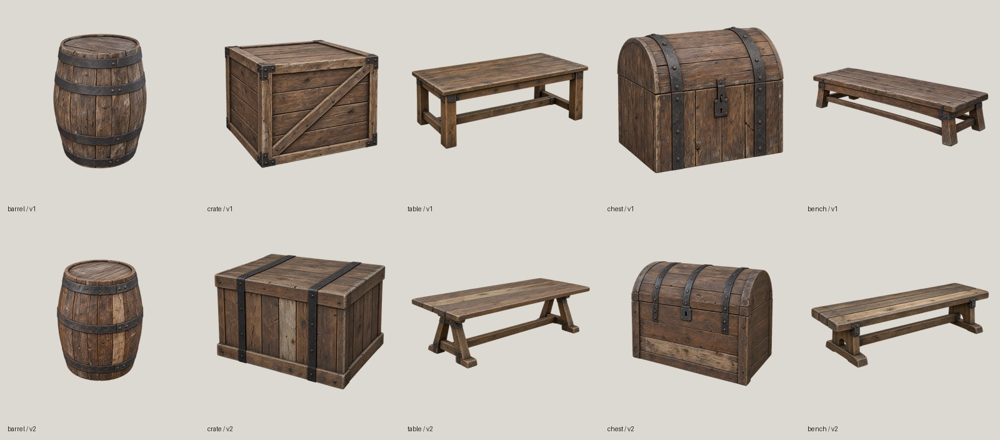

# Цели и концепты пилота 3D

## Бочка с материалами этапа 1 — остановлено на обработке

20.10.2026: три исходника получены встроенным `image_gen` по тексту и библии стиля, без оригинальных пикселей или вершин. Промпты, SHA-256, параметры фильтра и поправки цвета — записи `mesh3d-barrel-{wood-stave,wood-head,iron-band}` в [реестре](../../../data/content/registry.jsonl). PNG лежат в `~/.local/share/gothic-ai/content-sources/mesh3d-barrel-demo/`; копии в `dev-ubuntu:~/gothic-ai/content-backup/sources/mesh3d-barrel-demo/` совпадают по всем трём SHA-256. Сида и версии модели инструмент не раскрывает.

[Численный декодер](../../../scripts/content/mesh3d/barrel-material-measures.cpp) нашёл в MRM текстуру `NW_CITY_BARREL_01.TGA` (128 × 128). Общая функция `material-measures.h` считает OKLab от среднего линейного RGB видимых пикселей (alpha ≥128), яркость — `0.2126 R + 0.7152 G + 0.0722 B`. Бок занимает U <0,2; железо — строки [0,10), [28,42), [84,94), [116,128), выбранные по численному профилю R/G; днища — UV-маска горизонтальных треугольников вне боковой полосы. Из декодера выходят только числа.

| Ключ зоны | Пиксели | Целевой средний OKLab | Линейная яркость | Плитка / масштаб UV |
|---|---:|---|---:|---|
| `OWN_PROP_WOOD_STAVE` | 2132 | 0,277033203; 0,004256306; 0,017653306 | 0,021159043 | 0,38 м / 2,631578947 |
| `OWN_PROP_WOOD_HEAD` | 10231 | 0,236893477; 0,004448137; 0,016465847 | 0,013212124 | 0,38 м / 2,631578947 |
| `OWN_PROP_IRON_BAND` | 1196 | 0,297321699; −0,003922001; 0,018072904 | 0,026444262 | 0,20 м / 5 |

Деревянные плитки содержат четыре доски шириной 9,5 см, волокно вдоль V. Железо — сплошная мелкая кованая фактура для обруча шириной около 5 см. CPU-фильтр `generate.corrected_maps` / `bakeoff.filtered_maps` после шва `seam_fix` дал по шесть карт 1024²; максимальная ошибка среднего канала линейного RGB — 0,000017 при допуске 0,005. У железа metallic=1 на металле и 0 на цветовой маске ржавчины (33,31%); у дерева 0. `pack_materials.pack_set` собрал 9 DDS и отдельный индекс `~/.local/share/gothic-ai/content-staging/mesh3d-barrel-demo/materials/materials.json`, ключи с `.TGA` для загрузчика; GLB должен сохранять имена зон без расширения. Антиповтор выключен. Карты PNG — в `maps/<ключ_зоны_строчными>/` того же staging. Рабочий контент и папки пилота текстур не менялись.

**Показ заблокирован:** два корректно подготовленных `run-ryzen.sh postprocess` на Ryzen через `gq batch` дали для TRELLIS v1 **89 818**, затем **69 914** треугольников вместо бюджета **1 500** из 1 016 258 входных. Между попытками исправлено назначение stave/head: по нормали поверхности, а не оттенкам дерева; чистая проверка — 61 passed. SHA-256 NPZ и target совпали на Mac/Ryzen; отдельные метаданные `{"up_axis":"+Z","meters_per_unit":1}` исправляют несовпадающий формат метаданных генератора. Оба отказа бюджета возникли в `decimate()` до экспорта. По стоп-правилу продолжение остановлено, параллельная первая обработка TRELLIS.2 512 (5 700 976 входных треугольников) отменена. Папка задачи на Ryzen — `~/gothic-ai/mesh3d-barrel-demo/`; launcher запускается с `MESH3D_REMOTE_ROOT` на неё.

Проверки: `check-blender.sh` — **61 passed**, `check-concepts.sh` — **110 passed**, реестр — **201 рецепт / 251 исходник**. Исходный `BENCH_HOST=ryzen scripts/bench.sh own-mesh-barrel` завершён с кодом 0: PNG 800 × 600, census открыл оригинальный MRM 1 раз, подмен 0. GLB не созданы: glTF Validator, рендер четырёх колонок и игровой прогон с тремя подменами не выполнены; `barrel-materials.jpg` и `barrel-game.jpg` отсутствуют. Следующий шаг требует разрешения продолжить исправление упрощения меша после двух отказов; сравнение с Tripo пока не состоялось.

## Цели и концепты

Пилот запущен пользователем 2026-10-20 по [конвейеру этапа 2](../2026-10-3d-generators/README.md#конвейер). Готовы пять численных целей и по два концепта для TRELLIS.2 / TRELLIS. Выбор варианта остаётся за пользователем.

Размеры — метры в пространстве glTF: X отражён, +Y вверх, сантиметры поделены на 100. Порядок габаритов: X × Y × Z (ширина × высота × глубина). Частота — число экземпляров визуала во всём `NEWWORLD.ZEN`, не только внутри города. Полная точность, разрешённые файлы моделей и будущие ключи материалов — в [mesh3d-pilot.json](../../../data/content/mesh3d-pilot.json).

| Предмет | Визуал | Тип | Габариты, м | Треугольники / бюджет | Экземпляры |
|---|---|---|---|---:|---:|
| Бочка | `NW_HARBOUR_BARREL_01.MRM` | статичный MRM | 0,798436 × 1,107830 × 0,798436 | 60 / 1500 | 150 |
| Ящик | `NW_HARBOUR_CRATE_01.MRM` | статичный MRM | 1,200000 × 1,000000 × 1,000000 | 12 / 1500 | 105 |
| Стол | `NW_CITY_TABLE_PEASANT_01.MRM` | статичный MRM | 2,000000 × 0,900000 × 1,200000 | 44 / 3000 | 52 |
| Сундук | `CHESTBIG_NW_NORMAL_LOCKED.MDS` → `.MDL` | модель MOB, закрытая `S_S0` | 0,842117 × 0,774676 × 0,648678 | 66 / 3000 | 43 |
| Лавка | `BENCH_NW_CITY_01.ASC` → `.MDL` | модель MOB, bind pose | 2,000000 × 0,500209 × 0,756460 | 64 / 3000 | 43 |

| Предмет | bbox_min, м | bbox_max, м | Origin внутри bbox, доли X/Y/Z |
|---|---|---|---|
| Бочка | −0,398563; −0,558895; −0,400131 | 0,399873; 0,548935; 0,398305 | 0,499179; 0,504495; 0,501143 |
| Ящик | −0,600010; −0,499990; −0,499990 | 0,599990; 0,500010; 0,500010 | 0,500008; 0,499990; 0,499990 |
| Стол | −1,000010; −0,449990; −0,599990 | 0,999990; 0,450010; 0,600010 | 0,500005; 0,499989; 0,499992 |
| Сундук | −0,418043; 0,000005; −0,297961 | 0,424074; 0,774681; 0,350717 | 0,496419; −0,000006; 0,459336 |
| Лавка | −1,000000; −0,000054; −0,378126 | 1,000000; 0,500155; 0,378333 | 0,500000; 0,000108; 0,499863 |

`origin_in_bbox = (0 − bbox_min) / (bbox_max − bbox_min)` по каждой оси: 0 — нижняя граница, 1 — верхняя. У статичных предметов origin около центра, у MOB — у основания; значения не зажимаются в 0–1. Bbox считается по используемым вершинам полной детализации, треугольники — по всем submesh. У MOB учтены иерархия и привязки частей; у сундука применён единственный кадр закрытой `S_S0`. Смещение корня выбранного сундука нулевое. Отличие bbox бочки от сохранённого bbox PR #309 — менее 0,00000004 м.

Бочка, ящик и стол предназначены для последующей игровой подмены; сундук и лавка пока проверяют только форму. Зоны `WOOD` / `METAL` описывают материалы: клёпки/доски/опоры и обручи/оковка/крепёж. Три зоны бочки получили отдельный staging выше; рабочий `materials.json` не менялся.

Все десять английских промптов сохранены в [реестре](../../../data/content/registry.jsonl), записи `mesh3d-pilot-<id>-v1/v2`, `kind: concept`. Пропорции заданы словами, метрами и отношением X:Y:Z; палитра и износ следуют [библии стиля](../../../docs/content-style.md). Генератор получил только текст, без оригинальных имён, изображений, геометрии или снимков. Инструмент — `image_gen.imagegen`; внутренняя модель/версия и seed не раскрываются, revision и seed — `null`, UTC записан у каждого концепта.

PNG сохранены побайтно в `~/.local/share/gothic-ai/content-sources/mesh3d-pilot/`, копия — `dev-ubuntu:~/gothic-ai/content-backup/sources/mesh3d-pilot/`. Все 10 SHA-256 совпадают. Доля полностью прозрачных пикселей (`alpha=0`) — 31,52–71,38%; видимый предмет (`alpha≥128`, порог библии стиля) не касается краёв. Незаметный шум alpha=1 сохраняется в исходных байтах. Для двух бочек сделано по одному повтору с широким полем; остальные восемь концептов получены с первого вызова. Всего 12 вызовов, дальнейших кругов нет.

Проверка: `sh scripts/content/mesh3d/check-concepts.sh` — **110 passed** на Mac, без GPU, сети и архивов игры. Нужны C++20 и `uv` в PATH. Интерпретатор можно выбрать через `PYTHON`; если у него или у системного `python3` нет pytest, скрипт сам запускает `uv run --offline --with pytest --with pillow --with numpy python -m pytest` с зависимостями из кэша. При пустом кэше проверка явно завершается ошибкой без обращения в сеть. Первый общий запуск: 109 passed, 1 failed из-за одинаковых ID в фикстуре; после исправления — 110 passed. Реальный численный декодер отдельно собран против ZenKit и измерил все пять оригиналов. [measure_targets.py](../../../scripts/content/mesh3d/measure_targets.py) повторяет измерение; [concepts.py](../../../scripts/content/mesh3d/concepts.py) импортирует неизменный PNG, CLI вызывает прежний `backup-sources.sh`, команда `sheet` пересобирает JPG из постоянных исходников. Модели 3D и обработка Blender относятся к следующим задачам.
