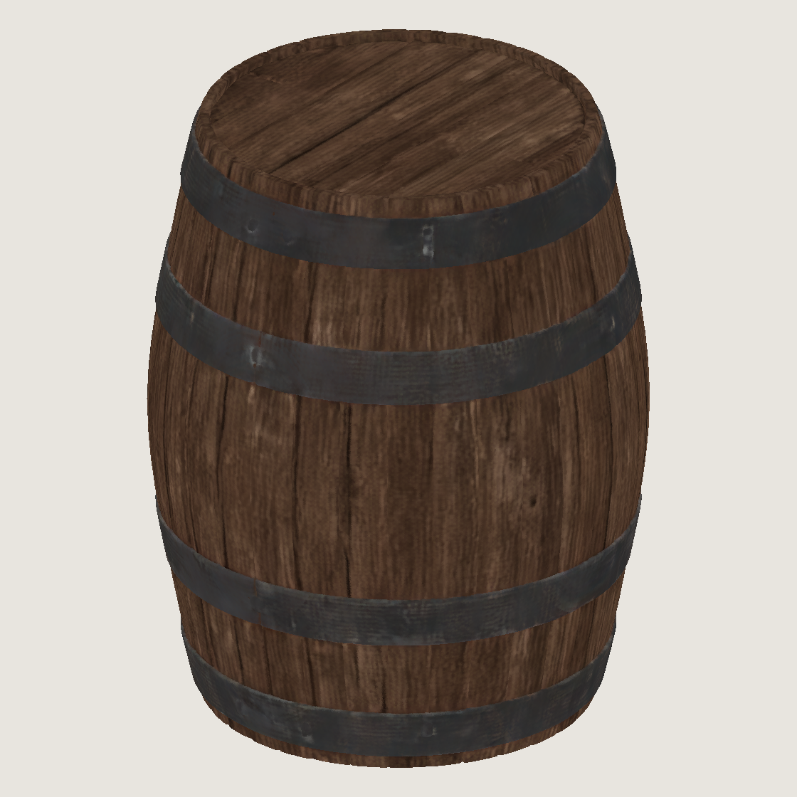

# Генерация 3D: пакетный пилот и проба бочки

## Пакетный пилот 10 × 2 × 2: результат

2026-10-20, одно окно на dev-ubuntu (RTX 3090 24 ГБ): **Сохранён 21 вариант из 40 — все 20 TRELLIS v1 и первый TRELLIS.2 512.** Второй вызов TRELLIS.2 завершился cgroup OOM (SIGKILL, exit 137); остальные 18 сочетаний этой модели не запускались после гибели процесса. Ниже учтены все 40 сочетаний, включая каждую неудачу и пропуск. Повторных инференсов после OOM не было.

**Gemma и Decider восстановлены и отвечают. Простой — 424/469 с, общий интервал 469 с (7 мин 49 с), меньше разрешённых 3600 с.** Voxtral/VoxCPM не останавливались: PID 556920/3359086 остались прежними. Итоговые ответы Gemma `/v1/models`, Decider, Voxtral `/health`, VoxCPM — HTTP 200/426/200/426; все четыре юнита active. Занято GPU до и после окна — 18 981 MiB, с остановленными Gemma/Decider — 6944 MiB. Чужие процессы, контейнеры и настройки машины не менялись.

Все **21/21 `raw.npz`** скопированы на Mac в `~/.local/share/gothic-ai/content-staging/mesh3d-pilot/batch/<concept-stem>/<model>-s<seed>/` вместе с `meta.json`, `memory.jsonl` и `batch.jsonl`; SHA-256 совпали с dev-ubuntu для каждого файла. Модели в путях — `trellis` и `trellis2` (всегда 512). Суммарно NPZ — **310 713 155 байт**, 10 652 209 вершин и 21 644 200 треугольников. CPU-проверка 21/21: типы и поля соответствуют контракту, все числа finite, индексы допустимы, атрибуты 0…1, счётчики совпадают с метаданными.

### Условия окна и восстановление

```sh
pgrep -lx Gothic2Notr || echo no game
bash scripts/content/mesh3d/run-mesh3d.sh \
  --batch --max-downtime 3600 --authorization pilot-20261020-batch-60m
```

Обе проверки Mac дали `no game`. Перед остановкой сервисов проверены общий `~/gothic-ai/materials/gpu.lock`, фактический отдельный cgroup scope `MemoryMax=20G`, `MemorySwapMax=0`, `memory.oom.group=1` и **MemAvailable 26 822 348 KiB = 25,580 ГиБ ≥ 24 ГиБ**. Порог 24 ГиБ уточнён пользователем для неизменного лимита 20 ГиБ; освобождать чужую память не потребовалось. Все 10 PNG из `content-sources/mesh3d-pilot/` переданы без изменений, SHA-256 входов 10/10 совпали с Mac.

Run ID: `20261020T131753Z-pilot-20261020-batch-60m-32728`. Серверные файлы — `~/gothic-ai/mesh3d/runs/<run-id>/batch/`. Каждая модель загружена один раз в отдельном процессе, порядок v1 → TRELLIS.2 512. Каскад 1024 не запускался. Метка `pilot-20261020-batch-60m` израсходована одним окном; `authorizations/<метка>.tsv` учитывает этот простой отдельно от прежних 592 с в `downtime.tsv`.

| Событие | UTC |
|---|---|
| Preflight; scope 20 ГиБ / swap 0, MemAvailable ≥24 ГиБ | 13:17:54 |
| Gemma и Decider stop-request | 13:17:55 |
| v1 start | 13:17:56 |
| v1 завершён, exit 0; TRELLIS.2 512 start | 13:22:48 |
| TRELLIS.2 cgroup OOM, exit 137 | 13:24:52 |
| Оба сервиса получили start из trap | 13:24:53 |
| Gemma отвечает; простой 424 с | 13:24:59 |
| Decider отвечает, окно закрыто; простой 469 с | 13:25:44 |

В этом прогоне готовность служб проверялась последовательно. После ревью F1 launcher фиксирует первый успешный ответ каждой службы независимой проверкой; исторические значения 424/469 с сохранены без пересчёта.

На генерацию отведено максимум 2970 с от первого stop-request, затем до 10 с на принудительное завершение и до 15 с на остановку scope — до 3000-й секунды. Последние 600 с разрешения зарезервированы восстановлению. Фактически процесс генерации завершился через 417 с от первого stop-request; восстановления обоих сервисов дождались через 469 с.

### Секунды, память и треугольники по всем вариантам

`Всего` — `meta.seconds`; `Инференс+raw` — `inference_seconds`, включая преобразование атрибутов, сохранение и CUDA sync, без загрузки общей модели. Первая загрузка v1 заняла **15,302 с**, TRELLIS.2 — **38,344 с**; первый инференс также включает прогрев. Загрузка не повторялась. RSS* — high-water mark за жизнь процесса, поэтому последующие варианты наследуют достигнутый максимум. Пики torch allocated/reserved сбрасывались перед каждым вариантом. Память в MiB.

Для убитого варианта `≥` означает последнее сохранённое значение, а не гарантированный финальный пик/полную длительность. `—` означает, что измерения нет: вариант не запускался или не успел завершиться.

#### TRELLIS v1

| Концепт | Сид | Итог | Всего, с | Инференс+raw, с | RSS*, MiB | torch allocated, MiB | torch reserved, MiB | Треугольники |
|---|---:|---|---:|---:|---:|---:|---:|---:|
| barrel-v1 | 1 | ok | 50.818 | 35.452 | 5775.336 | 10776.698 | 15422.000 | 1016258 |
| barrel-v1 | 2 | ok | 13.883 | 13.812 | 5775.336 | 10888.696 | 15874.000 | 1065350 |
| barrel-v2 | 1 | ok | 12.166 | 12.085 | 5775.336 | 10317.516 | 13896.000 | 1019184 |
| barrel-v2 | 2 | ok | 14.134 | 14.062 | 5775.336 | 10907.360 | 15938.000 | 1083776 |
| bench-v1 | 1 | ok | 7.523 | 7.457 | 5775.336 | 9588.140 | 11474.000 | 224176 |
| bench-v1 | 2 | ok | 7.527 | 7.463 | 5775.336 | 9570.375 | 11414.000 | 241092 |
| bench-v2 | 1 | ok | 7.555 | 7.490 | 5775.336 | 9576.445 | 11434.000 | 298540 |
| bench-v2 | 2 | ok | 7.511 | 7.444 | 5775.336 | 9575.091 | 11414.000 | 294432 |
| chest-v1 | 1 | ok | 17.865 | 17.782 | 5775.336 | 11263.591 | 16630.000 | 1111548 |
| chest-v1 | 2 | ok | 16.239 | 16.173 | 5775.336 | 11347.459 | 16058.000 | 1170942 |
| chest-v2 | 1 | ok | 14.210 | 14.125 | 5775.336 | 11300.283 | 16098.000 | 928602 |
| chest-v2 | 2 | ok | 14.043 | 13.961 | 5775.336 | 10982.877 | 15406.000 | 945378 |
| crate-v1 | 1 | ok | 19.359 | 19.281 | 5775.336 | 12286.673 | 16372.000 | 1510538 |
| crate-v1 | 2 | ok | 20.572 | 20.502 | 5775.336 | 12425.730 | 16454.000 | 1509388 |
| crate-v2 | 1 | ok | 13.756 | 13.683 | 5775.336 | 10537.375 | 14806.000 | 1026392 |
| crate-v2 | 2 | ok | 15.818 | 15.747 | 5775.336 | 11098.547 | 15894.000 | 1040360 |
| table-v1 | 1 | ok | 8.391 | 8.322 | 5775.336 | 9744.201 | 12154.000 | 340848 |
| table-v1 | 2 | ok | 8.622 | 8.557 | 5775.336 | 9806.098 | 11782.000 | 481516 |
| table-v2 | 1 | ok | 7.994 | 7.920 | 5775.336 | 9645.233 | 11718.000 | 332212 |
| table-v2 | 2 | ok | 7.676 | 7.606 | 5775.336 | 9639.208 | 11698.000 | 302692 |

#### TRELLIS.2 512

| Концепт | Сид | Итог | Всего, с | Инференс+raw, с | RSS*, MiB | torch allocated, MiB | torch reserved, MiB | Треугольники |
|---|---:|---|---:|---:|---:|---:|---:|---:|
| barrel-v1 | 1 | ok | 94.217 | 55.792 | 16662.570 | 3681.776 | 5322.000 | 5700976 |
| barrel-v1 | 2 | oom_kill | ≥27.369 | — | ≥20559.344 | ≥3592.374 | ≥5796.000 | — |
| barrel-v2 | 1 | not_run | — | — | — | — | — | — |
| barrel-v2 | 2 | not_run | — | — | — | — | — | — |
| bench-v1 | 1 | not_run | — | — | — | — | — | — |
| bench-v1 | 2 | not_run | — | — | — | — | — | — |
| bench-v2 | 1 | not_run | — | — | — | — | — | — |
| bench-v2 | 2 | not_run | — | — | — | — | — | — |
| chest-v1 | 1 | not_run | — | — | — | — | — | — |
| chest-v1 | 2 | not_run | — | — | — | — | — | — |
| chest-v2 | 1 | not_run | — | — | — | — | — | — |
| chest-v2 | 2 | not_run | — | — | — | — | — | — |
| crate-v1 | 1 | not_run | — | — | — | — | — | — |
| crate-v1 | 2 | not_run | — | — | — | — | — | — |
| crate-v2 | 1 | not_run | — | — | — | — | — | — |
| crate-v2 | 2 | not_run | — | — | — | — | — | — |
| table-v1 | 1 | not_run | — | — | — | — | — | — |
| table-v1 | 2 | not_run | — | — | — | — | — | — |
| table-v2 | 1 | not_run | — | — | — | — | — | — |
| table-v2 | 2 | not_run | — | — | — | — | — | — |

### Неудача TRELLIS.2 и пропуски

`barrel-v1 / trellis2 / s2` — единственный неуспешный инференс. После успешного s1 тот же загруженный pipeline на втором вызове превысил доступную память своего scope. В 13:24:52 systemd записал `Result=oom-kill`, ядро — `constraint=CONSTRAINT_MEMCG`, `memory.oom.group=1`; убит один генераторный PID 261177. Наблюдаемый cgroup peak — **20 480 MiB**, как и установленный лимит. Глобальных host OOM за окно **0**. Накопление памяти между вызовами в этом пилоте не локализовано; увеличения лимита, нового окна и повторного инференса не было.

Последняя запись перед kill: RSS **20 559,344 MiB**, torch allocated/reserved **3592,374/5796 MiB**, ≥27,369 с. Последний сэмпл ещё содержит `oom=0`: он записан за долю секунды до события, тогда как OOM подтверждён журналами systemd/ядра. Исходный `meta.json` оставлен с `outcome=running` как свидетельство прерывания; после окна в `batch.jsonl` добавлена явная запись `variant_interrupted / oom_kill`.

Остальные 18 сочетаний TRELLIS.2 (оба сида `barrel-v2`, `bench-v1/v2`, `chest-v1/v2`, `crate-v1/v2`, `table-v1/v2`) получили `variant_skipped / not_run` с причиной: процесс модели убит лимитом cgroup, trap восстановил сервисы, единственное разрешённое окно закрыто. Отсутствующие секунды, пики и треугольники отмечены `—`. Это одна OOM-неудача, а не две попытки одной ошибки; повтор не запускался.

Пойманные Python/CUDA-исключения пакет записывает и продолжает; повтор одинаковой ошибки останавливает обход. **SIGKILL от cgroup неперехватываем и завершает весь процесс модели**, поэтому оставшиеся варианты в таком случае требуют отдельного решения об окне/памяти. Проверенный результат пилота: v1 прошёл все 20 вариантов; многократный TRELLIS.2 512 в одном процессе **не прошёл лимит 20 ГиБ на втором варианте**.

### Известное ограничение TRELLIS.2: RAM между вариантами

При `low_vram=True` RAM накапливается между инференсами в одном процессе: первый вариант завершился при пике RSS 16 662,570 MiB, второй достиг ≥20 559,344 MiB и был убит cgroup с `MemoryMax=20G`. Утечка RAM при повторном использовании pipeline остаётся известным ограничением; её источник внутри модели не локализован.

Два варианта исправления для отдельной задачи:

- `low_vram=False` — отказаться от перемещения весов между CPU и GPU; потребуется проверить, что модель помещается в доступную VRAM.
- Отдельный процесс на каждый вариант — освобождать всю память после его завершения; это потребует повторной загрузки модели и изменит нынешнее условие одной загрузки на пакет.

Оба варианта пока не реализованы и не проверены. Этот merge сохраняет существующий режим; новых GPU-окон и инференсов нет.

### Пять сравнительных листов и CPU-превью

Для каждого сохранённого меша создан `preview.png` 1120×1120 с цветом вершин, без света и упрощения, с одинаковой ортографической камерой (+Z вверх). Все треугольники отрисованы CPU-инструментом `preview_raw.py`. Тяжёлый рендер выполнен на Ryzen через `gq batch` (2 потока, 12G, без GPU), затем листы пересобраны исходным скриптом через `gq quick`; оба запуска exit 0. Превью доставлены рядом с NPZ на Mac.

Каждый JPG 2400×1184: строки — концепты v1/v2, колонки — концепт, v1 s1/s2, TRELLIS.2 512 s1/s2. Подписи показывают модель, сид, секунды инференса+raw и треугольники; для прерванного варианта секунды — последняя запись, для пропусков — причина вместо изображения. Проверены 21/21 PNG и 5/5 JPG, все пять листов осмотрены.

- [Бочка](barrel-batch.jpg)
- [Лавка](bench-batch.jpg)
- [Сундук](chest-batch.jpg)
- [Ящик](crate-batch.jpg)
- [Стол](table-batch.jpg)

Проверки: `sh scripts/content/mesh3d/check-generate.sh` — **26 passed за 19,21 с** без GPU/сети, включая границу 24 ГиБ, отказ при 23 ГиБ, пакет, дедлайн, учёт разрешения и восстановление. Сам GPU-прогон: v1 exit 0 (20/20), TRELLIS.2 exit 137 (1 ok, 1 OOM, 18 not_run). SHA-256 NPZ 21/21 совпали, численный контракт 21/21 прошёл, CPU-превью 21/21 и листы 5/5 готовы. Blender, концепты, движок и `materials.json` не менялись.

## Проба бочки, сид 1: результат

2026-10-20, dev-ubuntu, RTX 3090 24 ГБ, 46 ГиБ RAM без swap. **TRELLIS image-large и TRELLIS.2-4B 512 создали `raw.npz` и `meta.json`.** Оба результата скопированы на Mac в `~/.local/share/gothic-ai/content-staging/mesh3d-pilot/smoke/`, подкаталоги `trellis/` и `trellis2-512/`; SHA-256 локальных NPZ совпадают с серверными. Gemma/Decider восстановлены и отвечают, Voxtral/VoxCPM не останавливались. Суммарный простой двух окон — **592 с (9 мин 52 с)**.

Вход — настоящий концепт `~/.local/share/gothic-ai/content-sources/mesh3d-pilot/barrel-v1.png` из [PR #312](https://github.com/kaifaty/GothicAI/pull/312), RGBA 1297×1212, альфа 0…255. SHA-256: `fd2e697f9c5627fdcdb5e9c828812e5708c2a3cb1761f1ea616b69fe7d4ee84f`. Сид **1**, CLI — `both`. GLB и запекания нет; запрещённые растеризаторы и удаление фона не устанавливаются и не импортируются.

```sh
pgrep -lx Gothic2Notr || echo no game
scripts/content/mesh3d/run-mesh3d.sh \
  --image ~/.local/share/gothic-ai/content-sources/mesh3d-pilot/barrel-v1.png \
  --seed 1 --model both
```

Перед обоими окнами: `no game`. Успешное второе окно выполнялось в порядке **v1 → TRELLIS.2 512**, по одному варианту каждого генератора. Каскад 1024 повторно не запускался: первый прогон показал потребность в RAM выше нового жёсткого лимита даже за вычетом исключённых весов.

| Показатель | TRELLIS v1 | TRELLIS.2 512, low_vram | TRELLIS.2 1024_cascade, первое окно |
|---|---:|---:|---:|
| Попыток | 1 | 1 | 1 |
| Результат | ok | ok | SIGKILL 137, global host OOM |
| Секунды по `meta.json` | 52,999 | 95,233 | не сохранились; процесс 349 с |
| Пик torch allocated, MiB | 10 776,698 | 3 681,035 | не записан |
| Пик torch reserved, MiB | 15 422 | 5 322 | не записан |
| Пик RSS процесса, MiB | 5 775,484 | 16 642,469 | 29 103,18 анонимного RSS при kill, не пик |
| Пик cgroup, MiB, включая файловый кэш | 9 625,117 | 20 480 | лимита не было |
| Вершины | 508 102 | 2 681 081 | — |
| Треугольники | 1 016 242 | 5 701 048 | — |
| `raw.npz`, байт | 14 607 063 | 84 924 332 | — |

Секунды успешных вариантов включают загрузку моделей, инференс, извлечение/сэмплинг атрибутов, сохранение, очистку и финальный `nvidia-smi`; по событиям launcher процессы заняли 56/98 с. В `meta.json` записаны ревизии источников и весов, лицензии, сид, параметры sampler, оси (+Z вверх), номинальный масштаб −0,5…0,5 без физической калибровки и `nvidia-smi` до/после. CPU-проверка обоих NPZ: индексы допустимы, все числа finite, типы `vertices/color` f32 и `faces` i32; цвет линейный 0…1. У TRELLIS.2 `metallic`/`roughness` — f32 по вершине, диапазоны 0…0,835145 / 0,765128…0,826158; атрибуты взяты из ближайших центров разреженных вокселей без растеризатора.

SHA-256 `raw.npz`:

- v1: `e5a64e5817d2734eb398cffdf03ff4fda1844c25bca1196366cfc1f029ecbcda`.
- TRELLIS.2 512: `5943a5b309cba2959bdd541aacfdfde0525dbe22ee217b9327fef540072a5ced`.

## Изоляция памяти во втором окне

До остановки сервисов проверены делегирование `memory` в пользовательском cgroup-v2 manager и фактические ограничения отдельного тестового scope. `MemAvailable` — **27 696 108 KiB = 26,413 ГиБ**, выше требуемых 26 ГиБ. Каждый рабочий Python повторно проверяет собственный scope перед `exec`:

```text
systemd-run --user --scope -p MemoryMax=20G -p MemorySwapMax=0
memory.max       = 21474836480
memory.swap.max  = 0
memory.oom.group = 1
```

`memory.oom.group` выставляется в файле собственной делегированной cgroup: установленная версия systemd не поддерживает свойство `MemoryOOMGroup`. Лимиты пользовательского manager и чужих процессов не меняются. Генератор и его потомки ограничены своим scope; launcher и наблюдатель находятся снаружи. `meta.json` создаётся до загрузки модели; RSS и torch current/peak allocated/reserved сохраняются каждую секунду в атомарный JSON и `memory.jsonl` с `fsync`. Внешний наблюдатель пишет cgroup current/peak/events, в том числе когда нативный код удерживает GIL. При SIGKILL остаются последние сохранённые значения; это не гарантирует захват последней доли секунды.

У TRELLIS.2 cgroup достигла лимита: `memory.events max=3753`, но **oom=0, oom_kill=0, oom_group_kill=0**. У v1 все эти счётчики 0. Cgroup peak включает файловый кэш, поэтому превышает RSS. В журнале ядра за второе окно новых OOM-kill/global OOM **0**.

Загрузчик использовал только нужные flow-веса: у 512 исключены оба flow 1024 (по 2,58 ГБ). Для каскада можно исключить лишь texture flow 512, 2 584 672 728 байт (2464,94 MiB). Прежние 29 103 MiB анонимного RSS минус эти веса дают оценку около **26 638 MiB**, всё ещё выше лимита **20 480 MiB**. Поэтому повтор 1024 не был допущен по памяти; это оценка по первому прогону, не новый замер.

## Окна и восстановление

Успешный run ID: `20261020T123646Z-seed1-59108`; серверные варианты — `~/gothic-ai/mesh3d/runs/<run-id>/trellis/` и `trellis2-512/`. События — `events.tsv`, простой — `downtime.tsv` в папке mesh3d. Общий замок — прежний `~/gothic-ai/materials/gpu.lock`.

| Событие второго окна | UTC |
|---|---|
| Preflight памяти / окно открыто | 12:36:47 |
| Gemma stop-request / stop | 12:36:48 |
| Decider stop-request / stop; v1 start | 12:36:49 |
| v1 exit 0; TRELLIS.2 512 start | 12:37:45 |
| TRELLIS.2 exit 0; обоим сервисам отправлен start | 12:39:23 |
| Gemma отвечает | 12:39:29 |
| Decider отвечает; окно закрыто, exit 0 | 12:40:05 |

Простой считаем от `stop-request` до успешного ответа:

| Окно | Gemma, с | Decider, с | Общий интервал, с |
|---|---:|---:|---:|
| Первое, неуспешное 1024 | 357 | 394 | 395 |
| Второе, v1 + 512 | 161 | 196 | 197 |
| Суммарно | **518** | **590** | **592** |

Полная длительность второго окна — 198 с, предел дополнительного окна — 1380 с (23 мин), суммарный предел простоя — 1800 с. Launcher отводит до 780 с генерации и резервирует 600 с для восстановления с учётом прежнего простоя. После окна все четыре юнита active: Gemma `/health` HTTP 200, Voxtral `/health` HTTP 200, Decider и VoxCPM HTTP 426 (живой WebSocket-сервер отвечает отказом без Upgrade), backend VoxCPM `/health` HTTP 200. GPU до и после второго окна — **18 981 MiB**.

Первый run ID — `20261020T121151Z-seed1-11485`, окно 12:11:52–12:18:28 UTC. `1024_cascade` закончил сэмплинг формы и материала, но ядро убило Python при декодировании: `constraint=CONSTRAINT_NONE`, `global_oom`, анонимный RSS 29 801 656 KiB (28,42 ГиБ). Выборочный максимум всей GPU был ≥19 373 MiB, включая ASR/TTS; это нижняя граница, а не пик torch. `raw.npz`/`meta.json` тогда не созданы, утраченные пики torch восстановить нельзя. Во втором окне эта неограниченная схема не использовалась; повторных ошибок генератора 0.

## CPU-превью цвета вершин

`preview_raw.py` на Mac, matplotlib Agg, одинаковая ортографическая камера, +Z вверх, без света; линейный цвет переводится в sRGB. Показаны все треугольники без упрощения, цвет грани — среднее трёх вершин. Это превью исходного меша, не запекание текстуры. PNG 1120×1120.

| TRELLIS v1 | TRELLIS.2 512 |
|---|---|
|  |  |

У v1 заметнее швы досок, у TRELLIS.2 512 — более плоские переходы цвета и четыре обруча; это визуальное наблюдение по данному ракурсу, не оценка готовности игрового ресурса. Оба результата содержат миллионы треугольников; дальнейшая подготовка мешей остаётся отдельной задачей Blender.

Проверки: `sh scripts/content/mesh3d/check-generate.sh` — **9 passed за 1,88 с**, без GPU/сети, включая сохранение текущих метаданных до завершения модели; синтаксис Bash и `git diff --check` прошли. `assert_clean_imports()` прошёл в обеих успешных генерациях. Дополнительных инференсов и сидов не было.
