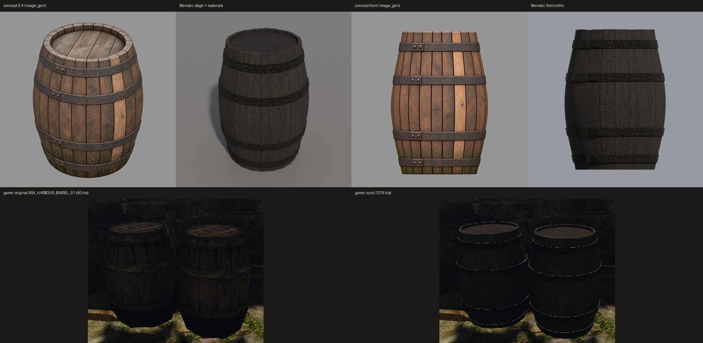
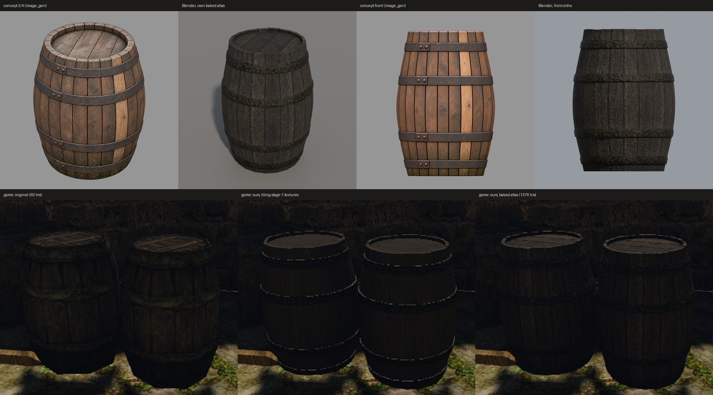

# Бочка по концепту в Blender

Первый предмет по новому пути этапа 2, 20 октября 2026 года: оригинал → задумка словами и числами → концепт `image_gen` → модель в Blender → игра. Нейросети-генераторы 3D не использовались.

Сверху — концепт и модель с материалами этапа 1, вид 3/4 и спереди. Снизу — один кадр стенда `own-mesh-barrel` на Ryzen: оригинал и наша бочка.

## Как сделано

1. **Задумка.** Claude посмотрел на оригинал в игре (`NW_HARBOUR_BARREL_01`, 60 треугольников, 150 экземпляров в NewWorld): пузатая бочка, четыре широких обруча, плоская крышка из досок, тёмное дерево, мокрый низ. Улучшения: обручи — объёмные, со стыком и заклёпками; крышка утоплена; торцы клёпок выступают над ней неровным венцом. Числа — из цели пилота: bbox 0,798 × 1,108 × 0,798 м, бюджет 1500 треугольников.
2. **Концепт.** Свежий тред Codex с `image_gen` в пустой папке, только текст. Сначала вид 3/4, затем ортогональные виды спереди и сверху — правкой первого изображения. Три PNG сохранены в `content-sources/mesh3d-pilot/barrel-v3-{34,front,top}.png`, в реестре — `mesh3d-pilot-barrel-v3-*` с промптами; у видов спереди и сверху записан `edit_of`. На каждый вид ушла одна повторная попытка: в первой было больше 20 клёпок.
3. **Модель.** [`barrel.py`](../../../scripts/content/mesh3d/blender/barrel.py) с настройками [`barrel.json`](../../../scripts/content/mesh3d/blender/barrel.json):
   - профиль снят с альфы вида спереди, многочлен 4-й степени без выступов обручей; концы — 0,78 от пуза;
   - 20 клёпок, одна грань на клёпку; шов доски на текстуре совпадает с ребром грани, у каждой клёпки своя доска тайла и свой сдвиг V;
   - 4 обруча с подъёмом 8 мм; положение и высоту (6,3 см) Claude снял с вида спереди;
   - на каждом обруче стык: накладка 6 см и две заклёпки;
   - 20 отдельных торцов клёпок над утопленной на 3 см крышкой, верх неровный до 6 мм; крышка из 4 досок.

   Итог: **1376 треугольников** из 1500, 0 открытых рёбер, bbox совпадает с целью до 0,4 мм. Сборка детерминирована: повтор даёт тот же GLB. Версия со скошенными обручами (ниже) — SHA-256 `cae24a5a…ae40f4f`.
4. **Материалы.** Дерево клёпок и крышки — плитки этапа 1 `mesh3d-barrel-wood-stave` и `mesh3d-barrel-wood-head` из реестра (сделаны `image_gen` по тексту для демо генераторов; записи перенесены из закрытого PR #319). Средние цвета зон оригинала измерил [`barrel-material-measures.cpp`](../../../scripts/content/mesh3d/barrel-material-measures.cpp). Железо обручей сделано заново: процедурная бесшовная плитка [`iron_material.py`](../../../scripts/content/mesh3d/iron_material.py) — кованые вмятины и около 15% ржавчины. Средний цвет равен замеру оригинала (линейный RGB 0,0282 / 0,0269 / 0,0168), подгонка — поканальными коэффициентами, как у этапа 1. Прежнее железо выглядело мхом: рыжая ржавчина при подгонке к оливковому среднему красила металл в зелёный. Теперь ржавчина бурая, и голое железо почти нейтрально (OKLab a = −0,006).
5. **Проверка.** [`compare.py`](../../../scripts/content/mesh3d/blender/compare.py) рендерит с одним светом и одной камерой, в том числе ортогонально спереди и сверху, как концепт. Игра — `BENCH_HOST=ryzen scripts/bench.sh own-mesh-barrel` с индексом `content-staging/mesh3d-barrel-concept/` и без него. Перепись: подменены меш и три текстуры, по одному открытию.

## Что видно

- **Форма — как у концепта.** Пузо, прямые кромки, четыре обруча и венец клёпок совпадают; пропорции — по цели (концепт чуть уже, 1,48 против 1,39).
- **В игре бочка темнее и площе оригинала.** Корпус в кадре — линейная яркость 0,0050 против 0,0060 у оригинала, на 17% темнее и чуть холоднее. У оригинала нарисованы светлые доски, тёмные щели и мшистые обручи. Наше плиточное дерево при замеренной тёмной яркости не показывает клёпки на этом расстоянии.
- **Верхние кромки обручей ловят небо** пунктирными бликами: металлическая полоса 8 мм смотрит вверх, а ржавчина рвёт её на штрихи.
- На концепте клёпки разного тона и есть светлая заменённая. Плиточная текстура так не умеет, а цвет вершин загрузчик не читает.

## Своя текстура на предмет

По решению пользователя бочка получила свой атлас вместо плиток. Плиточная версия выше осталась для сравнения.

- [`bake_atlas.py`](../../../scripts/content/mesh3d/blender/bake_atlas.py) с [`barrel-atlas.json`](../../../scripts/content/mesh3d/blender/barrel-atlas.json) делает новую развёртку (smart project, упаковка с поворотом) и запекает в атлас 1024² плитки этапа 1 через их прежние UV. Сверху добавляются:
  - тон каждой клёпки и доски крышки, ±28%, одна клёпка светлая;
  - тёмные щели там, где кончается доска тайла;
  - светлые стёртые кромки (узел Bevel) и выгоревший верх;
  - мокрый низ с водорослями в нижних 18 см;
  - AO.
- Потом каждая зона получает больше контраста (γ 1,6 у дерева, 1,3 у железа) и возвращается к своему замеренному среднему цвету. Невидимое днище в среднее не входит. Яркость прежняя, читаемость даёт контраст — так нарисована и текстура оригинала.
- В GLB остаётся одна UV и два материала: `OWN_BARREL_HARBOUR_WOOD` (`WOOD`) и `OWN_BARREL_HARBOUR_IRON` (`METAL`). [`pack_prop.py`](../../../scripts/content/mesh3d/pack_prop.py) пишет атлас в DDS один раз, оба ключа `materials.json` ссылаются на него, scale 1. В переписи открывался только ключ дерева. Причина оказалась в ошибке `bake_atlas.py`, а не в общих файлах: индексы материалов граней ставились до `mesh.materials.clear()`, а он их сбрасывает, поэтому все грани получали материал дерева. Исправлено 2026-10-20 — см. журнал `docs/own-content.md`.
- Сборка повторяема: тот же конфиг даёт те же GLB и PNG до байта. Запекание на Mac — 26 с.

**Пунктир на обручах.** В обеих версиях верхняя полка обруча шириной 8 мм ловила полуденное солнце и рассыпалась на карте теней в яркий пунктир. Ни затемнение альбедо, ни меньшая металличность его не убрали. Убрал скос: верх обруча теперь спускается к клёпкам на 2 см (`hoop_slope`), без новых треугольников. Накладка стыка опущена под скос.

**В игре** (тот же кадр стенда): клёпки и доски крышки читаются, пунктира нет. Корпус — 0,0051–0,0052 против 0,0059–0,0063 у оригинала, на 15% темнее. Крышка — 0,0256 против 0,0145: она смотрит прямо вверх, к солнцу. В нейтральном свете Blender ржавчина на обручах отдаёт зеленью — это оливковый замер обручей оригинала (они там мшистые). В игре обручи читаются тёмными полосами.

> Позже бочка перезапечена с 16 сэмплами на пиксель и вместе с ящиком снята в общем индексе — см. [ящик](../2026-10-crate-from-concept/README.md).

## Дальше

- Пользователю — оценить бочку в игре. Подключать ли её в общий контент, решает он.
- Если направление верное — тот же путь на ящик, стол, сундук и лавку пилота: `barrel.py` пока умеет только тела вращения, им нужны свои построители по частям, а `bake_atlas.py` и `pack_prop.py` общие.
- Атлас заполнен на 35%: при 1024² это около 4 пикселей на сантиметр. Ручная развёртка (корпус одной полосой) подняла бы плотность вдвое.
