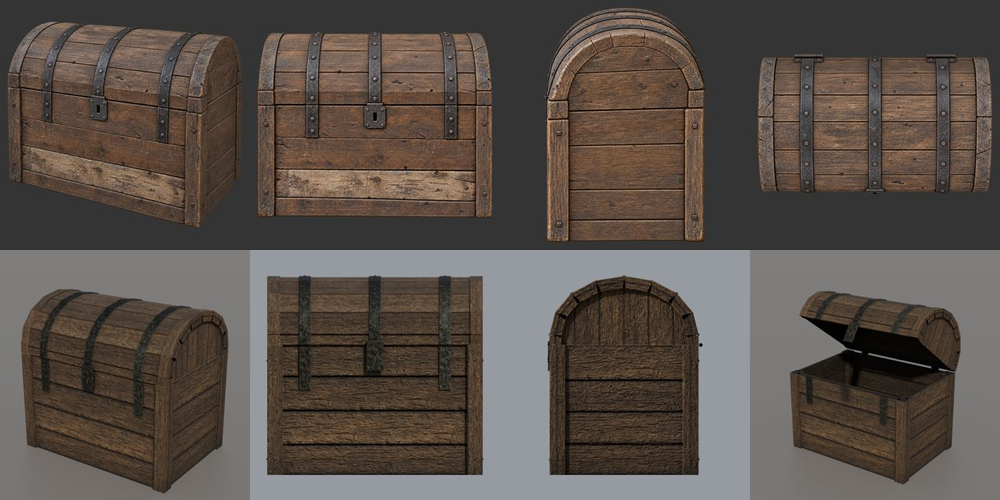
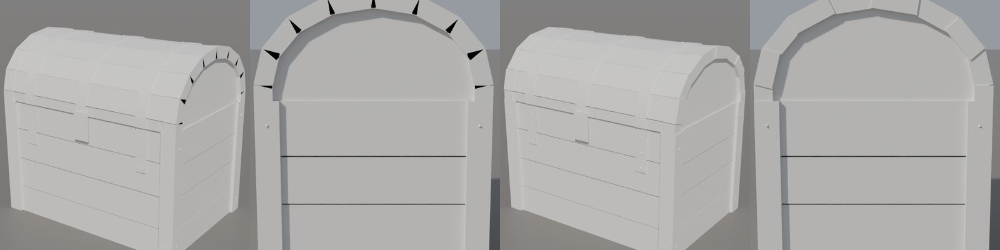
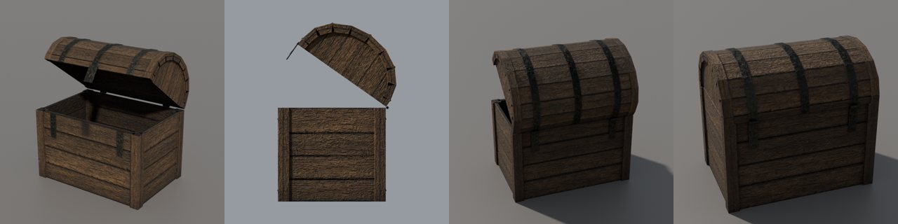

# Сундук по концепту в Blender

Пятый предмет нового пути этапа 2, 20 октября 2026 года, после [бочки](../2026-10-barrel-from-concept/README.md), [ящика](../2026-10-crate-from-concept/README.md), [стола и лавки](../2026-10-table-bench-from-concept/README.md). Первый предмет с подвижной частью: сундук — модель MOB с двумя вложениями, крышка анимируется. Путь тот же: оригинал → задумка → концепт `image_gen` → модель по частям → свой атлас → стенд.

Верхний ряд — концепт: вид 3/4 и три ортогональных вида, сделанных его правкой. Нижний ряд — наша модель с запечённым атласом. Последний кадр — крышка открыта на 35,2°, как в анимации `S_S1`.

## Оригинал

`CHESTBIG_NW_NORMAL_OPEN.MDS` → `.MDH` + `.MDM`, 9 копий в NEWWORLD. Числа сняты ZenKit, геометрия и текстуры оригинала никуда не передавались.

- Узлы: корень `BIP01 CHEST_BIG_0` с матрицей diag(−1, 1, −1), то есть с поворотом на 180° вокруг Y. Крышка `BIP01 CHEST_BIG_1` — ребёнок корня с переносом (0; 50,10; 29,58) см. Точка героя — `ZS_POS0`.
- Два жёстких вложения: корпус (28 треугольников) и крышка (24), soft-skin нет. Габариты в bind pose — 84 × 77,5 × 59 см, корпус высотой 50 см.
- Анимации двигают только узел крышки. В `S_S0` она закрыта, в `S_S1` повёрнута на 35,2° вокруг своей оси X. Bind pose совпадает с `S_S0`: корень повёрнут на 0,35° меньше, разница не больше 0,3 см. Поэтому GLB задаётся в bind pose, как у лавки (решение пользователя).
- Ось петли — начало узла крышки, в пространстве модели (x; 50,10; −29,58) см: верхняя кромка задней стенки. В Blender это линия y = 0,2958 м, z = 0,5010 м, перед сундука смотрит в −Y.
- Одна текстура `OBJ_CITY_CHESTALL_01` 512²; средний цвет дерева — линейный 0,0471 / 0,0273 / 0,0124, железа (4% текселей) — 0,0164 / 0,0161 / 0,0121 (`prop-survey`).
- `CHESTBIG_NW_NORMAL_LOCKED` устроен иначе: четыре вложения, у него свой замок `BIP01 CHESTLOCK`. Ему нужен свой GLB.

## Концепт

За основу взят концепт пилота `mesh3d-pilot-chest-v2`: он сделан только по тексту и числам. Три ортогональных вида (`-front`, `-side`, `-top`) сделаны его правкой в свежем треде Codex. В промпте только текст: размеры, крышка на петлях сзади, три полосы, накладка спереди, без висячего замка. Виды и промпт записаны в реестр, PNG хранятся в `content-sources/` и в резервной копии на dev-ubuntu.

С видов прочитаны детали:
- угловые стойки и по 4 горизонтальные доски на каждой стенке;
- арочная крышка: нижний пояс и 8 досок дуги;
- на торцах крышки — толстый арочный обод из сегментов, внутри него утопленный щит;
- три полосы через крышку с заклёпками, две крайние продолжаются на корпус примерно на 17 см;
- квадратная накладка с прорезью под ключ висит с передней кромки крышки;
- две петли сзади.

## Модель

[`chest.py`](../../../scripts/content/mesh3d/blender/chest.py) + [`chest.json`](../../../scripts/content/mesh3d/blender/chest.json) на общих деталях [`parts.py`](../../../scripts/content/mesh3d/blender/parts.py). Цель записана прямо в настройках (`goal`): этого сундука нет в наборе пилота.

- **Два узла GLB по именам вложений:** `BIP01 CHEST_BIG_0` — корпус, петли, полосы корпуса, гвозди стоек; `BIP01 CHEST_BIG_1` — крышка, полосы крышки, накладка. Новая функция `finish_nodes` в `parts.py` пишет каждый набор деталей отдельным объектом, а прежний `finish` вызывает её с одним узлом.
- **Крышка целиком лежит перед осью петли и над ней:** до оси не меньше 4,4 мм. Поэтому при повороте на 35,2° она не входит в корпус: после поворота её нижняя точка на 4,8 мм выше оси. Оба числа скрипт пишет в `metrics.json`. Петли — шестигранные штыри ровно на оси, они поворачиваются на месте.
- **Внутренние грани** — стенки изнутри, дно, низ крышки — получают свою зону `OWN_PROP_WOOD_INNER` с целью цвета вдвое темнее дерева. При запекании крышка закрыта и AO внутри почти чёрный; отдельная зона не даёт ему утянуть средний цвет внешнего дерева.
- **Сквозь щели не видно насквозь.** Щели противоположных стенок держатся не ближе 1 см друг от друга. Доски крышки и обода на шве садятся прямо на корпус. Проверка лучами через сундук по X и по Y с шагом 1 мм — 0 просветов. Первая сборка давала 5 просветов: светлые полосы на рендере.
- **Нет совпадающих видимых граней.** Каждый второй сегмент обода крышки уже на 3 мм с каждой стороны (`rim_step`), доски стенок кончаются у стоек, дно поднято на 1 мм. До правки 2026-10-21 торцы соседних сегментов лежали в одной плоскости, и на рендере в стыках были чёрные клинья ([журнал](../../../docs/own-content.md#план-и-журнал)).

  
- **1209 треугольников** при бюджете 3000: корпус 442, крышка 767. Открытых рёбер 129 = 43 шляпки гвоздей × 3, других нет. bbox — в пределах 1 см: петли выступают назад на 8 мм, верх ниже цели на 4 мм.

## Атлас

[`chest-atlas.json`](../../../scripts/content/mesh3d/blender/chest-atlas.json): 2048², плитки дерева и железа — как у лавки, цвета — по замеру сундука, без водорослей. У `bake_atlas.py` появилась настройка `nodes`. С ней объекты GLB запекаются в один атлас, а затем снова делятся на те же именованные узлы. Без неё скрипт работает как раньше.

- 2 материала атласа: `OWN_CHEST_NORMAL_WOOD` (`WOOD`, 728 граней) и `OWN_CHEST_NORMAL_IRON` (`METAL`, 481 грань). Запечено уже с исправлением индексов материалов из `main`. Первое запекание до него отдало все грани дереву: текстура та же, но звук и физика железа были бы деревянными.
- Заполнение атласа — 37%: развёртка Smart UV даёт много мелких островов.
- `pack_prop.py` собирает корень контента `content-staging/mesh3d-chest-atlas/` с ключом `CHESTBIG_NW_NORMAL_OPEN`.

## Проверки

- После выноса `finish_nodes` ящик, лавка и стол собраны заново: GLB совпали до байта (`4ee56b61…`, `e2d7d7d7…`, `e28b66ff…`).
- Раскраска по зонам и рендер Cycles закрытого и открытого сундука просмотрены. Крышка поднимается вокруг задней кромки, накладка уходит вместе с ней, внутри тёмное дерево.
- Подмена в игре — загрузчиком нескольких вложений MOB и стендом `own-mesh-chest` на Ryzen, отдельно.

## Дальше

- Доска «после ремонта» на концепте светлая; у нас светлее на 35% (`light_part`), но на рендере она почти не видна. Если в игре её не видно — поднять до 1,6–1,7.
- `CHESTBIG_NW_NORMAL_LOCKED` и `CHESTBIG_NW_RICH_*` — свои цели и свои узлы (`ZM_CHESTMEDIUM`, `BIP01 CHESTLOCK`; у богатого сундука ширина 120 см).
