# Задумка текстур Хориниса

Разобраны те же **71 текстура** `NW_CITY_*` / `NW_HARBOUR_*` мира `NEWWORLD.ZEN`: где они стоят, как используют UV и какую часть объекта изображают. Полные английские поля назначения — в [таблице](../../../data/content/city-materials.csv). Здесь — короткие карточки и дневные кадры: в начале обхода время выставлено на 12:00. Генерации не было; city-1/city-2 и рабочий каталог контента не менялись.

**Главное:** повторяться может целая конструкция. Поэтому `layout=tiled` и решение `module` совместимы. У всех модулей **scale 1, anti_repeat off**: сохраняем совмещение каркаса, окон, уступов и ступеней. Для них предложены 12 классов в [библии](../../../docs/content-style.md#задумка-прежде-материала). Панели делаются под участок, полосы повторяются вдоль оси. Подключение этих решений к генератору — отдельная работа; сейчас он читает только `include`.

## Как считалось

ZenKit читает меш мира и видимые статичные MRM/MSH-визуалы vob с их мировыми трансформами. Площадь совпала с прежней переписью для всех 71 имён: 294 627 треугольников, 147 334 участка, всего 130 704,1 м². Это сумма поверхностей во всём мире, включая повторное использование в других поселениях, а не площадь города на карте.

Связываются полные общие рёбра одного источника: координаты округляются до 0,01 см, UV совпадают до 0,0001, нормали расходятся не более чем на 5°, соседние плоскости — на 0,5 см. Разные экземпляры vob и UV-разрывы не склеиваются. Начало UV не важно: 7…8 — одна копия, а не повтор.

По каждому участку: оба размаха UV 0,75…1,25 дают `panel`; повтор более 1,25 по одной оси при физическом отношении длины к ширине ≥4 — `strip`; остальной непрерывный повтор — `tiled`. Малые обрезки сначала остаются кандидатами атласа. После просмотра оригинала и места они отнесены к своему назначению: обрезок единого материала или непрерывной оболочки модуля — продолжение tiled, обрезок ограниченной панели — panel, узкой линейной детали — strip. Только разные области рисунка для разных частей предмета оставлены atlas. У подтверждённого атласа сюда входят все его части, в том числе крупные торцы, близкие к единице UV. Группу такой доводки показывает строка каждой карточки. Одно изображение грани ящика поэтому оказалось панелью, а боковина и торец бочки — атласом.

Доли считаются по площади участков, основной тип — наибольшая доля. Метод не сшивает T-стыки; кривые поверхности могут распасться на небольшие участки. Тип определяется геометрией и назначением, не именем файла. Для `module` дополнительно приводятся охват типичной грани по U×V, площадь UV в единицах модуля и физические размеры одной единицы UV. Охват может быть дробным: край обрезан геометрией; это не число целых деталей. Метры на единицу UV усреднены по площади, поэтому на косых или неравномерно развёрнутых участках это приближение. У лестницы одна единица текстуры может содержать несколько ступеней. Зеркальные соседние копии могут иметь общий размах UV всего 1×1: их число выявляет сумма площадей UV и просмотр треугольников, как у RICH_WINDOW_01.

Места — до трёх самых плотных скоплений центров участков в радиусе 10 м; центр взвешен площадью. Координаты — игровые сантиметры, Y вверх. Прозрачные промежутки не вычитались: считается площадь треугольников. У шести имён существует только одно такое скопление: `DIRTYGROUND_WEG_TRANS_02`, `DOOR_01`, `DOOR_03`, `DUNGEONFLOOR_03`, `TEMPLESTARROOF_01`, `WOODENGATE_01`. Дополнительные места для них не придуманы. Скопление меньше 0,01 м² не считается типичным местом: это только почти вырожденная грань DOOR_02 площадью 0,000070421 м² у фермы; два остальных её места приведены. `DOOR_01` и `DOOR_03` встречаются только на нескольких треугольниках примерно на 42 м ниже портовых улиц: кадры показывают именно эти служебные остатки меша, а не действующие дверные проёмы. Визуалы указаны как в ZEN, топ-5 по числу экземпляров, затем по площади; рядом — число экземпляров.

Исходные текстуры, их уменьшенные просмотры, геометрия и сырые PNG остаются вне git и не поступают генератору. В отчёте только уменьшенные игровые JPG. Все 71 место сняты; **не снято: 0**. Карточки и итоговый сценарий идут по убыванию площади. Это порядок итогового отбора; исходный полный обход был снят раньше. После двух неудачных ракурсов оставлен лучший с пометкой; повторную съёмку ради идеальной картинки не продолжали. Сценарий — [city-intent.bench](../../../scripts/content/city-intent.bench), подготовка камер — [intent_cameras.py](../../../scripts/content/intent_cameras.py), запуск — [capture-intent.sh](../../../scripts/content/capture-intent.sh), измерения — `scripts/content-textures.sh --intent <JSON вне git>`.

## Доли раскладки

Последняя колонка суммирует реальные доли участков. Предыдущая относит всю площадь текстуры к её основному типу; это разные величины.

| Тип | Основной у текстур | Площадь по основному типу, м² (%) | Площадь самих участков, м² (%) |
|---|---:|---:|---:|
| `tiled` | 39/71 (54,93%) | 80 057,8 (61,25%) | 72 661,1 (55,59%) |
| `panel` | 18/71 (25,35%) | 25 261,8 (19,33%) | 32 739,7 (25,05%) |
| `strip` | 13/71 (18,31%) | 20 729,0 (15,86%) | 20 647,9 (15,80%) |
| `atlas` | 1/71 (1,41%) | 4 655,5 (3,56%) | 4 655,5 (3,56%) |

Решения таблицы: **16 include, 27 module, 10 panel, 7 strip, 11 exclude**. Одно исключение — атлас, три дверных изображения имеют только подземные образцы или искажённое применение на рельефе, ещё семь — пока неподдержанные поверхности и прозрачные детали. Причины стоят в CSV.

## Дом у рынка: почему city-1 потерял задумку

Это дом слева в [прежнем кадре market](../2026-10-city-set-1/market.jpg), у `NW_CITY_MERCHANT_HUT_02_ENTRY`. Его передний фасад выделен по геометрии отдельно от соседей. Внутренние рамки фахверка нарисованы на плоских участках; крупные угловые стойки, обвязки и фронтонные стропила существуют отдельной геометрией. Одно не заменяет другое.

| Часть дома | Текстура | Как разложена |
|---|---|---|
| Фронтон, 18,97 м² | `NW_CITY_WALL_03.TGA` | одна плоская треугольная грань; охват 5,42×1,70 UV, по площади 4,60 единицы модуля; рисунок обрезан скатами |
| Два заполнения между окнами, 10,37 м² | `NW_CITY_WALL_03.TGA` | две отдельные почти единичные панели: 0,999×0,999 UV |
| Три оконные секции, 11,82 м² | `NW_CITY_WINDOW_03.TGA` | три почти единичные панели; рамка окна и нижнее заполнение закреплены относительно краёв |
| Два участка нижнего этажа у входа, 20,17 м² | `NW_CITY_FACHWERKBASEMENT_WINDOW_01.TGA` | 1,33×1,00 и 1,38×1,02 UV; верхняя балка, кладка, маленькое окно и цоколь имеют свои места |
| Объёмные стойки и обвязки | `NW_CITY_WOODBEAM_02.TGA` | узкие грани трёхмерных балок; волокна и обвязки следуют их осям |
| Оба ската, 130,42 м² | `NW_CITY_ROOF_01.TGA` | на каждом 0,574×1,011 UV; U вдоль конька, V от конька к карнизу; обрезок кровли, не атлас |

На боковых стенах есть также цокольные `FACHWERKBASEMENT_CHAIN_01` и `FACHWERKBASEMENT_EMPTY_01`; задняя обшивка использует `HAFEN_HOLZWAND_01`. `WOOD_ORNAMENT_02` здесь главным образом внутренняя обвязка, её не считаем наружным карнизом. На торцах объёмных брусьев встречается `NW_NATURE_BARKRINGS_02.TGA`, а у порога — `NW_MISC_OLDSTONEPATH_01.TGA`: эти два имени вне фиксированных 71 строк.

Первый набор присвоил `WALL_03` класс обычной штукатурки и scale 1,24. Взамен целой конструкции с тёмной рамой и светлым заполнением пришла повторяемая поверхность с крупными пятнами. Она стёрла нарисованные балки внутри секций, сдвинула ритм относительно геометрии и потеряла грязь у дерева. Неизменённые оконные секции рядом сохранили прежний каркас — расхождение стало особенно заметно. Цоколи, внутренние обвязки и другие составные поверхности требуют такого же разбора по частям.

Теперь у `WALL_03` решение `module`, класс `timber_frame_tile`, масштаб 1 и антиповтор off. По всему миру её участки смешаны: основной тип tiled, но единичные панели тоже есть. Нужен цельный модуль по функции частей, с заданными пропорциями и краями, а не произвольная штукатурка. Свою версию в этой работе не генерировали.

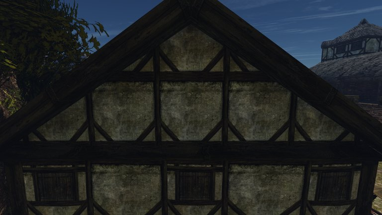

## Карточки

Если звёздный фон закрыт эффектом, кадр показывает сам портал; это отмечено в его карточке. Размытый камень и тёмный грунт также помечены, без догадок о невидимых деталях.

Полные поля object/role/depicts/colour/weathering/orientation — в CSV. Ниже краткая задумка, носители, центры скоплений, смесь раскладки и выбранное место съёмки.

### NW_CITY_HAFENKAI_MAUER_01.TGA

Модуль подпорной стены набережной: коричневато-серая грубая кладка над и под горизонтальным каменным выступом. Влажные швы темнее, открытый край выступа светлее и стёрт; верх и низ различаются.

**Где:** меш мира 17 491,5 м².

**Места:**

- (-14660, -1889, -8903), 1 133,3 м²; tiled 81,13%, strip 18,87%; типичная грань 482,5 м², 0,63×1,54 UV.
- (-8785, -1903, -19132), 1 109,0 м²; tiled 100,00%; типичная грань 374,7 м², 0,47×1,54 UV.
- (-8423, -1918, -13315), 1 023,0 м²; tiled 100,00%; типичная грань 388,2 м², 0,74×1,54 UV.

**Раскладка:** основной `tiled`; tiled 93,64%, panel 1,74%, strip 4,62%. Решение `module` / `quay_wall_tile`; антиповтор `off`. Обрезки: непрерывная поверхность → tiled.
**Модуль на типичной грани:** охват 0,94×1,61 UV; по площади 1,48 единицы модуля. Одна единица UV ≈14,33×19,98 м, пропорция U:V ≈0,72:1; scale 1.
**Ограничение снимка:** Кадр ограничен крупным масштабом развёртки: вблизи кладка размыта, полный профиль с полкой не виден. После двух ракурсов оставлен лучший; состав модуля установлен по оригиналу и UV.
**Кадр:** `NW_CITY_WAY_TO_SHIP_10`, поверхность у (-6360, -474, -9360); днём.

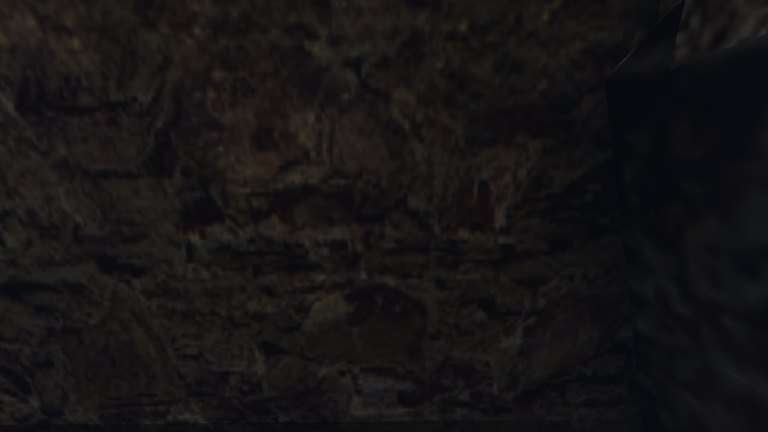

### NW_CITY_ROOF_04.TGA

Скат городской крыши из небольших серых каменных кровельных пластинок с коричневым оттенком. Швы темнее, открытые края обветрены; ряды должны перекрываться по направлению вниз по скату.

**Где:** меш мира 8 697,3 м².

**Места:**

- (14494, 1963, -4212), 459,6 м²; tiled 90,66%, panel 0,47%, strip 8,87%; типичная грань 83,0 м², 2,00×0,83 UV.
- (5143, 1468, 8830), 456,8 м²; tiled 95,45%, panel 4,55%; типичная грань 135,1 м², 2,62×0,94 UV.
- (75723, 4111, -11315), 415,3 м²; tiled 92,00%, strip 8,00%; типичная грань 191,0 м², 4,28×1,53 UV.

**Раскладка:** основной `tiled`; tiled 86,89%, panel 7,07%, strip 6,04%. Решение `include` / `roof_tiles`; антиповтор `off`. Обрезки: непрерывная поверхность → tiled.
**Кадр:** `NW_CITY_BARRACK02_SMALLTALK_01`, поверхность у (3118, 1342, 8483); днём.

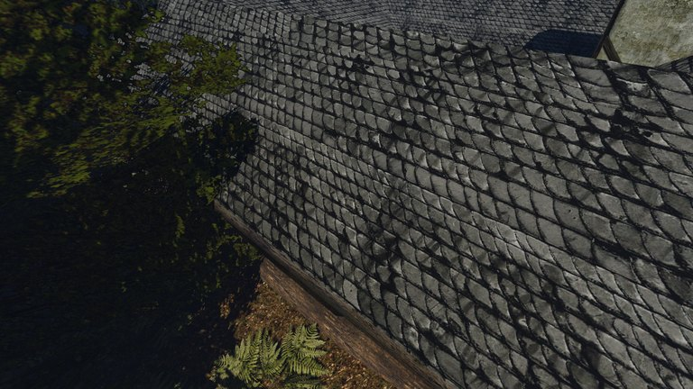

### NW_CITY_HAFENKAI_BODEN_01.TGA

Мощёная поверхность портовой набережной из крупных неровных серо-коричневых плит с оливковым оттенком. Верх истёрт проходами, земля и влажная грязь остаются в швах; фиксированного верха нет.

**Где:** меш мира 7 139,2 м².

**Места:**

- (-1517, -178, -4139), 371,4 м²; tiled 87,76%, panel 12,24%; типичная грань 88,3 м², 1,76×1,72 UV.
- (-13793, -223, -8751), 347,2 м²; tiled 100,00%; типичная грань 130,2 м², 1,45×1,66 UV.
- (-9090, -226, -8747), 342,7 м²; tiled 100,00%; типичная грань 145,0 м², 1,58×1,68 UV.

**Раскладка:** основной `tiled`; tiled 93,27%, panel 5,70%, strip 1,03%. Решение `include` / `flagstone`; антиповтор `on`. Обрезки: непрерывная поверхность → tiled.
**Кадр:** `NW_CITY_WAY_TO_SHIP_12`, поверхность у (-7172, -222, -14113); днём.

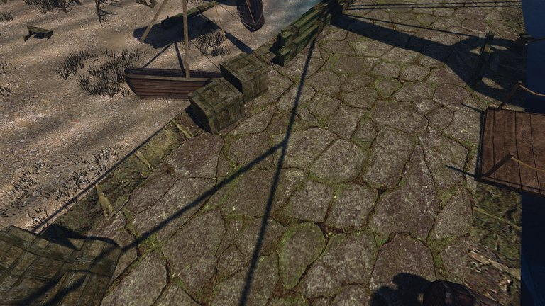

### NW_CITY_WOOD_ORNAMENT_02.TGA

Узкие открытые деревянные грани конструкции или креплений с грубыми серо-коричневыми волокнами и небольшими расколами. Открытое дерево потёрто, грязь остаётся в трещинах; волокна направлены вдоль детали.

**Где:** меш мира 2 582,6 м²; vob 3 984,7 м²: `NW_MISC_SIGN_01.3DS` ×54, `NW_MISC_BOARDS_01B.3DS` ×49, `DT_SHELF_V1.3DS` ×25, `NW_MISC_BOARDS_02B.3DS` ×17, `NW_MISC_POOR_HUT_01.3DS` ×8.

**Места:**

- (7777, 719, -2775), 244,4 м²; panel 27,14%, strip 72,86%; типичная грань 4,9 м², 1,00×1,78 UV.
- (8451, 577, 1179), 207,9 м²; panel 26,88%, strip 73,12%; типичная грань 6,3 м², 1,00×7,28 UV.
- (5759, 608, -594), 189,0 м²; tiled 7,19%, panel 19,76%, strip 73,05%; типичная грань 13,3 м², 1,63×0,81 UV.

**Раскладка:** основной `strip`; tiled 2,81%, panel 20,43%, strip 76,77%. Решение `strip` / `timber_strip`; антиповтор `off`. Обрезки: линейная деталь → strip.
**Кадр:** `NW_CITY_BARRACK02_SMALLTALK_01`, поверхность у (3196, 1125, 8651); днём.

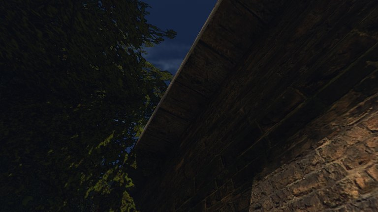

### NW_CITY_INSIDEFLOOR_11.TGA

Длинные доски полов зданий и нижней палубы корабля. Серо-коричневая древесина потёрта на проходе, темнее вдоль стыков; направление досок сохраняется.

**Где:** меш мира 6 081,0 м².

**Места:**

- (-10174, 467, -18683), 893,5 м²; tiled 93,50%, panel 1,64%, strip 4,85%; типичная грань 47,6 м², 1,40×1,84 UV.
- (-9909, -395, -14921), 852,8 м²; tiled 93,41%, strip 6,59%; типичная грань 278,4 м², 1,78×2,14 UV.
- (-9794, 14, -12538), 609,2 м²; tiled 97,56%, strip 2,44%; типичная грань 73,7 м², 1,65×1,49 UV.

**Раскладка:** основной `tiled`; tiled 91,40%, panel 1,66%, strip 6,94%. Решение `include` / `planks_floor`; антиповтор `off`. Обрезки: непрерывная поверхность → tiled.
**Кадр:** `NW_CITY_UPTOWN_HUT_03_04`, поверхность у (14796, 900, -4140); днём.

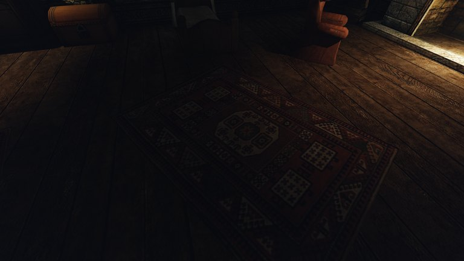

### NW_CITY_WOODBEAM_02.TGA

Модуль деревянной балки тёмного оливково-коричневого цвета с поперечными железными обвязками. Продольные трещины глубокие, углубления влажные и тёмные; волокна идут вдоль балки, металл пересекает их.

**Где:** меш мира 5 224,7 м²; vob 25,3 м²: `NW_SHIP_STAIRS_AND_MASTS_01.3DS` ×1, `NW_SHIP_STAIRS_NAVROOM_01.3DS` ×1.

**Места:**

- (1960, 222, -852), 356,3 м²; tiled 5,34%, panel 33,14%, strip 61,52%; типичная грань 8,3 м², 0,00×0,00 UV.
- (2843, 161, 2545), 292,5 м²; tiled 28,24%, panel 25,96%, strip 45,79%; типичная грань 28,7 м², 6,99×2,40 UV.
- (37125, 4142, -2241), 212,4 м²; panel 51,73%, strip 48,27%; типичная грань 4,0 м², 1,00×2,10 UV.

**Раскладка:** основной `strip`; tiled 8,04%, panel 31,82%, strip 60,14%. Решение `module` / `bound_timber_tile`; антиповтор `off`. Обрезки: линейная деталь → strip.
**Модуль на типичной грани:** охват 3,90×1,00 UV; по площади 3,89 единицы модуля. Одна единица UV ≈1,15×10,14 м, пропорция U:V ≈0,11:1; scale 1.
**Кадр:** `NW_CITY_HABOUR_02_B`, поверхность у (-940, -571, -739); днём.

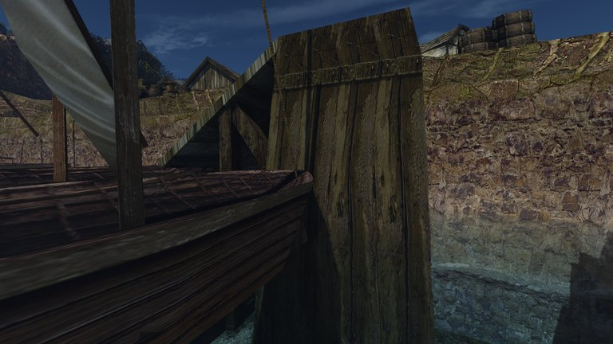

### NW_CITY_ROOF_INSIDE_01.TGA

Модуль нижней стороны крыши: узкие тёмные серо-коричневые доски поперёк более тяжёлых несущих брусьев. Пыль и копоть собираются в стыках и у опор; направления досок и брусьев существенны.

**Где:** меш мира 4 976,8 м².

**Места:**

- (1640, 341, -3032), 404,4 м²; panel 100,00%; типичная грань 72,5 м², 1,00×1,00 UV.
- (72358, 3672, -9561), 360,7 м²; panel 100,00%; типичная грань 117,3 м², 1,00×0,98 UV.
- (37358, 4429, -2371), 310,6 м²; panel 100,00%; типичная грань 65,9 м², 1,03×0,99 UV.

**Раскладка:** основной `panel`; tiled 4,38%, panel 87,77%, strip 7,86%. Решение `module` / `roof_structure_tile`; антиповтор `off`. Обрезки: ограниченная панель → panel.
**Модуль на типичной грани:** охват 1,00×1,01 UV; по площади 1,00 единицы модуля. Одна единица UV ≈14,48×6,42 м, пропорция U:V ≈2,26:1; scale 1.
**Кадр:** `NW_CITY_HABOUR_TAVERN01_01`, поверхность у (1636, 534, -699); днём.

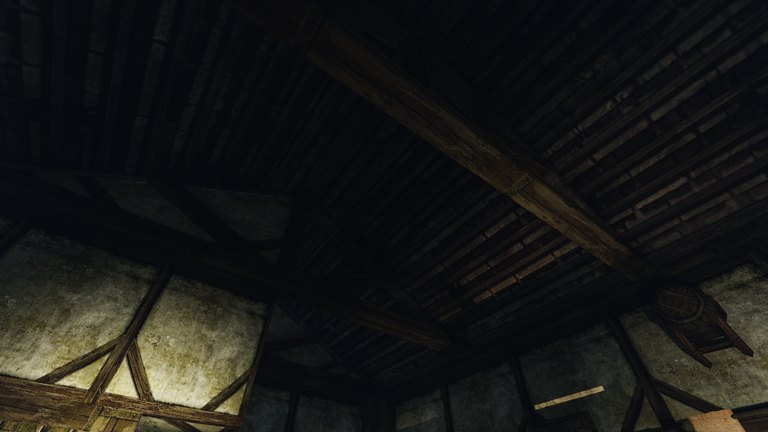

### NW_CITY_BODENDIELEN_01.TGA

Пол комнаты из широких серовато-коричневых досок с узкими тёмными стыками. Проходы высветляют поверхность дерева, грязь остаётся в щелях; волокна идут вдоль досок.

**Где:** меш мира 4 905,2 м².

**Места:**

- (8111, 661, 3440), 580,0 м²; tiled 98,29%, panel 1,39%, strip 0,32%; типичная грань 102,6 м², 4,22×5,79 UV.
- (75539, 3823, -12162), 433,2 м²; tiled 100,00%; типичная грань 224,8 м², 2,21×5,72 UV.
- (75208, 3952, -9811), 408,2 м²; tiled 91,94%, panel 4,58%, strip 3,48%; типичная грань 208,8 м², 1,76×4,21 UV.

**Раскладка:** основной `tiled`; tiled 93,43%, panel 4,25%, strip 2,32%. Решение `include` / `planks_floor`; антиповтор `off`. Обрезки: непрерывная поверхность → tiled.
**Кадр:** `NW_CITY_HABOUR_TAVERN01_01`, поверхность у (1776, -186, -794); днём.

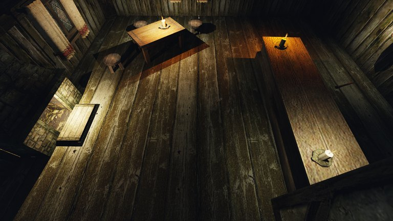

### NW_CITY_BARREL_01.TGA

Бочка собрана из тёмных деревянных клёпок с тусклыми металлическими обручами; боковина и торец занимают разные участки текстуры. Грязь держится у обручей и стыков, выступающее дерево потёрто.

**Где:** vob 4 655,5 м²: `NW_HARBOUR_BARREL_01.3DS` ×150, `NW_HARBOUR_BARRELGROUP_02.3DS` ×97, `NW_HARBOUR_BARRELGROUP_01.3DS` ×55, `NW_CITY_WEAPON_BARREL_01.3DS` ×36.

**Места:**

- (29573, 4319, -16074), 229,5 м²; atlas 100,00%; типичная грань 0,3 м², 0,77×1,01 UV.
- (49282, 3222, -15483), 172,1 м²; atlas 100,00%; типичная грань 0,3 м², 0,77×1,01 UV.
- (6980, -459, 1144), 171,4 м²; atlas 100,00%; типичная грань 0,3 м², 0,77×1,01 UV.

**Раскладка:** основной `atlas`; atlas 100,00%. Решение `exclude`; антиповтор `off`. Обрезки: разные части предмета → atlas.
**Кадр:** `NW_CITY_PATH_HABOUR_12`, поверхность у (1093, -137, -97); днём.

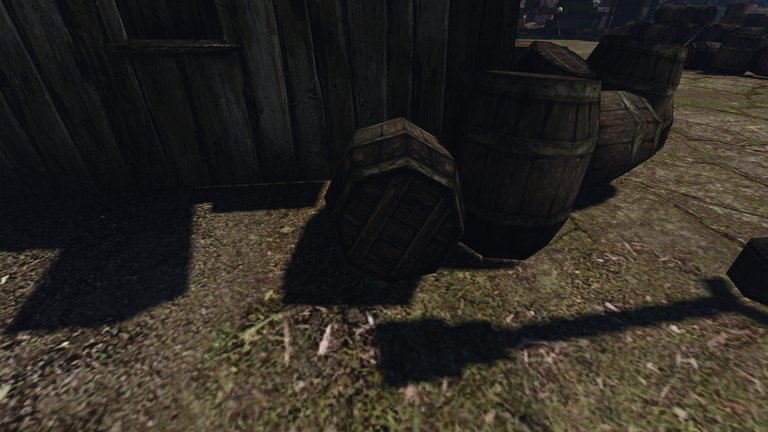

### NW_HARBOUR_WOODCRATE_01.TGA

Целая грань деревянного ящика: грубые оливково-серые коричневые доски усилены более толстыми брусками. Выступающие бруски потёрты, стыки темнее; положение усиления связано с границами каждой грани.

**Где:** меш мира 321,0 м²; vob 4 245,5 м²: `NW_HARBOUR_CRATEPILE_01.3DS` ×132, `NW_HARBOUR_CRATE_01.3DS` ×105, `NW_HARBOUR_CRATEBROKEN_01.3DS` ×92, `AW_CRATE_01.3DS` ×1.

**Места:**

- (-9859, -508, -14288), 325,7 м²; panel 100,00%; типичная грань 1,6 м², 1,00×1,00 UV.
- (2694, -31, 3037), 314,9 м²; panel 100,00%; типичная грань 1,6 м², 1,00×1,00 UV.
- (-10065, -168, -16036), 179,6 м²; panel 100,00%; типичная грань 1,6 м², 1,00×1,00 UV.

**Раскладка:** основной `panel`; panel 100,00%. Решение `panel` / `planks_panel`; антиповтор `off`. Обрезки: ограниченная панель → panel.
**Кадр:** `NW_CITY_HABOUR_KASERN_CENTRE_02`, поверхность у (4567, 814, 7625); днём.

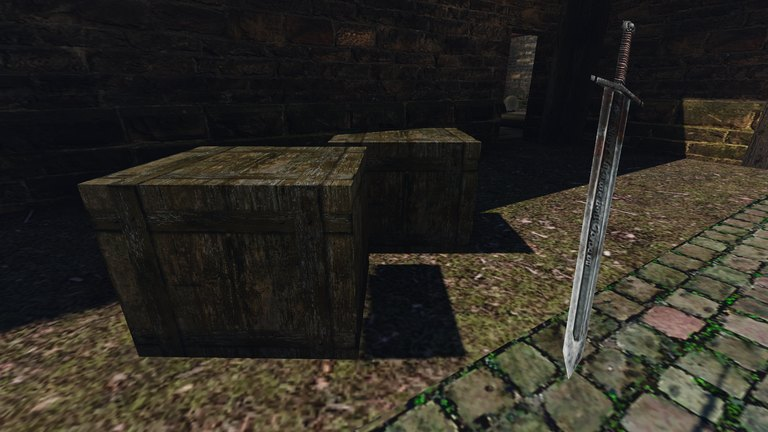

### NW_HARBOUR_WOODCRATE_02.TGA

Целая грань деревянного ящика из обветренных серо-охристых коричневых досок с усиливающей рамой. Выступающий каркас истёрт, в стыках досок грязнее; направление усиления задаётся отдельной гранью ящика.

**Где:** меш мира 572,4 м²; vob 3 438,8 м²: `NW_HARBOUR_CRATEPILE_01.3DS` ×132, `NW_HARBOUR_CRATE_01.3DS` ×105, `NW_HARBOUR_CRATEBROKEN_01.3DS` ×92, `NW_MISC_CAVE_BOARDING_01.3DS` ×12, `AW_CRATE_01.3DS` ×1.

**Места:**

- (58885, 7164, 23893), 232,4 м²; panel 100,00%; типичная грань 25,6 м², 0,89×1,19 UV.
- (-9882, -526, -14299), 157,0 м²; panel 100,00%; типичная грань 1,0 м², 1,00×1,00 UV.
- (2741, -49, 3045), 152,7 м²; panel 100,00%; типичная грань 1,0 м², 1,00×1,00 UV.

**Раскладка:** основной `panel`; tiled 1,52%, panel 93,50%, strip 4,98%. Решение `panel` / `planks_panel`; антиповтор `off`. Обрезки: ограниченная панель → panel.
**Кадр:** `NW_CITY_HABOUR_KASERN_CENTRE_02`, поверхность у (4555, 814, 7538); днём.

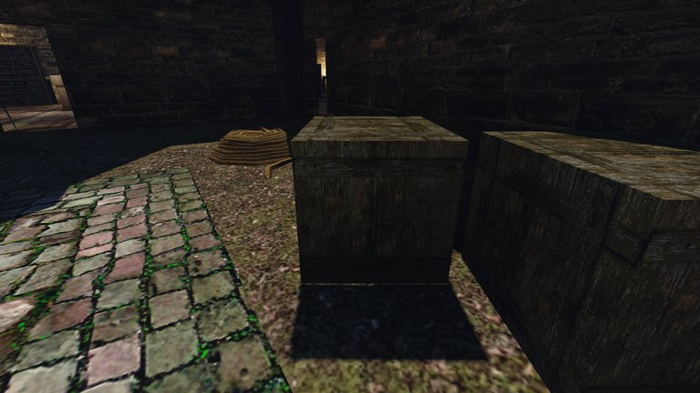

### NW_CITY_ROOF_01.TGA

Скат городской крыши из перекрывающихся деревянных гонтов серо-коричневого цвета с оливковым оттенком. Нахлёсты темнее, открытые края выветрены и светлее; каждый ряд перекрывает следующий вниз по скату.

**Где:** меш мира 3 936,0 м².

**Места:**

- (1638, 372, 1143), 414,7 м²; tiled 16,16%, panel 83,84%; типичная грань 93,9 м², 0,95×1,01 UV.
- (1624, 485, -3190), 341,3 м²; tiled 76,36%, panel 23,64%; типичная грань 51,2 м², 0,76×1,02 UV.
- (7677, 1023, -3033), 304,5 м²; tiled 68,17%, panel 31,83%; типичная грань 64,9 м², 1,15×1,02 UV.

**Раскладка:** основной `tiled`; tiled 73,45%, panel 26,55%. Решение `include` / `roof_shingle`; антиповтор `off`. Обрезки: непрерывная поверхность → tiled.
**Кадр:** `NW_CITY_PATH_HABOUR_15`, поверхность у (1366, 351, 1706); днём.

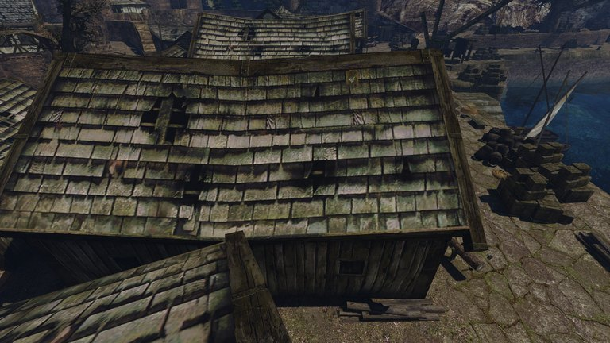

### NW_CITY_HAFEN_HOLZWAND_01.TGA

Стена портовой деревянной постройки из вертикальных серо-коричневых досок с оливковым оттенком. Лицевые поверхности выцветают, глубокие швы и влажный низ темнее; волокна и доски стоят вертикально.

**Где:** меш мира 3 370,0 м².

**Места:**

- (2657, 120, 2966), 611,1 м²; tiled 92,62%, panel 0,96%, strip 6,43%; типичная грань 86,3 м², 3,43×3,17 UV.
- (1723, 71, 885), 274,3 м²; tiled 73,03%, panel 26,97%; типичная грань 20,6 м², 1,22×0,93 UV.
- (2276, -22, -3045), 271,7 м²; tiled 87,33%, panel 12,67%; типичная грань 24,2 м², 3,22×0,83 UV.

**Раскладка:** основной `tiled`; tiled 73,41%, panel 19,39%, strip 7,20%. Решение `include` / `planks_wall`; антиповтор `off`. Обрезки: непрерывная поверхность → tiled.
**Кадр:** `NW_CITY_HABOUR_TAVERN01_07`, поверхность у (1529, -41, -300); днём.

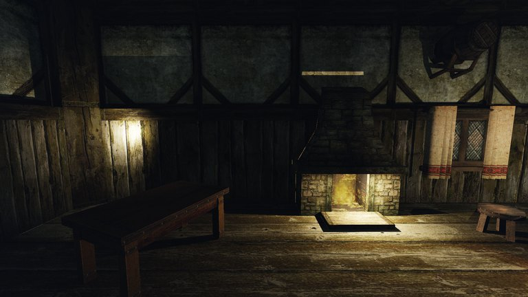

### NW_CITY_WALL_03.TGA

Модуль фахверковой стены торгового квартала: тёплое грязно-кремовое заполнение между тёмными стойками и балками. Середина светлее, грязь сильнее у дерева и снизу; верхняя балка и нижняя обвязка фиксированы.

**Где:** меш мира 3 159,0 м².

**Места:**

- (1996, 296, -3084), 435,4 м²; tiled 76,42%, panel 13,92%, strip 9,66%; типичная грань 20,5 м², 5,01×1,75 UV.
- (36905, 4302, -2336), 435,4 м²; tiled 76,42%, panel 13,92%, strip 9,66%; типичная грань 20,5 м², 5,01×1,75 UV.
- (7764, 758, -2643), 301,7 м²; tiled 60,74%, panel 2,86%, strip 36,40%; типичная грань 26,9 м², 3,00×1,00 UV.

**Раскладка:** основной `tiled`; tiled 62,22%, panel 23,58%, strip 14,20%. Решение `module` / `timber_frame_tile`; антиповтор `off`. Обрезки: ограниченная панель → panel.
**Модуль на типичной грани:** охват 5,42×1,70 UV; по площади 4,60 единицы модуля. Одна единица UV ≈2,00×2,06 м, пропорция U:V ≈0,97:1; scale 1.
**Кадр:** `NW_CITY_HOTEL_UPTSAIRS_05`, поверхность у (9137, 950, 3745); днём.

### NW_CITY_BODENDIELEN_02.TGA

Тёмный красновато-коричневый дощатый пол жилого помещения. Истёртые поверхности досок отделены тёмными швами, следы ходьбы проявляются на выступающем дереве; направление волокон совпадает с длиной досок.

**Где:** меш мира 2 968,0 м².

**Места:**

- (75726, 3566, -12160), 434,9 м²; tiled 96,86%, strip 3,14%; типичная грань 145,8 м², 1,31×6,89 UV.
- (75188, 3648, -9815), 401,6 м²; tiled 100,00%; типичная грань 78,7 м², 1,36×2,80 UV.
- (3728, 750, 5916), 299,1 м²; tiled 100,00%; типичная грань 134,8 м², 1,88×4,54 UV.

**Раскладка:** основной `tiled`; tiled 97,23%, panel 1,93%, strip 0,84%. Решение `include` / `planks_floor`; антиповтор `off`. Обрезки: непрерывная поверхность → tiled.
**Кадр:** `NW_CITY_BARRACK01_03`, поверхность у (5138, 750, 9061); днём.

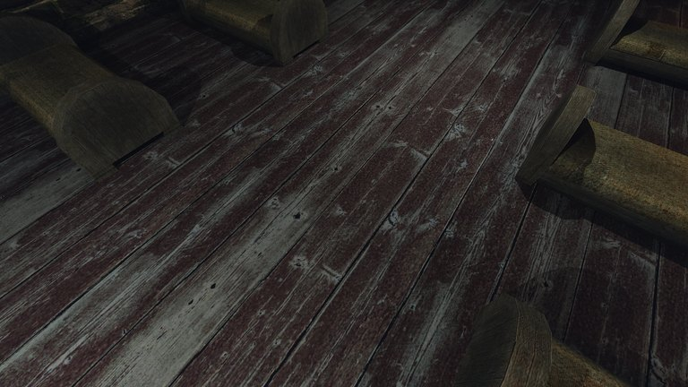

### NW_CITY_PFLASTERSTEIN_01.TGA

Городское мощение из небольших неровных обработанных камней серо-коричневого цвета с оливковым оттенком. Верх камней истёрт, грязь и мох остаются в швах; направление задают ряды.

**Где:** меш мира 2 732,1 м².

**Места:**

- (12281, 900, -3220), 348,3 м²; tiled 91,70%, panel 8,30%; типичная грань 189,6 м², 0,31×0,45 UV.
- (16086, 900, -3704), 324,9 м²; tiled 83,05%, panel 16,95%; типичная грань 80,5 м², 1,62×1,69 UV.
- (12285, 905, 1893), 322,9 м²; tiled 84,22%, panel 15,78%; типичная грань 38,9 м², 2,20×1,94 UV.

**Раскладка:** основной `tiled`; tiled 85,22%, panel 14,78%. Решение `include` / `cobble`; антиповтор `on`. Обрезки: непрерывная поверхность → tiled.
**Кадр:** `NW_CITY_SMALLTALK_02`, поверхность у (11950, 900, -2848); днём.

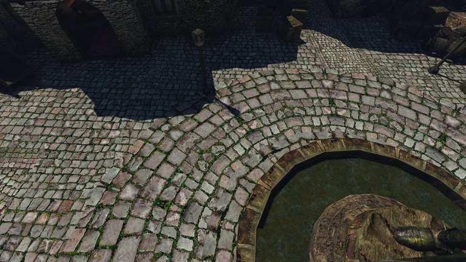

### NW_HARBOUR_WOOD_IRON_01.TGA

Модуль усиленной деревянной конструкции: тёмные оливково-коричневые доски или брусья стянуты тусклыми железными полосами. Открытое дерево потёрто, у металла темнее; обвязки пересекают продольные волокна дерева.

**Где:** меш мира 2 143,0 м²; vob 485,8 м²: `NW_HARBOUR_CANON_01.3DS` ×17, `NW_HARBOUR_FISHINGNET_01.3DS` ×7, `NW_HARBOUR_ANCHOR_01.3DS` ×5.

**Места:**

- (-8506, 169, -12798), 357,0 м²; tiled 1,41%, panel 23,01%, strip 75,58%; типичная грань 31,3 м², 1,06×1,00 UV.
- (-1057, 169, -2965), 355,8 м²; tiled 0,32%, panel 17,58%, strip 82,11%; типичная грань 25,9 м², 1,06×1,00 UV.
- (-8532, 195, -19153), 342,4 м²; panel 21,41%, strip 78,59%; типичная грань 31,3 м², 1,06×1,00 UV.

**Раскладка:** основной `strip`; tiled 7,88%, panel 13,19%, strip 78,93%. Решение `module` / `bound_timber_tile`; антиповтор `off`. Обрезки: линейная деталь → strip.
**Модуль на типичной грани:** охват 1,21×3,37 UV; по площади 3,22 единицы модуля. Одна единица UV ≈5,20×3,00 м, пропорция U:V ≈1,73:1; scale 1.
**Кадр:** `NW_CITY_SMITH_01_03`, поверхность у (4990, 510, -746); днём.

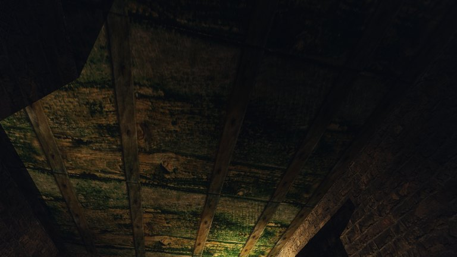

### NW_CITY_INSIDEWALL_12.TGA

Дощатая обшивка внутри дома, преимущественно потолочная: тёмные доски между деревянными обвязками, грязнее у стыков. Оси досок и каркаса закреплены относительно каждого участка.

**Где:** меш мира 2 265,1 м².

**Места:**

- (15109, 1689, -343), 541,6 м²; tiled 93,13%, panel 5,13%, strip 1,74%; типичная грань 109,6 м², 4,15×3,11 UV.
- (14377, 1509, -3907), 488,4 м²; tiled 97,25%, panel 2,75%; типичная грань 122,2 м², 3,10×2,16 UV.
- (12165, 1475, -4694), 357,8 м²; tiled 91,30%, panel 7,13%, strip 1,57%; типичная грань 75,2 м², 3,60×3,68 UV.

**Раскладка:** основной `tiled`; tiled 88,95%, panel 8,75%, strip 2,30%. Решение `module` / `framed_boards_tile`; антиповтор `off`. Обрезки: ограниченная панель → panel.
**Модуль на типичной грани:** охват 4,15×3,11 UV; по площади 8,81 единицы модуля. Одна единица UV ≈3,53×3,53 м, пропорция U:V ≈1,00:1; scale 1.
Несмотря на WALL в имени, 95,01% площади обращено вниз: это преимущественно потолочная обшивка; вертикальных участков 4,68%. Направления относятся к самой панели, а не к мировому верху.
**Кадр:** `NW_CITYHALL_PRIVATE_01`, поверхность у (15713, 1500, -140); днём.

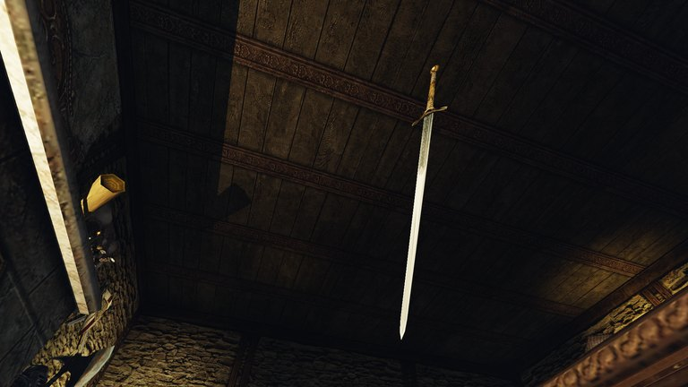

### NW_CITY_WOOD_01.TGA

Грубая древесина полов и деревянных конструкций; в кадре — пол оружейной кладовой. Серо-бурые волокна идут вдоль деталей, выступы потёрты, трещины темнее.

**Где:** меш мира 1 051,2 м²; vob 1 093,2 м²: `NW_NATURE_FENCE_01.3DS` ×167, `NW_MISC_WINDMILL_ROTOR_01.3DS` ×3, `NW_CITY_SHIP_01.3DS` ×2.

**Места:**

- (10779, 272, 6070), 128,0 м²; tiled 33,86%, panel 63,41%, strip 2,73%; типичная грань 19,2 м², 1,00×3,13 UV.
- (7962, 273, -6803), 82,6 м²; panel 96,47%, strip 3,53%; типичная грань 6,0 м², 1,00×1,00 UV.
- (-1694, 4518, 16340), 60,6 м²; strip 100,00%; типичная грань 1,4 м², 1,02×0,45 UV.

**Раскладка:** основной `panel`; tiled 7,72%, panel 50,63%, strip 41,64%. Решение `panel` / `planks_panel`; антиповтор `off`. Обрезки: линейная деталь → strip.
**Кадр:** `NW_CITY_MERCHANT_PATH_37`, поверхность у (10971, 270, 5251); днём.

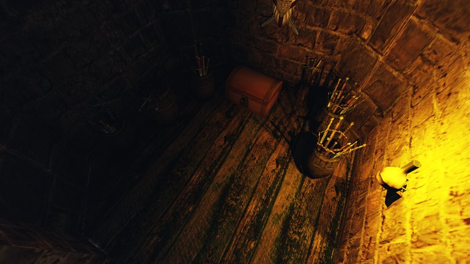

### NW_CITY_DUNGEONWALL_05.TGA

Несущая стена из неровных обработанных каменных блоков в старом растворе. Тёмные серо-коричневые поверхности имеют истёртые края и влажные углублённые швы; ряды кладки располагаются горизонтально.

**Где:** меш мира 2 120,5 м².

**Места:**

- (48104, 3639, 21791), 434,2 м²; tiled 98,17%, strip 1,83%; типичная грань 4,6 м², 1,85×0,52 UV.
- (49721, 3638, 22003), 335,8 м²; tiled 97,45%, strip 2,55%; типичная грань 2,9 м², 1,25×0,52 UV.
- (46388, 3640, 20857), 311,5 м²; tiled 100,00%; типичная грань 3,7 м², 1,25×0,52 UV.

**Раскладка:** основной `tiled`; tiled 98,82%, strip 1,18%. Решение `include` / `masonry_dressed`; антиповтор `on`. Обрезки: непрерывная поверхность → tiled.
**Кадр:** `NW_CITY_KANAL_23`, поверхность у (8056, -472, 3134); днём.

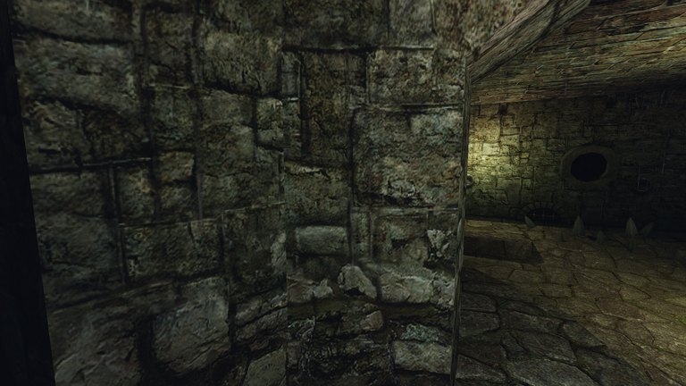

### NW_CITY_FACHWERKBASEMENT_EMPTY_01.TGA

Модуль нижнего этажа фахверкового дома: серая каменная кладка под деревянной балкой и более тяжёлый цоколь снизу. Основание темнее и зеленее от сырости, под верхней балкой грязнее.

**Где:** меш мира 2 034,6 м².

**Места:**

- (11590, 1081, -1296), 250,7 м²; tiled 11,63%, panel 84,12%, strip 4,25%; типичная грань 15,5 м², 1,38×0,88 UV.
- (8190, 401, 3177), 170,5 м²; tiled 66,30%, panel 33,70%; типичная грань 22,4 м², 3,00×0,83 UV.
- (7776, 393, -2805), 164,1 м²; tiled 87,71%, panel 12,29%; типичная грань 24,3 м², 3,00×0,83 UV.

**Раскладка:** основной `panel`; tiled 43,19%, panel 54,07%, strip 2,74%. Решение `module` / `framed_masonry_tile`; антиповтор `off`. Обрезки: ограниченная панель → panel.
**Модуль на типичной грани:** охват 1,85×0,88 UV; по площади 1,62 единицы модуля. Одна единица UV ≈4,00×4,00 м, пропорция U:V ≈1,00:1; scale 1.
**Кадр:** `NW_CITY_UPTOWN_JUDGE_02_B`, поверхность у (16806, 1167, -1710); днём.

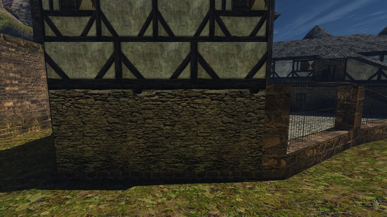

### NW_CITY_RICH_WALL_01.TGA

Полноразмерный модуль фахверкового дома верхнего квартала: холодное светлое заполнение между тёмными стойками и балками. У дерева грязнее, середина штукатурки светлее; верхняя балка и нижняя обвязка фиксированы.

**Где:** меш мира 2 025,4 м².

**Места:**

- (75105, 3816, -9804), 441,9 м²; tiled 44,12%, panel 31,15%, strip 24,73%; типичная грань 40,5 м², 3,99×0,94 UV.
- (75365, 3817, -12914), 441,2 м²; tiled 44,82%, panel 29,82%, strip 25,36%; типичная грань 39,2 м², 6,01×0,97 UV.
- (76345, 3765, -10586), 167,3 м²; tiled 26,94%, panel 44,37%, strip 28,70%; типичная грань 48,0 м², 5,04×0,94 UV.

**Раскладка:** основной `panel`; tiled 32,77%, panel 53,70%, strip 13,53%. Решение `module` / `timber_frame_tile`; антиповтор `off`. Обрезки: ограниченная панель → panel.
**Модуль на типичной грани:** охват 2,02×0,81 UV; по площади 0,94 единицы модуля. Одна единица UV ≈3,71×3,70 м, пропорция U:V ≈1,00:1; scale 1.
**Кадр:** `NW_CITY_LEOMAR_READ`, поверхность у (14116, 1600, -2995); днём.

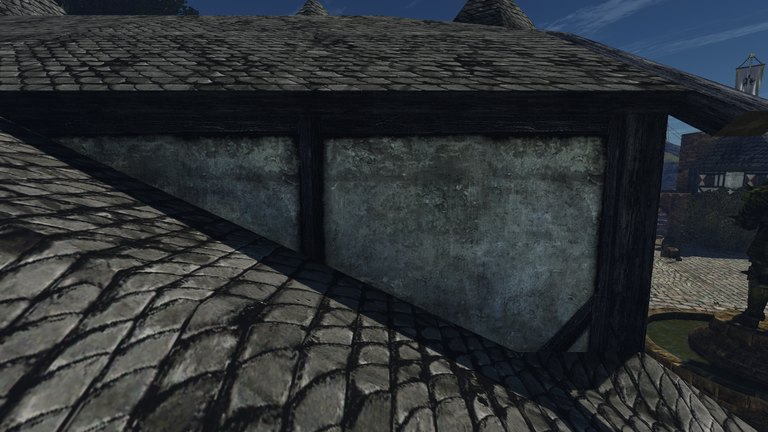

### NW_CITY_INSIDEWALL_13.TGA

Модуль внутреннего фахверка: тёплое кремовое известковое заполнение между коричневыми стойками и верхней и нижней балками. Середины светлее, грязь усиливается у дерева; верхняя балка и низ фиксированы.

**Где:** меш мира 1 850,3 м².

**Места:**

- (15068, 1725, -320), 415,3 м²; tiled 48,22%, panel 51,78%; типичная грань 38,0 м², 3,45×1,01 UV.
- (13305, 1465, -4201), 350,7 м²; tiled 86,03%, panel 13,97%; типичная грань 51,4 м², 3,05×0,96 UV.
- (16823, 1415, -2364), 203,0 м²; tiled 49,42%, panel 25,41%, strip 25,17%; типичная грань 51,1 м², 3,88×1,00 UV.

**Раскладка:** основной `tiled`; tiled 64,67%, panel 29,42%, strip 5,91%. Решение `module` / `timber_frame_tile`; антиповтор `off`. Обрезки: ограниченная панель → panel.
**Модуль на типичной грани:** охват 3,92×1,00 UV; по площади 3,92 единицы модуля. Одна единица UV ≈3,73×3,50 м, пропорция U:V ≈1,07:1; scale 1.
**Кадр:** `NW_CITY_REICH02_BED_01`, поверхность у (10270, 1417, -2355); днём.

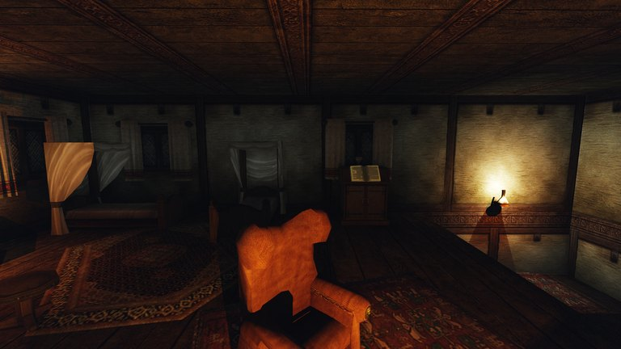

### NW_CITY_DIRTYGROUND_02.TGA

Утрамбованный двор между постройками: приглушённая коричневая земля, редкая оливковая трава и мелкий сор. Проходы затоптаны, у спокойных краёв скапливается мусор; выраженного верха нет.

**Где:** меш мира 1 829,5 м².

**Места:**

- (4435, 40, -1557), 167,2 м²; tiled 84,82%, panel 15,18%; типичная грань 17,0 м², 1,34×0,99 UV.
- (-540, -185, -5786), 144,5 м²; tiled 89,12%, panel 10,88%; типичная грань 52,0 м², 2,11×1,73 UV.
- (5762, 257, -3221), 143,9 м²; tiled 89,63%, panel 10,37%; типичная грань 48,9 м², 1,47×1,74 UV.

**Раскладка:** основной `tiled`; tiled 73,76%, panel 25,73%, strip 0,51%. Решение `include` / `mud`; антиповтор `on`. Обрезки: непрерывная поверхность → tiled.
**Ограничение снимка:** Кадр ограничен глубокой тенью: форма участка видна, цвет и мелкая фактура читаются слабо.
**Кадр:** `NW_CITY_HABOUR_KASERN_MAIN_ENTRY`, поверхность у (4045, 750, 6948); днём.

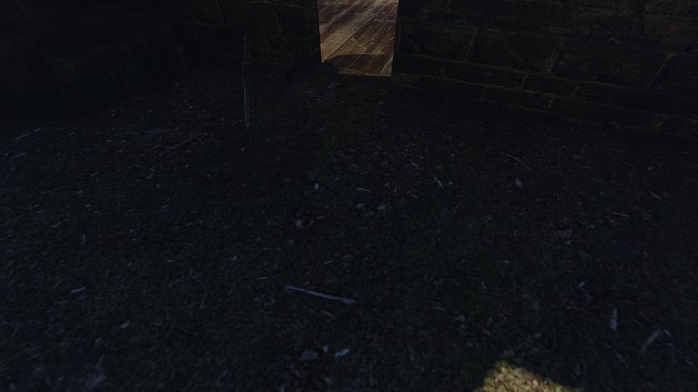

### NW_CITY_INSIDEWALL_11.TGA

Модуль внутренней стены: светлая тёплая каменная кладка между тёмными деревянными стойками, верхней балкой и нижней обвязкой. Грязь остаётся в швах и у дерева; верх и низ заданы.

**Где:** меш мира 1 748,8 м²; vob 66,1 м²: `NW_CITY_HIDDENDOOR_01.3DS` ×4.

**Места:**

- (14429, 1103, -3984), 318,0 м²; tiled 94,32%, panel 5,68%; типичная грань 51,4 м², 3,08×1,00 UV.
- (14943, 1303, -480), 311,6 м²; tiled 75,58%, panel 24,42%; типичная грань 50,4 м², 2,39×1,00 UV.
- (11954, 1076, -4675), 266,3 м²; tiled 21,95%, panel 78,05%; типичная грань 32,7 м², 2,49×0,99 UV.

**Раскладка:** основной `tiled`; tiled 63,70%, panel 36,30%. Решение `module` / `framed_masonry_tile`; антиповтор `off`. Обрезки: ограниченная панель → panel.
**Модуль на типичной грани:** охват 2,32×0,97 UV; по площади 2,26 единицы модуля. Одна единица UV ≈4,11×4,11 м, пропорция U:V ≈1,00:1; scale 1.
**Кадр:** `NW_CITY_UPTOWN_HUT_03_02`, поверхность у (15238, 1033, -3648); днём.

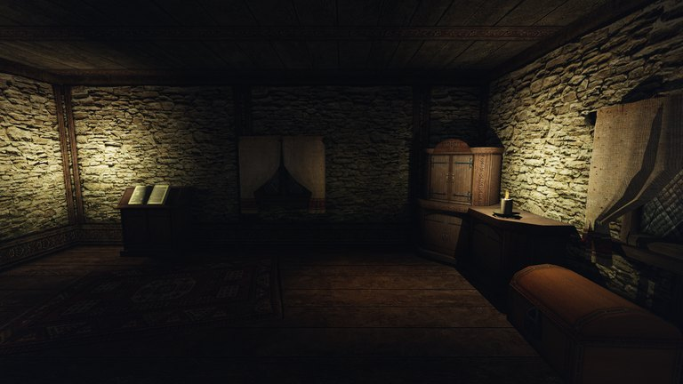

### NW_CITY_DUNGEONFLOOR_02.TGA

Каменный пол из крупных неровных плит серо-коричневого цвета с оливковым оттенком. Поверхности стёрты ходьбой, глубокие швы темнее и влажнее; фиксированных верха и низа нет.

**Где:** меш мира 1 720,4 м².

**Места:**

- (6869, -639, 1952), 199,7 м²; tiled 90,32%, strip 9,68%; типичная грань 33,5 м², 2,00×2,00 UV.
- (2317, -639, 6140), 194,0 м²; tiled 83,32%, panel 13,52%, strip 3,15%; типичная грань 33,5 м², 2,11×2,11 UV.
- (5820, -639, 4339), 189,5 м²; tiled 83,73%, panel 13,04%, strip 3,23%; типичная грань 33,5 м², 2,11×2,11 UV.

**Раскладка:** основной `tiled`; tiled 73,47%, panel 21,06%, strip 5,47%. Решение `include` / `flagstone`; антиповтор `on`. Обрезки: непрерывная поверхность → tiled.
**Кадр:** `NW_CITY_KANAL_ROOM_04_03`, поверхность у (9364, -639, 2193); днём.

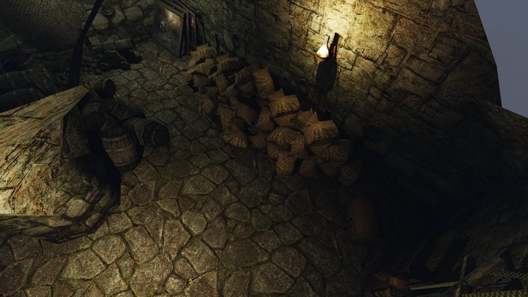

### NW_CITY_HAFEN_HOLZWAND_02.TGA

Модуль деревянной стены с небольшим проёмом и ставней среди вертикальных серо-коричневых досок. У проёма заметен износ, щели и участок под подоконником темнее; положение окна фиксировано.

**Где:** меш мира 1 454,2 м².

**Места:**

- (2316, -46, 424), 185,9 м²; tiled 11,43%, panel 49,81%, strip 38,76%; типичная грань 18,2 м², 2,58×0,49 UV.
- (4115, 41, -3959), 117,1 м²; tiled 17,85%, panel 78,91%, strip 3,24%; типичная грань 7,5 м², 2,28×0,73 UV.
- (2746, 7, 2044), 111,1 м²; tiled 44,80%, panel 55,20%; типичная грань 13,8 м², 1,08×0,92 UV.

**Раскладка:** основной `panel`; tiled 37,35%, panel 56,05%, strip 6,60%. Решение `module` / `window_wall_tile`; антиповтор `off`. Обрезки: ограниченная панель → panel.
**Модуль на типичной грани:** охват 2,58×0,49 UV; по площади 1,23 единицы модуля. Одна единица UV ≈3,64×4,09 м, пропорция U:V ≈0,89:1; scale 1.
**Кадр:** `NW_CITY_PATH_HABOUR_13_B`, поверхность у (2335, -59, 1154); днём.

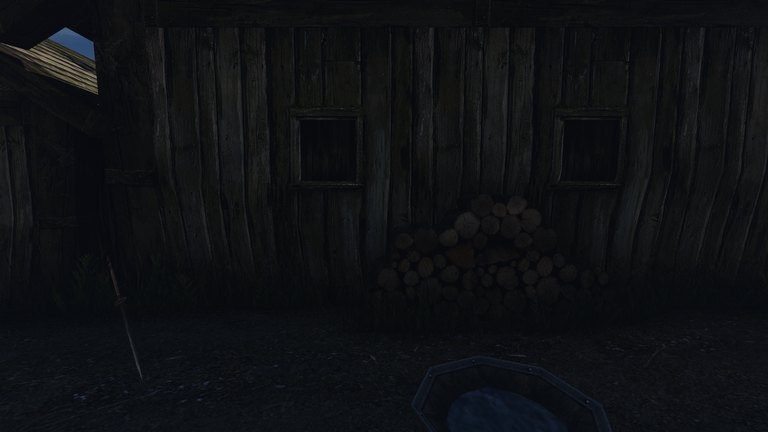

### NW_CITY_ROPE_01.TGA

Поверхность грубой крученой верёвки в портовом такелаже, охристо-коричневая по цвету. Наружные волокна истёрты, углубления между ними темнее; кручение и волокна должны следовать длине верёвки.

**Где:** меш мира 1 276,9 м²; vob 101,0 м²: `NW_HARBOUR_ROPE_01.3DS` ×47, `NW_MISC_BIG_TENT_430P.3DS` ×7, `NW_HARBOUR_SMALL_BOAT_01.3DS` ×7, `NW_HARBOUR_FISHINGNET_01.3DS` ×7, `NW_HARBOUR_SMALL_BOAT_03.3DS` ×5.

**Места:**

- (-10130, 3049, -16264), 112,7 м²; strip 100,00%; типичная грань 11,1 м², 1,00×6,39 UV.
- (-9890, 1498, -11258), 112,5 м²; strip 100,00%; типичная грань 6,1 м², 1,00×6,39 UV.
- (-9977, 4686, -13549), 105,5 м²; strip 100,00%; типичная грань 11,6 м², 1,00×6,39 UV.

**Раскладка:** основной `strip`; panel 0,49%, strip 99,51%. Решение `strip` / `rope_strip`; антиповтор `off`. Обрезки: линейная деталь → strip.
**Кадр:** `SHIP_DECK_23`, поверхность у (-10152, 2739, -16744); днём.

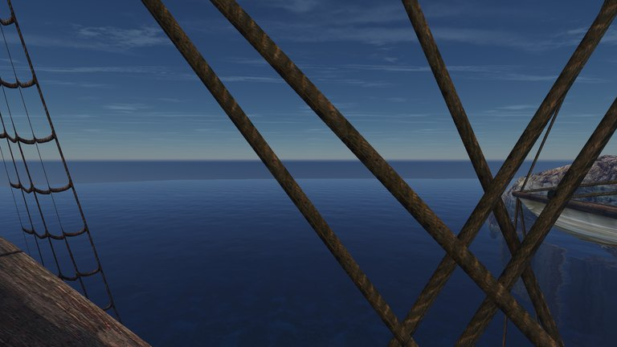

### NW_CITY_RICH_WINDOW_01.TGA

Модуль оконного участка дома верхнего квартала: проём в тёмном деревянном обрамлении, подоконник над светлым заполнением стены. У рамы и подоконника грязнее, ставня потёрта; окно стоит вертикально.

**Где:** меш мира 1 356,4 м².

**Места:**

- (13064, 1585, -4074), 123,1 м²; tiled 3,44%, panel 96,56%; типичная грань 12,7 м², 1,00×1,00 UV.
- (11153, 1567, 2801), 113,2 м²; tiled 7,45%, panel 92,55%; типичная грань 6,3 м², 1,00×1,00 UV.
- (11210, 1554, -1828), 105,0 м²; tiled 4,03%, panel 95,97%; типичная грань 7,1 м², 1,00×1,00 UV.

**Раскладка:** основной `panel`; tiled 2,49%, panel 97,51%. Решение `module` / `window_wall_tile`; антиповтор `off`. Обрезки: ограниченная панель → panel.
**Модуль на типичной грани:** охват 1,00×1,00 UV; по площади 2,00 единицы модуля. Одна единица UV ≈2,38×3,00 м, пропорция U:V ≈0,79:1; scale 1.
Здесь два соседних зеркальных модуля по одной копии UV каждый: U по стене идёт 0→1→0. Размер каждого около 2,375×3 м; общий размах 1×1 UV не означает одну копию на всю стену.
**Кадр:** `NW_CITY_CORNELIUS`, поверхность у (14647, 1700, 222); днём.

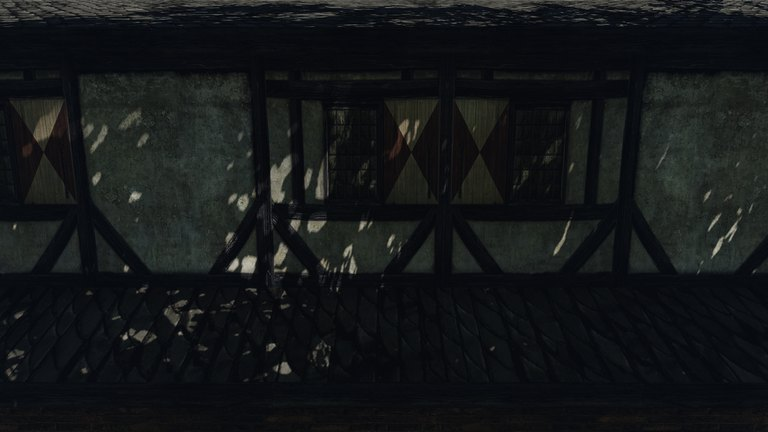

### NW_HARBOUR_STAIRS_01.TGA

Модуль каменной лестницы набережной: серо-коричневые проступи над более тёмными вертикальными подступенками. Края ступеней светлее от ходьбы, под выступами влажнее и грязнее; каждый выступ находится над подступенком.

**Где:** меш мира 1 260,9 м².

**Места:**

- (67680, 4558, -21816), 159,9 м²; panel 32,75%, strip 67,25%; типичная грань 2,1 м², 1,00×0,53 UV.
- (75835, 5824, 29416), 139,8 м²; strip 100,00%; типичная грань 139,8 м², 1,00×9,99 UV.
- (73262, 5824, 28227), 139,0 м²; strip 100,00%; типичная грань 139,0 м², 1,00×9,99 UV.

**Раскладка:** основной `strip`; tiled 20,34%, panel 24,29%, strip 55,37%. Решение `module` / `stair_tile`; антиповтор `off`. Обрезки: линейная деталь → strip.
**Модуль на типичной грани:** охват 1,50×2,00 UV; по площади 2,99 единицы модуля. Одна единица UV ≈3,40×2,56 м, пропорция U:V ≈1,33:1; scale 1.
**Кадр:** `NW_CITY_UPTOWN_PATH_01`, поверхность у (8619, 483, -4749); днём.

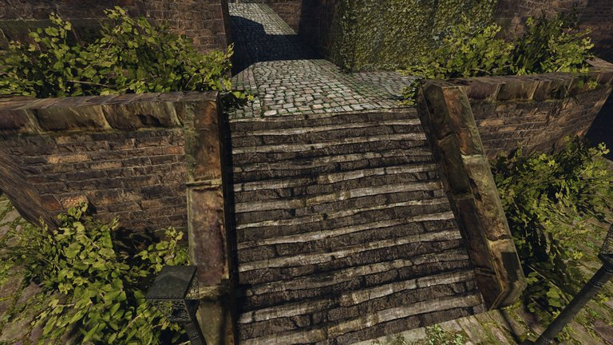

### NW_CITY_WOODBEAM_03.TGA

Модуль деревянной балки тёмного красновато-коричневого цвета с поперечными железными обвязками. Выступающие волокна истёрты, трещины и примыкания к металлу темнее; волокна продолжаются вдоль балки.

**Где:** меш мира 1 068,9 м²; vob 28,2 м²: `NW_SHIP_STAIRS_AND_MASTS_01.3DS` ×1, `EVT_GATEROOM_WHEEL_02.3DS` ×1.

**Места:**

- (-10033, 2601, -15226), 409,7 м²; tiled 13,36%, panel 9,86%, strip 76,79%; типичная грань 20,2 м², 0,95×0,82 UV.
- (-9934, 2765, -12334), 286,4 м²; tiled 19,11%, panel 14,10%, strip 66,79%; типичная грань 20,2 м², 0,95×0,82 UV.
- (-10126, 1899, -17053), 166,6 м²; strip 100,00%; типичная грань 12,3 м², 0,27×7,99 UV.

**Раскладка:** основной `strip`; tiled 9,98%, panel 7,36%, strip 82,66%. Решение `module` / `bound_timber_tile`; антиповтор `off`. Обрезки: линейная деталь → strip.
**Модуль на типичной грани:** охват 0,28×7,99 UV; по площади 2,20 единицы модуля. Одна единица UV ≈1,38×7,46 м, пропорция U:V ≈0,18:1; scale 1.
**Кадр:** `SHIP_DECK_16`, поверхность у (-10074, 1880, -15199); днём.

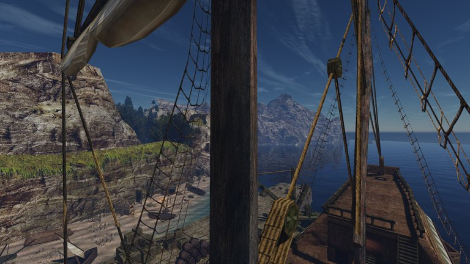

### NW_HARBOUR_FISHINGNET_01.TGA

Открытая рыболовная сеть из грубых узловатых верёвок серо-охристого коричневого цвета. Узлы истёрты, углубления волокон темнее; сетка должна следовать подвешенной или растянутой форме снасти.

**Где:** vob 1 077,2 м²: `NW_HARBOUR_FISHINGNETBIG.3DS` ×53, `NW_HARBOUR_FISHINGNETSMALL.3DS` ×19.

**Места:**

- (-10041, 114, -12716), 124,7 м²; tiled 91,28%, panel 3,99%, strip 4,73%; типичная грань 0,8 м², 1,34×1,62 UV.
- (37260, 4048, -2190), 96,6 м²; tiled 94,39%, panel 3,86%, strip 1,75%; типичная грань 0,8 м², 1,34×1,62 UV.
- (-13556, -211, -8841), 71,3 м²; tiled 91,28%, panel 3,99%, strip 4,73%; типичная грань 0,8 м², 1,34×1,62 UV.

**Раскладка:** основной `tiled`; tiled 91,90%, panel 3,95%, strip 4,15%. Решение `exclude`; антиповтор `off`. Обрезки: непрерывная поверхность → tiled.
**Кадр:** `SHIP_IN_09`, поверхность у (-10215, 579, -18671); днём.

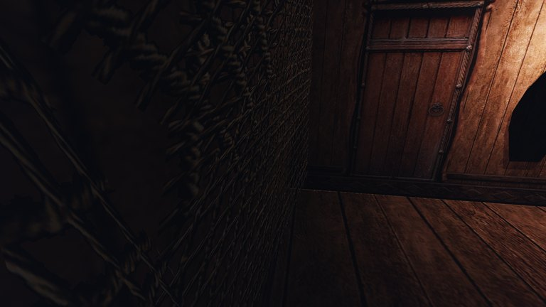

### NW_CITY_HAFENRANDSTEIN_01.TGA

Каменный бордюр на краю набережной из серо-охристых блоков. Открытые грани сколоты и потёрты, в стыках остаётся грязь; камни повторяются полосой вдоль края мощения.

**Где:** меш мира 1 053,7 м².

**Места:**

- (-1487, -208, 3420), 94,9 м²; tiled 1,59%, panel 39,22%, strip 59,18%; типичная грань 8,6 м², 1,77×0,81 UV.
- (-1111, -207, -1876), 84,7 м²; panel 24,94%, strip 75,06%; типичная грань 9,4 м², 0,73×1,04 UV.
- (-7215, -195, -5024), 81,7 м²; panel 100,00%; типичная грань 31,4 м², 1,05×0,98 UV.

**Раскладка:** основной `strip`; tiled 0,29%, panel 37,07%, strip 62,64%. Решение `strip` / `stone_strip`; антиповтор `off`. Обрезки: линейная деталь → strip.
**Кадр:** `NW_CITY_WAY_TO_SHIP_05`, поверхность у (-6553, -204, -4599); днём.

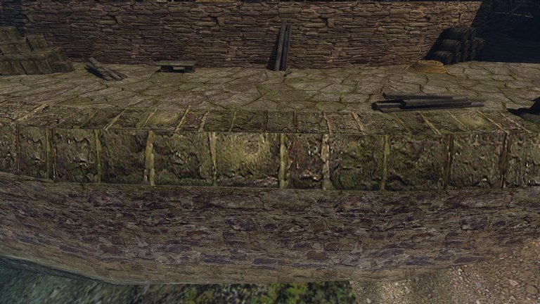

### NW_CITY_DIRTYGROUND_WEG_03.TGA

Тёмная грунтовая дорожка с оливковой растительностью по сторонам. Середина утрамбована, края сохраняют траву и сор; эти полосы идут вдоль направления движения.

**Где:** меш мира 987,5 м².

**Места:**

- (5053, -185, 357), 176,7 м²; tiled 89,48%, panel 10,52%; типичная грань 28,2 м², 0,68×2,08 UV.
- (3736, -187, 2814), 123,0 м²; tiled 79,77%, strip 20,23%; типичная грань 46,7 м², 1,03×1,42 UV.
- (2696, -188, 768), 118,8 м²; tiled 69,58%, panel 30,42%; типичная грань 36,6 м², 1,37×1,25 UV.

**Раскладка:** основной `tiled`; tiled 77,12%, panel 19,04%, strip 3,84%. Решение `module` / `path_tile`; антиповтор `off`. Обрезки: непрерывная поверхность → tiled.
**Модуль на типичной грани:** охват 1,40×1,64 UV; по площади 1,07 единицы модуля. Одна единица UV ≈5,93×6,66 м, пропорция U:V ≈0,89:1; scale 1.
**Кадр:** `NW_CITY_PATH_HABOUR_16`, поверхность у (3706, -187, 2396); днём.

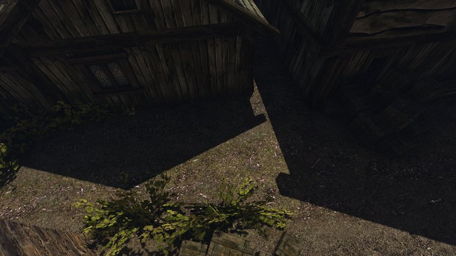

### NW_CITY_GITTERZAUN_01.TGA

Секция тёмного железного ограждения с тонкими вертикальными прутьями и открытыми промежутками. Соединения темнее, открытые поверхности обветрены; верх секции и вертикальное положение прутьев заданы конструкцией.

**Где:** меш мира 957,9 м².

**Места:**

- (15335, 1153, -2104), 134,1 м²; tiled 100,00%; типичная грань 26,0 м², 2,00×1,00 UV.
- (73138, 3365, -6159), 128,0 м²; strip 100,00%; типичная грань 26,5 м², 5,18×0,78 UV.
- (13413, 1152, 1950), 119,5 м²; tiled 46,01%, panel 53,99%; типичная грань 27,5 м², 2,00×1,00 UV.

**Раскладка:** основной `tiled`; tiled 51,21%, panel 6,74%, strip 42,05%. Решение `exclude`; антиповтор `off`. Обрезки: непрерывная поверхность → tiled.
**Кадр:** `NW_CITY_TRAIN_02`, поверхность у (12739, 1203, 307); днём.

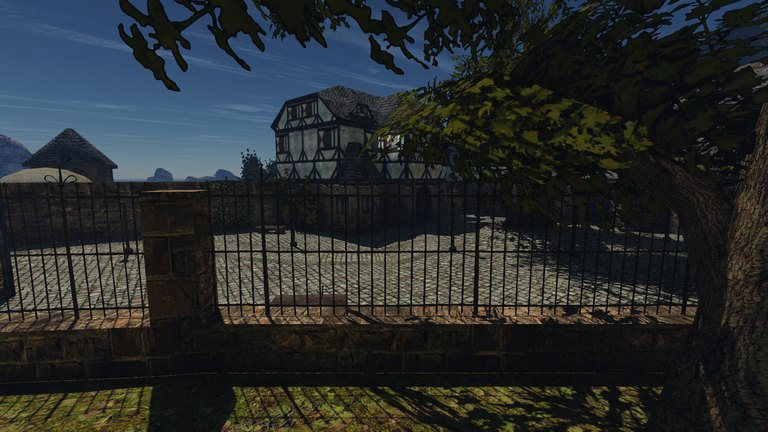

### NW_CITY_BODENDIELEN_DRECK_01.TGA

Затоптанный деревянный пол с серо-коричневыми и приглушёнными оливковыми тонами. Мелкая въевшаяся грязь лежит и на досках, и в швах; волокна направлены вдоль досок.

**Где:** меш мира 835,7 м².

**Места:**

- (-6861, -1863, -8668), 393,3 м²; tiled 100,00%; типичная грань 313,6 м², 1027,62×0,00 UV.
- (1268, -188, 966), 61,9 м²; tiled 67,03%, panel 32,97%; типичная грань 32,6 м², 1,31×1,03 UV.
- (3050, -139, -5463), 57,3 м²; tiled 9,78%, panel 90,22%; типичная грань 19,8 м², 1,00×0,91 UV.

**Раскладка:** основной `tiled`; tiled 66,93%, panel 33,07%. Решение `include` / `planks_floor`; антиповтор `off`. Обрезки: непрерывная поверхность → tiled.
**Кадр:** `NW_CITY_HABOUR_HUT_01_IN`, поверхность у (1591, -190, 346); днём.

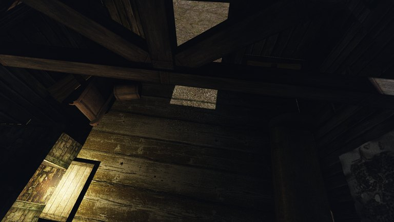

### NW_CITY_PFLASTERSTEIN_BORDER_01.TGA

Модуль границы городского мощения: узкий окантовочный ряд разделяет поля мелких серо-коричневых камней. Верх истёрт, в швах и у границы остаются грязь и мох; окантовка направлена вдоль края.

**Где:** меш мира 833,1 м².

**Места:**

- (5323, 750, 7438), 171,0 м²; tiled 65,81%, panel 34,19%; типичная грань 63,0 м², 1,00×1,75 UV.
- (5720, 695, 5306), 161,5 м²; tiled 73,99%, panel 26,01%; типичная грань 63,0 м², 1,00×1,97 UV.
- (15393, 900, -2433), 92,1 м²; tiled 51,41%, panel 48,59%; типичная грань 47,3 м², 0,94×2,55 UV.

**Раскладка:** основной `panel`; tiled 49,63%, panel 50,37%. Решение `module` / `pavement_border_tile`; антиповтор `off`. Обрезки: непрерывная поверхность → tiled.
**Модуль на типичной грани:** охват 1,00×1,88 UV; по площади 1,38 единицы модуля. Одна единица UV ≈6,00×6,00 м, пропорция U:V ≈1,00:1; scale 1.
**Кадр:** `NW_CITY_HABOUR_KASERN_CENTRE_04`, поверхность у (4794, 750, 6740); днём.

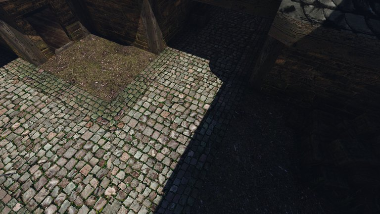

### NW_CITY_IVY_BORDER_01.TGA

Край растительного покрова на стене: приглушённые зелёные и оливковые листья постепенно образуют открытый контур. Цвет листьев стареет неравномерно; заполненная и свободная стороны различаются.

**Где:** меш мира 700,8 м².

**Места:**

- (14492, 1290, 2550), 117,2 м²; panel 100,00%; типичная грань 24,5 м², 1,10×1,00 UV.
- (10553, 856, 343), 107,6 м²; tiled 11,48%, panel 74,33%, strip 14,19%; типичная грань 14,7 м², 0,67×1,05 UV.
- (9582, 1120, -4255), 94,1 м²; tiled 7,45%, panel 91,88%, strip 0,67%; типичная грань 5,9 м², 0,63×0,73 UV.

**Раскладка:** основной `panel`; tiled 10,18%, panel 86,43%, strip 3,38%. Решение `panel` / `foliage_panel`; антиповтор `off`. Обрезки: ограниченная панель → panel.
**Кадр:** `NW_CITY_CITYHALL_04_B`, поверхность у (14068, 1084, 2942); днём.

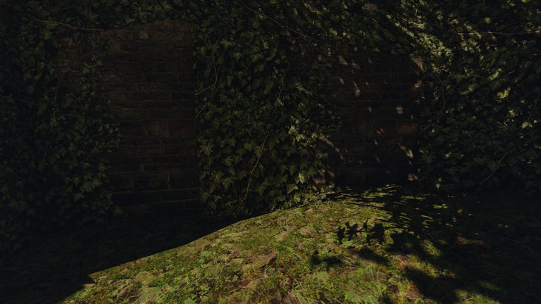

### NW_HARBOUR_BLACKIRON_01.TGA

Открытая поверхность портовой железной фурнитуры тёмных серых, коричневых и оливковых тонов. Неровная коррозия покрывает металл, углублённые места темнее; фиксированных верха и низа у материала нет.

**Где:** меш мира 496,2 м²; vob 156,9 м²: `NW_HARBOUR_IRONROPEHOLDER_01.3DS` ×20, `NW_HARBOUR_CANONBALLS_01.3DS` ×18, `NW_HARBOUR_RINGBIG_01.3DS` ×10, `NW_HARBOUR_CANONBALLS_02.3DS` ×6, `NW_HARBOUR_ANCHOR_01.3DS` ×5.

**Места:**

- (-8539, -14, -12707), 73,8 м²; tiled 47,20%, panel 50,69%, strip 2,12%; типичная грань 15,2 м², 1,00×1,00 UV.
- (-8520, -48, -19194), 65,7 м²; tiled 42,63%, panel 57,37%; типичная грань 15,2 м², 1,00×1,00 UV.
- (-1008, -6, -2883), 58,7 м²; tiled 45,55%, panel 54,45%; типичная грань 12,5 м², 1,00×1,00 UV.

**Раскладка:** основной `tiled`; tiled 64,06%, panel 25,03%, strip 10,91%. Решение `exclude`; антиповтор `off`. Обрезки: непрерывная поверхность → tiled.
**Кадр:** `NW_CITY_WAY_TO_SHIP_03`, поверхность у (-2849, -201, -3989); днём.

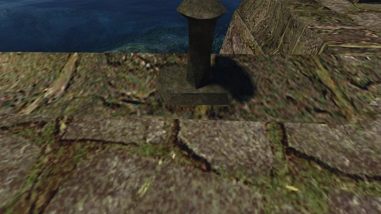

### NW_CITY_DIRTYGROUND_WEG_02.TGA

Участок грунтовой дорожки с гладкой затоптанной серединой и травянистыми краями. Земля серо-коричневая; края с сором идут вдоль пути, а поперёк меняется характер износа.

**Где:** меш мира 629,0 м².

**Места:**

- (3147, -142, -4404), 116,2 м²; tiled 56,29%, panel 43,71%; типичная грань 24,5 м², 0,83×1,46 UV.
- (2506, -163, -1758), 114,3 м²; tiled 82,20%, panel 17,80%; типичная грань 34,6 м², 1,00×1,52 UV.
- (963, -186, -4515), 89,5 м²; tiled 63,70%, panel 36,30%; типичная грань 29,5 м², 0,83×1,48 UV.

**Раскладка:** основной `tiled`; tiled 61,69%, panel 34,76%, strip 3,54%. Решение `module` / `path_tile`; антиповтор `off`. Обрезки: непрерывная поверхность → tiled.
**Модуль на типичной грани:** охват 1,00×1,52 UV; по площади 1,30 единицы модуля. Одна единица UV ≈5,34×5,00 м, пропорция U:V ≈1,07:1; scale 1.
**Кадр:** `NW_CITY_PATH_HABOUR_03`, поверхность у (1758, -188, -1650); днём.

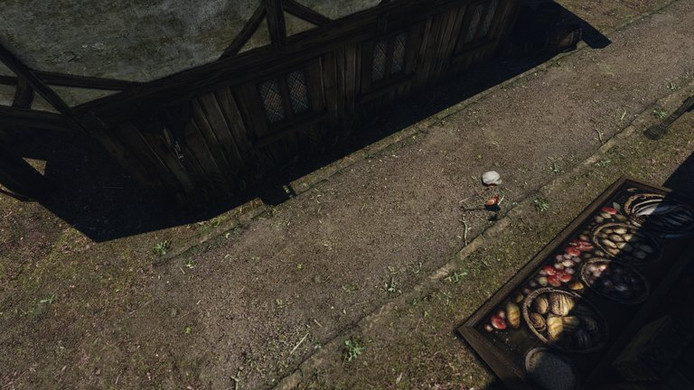

### NW_CITY_RICH_BLACKWOOD_01.TGA

Открытая тёмная деревянная балка дома верхнего квартала, от угольно-серого до коричневого цвета. Выступающие волокна истёрты и светлее, трещины темнее; волокна должны идти вдоль балки.

**Где:** меш мира 413,6 м²; vob 150,9 м²: `NW_MISC_BOARDS_01C.3DS` ×7, `NW_MISC_BOARDS_01A.3DS` ×5, `NW_MISC_BOARDS_02C.3DS` ×3, `NW_MISC_BOARDS_02A.3DS` ×2.

**Места:**

- (51197, 4297, 19367), 59,1 м²; strip 100,00%; типичная грань 0,9 м², 0,60×1,00 UV.
- (13581, 1647, -3329), 39,7 м²; panel 61,52%, strip 38,48%; типичная грань 3,2 м², 1,00×3,33 UV.
- (14383, 1886, -1050), 38,7 м²; panel 69,07%, strip 30,93%; типичная грань 2,7 м², 1,00×3,33 UV.

**Раскладка:** основной `strip`; tiled 0,42%, panel 40,47%, strip 59,10%. Решение `strip` / `timber_strip`; антиповтор `off`. Обрезки: линейная деталь → strip.
**Кадр:** `NW_CITY_CITYHALL_IN_03`, поверхность у (15936, 1510, -764); днём.

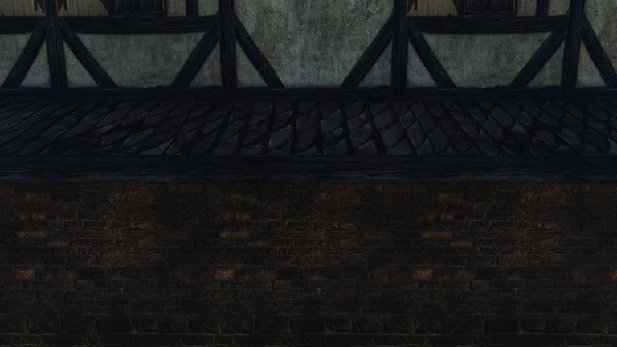

### NW_CITY_WINDOW_03.TGA

Модуль окна торгового квартала: проём в тёмном деревянном обрамлении и грязно-кремовое заполнение под подоконником. Грязь остаётся у ставни, подоконника и каркаса; оконный проём всегда находится над нижним заполнением.

**Где:** меш мира 519,0 м².

**Места:**

- (3052, 1932, 6645), 110,9 м²; tiled 27,05%, panel 72,95%; типичная грань 30,0 м², 2,00×1,00 UV.
- (3422, 2011, 5792), 49,1 м²; panel 100,00%; типичная грань 15,0 м², 1,00×0,97 UV.
- (5072, 535, -589), 32,8 м²; tiled 71,96%, panel 28,04%; типичная грань 12,5 м², 2,04×0,97 UV.

**Раскладка:** основной `panel`; tiled 15,91%, panel 84,09%. Решение `module` / `window_wall_tile`; антиповтор `off`. Обрезки: ограниченная панель → panel.
**Модуль на типичной грани:** охват 2,00×1,00 UV; по площади 2,00 единицы модуля. Одна единица UV ≈4,00×3,75 м, пропорция U:V ≈1,07:1; scale 1.
**Кадр:** `NW_CITY_ANDRE_01`, поверхность у (2986, 2000, 6924); днём.

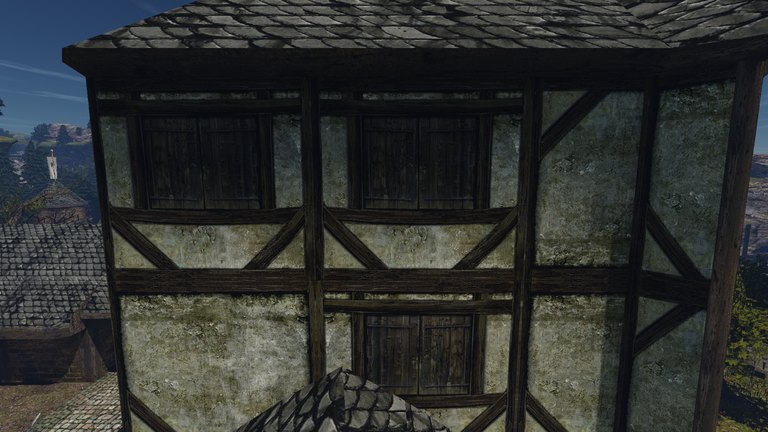

### NW_CITY_RICH_WALL_HALF_01.TGA

Невысокий модуль стены верхнего квартала: холодное светлое заполнение в тёмном деревянном каркасе. Примыкания к дереву темнее, середина слабо изношена; нижняя балка и раскосы задают ориентацию.

**Где:** меш мира 417,8 м².

**Места:**

- (10788, 1320, 2044), 67,2 м²; tiled 40,95%, panel 40,42%, strip 18,64%; типичная грань 12,5 м², 2,91×1,00 UV.
- (10922, 1319, -1739), 64,7 м²; tiled 33,30%, panel 22,30%, strip 44,40%; типичная грань 12,7 м², 2,91×1,00 UV.
- (16798, 1319, -2253), 50,7 м²; tiled 49,78%, panel 25,50%, strip 24,72%; типичная грань 12,5 м², 2,91×1,00 UV.

**Раскладка:** основной `tiled`; tiled 43,72%, panel 35,93%, strip 20,35%. Решение `module` / `timber_frame_tile`; антиповтор `off`. Обрезки: ограниченная панель → panel.
**Модуль на типичной грани:** охват 2,91×1,00 UV; по площади 2,43 единицы модуля. Одна единица UV ≈3,71×1,39 м, пропорция U:V ≈2,66:1; scale 1.
**Кадр:** `NW_CITY_SHOP_SALANDRIL_01`, поверхность у (12590, 1296, 3781); днём.

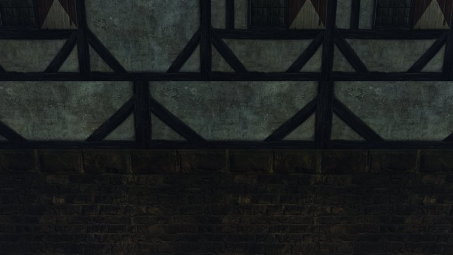

### NW_CITY_WOODBEAM_01.TGA

Модуль строительной балки: тёмное серо-коричневое дерево с поперечными тусклыми железными обвязками. Волокна потёрты, трещины и места у металла грязнее; волокна идут вдоль балки, обвязки поперёк.

**Где:** vob 401,8 м²: `NW_CITY_BEAMS_01.3DS` ×28, `NW_CITY_BEAM_01.3DS` ×7.

**Места:**

- (3866, 209, -3441), 65,2 м²; tiled 11,41%, panel 16,63%, strip 71,96%; типичная грань 2,1 м², 1,00×2,63 UV.
- (1144, 138, -5322), 64,3 м²; tiled 10,98%, panel 16,87%, strip 72,15%; типичная грань 2,1 м², 1,00×2,63 UV.
- (3401, 141, 1335), 64,3 м²; tiled 10,98%, panel 16,88%, strip 72,15%; типичная грань 2,1 м², 1,00×2,63 UV.

**Раскладка:** основной `strip`; tiled 10,37%, panel 15,11%, strip 74,51%. Решение `module` / `bound_timber_tile`; антиповтор `off`. Обрезки: линейная деталь → strip.
**Модуль на типичной грани:** охват 1,00×2,63 UV; по площади 2,62 единицы модуля. Одна единица UV ≈0,30×2,65 м, пропорция U:V ≈0,11:1; scale 1.
**Кадр:** `NW_CITY_HABOUR_HUT_07_IN`, поверхность у (4421, 94, 506); днём.

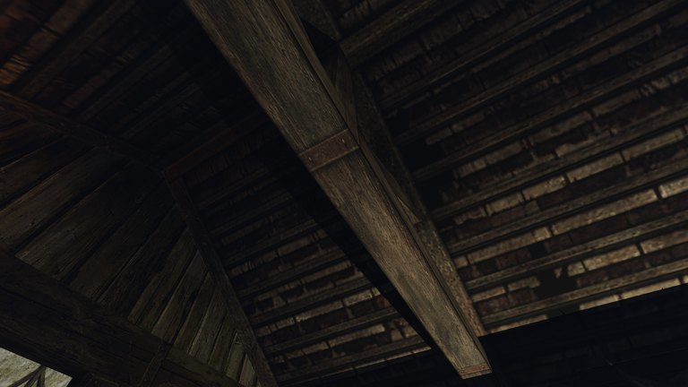

### NW_HARBOUR_FISHINGNET_04.TGA

Плотная тонкая рыболовная сетка тёмного серо-коричневого цвета с небольшими открытыми ячейками. Загрязнение слабое и неравномерное по поверхности; переплетение следует двум пересекающимся направлениям нитей.

**Где:** vob 401,6 м²: `NW_HARBOUR_FISHINGNET_01.3DS` ×7.

**Места:**

- (-2399, -258, -21810), 57,4 м²; tiled 75,95%, panel 24,05%; типичная грань 4,6 м², 0,94×0,98 UV.
- (-1379, 78, -3201), 57,4 м²; tiled 75,95%, panel 24,05%; типичная грань 4,6 м², 0,94×0,98 UV.
- (-8761, 15, -6346), 57,4 м²; tiled 75,95%, panel 24,05%; типичная грань 4,6 м², 0,94×0,98 UV.

**Раскладка:** основной `tiled`; tiled 75,95%, panel 24,05%. Решение `exclude`; антиповтор `off`. Обрезки: непрерывная поверхность → tiled.
**Кадр:** `NW_CITY_PIRATESCAMP_03`, поверхность у (-2522, -194, 12252); днём.

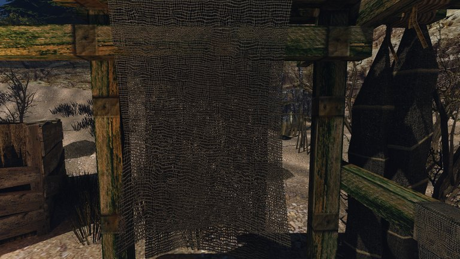

### NW_HARBOUR_ROPEWALL_01.TGA

Плотно уложенная верёвочная поверхность из параллельных охристо-коричневых витков. Наружные грубые волокна истёрты и светлее, борозды между витками темнее; ряды верёвки идут вдоль одной оси.

**Где:** меш мира 197,7 м²; vob 190,8 м²: `NW_HARBOUR_ROPE_01.3DS` ×47, `NW_HARBOUR_FISHINGNET_01.3DS` ×7, `NW_HARBOUR_IRONROPEHOLDER_WROPE_01.3DS` ×3.

**Места:**

- (-9964, 430, -12532), 62,8 м²; strip 100,00%; типичная грань 1,8 м², 1,55×0,27 UV.
- (-10031, 756, -17186), 25,8 м²; strip 100,00%; типичная грань 1,8 м², 1,55×0,27 UV.
- (-8916, 44, -15278), 20,3 м²; strip 100,00%; типичная грань 0,5 м², 1,55×0,27 UV.

**Раскладка:** основной `strip`; strip 100,00%. Решение `strip` / `rope_strip`; антиповтор `off`. Обрезки: линейная деталь → strip.
**Кадр:** `SHIP_IN_14`, поверхность у (-10178, 1254, -19660); днём.

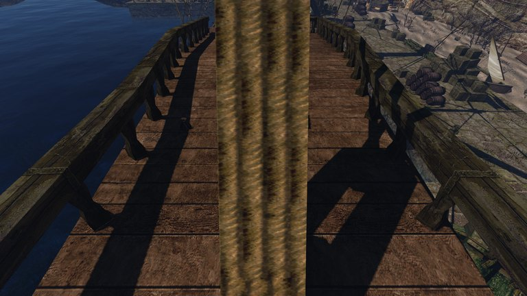

### NW_CITY_BROKENSTONE_01.TGA

Грубая каменная кладка земляных коричневых и серо-охристых тонов, местами сохраняющая старый раствор. Поверхности неровные, раствор утрачен, углублённые швы темнее; ряды задают горизонтальное направление.

**Где:** меш мира 368,4 м²; vob 11,4 м²: `ADDON_DUNGEON_BROKENSTONE_03.3DS` ×29, `ADDON_DUNGEON_SHELF_03.3DS` ×1, `ADDON_DUNGEON_SHELF_01.3DS` ×1.

**Места:**

- (4816, 1625, 7270), 250,5 м²; tiled 100,00%; типичная грань 250,5 м², 0,00×0,00 UV.
- (5453, 340, 1139), 34,6 м²; tiled 46,40%, panel 11,19%, strip 42,41%; типичная грань 6,9 м², 2,57×0,60 UV.
- (4106, 290, -2109), 32,8 м²; tiled 50,25%, panel 49,75%; типичная грань 7,4 м², 0,74×2,38 UV.

**Раскладка:** основной `tiled`; tiled 90,26%, panel 5,88%, strip 3,86%. Решение `include` / `masonry_rubble`; антиповтор `on`. Обрезки: непрерывная поверхность → tiled.
**Кадр:** `NW_CITY_PATH_HABOUR_07`, поверхность у (4000, 269, -1268); днём.

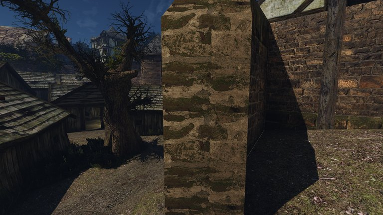

### NW_CITY_FACHWERKBASEMENT_WINDOW_01.TGA

Модуль нижнего этажа: небольшое углублённое окно в тёплой серой кладке, деревянная балка сверху и цоколь снизу. Сырость темнит основание, грязь остаётся вокруг проёма и балки.

**Где:** меш мира 244,4 м².

**Места:**

- (7679, 332, 2211), 42,1 м²; tiled 100,00%; типичная грань 11,3 м², 1,40×1,00 UV.
- (8319, 401, -3269), 39,6 м²; tiled 80,11%, panel 19,89%; типичная грань 11,6 м², 1,53×1,02 UV.
- (8796, 399, 3803), 31,9 м²; tiled 100,00%; типичная грань 11,7 м², 1,68×1,04 UV.

**Раскладка:** основной `tiled`; tiled 79,76%, panel 20,24%. Решение `module` / `framed_masonry_tile`; антиповтор `off`. Обрезки: ограниченная панель → panel.
**Модуль на типичной грани:** охват 1,00×0,88 UV; по площади 0,87 единицы модуля. Одна единица UV ≈4,00×4,00 м, пропорция U:V ≈1,00:1; scale 1.
**Кадр:** `NW_CITY_SALANDRIL`, поверхность у (12898, 1083, 2987); днём.

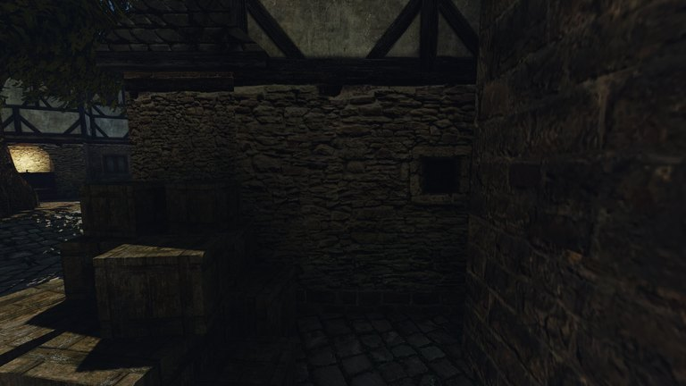

### NW_CITY_IVY_FULL_01.TGA

Сплошной покров вьющегося растения на здании: плотные перекрывающиеся листья приглушённых зелёных и оливковых тонов. Старение листьев неравномерно по поверхности; архитектурных верха и низа нет.

**Где:** меш мира 235,4 м².

**Места:**

- (9679, 1111, -3915), 45,3 м²; panel 100,00%; типичная грань 7,3 м², 1,09×1,05 UV.
- (74677, 3444, -13752), 30,1 м²; tiled 28,55%, panel 71,45%; типичная грань 8,6 м², 1,03×1,27 UV.
- (74416, 3447, -10652), 29,5 м²; panel 100,00%; типичная грань 5,8 м², 1,03×1,25 UV.

**Раскладка:** основной `panel`; tiled 5,08%, panel 94,92%. Решение `panel` / `foliage_panel`; антиповтор `off`. Обрезки: ограниченная панель → panel.
**Кадр:** `NW_CITY_UPTOWN_PATH_03_C`, поверхность у (9776, 1302, -4055); днём.

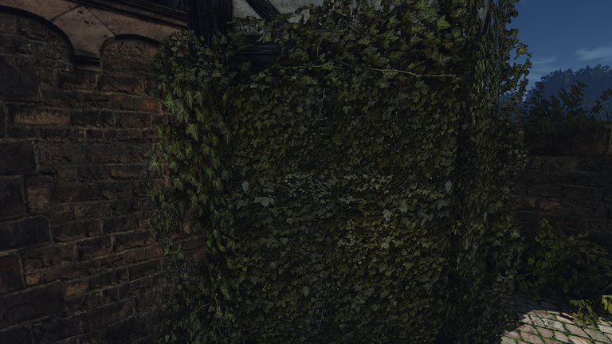

### NW_CITY_HAFENKAI_BODEN_TRANS_01.TGA

Модуль границы портового мощения и земли: открытые серо-коричневые камни постепенно уходят в грунт. Земля набивается в швы с грунтовой стороны; стороны перехода нельзя переставлять местами.

**Где:** меш мира 228,5 м².

**Места:**

- (813, -189, -1466), 82,3 м²; tiled 66,64%, panel 33,36%; типичная грань 22,7 м², 0,95×1,41 UV.
- (977, -185, 2007), 68,5 м²; tiled 77,10%, strip 22,90%; типичная грань 42,3 м², 0,87×1,53 UV.
- (64620, 6232, 45021), 47,7 м²; tiled 80,71%, strip 19,29%; типичная грань 38,5 м², 0,82×2,17 UV.

**Раскладка:** основной `tiled`; tiled 77,11%, panel 12,01%, strip 10,88%. Решение `module` / `paving_transition_tile`; антиповтор `off`. Обрезки: непрерывная поверхность → tiled.
**Модуль на типичной грани:** охват 0,87×1,53 UV; по площади 0,65 единицы модуля. Одна единица UV ≈7,97×8,18 м, пропорция U:V ≈0,97:1; scale 1.
**Кадр:** `NW_CITY_HABOUR_KASERN_01`, поверхность у (1006, -185, 2464); днём.

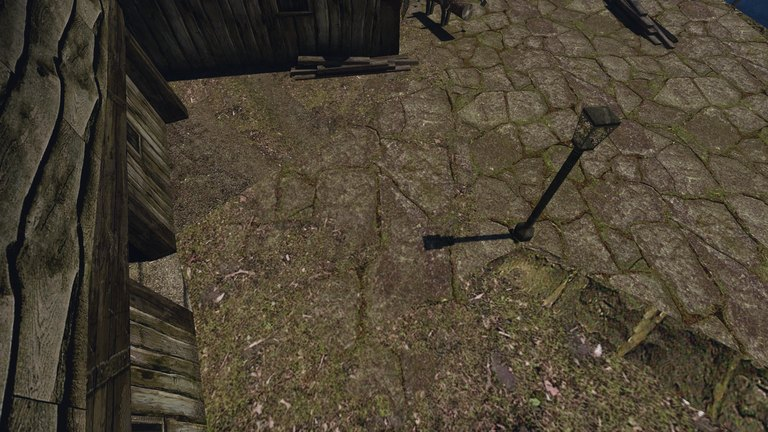

### NW_HARBOUR_FISHINGNET_03.TGA

Тонкая тёмная серо-коричневая рыболовная сеть с более толстыми поддерживающими верёвками. В мелкой сетке скапливаются пыль и грязь, опорная верёвка потёрта; её направление задаёт одну ось.

**Где:** vob 201,9 м²: `NW_HARBOUR_FISHINGNET_01.3DS` ×7.

**Места:**

- (-2259, -310, -21805), 28,8 м²; tiled 100,00%; типичная грань 0,2 м², 0,16×0,43 UV.
- (-1506, 23, -3258), 28,8 м²; tiled 100,00%; типичная грань 0,2 м², 0,16×0,43 UV.
- (-8895, -40, -6309), 28,8 м²; tiled 100,00%; типичная грань 0,2 м², 0,16×0,43 UV.

**Раскладка:** основной `tiled`; tiled 100,00%. Решение `exclude`; антиповтор `off`. Обрезки: непрерывная поверхность → tiled.
**Кадр:** `NW_CITY_PALCAMP_02`, поверхность у (-1468, 160, -3477); днём.

### NW_CITY_HAFEN_GIEBEL_01.TGA

Обшивка фронтона портовой постройки из грубых горизонтальных досок серо-коричневого цвета с оливковым оттенком. Открытые края высветлены, щели под нахлёстами темнее; доски перекрывают нижние ряды.

**Где:** меш мира 201,3 м².

**Места:**

- (3074, 202, 76), 36,0 м²; tiled 100,00%; типичная грань 7,5 м², 2,28×0,73 UV.
- (-608, 2813, 16638), 23,7 м²; tiled 69,24%, strip 30,76%; типичная грань 7,3 м², 2,63×0,54 UV.
- (65037, 4246, -25707), 23,7 м²; tiled 69,24%, strip 30,76%; типичная грань 7,3 м², 2,63×0,54 UV.

**Раскладка:** основной `tiled`; tiled 88,66%, strip 11,34%. Решение `include` / `planks_wall`; антиповтор `off`. Обрезки: непрерывная поверхность → tiled.
**Кадр:** `NW_CITY_HABOUR_KASERN_02`, поверхность у (1271, 165, 2836); днём.

### NW_HARBOUR_CANON_01.TGA

Единая металлическая обёртка ствола с поперечными усиливающими поясами; её же используют светильники. Тёмный металл корродирует, у поясов грязнее. Непрерывная развёртка, не атлас разных деталей.

**Где:** меш мира 96,3 м²; vob 94,8 м²: `NW_CITY_CANDLE_01.3DS` ×157, `NW_HARBOUR_CANON_01.3DS` ×17, `NW_MISC_DUMPTRUCK_01.3DS` ×2, `EVT_GATEROOM_WHEEL_02.3DS` ×1.

**Места:**

- (-1639, 4433, 16327), 31,0 м²; tiled 100,00%; типичная грань 0,8 м², 0,35×0,20 UV.
- (-10861, -355, -15087), 30,6 м²; tiled 100,00%; типичная грань 0,1 м², 0,20×0,37 UV.
- (-8935, -98, -14215), 23,6 м²; tiled 100,00%; типичная грань 0,1 м², 0,20×0,37 UV.

**Раскладка:** основной `tiled`; tiled 96,19%, strip 3,81%. Решение `module` / `banded_metal_tile`; антиповтор `off`. Обрезки: непрерывная поверхность → tiled.
**Модуль на типичной грани:** охват 0,20×0,37 UV; по площади 0,07 единицы модуля. Одна единица UV ≈0,72×1,26 м, пропорция U:V ≈0,57:1; scale 1.
У цельного ствола пушки U обходит окружность дважды, V проходит вдоль ствола: охват около 2,00×0,96 UV. Кольца и участки ствола принадлежат одной непрерывной оболочке; малые грани кривой поверхности не превращают её в атлас.
**Кадр:** `NW_CITY_PALCAMP_11`, поверхность у (-5634, 237, -5324); днём.

### NW_CITY_DUNGEONFLOOR_03.TGA

Каменная поверхность винтового прохода внутри башни Ксардаса: неровные буро-серые плиты, тёмные стыки и стёртые выступы. Подъём задаёт геометрия; у самого материала нет верха и низа.

**Где:** меш мира 185,9 м².

**Места:**

- (31009, 5075, -14448), 185,9 м²; tiled 100,00%; типичная грань 2,6 м², 0,91×0,67 UV.

**Раскладка:** основной `tiled`; tiled 100,00%. Решение `include` / `flagstone`; антиповтор `on`. Обрезки: непрерывная поверхность → tiled.
**Кадр:** `NW_XARDAS_TOWER_IN1_11_C`, поверхность у (30730, 5124, -14675); днём.

### NW_HARBOUR_WOODENGATE_01.TGA

Горизонтальная решётка палубного люка: тёмные перекладины с клёпаными креплениями и открытыми промежутками. Потёрты выступающие рёбра, стыки темнее; архитектурного верха и низа нет.

**Где:** меш мира 159,4 м².

**Места:**

- (-9988, -113, -14059), 159,4 м²; tiled 100,00%; типичная грань 39,9 м², 1,50×3,00 UV.

**Раскладка:** основной `tiled`; tiled 100,00%. Решение `exclude`; антиповтор `off`. Обрезки: ограниченная панель → panel.
**Кадр:** `SHIP_DECK_09`, поверхность у (-10274, -113, -13897); днём.

### NW_CITY_SHRINEFLOOR_01.TGA

Ограниченная каменная панель пола святилища с декоративной вставкой в приглушённых кремовых, коричневых и угольных тонах. Центр истёрт ходьбой, стыки и внешние края грязнее; центр и границы существенны.

**Где:** меш мира 150,3 м².

**Места:**

- (66058, 7459, 46365), 39,7 м²; panel 100,00%; типичная грань 32,1 м², 0,99×0,98 UV.
- (38465, 4362, 9791), 36,8 м²; panel 100,00%; типичная грань 36,8 м², 0,95×0,95 UV.
- (9948, 270, -716), 36,8 м²; panel 100,00%; типичная грань 36,8 м², 0,95×0,95 UV.

**Раскладка:** основной `panel`; panel 100,00%. Решение `panel` / `stone_panel`; антиповтор `off`. Обрезки: ограниченная панель → panel.
**Кадр:** `NW_CITY_MERCHANT_TEMPLE_IN`, поверхность у (9997, 270, -496); днём.

### NW_CITY_FACHWERKBASEMENT_CHAIN_01.TGA

Модуль нижнего этажа: кладка под деревянной балкой, тяжёлый цоколь, узкий проём и свисающие цепи. Сырость темнит низ, грязь собирается под балкой и у креплений.

**Где:** меш мира 119,6 м².

**Места:**

- (8314, 399, 2824), 32,3 м²; tiled 100,00%; типичная грань 11,6 м², 1,53×1,02 UV.
- (8354, 399, -2817), 27,4 м²; tiled 77,57%, panel 22,43%; типичная грань 11,5 м², 1,50×1,01 UV.
- (8609, 264, 450), 12,0 м²; tiled 100,00%; типичная грань 12,0 м², 1,41×1,04 UV.

**Раскладка:** основной `tiled`; tiled 79,59%, panel 20,41%. Решение `module` / `framed_masonry_tile`; антиповтор `off`. Обрезки: ограниченная панель → panel.
**Модуль на типичной грани:** охват 1,53×1,02 UV; по площади 1,50 единицы модуля. Одна единица UV ≈2,95×2,61 м, пропорция U:V ≈1,13:1; scale 1.
**Кадр:** `NW_CITY_MERCHANT_SHOP03_IN_02`, поверхность у (8356, 359, 2770); днём.

### NW_CITY_FLAG_01.TGA

Подвесное городское знамя из светлой ткани с тёмным знаком и приглушённой жёлтой отделкой. Загрязнение мягко следует складкам и открытым краям; верх подвеса и низ фиксированы.

**Где:** меш мира 115,4 м².

**Места:**

- (7289, 2220, -6202), 16,7 м²; panel 100,00%; типичная грань 8,1 м², 1,00×1,00 UV.
- (9671, 2555, -5355), 16,6 м²; panel 100,00%; типичная грань 8,1 м², 1,00×1,00 UV.
- (8767, 2219, -6397), 16,6 м²; panel 100,00%; типичная грань 8,1 м², 1,00×1,00 UV.

**Раскладка:** основной `panel`; panel 100,00%. Решение `panel` / `cloth_panel`; антиповтор `off`. Обрезки: ограниченная панель → panel.
**Кадр:** `NW_CITY_MAINSTREET_TOWER_01`, поверхность у (8734, 2278, -6389); днём.

### NW_CITY_WOOD_ORNAMENT_01.TGA

Узкая резная деревянная отделка конструкции в серо-коричневых тонах. Выступающие части резьбы истёрты, углубления темнее и грязнее; рисунок отделки должен продолжаться вдоль оси полосы.

**Где:** меш мира 79,2 м².

**Места:**

- (15220, 2148, -16284), 73,0 м²; panel 28,47%, strip 71,53%; типичная грань 8,6 м², 1,00×5,00 UV.
- (14678, 2037, -17031), 5,5 м²; panel 85,06%, strip 14,94%; типичная грань 2,0 м², 1,00×1,00 UV.
- (59201, 2542, -1206), 0,4 м²; strip 100,00%; типичная грань 0,2 м², 1,00×0,18 UV.

**Раскладка:** основной `strip`; panel 32,09%, strip 67,91%. Решение `strip` / `timber_strip`; антиповтор `off`. Обрезки: линейная деталь → strip.
**Кадр:** `NW_FARM1_INSTABLE_02`, поверхность у (15599, 2182, -16569); днём.

### NW_CITY_WALL_05.TGA

Невысокий модуль фахверковой стены торгового квартала: тёплое кремовое заполнение в коричневом каркасе. Середина штукатурки светлее, примыкания к дереву темнее; нижняя балка и раскосы задают низ.

**Где:** меш мира 53,0 м².

**Места:**

- (6720, 525, -492), 36,8 м²; tiled 12,24%, panel 23,48%, strip 64,28%; типичная грань 13,9 м², 4,06×1,01 UV.
- (7375, 524, -47), 16,2 м²; strip 100,00%; типичная грань 16,2 м², 4,06×1,03 UV.

**Раскладка:** основной `strip`; tiled 8,49%, panel 16,29%, strip 75,21%. Решение `module` / `timber_frame_tile`; антиповтор `off`. Обрезки: ограниченная панель → panel.
**Модуль на типичной грани:** охват 4,06×1,03 UV; по площади 4,17 единицы модуля. Одна единица UV ≈3,03×1,29 м, пропорция U:V ≈2,35:1; scale 1.
**Кадр:** `NW_CITY_MERCHANT_PATH_14_B`, поверхность у (7490, 546, -216); днём.

### NW_HARBOUR_CANONHOLE.TGA

Торец пушечного ствола с тёмным круглым каналом в центре и изношенным серо-коричневым металлом вокруг. К каналу усиливается копоть, наружный металл корродирует; отверстие привязано к центру торца.

**Где:** меш мира 47,2 м²; vob 4,7 м²: `NW_HARBOUR_CANON_01.3DS` ×17, `NW_MISC_DUMPTRUCK_01.3DS` ×2.

**Места:**

- (-8771, -225, -13574), 6,3 м²; panel 100,00%; типичная грань 1,0 м², 0,49×0,38 UV.
- (-11109, -402, -15570), 6,3 м²; panel 100,00%; типичная грань 1,0 м², 0,49×0,38 UV.
- (-8869, -342, -15690), 5,3 м²; panel 100,00%; типичная грань 1,0 м², 0,49×0,38 UV.

**Раскладка:** основной `panel`; tiled 4,98%, panel 95,02%. Решение `panel` / `iron_panel`; антиповтор `off`. Обрезки: ограниченная панель → panel.
**Кадр:** `NW_CITY_PALCAMP_11`, поверхность у (-5663, 225, -5247); днём.

### NW_HARBOUR_STAIRS_03.TGA

Модуль каменной лестницы в тёмных серо-коричневых и оливковых тонах. Носики ступеней истёрты и светлее, углубления влажные и тёмные; проступи располагаются над подступенками, направление подъёма фиксировано.

**Где:** меш мира 51,8 м².

**Места:**

- (79879, 3750, 20195), 10,4 м²; tiled 100,00%; типичная грань 5,2 м², 2,00×1,00 UV.
- (87129, 3755, 21154), 10,4 м²; tiled 100,00%; типичная грань 5,7 м², 2,00×1,20 UV.
- (77850, 3950, 22984), 10,4 м²; tiled 100,00%; типичная грань 5,7 м², 2,00×1,20 UV.

**Раскладка:** основной `tiled`; tiled 98,99%, strip 1,01%. Решение `module` / `stair_tile`; антиповтор `off`. Обрезки: линейная деталь → strip.
**Модуль на типичной грани:** охват 2,00×1,20 UV; по площади 2,19 единицы модуля. Одна единица UV ≈1,31×1,98 м, пропорция U:V ≈0,66:1; scale 1.
**Кадр:** `NW_TROLLAREA_PORTALTEMPEL_04`, поверхность у (77806, 4004, 23075); днём.

### NW_CITY_DIRTYGROUND_WEG_END_01.TGA

Конечный участок грунтовой дорожки, где гладкая утоптанная земля растворяется в более грубой поверхности. Коричнево-оливковые тона и рассеянный сор усиливаются к непротоптанной стороне; направление перехода существенно.

**Где:** меш мира 50,3 м².

**Места:**

- (4764, -1, -4946), 29,3 м²; tiled 43,83%, panel 56,17%; типичная грань 16,5 м², 0,80×1,04 UV.
- (1210, -190, -1736), 20,9 м²; panel 100,00%; типичная грань 20,9 м², 0,98×0,99 UV.

**Раскладка:** основной `panel`; tiled 25,58%, panel 74,42%. Решение `panel` / `ground_panel`; антиповтор `off`. Обрезки: непрерывная поверхность → tiled.
**Кадр:** `NW_CITY_PATH_HABOUR_02`, поверхность у (1268, -189, -1823); днём.

### NW_CITY_WALL_04.TGA

Модуль узкого фахверкового участка: тёплое кремовое заполнение между коричневыми стойками, верхней и нижней балками. У дерева грязнее, слабые следы сырости направлены вниз; стойка соединяет верх и низ.

**Где:** меш мира 25,7 м².

**Места:**

- (7224, 722, -1172), 19,4 м²; tiled 100,00%; типичная грань 19,4 м², 1,92×1,00 UV.
- (5285, 695, -1197), 6,3 м²; panel 100,00%; типичная грань 5,4 м², 1,04×1,00 UV.

**Раскладка:** основной `tiled`; tiled 75,36%, panel 24,64%. Решение `module` / `timber_frame_tile`; антиповтор `off`. Обрезки: ограниченная панель → panel.
**Модуль на типичной грани:** охват 1,92×1,00 UV; по площади 1,92 единицы модуля. Одна единица UV ≈3,83×2,64 м, пропорция U:V ≈1,45:1; scale 1.
**Кадр:** `NW_CITY_MERCHANT_PATH_06`, поверхность у (7122, 755, -1240); днём.

### NW_CITY_DIRTYGROUND_WEG_TRANS_02.TGA

Участок перехода от грунтовой дорожки к каменному мощению в серо-коричневых и оливковых тонах. Земля и трава заходят в швы; грунтовая и мощёная стороны должны сохраняться.

**Где:** меш мира 25,4 м².

**Места:**

- (5232, 223, -1828), 25,4 м²; panel 100,00%; типичная грань 13,9 м², 1,00×1,00 UV.

**Раскладка:** основной `panel`; panel 100,00%. Решение `panel` / `ground_panel`; антиповтор `off`. Обрезки: непрерывная поверхность → tiled.
**Кадр:** `NW_CITY_MAINSTREET_08`, поверхность у (5329, 239, -1784); днём.

### NW_CITY_TEMPLESTARROOF_01.TGA

Вертикальный звёздный фон портала в аддон: редкие светлые точки на тёмной пустоте, без материального износа. В игре перед ним стоят подвижные части и свечение портала.

**Где:** меш мира 20,4 м².

**Места:**

- (82643, 3899, 30198), 20,4 м²; tiled 100,00%; типичная грань 20,4 м², 1,72×1,69 UV.

**Раскладка:** основной `tiled`; tiled 100,00%. Решение `exclude`; антиповтор `off`. Обрезки: ограниченная панель → panel.
**Ограничение снимка:** Кадр показывает место портала. Сам звёздный задник перекрыт подвижными передними частями и свечением; из доступных ракурсов оставлен общий вид. Вертикальный диск подтверждён геометрией, звёздный фон — уменьшенным оригиналом.
**Кадр:** `NW_TROLLAREA_PORTAL_10`, поверхность у (82643, 3899, 30198); днём.

### NW_CITY_DOOR_02.TGA

Изображена красновато-коричневая дощатая створка с железной фурнитурой и истёртой краской. Основной найденный носитель — объёмный фрагмент рельефа с почти вырожденной UV-развёрткой; ещё один находится глубоко под городом. Размещение на действующей двери не подтверждено.

**Где:** меш мира 10,9 м².

**Места:**

- (46381, 2903, -2650), 9,8 м²; panel 100,00%; типичная грань 2,5 м², 0,52×0,49 UV.
- (1350, -4385, 820), 1,1 м²; tiled 100,00%; типичная грань 1,1 м², 2,22×0,99 UV.

**Раскладка:** основной `panel`; tiled 10,03%, panel 89,97%. Решение `exclude`; антиповтор `off`. Обрезки: ограниченная панель → panel.
Крупное скопление соединено общими рёбрами с лесным грунтом и скальным переходом. Две грани имеют нулевую площадь UV, остальные сильно искажены; причины такого применения дверного изображения неизвестны. Поэтому замену отложили, не назначая ему действующую дверь.
**Кадр:** `NW_CITY_KANAL_15`, поверхность у (1350, -4385, 820); днём.

### NW_HARBOUR_ROPEWALL_02.TGA

Канатная обвязка пучка шестов у вершины палатки. Параллельные тёмно-охристые витки удерживают опоры вместе; наружные волокна вытерты, борозды темнее. Это узкий пояс, не ткань палатки.

**Где:** vob 6,4 м²: `OW_MISC_TENT_01.3DS` ×4.

**Места:**

- (45033, 3425, 2119), 3,2 м²; strip 100,00%; типичная грань 0,2 м², 0,17×0,26 UV.
- (79233, 5356, 26390), 1,6 м²; strip 100,00%; типичная грань 0,2 м², 0,17×0,26 UV.
- (82525, 4714, -18070), 1,6 м²; strip 100,00%; типичная грань 0,2 м², 0,17×0,26 UV.

**Раскладка:** основной `strip`; strip 100,00%. Решение `strip` / `rope_strip`; антиповтор `off`. Обрезки: линейная деталь → strip.
**Кадр:** `NW_TAVERNE_TROLLAREA_MONSTER_02_01`, поверхность у (45348, 3481, 2404); днём.

### NW_CITY_STONEWALL_02.TGA

Грубая каменная стена небольшой постройки из неровных холодных серых блоков. Края камней изношены, углублённые растворные швы темнее; ряды кладки располагаются горизонтально по стене.

**Где:** меш мира 4,7 м².

**Места:**

- (59634, 4363, -22884), 3,6 м²; tiled 100,00%; типичная грань 3,6 м², 0,11×0,28 UV.
- (63777, 4880, -25450), 0,8 м²; tiled 100,00%; типичная грань 0,8 м², 1,26×0,19 UV.
- (59965, 5421, -21952), 0,3 м²; tiled 100,00%; типичная грань 0,3 м², 0,00×0,00 UV.

**Раскладка:** основной `tiled`; tiled 100,00%. Решение `include` / `masonry_rubble`; антиповтор `on`. Обрезки: непрерывная поверхность → tiled.
**Ограничение снимка:** Кадр ограничен вырожденными UV: основная видимая часть растянута в полосы. После двух ракурсов оставлен лучший; назначение материала сверено по уменьшенному оригиналу и геометрии. У двух крупных участков UV-площадь нулевая; корректная развёртка есть только на участке 0,77 м².
**Кадр:** `NW_CASTLEMINE_04`, поверхность у (59634, 4363, -22884); днём.

### NW_CITY_DOOR_01.TGA

Изображена тёмная деревянная створка с вертикальными досками, петлями и запором; у креплений грязнее. Найденный носитель — несколько треугольников мировой геометрии примерно на 42 м ниже улиц. Размещение на действующей двери не подтверждено.

**Где:** меш мира 2,4 м².

**Места:**

- (1364, -4361, 522), 2,4 м²; tiled 100,00%; типичная грань 1,3 м², 2,25×1,16 UV.

**Раскладка:** основной `tiled`; tiled 100,00%. Решение `exclude`; антиповтор `off`. Обрезки: ограниченная панель → panel.
**Кадр:** `NW_CITY_HABOUR_HUT_01_IN`, поверхность у (1364, -4313, 522); днём.

### NW_CITY_DOOR_03.TGA

Изображена тёмная красновато-коричневая створка из горизонтальных досок с железной фурнитурой и потёртостями у запора. Найденный носитель — несколько треугольников мировой геометрии примерно на 42 м ниже улиц. Размещение на действующей двери не подтверждено.

**Где:** меш мира 1,1 м².

**Места:**

- (1350, -4417, 746), 1,1 м²; tiled 100,00%; типичная грань 1,1 м², 2,22×0,99 UV.

**Раскладка:** основной `tiled`; tiled 100,00%. Решение `exclude`; антиповтор `off`. Обрезки: ограниченная панель → panel.
**Кадр:** `NW_CITY_KANAL_15`, поверхность у (1350, -4417, 746); днём.

## Проверки

- `uv run --no-project --with pytest --with numpy --with pillow --with scipy python -m pytest -q scripts/content/` — **242/242**, 12,79 с.
- `python3 scripts/content/map_textures.py check` — **71 строка**, решения 16/27/10/7/11, код 0.
- `scripts/content-textures.sh --self-test` — **24 проверки**, код 0.
- Съёмка через `gq quick` на Ryzen: основной обход **71/71** за 93 с, уточнения **2/2** за 9 с и **16/16** за 24 с. Все три игры — exit 0; проверены завершение и порядок `goto`/`shot`, PNG и пустой индекс замен. Из 89 кадров выбраны 71.
- Пробные 8 кадров отброшены: после асинхронного `shot` не было ожидания, кадры сместились к следующему месту. Добавлено 300 мс; последующие три проверки прошли. Двух падений съёмки по одной причине при верной подготовке не было.
- Сняты все 71 текстура. Ограничения четырёх выбранных кадров прямо отмечены в карточках. Генерации не было.
- Проверка файлов отчёта — 71 карточка, 71 JPG по 768×432, 27 описаний размера модуля, 78 действительных ссылок; суммарно 4 703 952 байта JPG.
