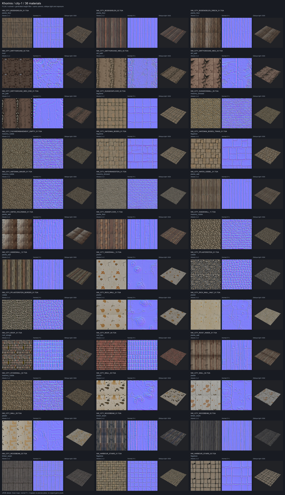

# Первый набор Хориниса — city-1

Готовы **36 материалов** для всех строк `include` [таблицы](../../../data/content/city-materials.csv), новый лист и 10 пар «было → стало». Набор остаётся `draft` в `~/.local/share/gothic-ai/content-staging/city-1/`: `materials/materials.json` + 108 DDS. Рабочий каталог `~/.local/share/gothic-ai/content` не менялся; просмотр и включение — за пользователем.

## Материалы

FLUX.1-schnell, ревизия `741f7c3ce8b383c54771c7003378a50191e9efe9`, Apache-2.0; 1024², 4 шага, guidance 0, NF4, circular padding — как в [сравнении](../2026-10-material-bakeoff/README.md). Вход — только текст из [библии](../../../docs/content-style.md) и таблицы, сид — от имени текстуры и номера попытки. Оригинальные пиксели генератору не передавались.

После правок пользователя перегенерированы **11 материалов**: три грунта, все шесть `plaster`, каменный бордюр и дощатая стена гавани. В CSV исправлены пять состояний с указанием положения; классы, масштабы и решения include/exclude сохранены. Остальным **25** применено только ограничение насыщенности albedo; прежние сиды, промпты и остальные карты сохранены.

Яркость вне диапазона класса приводится к его середине общим множителем. После этого среднее HSV S по пикселям ограничивается до **0,30**, для `roof_tiles` — **0,40**, общим сдвигом линейного RGB к серому той же яркости. Все 36 выбранных PNG проходят оба ограничения. Карты — свой фильтр, шероховатость в диапазоне класса, металличность 0; масштаб из CSV.

Всего **74 попытки**, из них **29 новых**: для девяти материалов использованы все три новые попытки, для двух хватило одной. Все сиды, рецепты, карты и поправки — в [реестре](../../../data/content/registry.jsonl). После лимита оставлены лучшие доступные варианты с пометкой `best_available`:

| Материал | Что осталось |
|---|---|
| `NW_CITY_DIRTYGROUND_WEG_03.TGA` | Широкие трещины местами напоминают мощение |
| `NW_CITY_INSIDEWALL_13.TGA`, `NW_CITY_RICH_WALL_01.TGA` | Крупные пятна штукатурки |
| `NW_CITY_WALL_03.TGA`, `NW_CITY_WALL_04.TGA`, `NW_CITY_WALL_05.TGA` | Крупные пятна и сколы заметны при повторе |

Кандидат с нарисованными буквами отклонён. По решению пользователя после лимита оставлены лучшие варианты без остановки работы.

## В игре

[Сценарий](../../../scripts/content/city.bench) сохраняет исходную точку «город» из `rf.bench` и добавляет рынок, гавань, верхний квартал и дом Зуриса. Полдень и 23:00, одинаковые камера и сейв; слева оригинал, справа набор. JPG уменьшены до 768×432 на половину пары, цвет не поправлялся.

| Точка | 12:00 | 23:00 |
|---|---|---|
| Город, у лестницы в верхний квартал | [Было → стало](city.jpg) | [Было → стало](city_night.jpg) |
| Рыночная площадь | [Было → стало](market.jpg) | [Было → стало](market_night.jpg) |
| Гавань | [Было → стало](harbour.jpg) | [Было → стало](harbour_night.jpg) |
| Верхний квартал | [Было → стало](upper.jpg) | [Было → стало](upper_night.jpg) |
| Внутри дома | [Было → стало](house.jpg) | [Было → стало](house_night.jpg) |

Ryzen, заявка `gq` **62636d4288f1**: две игры завершились с кодом 0, **15 кадров каждая**, ошибок стенда нет; 128 с без набора и 214 с с набором. Все 10 пар просмотрены, дом снят изнутри. Перепись `OPENGOTHIC_CENSUS`: без набора — **0 подмен / 36 открытых оригиналов**, с набором — **36 подмен / 0 открытых оригиналов**. Проверены также архивные имена `-C.TEX` и пути к DDS набора. Перед игрой используется явный пустой индекс, с набором — `OPENGOTHIC_CONTENT` на его отдельную копию. Локальная сборка пар была продолжена из готовых PNG после правки читавшегося shell-файла; повторных игр на Ryzen не было.

**Mac, M1 Pro:** свободен при запуске, ожидание слота не потребовалось. Метод исходного замера рендера: 6 с прогрева и 20 с игрового времени между маркерами, FPS = представленные кадры / реальное время; окно 960×540 точек, Retina 1920×1080, RelWithDebInfo с `OPENGOTHIC_ENABLE_FRAME_PROFILE=ON`.

| | FPS | Кадров | Реальное окно | Игровое окно |
|---|---:|---:|---:|---:|
| Без набора | **55,74** | 292 | 5,238 с | 19,967 с |
| С набором | **54,14** | 280 | 5,171 с | 19,967 с |

Разница **−1,60 FPS (−2,87%)** в одной паре прогонов. Это FPS фиксированного стенда, не живой игры. Перепись Mac: 36 подмен / 0 оригиналов, переполнение профиля 0. Первый запуск без профилировщика повторён; проверка окна исправлена на игровое время. В обоих логах Mac одно сообщение OpenAL о недоступном аудиоустройстве при выключенном звуке, игры завершились с кодом 0.

Исходные кадры, переписи и профили — вне git, в `~/.local/share/gothic-ai/content-staging/city-1-captures/`.

## Время и проверки

Сумма генерации и фильтра всех 74 попыток — **654,537 с**, из них новые 29 — 259,048 с, без загрузки модели и ожидания машин. На dev-ubuntu использовался только `~/gothic-ai/materials/`. Окна остановки `gothic-gemma` 19 октября 2026, UTC, до успешной проверки порта:

| Остановка | Запуск | Порт проверен | Окно |
|---|---|---|---:|
| 08:43:30 | 08:49:32 | 08:49:38 | 368 с |
| 08:51:50 | 08:53:19 | 08:53:26 | 96 с |
| 09:02:18 | 09:03:15 | 09:03:21 | 63 с |
| 09:24:15 | 09:26:27 | 09:26:34 | 139 с |
| 09:29:39 | 09:32:52 | 09:32:58 | 199 с |

Всего по city-1 **865 с (14 мин 25 с)**; вместе с прежними окнами материалов — **1498 с**, меньше лимита 3600 с. Перед каждой остановкой проверялась игра на Mac. `gothic-decider`, ASR и TTS не останавливались. После каждого окна сервисы восстановлены и порт проверен; после последнего все четыре юнита активны. Токен передавался только FLUX и не печатался.

- `uv run --no-project --with pytest --with numpy --with pillow --with scipy python -m pytest scripts/content/test_*.py -q` — **170 passed**.
- `registry.py check` — **86 записей**, включая 36 городских `draft`; `map_textures.py check` — **71 строка: 36 include, 35 exclude**, покрытие 72,30% площади.
- Выбранные **216 PNG 1024²**, **108 DDS + materials.json**; 36 имён и масштабы совпадают с таблицей. Прижим отрицательного Z нормалей: 0 пикселей во всех выбранных материалах.
- `capture-city.sh --check` прошёл для обеих серий Ryzen; `--check-fps` сверил оба Mac-профиля с реальными кадрами и окнами. `bash -n` обоих раннеров прошёл.
- Mac-бинарник собран из этого worktree: сначала 1208 шагов, затем 223 шага с включённым профилировщиком, exit 0. Исходники движка, шейдеры и `server/` не менялись.

Следующие наборы делаются тем же конвейером из CSV и библии: `generate.py prepare`, `run-materials.sh city`, упаковка и съёмка. Команды и правила повторных серий — в [описании системы](../../../docs/own-content.md#как-работает-сейчас).
