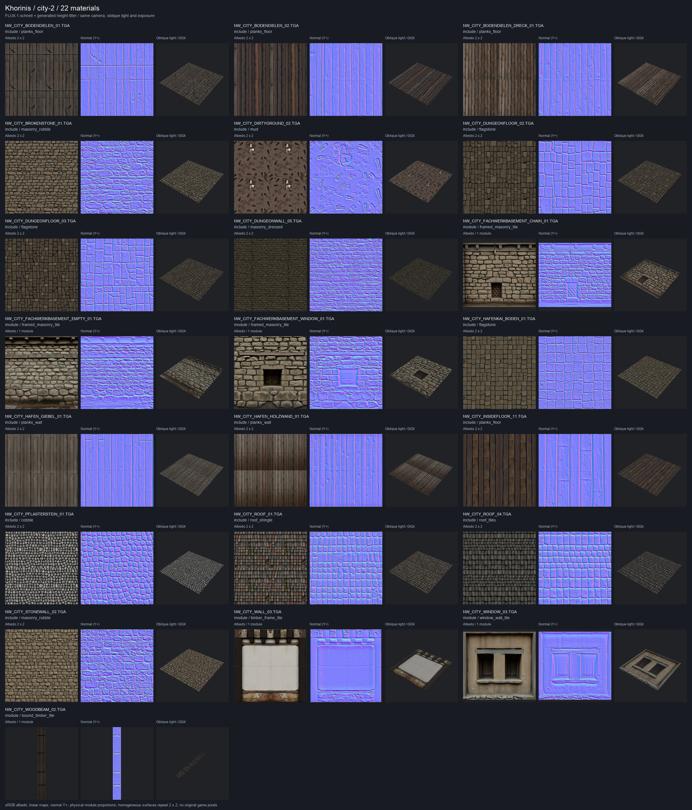
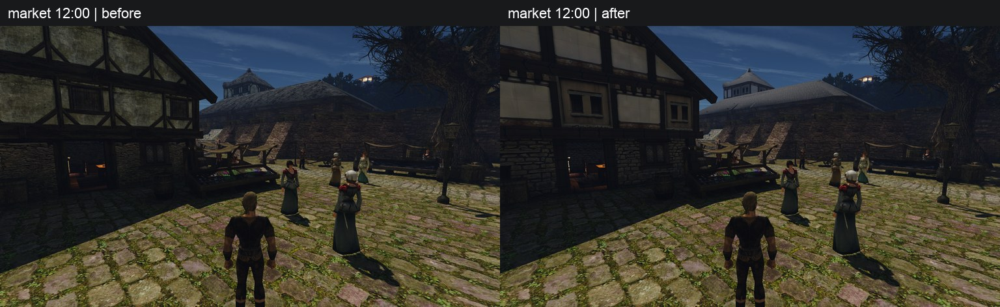
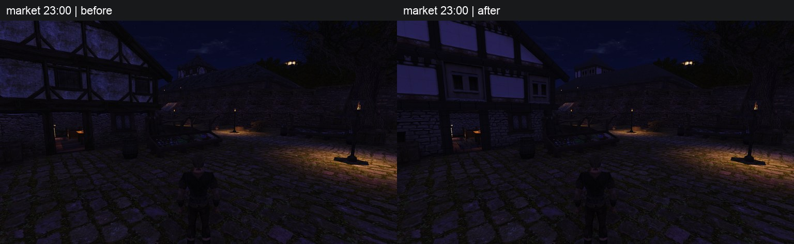
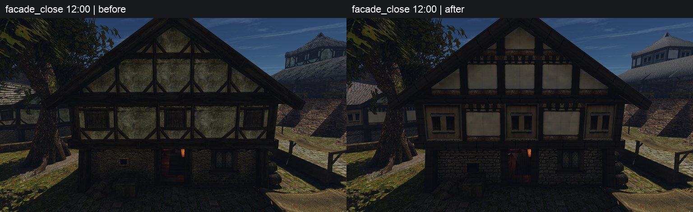
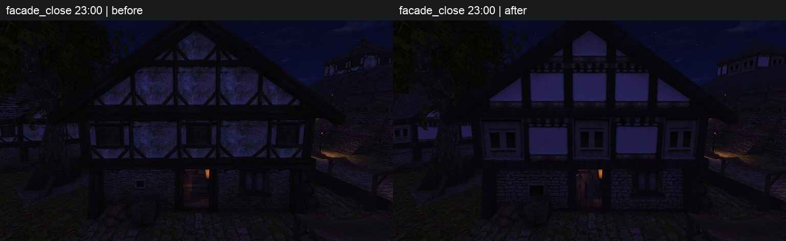
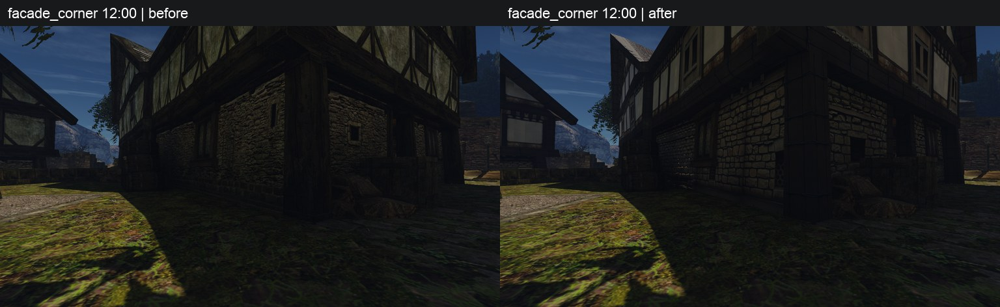
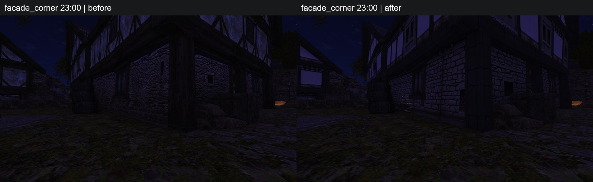
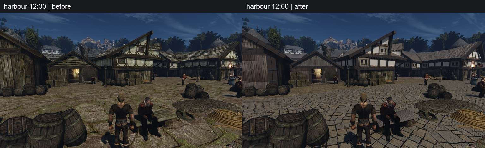
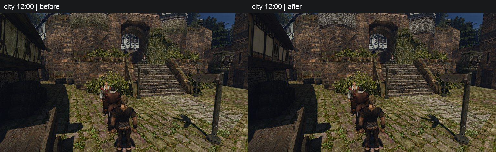

# Второй городской пилот: city-2

22 уникальные замены: все 16 `include` и шесть дополнительных составных текстур дома у рынка. Крыша `ROOF_01` и задняя обшивка `HAFEN_HOLZWAND_01` уже входят в эти 16. Набор остаётся `draft` в `~/.local/share/gothic-ai/content-staging/city-2/`; выбор и включение — за пользователем.

FLUX.1-schnell + свой фильтр: **41 изображение, 42 попытки**, включая одну прерванную при исправлении округления пропорций балки. У 12 материалов одна попытка, у 10 — три; больше трёх нигде нет. В реестре сохранены все варианты, причины и прежние рецепты. Семь лучших вариантов оставлены с замечаниями.

## Яркость и попытки

Оригинал декодирован как в `texdump.cpp`: ZenKit `as_rgba8(0)`, средняя линейная яркость с весом альфы. Из оригинала в конвейер передано только это число. Здесь city-2 — яркость упакованного DDS, mip 0. Максимальная ошибка PNG до упаковки — **0,0000422**, DDS — **0,001326**. У 10 текстур уровень ниже ориентира класса; он сохранён по решению пользователя.

↓ — ниже ориентира класса; † — лучший вариант с замечанием. Последняя колонка: число попыток → выбранная.

| Текстура | Решение | Яркость оригинала | Яркость city-2 | Попытки |
|---|---|---:|---:|---:|
| `NW_CITY_BODENDIELEN_01.TGA` | include | 0.058112 ↓ | 0.058396 | 1 → 1 |
| `NW_CITY_BODENDIELEN_02.TGA` | include | 0.044092 ↓ | 0.044295 | 1 → 1 |
| `NW_CITY_BODENDIELEN_DRECK_01.TGA` | include | 0.073641 | 0.073924 | 1 → 1 |
| `NW_CITY_BROKENSTONE_01.TGA` | include | 0.098916 | 0.099712 | 1 → 1 |
| `NW_CITY_DIRTYGROUND_02.TGA` | include | 0.079081 | 0.079400 | 3 → 2 † |
| `NW_CITY_DUNGEONFLOOR_02.TGA` | include | 0.053327 ↓ | 0.053422 | 3 → 3 † |
| `NW_CITY_DUNGEONFLOOR_03.TGA` | include | 0.049370 ↓ | 0.049586 | 3 → 3 † |
| `NW_CITY_DUNGEONWALL_05.TGA` | include | 0.036494 ↓ | 0.036885 | 1 → 1 |
| `NW_CITY_FACHWERKBASEMENT_CHAIN_01.TGA` | module | 0.116755 | 0.117642 | 3 → 3 † |
| `NW_CITY_FACHWERKBASEMENT_EMPTY_01.TGA` | module | 0.127084 | 0.128189 | 3 → 1 † |
| `NW_CITY_FACHWERKBASEMENT_WINDOW_01.TGA` | module | 0.125475 | 0.126680 | 3 → 2 |
| `NW_CITY_HAFENKAI_BODEN_01.TGA` | include | 0.077225 ↓ | 0.077612 | 3 → 2 † |
| `NW_CITY_HAFEN_GIEBEL_01.TGA` | include | 0.078404 | 0.078762 | 1 → 1 |
| `NW_CITY_HAFEN_HOLZWAND_01.TGA` | include | 0.065688 | 0.066053 | 1 → 1 |
| `NW_CITY_INSIDEFLOOR_11.TGA` | include | 0.038294 ↓ | 0.038437 | 1 → 1 |
| `NW_CITY_PFLASTERSTEIN_01.TGA` | include | 0.151206 | 0.151874 | 1 → 1 |
| `NW_CITY_ROOF_01.TGA` | include | 0.073367 | 0.073707 | 1 → 1 |
| `NW_CITY_ROOF_04.TGA` | include | 0.053814 ↓ | 0.054004 | 1 → 1 |
| `NW_CITY_STONEWALL_02.TGA` | include | 0.128242 | 0.129568 | 1 → 1 |
| `NW_CITY_WALL_03.TGA` | module | 0.253587 | 0.253855 | 3 → 3 |
| `NW_CITY_WINDOW_03.TGA` | module | 0.127497 ↓ | 0.128358 | 3 → 3 † |
| `NW_CITY_WOODBEAM_02.TGA` | module | 0.020601 ↓ | 0.020628 | 3 → 3 |

## Дом по частям

| Часть | Что задумано → что получилось |
|---|---|
| Фахверк `WALL_03` | Стойки, верхняя и нижняя обвязка, светлое заполнение → после трёх попыток выбран цельный рамный модуль. Ритм UV сохранён; середина выглядит заметно чище оригинала. |
| Окна `WINDOW_03` | Деревянная рама, проём, подоконник и нижнее заполнение → рама вернулась, но лучший вариант рисует два проёма и слишком узкое нижнее заполнение. † |
| Цоколь с окном | Верхняя балка, кладка, небольшой проём, тяжёлое основание → выбран второй вариант: проём находится внутри кладки, основание читается отдельно. |
| Боковые цоколи `CHAIN` / `EMPTY` | Балка, кладка и основание; у CHAIN ещё цепь → цепь видна, но тяжёлый низ CHAIN выражен слабо. У EMPTY оставлен первый вариант: лучше состав, однако есть узкая полоса пола и запечённая тень. † |
| Объёмные балки `WOODBEAM_02` | Продольные волокна и поперечные железные обвязки → третий вариант заполняет карту деревом и железом без белого фона. Генерация 352×3104, затем квадрат 1024×1024 под UV; повтор только вдоль балки. |
| Крыша и задняя обшивка | Деревянный гонт и вертикальные доски → оба материала сохранили направление; их антиповтор — offset. Кровля стала ровнее по тону. |

Оставшиеся замечания относятся к однородным поверхностям: у грязи крупные штампованные следы, у трёх плитных полов после всех попыток сохраняется прямоугольная сетка. Эти четыре материала тоже помечены †. Числовые ограничения яркости и насыщенности проходят все 22 материала.

## Было → стало

Слева пустой набор, справа city-2. На Ryzen использован отдельный каталог задачи, исходные камеры city/harbour и детерминированные камеры фасада.

## Прогон и FPS

Ryzen через `gq` (`0b9265255a67`): финальный проход — **44 / 44 с**, обе игры exit 0, по 10 технических снимков. В первом проходе (55 / 56 с, exit 0) навес закрывал цоколь; после уточнения камер фасад снят с 8 м, угол с цоколем — с 5 м по другую сторону дома. Перепись: без набора **0 подмен / 22 целевых оригинала**, с набором **22 подмены / 0 целевых оригиналов**. В отчёте восемь пар; технические city_a и city_night не публикуются.

Mac был свободен. Исходная точка city, 960×540, свои карты с режимами из индекса: 7 rotate, 9 offset, 6 off; ячейка 1. Обе игры exit 0, overflow 0, окно 19,967 с игрового времени.

| Mac / city | FPS | Предъявлено кадров | Реальное окно, с |
|---|---:|---:|---:|
| Без набора | 59,168 | 311 | 5,256190 |
| city-2 | 57,676 | 305 | 5,288158 |

Изменение — **−2,52%**. Это один парный замер; фоновая загрузка GPU перед играми различалась: 22,0% и 2,14%.

Окна только `gothic-gemma` (UTC): **14:43:44–14:45:43 — 119 с; 14:46:32–14:49:19 — 167 с; 14:51:38–14:55:10 — 212 с**. Первое окно остановлено для исправления подготовки; после каждого проверены запуск и ответ порта. Всего за пилот 498 с, вместе с прежними прогонами 1996 / 3600 с. Decider не останавливался; все четыре сервиса активны. Генерация и фильтр завершённых попыток — 371,147 с.

Проверки: 281 Python-тест; C++ — 7 проверок яркости и альфы; реестр — 108 записей, файлы 22 новых материалов проверены отдельно; таблица — 71 строка. Упакованы 66 DDS, отрицательных Z нормалей — 0. Прежние поля всех 71 строки CSV и 86 старых записей реестра сохранены. Движок, шейдеры, server и рабочий каталог контента не менялись.
