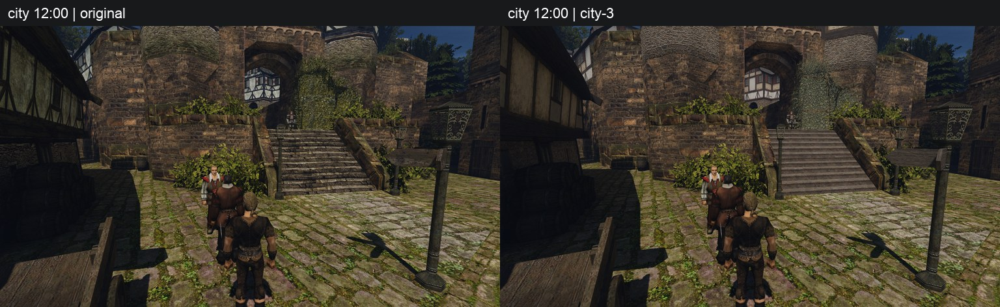
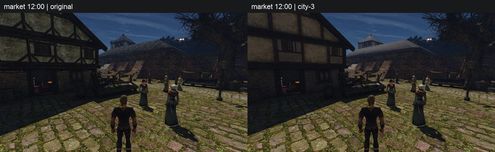
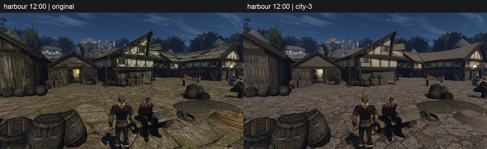
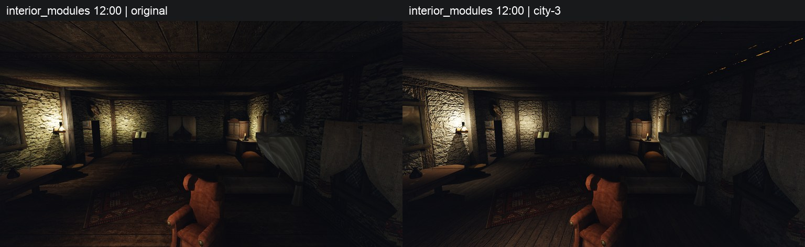

# city-3

Набор упакован в `~/.local/share/gothic-ai/content-staging/city-3/`; рабочий контент не меняется. Обработаны **58 из 58 материалов**: партии по 10/10/10/8/8/7 и пять перенесённых из сравнения. Всего для city-3 сохранены **90 вызовов image_gen**; ошибок инструмента нет.

Все прежние FLUX-материалы пилота заменены новыми imagegen. Из сравнения перенесены только `DIRTYGROUND_02`, `DUNGEONFLOOR_02/03`, `HAFENKAI_BODEN_01`, `HAFEN_HOLZWAND_01`. Семь остальных перегенерированы: при просмотре у них найдено затемнение под балками, обвязками или нахлёстами. Генератор получает только текст, включая полный запрет запечённого света из [библии](../../../docs/content-style.md#промпт).

Яркость берётся по `target_luminance`; насыщенность ограничена 0,30, у `roof_tiles` — 0,25. Модули, панели и полосы сохраняют scale 1 и antitile off; однородные поверхности — масштаб таблицы и режим класса. Шов-фикс: tiled по обеим осям (128 px у поверхности, 32 px у модуля), strip только вдоль измеренной оси, panel без замыкания. Все попытки, выбор и замечания — в [реестре](../../../data/content/registry.jsonl). У `ROOF_01` и `ROOF_04` после трёх попыток оставлены лучшие варианты с пометками: тёмные линии нахлёстов ещё видны.

**Пропуски:** `NW_HARBOUR_CANONHOLE.TGA` и `NW_HARBOUR_CANON_01.TGA` — **предмет, этап 2, параметры металла заведём в библии вместе с предметами**. Других отдельных металлических классов в охвате нет. Остальные 11 строк `exclude` остаются вне набора, включая сети; решения CSV сохранены.

Охват: **55 непрозрачных материалов и три панели с альфой**. Верёвки включены как непрозрачные strip. Для флага и плюща измерены яркость видимых пикселей и `target_coverage` при пороге движка 0,5 (PNG ≥128); исходные пиксели остаются в памяти декодера и не передаются генератору. Решения и задумка CSV не менялись.

**Альфа:** выбранные флаг / краевой плющ / сплошной плющ имеют покрытие 82,75 / 44,79 / 87,64% при оригинальных 86,46 / 50,04 / 94,54%; все в допуске ±10 п.п. Край жёсткий, RGB под вырезами заполнен ближайшим цветом. Упаковщик сохраняет покрытие мипов не ниже mip0 −10 п.п.; albedo DXT5 только при настоящих вырезах, иначе DXT1. Три карты сохраняются, но у этих панелей движок использует только цвет. У обоих плющей и трёх верёвок после трёх попыток ещё заметно нарисованное затемнение между листьями/прядями; выбраны лучшие с пометками. На близких и дальних кадрах флаг и плющ вырезаны по силуэту, сплошных квадратов и явных светлых/тёмных ореолов не видно. Во всех 33 декодированных alpha-мипах значения только 0/255, потери покрытия относительно mip 0 нет.

**Исходники:** постоянное место на Mac `~/.local/share/gothic-ai/content-sources/`, копия `dev-ubuntu:~/gothic-ai/content-backup/sources/`. Сейчас **238 PNG, 698 748 841 байт** сверены на обеих машинах. В staging и прежних временных местах — относительные ссылки; в реестре — относительные пути и SHA-256. CLI импорта вызывает копирование после партии; все невыбранные попытки сохраняются.

**Проверки:** `scripts/content/` — **422 passed**; реестр — **188 рецептов / 238 исходников**; таблица — **71 строка**; резервная копия — exit 0. Упакованы 58 записей / 174 DDS, создан [лист материалов](materials.jpg), сняты 19 пар на Ryzen через gq. Обе игры exit 0, 98/116 с, по 21 исходному PNG, ошибок событий 0. Строгая перепись не проходит по причинам ниже. Включение набора — за пользователем.

Партия из восьми: 12 вызовов. У `HAFENKAI_MAUER_01`, `INSIDEWALL_11/12/13` и после второй попытки остались тонкие тёмные линии под выступом/балкой; выбраны лучшие с пометками, третьих вызовов не было.

Следующие восемь: 14 вызовов. У `RICH_WALL_HALF_01`, `ROOF_INSIDE_01`, `WALL_04/05`, `WOODBEAM_01/03` после двух попыток остаётся затемнение у обвязок. У `WOODBEAM_03` выбрана первая: вторая добавила лишнее штукатурное заполнение.

Последние семь: по одному вызову, без повторов по брифу. `WOOD_ORNAMENT_01` — нарисованный рельеф и тёмные контакты резьбы; `WOOD_ORNAMENT_02` — обычные доски вместо ожидаемого орнамента; `STAIRS_01/03` — тёмные полосы под кромками; `WOODCRATE_01/02` — затемнение под обвязками; `WOOD_IRON_01` — тёмные линии под металлом. Изъяны сохранены в реестре.

## Снимки

Слева оригинал, справа city-3. [Лист всех 58 материалов](materials.jpg).

Улица:

Рынок:

Порт:

Интерьер:

Другие точки: [верхний квартал](upper.jpg), [дом](house.jpg), дом у рынка [вблизи](facade_close.jpg), [угол](facade_corner.jpg), [целиком](facade_full.jpg); [модули верхнего квартала](upper_modules.jpg), [модули гавани](harbour_modules.jpg); 23:00 — [рынок](market_night.jpg), [фасад](facade_close_night.jpg).

Альфа вблизи / издали: флаг [близко](alpha_flag_close.jpg) / [далеко](alpha_flag_far.jpg), краевой плющ [близко](alpha_ivy_border_close.jpg) / [далеко](alpha_ivy_border_far.jpg), сплошной плющ [близко](alpha_ivy_full_close.jpg) / [далеко](alpha_ivy_full_far.jpg).

## Перепись: отказ

На Ryzen подтверждены **58/58 подмен**, но один раз открыт оригинал `NW_CITY_ROPE_01-C.TEX`. На Mac открыты также `NW_CITY_WOOD_01`, `NW_HARBOUR_WOODCRATE_01/02`. Это два отказа строгой проверки при корректной подготовке; дальнейшие игровые прогоны остановлены. Все четыре записи есть в `materials.json`, их собственные DDS исправны. У трёх alpha-материалов оригиналы не открывались.

Площадь 58 текстур по переписи геометрии — **122 319,713 м² из 130 704,102 м² (93,585%)**, включая 1 051,572 м² трёх alpha-текстур; это сумма площадей поверхностей, а не площадь города на карте. Albedo упакованы как 55 DXT1 и 3 DXT5; фактические AlphaFunc экземпляров игровые журналы не печатают, отдельное подтверждение классификации Solid/AlphaTest отсутствует.

**Верёвка, обе машины.** Оба census открывают `ITMI_POCKET.MRM`, его подматериал — `NW_CITY_ROPE_01.TGA`. Декодирование `GOTHIC.DAT` подтвердило `visual=ItMi_Pocket.3ds`, `material=3` у кошелька и его денежных вариантов. [world.cpp:558](../../../OpenGothic/common/world/world.cpp#L558) передаёт `material` как `texVar` и `bodyColor`; [meshobjects.cpp:23](../../../OpenGothic/common/graphics/meshobjects.cpp#L23) включает выбор вариации. Условие [meshobjects.cpp:30](../../../OpenGothic/common/graphics/meshobjects.cpp#L30) находит букву `C` в `CITY`, затем [solveTex, строка 45](../../../OpenGothic/common/graphics/meshobjects.cpp#L45) вызывает обычный `Resources::loadTexture(format,v,c)`. Тегов `_V0`/`_C0` в имени нет: после подстановок [resources.cpp:1170](../../../OpenGothic/common/resources.cpp#L1170)–1176 загружается прежнее имя напрямую, мимо `loadMaterialMaps`. Так своё альбедо кошелька перезаписывается оригиналом. Это не волна, анимация текстуры или декаль.

**Дерево, Mac.** `NW_NATURE_FENCE_01.fracture` содержит `NW_CITY_WOOD_01`; `NW_HARBOUR_CRATE_01.fracture` и `AW_CRATE_01.fracture` содержат обе `WOODCRATE_01/02`. [staticobj.cpp:29](../../../OpenGothic/common/world/objects/staticobj.cpp#L29) готовит осколки, [objvisual.cpp:365](../../../OpenGothic/common/graphics/objvisual.cpp#L365) вызывает `FractureView::load`. В [objvisual.cpp:50](../../../OpenGothic/common/graphics/objvisual.cpp#L50) создаётся пустой `Material`, а строка 51 присваивает результат прямого `Resources::loadTexture(texture)` без `materials.json`; осколки пока скрыты. На Ryzen fracture-кэш недоступен по журналу, поэтому этих трёх открытий там нет. У проверенных обычных ZEN/MRM-материалов четырёх текстур `clrAlpha=255`, `alpha_func=NONE`, wave/UV/frame-анимации нет: обычный конструктор проходит условия `loadMaterialMaps`.

Правильная правка — отдельная задача движка: прямые загрузки в `texVar` и подготовке осколков должны брать своё альбедо из `materials.json`. Движок в этом PR не менялся. Пробные незакоммиченные DDS-алиасы и изменения стенда возвращены к HEAD; жёсткого списка обходов в упаковщике нет.

Сырые журналы и PNG сохранены вне git: `~/.local/share/gothic-ai/content-staging/city-3-captures/ryzen/20261020T033124Z-BxVom2tF/` и `.../mac/20261020T034643Z-wVoLg9bm/`, перепись — `captures/{before,after}/census.json`.

## FPS на Mac

Один прежний замер точки `city`: **59,2997 → 59,0027 FPS (−0,501%)**, оригинал → city-3. Предъявлено 313/310 кадров за 5 278,270/5 254,000 мс реального времени; оба окна — 19 967 мс игрового времени, overflow 0, обе игры exit 0. Перед запуском `pgrep -fl Gothic2Notr` не нашёл занятую игру. Итоговая команда отказала на строгой переписи, поэтому FPS сохранён как результат измерения, а не как успешная приёмка набора.
