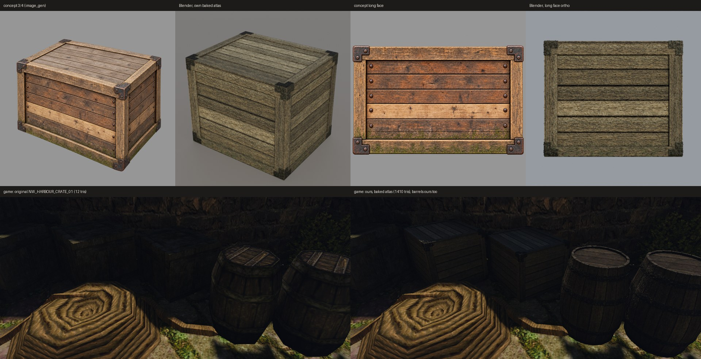

# Ящик по концепту в Blender

Второй предмет нового пути этапа 2, 20 октября 2026 года, после [бочки](../2026-10-barrel-from-concept/README.md). Путь тот же: оригинал → задумка словами и числами → концепт `image_gen` → модель по частям в Blender → свой атлас → стенд в игре. Нейросети-генераторы 3D не использовались.

Сверху — концепт и модель со своим атласом: вид 3/4 и длинная грань. Снизу — один кадр стенда `own-mesh-crate` на Ryzen: оригинал и наш ящик. Бочки в правом кадре тоже наши, оба предмета в одном индексе.

## Оригинал и задумка

[`prop-survey.cpp`](../../../scripts/content/mesh3d/prop-survey.cpp) — небольшой декодер против ZenKit, как `target-measures.cpp`. Он выводит только числа: где стоят 105 копий `NW_HARBOUR_CRATE_01` в NewWorld и средний цвет текселей, которые использует меш. Что показал оригинал:
- **Геометрия:** коробка из 12 треугольников, 1,2 × 1,0 × 1,0 м.
- **Текстуры:** бока — `NW_HARBOUR_WOODCRATE_01`, верх и низ — `_02`, обе 512². Деталь только нарисована.
- **Цвет:** по площади видимых граней средний линейный RGB 0,0588 / 0,0482 / 0,0244. 22% текселей сероватые (R ≈ G). На кадре это выветренное дерево верха, не железо.
- **В игре** (стенд `own-mesh-crate`, ряд ящиков в двух метрах от бочки): глухая тёмная коробка, на каждой грани рамка из брусков, внутри доски. Верх серее.

Задумку оригинала оставил: рамка и доски. Улучшения:
- настоящие доски со щелями вместо нарисованных;
- кованые Г-образные уголки на всех восьми углах, по два гвоздя на уголок;
- гвоздь на каждом конце доски;
- одна светлая заменённая доска;
- мокрый низ.

## Концепт

Свежий тред Codex с `image_gen`, только текст. Четыре вида: 3/4, длинная грань, короткая грань и верх; виды граней — правкой первого изображения. В реестре они записаны как `mesh3d-pilot-crate-v3-{34,front,side,top}`. Проверка прозрачности для плоских видов снижена до 10% прозрачных пикселей: грань заполняет холст, нужен только свободный край. Для вида 3/4 порог прежний, 30%.

Концепт длиннее цели, примерно 1,5:1. Ящик собран по цели, 1,2:1. Числа деталей сняты с концепта: 6 досок на боковых гранях, 7 на крышке, рамка из 4 брусков, светлая третья доска снизу на длинной грани.

## Модель

[`crate.py`](../../../scripts/content/mesh3d/blender/crate.py) с настройками [`crate.json`](../../../scripts/content/mesh3d/blender/crate.json):
- **Бруски рамки:** 9 × 2,5 см.
- **Доски:** 2 см, ширина с разбросом ±12%, щели 6 мм. Каждая доска чуть выступает или утоплена, до 2 мм.
- **Тёмный короб за щелями.**
- **Уголки:** Г-образные пластины 12 × 6 см, толщина 4 мм. Каждая пластина разбита на две выпуклые грани, иначе триангуляция заливает внутренний угол.
- **Гвозди:** трёхгранные шляпки, утоплены в дерево на 1 мм, без основания.
- **Края и пол:** на общем ребре грани не перекрываются — ребро забирает грань с высшим приоритетом: верх, затем торцы, затем длинные. Низ не строится; бока доходят до пола, ящик стоит на земле.

Итог: **1410 треугольников** из 1500, 174 детали, bbox совпадает с целью. Открытых рёбер 306 — ровно основания 102 шляпок, спрятанные в дереве; больше открытых рёбер нет. Сборка детерминирована, GLB `4ee56b61…7cdb63c`.

## Атлас

[`bake_atlas.py`](../../../scripts/content/mesh3d/blender/bake_atlas.py) с [`crate-atlas.json`](../../../scripts/content/mesh3d/blender/crate-atlas.json):
- Тон теперь берётся по номеру детали из атрибута `_part`, который пишет `crate.py`. У бочки остались угловые секторы.
- Атлас 2048², потому что площадь ящика в несколько раз больше бочки. При 1024 и 4 сэмплах дерево было шумным и пиксельным: на атлас приходилось около 2 пикселей на сантиметр, а у тайла их 27.
- Цвет, грубость и нормали запекаются с 16 сэмплами на пиксель, это сглаживает мелкое волокно тайла. Запекание на Mac — 92 с.
- Дерево — плитка клёпок бочки, поднятая к замеру ящика: усиление около 4–5 по каналам. Контраст γ 1,3.
- У оригинала нет железа, поэтому уголки и гвозди взяли замеренное железо обручей бочки из того же портового набора.
- `pack_prop.py` даёт два ключа, `OWN_CRATE_HARBOUR_WOOD` (`WOOD`) и `OWN_CRATE_HARBOUR_IRON` (`METAL`), на одни DDS. До исправления 2026-10-20 все грани GLB попадали в материал дерева; теперь 624 грани дерева и 786 железа.

Бочка перезапечена тем же кодом (16 сэмплов) и лежит с ящиком в общем индексе `content-staging/mesh3d-props-atlas/`. Перепись обоих кадров: подменены оба меша и оба атласа.

## Что видно в игре

- Доски, щели, рамка, уголки и доски крышки читаются. Оригинал на том же месте — тёмная коробка с нарисованными линиями.
- Наш ящик чуть светлее оригинала. Передние грани в кадре — 0,0121 и 0,0050 против 0,0107 и 0,0039, на 13–28% светлее. Верх — 0,0080 против 0,0047: он смотрит в небо и выбелен при запекании.
- Гвозди на концах досок с этого расстояния почти не видны.

## Дальше

- Пользователю — оценить ящик и бочку в игре; подключать ли их в общий контент, решает он.
- Остальные предметы пилота: стол, сундук и лавка. Сундук — MOB с крышкой и анимацией, ему нужен отдельный разговор о загрузке.
