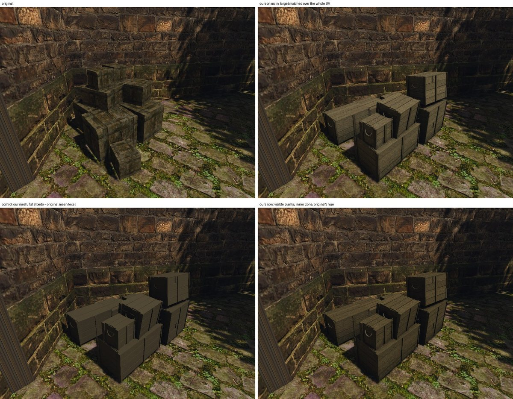
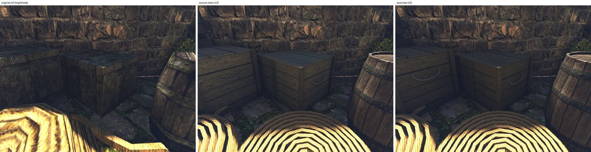

# Ящики порта заново: по замыслу

21 октября 2026 года. Пользователь посмотрел набор рынка: ящики не читаются как деревянные ящики Готики, это «коробки из Counter-Strike». Переделываем два визуала с нуля по скиллу [`object-design`](../../../.claude/skills/object-design/SKILL.md): одиночный ящик `NW_HARBOUR_CRATE_01` (пилот) и кучу ящиков `NW_HARBOUR_CRATEPILE_01` (набор рынка). Это первый предмет, сделанный по этому скиллу.

## Что было не так

Нижний ряд листа: оригинал слева, наша куча после двух проходов цвета справа.
- **Оригинал** грубый, это просто кубы, а у кучи они ещё и вдавлены друг в друга. Но цвет у него того же семейства, что двор вокруг: оливково-бурое дерево, тёмная грязь, пятна мха, как на стене и между камнями брусчатки. Рамка из брусков и доски только нарисованы и издали почти не видны.
- **Наш ящик** повторил нарисованную рамку чистой ровной геометрией. На все восемь углов он получил железные уголки, которых у оригинала нет. Дерево — серая пилотная плитка, растянутая до среднего цвета оригинала. Светлые кромки обводят каждый ящик. Все ящики кучи одного вида и тона и стоят ровно.

## Замысел

**Общее для ящиков порта и рынка.** Одно дерево — грубо пиленая сосна, тёмная, тёплая, с оливковым оттенком от сырости. Одна грязь — почти чёрная в стыках и щелях. Один мох — зелёный, на нижних досках и в трещинах верхних. Без краски и надписей.

**Роль в игре.** Декор и местами укрытие. Ящики говорят игроку, что это бедный порт, через который идёт товар: их таскают между кораблём, складом и рынком, грузят снова и снова, не чинят, пока не развалятся. Это не MOB, открыть их нельзя.

**Место.**
- Одиночный ящик — 105 копий: ряды у пристани и складов порта, рядом бочки, бухты каната, мешки. Часто в тени или в полутёмном складе.
- Куча — 132 копии, из них 5 на рынке: углы дворов у стен из тёсаного охристо-бурого камня, на брусчатке с мхом и травой в швах. Днём, на солнце и в тени стены.
- Игрок проходит мимо в 3–10 м. Сверху ящики видны с лестниц и стен.

**Сохранить.**
- Цвет оригинала: тёмное тёплое дерево с оливковым оттенком, грязь, мох. Ящик — того же семейства цвета, что стена и мостовая.
- Нарисованную у оригинала конструкцию — бруски и доски — как грубую плотницкую работу.
- Небрежную кучу: ящики сдвинуты, не по линейке.

**Улучшить.**
- Настоящие доски и бруски вместо нарисованных; разные размеры ящиков в куче; ящики не проваливаются друг в друга.
- Следы жизни: сбитый угол, треснувшая или заменённая доска, у одного ящика сдвинута крышка.

**Происхождение и конструкция.** Ящики сколотили портовые плотники из того, что было.
- Доски 2–2,5 см, ширина разная, 12–25 см, кромки неровные, щели до сантиметра.
- Бруски 6–8 × 3 см на торцах. Концы просто наложены друг на друга и прибиты, без запилов на ус. На длинных гранях — одна-две поперечные планки или ничего.
- Гвозди с тёмными коваными шляпками, по два-три на конец доски.
- У некоторых ящиков верёвочные ручки на торцах. Железа почти нет: одна-две кованые полосы на весь порт, не уголки на каждом ящике.
- Размеры одиночного ящика — по цели: 1,2 × 1,0 × 1,0 м. В куче три-четыре размера: около 1,2 × 1,0 × 1,0, 0,9 × 0,7 × 0,7 и 0,6 × 0,5 × 0,5 м; куча в целом 3,1 × 2,1 × 2,9 м.

**Как стареет.** Углы и верхние кромки стёрты и затемнены руками и волочением. Низ сырой, тёмный, с мхом. Верх слегка посерел на солнце, но грязный. Доски разного тона: одна светлее (заменённая), одна темнее (гнилая).

**Цвет словами.** Темнее стены, теплее серого, с оливковым оттенком; грязь в стыках почти чёрная; мох как в швах мостовой. Числа оригинала — ограничитель: средний линейный RGB граней 0,0588 / 0,0482 / 0,0244. Матовый, без светлой обводки кромок.

**Чего избегать.** Ровная одинаковая рамка на каждой грани, железные уголки на всех углах, чистое серое дерево, все ящики одного размера и тона, ровные стопки, светлые кромки, вид контейнера для перевозок.

## Концепты

Три варианта кучи на её месте — угол двора у каменной стены, — свежий тред Codex с `image_gen`, только текст замысла выше. Выбор варианта за пользователем. По выбранному варианту делаются виды для модели кучи и одиночного ящика и общая плитка дерева, затем модели и проверка в игре. PNG — в `~/.codex/generated_images/01a15b58-…`; в реестр они войдут вместе с видами выбранного варианта.

1. **Дощатые ящики без рамок.** Доски прибиты к брускам изнутри, на крышках две поперечные планки. Самый грубый и тихий вариант, ближе всего к оригиналу по характеру: куча сливается со двором. Стопка вышла ступенями, ровнее, чем просили.
2. **Рамки из брусков на торцах, верёвочные ручки.** Сильнее всего читается как «ящики для товара». Рамка тут грубая плотницкая и только на торцах, поэтому от игрового ящика она далеко. Верхние ящики стоят косо, как просили.
3. **Смешанный.** Ящики обоих видов, один на боку с рассыпанной соломой, у одного кованая полоса на крышке. Самый живой, но и самый пёстрый, и солому пришлось бы делать отдельной деталью.

Во всех трёх вариантах дерево тёмно-бурое и тёплое, мох внизу, и цвет того же семейства, что стена и мостовая. Тред сам отметил, где вышло ровнее, чем просили, и где на кромках есть светлая обводка. В модели и атласе это поправимо: кромки без светлой обводки, куча небрежнее.

## Выбор и палитра

Пользователь выбрал вариант 2: рамки из брусков на торцах, верёвочные ручки. Но цвет у всех трёх вариантов в сцену не вписывается: дерево рыжее, медовое, стена золотая. В игре двор куда темнее, холоднее и бледнее.

Палитру сняли числами с кадра игры, где оригинал стоит в углу двора (`own-mesh-market`): средний sRGB областей, светлая и тёмная четверти. В генератор пошли только эти числа, кадр — нет.

| Что | Среднее | Светлое | Тёмное |
|---|---|---|---|
| ящики оригинала | `#302A1E` | `#52472F` | `#141211` |
| стена в тени | `#2C241E` | `#594531` | `#131213` |
| стена на свету | `#423524` | `#5D4B31` | `#2D241A` |
| мостовая | `#5C5231` | `#837751` | `#2D2B17` |
| мох | `#495523` | | |

Вывод записан в скилл `object-design`: генератор рисует теплее и ярче игры, поэтому цвет концепта задаётся числами со сцены.

## Модели

Оба визуала строит один общий ящик — [`harbour_crate.py`](../../../scripts/content/mesh3d/blender/harbour_crate.py):
- на торцах угловые стойки 8 × 3,5 см поверх горизонтальных досок и верёвочная ручка между ними;
- на длинных гранях горизонтальные доски разной ширины и одна вертикальная планка посередине;
- крышка из досок вдоль ящика;
- тёмный короб за щелями;
- износ геометрией: разная ширина и наклон досок до 0,6°, доски выступают или утоплены на 2 мм, одна доска сломана с дырой на короб, одна доска крышки сдвинута.

Металла нет, кроме шляпок гвоздей у одиночного ящика.

| Визуал | Скрипт | Треугольники (бюджет) | Атлас |
|---|---|---:|---|
| ящик `NW_HARBOUR_CRATE_01` | [`crate.py`](../../../scripts/content/mesh3d/blender/crate.py) | 826 (1500) | 2048 |
| куча `NW_HARBOUR_CRATEPILE_01` | [`crate_pile.py`](../../../scripts/content/mesh3d/blender/crate_pile.py), 8 ящиков без гвоздей | 3772 (6000) | 2048 |

Раскладка кучи взята с концепта. Три ящика стоят впереди: маленький торцом с ручкой, длинный со сдвинутой крышкой, длинный справа. Два стоят сзади, три — сверху, два из них наклонены.

Зоны: доски, бруски, верёвка, у одиночного ящика ещё гвозди. Железная зона ящика пилота осталась в цели, но не используется. Её держит старый тест генераторов, который ждёт у ящика две металлические зоны.

**Плитка дерева** — новая, `image_gen` по тексту замысла: четыре грубо пиленые сосновые доски на плитку 0,4 м, тёмно-оливковые, со следами пилы, сучками, грязью в трещинах и плесенью (`mesh3d-market-tile-wood-crate`). Цвет у неё уже свой, поэтому усиление атласа около 1, а не растяжка серой плитки до среднего, как раньше. Цель атласа — пропорции цвета оригинала, на треть темнее: доски 0,038 / 0,031 / 0,016.

Два урока плитки, оба увидены на рендере атласа:
1. **Полосы от сшивки.** Каждая доска модели берёт ровно одну доску плитки, на четверть ширины. Сшивка по обеим осям обрезает перекрытие и растягивает картинку: стыки уехали с 256/512/768 на 292/585/878 пикселей, и каждая доска модели поймала полосу соседней. Плитка сшивается только вдоль волокна (`axes: v`): поперёк доска плитки никогда не переходит в соседнюю.
2. **Светлая доска на каждой четвёртой.** «Заменённая» светлая доска плитки досталась каждой четвёртой доске модели: вышли полосы. Новый ключ `equalize` в `market_tiles.py` приводит четыре доски плитки к одному среднему цвету, а разный тон досок даёт атлас (`tone_spread` 0,14). Шов между досками атласа ослаблен (`seam_dark` 0,3), выгорание верхов снято.

## В игре

Стенд [`own-mesh-market`](../../../scripts/bench/own-mesh-market.bench) на Ryzen с пересобранным корнем набора: заменены все 21 меш, ни один оригинал не открыт, используются 43 своих ключа (у ящиков прибавилась верёвка).

Сверху — куча в углу двора, снизу — одиночные ящики в тёмном углу порта, рядом бочка и бухта каната.
- **Читаются как деревянные ящики порта:** стойки на торцах, доски, верёвочные ручки. Серых коробок с уголками больше нет.
- **Цвет того же семейства, что двор и оригинал:** тёмное оливково-серое дерево. Наши ящики чуть чище оригинала: у него грязь и мох нарисованы по всем граням.
- **Раскладка кучи — с концепта, а не с оригинала.** У оригинала высокая часть кучи слева, у угла, у нас — справа. Пользователь оставил раскладку концепта.
- **Одиночный ящик** стоит в глубокой тени склада; он чуть светлее оригинала, примерно как соседняя бочка.

Перед проверкой пилотный пакет бочки и ящика разделён: бочка — `pilot-barrel`, без изменений; ящик — `crate`. Верёвка одиночного ящика звучит и сталкивается как дерево: у пилотных целей старые тесты генераторов допускают только группы WOOD и METAL, а ручки маленькие. У кучи у верёвки группа UNDEF.

Проверки: `test_concepts.py` и `test_measure_targets.py` — 31 passed; `blender/test_geometry.py` — 46 passed.

## Цвет по видимым граням

21 октября 2026 года, после [#361](https://github.com/kaifaty/GothicAI/pull/361). Тот PR убрал блик шероховатого дерева, который добавлял своим материалам серую плёнку. Он же показал, что рендер даёт куче только 6–7% яркости ([отчёт](../../engine/2026-10-21-rough-specular/README.md)), а основная причина светлых серых ящиков — атлас.

**Что было не так.** `bake_atlas.py` приводил к цели средний тексель зоны по всей развёртке. У ящиков в зону досок входили и тёмный короб за щелями, и изнанка досок, прижатая к нему, и концы досок под стойками. Это 53% развёртки кучи с текселем около 0,012. Средний тексель совпадал с целью «на треть темнее оригинала» (0,038 / 0,031 / 0,016) за счёт граней, которых в игре не видно. Видимые доски выходили 0,069 / 0,057 / 0,030: в 1,9 раза светлее цели и в 1,2 раза светлее оригинала.

**Что сделано.**
- **Короб — своя зона `OWN_PROP_WOOD_INNER`**, как внутренние грани сундука. Зона записана в целях обоих визуалов (`market_targets.py`, `measure_targets.py` и их JSON), и `harbour_crate.py` строит короб в ней. У зоны своя цель: почти чёрная грязь, которая видна только в щелях и в дыре сломанной доски.
- **Доски и бруски меряются по открытым текселям.** Новый ключ атласа `measure_ao` задаёт зоне порог запечённого AO: среднее считается только по текселям с AO не ниже порога, то есть по граням, открытым наружу. Усиление по-прежнему получает вся зона. У ящиков порог 0,5. Так в замер попадает 49% текселей досок одиночного ящика и 43% у кучи, у брусков — 69% и 59%.
- **Цель — цвет оригинала в кадре, а не его средний тексель.** Проходов было два.
  - Первый: цель видимых досок — средний тексель оригинала 0,0572 / 0,0469 / 0,0238. Яркость сошлась, но цвет остался серее оригинала: B/R граней 0,38–0,44 против 0,28–0,36.
  - Второй: синий ×0,80, зелёный ×0,94, красный ×0,966. Бурый цвет оригинала в кадре даёт распределение его текстуры (тёмная грязь, мох), а не среднее: ровное альбедо со средним текселем оригинала на нашем меше читается ещё серее (B/R 0,42–0,50).

| Зона | Цель была (по всей развёртке) | Цель теперь | Чем меряется |
|---|---|---|---|
| доски | 0,038 / 0,031 / 0,016 | 0,0553 / 0,0426 / 0,0184 | тексели с AO ≥ 0,5 |
| бруски | 0,033 / 0,027 / 0,014 | 0,048 / 0,037 / 0,016 | тексели с AO ≥ 0,5 |
| короб | (в зоне досок) | 0,011 / 0,0085 / 0,0037 | вся зона |

Средний тексель досок по всей развёртке теперь 0,0286 / 0,0221 / 0,0095 у кучи и 0,0309 / 0,0238 / 0,0103 у одиночного ящика: ниже прежней цели, потому что в среднем снова сидят изнанка и стыки. Геометрия не менялась: 3772 и 826 треугольников, bbox тот же. У гвоздей и верёвки цели прежние.

### В игре

Стенд [`own-mesh-market`](../../../scripts/bench/own-mesh-market.bench) на Ryzen, сборка `main` с #361. Четыре корня: оригиналы (`OPENGOTHIC_CONTENT=`), набор с `main`, контроль и набор с новыми атласами. Корни различаются только ящиками. Перепись набора с `main` и с новыми атласами: заменены все 21 меш, оригиналы этих визуалов не открываются.

**Контроль** — наш меш кучи с ровным альбедо, равным среднему текселю оригинала (`#443D2B`). Кубы оригинала стоят в тени стены, а наши ящики — местами в пятнах солнца, поэтому прямое сравнение граней путает свет с цветом. Контроль показывает, как выглядел бы цвет оригинала на наших гранях в том же свете.

Медианы граней кучи, линейный RGB кадра: яркость, G/R, B/R. Прямоугольники на гранях кадра 800×600, у трёх наших корней одни и те же.

| Грань | Набор с main | Контроль | Теперь | Теперь / контроль |
|---|---|---|---|---:|
| верх, передний (тень) | 0,0559 0,77 0,39 | 0,0341 0,78 0,46 | 0,0329 0,75 0,36 | 0,96 |
| верх, левый (тень) | 0,0446 0,63 0,33 | 0,0442 0,65 0,34 | 0,0414 0,64 0,34 | 0,94 |
| верх, наклонный (солнце) | 0,1160 0,75 0,37 | 0,0650 0,77 0,42 | 0,0676 0,71 0,30 | 1,04 |
| верх, малый (солнце) | 0,1016 0,73 0,37 | 0,0577 0,78 0,42 | 0,0586 0,72 0,32 | 1,02 |
| бок, передний | 0,0593 0,77 0,36 | 0,0378 0,79 0,43 | 0,0356 0,74 0,34 | 0,94 |
| бок, левый | 0,0540 0,79 0,43 | 0,0303 0,80 0,50 | 0,0309 0,72 0,37 | 1,02 |
| бок, правый верхний | 0,0850 0,75 0,36 | 0,0450 0,78 0,43 | 0,0498 0,74 0,33 | 1,11 |
| бок, правый нижний | 0,0608 0,78 0,37 | 0,0362 0,81 0,46 | 0,0369 0,74 0,35 | 1,02 |

Грани оригинала другие, поэтому только диапазоны по пяти верхним и трём боковым граням: верхние 0,040–0,049, боковые 0,028–0,037, G/R 0,70–0,77, B/R 0,28–0,36.
- **Яркость.** Набор с `main` был светлее контроля в 1,6–1,9 раза, кроме одной грани в глубокой тени. Теперь он в 0,94–1,11 раза от контроля. Затенённые грани стоят в диапазоне оригинала: верх 0,033–0,041, бока 0,031–0,037. Грани на солнце светлее граней оригинала, как и у контроля: это свет, а не атлас.
- **Цвет.** G/R 0,71–0,75 и B/R 0,30–0,37 — как у оригинала. На `main` было 0,73–0,79 и 0,36–0,43, у контроля 0,77–0,81 и 0,42–0,50. Тень у левой стены зеленит обе версии одинаково (G/R 0,64).

**Одиночный ящик** стоит в тёмном углу порта, кадр `nw_harbour_crate_01_2`. Грани там около 10 из 255 в sRGB, поэтому цвет по ним не измерить, только яркость. На листе кадры осветлены втрое.

| Грань | Оригинал | Набор с main | Контроль | Теперь |
|---|---:|---:|---:|---:|
| верх | 0,0047 | 0,0064 | 0,0051 | 0,0051 |
| бок, левый | 0,0037 | 0,0052 | 0,0041 | 0,0041 |
| бок, правый | 0,0041 | 0,0048 | 0,0040 | 0,0041 |

Набор с `main` был светлее оригинала в 1,2–1,4 раза, теперь — в 1,0–1,1, вровень с контролем. Первый кадр ящика (`nw_harbour_crate_01`) на этом стенде чёрный и у оригинала: камера стоит в стене.

### Что осталось

- У оригинала грязь и мох нарисованы пятнами по всем граням. Наши ящики того же тона, но чище. Это замысел, а не цвет атласа.
- Короб занимает в атласе почти столько же места, сколько доски (324 тыс. текселей против 655 тыс. у кучи): развёртка даёт всем граням одну плотность. Короб видно только в щелях, его острова можно уменьшить и отдать место доскам.

### Как повторить

Плитки — `market_tiles.py --spec blender/crate-tiles.json` (добавлена копия для `own_prop_wood_inner`). Сборка и запекание обоих ящиков — `crate.py`, `crate_pile.py` и `bake_atlas.py` с их `*-atlas.json`, как выше. Здесь они шли на Ryzen одной заявкой `gq batch` (6 потоков, 4 ГиБ, около 10 минут). Затем `pack_prop.py`, `market_pack.py` и стенд:
`BENCH_HOST=ryzen WORLD=NEWWORLD.ZEN OPENGOTHIC_CONTENT=<корень> scripts/bench.sh own-mesh-market <out>`.
Для контроля альбедо атласа заменяется ровным цветом `#443D2B` до `pack_prop.py`.
