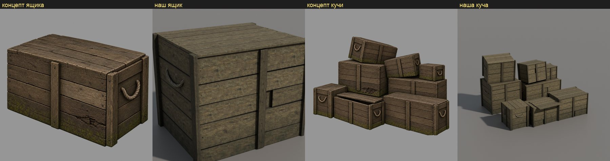
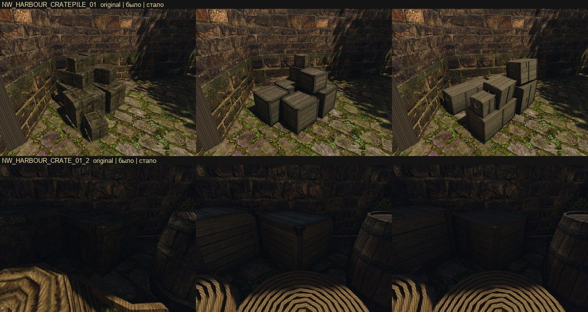

# Ящики порта заново: по замыслу

21 октября 2026 года. Пользователь посмотрел набор рынка: ящики не читаются как деревянные ящики Готики, это «коробки из Counter-Strike». Переделываем два визуала с нуля по скиллу [`object-design`](../../../.claude/skills/object-design/SKILL.md): одиночный ящик `NW_HARBOUR_CRATE_01` (пилот) и кучу ящиков `NW_HARBOUR_CRATEPILE_01` (набор рынка). Это первый предмет, сделанный по этому скиллу.

## Что было не так

Нижний ряд листа: оригинал слева, наша куча после двух проходов цвета справа.
- **Оригинал** грубый, это просто кубы, а у кучи они ещё и вдавлены друг в друга. Но цвет у него того же семейства, что двор вокруг: оливково-бурое дерево, тёмная грязь, пятна мха, как на стене и между камнями брусчатки. Рамка из брусков и доски только нарисованы и издали почти не видны.
- **Наш ящик** повторил нарисованную рамку чистой ровной геометрией. На все восемь углов он получил железные уголки, которых у оригинала нет. Дерево — серая пилотная плитка, растянутая до среднего цвета оригинала. Светлые кромки обводят каждый ящик. Все ящики кучи одного вида и тона и стоят ровно.

## Замысел

**Общее для ящиков порта и рынка.** Одно дерево — грубо пиленая сосна, тёмная, тёплая, с оливковым оттенком от сырости. Одна грязь — почти чёрная в стыках и щелях. Один мох — зелёный, на нижних досках и в трещинах верхних. Без краски и надписей.

**Роль в игре.** Декор и местами укрытие. Ящики говорят игроку, что это бедный порт, через который идёт товар: их таскают между кораблём, складом и рынком, грузят снова и снова, не чинят, пока не развалятся. Это не MOB, открыть их нельзя.

**Место.**
- Одиночный ящик — 105 копий: ряды у пристани и складов порта, рядом бочки, бухты каната, мешки. Часто в тени или в полутёмном складе.
- Куча — 132 копии, из них 5 на рынке: углы дворов у стен из тёсаного охристо-бурого камня, на брусчатке с мхом и травой в швах. Днём, на солнце и в тени стены.
- Игрок проходит мимо в 3–10 м. Сверху ящики видны с лестниц и стен.

**Сохранить.**
- Цвет оригинала: тёмное тёплое дерево с оливковым оттенком, грязь, мох. Ящик — того же семейства цвета, что стена и мостовая.
- Нарисованную у оригинала конструкцию — бруски и доски — как грубую плотницкую работу.
- Небрежную кучу: ящики сдвинуты, не по линейке.

**Улучшить.**
- Настоящие доски и бруски вместо нарисованных; разные размеры ящиков в куче; ящики не проваливаются друг в друга.
- Следы жизни: сбитый угол, треснувшая или заменённая доска, у одного ящика сдвинута крышка.

**Происхождение и конструкция.** Ящики сколотили портовые плотники из того, что было.
- Доски 2–2,5 см, ширина разная, 12–25 см, кромки неровные, щели до сантиметра.
- Бруски 6–8 × 3 см на торцах. Концы просто наложены друг на друга и прибиты, без запилов на ус. На длинных гранях — одна-две поперечные планки или ничего.
- Гвозди с тёмными коваными шляпками, по два-три на конец доски.
- У некоторых ящиков верёвочные ручки на торцах. Железа почти нет: одна-две кованые полосы на весь порт, не уголки на каждом ящике.
- Размеры одиночного ящика — по цели: 1,2 × 1,0 × 1,0 м. В куче три-четыре размера: около 1,2 × 1,0 × 1,0, 0,9 × 0,7 × 0,7 и 0,6 × 0,5 × 0,5 м; куча в целом 3,1 × 2,1 × 2,9 м.

**Как стареет.** Углы и верхние кромки стёрты и затемнены руками и волочением. Низ сырой, тёмный, с мхом. Верх слегка посерел на солнце, но грязный. Доски разного тона: одна светлее (заменённая), одна темнее (гнилая).

**Цвет словами.** Темнее стены, теплее серого, с оливковым оттенком; грязь в стыках почти чёрная; мох как в швах мостовой. Числа оригинала — ограничитель: средний линейный RGB граней 0,0588 / 0,0482 / 0,0244. Матовый, без светлой обводки кромок.

**Чего избегать.** Ровная одинаковая рамка на каждой грани, железные уголки на всех углах, чистое серое дерево, все ящики одного размера и тона, ровные стопки, светлые кромки, вид контейнера для перевозок.

## Концепты

Три варианта кучи на её месте — угол двора у каменной стены, — свежий тред Codex с `image_gen`, только текст замысла выше. Выбор варианта за пользователем. По выбранному варианту делаются виды для модели кучи и одиночного ящика и общая плитка дерева, затем модели и проверка в игре. PNG — в `~/.codex/generated_images/01a15b58-…`; в реестр они войдут вместе с видами выбранного варианта.

1. **Дощатые ящики без рамок.** Доски прибиты к брускам изнутри, на крышках две поперечные планки. Самый грубый и тихий вариант, ближе всего к оригиналу по характеру: куча сливается со двором. Стопка вышла ступенями, ровнее, чем просили.
2. **Рамки из брусков на торцах, верёвочные ручки.** Сильнее всего читается как «ящики для товара». Рамка тут грубая плотницкая и только на торцах, поэтому от игрового ящика она далеко. Верхние ящики стоят косо, как просили.
3. **Смешанный.** Ящики обоих видов, один на боку с рассыпанной соломой, у одного кованая полоса на крышке. Самый живой, но и самый пёстрый, и солому пришлось бы делать отдельной деталью.

Во всех трёх вариантах дерево тёмно-бурое и тёплое, мох внизу, и цвет того же семейства, что стена и мостовая. Тред сам отметил, где вышло ровнее, чем просили, и где на кромках есть светлая обводка. В модели и атласе это поправимо: кромки без светлой обводки, куча небрежнее.

## Выбор и палитра

Пользователь выбрал вариант 2: рамки из брусков на торцах, верёвочные ручки. Но цвет у всех трёх вариантов в сцену не вписывается: дерево рыжее, медовое, стена золотая. В игре двор куда темнее, холоднее и бледнее.

Палитру сняли числами с кадра игры, где оригинал стоит в углу двора (`own-mesh-market`): средний sRGB областей, светлая и тёмная четверти. В генератор пошли только эти числа, кадр — нет.

| Что | Среднее | Светлое | Тёмное |
|---|---|---|---|
| ящики оригинала | `#302A1E` | `#52472F` | `#141211` |
| стена в тени | `#2C241E` | `#594531` | `#131213` |
| стена на свету | `#423524` | `#5D4B31` | `#2D241A` |
| мостовая | `#5C5231` | `#837751` | `#2D2B17` |
| мох | `#495523` | | |

Вывод записан в скилл `object-design`: генератор рисует теплее и ярче игры, поэтому цвет концепта задаётся числами со сцены.

## Модели

Оба визуала строит один общий ящик — [`harbour_crate.py`](../../../scripts/content/mesh3d/blender/harbour_crate.py):
- на торцах угловые стойки 8 × 3,5 см поверх горизонтальных досок и верёвочная ручка между ними;
- на длинных гранях горизонтальные доски разной ширины и одна вертикальная планка посередине;
- крышка из досок вдоль ящика;
- тёмный короб за щелями;
- износ геометрией: разная ширина и наклон досок до 0,6°, доски выступают или утоплены на 2 мм, одна доска сломана с дырой на короб, одна доска крышки сдвинута.

Металла нет, кроме шляпок гвоздей у одиночного ящика.

| Визуал | Скрипт | Треугольники (бюджет) | Атлас |
|---|---|---:|---|
| ящик `NW_HARBOUR_CRATE_01` | [`crate.py`](../../../scripts/content/mesh3d/blender/crate.py) | 826 (1500) | 2048 |
| куча `NW_HARBOUR_CRATEPILE_01` | [`crate_pile.py`](../../../scripts/content/mesh3d/blender/crate_pile.py), 8 ящиков без гвоздей | 3772 (6000) | 2048 |

Раскладка кучи взята с концепта. Три ящика стоят впереди: маленький торцом с ручкой, длинный со сдвинутой крышкой, длинный справа. Два стоят сзади, три — сверху, два из них наклонены.

Зоны: доски, бруски, верёвка, у одиночного ящика ещё гвозди. Железная зона ящика пилота осталась в цели, но не используется. Её держит старый тест генераторов, который ждёт у ящика две металлические зоны.

**Плитка дерева** — новая, `image_gen` по тексту замысла: четыре грубо пиленые сосновые доски на плитку 0,4 м, тёмно-оливковые, со следами пилы, сучками, грязью в трещинах и плесенью (`mesh3d-market-tile-wood-crate`). Цвет у неё уже свой, поэтому усиление атласа около 1, а не растяжка серой плитки до среднего, как раньше. Цель атласа — пропорции цвета оригинала, на треть темнее: доски 0,038 / 0,031 / 0,016.

Два урока плитки, оба увидены на рендере атласа:
1. **Полосы от сшивки.** Каждая доска модели берёт ровно одну доску плитки, на четверть ширины. Сшивка по обеим осям обрезает перекрытие и растягивает картинку: стыки уехали с 256/512/768 на 292/585/878 пикселей, и каждая доска модели поймала полосу соседней. Плитка сшивается только вдоль волокна (`axes: v`): поперёк доска плитки никогда не переходит в соседнюю.
2. **Светлая доска на каждой четвёртой.** «Заменённая» светлая доска плитки досталась каждой четвёртой доске модели: вышли полосы. Новый ключ `equalize` в `market_tiles.py` приводит четыре доски плитки к одному среднему цвету, а разный тон досок даёт атлас (`tone_spread` 0,14). Шов между досками атласа ослаблен (`seam_dark` 0,3), выгорание верхов снято.

## В игре

Стенд [`own-mesh-market`](../../../scripts/bench/own-mesh-market.bench) на Ryzen с пересобранным корнем набора: заменены все 21 меш, ни один оригинал не открыт, используются 43 своих ключа (у ящиков прибавилась верёвка).

Сверху — куча в углу двора, снизу — одиночные ящики в тёмном углу порта, рядом бочка и бухта каната.
- **Читаются как деревянные ящики порта:** стойки на торцах, доски, верёвочные ручки. Серых коробок с уголками больше нет.
- **Цвет того же семейства, что двор и оригинал:** тёмное оливково-серое дерево. Наши ящики чуть чище оригинала: у него грязь и мох нарисованы по всем граням.
- **Раскладка кучи — с концепта, а не с оригинала.** У оригинала высокая часть кучи слева, у угла, у нас — справа. Пользователь оставил раскладку концепта.
- **Одиночный ящик** стоит в глубокой тени склада; он чуть светлее оригинала, примерно как соседняя бочка.

Перед проверкой пилотный пакет бочки и ящика разделён: бочка — `pilot-barrel`, без изменений; ящик — `crate`. Верёвка одиночного ящика звучит и сталкивается как дерево: у пилотных целей старые тесты генераторов допускают только группы WOOD и METAL, а ручки маленькие. У кучи у верёвки группа UNDEF.

Проверки: `test_concepts.py` и `test_measure_targets.py` — 31 passed; `blender/test_geometry.py` — 46 passed.

