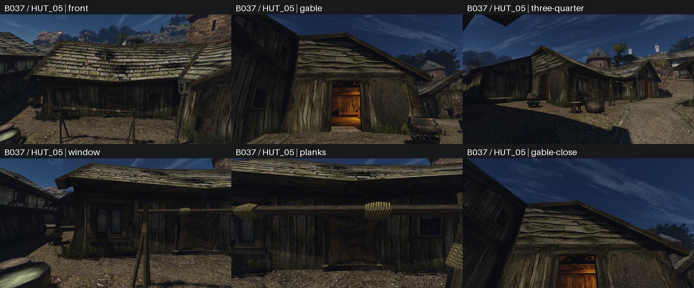
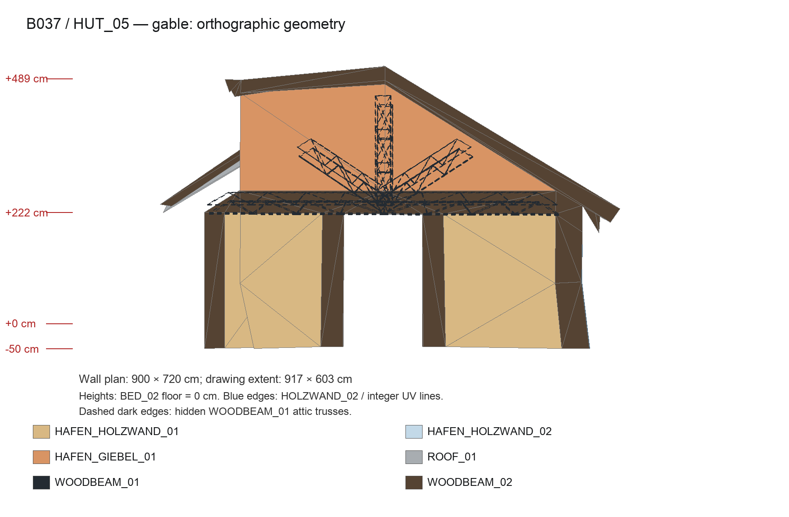
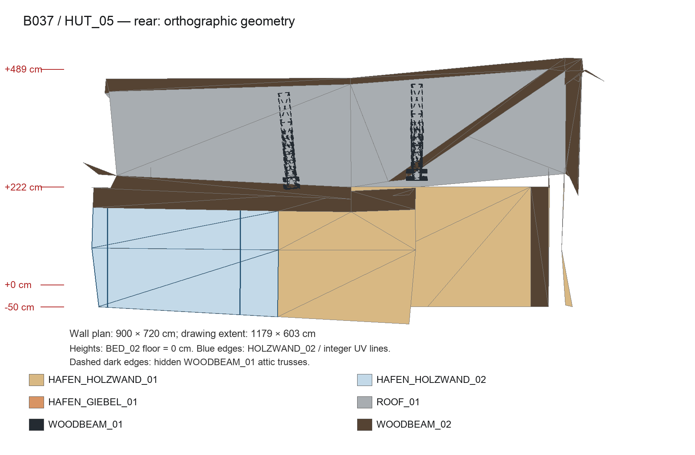
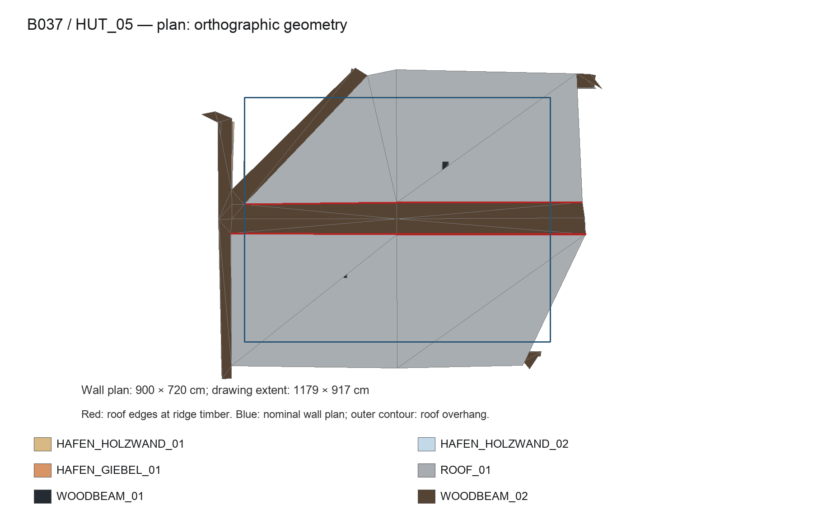
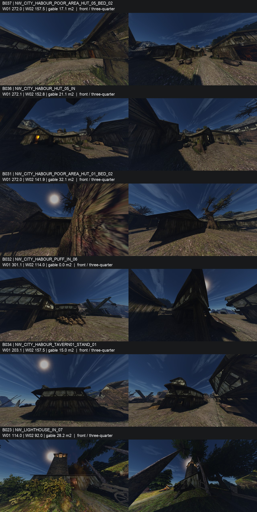

# Перепись Хориниса и обмер выбранной портовой хижины B037

2026-10-21. Пользователь выбрал **B037**, ориентир `NW_CITY_HABOUR_POOR_AREA_HUT_05_BED_02`. Ниже — обмер, четыре чертежа и **6/6 новых кадров original с обычным FOV**, **exit 0**. Исходная [перепись](census.csv) содержит **69 связных блоков ≥30 м²**; обзорные 12 кадров кандидатов сохранены ниже. Автоматического разделения блоков на отдельные здания нет.



Новый лист — **1920×800**, 3 столбца × 2 строки, панели **640×360** без обрезки, **356 727 байт**, JPEG quality 90. Полные PNG 1280×720, журнал игры и перепись ресурсов — `~/.local/share/gothic-ai/harbour-hut/captures/original/`.

## Обмер B037 и ручная рамка HUT_05

[`harbour_hut.py`](../../../scripts/content/harbour_hut.py) сохраняет `~/.local/share/gothic-ai/texture-intent/harbour-hut-measurement.json`: **все 1481 треугольник блока** с UV, `origin`, `outward`, `tangent`, `candidate_house_triangles`, локальными координатами и связью с исходной переписью. JSON остаётся вне git. В B037 соединены **три хижины**, а не одна постройка: центры пар чердачных ферм примерно XZ **[36,23; −34,40]**, **[32,04; −25,07]**, **[44,44; −38,30] м**. Выбранная хижина — первая, ближайшая к указанной кровати: waypoint **[3872,602; −66,221; −3529,469] см**.

Для чертежей и фактов выбранная хижина выделена **явной ручной рамкой**, сохранённой в `primary_hut`. Продольная ось A = **[0,96814764; 0; −0,25038000]**, поперечная B = **[0,25038000; 0; 0,96814764]**. Пределы скалярных проекций мировых точек: **A 3800…5000 см, B −2950…−1920 см**; все три вершины остаются внутри, треугольники не режутся. Сохранены только собственные статичные фермы `source 9906/9907`. Горизонтальные направления нормалей стен и вертикальных граней обвязки отклоняются от осей не больше **6,8°**, нормали кровли — от перпендикуляра A не больше **6,9°**: это убирает фрагменты соседней, повёрнутой хижины. Получены **456 треугольников** для чертежей. Полная геометрия блока при этом сохранена в верхнем массиве JSON.

Группы стен строятся по всем треугольникам блока: **25 связных копланарных полей ≥5 м²**, разница нормалей ≤1°, расстояние от плоскости и зазор связности ≤1 см, `abs(normal.y) ≤0,2`. Проверяются все вершины, а не только центры граней. `outward` направлен от ближайшего из трёх центров хижин; исходная нормаль сохранена отдельно. У каждой группы есть `origin`, `outward`, `tangent`, ширина/высота в см, площади текстур и данные каждой треугольной грани: UV min/max/span, см на единицу U/V, мировые векторы U/V и угол U относительно горизонтали стены. Для групп отмечены площадь и доля внутри ручной рамки.

Размах UV — число занятых периодов координаты, включая дробные и обрезанные части. Он не равен количеству нарисованных окон: пиксели оригинальных текстур не изучались. Масштаб см/UV вычислен из полного аффинного отображения треугольника, с учётом перекоса U/V.

## Чертежи выбранной хижины

Ортогональные проекции, цвет обозначает имя текстуры. `WOODBEAM_01` — тёмный графит, `WOODBEAM_02` — тёмно-коричневый; скрытые чердачные фермы показаны пунктиром. В фасадах оставлена ближайшая оболочка в полосе 150 см, чтобы задняя стена не закрывала дверной проём. Кровля и её верхние деревянные элементы сохраняются целиком. Синие границы выделяют поля `HOLZWAND_02` и целые UV-линии. Высоты отсчитаны от уровня выбранной кровати, **Y = −66,221 см**; деформации оригинального меша сохранены.








## Факты для концепции

| Что | Измерение / наблюдение |
|---|---|
| Этажность | Один жилой этаж, выше чердачное пространство с двумя объёмными фермами; второго оконного пояса нет |
| План по номинальным плоскостям стен | **900,00 × 719,99 см**; рамка кровли и деформированной наружной обвязки на плане примерно **1179 × 917 см** |
| Низ / верх номинальной стены | Y **−116,221 / 155,377 см**; полная высота поля **271,60 см**, из них **50 см ниже пола**, **221,60 см над полом** |
| Карниз | Номинальный верх стены **221,60 см** над полом; верх объёмной обвязки **265,43 см**. Минимум деформированной кровли у свеса **208,01 см**; карниз не идеально горизонтален |
| Конёк | Максимум поверхности кровли **488,74 см** над полом (Y **422,520**); верх деревянного конькового элемента **514,30 см** (Y **448,081**) |
| Уклон крыши | Грани **26,48…31,55°**, средний с весом по площади **29,83°**; двускатная крыша с прогибами и перекосами |
| Между двумя передними оконными полями | `HOLZWAND_01`, ширина **337,50 см** в номинальной плоскости |
| Над окнами | Объёмная верхняя обвязка `WOODBEAM_02`, Y **155,377…199,21 см**, высота **43,83 см**; затем свес крыши |
| Под окнами | Та же непрерывная плоскость `HOLZWAND_02` до Y **−116,221 см**. Отдельных геометрических подоконника и цоколя под изображением окна нет; окно и ставня заданы материалом |

Номинальные прямоугольные поля с окнами (по два треугольника), а не округлённые эквиваленты площади UV:

| Фасад | Число полей `HOLZWAND_02` | Размеры, см | Размах UV U×V | См на единицу U×V |
|---|---:|---|---|---|
| Передний, W04 | **2** | **233,57×271,60**; **248,94×271,60** | **0,8942×0,9775**; **0,8391×0,9208** | **261,86×293,75**; **296,77×295,82** |
| Задний, W08 | **1** | **248,93×271,60** | **0,8117×0,9625** | **307,07×293,64** |
| Входной торец с `GIEBEL_01` | **0** | Дверной проём, доски и фронтон | — | — |
| Противоположный торец | **0** | Дощатое поле | — | — |

Наружные поля слегка деформированы и имеют дополнительные треугольники. Число выше относится к номинальным связанным прямоугольникам W04/W08; это **2 + 1 окна**, а не число любых фрагментов с этим именем материала в трёх хижинах блока. Их площадь UV эквивалентна **1,5967 / 0,7505** целого модуля соответственно. U передних полей идёт в обратную сторону горизонтали, наклон **0,18° / 3,81°**; у заднего — **2,54°**. Все точные направления относительно собственного `tangent` записаны по граням в JSON.

| Материал | См на единицу UV выбранной хижины |
|---|---|
| `HOLZWAND_01` | Среднее по площади **U 288,59 / V 293,89**; диапазоны **U 180,21…300,78 / V 250,10…325,73**. Номинальные торцевые доски ≈**300×300**; переднее поле W04 ≈**267,17×293,75…295,82**. Разные и деформированные грани не дают одного универсального масштаба |
| `GIEBEL_01` | Среднее **U 300,56 / V 301,13**; диапазоны **U 300,00…301,75 / V 300,00…303,79**. U почти горизонтален, отклонение до **0,08°** от собственной горизонтали грани |

| Объёмная деталь | Материал и сечение, см |
|---|---|
| Четыре угловые стойки | `WOODBEAM_02`, **40×40** |
| Стойки входного проёма | `WOODBEAM_02`, деформированы, примерно **36×43** |
| Верхняя обвязка стен | `WOODBEAM_02`, примерно **40×44**; высота **43,83** |
| Наружные наклонные стропильные/торцевые планки | `WOODBEAM_02`, переменное сечение примерно **29…38 × 24…33**; сохраняется сужение и перекос |
| Затяжки двух чердачных ферм | `WOODBEAM_01`, **29,91×24,47**, Y **170,98…195,44** |
| Центральные стойки ферм | `WOODBEAM_01`, **24,13×30,00**, Y **187,66…388,01** |
| Диагональные подкосы ферм | `WOODBEAM_01`, толщина **19,37**, переменная ширина примерно **19…29** |

`WOODBEAM_01` здесь относится к двум статичным `NW_CITY_BEAMS_01.3DS`, по **136 треугольников / 13,04449 м²**, а не к наружным угловым стойкам или карнизной обвязке. Сечения ферм измерены по их собственным осям, наклонных деталей — поперёк длины, а не по мировой рамке XYZ.

## Повторённые конструкции

Строгая сигнатура — одинаковый набор имён материалов и отклонение площади **каждого** не больше 1%. **Других полных блоков, соответствующих B037, нет.** Центр самого B037, взвешенный площадью: **[37,495; 1,524; −32,432] м**. У B031 и B036 повторяется трёхчастная конструкция, но материал оконных/фронтонных полей распределён иначе:

| Блок | Центр XYZ, м | HOLZWAND_01 | ROOF_01 | WOODBEAM_02 | HOLZWAND_02 | WOODBEAM_01 | GIEBEL_01 |
|---|---|---:|---:|---:|---:|---:|---:|
| B037 | **37,495; 1,524; −32,432** | 272,034 | 249,402 | 238,484 | 157,497 | 78,267 | 17,094 |
| B031 | **13,873; 0,827; −52,995** | 271,973 | 249,402 | 238,671 | 141,878 | 78,267 | 32,060 |
| B036 | **35,931; 0,831; 11,863** | 272,099 | 249,402 | 238,723 | 152,842 | 78,267 | 21,125 |

Площади в м². У B031 `HOLZWAND_02` отличается на **−9,92%**, `GIEBEL_01` на **+87,55%**; у B036 — **−2,96% / +23,58%**. Остальные четыре материала отличаются меньше **0,11%**. Если сложить `HOLZWAND_02 + GIEBEL_01`, расхождение становится меньше **0,374%**. Поэтому это повтор конструкции с заменами полей, но не совпадение заданной сигнатуры отдельных текстур.

В **B035** есть частичный повтор каркаса **900×720 см**, центр номинального стенового объёма **[18,600; −0,558; 3,188] м**. Он содержит такую же пару ферм (`source 9956/9957`) и два передних поля площадью **13,104677 м²** против **13,104702 м²** у HUT_05. Сзади там два поля, у выбранной хижины одно. Весь B035 включает соседнюю застройку, центр блока **[21,138; 1,993; 20,420] м**; строгого совпадения площадей всей оболочки нет.

## Новые игровые кадры для концепции

[`harbour-hut.bench`](../../../scripts/content/harbour-hut.bench), только `original`, полдень; NPC удалены из временной копии мира (`clear 1000000`, **1052 NPC**), эффекты и morph скрыты. Собственная папка Ryzen **`gothic-ai/harbour-hut`**, запуск через `gq quick` с GPU и эксклюзивным окном. Использован прежний неизменённый бинарник из своей папки `harbour-house`. Игра читает обычную общую установку с **`VerticalFOV=67.5`**: съёмка **не меняет эту настройку и не создаёт подмены конфига**. Широкоугольная папка старой переписи не используется.

| Кадр | Расстояние и высота глаза над землёй |
|---|---|
| `front` | **6 м / 4 м**: подходы 15–25 м закрыты противоположными постройками, использовано разрешённое приближение и поднятие глаза |
| `gable` | **5 м / 1,7 м**, входной торец целиком |
| `three-quarter` | **13 м от центра / 1,7 м**, 45° со стороны переднего фасада и входного торца |
| `window` | **4 м / 1,7 м**, переднее оконное поле |
| `planks` | **3 м / 1,7 м**, доски между передними окнами |
| `gable-close` | **4 м / 1,7 м**, фронтон снизу |

Сохранены естественные заслонения: соседние строения, столбы и бельевая верёвка. Финальный запуск: **exit 0**, **6/6 кадров**, **[bench] done**, **0 подмен**, открыты все три портовых оригинала. Камеры и высоты земли записаны в JSON; сценарий воспроизводится из измеренных опорных точек.

```sh
uv run --no-project --with numpy --with scipy --with pillow python scripts/content/harbour_hut.py \
  --scenario scripts/content/harbour-hut.bench --draw reports/content/2026-10-harbour-house
QUALITY_PILOT_TASK=gothic-ai/harbour-hut scripts/content/capture-quality-pilot.sh \
  --capture original "$HOME/.local/share/gothic-ai/harbour-hut/captures"
uv run --no-project --with numpy --with scipy --with pillow python scripts/content/harbour_hut.py \
  --draw reports/content/2026-10-harbour-house --captures "$HOME/.local/share/gothic-ai/harbour-hut/captures"
```

## Обзорные кадры кандидатов перед выбором



Лист — **1280×2544**, шесть строк по две панели **640×360**, **662 104 байта** (JPEG quality 90). Каждый полный игровой кадр 1280×720 уменьшен вдвое без обрезки. Подписи: id блока, ближайший waypoint/freepoint и площади трёх портовых текстур по всему блоку.

## Как считалась перепись

[`world-textures.cpp`](../../../scripts/content/world-textures.cpp), режим `--triangles`, читает только `Meshes.vdf`, `Meshes_Addon.vdf`, `Worlds.vdf`, `Worlds_Addon.vdf`; аддон перекрывает базу. Меш `NEWWORLD.ZEN` — BSP leaf-треугольники; статичные видимые vob `.3DS` → `.MRM`, `.MRM`, `.MSH` — с мировыми трансформами. NPC, декали, частицы и анимированные визуалы не входят. Записи содержат имя текстуры, visual/source, площадь, центр, ориентированную нормаль, три точки и три UV. Дополнительно выходят геометрия заслонений, направленные вверх грани с именами их материалов и waypoint/freepoint. Пиксели текстур, их превью и листы не открывались; image_gen не использовался.

Прямоугольник города: X от −180 до 230 м, Z от −240 до 180 м, как область города в `intent_cameras.py`. Включаются целые треугольники, чьи рамки XZ пересекают прямоугольник; геометрия на границе не обрезается. Сырые JSON и метаданные остаются вне git в `~/.local/share/gothic-ai/harbour-house/`.

Отобрана 31 строка [city-materials.csv](../../../data/content/city-materials.csv); 30 текстур встречаются внутри прямоугольника, `NW_CITY_STONEWALL_02.TGA` отсутствует. Вошли классы: `bound_timber_tile`, `framed_masonry_tile`, `masonry_dressed`, `masonry_panel`, `masonry_rubble`, `planks_wall`, `quay_wall_tile`, `roof_shingle`, `roof_tiles`, `stone_strip`, `timber_frame_tile`, `timber_strip`, `window_wall_tile`.

Это стены, оконные поля, балки, деревянные обвязки, дощатая обшивка и фронтоны, кровли, кладка, крепостные и подпорные стены с каменными обвязками. Исключены полы, земля, мостовые, пол причала, ступени, внутренняя конструкция крыши, `INSIDEWALL_*`, флаги/плющ и прочая альфа, сети, верёвки и предметы. Каменный бордюр причала `HAFENRANDSTEIN_01` исключён отдельно. У статичных vob сохраняются строительные семейства этой выгрузки `NW_CITY_BEAM*`, `NW_MISC_POOR_HUT_*`; пушки, сети, полки, вывески, корабль и отдельные доски исключены, даже если используют материал балки.

Выгружены **61 448** треугольников выбранных текстур. После фильтра предметных visual остаются **44 610**. [`building_survey.py census`](../../../scripts/content/building_survey.py) объединяет общие вершины с округлением до 1 см и грани с истинным минимальным расстоянием ≤50 см: вершина–грань, ребро–ребро и пересечения. Получены **244 компоненты**, из них **69 блоков** площадью ≥30 м². Общая стена объединяет соседние постройки в один блок.

Площадь — сумма 3D-площадей оболочки, а не площадь застройки и не площадь отдельного дома. Центр взвешен площадью; размеры — мировая рамка XYZ в метрах; шесть главных текстур — по убыванию площади; ориентир — ближайший waypoint/freepoint по 3D-расстоянию до центра. ID упорядочены по центру X, Z, Y и стабильны при неизменных входах.

## Сверка дома у рынка

**Пройдена: B052 содержит 271/271 эталонный треугольник шести текстур, пропусков 0.** Проверяется мультимножество имени текстуры, visual и трёх мировых вершин с точностью 0,001 см; порядок вершин не влияет, повторяющиеся треугольники учитываются по количеству. Дополнительная геометрия блока допустима. Источник — `~/.local/share/gothic-ai/texture-intent/market-house-measurement.json`.

Блок B052 рядом с `NW_CITY_MERCHANT_HUT_02_ENTRY`: **865 треугольников**, **1514,855 м²**, рамка **33,246 × 11,331 × 37,347 м**. Он содержит дом у рынка и соседнюю оболочку. Это проверка сохранности геометрии, а не попытка автоматически выделить отдельный дом.

## Шесть кандидатов

Фильтр: `HAFEN_HOLZWAND_02` ≥10 м² и рамка не больше **40 м по X и Z**. Сортировка — по сумме площадей `HAFEN_HOLZWAND_01`, `HAFEN_HOLZWAND_02`, `HAFEN_GIEBEL_01`, затем ID. B050 исключён из-за рамки **191,127 × 177,477 м** по земле; B035 также исключён: Z = **40,375 м**.

Площади ниже относятся ко всему блоку; обмер выбранной хижины по ручной рамке приведён выше.

| Блок | Оболочка, м² | HOLZWAND_01, м² | HOLZWAND_02, м² | GIEBEL_01, м² | Рамка X×Y×Z, м | Ориентир |
|---|---:|---:|---:|---:|---|---|
| B037 | 1012.778 | 272.034 | 157.497 | 17.094 | 23.62 × 6.03 × 25.02 | `NW_CITY_HABOUR_POOR_AREA_HUT_05_BED_02` |
| B036 | 1012.458 | 272.099 | 152.842 | 21.125 | 23.44 × 5.67 × 25.12 | `NW_CITY_HABOUR_HUT_05_IN` |
| B031 | 1012.251 | 271.973 | 141.878 | 32.060 | 30.85 × 5.65 × 19.57 | `NW_CITY_HABOUR_POOR_AREA_HUT_01_BED_02` |
| B032 | 1782.555 | 301.143 | 113.988 | 0.000 | 23.28 × 9.28 × 21.11 | `NW_CITY_HABOUR_PUFF_IN_06` |
| B034 | 1510.885 | 203.139 | 157.459 | 14.966 | 26.58 × 9.08 × 16.79 | `NW_CITY_HABOUR_TAVERN01_STAND_01` |
| B023 | 521.970 | 113.986 | 92.019 | 28.233 | 19.91 × 19.63 × 16.74 | `NW_LIGHTHOUSE_IN_07` |

## Камеры и съёмка

[`harbour-house.bench`](../../../scripts/content/harbour-house.bench) порождён из переписи. Основа фасада — крупнейшее связное копланарное поле `HOLZWAND_02`: нормали в пределах 5°, плоскости в пределах 0,5 см, общие вершины ≈1 см. Затем берутся все треугольники оболочки блока, у которых все три вершины лежат в полосе **±50 см** от этой плоскости. Наружная сторона направлена от центра блока; это разворачивает внутренние исходные нормали B031 и B023.

Кадр охватывает фасад по высоте от основания до деревянного конька, по горизонтали — с полями **3 м** с каждой стороны. Верх берётся по кровлям `ROOF_01/04` и `HAFEN_GIEBEL_01`, поэтому у B023 учитывается конёк **29,956 м**, а не верх каменной башни **43,724 м**. `front` смотрит прямо на плоскость; `three-quarter` — с той же наружной стороны под **45°**. Позиции могут смещаться вдоль фасада, сохраняя эти углы.

Глаз во всех 12 позициях находится **на 170 см над опорной землёй**. Опора выбирается по материалам улиц, мостовой, почвы и скал; крыши, внутренние полы, деревья, вода и альфа исключены. Видимость выбранного поля проверяется лучами по **904 971** треугольнику мира и видимых статичных vob, включая деревья и предметы. Естественные заслонения в плотной застройке и растительность на кадрах сохраняются.

В узких переулках использован вертикальный **FOV 125°**. `capture-quality-pilot.sh` создаёт в собственной папке съёмки ссылки на исходную установку и отдельный `SystemPack.ini` с этим FOV; общий конфиг игры не меняется. Проекция при расчёте камеры использует тот же угол, формат 1280×720 и запас 4% от края. Это широкоугольные обзорные кадры для выбора постройки.

Полдень, эффекты и morph скрыты. Штатная команда `clear 1000000` убрала **1052 NPC** только из временного мира этого запуска; это исключает оставшиеся отдельные головы после скрытия Animated. Сохранение берётся копией. Рабочий контент, staging, концепт и текстуры дома у рынка не менялись.

Съёмка — только `original`, через `gq quick` с GPU и эксклюзивным окном на Ryzen, собственная папка `QUALITY_PILOT_TASK=gothic-ai/harbour-house`. Использован ранее собранный в этой папке неизменённый движок. Финальная игра: **exit 0, 12/12 PNG 1280×720, [bench] done, 0 подмен ресурсов**; открыты все три портовых оригинала. Валидатор требует шесть пар `Bxxx-front` / `Bxxx-three-quarter`, пустой индекс и отсутствие ошибок игры. Полные PNG, game.log, exit.txt и census.json лежат в `~/.local/share/gothic-ai/harbour-house/captures/original/`.

## Воспроизведение

```sh
work="$HOME/.local/share/gothic-ai/harbour-house"
mkdir -p "$work"
uv run --no-project --with numpy --with scipy python - <<'PYTEXTURES'
import csv, sys
from pathlib import Path
sys.path.insert(0, "scripts/content")
from building_survey import shell_rows
rows = shell_rows(csv.DictReader(open("data/content/city-materials.csv")))
(Path.home()/".local/share/gothic-ai/harbour-house/shell-textures.txt").write_text("\n".join(rows)+"\n")
PYTEXTURES
scripts/content-textures.sh --triangles "$work/triangles.json" \
  --textures "$work/shell-textures.txt" --bounds -18000 -24000 23000 18000
remote_task="$(ssh ryzen 'printf %s "$HOME/gothic-ai/harbour-house"')"
ssh ryzen 'mkdir -p "$HOME/gothic-ai/harbour-house"'
rsync -a scripts/content/building_survey.py scripts/content/intent_cameras.py data/content/city-materials.csv \
  "$work/triangles.json" "$HOME/.local/share/gothic-ai/texture-intent/market-house-measurement.json" \
  "ryzen:$remote_task/"
GQ_OWNER=harbour-house scripts/gq --host ryzen run --class quick \
  --threads 2 --mem 5G --max 12m --wait-max 900 --name 'harbour census' -- \
  env OPENBLAS_NUM_THREADS=1 "${remote_task%/gothic-ai/harbour-house}/.local/bin/uv" run --no-project --with numpy --with scipy \
  python "$remote_task/building_survey.py" census --input "$remote_task/triangles.json" \
  --mapping "$remote_task/city-materials.csv" --output "$remote_task/census.csv" \
  --metadata "$remote_task/survey.json" --scenario "$remote_task/harbour-house.bench" \
  --market-measurement "$remote_task/market-house-measurement.json"
rsync -a "ryzen:$remote_task/census.csv" reports/content/2026-10-harbour-house/
rsync -a "ryzen:$remote_task/survey.json" "$work/survey.json"
rsync -a "ryzen:$remote_task/harbour-house.bench" scripts/content/
```

Съёмка и лист (используется собранный в этой папке неизменённый движок):

```sh
QUALITY_PILOT_TASK=gothic-ai/harbour-house scripts/content/capture-quality-pilot.sh \
  --capture original "$work/captures"
uv run --no-project --with numpy --with scipy --with pillow python scripts/content/building_survey.py sheet \
  --metadata "$work/survey.json" --captures "$work/captures"
```

## Проверки

- `scripts/content-textures.sh --self-test`: **27/27**, exit 0. Выгрузка: **61 448** выбранных треугольников, **36 616** направленных вверх граней с материалами, **904 971** грань заслонений; 2959 waypoint и 2289 freepoint.
- Синтетика `test_building_survey.py`: **31/31**. Общая стена, порог 50/50,01 см, расстояния и пересечения, отбор классов и предметов, включение эталона с учётом повторов, граница 40 м, фасадная полоса/поля, наружная сторона, высота кровли, земля, смещение камеры, 12 кадров и лист.
- Контентные тесты, финальная проверка на Mac: **876 passed, 2 deselected за 73,99 с**, exit 0. Из них **9** новых проверок копланарных полей, UV и сигнатуры повторов, **7** проверок шестикадрового режима. Команда ниже исключает оба варианта указанного пользователем `mesh3d/test_run_mesh3d.py::test_restore_records_each_service_readiness_independently`: ранее чужой тест с таймаутом 20 с падал под нагрузкой; его код не менялся.
- Первый запуск того же набора на Ryzen: **871 passed, 5 failed, 2 deselected за 72,34 с**. Четыре вложенных shell-запуска не нашли `uv` в PATH; пятый — существующий `test_legacy_fields_are_byte_identical_on_stripes_with_alpha`, чей двоичный эталон явно снят Apple clang 21 / arm64 macOS. Эти модули не менялись; финальная проверка выполнена на соответствующей Mac-платформе.
- `python3 scripts/content/map_textures.py check`: **78 строк**, exit 0.
- Обзорная съёмка: **12/12**, exit 0, **0** подмен; лист **662 104 байта**. Новая съёмка выбранной хижины: **6/6**, exit 0, **0** подмен; лист **356 727 байт**. Обмер: **1481 UV-треугольник, 25 стеновых полей**, четыре PNG **1800×1180**.

```sh
OPENBLAS_NUM_THREADS=1 uv run --no-project --with pytest --with numpy --with pillow --with scipy \
  python -m pytest -q scripts/content/ \
  --deselect scripts/content/mesh3d/test_run_mesh3d.py::test_restore_records_each_service_readiness_independently
python3 scripts/content/map_textures.py check
```
