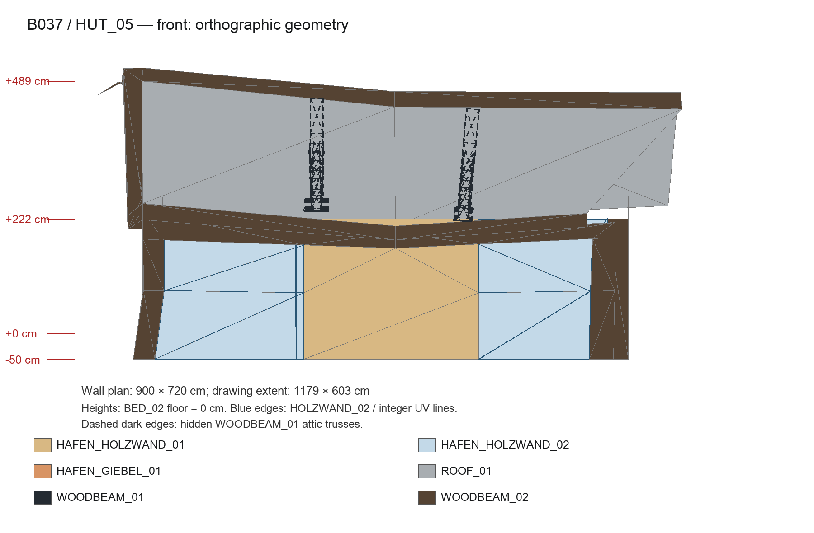
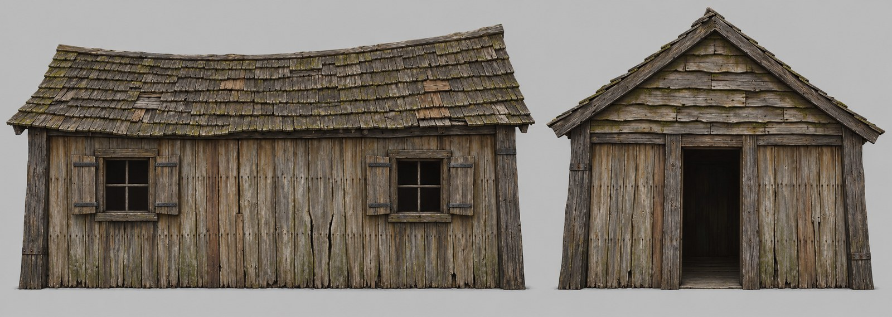

# Хижина бедного квартала порта: концепция здания

Вторая постройка, сделанная по правилу «Здание прежде текстуры» ([docs/content-style.md](../../../docs/content-style.md)). Первая — [дом у рынка](../2026-10-market-house-concept/README.md): пользователь принял его текстуры house-2 21 октября 2026. Хижину выбрали по переписи и игровым кадрам: [обмер B037, чертежи и снимки оригинала](../2026-10-harbour-house/README.md). Такая же конструкция повторена в блоках B031, B036 и частично в B035. Оригинал служит для понимания, как хижина устроена; генератор его пикселей не получает.

## Что это за дом

Хижина рыбака в бедном квартале порта, ей лет сорок. Строили её дёшево и быстро. Каркас дубовый: тяжёлые стойки и обвязка, возможно, взяты со старого корабля. Стены — без штукатурки, из сосновых досок, прибитых стоймя. Внутри одна комната и очаг, под крышей сушат сети. Хижину никогда не красили. Чинили чем было: треснувшую доску меняли новой, щель забивали планкой. Морской ветер с солью выбелил доски до серого, сырость дала зелень и чёрные потёки. Крыша из гонта просела. Дом бедный, но живой: в нём живут, а не бросили.

Рядом стоит дом у рынка, и материалы с ним общие. Дуб каркаса тот же, тёмный, гонт тот же. Только стену торговец оштукатурил и побелил, а рыбак оставил доски голыми. Те же доски закрывают заднюю стену дома у рынка и нижние этажи таверны и «Красного фонаря» под их штукатуркой (`WALL_03`), поэтому они должны подходить к обеим постройкам.

## Правило портового квартала

Слова пользователя: «концепция портового квартала в том, что там постоянная сырость, влага, и это должно сказываться на всех строениях, которые там находятся». Это общее правило для всех построек порта, не только для хижины:
- дерево зарастает мхом и зелёным налётом водорослей: в щелях, на кромках, в тени нахлёстов, на подоконниках и горизонтальных гранях; от этого у дерева зеленоватый оттенок;
- сырость темнит торцы и низ, железо ржавеет и оставляет потёки, соль выбеливает открытые грани;
- старение крупное и связано с устройством постройки (доска, щель, гвоздь, нахлёст), а не мелкий шум.

Средний цвет текстур при этом остаётся по целям оригинала (серо-олив-коричневый, `#4e4837` у стены): зелень даёт распределение мха и налёта, а не общий сдвиг цвета.

## Как построена

| Часть | Как устроена | Размер, см |
|---|---|---|
| План | один этаж, прямоугольник по осям стен | 900 × 720 |
| Стены | от земли до обвязки; низ поля уходит в землю на 50 | 222 над полом, поле 272 |
| Угловые стойки, стойки дверного проёма | дуб, объёмная геометрия (`WOODBEAM_02`) | 40 × 40 |
| Верхняя обвязка | дуб, объёмная геометрия | 40 × 44 |
| Крыша | двускатная, гонт (`ROOF_01`), уклон около 30°, свес и конёк с прогибом | конёк 489 над полом |
| Стропильные доски торцов | дуб, объёмная геометрия | около 30 × 30 |
| Фермы чердака | две, дуб (`WOODBEAM_01`): затяжка, стойка, два подкоса; снаружи почти не видны | 30 × 24 |
| Длинная сторона | два оконных поля и между ними дощатое поле; объёмных стоек между полями **нет** | окна 234 и 249, доски 338 |
| Задняя сторона | одно оконное поле, остальное доски | окно 249 |
| Торец со входом | дверной проём между дубовыми стойками, по бокам доски, над обвязкой фронтон | фронтон 720 × ≈245 |
| Дальний торец | глухая дощатая стена и фронтон | — |

Главное правило: дерево каркаса тяжёлое и объёмное, стена — тонкие доски. Между оконными и дощатыми полями объёмной стойки нет. Поэтому края оконной текстуры — обычные доски, которые продолжают стену, без нарисованной стойки или рамы на краю.

### Стена: `HAFEN_HOLZWAND_01`

- Вертикальные сосновые доски, грубо опиленные, шириной 22–36 см, в среднем 30. На квадрат текстуры 3 × 3 м приходится 10 досок.
- Доски цельные на всю высоту квадрата. Стык по длине — у края квадрата: на хижине он скрыт обвязкой и землёй, на высоких стенах получается ровный ряд торцов через 3 м.
- Доски прибиты к двум скрытым внутренним ригелям, поэтому через всю стену идут два ряда кованых гвоздей.
- Между досками щели 0,5–1,5 см, за ними темнота.
- Края слегка волнистые, у некоторых досок трещина вдоль волокна.
- Квадрат повторяется по обеим осям: на складе порта он лежит на стене 10 × 9,5 м три раза по высоте. Поэтому горизонтальных полос грязи и мха нет. Старение меняется от доски к доске, а не по высоте.

### Окно: `HAFEN_HOLZWAND_02`

На хижине поле 234–249 × 272 см закрывает почти весь квадрат текстуры. Видны U 0,10…0,95 и V 0,05…0,97, V идёт сверху вниз; пол на V ≈ 0,80. Ниже V 0,80 стена уходит в землю.

- Те же доски, что в `HOLZWAND_01`, с тем же шагом. Края квадрата — обычные доски.
- В середине по ширине — проём около 90 × 100 см. Верх рамы на V ≈ 0,17 (185 см над полом), подоконник на V ≈ 0,55 (75 см над полом). Размер взят с оригинала: на игровом кадре его остеклённый проём около 1,1 × 1,1 м в дощатой обкладке шириной около 1,9 м. Первый концепт с проёмом 65 × 70 см пользователь счёл слишком мелким.
- Рама проёма — широкие дубовые доски около 15 см: перемычка, два косяка, подоконник с выносом. Рама чуть перекошена, как вся хижина.
- В проёме простой деревянный крест из двух брусков, за ним темнота комнаты.
- Две ставни из вертикальных досок на кованых петлях, по одной с каждой стороны, открыты и лежат плашмя на стене. Каждая шириной около 45 см, вся группа — около 2,1 м и помещается в видимую часть квадрата. Правая ставня висит чуть криво на разболтанной петле.
- Под подоконником тёмные потёки от дождя, у петель ржавые следы.

### Фронтон: `HAFEN_GIEBEL_01`

- Горизонтальные доски внахлёст, обзол на нижней кромке. Видимая ширина ряда около 37 см: 8 рядов на квадрат 3 × 3 м.
- Длина доски около 150 см, стыки в соседних рядах вразбежку.
- Под каждым нахлёстом глубокая тень, на нижних кромках местами остатки коры. В тени нахлёста держится зелёный мох.
- Квадрат повторяется по обеим осям, ряды должны совпадать на краях.

### Балка: `WOODBEAM_01`

Тот же дуб, что `WOODBEAM_02` дома у рынка, чуть светлее и серее (цель `#403935` против `#2d2718`). Продольное волокно и трещины, одна поперечная железная полоса на заклёпках у верхней четверти. Это фермы чердака здесь и балки в других постройках города.

## Из чего сделано и как стареет

- **Доски.** Сосна, никогда не крашенная. Лицевая сторона выбелена солнцем и солёным ветром до холодного серо-оливкового. В волокне и ближе к верху под свесом остаётся тёплый коричневый. Одна-две доски на квадрат заменены позже: они коричневее и меньше выцвели. По отдельным доскам — зелёный налёт водорослей, чёрные потёки от гвоздей вниз, тёмная сырость на торцах. Средний цвет стены ≈ `#4e4837`: средне-тёмный серо-олив-коричневый, светлее дуба и намного темнее побелки дома у рынка (`#8c8b77`).
- **Фронтон.** Те же сосновые доски, чуть светлее стены (`#544f3c`): дождь бьёт в них сильнее, а земляных брызг нет.
- **Дуб.** Как у дома у рынка: тёмный серо-коричневый, глубокие продольные трещины, грани под дождём серебрятся.
- **Железо.** Тусклое, ржавые потёки вниз.

Поверхность читается как дерево: волокно, щели, гвозди, трещины. Мелкой крапины, «шума» и узора лишайника нет: всё старение крупное и связано с досками.

## Концепт

Вызовы `image_gen` только по тексту этой концепции, в чистом треде (пустой каталог, без файлов и картинок). На одном листе два ортогональных вида: длинная сторона с двумя окнами и торец со входом и фронтоном.

[Попытка 1](hut-concept-attempt-1.jpg) прошла проверку, но пользователь её не принял. Окна вышли мельче, чем в оригинальном дизайне, а хижина — слишком ровной. В оригинале крыша просела и покосилась, есть лёгкая асимметрия, и ряд ровных хижин потерял бы ощущение бедного квартала. Попытка 2 сделана по новому промпту:
- конёк просел и опущен к одному концу, карниз волнистый;
- стойки чуть завалены, обвязка выгнута, фронтон немного несимметричен;
- доски разной ширины и не параллельны, щели разные, есть вставки и прибитая поверх щели планка;
- окна крупнее, в перекошенных рамах, с двумя ставнями и крестом в проёме.

Исходные PNG и точные промпты обеих попыток лежат в `content-sources/harbour-hut-concept/`. Копия на dev-ubuntu сверена по SHA-256: 4/4 файла совпали.

**Принят пользователем 21 октября 2026** с замечанием: в оригинале дом сильнее зарос мхом и от этого был зеленоватым. Это правило всего портового квартала (см. ниже), поэтому в текстурах мха и водорослей больше, чем на концепте.

Что концепт задаёт для текстур:
- доски разной ширины, в среднем около 30 см: серые, местами с коричневыми заменёнными досками, неровные щели, вставки, ряды гвоздей;
- старение по доскам, без полос по высоте;
- окна в перекошенной дубовой раме с двумя открытыми ставнями и крестом, вокруг доски;
- фронтон из досок внахлёст с корой на кромках, ряды не совсем ровные, мох в тени нахлёста;
- тяжёлый тёмный дуб каркаса с железными накладками, тот же, что у дома у рынка.

Что игра так не покажет:
- **Кривизна дома.** Просевший конёк, волнистый карниз и завал стоек в игре задаёт сама геометрия хижины: обмер показывает уклоны скатов 26,5–31,6° и неровный карниз. Текстуры добавляют неровность досок, рам и ставен.
- **Гнилые концы досок у земли.** Низ поля на хижине уходит в землю, а `HOLZWAND_01` повторяется по высоте на высоких стенах, поэтому рваных концов в текстурах нет. Доски идут через весь квадрат.
- **Высота стены.** На концепте стена выше (около 2,75 м против 2,2 м над полом). Для текстур это неважно: квадрат `HOLZWAND` — 3 × 3 м, и поле хижины занимает его почти целиком.
- **Окно по высоте.** Окно в текстуре ставим по обмеру: верх рамы на V ≈ 0,17, подоконник на V ≈ 0,55.
- **Крыша, стойки, обвязка.** Это отдельная геометрия со своими текстурами: `ROOF_01` и `WOODBEAM_02` уже приняты в house-2. Концепт показывает их только для цельности дома.

Пользователь правит или принимает. Текстуры `HOLZWAND_01`, `HOLZWAND_02`, `GIEBEL_01` и `WOODBEAM_01` потом выводятся из принятого концепта в том же треде, как правки его изображения. `WOODBEAM_02` и `ROOF_01` уже приняты в house-2 и не меняются.

Обработка — как в house-2: цвет по материалам (доски — по своим целям, общий набор усилений для `HOLZWAND_01`/`02` и фронтона, дуб окна по `T_oak` через маску), без подгонки детали и Marigold. Проверка в игре — снимки той же хижины B037 (`harbour-hut.bench`): original | ours.
