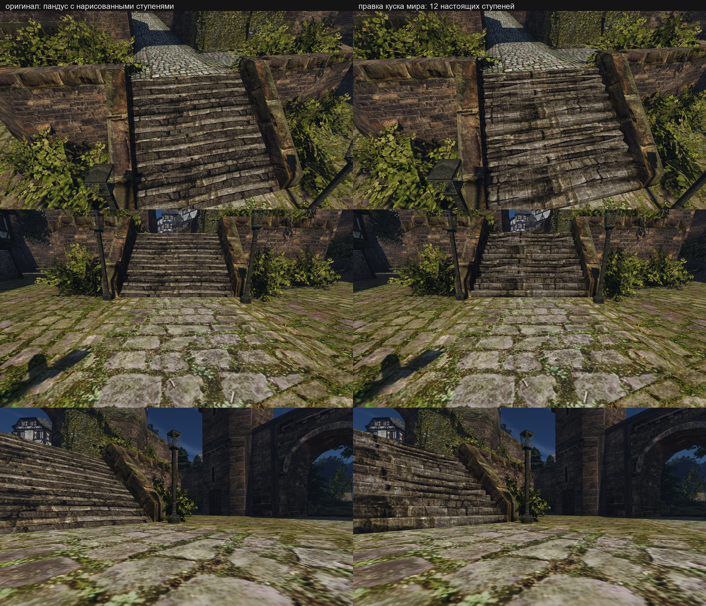

# Лестница порта: настоящие ступени в меше мира

Пилот шага П2 [переноса ресурсов](../../../docs/asset-migration.md#шаги), 2026-10-24. Первая правка сконвертированного куска мира: правка куска как производной разрешена пользователем 2026-10-24 («Да, разрешаю»). 2026-10-25 пользователь принял правку («она норм же получилась, оставляем»): кусок включён в рабочий контент Mac `working-7` вместе с текстурой набережной `quay-4`, запись реестра — `data/content/world-edits.jsonl` (вид `worldchunk`, вход `converted world mesh NEWWORLD/1_-1`).

## Что было

Лестница от площади порта к дороге в верхний город (`NW_HARBOUR_STAIRS_01`, у камеры одноимённого ракурса `harbour-quay.bench`) — два треугольника: пандус 5,10 м шириной, 3,20 м подъёма на 4,00 м горизонтали. На пандусе нарисованы 12 ступеней: одна плитка текстуры вдоль склона держит 6 ступеней, светлая полоса проступи — 42 % периода, тёмная полоса подступенка — 58 %.

## Что сделано

[`scripts/content/world/harbour_stairs.py`](../../../scripts/content/world/harbour_stairs.py) в Blender 5.2 открывает кусок базы `1_-1.glb`, убирает два треугольника пандуса и ставит 12 ступеней в пропорциях оригинала: подступенок 26,7 см, проступь 33,3 см, на каждой кромке — сколотая фаска 4 см. Внутренние углы ступеней лежат на прежней линии пандуса, поэтому ступени уходят в боковые стенки без щелей. Нижняя и верхняя кромки — прежние вершины, площадь и площадка остаются связаны с лестницей. Правка — +70 треугольников в куске, 473 572 во всём мире.

Развёртка — по нарисованному: каждая ступень берёт свой период текстуры, U поперёк лестницы как на пандусе.

| Набор | Проступь | Подступенок | Яркость ступеней с площади (линейная) |
|---|---|---|---|
| оригинал | — | — | 0,065 |
| `stairs-1` | светлая полоса | тёмная полоса | 0,021 |
| `stairs-2` | + фаска 4 см со светлым краем | тёмная полоса | 0,030 |
| `stairs-3` | светлая полоса, фаска | светлая полоса | 0,057 |

Тёмная полоса текстуры — нарисованная тень подступенка. На настоящем подступенке тень даёт сам движок, и нарисованная её удваивала: `stairs-1` и `stairs-2` вышли вдвое темнее оригинала. Это то же, что с картами нормалей: Gothic рисует объём в цвете ([own-content](../../../docs/own-content.md)).

## Ходьба

Стенд [`harbour-stairs.bench`](../../../scripts/content/harbour-stairs.bench) и [`harbour-stairs-down.bench`](../../../scripts/content/harbour-stairs-down.bench), Mac:
- вверх шагом за 6,5 с герой проходит всю лестницу до площадки (y 590); по пандусу за то же время — до y 529;
- вниз шагом с площадки и с середины герой спускается по ступеням до площади, как и по пандусу; высота по пути — высота ступени (на x 8 628 — 483 см, на пандусе — 482);
- в беге с площадки герой разворачивается и стоит — так же и на исходном пандусе, это не лестница.

Навмеш для правленого места пересобирается: порядок треугольников куска после Blender другой ([формат](../../../docs/asset-migration.md#мир)).

## Не сделано

- Сверху ступени читаются ровнее и светлее оригинала: тёмные стыки между ступенями почти ушли. Можно дать тёмную полоску в глубине каждой проступи — решение по виду за пользователем.
- Остальные лестницы с `NW_HARBOUR_STAIRS_01` (18 мест, 1 261 м²) и `_03`.
- Слепой рецензент по пакету пар не запускался.
