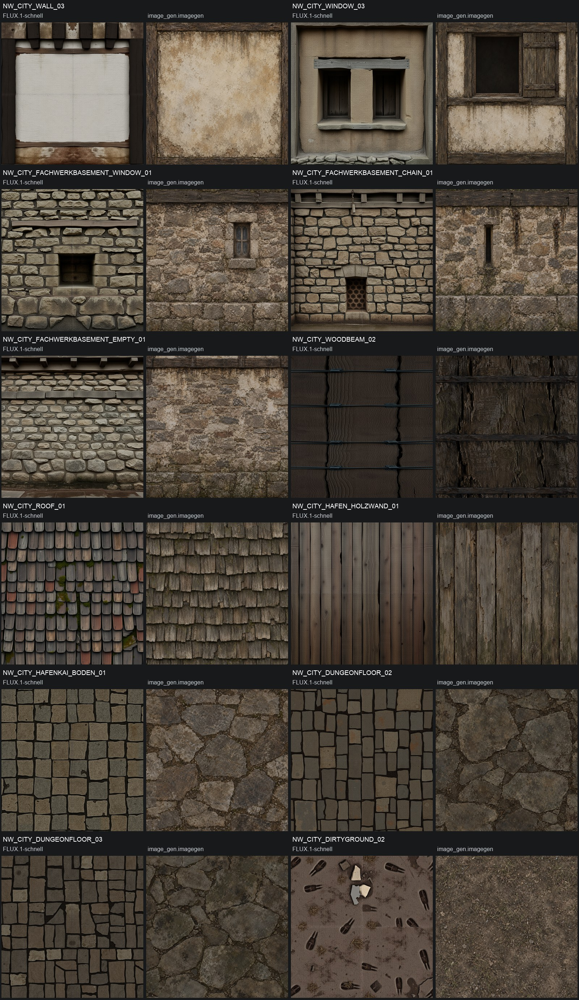
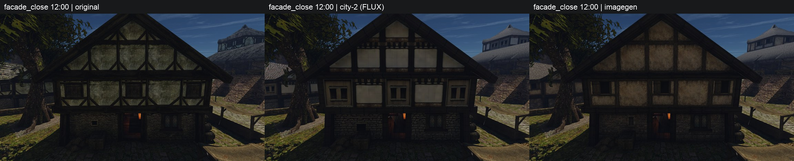
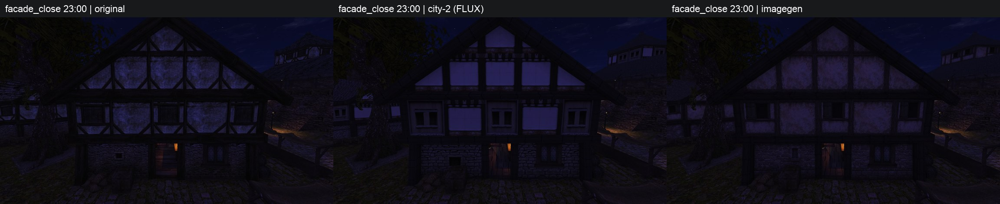
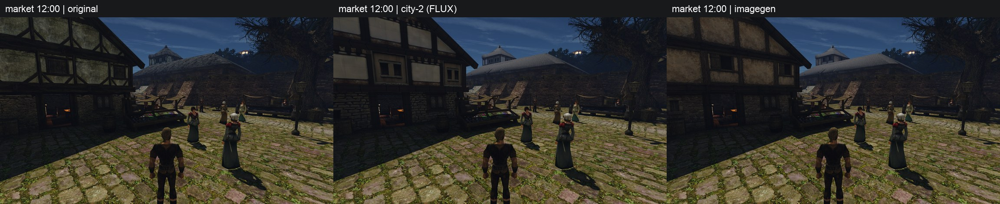
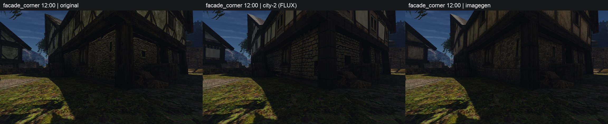
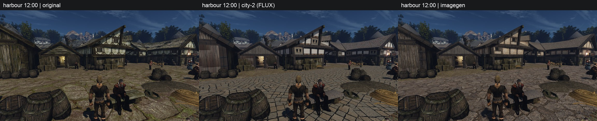

# city-2: FLUX.1-schnell и встроенный imagegen

12 материалов сгенерированы встроенным `image_gen.imagegen` за **13 вызовов**, обработаны прежним фильтром и упакованы. Набор `city-2-imagegen` содержит 22 замены: 12 новых и десять прежних FLUX. Он остаётся `draft` в `~/.local/share/gothic-ai/content-staging/city-2-imagegen/`. Выбор генератора и включение набора — за пользователем.

Основание — [замечания city-2](../2026-10-city-set-2/README.md), [задумка материалов и пропорции модулей](../2026-10-city-intent/README.md), [таблица](../../../data/content/city-materials.csv) и [библия стиля](../../../docs/content-style.md). Из полов выбраны `DUNGEONFLOOR_02` и `DUNGEONFLOOR_03`: оба в таблице city-2 отмечены как лучшие из трёх попыток, но с оставшейся прямоугольной сеткой. Таблица CSV не менялась.

## Материалы

В каждой паре слева FLUX, справа imagegen. Показаны обработанные альбедо в квадратных UV, которые получает упаковщик; физические пропорции возвращает геометрия игры. Особенно существенно это для узкой балки.

В таблице опущены общий префикс `NW_CITY_` и суффикс `.TGA`. `u` — левый/правый стык, `v` — верхний/нижний; число после осей — ширина перекрытия в пикселях карты 1024². Число вызовов относится только к imagegen.

| Материал | Что требовала задумка | Что дал FLUX | Что дал imagegen | Вызовы → выбранный | Шов-фикс |
|---|---|---|---|---|---|
| `WALL_03` | Стойки по сторонам, верхняя и нижняя обвязка, светлое заполнение; грязь у дерева, середина светлее | Цельная рама, но почти чистая середина и выдуманный пояс с выступами | Одна состаренная панель в раме, потёки и разрушение штукатурки у краёв; декоративного пояса нет. Осталось затемнение под верхней балкой в самом цвете | 1 → 1 | uv, 32 |
| `WINDOW_03` | Один вертикальный проём над существенным нижним заполнением, рама и подоконник | Два соседних проёма; нижнее заполнение слишком узкое | Один проём со ставней сбоку, широкая нижняя штукатурная панель и грязь под подоконником. Углубление всё ещё нарисовано с затемнением | 1 → 1 | Нет: panel |
| `FACHWERKBASEMENT_WINDOW_01` | Верхняя балка, бутовая кладка, небольшое окно внутри неё, тяжёлое основание | Окно и основание читаются, но кладка ровная и чистая, верх разделён дополнительными полосами | Верхняя деревянная балка, неровная кладка, одно маленькое окно и отдельный тяжёлый низ; грязь у окна и в нижних швах | 1 → 1 | uv, 32 |
| `FACHWERKBASEMENT_CHAIN_01` | Балка, кладка, узкая ниша и подвесные цепи; тяжёлый цоколь | Цепь есть, основание выражено слабо; сверху декоративные выступы | Узкая вертикальная ниша, цепные крепления, явный крупнокаменный цоколь, сырость внизу; без декоративных выступов | 1 → 1 | uv, 32 |
| `FACHWERKBASEMENT_EMPTY_01` | Глухая ограниченная секция: балка сверху, кладка и тяжёлый низ | Состав сохранён, но снизу полоса пола, сверху выступы и запечённая тень | Вся карта занята стеной, пол отсутствует; балка, грубая кладка и сырой крупнокаменный низ. Под балкой остаётся тёмный контакт | 1 → 1 | Нет: panel |
| `WOODBEAM_02` | Продольные волокна, поперечное железо, глубокие трещины и грязь у обвязок | Направление сохранено, волокна и железо выглядят тонкими и схематичными | Грубые продольные расколы и широкие старые железные обвязки; поверхность заполняет изображение. Второй исходник ближе по пропорции к узкой детали | 2 → 2 | v, 32 |
| `ROOF_01` | Старый деревянный гонт, нахлёст вниз, тёмные стыки и выветренные края | Направление правильное, но элементы похожи на ровные округлые плитки, тон однородный | Разные потрёпанные деревянные плашки, сколы и щели; направление рядов сохранено. Сильное затемнение нахлёстов осталось в альбедо | 1 → 1 | uv, 128 |
| `HAFEN_HOLZWAND_01` | Вертикальные грубые доски, глубокие щели, выбеленные лица и сырость | Вертикальные доски, но гладкие и сравнительно новые | Выбеленные грубые доски, продольные повреждения и тёмные щели. Рисунок сырости заметно повторяется и после исправления стыка | 1 → 1 | uv, 128 |
| `HAFENKAI_BODEN_01` | Крупные разные плиты набережной, земля в кривых швах, стёртые лица | Прямоугольные камни в сетке; издали поверхность теряла характер мощения | Крупные неравные многоугольные плиты, сколотые края и земля между ними; в гавани рисунок мощения читается | 1 → 1 | uv, 128 |
| `DUNGEONFLOOR_02` | Крупные неровные серо-бурые плиты пола, тёмные влажные швы | Прямоугольная сетка сохранялась после трёх попыток | Неравные каменные плиты и кривые земляные швы; прямоугольной сетки нет | 1 → 1 | uv, 128 |
| `DUNGEONFLOOR_03` | Неровные буро-серые плиты прохода башни; подъём задаёт геометрия | Прямоугольная сетка сохранялась после трёх попыток | Неровные плиты без сетки и без нарисованных ступеней; есть мелкие камни в швах | 1 → 1 | uv, 128 |
| `DIRTYGROUND_02` | Сплошная утоптанная земля двора, редкая трава и мелкий мусор | Одинаковые крупные отпечатки подошв и отдельные контрастные фрагменты | Сплошной грунт с неравномерным уплотнением, травинками и мелким мусором; штампованных одинаковых следов нет | 1 → 1 | uv, 128 |

## Генерация и обработка

Только встроенный инструмент, режим по умолчанию skill `imagegen`: без CLI, API-ключа и локальных моделей. Все 13 вызовов получили только текст; оригинальные пиксели, игровые кадры и предыдущие результаты изображениями на вход не передавались. Промпты описывают объект, назначение частей, раскладку, физическую пропорцию, износ у контактов и запреты из пилота. Везде запрошены ортографический вид, рассеянный свет без теней/бликов и отсутствие текста.

Инструмент возвращает PNG и путь, но не раскрывает внутреннее имя/версию модели, ревизию или seed. В [реестре](../../../data/content/registry.jsonl) модель названа `image_gen.imagegen`, ревизия и seed — `null`; дата, полный промпт, длительность и источник есть у каждой попытки. Исходные PNG теперь постоянно хранятся вне git, в `~/.local/share/gothic-ai/content-sources/city-2-imagegen/`, и копией со сверкой SHA-256 на dev-ubuntu ([резервная копия](../2026-10-city-set-3/README.md)). В `city-2-imagegen/sources/` находятся относительные ссылки на них и все обработанные варианты. По [условиям OpenAI, раздел Content](https://openai.com/policies/row-terms-of-use/), результат принадлежит пользователю в пределах, допускаемых применимым правом.

Генерация: **13 успешных вызовов, 0 ошибок**. От первого вызова до последнего ответа — **386,370 с** (15:47:09,692–15:53:36,062 UTC, 2026-10-19). Сумма длительностей вызовов — **864,666 с**, диапазон 20,222–169,865 с. Вызовы подавались группами с перекрытием; эти числа включают ожидание инструмента и очереди провайдера, поэтому не являются измерением чистого времени модели.

Размер задавался словами: отдельного параметра размера и списка поддерживаемых размеров инструмент не предоставляет. Девять выбранных исходников — 1254², окно — 1295×1214 при физическом модуле 4,00×3,75, CHAIN — 1334×1179 при 2,95×2,61. Балка сначала вышла 822×1913; повторный запрос узкого портрета 1:3 дал **724×2172**, он выбран. Это ближе к физическим 1,15×10,14, но исходник всё ещё шире этой пропорции. Физические пропорции записаны отдельно в `parameters.source_aspect`. Все исходники приведены LANCZOS к квадрату 1024², как в пилоте.

Бесшовность сначала запрошена текстом по раскладке. После просмотра 2×2 исправлены девять `tiled` по обеим осям и балка `strip` вдоль длины; два `panel` не исправлялись. `seam_fix.py` выбирает разрез с наименьшей суммой квадратов RGB-перепадов в перекрытии противоположных краёв, без нейросети. Второй разрез замкнут вокруг уже исправленной оси. У модулей перекрытие 32 px, чтобы сохранить тонкие конструктивные балки; у однородных поверхностей 128 px. Период после перекрытия — 992 или 896 px, затем периодический LANCZOS возвращает 1024 px. Оси, ширина, путь разреза и ошибка сохранены у каждой попытки. Исправление стыка не устраняет повтор самого рисунка.

Дальше использован прежний `generate.target_corrected_maps`: общий множитель линейного RGB к `target_luminance`, ограничение средней HSV S до 0,30, прежние фильтры нормали/высоты/AO/шероховатости, металличность 0. `scale`, `antitile` и `antitile_cell` всех 22 записей совпадают с city-2. Упаковка прежняя: albedo/ORM DXT1, normal DXT5nm.

Максимальная ошибка яркости 12 новых материалов: PNG **0,000011735**, DDS mip 0 **0,000877913**. Максимальная средняя HSV S PNG — **0,299999985**. Упакованы **66 DDS**, отрицательных Z нормалей **0** во всех 22 материалах. У десяти перенесённых материалов все 30 DDS побайтно совпадают с city-2. Все 108 прежних строк реестра сохранены дословно.

## В игре

Три колонки: **оригинал | city-2 (FLUX) | imagegen**. Все три варианта сняты заново одним бинарником на Ryzen, через `gq`, по неизменённому `scripts/content/city-2.bench`. Камеры совпадают с пилотом; цвет и экспозиция снимков после съёмки не менялись.

У дома imagegen сохраняет отдельные окна и загрязнённые панели без выдуманного декоративного пояса; в гавани видны неровные плиты и состаренная обшивка. Ночью и на затенённом углу мелкий износ читается слабее. Внутренние полы канализации и башни заданные камеры не показывают: их сравнение находится на листе материалов.

Съёмка `gq` **36101d13f1f9**, класс `quick`, эксклюзивное окно. Первый запуск остановился до игры из-за отсутствия кэшированной сборки текущих исходников. Она подготовлена через `gq` **90f4d0f75aa3**, без изменения исходников движка; первый полный проход съёмки прошёл успешно.

| Вариант | Время игры, с | Exit | Технических кадров | Целевых подмен | Целевых оригиналов открыто |
|---|---:|---:|---:|---:|---:|
| Оригинал | 47 | 0 | 10 | 0 | 22 |
| city-2 (FLUX) | 47 | 0 | 10 | 22 | 0 |
| imagegen | 56 | 0 | 10 | 22 | 0 |

У всех трёх `done=true`, ошибок 0, overflow 0. В отчёте пять троек; остальные технические кадры, журналы и перепись — вне git: `city-2-imagegen/captures/20261019T160454Z-TRWQ27bs/`. Это съёмка внешнего вида, отдельного замера FPS не проводилось.

## Выводы для просмотра

- На этих текстовых описаниях imagegen выполнил проверяемые ограничения: один оконный проём, отсутствие декоративного пояса, неровные плиты без прямоугольной сетки, грунт без одинаковых отпечатков. Износ чаще привязан к раме, стыкам и низу стены.
- Остались ограничения: нарисованное контактное затемнение под балками и нахлёстами, заметный повтор сырости досок, регулярный ритм гонта и приближённая исходная пропорция балки. Запрос бесшовности сам по себе не заменил обработку швов у десяти материалов.
- Совпадение средней яркости не делает распределение светлых и тёмных частей одинаковым: поэтому важны и лист, и дневной/ночной фасад. Набор и генератор не выбирались автоматически.

## Проверки

- `uv run --no-project --with pytest --with numpy --with pillow --with scipy python -m pytest -q scripts/content/` — **322 passed**, 23,30 с. Первый проход: 320 passed / 1 failed; загрузчик HF ошибочно принял имя встроенного инструмента за репозиторий модели. Добавлен пропуск таких рецептов и тест отсутствия HF-зависимости; повторный полный проход зелёный.
- `registry.py check` — **130** записей; отдельный реестр набора с `--content-root` — **22** записи с проверенными файлами. Сохранены все **13** исходников и шесть карт каждой попытки.
- `map_textures.py check` — **71** строка; CSV не менялся. Проверены одинаковые scale/antitile и побайтное совпадение десяти материалов FLUX.
- `bash -n scripts/content/capture-city.sh`, `git diff --check` и все три проверки игровых кадров/переписи прошли.

Движок, шейдеры, server, наборы city-1/city-2 и рабочий каталог контента не менялись; dev-ubuntu не использовался.
