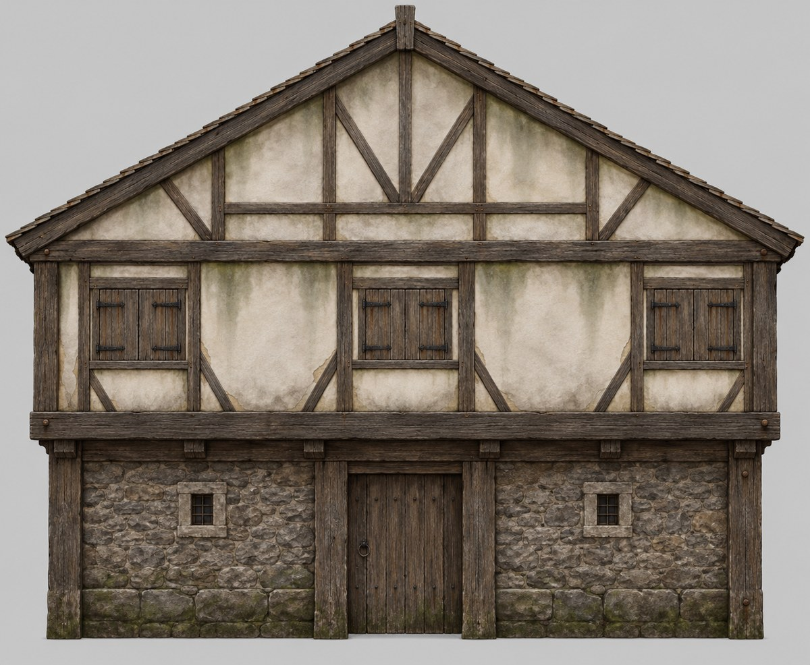
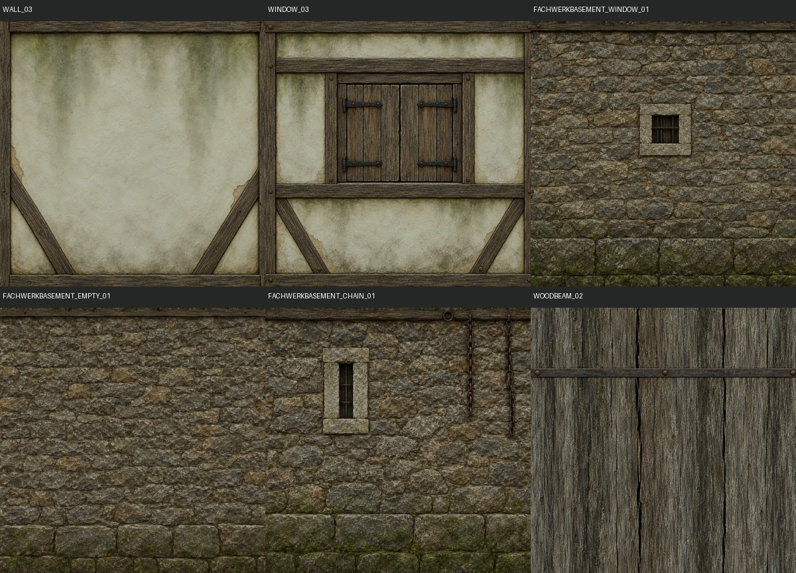
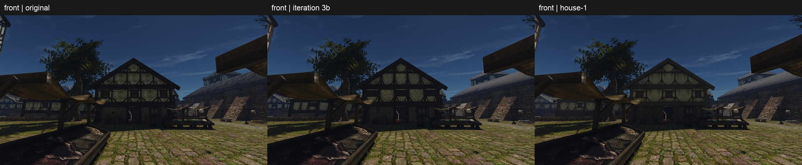
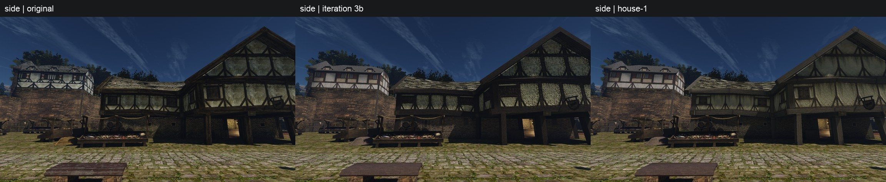
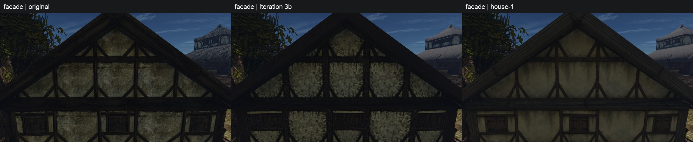
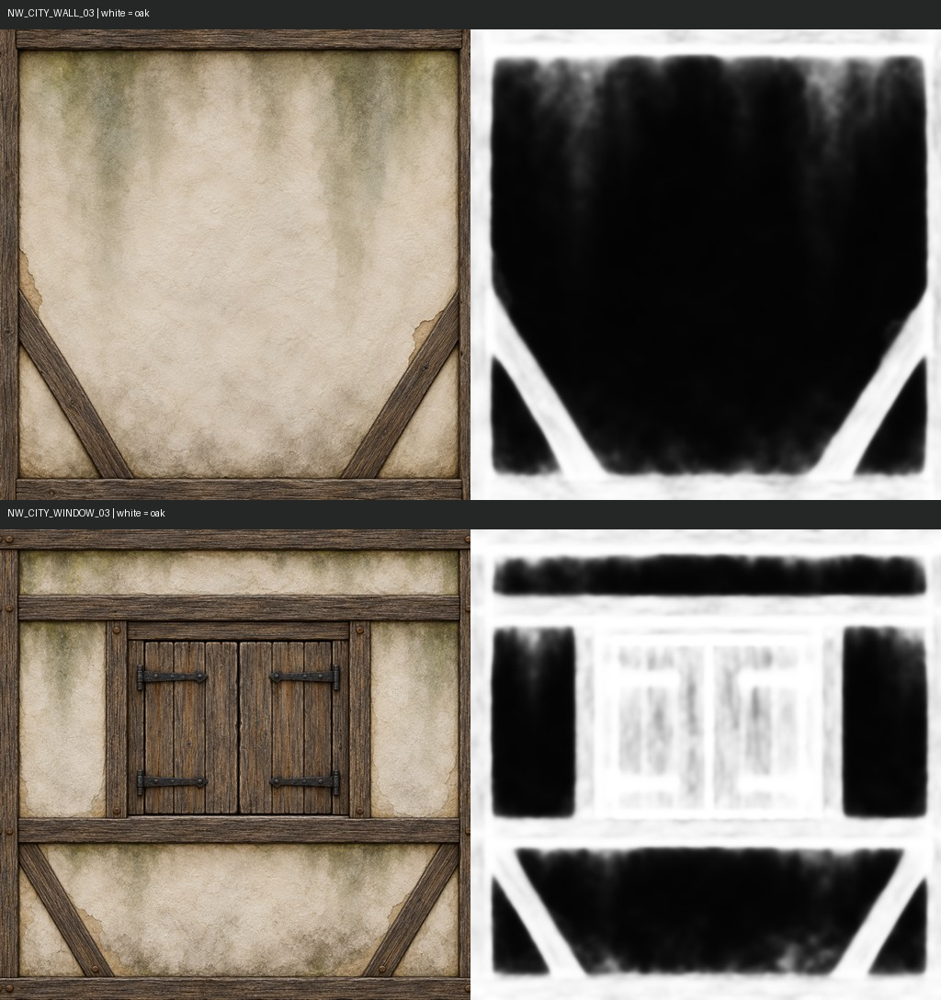
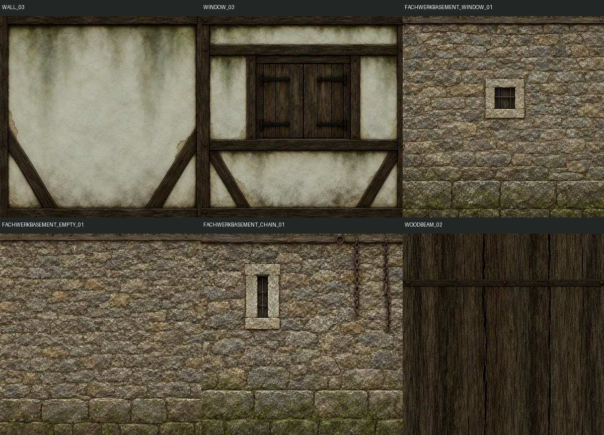
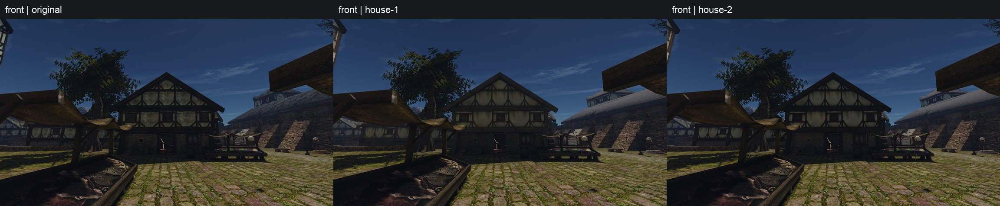
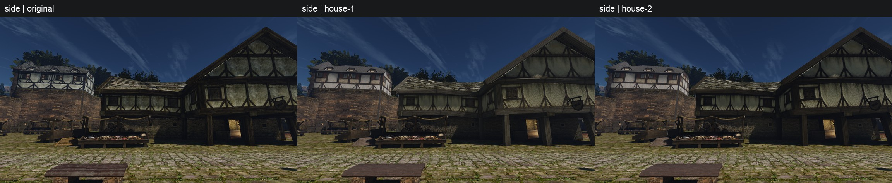
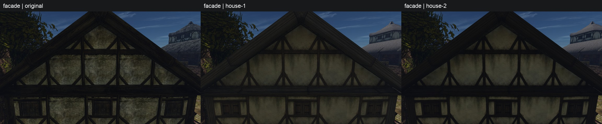

# Дом у рынка: концепция здания

Концепция принята пользователем 21 октября 2026. **Текстуры `house-2` приняты им в тот же день** после просмотра в игре: «сейчас выглядит хорошо, можем оставлять», house-2 лучше house-1. Метод «здание прежде текстуры» идёт дальше по другим постройкам города. Пилот качества 3 сделал материалы по одной текстуре с числами и потерял дом (вердикт пользователя: «нет единой концепции, текстуры налепленные на стену»). Здесь сначала описано здание, а текстуры выводятся из него. Оригинал служит для понимания, как дом устроен; его пиксели генератор не получает.


Размеры взяты из геометрии фасада (`texture-intent/market-house-measurement.json`, сантиметры игры). Тёмное — объёмные балки (`WOODBEAM_02`), кремовое — `WALL_03`, голубое — `WINDOW_03`, серое — каменный низ.

## Что это за дом

Дом торговца у рынка, ему лет восемьдесят. Внизу каменная лавка и склад: камень не боится сырости и огня. Наверху жилой этаж в дубовом каркасе, под крышей чердак для товара. Хозяин дом бережёт и раз в несколько лет обновляет побелку. Но портовая сырость и дым из труб каждый раз берут своё: дом чистый, хотя и не новый.

## Как построен

| Часть | Как устроена | Размер, см |
|---|---|---|
| Нижний этаж | бутовый камень на известковом растворе, внизу два ряда крупного тёсаного камня; посередине дверной проём; маленькое окно в каменном обрамлении | высота 265, отступ 40 под выносом |
| Стойки нижнего этажа, угловые стойки | дуб, объёмная геометрия | 45 |
| Поясная балка | один массивный дубовый брус, на нём верхний этаж выступает вперёд на 40 | 52 |
| Верхний этаж | дубовый каркас, пять полей слева направо: окно ≈200, стена ≈240, окно ≈190, стена ≈250, окно ≈175 | высота 210, ширина 1055 |
| Промежуточные стойки, нижние и верхние ригели полей | нарисованы в текстурах; на каждом краю текстуры половина стойки, на стыке двух полей получается одна стойка | 8 на краю текстуры, 16 на стыке |
| Подкосы | в каждом поле стены два коротких подкоса в нижних углах: от стойки на ~40% высоты вниз к нижнему ригелю ~25% ширины от края | 14 |
| Окно | небольшой проём в своей раме: перемычка, два косяка, подоконник; над перемычкой полоса штукатурки; по бокам окна стена; закрытая двустворчатая дощатая ставня на кованых петлях | проём ≈90 × 80, рама 10–12 |
| Фронтон | ещё один вынос на 70; тот же язык каркаса, нарисованный в `WALL_03` с повтором ~5,4 раза: стойки через ~250, средний ригель, пары подкосов; стропила — объёмная геометрия | 1368 × 400 |
| Крыша | деревянный гонт | — |

Главное правило: объёмное дерево тяжёлое (45–52 см), нарисованное лёгкое (стойки 16, подкосы 14, рама окна 10–12). Нарисованное не повторяет объёмное: где у геометрии уже есть балка, текстура её не рисует. Раз `WALL_03` одновременно и поле этажа, и весь каркас фронтона, края текстуры несут ровно половину стойки.

## Из чего сделано и как стареет

- **Дерево.** Дуб, тёмный серо-коричневый. Грани, на которые льёт дождь, выцветают до серебристо-серого. Вдоль волокон глубокие трещины усыхания, торцы темнее; в узлах круглые деревянные нагели. Нарисованное дерево того же тона и волокна, что объёмные балки.
- **Заполнение.** Плетень из прутьев, обмазанный глиной с соломой, сверху известковая штукатурка и побелка. Поверхность заглажена вручную: матовая, чуть волнистая, без «кракелюра» и узора. Старение:
  - мягкие облачные серо-зелёные пятна сырости идут от верха каждого поля, куда с балки стекает вода;
  - зелёный налёт в верхних углах;
  - тонкая тёмная щель там, где штукатурка усохла и отошла от дерева;
  - редкие небольшие места, где побелка облетела и видна серо-охристая обмазка;
  - внизу полей брызги грязи.

  Пятна крупные и мягкие, не крапины.
- **Камень.** Серо-бурый бутовый камень неровными рядами, швы раствора утоплены и темнее, у земли сырость и зелень.
- **Ставни и рамы окон.** То же дерево, доски вертикальные, железо тусклое, ржавые потёки под петлями.

Светлее всего на доме штукатурка, но не белая: средне-светлая серо-кремовая, средний цвет `WALL_03` ≈ `#8c8b77`. Дерево очень тёмное, камень средне-тёмный.

## Концепт фасада



Два вызова `image_gen` по тексту выше в чистом треде; вторая попытка исправила штукатурку: была мелкая «лишайниковая» крапина, стала гладкая с мягкими пятнами. [Попытка 1](facade-concept-attempt-1.jpg). Исходные PNG и точные промпты лежат в `content-sources/market-house-concept/`, копия на dev-ubuntu.

Что концепт задаёт для текстур: одно дерево на объёмных балках и на нарисованных стойках, тонкие стойки и подкосы рядом с тяжёлыми поясом и углами, маленькие окна в своей раме со стеной вокруг, гладкую побелку с мягкой сыростью сверху полей, бут с крупным камнем внизу.

Что игра так показать не сможет:
- **Фронтон.** В игре это одна грань, по которой `WALL_03` повторяется ≈5,4 раза по ширине и 1,7 по высоте (поле ≈250 × 235 см). Своего рисунка с ригелем и V-подкосами у него быть не может: фронтон в игре — ряды тех же полей стены, срезанные скатами. Рисунок поля надо выбирать так, чтобы и повтор на фронтоне выглядел каркасом.
- **Дверь, кронштейны под поясом, гонт на скатах.** Это отдельная геометрия или другие текстуры; концепт показывает их только для цельности дома.

## Как отсюда получатся текстуры

1. Концепт фасада: одно изображение `image_gen` только по тексту этой концепции, в чистом треде. Пользователь правит или принимает.
2. Текстуры дома выводятся из принятого концепта в том же треде, как правки его изображения: `WALL_03`, `WINDOW_03`, `FACHWERKBASEMENT_*`, `WOODBEAM_02`. У всех одна штукатурка, одно дерево, одна грязь.
3. Средний цвет и пределы детали служат только ограничителями. Подгонка детали больше не усиливает картинку к цели.
4. Приёмка в игре глазами по концепту: читается ли стена как побелённая штукатурка, окно как окно, а дерево как один каркас.

## Текстуры дома

Набор `house-1` собран из шести правок принятого концепта фасада в его треде; новых вызовов генератора при обработке не было. Выбор: WALL — 1, WINDOW — 2, FACHWERKBASEMENT_WINDOW — 2, EMPTY — 1, CHAIN — 1, WOODBEAM — 2. Все девять попыток, включая невыбранные, сохранены с точными промптами, временем, длительностью, моделью `image_gen.imagegen` и SHA-256 в [реестре](../../../data/content/market-house.jsonl). Резервная копия `dev-ubuntu:~/gothic-ai/content-backup/sources/market-house/` проверена чтением SHA: **18/18 файлов совпали (9 PNG + 9 JSON), 0 расхождений**. Оригинальные текстуры, превью и листы при этой работе не открывались.



Обработка: один Lanczos из исходника в 1024², затем `seam_fix.seamless` с узким перекрытием 1/64 по U/V; WINDOW_03 — только U. После стыков применён **один общий набор трёх линейных усилений RGB на весь дом**: `0.614557529, 0.712756295, 0.648858141`. Подбор учитывает обычную обрезку за границей RGB [0;1] и квантование конечного PNG; подгонки детали, Marigold и мягкого плеча нет. Normal/ORM получены прежним CPU-фильтром из итогового альбедо. Детектор света только записан.

Цели `target_oklab` переведены в линейный RGB и взвешены суммой площадей треугольников соответствующей текстуры в `market-house-measurement.json` (всего **463.618 м²** для этих шести). Взвешенная цель RGB — `0.149279, 0.137872, 0.092270`; наше среднее — `0.149299, 0.137844, 0.092250`. Максимальная ошибка канала **0.00002779** при допуске **0,005**. Один множитель сохраняет отношения цветов одинаковых материалов между шестью картинками.

В таблице RGB — средний **линейный RGB**, отношение яркости — Rec.709 нашего среднего к индивидуальной цели. Предел 0,75–1,25 служит ограничителем: четыре выхода записаны, без индивидуального исправления цвета.

| Текстура (NW_CITY_) | Площадь, м² | Цель RGB | Наш RGB | Яркость / цель | ±25% | Свет: флаг |
|---|---:|---|---|---:|---|---|
| WALL_03 | 143.265 | 0.260614, 0.258526, 0.183960 | 0.272658, 0.263336, 0.180675 | 1.0227 | да | да |
| WINDOW_03 | 22.599 | 0.135861, 0.128987, 0.088101 | 0.170996, 0.156510, 0.101693 | 1.2207 | да | да |
| FACHWERKBASEMENT_WINDOW_01 | 35.974 | 0.147342, 0.123924, 0.076442 | 0.089305, 0.075515, 0.044826 | 0.6075 | **вне** | да |
| FACHWERKBASEMENT_EMPTY_01 | 109.587 | 0.149277, 0.125459, 0.077823 | 0.091239, 0.075081, 0.044385 | 0.6004 | **вне** | да |
| FACHWERKBASEMENT_CHAIN_01 | 28.397 | 0.137547, 0.115148, 0.071439 | 0.087843, 0.074006, 0.043497 | 0.6402 | **вне** | да |
| WOODBEAM_02 | 123.795 | 0.026139, 0.020117, 0.009086 | 0.085506, 0.077524, 0.055530 | 3.7685 | **вне** | да |

Три каменных модуля темнее своих целей (0,6004–0,6402), объёмная балка светлее (3,7685). Это ограничение выбранных исходников при едином цвете; отдельные усиления на материал не применялись.

`~/.local/share/gothic-ai/content-staging/house-1/` содержит **58 записей**, **12 целевых замен**: шесть дома и шесть прочих пилотных. От `pilot-3b` отличаются ровно шесть записей дома; **52 остальные записи и 156 DDS** проверены побайтно. Рабочий content и прежние staging-наборы не менялись. Карты лежат в `content-staging/market-house-sources/`, подготовленные PNG — в `market-house/prepared/`. Лист выше — 1200×864, меньше 1 МБ.

Воспроизведение обработки:

```sh
uv run --no-project --with numpy --with pillow --with scipy python scripts/content/market_house.py prepare
uv run --no-project --with numpy --with pillow --with scipy python scripts/content/market_house.py build
```

`build` требует свободный путь `house-1` и не перезаписывает существующий набор.

### Дом целиком в игре

Одна сборка неизменённого движка на Ryzen через `gq`, отдельная папка `gothic-ai/market-house`. SHA-256 бинарника: `83aec616504fbcc8094d4b48cbe120e3a7a616d058c7a0e44b401c971da58f27`. Все три запуска используют один сейв (SHA-256 `c2852f4c009f23225e1c9c70f564ca36b4c12e8220736d1c72a1dbfce8d3372f`), полдень и одинаковые камеры; NPC и эффекты скрыты. Сценарий — [market-house.bench](../../../scripts/content/market-house.bench). Снимки 1280×720 без обрезки уменьшены до панелей 768×432; каждый JPEG — original | iteration 3b | house-1, 2304×476 с заголовком.

| Набор | Exit | Кадры | Цели проверки | Применены | Открыты целевые оригиналы |
|---|---:|---:|---:|---:|---:|
| original | 0 | 3 | 12 | 0 | 12 |
| pilot-3b | 0 | 3 | 8 прежних | 8 | 0 |
| house-1 | 0 | 3 | 12 | 12 | 0 |

**Передний фасад с земли.** Весь дом от основания до конька; камера выведена по `origin/outward` измерения. Торговые прилавки и дерево остаются частью сцены.



**Боковая стена.** Каменный низ EMPTY/CHAIN, верхние поля и тяжёлое объёмное дерево в окружении рынка. Камера со стороны `+tangent`.



**Прежняя facade.** Та же камера из `quality-pilot.bench`, крупно верхний этаж и фронтон. У house-1 побелка гладкая, с мягкими пятнами, нарисованный каркас тоньше объёмных балок. Светлая объёмная балка и тёмный камень остаются ограничениями единого множителя, отражёнными в таблице выше; визуальная приёмка набора остаётся за пользователем.



Воспроизведение съёмки:

```sh
QUALITY_PILOT_TASK=gothic-ai/market-house scripts/content/capture-quality-pilot.sh --prepare
QUALITY_PILOT_TASK=gothic-ai/market-house scripts/content/capture-quality-pilot.sh --capture original ~/.local/share/gothic-ai/market-house/captures
QUALITY_PILOT_TASK=gothic-ai/market-house scripts/content/capture-quality-pilot.sh --capture pilot-3b ~/.local/share/gothic-ai/market-house/captures
QUALITY_PILOT_TASK=gothic-ai/market-house scripts/content/capture-quality-pilot.sh --capture house-1 ~/.local/share/gothic-ai/market-house/captures
scripts/content/capture-quality-pilot.sh --compose-house ~/.local/share/gothic-ai/market-house/captures reports/content/2026-10-market-house-concept
```

Проверки:

- `uv run --no-project --with pytest --with numpy --with pillow --with scipy python -m pytest -q scripts/content/` — **814 passed**, 80,67 с; после упрощения CLI затронутые два файла тестов — **29 passed**. Общий цвет в пределах 0,005, одинаковые входы получают одинаковые выходы при разных индивидуальных целях, учтён клиппинг, стыки идут только по разрешённым осям после единственного приведения к 1024².
- `python3 scripts/content/map_textures.py check` — **78 строк**, passed.
- `python3 scripts/content/registry.py check data/content/market-house.jsonl --content-root ~/.local/share/gothic-ai/content-staging/market-house-sources --source-root ~/.local/share/gothic-ai/content-sources` — **6 рецептов / 9 исходных PNG**, все карты и SHA проверены. Итоговые альбедо совпали по SHA с подготовленными в **6/6** случаях.
- Сборка staging — **58 записей, 6 изменённых относительно pilot-3b, 52 прежние записи / 156 DDS**; игровые проверки `check --market-house` — **3/3**, **9/9 кадров**, у house-1 **12/12 замен и 0 целевых оригиналов**.
- Четыре JPEG: лист **369 363 байта**, front **230 668**, side **266 790**, facade **197 286**.

### Цвет по материалам: house-2

House-1 оставил балку в 3,7685 раза светлее цели, а каменный низ — 0,6004–0,6402; контраст каркаса со штукатуркой ослаб. В `house-2` цвет исправляется по материалам: отдельный дуб балки, общая группа трёх каменных модулей и общие усиления нарисованного дуба / штукатурки в WALL_03 и WINDOW_03. Исходники, их выбор, один Lanczos в 1024², узкие стыки и CPU-фильтр normal/ORM прежние. Подгонки детали, Marigold и плеча нет.

**Маска дуба.** Условие по OKLab b убрано по решению пользователя. Для обеих панелей: `ln(max(Y, 1e-8)) → Gaussian σ=6 px → общий порог Оцу объединённых значений → sigmoid((threshold − blurred_lnY)/0.3)`. Gaussian заворачивается по U/V у WALL_03 и только U у WINDOW_03 (V отражается). Общий порог — **-1.800131667** в ln Y. Маска участвует только в мягком смешении цветовых усилений; яркие прожилки не разбивают брус на штукатурку.



Лист проверен глазами: брусья, подкосы, оконная рама и ставня образуют цельные светлые области; поля штукатурки тёмные, переходы мягкие. Верхние пятна проверены на вручную отмеченных полях штукатурки: WALL — **2144 / 640500 = 0,3347%**, WINDOW — **6632 / 344464 = 1,9253%** от площади размеченной штукатурки. В числитель входят пиксели верхних пятен с маской >0,5; границы полей хранятся в рецепте (`upper_plaster_spill.manual_plaster_polygons_uv`) и не влияют на обработку. Это оценка по ручной разметке, оба значения ниже ориентировочных 2%.

**Тон дуба.** Итоговый средний RGB балки после её коррекции — `T_oak = (0.026125, 0.020111, 0.009088)`. Среднее нарисованного дерева измеряется на конечном PNG по пикселям с маской >0,5, с площадным весом двух панелей. Два общих набора усилений решаются совместно: полный средний WALL/WINDOW попадает в их площадь-взвешенную цель, а средний конечного дерева — в `T_oak`. Само смешение остаётся мягким, без бинарных границ. После 8-bit квантования ошибки максимального канала: **0.000001727** для панелей и **0.000001225** для дуба; обрезанных пикселей у панелей — 0.

| Группа | Общие линейные усиления R, G, B |
|---|---|
| Дуб WOODBEAM_02 | 0.187853, 0.184917, 0.106169 |
| Камень, три FACHWERKBASEMENT | 1.000274, 1.173125, 1.119435 |
| Нарисованный дуб WALL/WINDOW | 0.162160, 0.173965, 0.112019 |
| Штукатурка WALL/WINDOW | 0.631872, 0.747209, 0.703017 |

В таблице — средний **линейный RGB**. У каменной группы маска дуба не применяется; балка задаёт эталон целиком. Все **6/6 текстур** проходят ±25% собственной цели по яркости. Дуб обеих панелей проходит ±25% `T_oak` по всем трём каналам: максимальное отклонение — 6,82%.

| Текстура (NW_CITY_) | Цель RGB | Наш RGB | Яркость / цель | RGB дерева | Яркость дерева / T_oak | Маска >0,5 |
|---|---|---|---:|---|---:|---:|
| WALL_03 | 0.260614, 0.258526, 0.183960 | 0.259863, 0.257721, 0.183592 | 0.99699 | 0.026613, 0.020621, 0.009258 | 1.02337 | 24.743% |
| WINDOW_03 | 0.135861, 0.128987, 0.088101 | 0.140616, 0.134106, 0.090439 | 1.03797 | 0.024814, 0.018740, 0.008630 | 0.93726 | 58.243% |
| FACHWERKBASEMENT_WINDOW_01 | 0.147342, 0.123924, 0.076442 | 0.145327, 0.124329, 0.077345 | 0.99941 | — | — | — |
| FACHWERKBASEMENT_EMPTY_01 | 0.149277, 0.125459, 0.077823 | 0.148475, 0.123618, 0.076590 | 0.98759 | — | — | — |
| FACHWERKBASEMENT_CHAIN_01 | 0.137547, 0.115148, 0.071439 | 0.142948, 0.121844, 0.075058 | 1.05309 | — | — | — |
| WOODBEAM_02 | 0.026139, 0.020117, 0.009086 | 0.026125, 0.020111, 0.009088 | 0.99966 | 0.026125, 0.020111, 0.009088 | 1.00000 | — |



**Набор и проверка в игре.** `content-staging/house-2/`: **58 записей, 12 целевых замен**. От `pilot-3b` изменены ровно шесть записей дома; остальные **52 записи и 156 DDS** совпадают побайтно. В общем реестре теперь **12 рецептов / 9 уникальных исходных PNG**; прежние 86093 байта house-1 сохранены без изменения, его шесть альбедо совпали по SHA. Прежние четыре JPEG также сохранены побайтно.

На Ryzen в той же папке `gothic-ai/market-house` переиспользован бинарник SHA `83aec616504fbcc8094d4b48cbe120e3a7a616d058c7a0e44b401c971da58f27` и тот же сейв SHA `c2852f4c009f23225e1c9c70f564ca36b4c12e8220736d1c72a1dbfce8d3372f`. Только house-2 запущен заново через gq: **exit 0, 3/3 кадра, 58 материалов, 12/12 замен и 0 открытых целевых оригиналов**. Original и house-1 переиспользованы. На кадре каркас снова тёмный и контрастный; штукатурка сохраняет гладкие поля и мягкие пятна.







Воспроизведение:

```sh
uv run --no-project --with numpy --with pillow --with scipy python scripts/content/market_house.py prepare --set house-2
uv run --no-project --with numpy --with pillow --with scipy python scripts/content/market_house.py build --set house-2
QUALITY_PILOT_TASK=gothic-ai/market-house scripts/content/capture-quality-pilot.sh --capture house-2 ~/.local/share/gothic-ai/market-house/captures
scripts/content/capture-quality-pilot.sh --compose-house-2 ~/.local/share/gothic-ai/market-house/captures reports/content/2026-10-market-house-concept
```

`build` требует свободный путь house-2 и добавляет рецепты к общему реестру. Проверки хода: запрошенный `uv run --no-project --with pytest --with numpy --with pillow --with scipy python -m pytest -q scripts/content/` — **823 passed** (78,14 с); отдельно **38 passed** в двух затронутых тестовых модулях (3,86 с), включая общий порог, порядок ln→Gaussian, wrap/reflect по разрешённым осям, светлые прожилки и мягкие пятна, совместный цвет дуба/штукатурки и сохранение старых JPEG. Таблица — **78 строк**, реестр — **12 рецептов / 9 PNG**, все карты и SHA проверены. Новые файлы: маска **220476 байт**, лист **365689**, front **229374**, side **263977**, facade **181880**. Все панели сравнений — 768×432, JPEG 2304×476.
