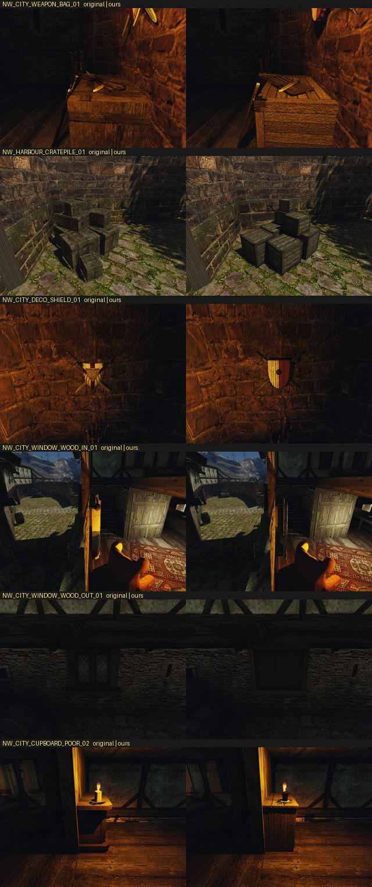
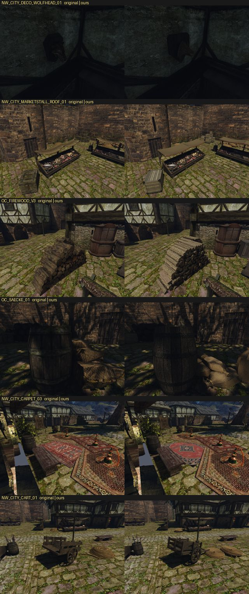
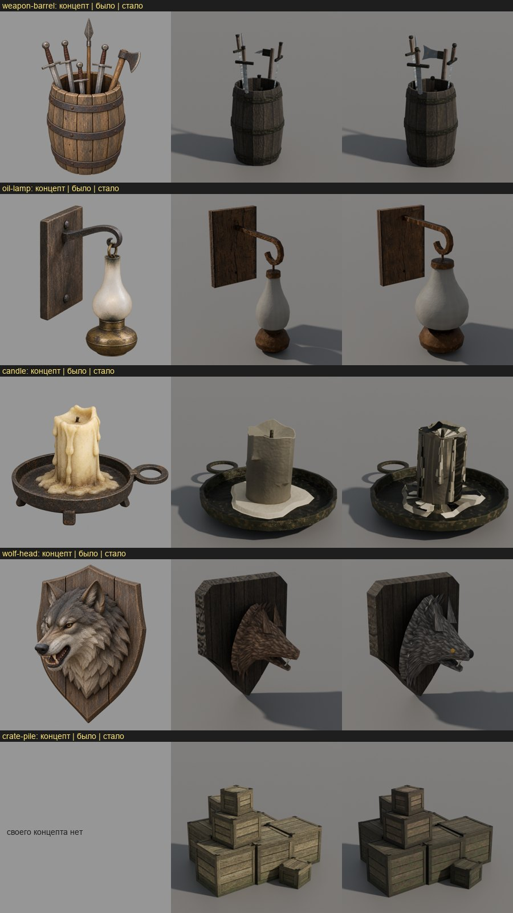
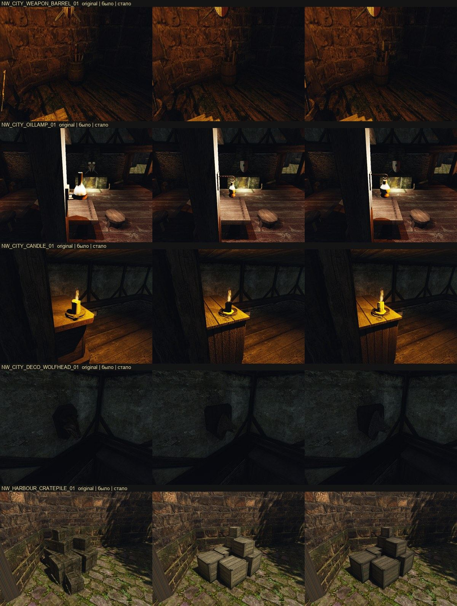
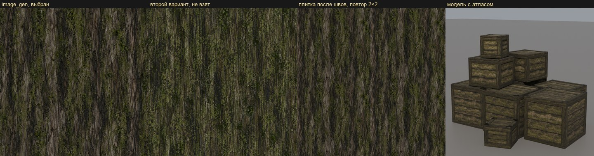
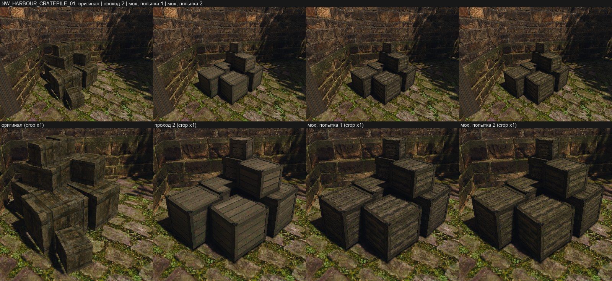
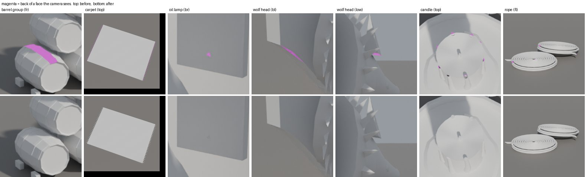
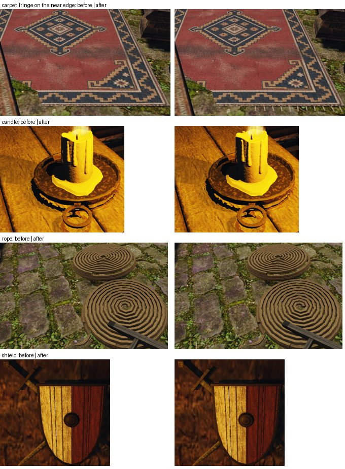

# Набор рынка Хориниса: первый цельный набор этапа 2

20 октября 2026 года. Первый набор этапа 2 [плана своего контента](../../../docs/own-content.md#этап-2-предметы-и-постройки): 21 визуал, которые закрывают 80% предметов района рынка `NW_CITY_MERCHANT`. Это 136 из 170 vob района по [переписи мешей](../2026-10-world-meshes/README.md). Сначала перепись предложила район канала, но это канализация под городом; пользователь заменил его рынком (#328).

Все модели построены по скиллу [`blender-3d`](../../../.claude/skills/blender-3d/SKILL.md):
- оригинал → задумка словами и числами;
- концепт `image_gen` только по тексту, в отдельном треде Codex;
- модель по частям в Blender;
- свой атлас из плиток этапа 1 в цвете замеров оригинала;
- проверка в игре.

Нейросети-генераторы 3D не использовались. Пиксели и вершины оригинала не попадали ни в `image_gen`, ни в Blender. Из оригинала брались только числа: bbox, происхождение, число треугольников, средний цвет текстур и отдельные габариты частей. Ещё смотрели на снимки в игре.

Набор лежит вне рабочей папки контента и по умолчанию не включён. Включение решает пользователь.


Слева — концепт `image_gen`, справа — модель со своим атласом. У группы бочек и кучи ящиков своего концепта нет: это облегчённые бочки и ящики, построенные своим кодом (`barrel_group.py`, `crate_pile.py`) по образцу бочки и ящика пилота.


## Кто что строил

- **Ведущая сессия** («Этап 2: свои статичные меши в glTF»), 13 предметов: тележка, группа бочек, куча ящиков, ковёр, канаты, поленница, свеча, лампа, щит со скрещёнными мечами, мешки, бочка с оружием, связка клинков, голова волка.
- **Сессия «Рынок: мебель и окна в Blender»**, 6 предметов: шкаф, прилавок, окно с улицы, окно изнутри со шторами, указатель, навес прилавка. Её заметки по каждому предмету — в общей папке сессий `market-set/<item>.md`.
- **Бочка `NW_HARBOUR_BARREL_01` и ящик `NW_HARBOUR_CRATE_01`** — пилот ([бочка](../2026-10-barrel-from-concept/README.md), [ящик](../2026-10-crate-from-concept/README.md)). Бочка входит в набор пакетом `pilot-barrel` без изменений. Ящик и куча ящиков 21 октября [построены заново по замыслу](../2026-10-crates-redesign/README.md), у них свои пакеты `crate` и `crate-pile`.

## Предметы

`NW` — экземпляры в Хоринисе, `рынок` — в районе. Треугольники — у оригинала и у нас (бюджет из цели).

| Предмет | Визуал | NW / рынок | Треуг. оригинал → наш (бюджет) | Атлас, покрытие | Что лучше оригинала |
|---|---|---:|---|---|---|
| тележка | `NW_CITY_CART_01` | 40 / 2 | 760 → 1528 (3000) | 2048, 26% | дощатое дно со щелями, перила на стойках, колёса со спицами, ступицей и шиной, оглобли на земле, железные уголки |
| группа бочек | `NW_HARBOUR_BARRELGROUP_01` | 55 / 6 | 660 → 5760 (6000) | 2048, 22% | пирамида 5-4-3 лежащих бочек: клёпки отдельными частями, четыре обруча, утопленные днища, клинья |
| куча ящиков | `NW_HARBOUR_CRATEPILE_01` | 132 / 5 | 135 → 3772 (6000) | 2048, 29% | 21 октября [переделана по замыслу](../2026-10-crates-redesign/README.md): восемь ящиков порта со стойками на торцах и верёвочными ручками, сдвинутая крышка, сломанная доска |
| ковёр | `NW_CITY_CARPET_03` | 32 / 2 | 50 → 480 (600) | 2048, 76% | свой рисунок (вид сверху своего концепта), бахрома, загнутый угол |
| канаты | `NW_HARBOUR_ROPE_01` | 47 / 6 | 177 → 3928 (4000) | 2048, 14% | две бухты каната по спирали, вторая лежит на первой, концы |
| поленница | `OC_FIREWOOD_V3` | 12 / 3 | 438 → 1968 (3000) | 2048, 28% | 90 поленьев (кругляк, половинки, четвертинки), кора, торцы с кольцами вокруг сердцевины |
| свеча | `NW_CITY_CANDLE_01` | 157 / 5 | 124 → 2532 (2700) | 1024, 30% | железная плошка на ножках с кольцом, толстая свеча, восемь потёков с каплями, лужица воска |
| лампа | `NW_CITY_OILLAMP_01` | 223 / 9 | 138 → 970 (1000) | 1024, 59% | дощечка, кованый кронштейн с завитком, латунный резервуар, крупное стекло-«груша» |
| щит со скрещёнными мечами | `NW_CITY_DECO_SHIELD_01` | 46 / 4 | 326 → 408 (1500) | 1024, 72% | щит из четырёх досок, окрашенный в две половины без герба, обод и умбон, мечи за щитом |
| мешки | `OC_SAECKE_01` | 98 / 3 | 252 → 2268 (2500) | 2048, 47% | семь мешков с перевязанными горловинами |
| бочка с оружием | `NW_CITY_WEAPON_BARREL_01` | 36 / 15 | 1048 → 1002 (3000) | 1024, 52% | открытая бочка с ободом; три меча и короткий меч с навершиями и длинными гардами, топор с широким лезвием, копьё с листовидным наконечником |
| связка клинков | `NW_CITY_WEAPON_BAG_01` | 27 / 5 | 366 → 552 (1500) | 1024, 44% | кожаная обёртка, четыре клинка, ремни с пряжками |
| голова волка | `NW_CITY_DECO_WOLFHEAD_01` | 31 / 3 | 174 → 696 (2500) | 1024, 60% | щит-табличка из трёх досок, голова с открытой пастью, клыки, уши, грива, глаза и чёрный нос |
| шкаф | `NW_CITY_CUPBOARD_POOR_02` | 89 / 3 | 112 → 924 (2000) | 2048, 41% | см. заметку сессии |
| прилавок | `NW_CITY_COUNTER_01` | 10 / 2 | 199 → 1384 (2500) | 2048, 22% | каркас с досками, полки со стороны продавца, откидная крышка |
| окно с улицы | `NW_CITY_WINDOW_WOOD_OUT_01` | 43 / 4 | 70 → 404 (1200) | 2048, 64% | рама, две створки с ромбовидным переплётом |
| окно изнутри | `NW_CITY_WINDOW_WOOD_IN_01` | 63 / 4 | 176 → 1740 (2000) | 2048, 36% | рама, переплёт, штанга и две шторы со складками |
| указатель | `NW_MISC_SIGN_01` | 54 / 11 | 36 → 82 (1000) | 1024, 20% | доска-указатель на столбе |
| навес | `NW_CITY_MARKETSTALL_ROOF_01` | 7 / 3 | 278 → 2040 (2500) | 2048, 62% | провисшее полотно с фестонами на консолях, столбы с подкосами |

На 95 экземплярах этих 19 визуалов в районе рынка треугольников стало около 158 тыс. вместо 34 тыс.



## Как сделано

- **Цели.** `scripts/content/mesh3d/market_targets.py` → `data/content/mesh3d-market.json`: bbox в метрах glTF, начало координат, треугольники и копии оригинала, бюджет, зоны материалов. Тот же декодер и та же запись, что у пилота (`measure_targets.py`).
- **Снимки оригиналов** сделаны на Ryzen сценарием с камерой у каждой копии в районе. Для этого `scripts/meshes/world-meshes.cpp` дописали в рабочей копии так, чтобы он выводил позиции; в репозиторий эта правка не вошла.
- **Концепты.** 41 изображение `image_gen`, 17 предметов. Брифы — только текст: части, их число, размеры в метрах и общий абзац стиля. Каждый предмет — отдельный тред Codex в пустой папке. Регистрация — `market_concepts.py` (записи `mesh3d-market-<item>-v1-<вид>`), исходники сверены с копией на dev-ubuntu.
- **Плитки** (`market_tiles.py`, спецификации `market-tiles-*.json`):
  - восемь новых плиток своим `image_gen` по тексту: мешковина, парусина, канат, мех, кора, торец полена, кожа, замшелая доска кучи ящиков (записи `mesh3d-market-tile-*`);
  - процедурные воск, стекло и кость без `image_gen`;
  - дерево и железо — копии плиток пилота;
  - панель ковра — прямоугольник, вырезанный из нашего же концепта.

  Плитка задаёт рисунок и рельеф. Цвет каждой зоны атлас приводит к замеренному среднему цвету оригинала.
- **Модели** — `scripts/content/mesh3d/blender/<item>.py` с настройками `<item>.json` на общем `parts.py`.
- **Атлас** — общий `bake_atlas.py` с `<item>-atlas.json`. После исправления #334 у каждой грани свой материал, звук и физика, а нижние грани получают усиление своей зоны. Весь набор перепечён на Ryzen в очереди `gq batch`.
- **Сторона.** У настенных предметов (лампа, щит, голова волка, окна, шкаф, прилавок) лицо смотрит в +Y Blender (glTF −Z), стена — с −Y. Щит сначала был построен зеркально и в игре утонул в стене. Теперь он отражается в конце сборки.
- **Пакет** — `pack_prop.py` для каждого предмета, `market_pack.py` сводит пакеты в один корень `OPENGOTHIC_CONTENT`: `~/.local/share/gothic-ai/content-staging/market-set/content`, 21 меш.

## Проверка в игре

Сценарий [`own-mesh-market.bench`](../../../scripts/bench/own-mesh-market.bench) на Ryzen (3950X / RTX 3080, 800×600):
- по кадру на визуал с копией в районе;
- перепись;
- кадр рынка сверху;
- 30 секунд обычного темпа кадров.

Два прогона на одной сборке — `OPENGOTHIC_CONTENT=` (оригинал) и с корнем набора.

- **Перепись.** С набором заменены все 21 меш, и ни один из этих 21 оригинальных `.MRM` не открыт. Без набора открыты все 21 оригинал, замен нет.
- **FPS** на Ryzen не изменился. В тихом классе `gq` (`RYZEN_BENCH_CLASS=quiet`) без набора 148,2, с набором 148,0, по 30 с. Прогоны в обычном классе разбросаны от 100 до 153 из-за соседних задач на машине. Замер на Mac (M1 Pro) — отдельная задача.




## Доработка пяти слабых предметов

21 октября пользователь попросил до решения о включении набора доработать пять слабых предметов: оружие в бочке, лампу, свечу, голову волка и кучу ящиков. Новых концептов не было, менялись модели и настройки атласа.

- **Бочка с оружием.** Рукояти крупнее: восьмигранное навершие 5 см вместо 3,5, рукоять 14 см, гарда 24 см вместо 20. Клинки шире: 5,8 см вместо 4,8. У топора теперь лезвие-пластина 22 × 18 см с выгнутой кромкой. У копья — листовидный наконечник 32 × 8,5 см с железной втулкой. Модель — 1002 треугольника вместо 784.
- **Лампа.** Стекло-«груша» крупнее: 9,8 × 22,5 см вместо 6,2 × 20. Резервуар 8,5 × 9 см вместо 6,5 × 8. Лампа отодвинута от стены на 28 см, кронштейн загибается ниже. Треугольников по-прежнему 970.
- **Свеча.** Потёки теперь — восемь отдельных наплывов на боках свечи. Каждый — стержень, наполовину утопленный в свечу; книзу он толще и кончается каплей. Прежний способ (вздутия поверхности свечи) дважды давал ступеньки. Модель — 2660 треугольников, поэтому бюджет свечи поднят с 1600 до 2700.
  Снимок в игре показал старую ошибку: тело свечи было чёрным. Оно было открыто снизу, и общий пересчёт нормалей в `parts.py` вывернул его внутрь. Blender рисует обе стороны грани, поэтому на рендерах этого не было видно. Теперь у тела есть скрытое донце под лужицей.
- **Голова волка.** Голова крупнее: сечения ×1,1–1,25, челюсть ×1,15. Уши больше. Появились янтарные глаза — своя зона `OWN_PROP_EYE` на копии плитки стекла. Появился чёрный нос — зона `OWN_PROP_NOSE` на копии кожи. Мех теперь серый, как на концепте, а не замеренного коричневатого цвета тела волка из оригинала. Пятна тона на морде убраны: `tone_spread` 0,05, выгорание отключено.
- **Куча ящиков.** Выгорание верхов снято: оно и давало серо-белый вид. Дерево темнее и зеленее. Первый проход (цель зоны ×0,68 от замера, мох до 60 см) в игре всё ещё был светлее оригинала. Второй проход:
  - цель зоны 0,024 / 0,020 / 0,011 вместо замеренных 0,059 / 0,048 / 0,024;
  - мох и сырость плавно идут по всей высоте кучи (`wet_height` 3 м);
  - светлые кромки ослаблены (`edge_wear` 0,2 вместо 0,7).

  Средний цвет теперь намного ниже, чем у оригинала. Наши ящики движок освещает ярче оригинальных при том же альбедо, а у оригинала грязь и мох нарисованы в самой текстуре.

Все пять атласов запечены на Ryzen (`gq batch`) уже с ослабленным рельефом плиток: дерево ×0,25, ткань ×0,12. Это правка `bake_atlas.py` сессии мебели из #344, [её отчёт](../2026-10-prop-relief/README.md).



Проверка в игре — тот же `own-mesh-market` на Ryzen с пересобранным корнем набора: заменены все 21 меш, ни один оригинал не открыт, используются 42 своих ключа.



## Замшелая плитка для кучи ящиков

21 октября. После двух проходов настроек куча ящиков оставалась чище оригинала: мох был пятнами шума атласа поверх чистой плитки дерева. Теперь мох и грязь нарисованы в самой плитке.

- **Плитка.** Свой `image_gen` по тексту в отдельном треде Codex в пустой папке, как у остальных плиток рынка. Бриф: лицевая сторона старой доски ящика из мягкой древесины, 38 × 38 см, волокно вертикально, без стыков (доски даёт геометрия, тёмные швы — запекание). Тёмное мокрое дерево с почти чёрными потёками вдоль волокна, оливковая плёнка водорослей и плоский мох примерно на половине поверхности, чёрные точки плесени, ровный свет без теней. Из двух вариантов взят первый. В масштабе игры, около 30 пикселей на плитку, у него остаются тёмные и оливковые пятна: разброс log-яркости 0,99. Второй сливается в ровный зелёный (0,88). Запись реестра — `mesh3d-market-tile-wood-mossy`, исходник сохранён и скопирован на dev-ubuntu. Шероховатость 0,97: мох матовый.
- **Зоны.** Доски — `OWN_PROP_WOOD_MOSSY`, рамки — `OWN_PROP_WOOD_MOSSY_BRACE`: копия той же плитки со своей целью. Шум водорослей при запекании выключен (`algae` 0). Растяжка контраста снята (1,3 → 1,0): разброс log-яркости у новой плитки и так в 1,6 раза больше, чем у прежней (0,99 против 0,63). Сырость снизу и слабые светлые кромки остались.



На рендере Blender под ярким солнцем доски желтее, чем в игре: цель зоны занижает синий под отражение неба в движке (ниже).

**Почему куча была серой.** У наших материалов есть ORM, и движок освещает их по PBR-пути (`shader/lighting/ambient_light.frag`): поверх рассеянного света добавляется отражение неба `reflectedSky × materialEnvBrdf` с F0 = 0,04. У оригинальных материалов этого отражения нет. При альбедо около 0,02 оно сравнимо с рассеянным светом и голубое: серит дерево и высветляет верхние грани. Поэтому затемнение альбедо в прошлых проходах почти не помогало. Шероховатость 0,97 вместо прежних 0,82 его уменьшает — верхние грани 0,082 → 0,060, — но не убирает.

**Цель зоны** подобрана по виду в игре, а не по среднему текстуры. Грани ящиков оригинала на кадре стенда (линейный RGB): медиана яркости 0,025, G/R 0,80, B/R 0,43, зелёных пикселей (G > R) меньше 1%. Мшистым оригинал выглядит за счёт оливково-бурого цвета и тёмных потёков, а не зелени.
- Попытка 1: оттенок цели (1; 0,80; 0,41), яркость 0,018 у досок и 0,013 у рамок. Яркость совпала, но B/R 0,49: отражение неба добавило синего, и мох читался серым.
- Попытка 2: B/R цели 0,34, ниже на измеренный сдвиг 0,07. Цель досок — 0,0222 / 0,0178 / 0,0076, рамок — 0,0161 / 0,0129 / 0,0055.

| Грани ящиков в игре, линейный RGB | оригинал | проход 2 | попытка 1 | попытка 2 |
|---|---:|---:|---:|---:|
| медиана яркости | 0,025 | 0,043 | 0,028 | 0,028 |
| G/R, медиана | 0,80 | 0,82 | 0,80 | 0,80 |
| B/R, медиана | 0,43 | 0,46 | 0,49 | 0,44 |
| передняя грань | 0,031 | 0,035 | 0,028 | 0,028 |
| боковая грань | 0,033 | 0,040 | 0,031 | 0,031 |
| верх (у оригинала другой ящик) | 0,031 | 0,082 | 0,060 | 0,059 |

Атлас запечён на Ryzen (`gq batch`), стенд `own-mesh-market` на Ryzen с пересобранным корнем набора: заменены все 21 меш, ни один оригинал не открыт, используются 42 своих ключа.



## Изнанка граней

21 октября все предметы набора и пилота проверены на вывернутые грани: `compare.py` с `"backfaces": true` заливает пурпуром изнанку граней, которую видит камера. Шесть видов каждого предмета сняты на Ryzen. Изнанка нашлась у семи предметов:
- группа бочек — целые клёпки;
- ковёр — все кисти бахромы;
- щит — подложка между досками;
- лампа — шляпка гвоздя;
- голова волка — ухо и треугольник доски таблички;
- свеча и канаты — открытые концы наплывов и каната.

Модели исправлены в своих скриптах, их атласы перепечены, корень набора пересобран. Подробности — в [журнале](../../../docs/own-content.md) и в [`blender/README.md`](../../../scripts/content/mesh3d/blender/README.md#вывернутые-грани).



В игре разница заметнее всего у ковра: кисти бахромы смотрели вниз, и движок их не рисовал. Остальные исправления на стенде `own-mesh-backfaces` почти не видны: детали мелкие, а группа бочек и голова волка стоят в тени. Ни один предмет не сломался. `own-mesh-market` с новым корнем: заменены все 21 меш, оригиналы не открываются.



## Что осталось слабым

- **Бочка с оружием.** Рукояти одного тёмного цвета, у оригинала они пёстрые.
- **Свеча** — самый тяжёлый предмет на экземпляр: 2532 треугольника. В мире 157 свечей, это около 400 тыс. треугольников против 19 тыс. у оригинала.
- **Голова волка** на стенде висит в тёмном углу: глаза и нос видны только на рендере.
- **Канаты.** Сечение пятигранное, на атласе около 2 пикселей на сантиметр: пряди с близи размыты. Бухты ниже bbox оригинала на 11 см.
- **Куча ящиков.** Сначала замшелая плитка ([#347](https://github.com/kaifaty/GothicAI/pull/347)) сделала её тёмной и оливковой, но форма осталась прежней, «коробки из Counter-Strike». Затем кучу вместе с одиночным ящиком [переделали по замыслу](../2026-10-crates-redesign/README.md); что у неё осталось слабым — там. Наблюдение #347 верно и для новых ящиков: верхние грани наших материалов светлее оригинала при том же цвете, потому что движок добавляет отражение неба только нашим материалам.
- **Мешки** короче bbox оригинала в глубину на 40 см.
- **Окно с улицы:** стекло тёмное, как у замера оригинала, и переплёт издали не читается.
- Кадры **указателя и прилавка** на стенде мало что показывают: копии стоят у фонарного столба и в тёмной лавке.

## Как повторить

Шаги для одного предмета `<item>`:

```sh
BL=/Applications/Blender.app/Contents/MacOS/Blender
ST=~/.local/share/gothic-ai/content-staging/market-set
$BL -b --factory-startup -P scripts/content/mesh3d/blender/<item>.py -- scripts/content/mesh3d/blender/<item>.json $ST/build/<item>
$BL -b --factory-startup -P scripts/content/mesh3d/blender/bake_atlas.py -- scripts/content/mesh3d/blender/<item>-atlas.json $ST/build/<item>/atlas
uv run --offline --no-project --with numpy --with pillow python scripts/content/mesh3d/pack_prop.py --bake $ST/build/<item>/atlas --visual <VISUAL> --name market-<item> --output $ST/packs/<item>
python3 scripts/content/mesh3d/market_pack.py --output $ST/content $ST/packs/*
```

Проверка в игре:

```sh
BENCH_HOST=ryzen WORLD=NEWWORLD.ZEN OPENGOTHIC_CONTENT=$ST/content OPENGOTHIC_CENSUS=<abs out>/census.json scripts/bench.sh own-mesh-market <abs out>
```

Плитки перед запеканием:
1. `market_tiles.py --spec scripts/content/mesh3d/blender/market-tiles-base.json`;
2. `market-tiles-imagegen.json` — новые плитки и панель ковра из сохранённых исходников `content-sources/mesh3d-market/tile-*.png` (при первом импорте был `--import-sources`);
3. `market-tiles-procedural.json`;
4. `market-tiles-derived.json`;
5. `crate-tiles.json` — плитки ящика и кучи ящиков: дерево `own_prop_wood_crate`, верёвка, железо гвоздей.
