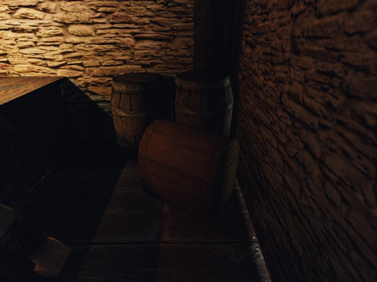
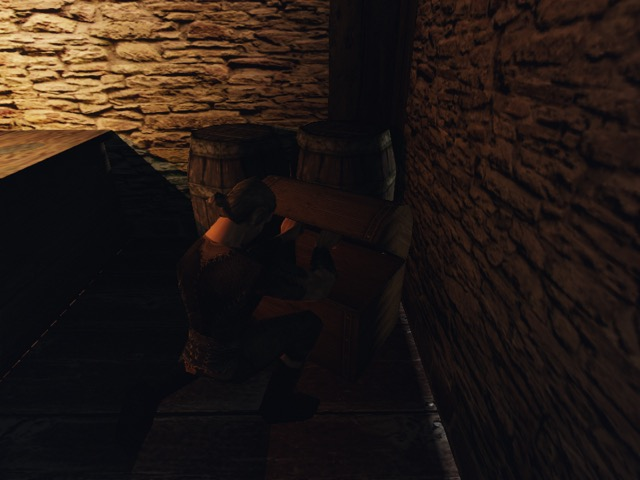

# Сундук MOB: GLB и оригинал — 2026-10-20

Оба прогона [`own-mesh-chest.bench`](../../../scripts/bench/own-mesh-chest.bench) на Ryzen через `bench.sh` / `gq quick` — **exit 0**. Герой штатно открыл сундук и забрал 32 золотых. Крышка GLB движется вместе со своим узлом; мировые матрицы GLB и оригинала совпали точно. Перекрёстная загрузка сохранений прошла в обе стороны.

## Место и путь игрока

`NEWWORLD.ZEN`, `CHESTBIG_NW_NORMAL_OPEN.MDS`, ZEN id **23109** (prop-survey №20369), позиция `(7654.307129, 126.205124, 1238.297241)` см, yaw `65.997707°`. В стенде runtime mob id — 714. Сундук не заперт; исходное содержимое `ItMi_Gold:32`, предметы не добавлялись (`seeded_gold=false`).

Герой поставлен на свободный пол перед оригинальным `ZS_POS0`: `(7785.75049,128.07651,1295.33582)` см; сокет `(7726.12256,223.83511,1269.46094)` см. Обычный focus выбрал этот сундук. Команда `own-mesh-chest open` вызывает `PlayerControl::interact → InventoryMenu::open → Npc::setInteraction`; штатный MOB сам подводит героя к сокету и проигрывает `T_S0_2_S1 → S_S1`. `take` вызывает тот же `Npc::addItem(id,chest,count)`, что `InventoryMenu::onTakeStuff`, с реальным удалением из контейнера и проверкой прироста инвентаря.

| Проверка | GLB | Оригинал |
|---|---:|---:|
| Закрыт / открыт | `S_S0` / `S_S1` | `S_S0` / `S_S1` |
| Переход `T_S0_2_S1` наблюдался | да | да |
| Поворот крышки | 35.207400° | 35.207400° |
| Подъём контрольной кромки | 28.674637 см | 28.674637 см |
| Золото героя | 0 → 32 | 0 → 32 |
| Золото в сундуке | 32 → 0 | 32 → 0 |
| Строк подмены меша / ошибок сундука | 1 / 0 | 0 / 0 |

В исходном закрытом MOB внутренний `state=-1`, при использовании — `0`, после открытия — `1`. Кадр открыт через 6000 мс после взаимодействия. Камера в обоих прогонах `(7752.10254,291.20514,1389.74402)` см, цель `(7654.30713,191.20512,1238.29724)` см; seed 73013, полдень, 800×600, без UI. JPG ниже — 640×480, только уменьшение и JPEG-конверсия.

## Матрицы и кромка

Мировая матрица узла `BIP01 CHEST_BIG_1` одинакова у GLB и оригинала в обоих состояниях: максимальная разница всех 16 чисел **0**, перенос **0 см**, поворот **0°** (допуск 0,1 см / 0,1°). Ниже матрицы строками, координаты в сантиметрах.

Закрытый `S_S0`:

```text
  -0.401194185    0.000000000   -0.915992498 7627.214360000
   0.000000000    1.000000000    0.000000000  176.306992000
   0.915992498    0.000000000   -0.401194185 1226.430300000
   0.000000000    0.000000000    0.000000000    1.000000000
```

Открытый `S_S1`:

```text
  -0.401194185   -0.528103232   -0.748431206 7627.214360000
   0.000000000    0.817071319   -0.576536655  176.306992000
   0.915992498   -0.231303155   -0.327804267 1226.430300000
   0.000000000    0.000000000    0.000000000    1.000000000
```

Контрольная точка `(0,27.36672,−58.41916)` см — середина верхнего переднего ребра bbox оригинальной крышки в локальном пространстве её узла, не утверждение о вершине GLB. Её мировые координаты: `(7680.72607,203.673706,1249.86768)` → `(7656.48486,232.348343,1239.25037)` см. Получены ожидаемые ≈30 см / ≈35°.

## Перепись и сохранения

GLB: одна строка `mesh`, `CHESTBIG_NW_NORMAL_OPEN.MDM → meshes/mesh3d-chest-atlas/model.glb`, `opens=1`; ещё две строки текстур `OWN_CHEST_NORMAL_WOOD.TGA` и `OWN_CHEST_NORMAL_IRON.TGA`. Без индекса `replacements=[]`. В обоих логах нет `meshes: unable to replace` для этого сундука. Контент не менялся; GLB содержит корпус 442 и крышку 767 треугольников.

| Сохранение → загрузка | Exit | Состояние / анимация | Золото героя | Сундук |
|---|---:|---|---:|---|
| GLB → без индекса | 0 | 1 / `S_S1` | 32 | пуст |
| Оригинал → GLB | 0 | 1 / `S_S1` | 32 | пуст |

Полные архивы `GameSession::save` — 9835218 / 9835218 байт. До и после загрузки совпали весь инвентарь героя и все 16 чисел матрицы крышки. `reload` только находит исходный ZEN id и читает состояние, без подготовки, перемещения или добавления предметов. Код и формат сохранений не менялись.

## Снимки

| Состояние | GLB | Оригинал |
|---|---|---|
| Закрыт |  |  |
| Открыт |  |  |

## Повторение и проверки

Основной прогон (повторить с `OPENGOTHIC_CONTENT=` и другим `out` для оригинала):

```bash
out="$PWD/.bench/own-mesh-chest-glb"
BENCH_HOST=ryzen RYZEN_WORKTREE=mob-chest RYZEN_CLEAN_IDLE_HOURS=0 \
WORLD=NEWWORLD.ZEN GOTHIC_AI=0 OPENGOTHIC_TEXTURES= OPENGOTHIC_FRACTURE= \
OPENGOTHIC_CONTENT="$HOME/.local/share/gothic-ai/content-staging/mesh3d-chest-atlas" \
OPENGOTHIC_CENSUS="$out/census.json" MOVABLE_VOBS=0 \
TEMPEST_WINDOW_SIZE=800x600 TIMEOUT=180 scripts/bench.sh own-mesh-chest "$out"
```

Для cross-load — новый процесс `bench.sh`, `SAVE=<другой прогон>/session-opened.sav` вместо `WORLD`, противоположный `OPENGOTHIC_CONTENT`. Временный сценарий: `own-mesh-chest reload 7654 126 1238 23109`, затем `rec own-mesh-chest-loaded novideo`, `wait 100`, `own-mesh-chest snapshot reloaded`, `stop`, `census`.

Заданный `mob-chest/check.sh` — exit 0: **7990** проверок мешей, **133** проверки материалов и **14** Python-тестов. Оба основных и оба cross-load прогона — exit 0. Ещё один успешный подготовительный GLB-прогон потребовался до приближения камеры; механических отказов открытия/крышки — **0**. Сборки и игры шли через `gq`, файлы сборки — в `~/gothic-ai/mob-chest/`. На Mac игра не запускалась. Ничего не включено по умолчанию.
