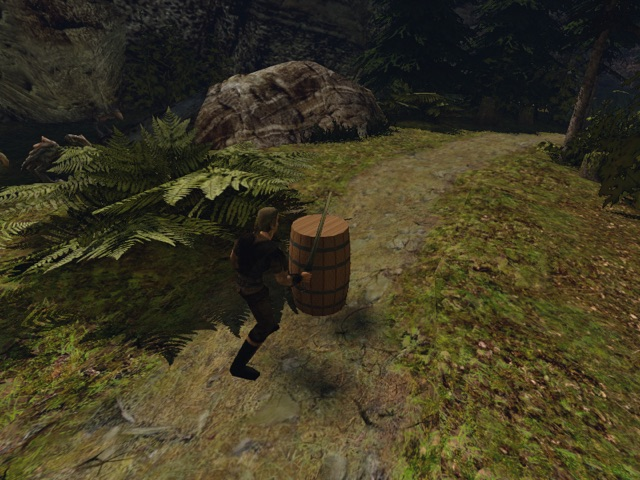
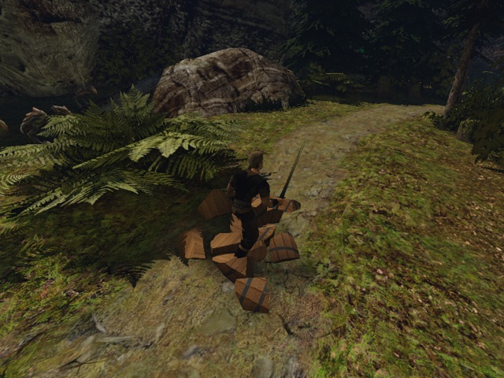
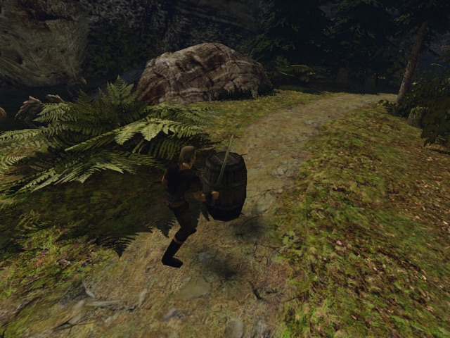
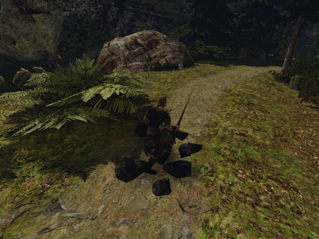

# Свои осколки индексированной бочки GLB

2026-10-20. Третий шаг этапа 2: `NW_HARBOUR_BARREL_01` загружается из нашего GLB и разбивается на наши 12 частей. Без индекса тот же сценарий разбивает оригинал его прежними осколками. Рабочие каталоги контента и оригинального кэша не менялись; автоматического включения нет.

| Вариант | До ударов | После ударов |
|---|---|---|
| Наш GLB и `.fracture` v2 |  |  |
| Оригинал и кэш v1 |  |  |

JPG уменьшены до 640×480 только для отчёта (исходные кадры — PNG 800×600). Кадры просмотрены: у своей бочки видны процедурные клёпки, обручи, крышка и их фрагменты; у оригинала — прежний материал и форма частей.

## Что изменилось

[`scripts/fracture.sh content <каталог> [--verify]`](../../../scripts/fracture.sh) выбирает индексированные визуалы из таблицы разрушаемых. Отдельный `fracture-gltf-extract` вызывает тот же `common/gltfmesh.cpp`, что и игра, и передаёт собственные позиции, нормали, UV и материалы прежней резке Вороного. Архивы Gothic, MRM, Resources и GPU этому пути не нужны. Основной материал нашего меша покрывает срезы; внешние грани сохраняют исходный материал и UV.

Результат — соседний `meshes/test/nw_harbour_barrel_01.fracture`. После заголовка версии 2 записано `source 10904 894eb41f`. Размер и `zlib.crc32` относятся к снимку байтов GLB, который передан конвертеру. Движок сохраняет размер и `mz_crc32` байтов успешной загрузки GLB и принимает только совпадающий v2. При отсутствии, ошибке или несовпадении осколков разрушения нет, `Log::i` ограничен одним сообщением на визуал. Подмена никогда не использует оригинальный кэш; оригинал и запасной MRM после ошибки GLB читают прежний v1.

## Резка

Контент создан неизменённым [`make_test_barrel.py`](../../../scripts/meshes/make_test_barrel.py): собственная геометрия и процедурная DDS, без вершин и пикселей оригинала. Выполнены настоящие `content` и `content --verify` на Ryzen через `gq quick`, 2 потока / 2 ГиБ. Исходники/сборка — `~/gothic-ai/own-meshes/check-codex-own-meshes-fracture/`, контент — `~/gothic-ai/own-meshes/fracture-content/`. Параметры: 12 ячеек, seed 601, numpy 2.3.5, scipy 1.16.3.

| Показатель | Наш GLB / v2 | Оригинальный кэш v1, только чтение |
|---|---:|---:|
| Частей | 12 | 12 |
| Объём оболочки, см³ | 484016,167158 | 451518,619216 |
| Суммарный объём частей, см³ | 484016,193579 | 451518,636381 |
| Части / оболочка | **1,000000055** | 1,000000038 |
| Размер `.fracture`, байт | 427903 | 185083 |
| Материал частей | `OWN_TEST_BARREL_WOOD.TGA` | `NW_CITY_BARREL_01.TGA` |

Конвертер вывел 224 треугольника GLB; результат содержит 1106 треугольников. Все 12 частей проходят проверку замкнутости, согласованного обхода и выпуклости сериализованной float-геометрии. `--verify` повторил резку побайтово: SHA-256 `40e76f1fedf00de950fea39c0e2dd32024cbec84dfbb8b1f4a98ecf265bc6f9e`. В трассе `strace -f -e trace=open,openat` режима `content` — **0 открытий `.MRM` и `.VDF`**. Числа оригинала взяты из существующих `.fracture` и `validation.csv`; повторной резки оригинала не было.

## Игровая проверка

Ryzen 3950X / RTX 3080, Vulkan, RelWithDebInfo, код `5c10f1fe`, engine digest `deca01517614`. [`own-mesh-fracture.bench`](../../../scripts/bench/own-mesh-fracture.bench) использует готовую постановку `destruction2 setup barrel 1h` из `destruction-step2-melee`: свежий NEWWORLD, seed 73013, полдень, штатный визуал бочки на открытой площадке у `NW_PATH_TO_MONASTERY_08`. Сила героя 100, урон штатного меча 40; поломка идёт через события настоящей анимации удара. Прямого вызова урона стендом нет.

Обе финальные игры запущены последовательно через `BENCH_HOST=ryzen scripts/bench.sh` и `gq quick`, с абсолютными путями вывода и переписи. `GOTHIC_AI=0`, `OPENGOTHIC_TEXTURES=`, `MOVABLE_VOBS=1`, `DESTRUCTION=1`; прежний кэш оригинала передан launcher только для чтения/копирования в изолированный прогон. `RYZEN_CLEAN_IDLE_HOURS=0` отключал уборку чужих каталогов. Launcher использовал свой штатный каталог `e2e/own-meshes-fracture`; результаты скопированы в `.bench/own-meshes-fracture/own-final` и `original` этого worktree.

| Проверка | Наш GLB, `20261020T124112Z-67676` | Без индекса, `20261020T124157Z-68873` |
|---|---:|---:|
| Exit | 0 | 0 |
| Принятых атак / попаданий | 2 / 2 | 2 / 2 |
| Разбитых тестовых тел | 1 | 1 |
| Частей в событии поломки / checkpoint | 12 / 12 | 12 / 12 |
| Здоровье после поломки | 0 | 0 |
| Время события поломки стенда, мс | 3200 | 3200 |
| Открытий `NW_HARBOUR_BARREL_01.MRM` | **0** | 1 |
| Открытий `NW_CITY_BARREL_01-C.TEX` | **0** | 1 |
| Открытий `NW_CITY_BARREL_01.TGA` | **0** | 0 |
| Подмен меша целевой бочки | 1 | 0 |

У своей бочки записано `NW_HARBOUR_BARREL_01.MRM → meshes/test/nw_harbour_barrel_01.glb`, `opens=1`; материал `OWN_TEST_BARREL_WOOD.TGA → materials/test/barrel_wood.dds`, `opens=13` (целая бочка и 12 частей).

**Общая текстура мира.** Другие визуалы NEWWORLD тоже используют `NW_CITY_BARREL_01.TGA`. Чтобы полная перепись игры имела ноль открытий этой текстуры, только в тестовом `materials.json` это имя дополнительно направлено на нашу процедурную `test/barrel_wood.dds`; перепись показывает 15 обращений к этой подмене. Собственный GLB и все его части используют отдельное имя `OWN_TEST_BARREL_WOOD.TGA`, что проверено в файле и тестах движка. В контрольной игре `OPENGOTHIC_CONTENT=` отключает оба индекса, поэтому оригинал получает свой материал. Генератор и рабочий контент не изменены.

Подготовительный прогон `20261020T122946Z-46709` уже разбил нашу бочку двумя ударами на 12 частей, exit 0. Он выявил одно открытие общей текстуры другими визуалами и отсутствие последнего PNG: асинхронный `shot` не успевал до конца сценария. Добавлены ожидания по 100 мс после снимков и указанная запись тестового материала; обе финальные пары сняты новым сценарием. Отказов самой механики разрушения не было.

## Проверки кода

- Предписанный `bash /private/tmp/claude-501/-Volumes-DevSSD-Dev-projects-gothic--claude-worktrees-competent-mahavira-60dad2/318ee011-1b1c-4418-b85a-222b6f236b6c/scratchpad/own-meshes/check.sh`: **exit 0 с первой попытки**. Unittest генератора 11/11; Ryzen через `gq quick`: `gothic-mesh-gltf-test` **3319 проверок**, `gothic-material-texture-test` **133**, оба exit 0.
- Тест движка проверяет v2 с верной идентичностью, неверные CRC32 и размер, отсутствие sidecar, отказ от v1 для подмены, оригинальный v1 без индекса, битый/отсутствующий/неподдерживаемый GLB с запасным MRM и прежним кэшем. Изменение GLB на диске после загрузки не меняет сохранённую идентичность прочитанных байтов. Материалы частей и одно сообщение на визуал также проверены.
- `uv run --quiet --no-project --with numpy==2.3.5 --with scipy==1.16.3 python -m unittest discover -s scripts/fracture -p 'test_*.py' -v`: **3/3**, exit 0. Проверяются строка `source`, сериализованная геометрия, отказ от чужого GLB (включая тот же размер с другим CRC), v1 и изоляция `content` от установки Gothic/оригинального кэша.
- `git diff --check` и `bash -n scripts/fracture.sh scripts/bench.sh`: exit 0. Полная регрессия не запускалась по заданному объёму работ.

## Повторение

Резку и сборку выполнять на Ryzen через `scripts/gq`; абсолютный каталог контента должен быть создан генератором до запуска:

```sh
scripts/fracture.sh content /absolute/test-content
scripts/fracture.sh content /absolute/test-content --verify
```

После копирования тестового контента с осколками в этот worktree добавить описанную запись общего материала и запустить из корня:

```sh
TASK_ROOT="$PWD/.bench/own-meshes-fracture"
python3 - "$TASK_ROOT/content/materials/materials.json" <<'PY'
import json
from pathlib import Path
import sys
path = Path(sys.argv[1])
index = json.loads(path.read_text())
index['NW_CITY_BARREL_01.TGA'] = {'albedo': 'test/barrel_wood.dds'}
path.write_text(json.dumps(index, indent=2) + '\n')
PY
BENCH_HOST=ryzen RYZEN_CLEAN_IDLE_HOURS=0 RYZEN_WORKTREE=own-meshes-fracture \
  WORLD=NEWWORLD.ZEN MOVABLE_VOBS=1 DESTRUCTION=1 GOTHIC_AI=0 OPENGOTHIC_TEXTURES= \
  OPENGOTHIC_CONTENT="$TASK_ROOT/content" \
  OPENGOTHIC_CENSUS="$TASK_ROOT/own-final/census.json" \
  scripts/bench.sh own-mesh-fracture "$TASK_ROOT/own-final"
BENCH_HOST=ryzen RYZEN_CLEAN_IDLE_HOURS=0 RYZEN_WORKTREE=own-meshes-fracture \
  WORLD=NEWWORLD.ZEN MOVABLE_VOBS=1 DESTRUCTION=1 GOTHIC_AI=0 OPENGOTHIC_TEXTURES= \
  OPENGOTHIC_CONTENT= OPENGOTHIC_CENSUS="$TASK_ROOT/original/census.json" \
  scripts/bench.sh own-mesh-fracture "$TASK_ROOT/original"
```
