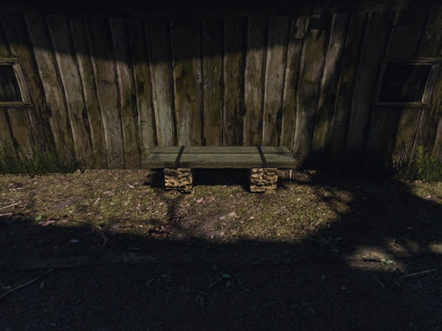
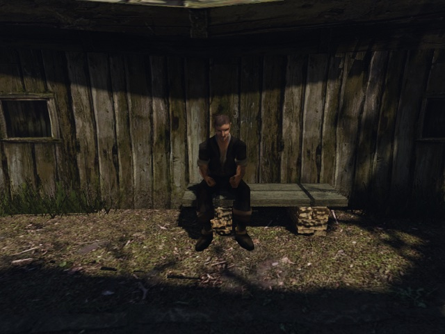
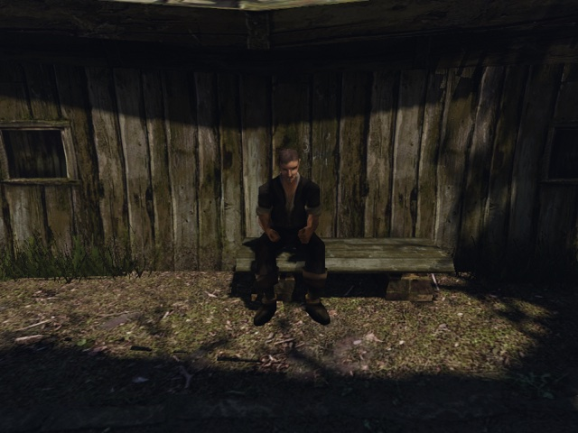

# Подмена модели MOB: лавка и штатная посадка NPC

2026-10-20. Два финальных прогона на Ryzen через `scripts/bench.sh` / `gq quick`,
по одной игре за раз: GLB и оригинал, оба exit 0. Лавка сохранила место и направление;
NPC сел на сиденье и встал в обоих прогонах. Разница позы сидящего — **0 см / 0°**.

#20649 в обходе prop-survey = ZEN id 23479

## Условия и идентичность объекта

Стенд — [`own-mesh-mob.bench`](../../../scripts/bench/own-mesh-mob.bench), свежий
`NEWWORLD.ZEN`, 12:00, seed 73013, `MOVABLE_VOBS=0`, `NPC_CHARACTER_VIRTUAL=1`,
`GOTHIC_AI=0`, без HD-текстур и кэша осколков. Обе игры использовали один бинарник
из engine-cache, хэш исходников `02ba9d155525706ae8202d31e789ddd4f3ccfd5e9626d25ec507e0b6c1c78180`.

Прямое чтение исходного ZEN связало №20649 с `BENCH_NW_CITY_01.ASC`, ZEN id 23479
и позицией `(2981.984375, −120.9642639, −5630.73584)` см. Ближайшая точка —
`NW_CITY_HABOUR_BENCH_01`, расстояние 203,2793506 см; это единственный BENCH,
которому назначается эта ближайшая точка. В обоих `npc_character_seat_setup`
поле `mob_cm` совпало с исходной позицией с ошибкой менее 0,001 см.
Неизменённое поле `mob_id=801` — внутренний индекс MOB движка.

GLB взят из неизменённого `content-staging/mesh3d-bench-atlas/`: 552 треугольника
и DDS-атлас из `materials.json`. Прямое чтение JSON-части GLB показало один материал
`OWN_BENCH_CITY_WOOD`; три записи `OWN_BENCH_CITY_{WOOD,STONE,IRON}.TGA` есть
в индексе материалов, но GLB использует только WOOD. Камень и железо видны как
области атласа. У оригинала 64 треугольника и два материала. SHA-256 всех шести файлов staging
до и после проверки совпали; рабочий каталог контента не менялся.

## Числа двух прогонов

| Параметр | GLB | Оригинал |
|---|---|---|
| Каталог результата в `.bench/own-mesh-mob/` | `glb-2` | `original-1` |
| Run ID launcher | `20261020T184357Z-95288` | `20261020T184453Z-96539` |
| Код выхода | 0 | 0 |
| `mob_id` / исходный ZEN id | 801 / 23479 | 801 / 23479 |
| `mob_cm`, см | (2981.98438, −120.964264, −5630.73584) | (2981.98438, −120.964264, −5630.73584) |
| Сокет `socket_cm`, см | (2943.49268, −23.5642624, −5542.74512) | (2943.49268, −23.5642624, −5542.74512) |
| Готовность подхода `ready` | true | true |
| NPC / `npc_id` | `BAU_904_BAUER` / 195 | `BAU_904_BAUER` / 195 |
| Сидя: `root_cm` и `visual_root_cm`, см | (3002.80615, −116.514709, −5582.64062) | (3002.80615, −116.514709, −5582.64062) |
| Сидя: `yaw_deg` | −35.0092087° | −35.0092087° |
| Анимация сидения | `S_BENCH_S1` | `S_BENCH_S1` |
| Достигнуто `stateId≥1` выбранного MOB (`sat`) | true | true |
| Встал после выхода (`standing`) / успех маршрута | true / true | true / true |
| После выхода: `root_cm`, см | (2943.1936, −116.515038, −5543.03857) | (2943.1936, −116.515038, −5543.03857) |
| Время до завершённого вставания от начала подхода | 7234 мс | 7234 мс |
| Открытий оригинального `BENCH_NW_CITY_01.MDL` | 1 | 1 |
| `replaced` этого `.MDL`, вид `mesh` | 1 | 0 |
| Ошибок загрузки / подмены этой лавки в логе | 0 | 0 |

Позиция и поворот взяты из последнего `npc_character_motion_trace` перед
`npc_character_snapshot` с меткой `seated`; позиция также совпадает со snapshot.
Разница корней по X/Y/Z — `(0, 0, 0)` см, длина разницы — 0 см; угловая разница
с учётом оборота — 0°. Оба допуска (1 см и 1°) соблюдены.

Посадка выполняется штатными `AI_GoToPoint` → `AI_UseMob("BENCH", 1)`, выход —
`AI_UseMob("BENCH", -1)`. Стенд устанавливает `sat` только при
`npc->interactive()==route.seat && route.seat->stateId()>=1` и прерывает проверку,
если NPC выбрал другой MOB. `standing` требует выхода из интерактива и
`isStanding()`. В обоих финальных `npc_character_route_end` все три флага
`success`, `sat`, `standing` равны `true`.

Перепись GLB содержит:

```json
{"name":"BENCH_NW_CITY_01.MDL","kind":"mesh","replacement":"meshes/mesh3d-bench-atlas/model.glb","opens":1}
```

В контроле этой подмены нет. Оригинальный `.MDL` остаётся в разделе `files`
как `model`, источник `Anims.vdf`, одно открытие в каждой игре: из него берётся
иерархия. Старт, подход, сокет и начальная камера из события setup также совпали.

## Снимки

Одинаковые камеры и освещение внутри каждой пары. JPG 640×480, только уменьшение
и JPEG-кодирование исходных снимков игры. На пустом кадре героя нет. У GLB видны
две доски, каменные столбы и железные скобы; направление и место относительно
деревянной стены совпадают с оригиналом. NPC сидит на верхней плоскости сиденья,
без заметного провала или зазора.

| GLB | Оригинал |
|---|---|
|  |  |
|  |  |

## Повторение и проверки

Из корня worktree; launcher сам копирует входной контент на Ryzen:

```bash
OUT="$(pwd)/.bench/own-mesh-mob/glb-2"
env -u GOTHIC_AI_URL BENCH_HOST=ryzen RYZEN_WORKTREE=mob-glb \
  RYZEN_CLEAN_IDLE_HOURS=0 RYZEN_LOCK_WAIT=1800 WORLD=NEWWORLD.ZEN \
  GOTHIC_AI=0 OPENGOTHIC_TEXTURES= OPENGOTHIC_FRACTURE= MOVABLE_VOBS=0 TIMEOUT=240 \
  OPENGOTHIC_CONTENT="$HOME/.local/share/gothic-ai/content-staging/mesh3d-bench-atlas" \
  OPENGOTHIC_CENSUS="$OUT/census.json" scripts/bench.sh own-mesh-mob "$OUT"

OUT="$(pwd)/.bench/own-mesh-mob/original-1"
env -u GOTHIC_AI_URL BENCH_HOST=ryzen RYZEN_WORKTREE=mob-glb \
  RYZEN_CLEAN_IDLE_HOURS=0 RYZEN_LOCK_WAIT=1800 WORLD=NEWWORLD.ZEN \
  GOTHIC_AI=0 OPENGOTHIC_TEXTURES= OPENGOTHIC_FRACTURE= MOVABLE_VOBS=0 TIMEOUT=240 \
  OPENGOTHIC_CONTENT= OPENGOTHIC_CENSUS="$OUT/census.json" \
  scripts/bench.sh own-mesh-mob "$OUT"
```

`check.sh` после ребейса: 14 Python-тестов, 4371 проверка мешей и 133 проверки
материалов, exit 0. Для игрового этапа код движка не менялся. Первый GLB-прогон
был подготовительным: посадка прошла, затем добавлены паузы после отложенного
`shot` и крупная камера. Сравнение выше использует два финальных прогона одного
сценария; механических отказов посадки — 0 из 3 игровых запусков.

Вне задачи: оба лога одинаково сообщают о `INVISIBLE_VOBBOX.3DS`, двух звуках
окружения и двух исходных spawnpoint стражников; ошибок про лавку нет.
