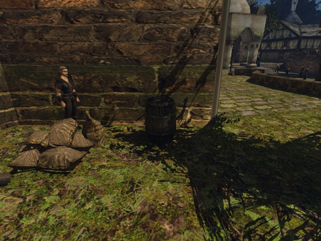
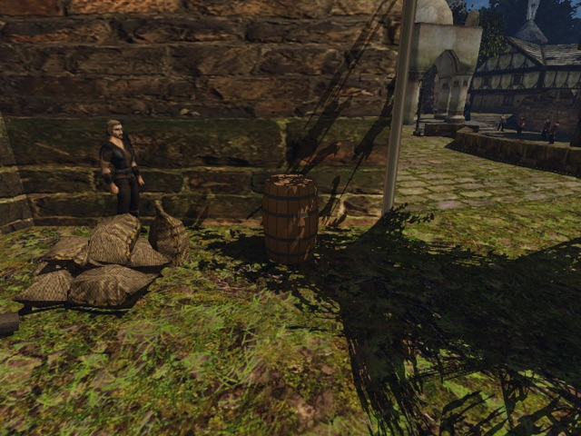
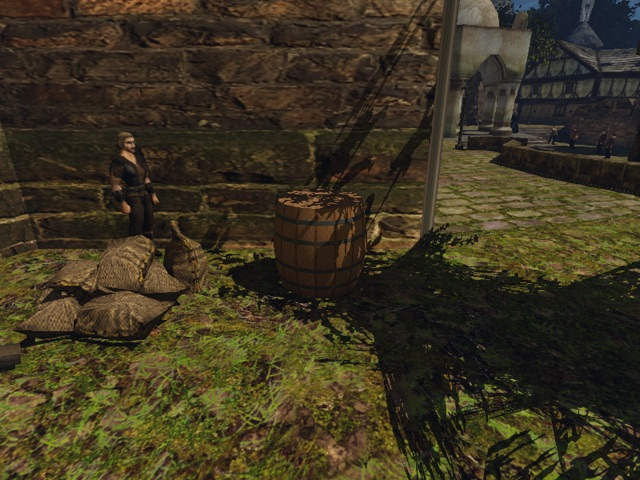

# Физика своих GLB в игре

2026-10-20. Второй шаг этапа 2 проверен на Ryzen: герой, поверхность попадания стрелы и подвижное тело используют новую геометрию. При K=1,5 относительно K=1 герой останавливается на **19,583 см** дальше от оси, стрела попадает на **19,550 см** дальше, объём оболочки растёт в **2,250001 раза**. Путь физики исправлять не потребовалось. Семь изменений подвижности в переписи объясняются новым профилем, правило и CSV сохранены.

## Условия и воспроизведение

Ryzen 3950X / RTX 3080, Vulkan, штатное окно 800×600. Шесть физических запусков выполнены по одной своей игре через `BENCH_HOST=ryzen scripts/bench.sh`; launcher использует собственный `~/gothic-ai/e2e/claude-own-meshes-physics` и окно очереди `gq`. Отдельная сборка тестов — `~/gothic-ai/own-meshes/check-codex-own-meshes-physics/`. Пути контента, переписи и вывода абсолютные. Рабочий каталог контента не менялся.

```sh
python3 scripts/meshes/make_test_barrel.py "$PWD/.bench/own-mesh-physics/content-k1"
python3 scripts/meshes/make_test_barrel.py "$PWD/.bench/own-mesh-physics/content-k15" --radius-scale 1.5

BENCH_HOST=ryzen RYZEN_CLEAN_IDLE_HOURS=0 WORLD=NEWWORLD.ZEN \
  MOVABLE_VOBS=0 CHARACTER_VIRTUAL=1 GOTHIC_AI=0 \
  OPENGOTHIC_CONTENT="$PWD/.bench/own-mesh-physics/content-k1" \
  OPENGOTHIC_TEXTURES= OPENGOTHIC_FRACTURE= \
  OPENGOTHIC_CENSUS="$PWD/.bench/own-mesh-physics/example-k1-0/census.json" \
  scripts/bench.sh own-mesh-physics "$PWD/.bench/own-mesh-physics/example-k1-0"
```

Генератор требует пустой каталог. Повторить для `MOVABLE_VOBS=1` и трёх вариантов контента: `OPENGOTHIC_CONTENT=` без индекса, `content-k1`, `content-k15`; каждому запуску — новый абсолютный output. K масштабирует только X/Z относительно оси, сохраняя высоту и origin. K=1 побайтно сохраняет прежний результат генератора. Подвижность задаётся до загрузки мира; настройки по умолчанию не менялись. Разрушение подменённых визуалов в этих прогонах было выключено защитой #309; свои осколки добавлены позже в #315.

[`own-mesh-physics.bench`](../../../scripts/bench/own-mesh-physics.bench) использует штатную бочку `NW_HARBOUR_BARREL_01`, **ZEN id 24244**, origin **(10248,6309; 326,437866; 2359,78076) см**, без переноса или создания vob. Ось на половине высоты — **(10248,5830; 325,939880; 2359,67969) см**. Герой и стрела начинают в 270 см с востока (+X), герой идёт и толкает на запад (−X). Это направление удаляет бочку от стены: его скалярное произведение с направлением от стены `(−0,25879; 0; 0,96593)` равно **+0,25879**.

Перед измерением `own-mesh clearance` проверяет положительный зазор и `enabled/ok` в ON. Лучи идут на **200 см** снаружи bbox: подход и толчок на четырёх высотах **310,548 / 325,940 / 380,548 / 440,548 см**, стрела на половине высоты. Каждый луч проверяется отдельно по физической и видимой геометрии. В каждом из шести прогонов свободны **9/9 линий**, всего **54/54**, первое препятствие не найдено на всех 200 см.

| Контент | Ближайший зазор в ON, см | Подход: свободно | Стрела: свободно | Толчок: свободно | Подвижность |
|---|---:|---:|---:|---:|---|
| Оригинал | 70,970772 | 4 × 200 см | 200 см | 4 × 200 см | enabled / ok |
| K=1 | 70,965347 | 4 × 200 см | 200 см | 4 × 200 см | enabled / ok |
| K=1,5 | **51,080559** | 4 × 200 см | 200 см | 4 × 200 см | enabled / ok |

В расширенном варианте мешки `OC_SAECKE_01` находятся в **86,036278 см**, вне проверенных линий. Опора пола отделена от остальных контактов; её глубина −0,4431 см. Круговая изоляция на метр не требуется.

Камера с открытой стороны: **(10137,3037; 485,939880; 2775,02954) см**. Во всех шести прогонах видны восемь углов bbox, `framed=true`, `visible=true`; максимальный модуль X/Y в NDC **0,306249 < 0,95**. Все три снимка ниже просмотрены: бочка целиком в кадре.

## Остановка, стрела и толчок

Герой идёт 2500 мс с удержанным `forward`. Стенд поворачивает его обычным `setDirection` обратно к исходной прямой при боковом отклонении (`gain=0,1/см`), одинаково в OFF/ON. Без этого наклонная грань оригинала уводит героя по касательной. Положение и скорость на ходу не исправляются: их задаёт штатный CharacterVirtual. Контрольная точка снимается **до отпускания forward**; остаточная скорость усреднена за последние **534 мс**. Расстояния до оси горизонтальные, сдвиг тела — длина изменения его позиции после выстрела и до/после толчка.

| Контент | OFF: остановка от оси, см | OFF: остаточная скорость, см/с | ON: стрела от оси, см | Ошибка половины высоты, см | ON: сдвиг тела, см | Контакт NPC с телом |
|---|---:|---:|---:|---:|---:|---|
| Оригинал | **46,756580** | 0,855022 | **37,778320** | +0,351898 | **92,059746** | да |
| K=1 | **48,335125** | 0,795725 | **39,142578** | +0,368835 | **111,221909** | да |
| K=1,5 | **67,918045** | 0,885353 | **58,692383** | +0,611450 | **126,404274** | да |

Максимальное отклонение героя от прямой OFF/ON: оригинал **2,533 / 1,011 см**, K=1 **0,550 / 0,438 см**, K=1,5 **0,572 / 0,438 см**. В OFF все три бочки сдвинуты на **0 см**. В ON сдвиги `(X,Z)` — **(−90,865; +14,775)**, **(−111,202; +2,048)**, **(−126,376; +2,631) см**: тела уходят от стены, в пределах проверенных 2 м. Тело движется свободно, его траектория не корректируется.

Стрела — настоящий `ITRW_ARROW` через `World::shootArrow` с гравитацией; `Bullet::onWorldHit` записывает фактическую точку и ZEN id, а не результат отдельного измерительного луча. Во всех **6/6** запусках ровно одно попадание в **24244**; радиусы и ошибки высоты в OFF и ON одинаковы. Стрела проверяет query-поверхность выбранного меша, толчок и объём — его подвижную выпуклую оболочку.

K=1 близок к оригиналу: остановка отличается на **1,579 см**, стрела на **1,364 см**. Увеличение K=1 → 1,5 добавляет **19,583 / 19,550 см** соответственно, примерно половину исходного радиуса **39,143 см**. Разность stop − hit остаётся около радиуса капсулы героя: **8,978 / 9,193 / 9,226 см**. Больший сдвиг K=1,5 объясняется в том числе более ранним контактом при одинаковом времени удержания; толчок здесь подтверждает работу тела, а не измеряет массу по ускорению.

| Контент | Run id, MOVABLE_VOBS=0 | Run id, MOVABLE_VOBS=1 |
|---|---|---|
| Оригинал | `20261020T133212Z-64452` | `20261020T133505Z-72872` |
| K=1 | `20261020T133524Z-73886` | `20261020T133541Z-74401` |
| K=1,5 | `20261020T133558Z-74977` | `20261020T133615Z-75474` |

Все выходы **0**, один engine cache **c65b82d0c6ac**. Локальные исходные результаты — `.bench/own-mesh-physics/straight-{original,k1,k15}-{0,1}/`: `events.jsonl`, `census.json`, журналы launcher и снимки. Снимки ниже сделаны в ON до выстрела и движения тела, при одной камере.

Оригинал:



Наша бочка, K=1:



Наша бочка, K=1,5:



## Геометрия, объём и материал

Статичный путь: `Resources::loadVisualMesh` → `PackedMesh` → `ProtoMesh::Attach::shape` → `PhysicMeshShape` / `PhysicVbo`, непосредственно из выбранной геометрии. Подвижный путь: `DynamicWorld::prepareMovableVobShape` собирает вершины `part.source->mesh`, строит Jolt `ConvexHullShape`; масса — объём × `materialDensity` × множитель класса. Старый MRM отдельно для физики не загружается.

Все поля ниже измерены **напрямую** из `MovableVobSnapshot`: `hull_volume_m3` — `GetVolume()` Jolt с детерминантом трансформа, `material_group` — материал выбранного меша, `density_kg_m3` — вызов `materialDensity` с этой группой. Числа совпадают в OFF/ON; объём оригинала не восстановлен из массы.

| Контент | Объём оболочки, м³ | Группа материала | Плотность, кг/м³ | Множитель CSV | Масса, кг |
|---|---:|---|---:|---:|---:|
| Оригинал | **0,451518685** | **UNDEF (0)** | **2000** | 0,03 | **27,0911198** |
| K=1 | **0,484015375** | **WOOD (3)** | **700** | 0,03 | **10,1643229** |
| K=1,5 | **1,08903515** | **WOOD (3)** | **700** | 0,03 | **22,8697395** |

При одинаковом bbox оболочка K=1 на **7,197%** объёмнее из-за другого профиля. Но её плотность **700/2000=0,35** исходной, поэтому `0,484015375 × 700 × 0,03 = 10,1643229 кг` против `0,451518685 × 2000 × 0,03 = 27,0911198 кг`. Масса следует за материалом меша; тестовая бочка остаётся WOOD. K=1,5 / K=1 по объёму и массе — **2,250001**, ожидаемое `1,5²=2,25` при неизменной высоте. Таблицы `movable-vobs.csv` и `destructible-vobs.csv` сохраняют ключ по имени визуала.

## Правило переписи

Для всех **180 экземпляров × 2 набора = 360 строк** решения движка совпадают с `scripts/movable_census.py`: **0 расхождений**. Опора — нижний контакт в пределах 1 см; глубина >4 см оставляет вещь статичной, кроме малого предмета сверху. Крупная статичная вещь сверху и оба конца глубоко пересекающейся пары также остаются статичными. Новая геометрия меняет реальные контакты, но не правило и не принадлежность визуала к CSV.

| Мир | Экземпляров бочки | Подвижных: оригинал | Подвижных: K=1 | Изменений подвижности | Изменений причины |
|---|---:|---:|---:|---:|---:|
| NEWWORLD | 150 | 65 | 59 | 6 | 9 |
| ADDONWORLD | 27 | 4 | 3 | 1 | 1 |
| DRAGONISLAND | 3 | 2 | 2 | 0 | 0 |
| Всего | 180 | 71 | 64 | **7** | **10** |

Все изменения ниже вызваны отличием профиля оболочки при прежнем bbox. Глубины — сантиметры, положительное число означает проникновение. `ok` — подвижная, остальные причины — статичная.

| Мир / ZEN id | Причина: оригинал → K=1 | Контакт и глубина: оригинал → K=1 |
|---|---|---|
| NW 977 | ok → neighbour | Бочка 978: 0,492415 → 4,412445; пол также 3,935418 → 4,280427 |
| NW 978 | floor → wall | Самый глубокий контакт: пол 5,455005 → стена 5,804821; новый пол 5,800051 |
| NW 979 | ok → floor | Пол: 3,891514 → 4,236527 |
| NW 4126 | ok → floor | Наклонный пол: 1,572475 → 4,426748 |
| NW 11885 | structure → floor | `NW_HARBOUR_BARRELGROUP_01`: 19,787430 сбоку → 21,579884 снизу |
| NW 21497 | ok → neighbour | Бочка 21496: 1,906389 → 4,653804 |
| NW 22993 | floor → neighbour | Пол 8,158927 → бочка 22994 11,216105; прежняя пара 6,898072, новый пол 8,159350 |
| NW 24210 | ok → neighbour | Стол `DT_TABLE_V2`, id 24206: 3,508079 → 5,961391 |
| NW 25298 | ok → floor | Пол: 3,796955 → 4,028221 |
| ADDON 3114 | ok → floor | Наклонный пол: 3,467505 → 4,766637 |

Исправлять эти решения без изменения формы означало бы нарушить порог 4 см. Ошибки реализации правила не обнаружено. Предыдущее описание этапа 2, обещавшее пересборку таблиц визуалов при подмене, исправлено: таблицы остаются по имени визуала.

## Дисковые кэши

- Оболочки `MovableVobs::shapes`, `PhysicVbo::meshShape`, `ProtoMesh`, эмиттеры и ткань кешируются только в памяти процесса; дискового кэша оболочек нет.
- Дисковый навмеш уже защищён геометрией: `CollisionWorld::staticTriangles()` извлекает треугольники актуальных Jolt-форм. `NavMesh::geometryHash()` включает все вершины, индексы, воду, мир, параметры и версию кэша 2. Новая форма меняет ключ, кэш оригинала не подходит. Существующий `tests/navmesh_contract.cpp` проверяет инвалидацию при изменении координаты вершины; `gothic-navmesh-contract` собран и прошёл на Ryzen через `gq` в этом прогоне.
- Дополнительного геометрического кэша, не знающего о подмене, не найдено, поэтому новая защита и новый случай `gothic-mesh-gltf-test` не требуются. Защита оригинальных осколков из #309 сохранена; код и кэш осколков не менялись.

## Проверки

Предписанный `check.sh` из корня worktree с `MESH_CHECK_TARGETS='gothic-mesh-gltf-test gothic-navmesh-contract'`: **exit 0**, Python unittest **14/14**, `gothic-mesh-gltf-test` **2163 assertions**, `gothic-material-texture-test` **133 assertions**, `gothic-navmesh-contract` **exit 0**. Все три C++-цели собраны и запущены на Ryzen через `gq`. Генератор покрывает K=1 (байтовая идентичность), K=0,5/1,5 (ось, Y, origin, нормали) и отказ для 0, отрицательных и неконечных K до создания output.

Физический стенд: **6/6** выходов 0, **54/54** свободных линий по обоим видам лучей, **6/6** попаданий в нужный ZEN id, **3/3** неподвижных бочек при удержанном forward в OFF, **3/3** толчков с подтверждённым NPC-контактом в ON. Контрольные числа проверены по `events.jsonl`: OFF скорость <1 см/с, поперечное отклонение <3 см, сдвиг ON 90–200 см и положительный исходный зазор.

Шесть переписей `movable-census` по `NEWWORLD.ZEN`, `ADDONWORLD.ZEN`, `DRAGONISLAND.ZEN` без индекса и с K=1 завершились с **exit 0**. Воспроизведение: `BENCH_HOST=ryzen WORLD=<мир>.ZEN MOVABLE_VOBS=1 OPENGOTHIC_CONTENT=<абсолютный каталог или пусто> scripts/bench.sh movable-census <абсолютный output>`, затем `python3 scripts/movable_census.py <output>`. Локальные наборы — `.bench/own-mesh-physics/census-{original,k1}-{NEWWORLD,ADDONWORLD,DRAGONISLAND}/`; все **360/360** строк согласованы с Python. Изменения формы ожидаемо меняют подвижность семи бочек; исправление правила не требуется.
