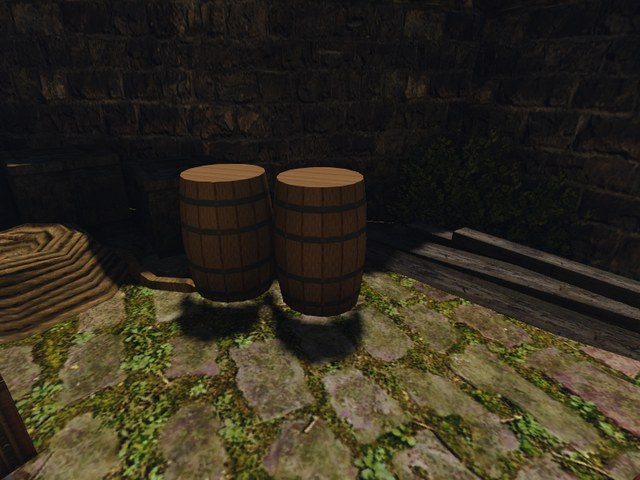
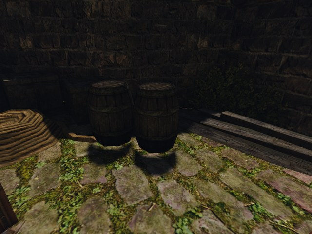

# Свои статичные меши: бочка в порту

2026-10-20. Стенд [`own-mesh-barrel.bench`](../../../scripts/bench/own-mesh-barrel.bench) на Ryzen 3950X / RTX 3080, Vulkan, 800×600. Процедурный GLB загружен вместо `NW_HARBOUR_BARREL_01.MRM`: на кадре видны целиком два соседних экземпляра этого визуала в порту Хориниса. Контрольная пара без индекса совпала по всем RGB-пикселям; средний FPS ветки относительно `main` — **−1,545%**.

| Своя бочка | Оригинал |
|---|---|
|  |  |

JPG уменьшены до 640×480 только для отчёта. Числа разницы ниже получены из исходных PNG 800×600, до уменьшения и JPEG-сжатия.

## Условия

Код движка ветки — `62cfcd63`, общий сценарий и запуск — `7bcb173f`. База — `origin/main` `dcb639d60548de2dad6b6abcca137d27dcadccef`. Для неё создан отдельный снимок исходников через `git archive`, без переключения ветки или создания другого worktree; к нему скопированы те же launcher и сценарий. Обе сборки — RelWithDebInfo, `OPENGOTHIC_ENABLE_APP_CADENCE=ON`, один toolchain; сборки выполнялись через `gq quick` в `~/gothic-ai/own-meshes/check/`.

Свежий `NEWWORLD.ZEN`, полдень, seed 73013, камера на штатную бочку ZEN id 19986, рядом id 19987. `MOVABLE_VOBS=0`, `GOTHIC_AI=0`, `OPENGOTHIC_TEXTURES=`, `OPENGOTHIC_FRACTURE=`; UI и эффекты выключены сценарием. Контент создан [`make_test_barrel.py`](../../../scripts/meshes/make_test_barrel.py) во временном каталоге: собственные геометрия и DXT1-текстура, 16 клёпок и крышки, материал `OWN_TEST_BARREL_WOOD`, группа `WOOD`. Рабочий каталог контента не менялся.

Все пять игр запущены через `BENCH_HOST=ryzen scripts/bench.sh`, с абсолютными путями вывода и `OPENGOTHIC_CENSUS`. Съёмка подмены шла через `gq quick`; четыре замера без индекса — через `gq quiet`, после окончания фоновой работы, по одной игре в порядке **A/B/A/B**. Все выходы — 0. `RYZEN_CLEAN_IDLE_HOURS=0` отключал удаление чужих папок.

## Перепись

Целевое имя — `NW_HARBOUR_BARREL_01.MRM`. Число открытий — сумма `files[].opens` этого имени; подмена — запись `replacements` вида `mesh`.

| Прогон | Индекс | Подмен меша | Открытий исходного MRM |
|---|---|---:|---:|
| Своя бочка, `20261020T110855Z-43650` | процедурный контент | 1 | **0** |
| A1, ветка, `20261020T111349Z-12988` | `OPENGOTHIC_CONTENT=` | 0 | 1 |
| B1, main, `20261020T111417Z-13774` | `OPENGOTHIC_CONTENT=` | 0 | 1 |
| A2, ветка, `20261020T111449Z-14801` | `OPENGOTHIC_CONTENT=` | 0 | 1 |
| B2, main, `20261020T111524Z-15517` | `OPENGOTHIC_CONTENT=` | 0 | 1 |

У подмены записано `NW_HARBOUR_BARREL_01.MRM` → `meshes/test/nw_harbour_barrel_01.glb`, `opens: 1`. Текстура также подменена один раз: `OWN_TEST_BARREL_WOOD.TGA` → `materials/test/barrel_wood.dds`.

## Сравнение без индекса

Средняя разница — среднее абсолютное отклонение всех RGB-компонентов в шкале 0…255; максимум — наибольшее отклонение компонента.

| Пара PNG | Средняя разница | Максимальная | Изменённых пикселей из 480 000 |
|---|---:|---:|---:|
| Контроль A1 / B1 | **0** | **0** | **0** |
| Снимки повторного FPS-замера A2 / B2 | 0,000126389 | 25 | 7 |

A1, B1 и A2 совпадают полностью. Во втором снимке `main` отличаются семь пикселей у краёв геометрии; повторная пара не побитово идентична. Для иллюстрации оригинала взят первый контрольный кадр A1.

## FPS без индекса

Сценарий сначала снимает PNG, затем включает обычные игровые часы и измеряет завершённые кадры приложения без видеозахвата. FPS = `frames / ((final_end_ns − start_ns) / 1e9)` из `appcadence.csv` и его JSON; последний интервал целиком включён. Во всех четырёх окнах `complete=true`, `overflow=0`; счётчики до/после одинаковы: 1 модель, 7395 частей, погибших 0.

| Порядок | Сборка | Кадров | Реальное окно, с | FPS |
|---|---|---:|---:|---:|
| A1 | ветка | 4500 | 30,001658589 | 149,991708 |
| B1 | main | 4587 | 30,005882874 | 152,870023 |
| A2 | ветка | 4546 | 30,006065998 | 151,502699 |
| B2 | main | 4601 | 30,002279047 | 153,355017 |

Арифметические средние двух прогонов: **ветка 150,747204 FPS**, **main 153,112520 FPS**. Изменение `(ветка / main − 1) × 100` = **−1,544822%**. Это результат двух прогонов на сборку в данном ракурсе, без вывода о цене загрузчика в других сценах.

## Проверки кода

Предписанный `check.sh` завершился с кодом 0: stdlib unittest генератора — **11/11**; Ryzen, `gq quick`, `-Wall -Wconversion -Werror`: `gothic-mesh-gltf-test` — **1763 проверки**, `gothic-material-texture-test` — **133**, оба exit 0. Тесты включают отказ `WATER` для `OPAQUE` и `MASK`, а также валидный временный кэш из восьми осколков: без индекса он загружается, с записью подмены — нет, лог один раз на визуал. Свои осколки ещё не генерируются. Отдельно `python3 -m unittest scripts.tests.test_ryzen.ContentTests` — **5/5**: загрузка каталога, пустое/незаданное значение и передача через bench; синтаксис обоих shell-launcher проверен.

После ревью F2 защита осколков уточнена: она действует только после успешной загрузки GLB. При битой, отсутствующей или неподдерживаемой подмене оригинальный MRM сохраняет свой кэш и возможность восстановить сохранённое разрушение; новые регрессии описаны в [журнале](../../../docs/own-content.md#план-и-журнал). `check.sh` после исправления прошёл с первой попытки: 11 Python-тестов, 2163 проверки мешей и 133 материалов на Ryzen через `gq quick`. Игровые кадры и FPS выше относятся к указанным сборкам; их входные GLB исправны.

Повтор съёмки своей бочки из корня репозитория (оба пути абсолютные):

```sh
RUN_ROOT="$(mktemp -d)"
python3 scripts/meshes/make_test_barrel.py "$RUN_ROOT/content"
BENCH_HOST=ryzen RYZEN_CLEAN_IDLE_HOURS=0 WORLD=NEWWORLD.ZEN \
  MOVABLE_VOBS=0 GOTHIC_AI=0 OPENGOTHIC_TEXTURES= OPENGOTHIC_FRACTURE= \
  OPENGOTHIC_CONTENT="$RUN_ROOT/content" \
  OPENGOTHIC_CENSUS="$RUN_ROOT/with-index/census.json" \
  scripts/bench.sh own-mesh-barrel "$RUN_ROOT/with-index"
```

Для оригинала задаётся `OPENGOTHIC_CONTENT=` и другой каталог вывода. Для FPS — `RYZEN_BENCH_CLASS=quiet`; по два запуска каждой сборки тем же сценарием, чередуя A/B.
