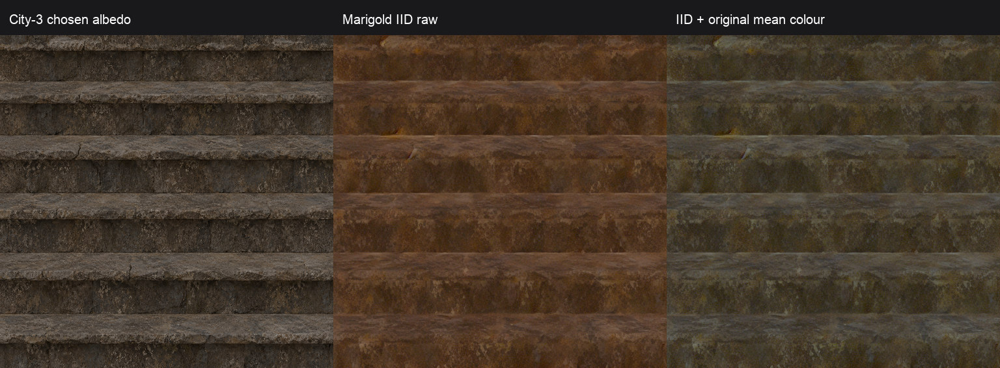
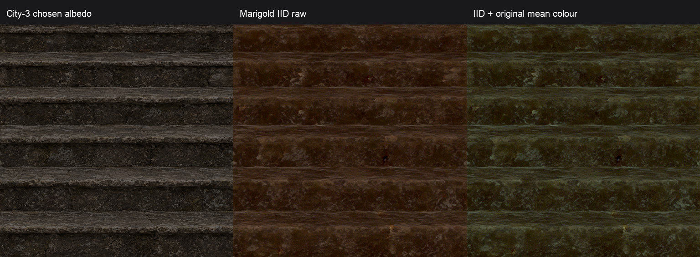
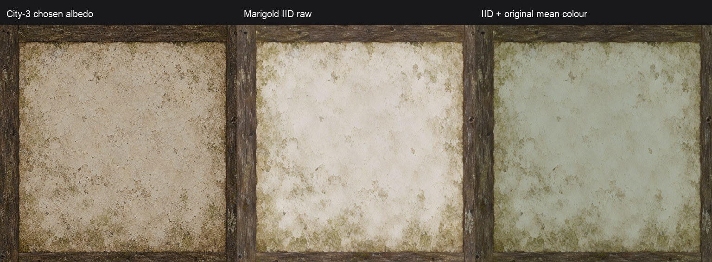

# Пилот качества материалов: шаг 1, замеры без генерации

20 октября 2026. Подготовлены численные цели всех **71** оригинала, проверены **58** выбранных альбедо city-3, выполнены **3/3** прогона Marigold IID на dev-ubuntu. Новый план размера деталей даёт максимум **5,41%** расчётной ошибки по 53 известным осям 60 материалов, допускаемых к замене; предел — ±15%. После IID и поправки цвета детектор снимает риск у STAIRS_03; у STAIRS_01 и WALL_03 риск остаётся.

Исходные пиксели оригинала в этом шаге не сохранялись, не передавались Python или модели. Генераций image_gen — **0**. Реестр, staging city-3, рабочий контент и OpenGothic не менялись. В git — числа, код и уменьшенные сравнения **наших** картинок. Это подготовка следующего пилота; текущие DDS и их scale не перепаковывались.

## Численные результаты и воспроизведение

- [71 строка с девятью новыми столбцами](../../../data/content/city-materials.csv), [описание полей](../../../docs/own-content.md#численные-замеры-качества-материалов).
- [План масштаба и числа деталей для 71 строки](scale-plan.csv): `eligible=false` у 11 исключённых атласов/материалов; включение в набор не меняется.
- [Замеры и физическое сравнение 58 выбранных альбедо](city3-measures.csv), включая SHA-256 PNG, периоды, направления и OKLab.
- [Детектор по всем 58 материалам](city3-lighting.csv), [до/IID/поправка цвета: девять строк](marigold-lighting.csv).
- [Семь материалов рынка и ворот: имена, площади, места](unchanged-surfaces.csv).

```bash
scripts/content/measure-originals.sh '/Volumes/DevSSD/Dev/games/Gothic II' --write
python3 scripts/content/map_textures.py check
uv run --no-project --with numpy --with pillow python scripts/content/measure_city.py \
  --content-root "$HOME/.local/share/gothic-ai/content-staging/city-3/sources" \
  --output reports/content/2026-10-pilot-measures
uv run --no-project --with numpy --with pillow --with scipy python scripts/content/material_lighting.py \
  --registry data/content/registry.jsonl \
  --content-root "$HOME/.local/share/gothic-ai/content-staging/city-3/sources" \
  --output reports/content/2026-10-pilot-measures/city3-lighting.csv
```

`measure-originals.sh` собирает только ZenKit и свой декодер во временном каталоге вне репозитория. `measure_luminance.py --materials` требует точный набор 71 имени и точную схему скалярного ответа, атомарно обновляет только новые поля. Прежние 19 столбцов CSV сохранены по значениям. `map_textures.py update` сохраняет измеренный период UV, направление, цвет, яркость и покрытие; метры пересчитываются при изменении UV-медианы.

## Алгоритм оригинала и нашей картинки

Единственная функция — `material_measures::measure` в [material-measures.h](../../../scripts/content/material-measures.h). Декодер вызывает её непосредственно на RGBA mip 0 ZenKit; [material_measures.py](../../../scripts/content/material_measures.py) передаёт **наши** PNG той же функции через C ABI. Маленькая библиотека автоматически собирается и кэшируется во временном каталоге. Оригинальный RGBA не покидает C++ и не сериализуется; интерфейс декодера выводит только скаляры.

sRGB переводится в линейный RGB. Средний цвет — **OKLab от среднего линейного RGB**, D65, не среднее нелинейных координат отдельных пикселей. Учитываются пиксели с alpha ≥128. Матрицы — [первичная публикация OKLab](https://bottosson.github.io/posts/oklab/). Это определение позволяет поканальным усилением точно воспроизводить целевой средний RGB и согласуется со средней линейной яркостью.

Для периода берётся линейная Rec.709-яркость. В памяти строится box-сетка максимум 128×128. По каждой оси суммируются мощности DFT отдельных строк: сдвинутые ряды кладки не гасят друг друга фазой. Из частот k=2…32 выбирается локальный пик с максимальным превышением соседнего фона: мощность ≥1,5 среднего соседей и ≥2,5% общей мощности. k=1 считается крупным полем, не повторяющейся деталью. Период равен 1/k UV; 0 означает отсутствие надёжного пика. Метры — период × `uv_m_per_unit_median`.

Направление длинных деталей даёт тензор центральных градиентов. Уверенность — |E_U−E_V|/(E_U+E_V). При выраженной анизотропии и осевом преобладании ≥0,20 выдаётся U или V; иначе `none`. Диагональные полосы не получают ложную осевую уверенность. Синтетические тесты проверяют горизонтальные, вертикальные и наклонные полосы с известными периодами/углами, диагональ 45°, заливку и отсечение невидимых пикселей.

По 71 оригиналу: направления **U 22 / V 10 / none 39**; нет надёжного периода у **39 осей U и 34 осей V**. Это измеренный результат, не пропуски данных. Спектр фиксирует ритм рисунка: у сложного модуля пик может относиться к рамке или группам деталей. Он не считает семантические «камни» и не гарантирует видимую укладку без просмотра. Метры по общей UV-медиане — требуемая сравнимая оценка; для вытянутой панели её реальные отдельные размеры U/V задаются геометрией.

## Масштаб, число деталей и панель кровли

Обозначения: m — UV-медиана в метрах, p₀ — период оригинала в UV, k=1/p₀ — число повторов на исходную UV-единицу, n — число деталей на своём тайле. Размер после рендера: **d=m/(scale×n)**; целевой размер **d₀=m×p₀**.

[material_scale.py](../../../scripts/content/material_scale.py) начинает с `s₀=m/плитка_класса`, перебирает соседние целые n по известным осям и общий scale как геометрическое среднее k/n. Допускаются только варианты с |d/d₀−1|≤0,15 на каждой оси. Выбор минимизирует `|log(scale/s₀)| + 2×max_error`: небольшой сдвиг размера тайла предпочтительнее лишнего искажения деталей. Число деталей хотя бы 1 на известной оси; нулевой пик не создаёт выдуманного ограничения. Проверка всех 53 известных осей допускаемых 60 строк: максимум ошибки **0,054093**. Период неизвестен по обеим осям у части материалов: для них физическая гарантия не заявляется.

Модули, панели и полосы сохраняют **scale=1** и **n=k**. Класс задаёт исходный ориентир, а не отменяет измеренный размер. Новый план — отдельный CSV: текущие scale таблицы и сохранённых рецептов оставлены совместимыми с уже собранным city-3. Для будущего рисунка берутся **оба** значения нового плана — scale и число деталей, затем результат снова измеряется. Одного изменения scale текущего изображения недостаточно, если оси или направления не согласуются.

Для готового альбедо с периодом p на каждой оси допустим интервал **p/(1,15×p₀) ≤ scale ≤ p/(0,85×p₀)**. Пересечение интервалов обязательно. У модулей допустима только 1. Нет пика, несовпадение направления или пустое пересечение требуют просмотра/нового рисунка. В `city3-measures.csv` статус `within_15_percent` означает возможность подобрать scale, а не приёмку текущего scale: **6** таких случаев; **16** с отсутствующим пиком нужной оси, **19** без целевого периода, **6** с несовпадением направления и **11** модулей с несовпадающим размером деталей. Колонки направлений сохраняются и при другом основном статусе.

Конкретные примеры:

| Текстура | Оригинальный период U/V, UV | Размер по UV-медиане U/V, м | План scale | Деталей U/V на свой тайл |
|---|---|---|---:|---|
| ROOF_01 | 1/3; 1/10 | 2,87325; 0,86197 | 3,16228 | 1; 3 |
| PFLASTERSTEIN_01 | 1/16; 1/16 | 0,37500; 0,37500 | 3,2 | 5; 5 |
| BODENDIELEN_01 | нет; 1/4 | нет; 1,08620 | 2 | нет; 2 |
| ROOF_INSIDE_01 | 1/3; 1/20 | 2,44899; 0,36735 | 1 | 3; 20 |

У текущего ROOF_01 scale=4,31, измеренный период ряда V=1/6: **0,33332 м вместо 0,86197 м**. Это согласуется с наблюдением о слишком мелких рядах, но спектральные десять повторов на UV не равны числу рядов на всём скате (~14 по наблюдению пользователя). Дополнительно U/V не допускают одного подходящего scale. У PFLASTERSTEIN V=1/12 и scale=3 дают **0,16667 м вместо 0,375 м**, надёжного собственного пика U нет. У BODENDIELEN_01 и DRECK_01 направление **U → V**; у BODENDIELEN_02 алгоритм даёт U с обеих сторон, поэтому автоматический замер не подтверждает поворот этой конкретной карты. Умеренная уверенность оригинальных досок (0,22–0,30) также требует просмотра.

Для **ROOF_INSIDE_01** физическая панель 14,48×6,42 м, отношение **2,25545**. Квадратный исходный рисунок растянулся бы в 2,255 раза; даже 1536×1024 потребовал бы 1,5036 раза, больше 1,25. Выбран **не новый вызов генератора**, а способ следующего шага: три квадратных модуля с перекрытием на холсте **1536×681**, сначала единая раскладка досок/балок, затем стыковка перекрытий, один ресемпл в квадратное UV-хранение. Квадратные куски при сборке не растягиваются; приблизительно 37% перекрытия соседних модулей покрывает нужную ширину. Отношение холста 2,25551 отличается от физического менее чем на 0,003%. Квадратное хранение после сборки компенсируется физическими UV, а исходная композиция строится в правильных пропорциях. Генератор и сборка модулей здесь не запускались; функция `panel_canvas` проверяет численный предел 1,25.

## Поправка среднего цвета

[material_colour.correct_mean_colour](../../../scripts/content/material_colour.py) решает три равномерных линейных усиления с учётом клиппинга, кодирует sRGB и повторяет замер по сохранённым 8-битным значениям. При альфе среднее считается на видимой части. Невозможность создать отсутствующий RGB-канал умножением или ошибка >0,005 отклоняет результат. Новый `target_oklab` имеет приоритет над старым `target_luminance`; при целевом цвете потолок насыщенности 0,30/0,25 не применяется. Рецепты без целевого цвета обрабатываются по прежним правилам. Адаптеры `city_set.py`, `generate.py`, `alpha_material.py` обновлены, существующий реестр не переписан. `reuse` применяет новую цветовую цель к выбранному альбедо и всем удержанным попыткам, сохраняет остальные карты и сырые исходники, записывает новые неизменяемые PNG и проверяет выбранный результат до обновления реестра. Повторное переиспользование воспроизводит те же файлы. Выбор лучшей попытки при исчерпании лимита оценивает ошибку среднего RGB к текущему `target_oklab`, даже если отдельного `target_luminance` нет.

Marigold даёт сдвиг среднего цвета. После IID применены только эти усиления, без пространственной правки:

| Материал | Усиления linear R/G/B | Максимальная ошибка среднего RGB | Средняя HSV S после |
|---|---|---:|---:|
| STAIRS_01 | 0,733209 / 1,205046 / 1,549911 | 0,00002324 | 0,3474 |
| STAIRS_03 | 0,836806 / 1,531948 / 1,385617 | 0,00003051 | 0,5635 |
| WALL_03 | 0,557426 / 0,624793 / 0,547122 | 0,00004965 | 0,2090 |

Клиппинга нет у всех трёх. Насыщенность выше 0,30 у двух ступеней соответствует разрешённой цели цвета; повторная десатурация нарушила бы измеренное среднее.

## Детектор запечённого света: метод и калибровка

[material_lighting.py](../../../scripts/content/material_lighting.py) уменьшает нашу картинку до длинной стороны 256. После sRGB→linear Rec.709 берётся log(max(Y,1/65535)). Горизонтальные/вертикальные полосы сравнивают яркость с обеих сторон края: ближние отсчёты ±тайл/128, дальние ±тайл/32, усреднение вдоль края длиной тайл/8. Для каждой полярности берётся q99 положительного потемнения и восстановления яркости; разность полярностей **E_H/E_V** подавляет симметричные тёмные швы. **C** — меньшая из максимальных сил полос H/V, чтобы заметить сильную рамку с взаимно компенсирующимися противоположными полосами. Граница тайла и прозрачные силуэты исключаются.

Низкочастотное поле — Gaussian σ=(H/8,W/8) по log-яркости, с нормализацией видимой маской. **LF** — p90−p10; **P** — норма градиента наилучшей плоскости в нормализованных UV. Угол к светлой стороне: 0°=+U, 90°=+V; R² и компоненты плоскости находятся в CSV. Малое R² означает, что одним направлением поле объясняется плохо.

Флаг просмотра — OR: **max(E_H,E_V)≥0,062**, **C≥0,50**, **LF≥0,35**, **P≥0,35**. На заданных примерах **8/8 плохих отмечены, 3/3 хороших пропущены**. Всего отмечено **40/58**, остальные 18 без флага. Это калибровка на 11 примерах, не проверка на независимом наборе и не автоматический допуск. Граница узкая: хороший PFLASTERSTEIN имеет E_max=0,05958, плохой STAIRS_01 — 0,06387. Износ, окраска, рамка фахверка могут имитировать свет; остальные 47 изображений не получили новой экспертной разметки. Повторяющаяся тень разных полярностей также может компенсироваться — поэтому сохранены сырые силы полос и поле, а не один бинарный ответ.

Таблица всех 58 выбранных PNG; полные значения и SHA-256 — в [CSV](city3-lighting.csv). «плох.»/«хор.» — только предоставленные пользователем 11 меток.

| Материал | E_H | E_V | C | LF | P | Угол, ° | Флаг | Метка |
|---|---:|---:|---:|---:|---:|---:|---|---|
| CITY_BODENDIELEN_01 | 0.0186 | 0.0288 | 0.0881 | 0.2044 | 0.2392 | 159.2 | — | хор. |
| CITY_BODENDIELEN_02 | 0.1090 | 0.0056 | 0.0929 | 0.0890 | 0.0564 | 125.9 | да | — |
| CITY_BODENDIELEN_DRECK_01 | 0.0020 | 0.0010 | 0.0701 | 0.0817 | 0.0528 | 151.7 | — | — |
| CITY_BROKENSTONE_01 | 0.0645 | 0.0066 | 0.1884 | 0.0760 | 0.0458 | 61.8 | да | — |
| CITY_DIRTYGROUND_02 | 0.0044 | 0.0150 | 0.1782 | 0.1045 | 0.0932 | 12.6 | — | — |
| CITY_DIRTYGROUND_WEG_02 | 0.0014 | 0.0035 | 0.1059 | 0.3668 | 0.0544 | 52.7 | да | — |
| CITY_DIRTYGROUND_WEG_03 | 0.0022 | 0.0068 | 0.1256 | 0.0432 | 0.0187 | 354.2 | — | — |
| CITY_DIRTYGROUND_WEG_END_01 | 0.0029 | 0.0078 | 0.1153 | 0.3696 | 0.4074 | 170.4 | да | — |
| CITY_DIRTYGROUND_WEG_TRANS_02 | 0.0161 | 0.0176 | 0.2317 | 0.3980 | 0.5260 | 359.3 | да | — |
| CITY_DUNGEONFLOOR_02 | 0.0006 | 0.0257 | 0.2210 | 0.1973 | 0.1045 | 217.8 | — | хор. |
| CITY_DUNGEONFLOOR_03 | 0.0099 | 0.0209 | 0.2869 | 0.1759 | 0.0295 | 155.1 | — | — |
| CITY_DUNGEONWALL_05 | 0.0706 | 0.0051 | 0.1831 | 0.1184 | 0.0582 | 177.9 | да | — |
| CITY_FACHWERKBASEMENT_CHAIN_01 | 0.0480 | 0.0059 | 0.3772 | 0.4487 | 0.2068 | 127.6 | да | — |
| CITY_FACHWERKBASEMENT_EMPTY_01 | 0.0280 | 0.0166 | 0.1728 | 0.5745 | 0.1472 | 276.7 | да | — |
| CITY_FACHWERKBASEMENT_WINDOW_01 | 0.0678 | 0.0010 | 0.1783 | 0.3867 | 0.2312 | 70.6 | да | — |
| CITY_FLAG_01 | 0.0090 | 0.0221 | 0.1012 | 1.0115 | 0.0573 | 272.9 | да | — |
| CITY_HAFEN_GIEBEL_01 | 0.1596 | 0.0032 | 0.0896 | 0.0508 | 0.0334 | 132.4 | да | — |
| CITY_HAFEN_HOLZWAND_01 | 0.0063 | 0.1152 | 0.1011 | 0.3885 | 0.3034 | 293.2 | да | — |
| CITY_HAFEN_HOLZWAND_02 | 0.0252 | 0.0214 | 0.4638 | 0.0841 | 0.0434 | 26.1 | — | — |
| CITY_HAFENKAI_BODEN_01 | 0.0983 | 0.0386 | 0.2576 | 0.2101 | 0.1974 | 212.7 | да | — |
| CITY_HAFENKAI_BODEN_TRANS_01 | 0.0192 | 0.0206 | 0.2034 | 0.2689 | 0.3741 | 176.6 | да | — |
| CITY_HAFENKAI_MAUER_01 | 0.0367 | 0.0057 | 0.1839 | 0.0980 | 0.1125 | 280.3 | — | — |
| CITY_HAFENRANDSTEIN_01 | 0.0385 | 0.0551 | 0.2733 | 0.2255 | 0.0419 | 181.9 | — | — |
| CITY_INSIDEFLOOR_11 | 0.0019 | 0.0289 | 0.0536 | 0.0791 | 0.0396 | 203.2 | — | — |
| CITY_INSIDEWALL_11 | 0.0808 | 0.0030 | 0.1704 | 0.5824 | 0.2529 | 46.1 | да | плох. |
| CITY_INSIDEWALL_12 | 0.0660 | 0.0228 | 0.3921 | 0.0427 | 0.0319 | 105.7 | да | плох. |
| CITY_INSIDEWALL_13 | 0.3400 | 0.0097 | 0.1142 | 0.7361 | 0.3184 | 44.7 | да | плох. |
| CITY_IVY_BORDER_01 | 0.0600 | 0.0119 | 0.4473 | 0.0704 | 0.1412 | 15.0 | — | — |
| CITY_IVY_FULL_01 | 0.0004 | 0.0127 | 0.4353 | 0.1315 | 0.0923 | 97.2 | — | — |
| CITY_PFLASTERSTEIN_01 | 0.0596 | 0.0148 | 0.3089 | 0.0808 | 0.0739 | 80.6 | — | хор. |
| CITY_PFLASTERSTEIN_BORDER_01 | 0.0052 | 0.0036 | 0.5331 | 0.0418 | 0.0361 | 30.8 | да | — |
| CITY_RICH_BLACKWOOD_01 | 0.0153 | 0.1164 | 0.1182 | 0.1267 | 0.0422 | 65.7 | да | — |
| CITY_RICH_WALL_01 | 0.0657 | 0.0016 | 0.0850 | 1.4830 | 0.0541 | 226.2 | да | — |
| CITY_RICH_WALL_HALF_01 | 0.1040 | 0.0050 | 0.1406 | 1.4065 | 0.2635 | 356.3 | да | — |
| CITY_RICH_WINDOW_01 | 0.0519 | 0.1219 | 0.7877 | 1.2417 | 1.1531 | 102.5 | да | — |
| CITY_ROOF_01 | 0.1147 | 0.0110 | 0.4483 | 0.0659 | 0.0430 | 118.6 | да | — |
| CITY_ROOF_04 | 0.1301 | 0.0028 | 0.1267 | 0.0633 | 0.0715 | 156.1 | да | — |
| CITY_ROOF_INSIDE_01 | 0.0477 | 0.0029 | 0.6107 | 0.0802 | 0.0782 | 94.4 | да | — |
| CITY_ROPE_01 | 0.0023 | 0.2815 | 0.0919 | 0.0263 | 0.0076 | 37.4 | да | — |
| CITY_SHRINEFLOOR_01 | 0.0218 | 0.1051 | 1.0156 | 0.1338 | 0.1349 | 254.6 | да | — |
| CITY_STONEWALL_02 | 0.0366 | 0.0049 | 0.1519 | 0.0717 | 0.0516 | 7.4 | — | — |
| CITY_WALL_03 | 0.0684 | 0.1155 | 0.1522 | 1.2034 | 0.3271 | 19.6 | да | — |
| CITY_WALL_04 | 0.3226 | 0.0090 | 0.1674 | 0.7625 | 0.2404 | 28.2 | да | — |
| CITY_WALL_05 | 0.1839 | 0.0125 | 0.1576 | 1.3727 | 0.1431 | 344.7 | да | — |
| CITY_WINDOW_03 | 0.0477 | 0.0748 | 0.3047 | 1.0653 | 0.8352 | 107.7 | да | — |
| CITY_WOOD_01 | 0.0033 | 0.0236 | 0.1720 | 0.0620 | 0.0368 | 91.3 | — | — |
| CITY_WOOD_ORNAMENT_01 | 0.0790 | 0.0269 | 0.4777 | 0.2238 | 0.2372 | 87.6 | да | — |
| CITY_WOOD_ORNAMENT_02 | 0.0163 | 0.0231 | 0.1188 | 0.0768 | 0.0719 | 270.9 | — | — |
| CITY_WOODBEAM_01 | 0.1118 | 0.0105 | 0.6274 | 0.0694 | 0.0527 | 1.7 | да | — |
| CITY_WOODBEAM_02 | 0.0029 | 0.0035 | 0.1708 | 0.0921 | 0.1007 | 150.4 | — | — |
| CITY_WOODBEAM_03 | 0.0102 | 0.0459 | 0.5521 | 0.1125 | 0.0863 | 265.4 | да | — |
| HARBOUR_ROPEWALL_01 | 0.0553 | 0.0003 | 0.0980 | 0.0255 | 0.0209 | 83.8 | — | — |
| HARBOUR_ROPEWALL_02 | 0.5641 | 0.0086 | 0.1557 | 0.0503 | 0.0588 | 78.4 | да | — |
| HARBOUR_STAIRS_01 | 0.0639 | 0.0039 | 0.1257 | 0.1453 | 0.1008 | 93.1 | да | плох. |
| HARBOUR_STAIRS_03 | 0.3351 | 0.0007 | 0.1663 | 0.1550 | 0.0870 | 96.5 | да | плох. |
| HARBOUR_WOOD_IRON_01 | 0.0423 | 0.0083 | 0.8039 | 0.0795 | 0.0273 | 328.7 | да | плох. |
| HARBOUR_WOODCRATE_01 | 0.3196 | 0.0396 | 0.8767 | 0.1170 | 0.0400 | 141.5 | да | плох. |
| HARBOUR_WOODCRATE_02 | 0.2170 | 0.0446 | 0.8647 | 0.1119 | 0.0715 | 171.5 | да | плох. |

## Marigold IID Lighting v1-1 на dev-ubuntu

Установлен в `~/gothic-ai/materials/marigold/`, отдельный `.venv`, Python **3.11.16**. Модель **prs-eth/marigold-iid-lighting-v1-1**, закреплённая ревизия **08c3930bb641abf786ba44ce92547507ebefbc16**. [Карточка именно этой ревизии](https://huggingface.co/prs-eth/marigold-iid-lighting-v1-1/blob/08c3930bb641abf786ba44ce92547507ebefbc16/README.md) прямо указывает **CreativeML Open RAIL++-M** (OpenRAIL++-M; metadata `openrail++`). Связанный [LICENSE-MODEL SD2](https://huggingface.co/stabilityai/stable-diffusion-2/blob/main/LICENSE-MODEL) при проверке отвечал HTTP 401; утверждение о лицензии модели подтверждено её карточкой. Доступен [первичный текст лицензии с тем же названием у Stability AI](https://huggingface.co/stabilityai/stable-diffusion-xl-base-1.0/raw/main/LICENSE.md).

Зависимости: torch 2.5.1+cu124, torchvision 0.20.1+cu124, diffusers 0.35.2, transformers 4.57.1, accelerate 1.11.0, huggingface-hub 0.36.0, safetensors 0.6.2, numpy 2.2.6, Pillow 12.0.0, scipy 1.16.2, sentencepiece 0.2.1, protobuf 5.29.5. Установка только через uv в свой venv, без системных пакетов. Snapshot:

```text
~/gothic-ai/materials/marigold/hf/hub/models--prs-eth--marigold-iid-lighting-v1-1/snapshots/08c3930bb641abf786ba44ce92547507ebefbc16
```

Скрипт [marigold_iid.py](../../../scripts/content/marigold_iid.py) загружает локальный snapshot, проверяет Linux/CUDA и свободную VRAM, не обращается к оригиналам и не перезаписывает PNG. Вход sRGB; предсказание модели — linear RGB, перед сохранением применяется sRGB-кодирование. Параметры: **fp16, DDIM, 4 шага, ensemble=1, processing_resolution=768, match_input_resolution=True, seed=20261020**, выходы 1024². Сервис не создавался, модель после команды выгружена.

Фактическая команда внутри окна свободной VRAM (для повторения требуется свежий `--output-dir`):

```bash
cd ~/gothic-ai/materials/marigold
export HF_HOME="$PWD/hf" HF_HUB_DISABLE_IMPLICIT_TOKEN=1
snapshot="$PWD/hf/hub/models--prs-eth--marigold-iid-lighting-v1-1/snapshots/08c3930bb641abf786ba44ce92547507ebefbc16"
timeout -k 10 600 .venv/bin/python -u marigold_iid.py \
  --model-path "$snapshot" --output-dir "$PWD/output" \
  inputs/NW_HARBOUR_STAIRS_01.png inputs/NW_HARBOUR_STAIRS_03.png inputs/NW_CITY_WALL_03.png
```

Перед прогоном свободно **5144 MiB**, занято 18981 MiB; на диске 330 ГБ свободно. Остановлен только `gothic-gemma`: свободно стало **12525 MiB**. Окно **07:58:48–07:58:57 UTC, 9 секунд**; восстановление выполнялось сразу через trap. Decider, Voxtral, VoxCPM и продовые контейнеры не останавливались. После: все четыре gothic-сервиса active, Gemma `/v1/models` HTTP 200, GPU вернулся к 18981 MiB used / 5144 MiB free. Docker и системная конфигурация не менялись.

Прогон **3/3, первая GPU-попытка, exit 0**. Загрузка модели **2,299 с**; STAIRS_01 **1,696 с**, STAIRS_03 **1,096 с**, WALL_03 **1,085 с**. Пик **3863,5 MiB allocated / 5010 MiB reserved**. До/сырые IID/цветовые PNG сохранены вне git в `~/.local/share/gothic-ai/pilot-measures/marigold/` на Mac и `~/gothic-ai/materials/marigold/{inputs,output}/` на dev-ubuntu (на сервере — вход и сырой IID; цветовая поправка на Mac без модели). Имена локально: `NW_HARBOUR_STAIRS_01`, `NW_HARBOUR_STAIRS_03`, `NW_CITY_WALL_03`; суффиксы пустой / `-albedo` / `-colour`.

| Материал | Этап | E_max | LF | P | Флаг |
|---|---|---:|---:|---:|---|
| STAIRS_01 | city-3 | 0.06387 | 0.14531 | 0.10079 | да |
| STAIRS_01 | IID сырой | 0.06925 | 0.08922 | 0.05901 | да |
| STAIRS_01 | IID + средний цвет | 0.07005 | 0.09152 | 0.06174 | да |
| STAIRS_03 | city-3 | 0.33514 | 0.15495 | 0.08699 | да |
| STAIRS_03 | IID сырой | 0.03081 | 0.10394 | 0.08619 | — |
| STAIRS_03 | IID + средний цвет | 0.02900 | 0.11208 | 0.09384 | — |
| WALL_03 | city-3 | 0.11551 | 1.20344 | 0.32707 | да |
| WALL_03 | IID сырой | 0.09301 | 1.02163 | 0.27440 | да |
| WALL_03 | IID + средний цвет | 0.09175 | 1.02316 | 0.27481 | да |

После поправки цвета у STAIRS_03 E_max уменьшается **на 91,35%**, флаг снят. У STAIRS_01 поле уменьшается **на 37,01%**, но E_max растёт **на 9,68%**, флаг остаётся. У WALL_03 поле уменьшается **на 14,99%**, но остаётся сильным; флаг остаётся. Marigold полезен для одной из двух ступеней, общего решения запечённого света этот опыт не подтвердил. Средний цвет возвращён точно, пространственные остатки света этим усилением не исправляются.

На каждом листе слева выбранное альбедо city-3, в центре сырой IID, справа IID с целевым средним цветом. Все три колонки — наши картинки, пикселей оригинальной текстуры здесь нет.







## Брусчатка рынка и крепостные стены у ворот

Имена подтверждены геометрией NEWWORLD через ZenKit, без экспорта текстур. В набор не добавлялись. Полные площади — сумма поверхностей world mesh всего NEWWORLD; локальные — полные площади треугольников с центроидом внутри горизонтального круга. Это не видимая площадь пикселей кадра. Рынок: радиус 20 м вокруг MARKT, X=10044,136, Z=4239,259 см. Ворота: радиус 15 м вокруг X=9500, Z=−4650 см, верхний квартал перед лестницей из city.jpg. Полные bounds и число треугольников — в CSV.

| Текстура | Где | Локально, м² | NEWWORLD, м² |
|---|---|---:|---:|
| `NW_MISC_OLDSTONEPATH_01.TGA` | Основная брусчатка рынка у MARKT | 530.481 | 3685.953 |
| `NW_MISC_OLDSTONEPATH_WAY_01.TGA` | Проходная полоса брусчатки на рынке у MARKT | 145.134 | 871.052 |
| `NW_MISC_STRONG_STONEWALL_01.TGA` | Основная кладка крепостных стен и подпорных стенок рампы перед воротами верхнего квартала | 447.931 | 8927.385 |
| `NW_MISC_STRONG_STONEWALL_SIDE_01.TGA` | Лицевой блок ворот вокруг арки верхнего квартала | 145.002 | 1652.576 |
| `NW_MISC_STRONG_STONEWALL_ENTRANCE_01.TGA` | Обвод и свод арки ворот верхнего квартала | 10.640 | 255.902 |
| `NW_MISC_STRONG_STONEWALL_BLOCKBORDER_01.TGA` | Верхние и торцевые обводы крепостных стен и рампы у ворот | 228.181 | 4384.958 |
| `NW_MISC_STRONG_STONEWALL_ROUNDBORDER_01.TGA` | Карниз непосредственно над аркой ворот верхнего квартала | 30.924 | 759.090 |

## Проверки

- `uv run --no-project --with numpy --with scipy --with pillow --with pytest pytest -q scripts/content/`: **480 passed, 19,11 с**, exit 0. Полная регрессия проекта и игра не требовались: движок/разговор не менялись.
- `python3 scripts/content/map_textures.py check`: **71 строка**, новые поля и прежние правила; exit 0.
- Декодер C++ `--self-test`: **15/15**, exit 0. Сборка через `measure-originals.sh` и свежая выгрузка — **71/71**, все значения совпали с CSV; прежние 19 столбцов сверены с HEAD без изменений. Пиксельных выходов нет.
- План: **71 строка / 60 допускаемых / 53 известных оси**, ошибка **≤5,41%**, модули scale 1; детектор **58/58**, контрольные метки **8/8 + 3/3**.
- Marigold: **3/3** фактических GPU-прогона с первой попытки, exit 0; цвет **3/3** в допуске, сервис восстановлен.
- Регрессии выбора и reuse: пять новых случаев, включая настоящий рецепт city-1 без яркостной цели, недостижимый цвет, сохранение исходников и повторяемость. Реальный HAFENKAI_BODEN_01 проверен во временном каталоге: ошибка RGB **0,01356578 → 0,000096924**, прочие карты и исходный PNG сохранены. Новых модельных прогонов для этих исправлений не было.

Следующий шаг использует эти численные цели для нового пилота генерации и последующей игры. Два оставшихся сигнала Marigold и неизвестные периоды требуют просмотра при выборе материалов; этот шаг ничего автоматически не принимает и не подключает.
