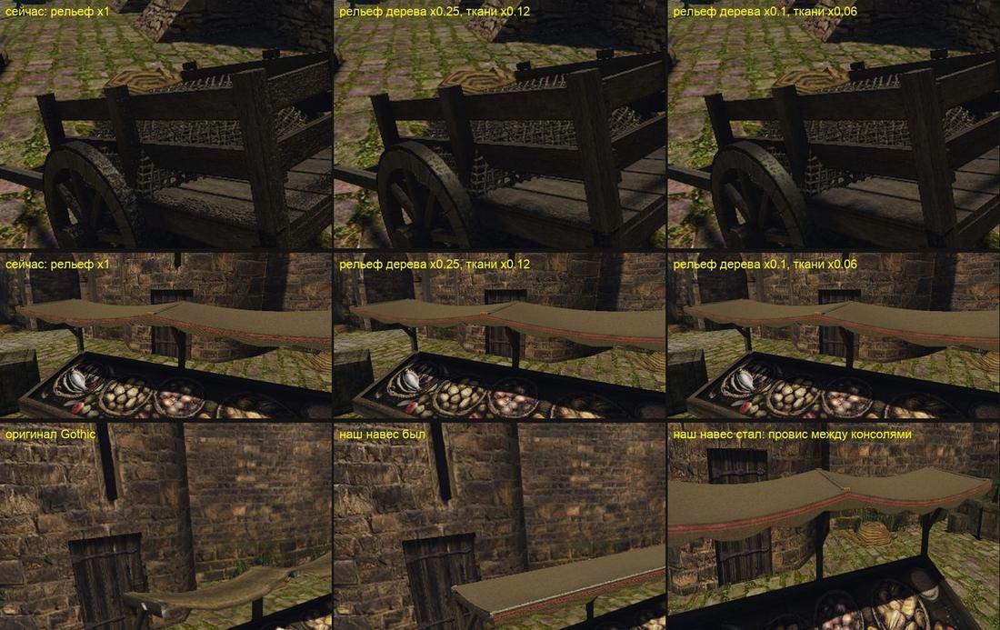
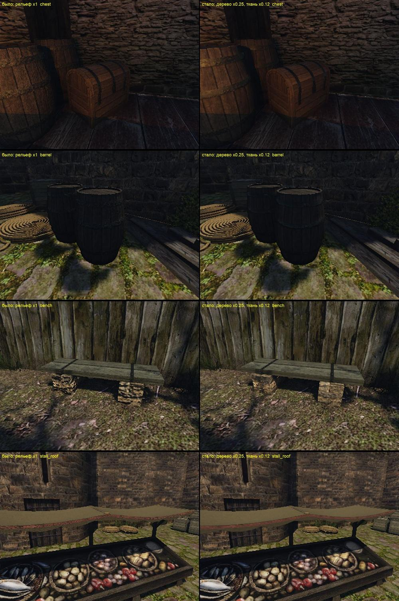

# Рельеф плиток в атласах предметов

21 октября 2026 года, этап 2 [плана своего контента](../../../docs/own-content.md#как-работает-сейчас).

## Что было не так

Пользователь посмотрел наши предметы в игре — сундук, бочку, набор рынка. Дерево у них «совсем не дерево»: слишком рельефное, и рельеф не похож на волокно, как будто имитация. А навес рынка читался твёрдой поверхностью, хотя у оригинала видно, что это натянутая и провисшая ткань.

Причина нашлась в числах. Плитки этапа 1 получают карту нормалей из яркости своей картинки: это `bakeoff.filtered_maps`, полоса частот яркости. Фильтр нормирует её так, что рельеф любой плитки растягивается на полный диапазон. В итоге каждая тёмная прожилка становится канавкой, а светлая — гребнем. `bake_atlas.py` запекал эту карту в атлас с силой 1.

Средний наклон нормали плиток, которые используют атласы предметов:

| плитка | средний наклон | 90-й процентиль |
|---|---:|---:|
| дерево (доска, рама, клёпка; копии пилота) | 37,7° | 62,2° |
| холст `own_prop_canvas` | 63,6° | 76,6° |
| ткань `own_prop_cloth` | 53,8° | 70,5° |
| железо, латунь, сталь | 54,4° | 71,5° |
| кожа | 54,8° | 72,5° |
| кора | 46,7° | 66,7° |
| камень лавки | 45,5° | 66,6° |
| мех | 42,7° | 64,7° |
| верёвка | 39,3° | 60,6° |
| ковёр | 29,0° | 67,1° |
| свои процедурные: стекло, воск, кость | 2–4° | 5–15° |

У волокна дерева и плетения ткани наклон должен быть в пределах нескольких градусов. Таким рельефом поверхность в игре искрит, как наждак.

## Выбор силы

На Ryzen сняты одни и те же крупные планы тележки, указателя и навеса при трёх силах рельефа: ×1, ×0,25 и ×0,1 для дерева, у ткани — ×0,12 и ×0,06 соответственно. При ×1 дерево зернистое и блестит точками. При ×0,25 читаются волокно и доски. При ×0,1 поверхность гладкая. Ткань при ×0,12 выглядит тканью. Пользователь выбрал: дерево ×0,25, ткань ×0,12, без светлых кромок у ткани.



Навес отдельно переделан по форме, PR #338. Полотно лежит на трёх консолях и провисает между ними до 24 см, как у оригинала, без жёстких жердей. Подзор висит с провисшего края.

## Что изменено

`scripts/content/mesh3d/blender/bake_atlas.py` запекает карту нормалей плитки с силой по материалу зоны:
- ткань, холст, мешковина и ковёр — ×0,12;
- свои процедурные плитки стекла, воска и кости — ×1: их рельеф и так слабый и настоящий, у стекла это свинцовые переплёты;
- всё остальное — дерево, кора, железо, камень, кожа, мех, верёвка — ×0,25.

`tile_normal` в настройках атласа задаёт силу для зоны. Светлых стёртых кромок нет у ткани, верёвки и меха (`edge_wear`, по умолчанию 0,7 маски кромок). Обе величины пишутся по зонам в `metrics.json`. Ни одна настройка атласа менять не пришлось.

Пользователь назвал дерево и ткань. Железо, камень, кожа, мех и верёвка получили ×0,25 по той же причине: их плитки вышли из того же фильтра с тем же растянутым рельефом.

## Перепекание

Все 24 атласа перепечены на Ryzen одной заявкой `gq batch` (24 потока, по 4 Blender параллельно, 15 минут): 21 предмет рынка вместе с бочкой и ящиком пилота, стол, лавка и сундук. Входы скопированы в отдельную папку Ryzen. `pack_prop.py` переупаковал пакеты; корни `market-set/content`, `mesh3d-props-atlas`, `mesh3d-chest-atlas` и `market-set/packs/pilot-barrel-crate` пересобраны `market_pack.py`. Пять предметов рынка с новой геометрией ведущая сессия перепекает тем же кодом сама.

Медиана наклона нормали в атласе навеса — 40,7° → 3,9°. У тележки — около 9°: остались скруглённые кромки от Bevel, они задуманы.

## Проверка в игре

Ryzen был занят игрой пользователя, поэтому сравнение «было/стало» снято на Mac, сценарий [`own-mesh-relief.bench`](../../../scripts/bench/own-mesh-relief.bench). 16 крупных планов: бочка, ящик, стол, лавка, сундук, тележка, указатель, навес, окно изнутри, шкаф. Два корня контента: прежнее запекание и новое. Движок — сборка 21 октября 00:15 из соседнего worktree: в ней есть загрузчик GLB и перепись. Своей сборки движка на Mac у этой ветки нет.



Результаты:
- Перепись: все 10 предметов взяты из наших GLB в обоих корнях. Наборы открытых файлов двух прогонов совпали полностью: 4064 файла и 366 подмен. У лавки и сундука движок по-прежнему читает оригинальные `.MDL`, `.MDH`, `.MSB` и анимации: так устроена подмена MOB — меш наш, иерархия и анимации остаются движка.
- Кадры рынка `own-mesh-market` (без замера FPS: в этой сборке нет cadence) с новым корнем: 24 из 24 мешей заменены, ни одного открытия оригинального меша.
- Дерево стало ровнее, на нём видно волокно, а точечные блики пропали. Обручи бочки и полосы сундука чище, камни лавки без «накипи». Ткань навеса и штор мягкая.

Ограничение: на этой сборке отдельные vob от прогона к прогону иногда не попадают в кадр: шкаф, канаты у тележки, фонарный столб. Это видно и со старым корнем, и с новым, переписи совпадают. С перепеканием это не связано.

## Повтор

```sh
# запекание одного предмета (Mac или Ryzen), затем пакет
$B -b --factory-startup -P scripts/content/mesh3d/blender/bake_atlas.py -- \
  scripts/content/mesh3d/blender/<item>-atlas.json <content-staging>/market-set/build/<item>/atlas
uv run --no-project --with numpy --with pillow python scripts/content/mesh3d/pack_prop.py \
  --bake <bake dir> --visual <VISUAL> --name market-<item> --output <content-staging>/market-set/packs/<item>
# сравнение в игре
BENCH_HOST=ryzen WORLD=NEWWORLD.ZEN GOTHIC_AI=0 MOVABLE_VOBS=0 TIMEOUT=900 \
  OPENGOTHIC_CONTENT=<root> OPENGOTHIC_CENSUS=<absolute out>/census.json scripts/bench.sh own-mesh-relief <absolute out>
```
