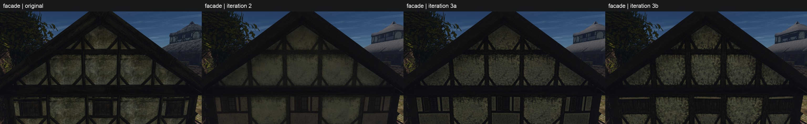
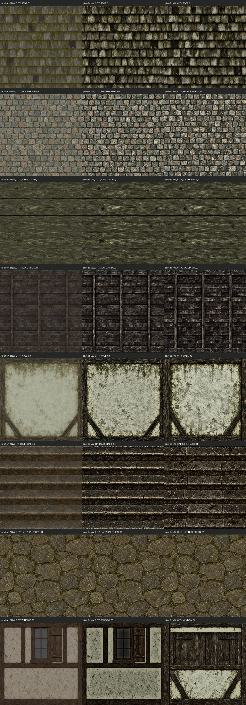
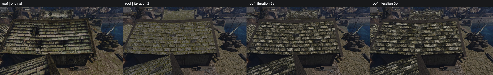
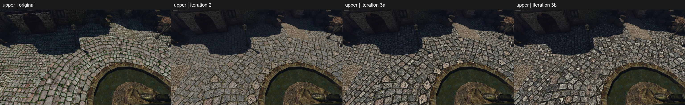
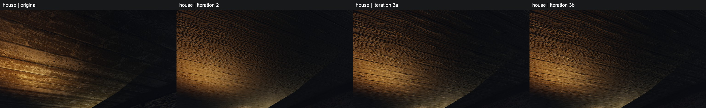
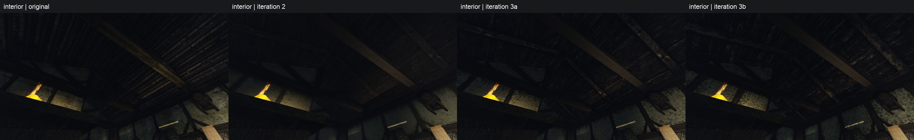
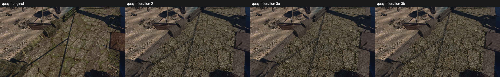
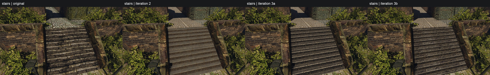

# Пилот качества материалов, итерация 3: контраст и мелкая деталь

20 октября 2026. Добавлен восьмой материал — **NW_CITY_WINDOW_03**. После пересъёмки **фасад 3a/3b — 1,0472 / 1,0533** по локальной детали полного кадра относительно original (порог ≥0,90); у итерации 2 — 0,7444. Окна видны во всех трёх секциях фасада. Две новые игры дали **14 кадров, exit 0, 8/8 подмен и 0 открытых целевых оригиналов** у каждого набора; original и pilot-2 переиспользованы при том же SHA бинарника. Итог — **28 замеров и семь заново собранных JPEG**.



## Обработка итерации 3

`quality_pilot_3.py prepare/build` собирает **3a** из выбранных исходников итерации 2 и выбранного конечного альбедо WINDOW_03 из реестра city-3, **3b** — из шести новых изображений и прежних BODENDIELEN/HAFENKAI. У каждого **58 записей, восемь замен, 50 неизменённых записей и 150 побайтно совпадающих с city-3 DDS**. Рабочий content и прежние staging-наборы не меняются.

1. Прежние семь: исходник → прежняя `roof_canvas` у ROOF_INSIDE → Lanczos 1024² → узкие стыки разрешённых осей → поправка среднего цвета. WINDOW_03: один физический модуль 193×214 см → вырезание U-стыка на исходном холсте → единственный 2D Lanczos-ресемпл с периодическими соседями только U в 1024² → цвет. V не сшивается.
2. Детектор; только отмеченный вход получает IID. В линейном RGB по каналам: `in × clamp(G(IID) / G(in), 0.25, 4)^0.5`, Gaussian σ=32 px, заворот. Мелкие тёмные кромки остаются в исходной полосе. Повторный флаг только записывается.
3. `material_detail.py`: `L=ln(Y+0.001)`, полосы box-фильтров B12/B36/B108 с заворотом на полном разрешении. База относительно среднего получает g0, полосы k3/k9/k27 — g1/g2/g3; часть `L−B4` получает `min(g1,1.5)`. По итоговому PNG после цвета выполняется до восьми обновлений усилений в обе стороны, допуск ±3%; g0 ∈ [0.8,1.6], g1…g3 ∈ [0.5,3].
4. После `RGB_lin × exp(L'−L)` берётся `M=max(R,G,B)`. При M>0.7 применяется `M'=0.7+0.3*tanh((M−0.7)/0.3)` и общий множитель M'/M ко всем RGB-каналам. Затем обрезка [0,1], поканальная поправка среднего цвета, замер и детектор. Normal/ORM — прежним CPU-фильтром из конечного альбедо.

**Обрезка равна 0 у всех 16 конечных материалов**, включая поправку цвета. Плечо по максимальному каналу — принятое ведущим решение для сжатия светлых мест с общим множителем RGB. `clipped_pixel_fraction` считает пиксели с хотя бы одним обрезанным каналом при усилении после плеча или последующем цвете; это не доля белых пикселей в готовом PNG и не доля пикселей под плечом.

Доля пикселей под плечом (`shoulder_pixel_fraction` в [material-metrics.csv](material-metrics.csv)) — `mean(max(R,G,B) > 0.7)` в линейном RGB после усиления, **до плеча и итоговой поправки цвета**. Это доля площади текстуры, где светлые места сжаты. Метрику вычисляет `fit_material_detail` для окончательно выбранных усилений, а `quality_pilot_3.py build` сам записывает её в CSV при каждой сборке; отдельных ручных замеров нет. В каждом материале 1 048 576 пикселей.

| Материал | Под плечом 3a | Под плечом 3b |
|---|---:|---:|
| ROOF_01 | 5,6537% | 6,7680% |
| PFLASTERSTEIN_01 | 5,6599% | 3,8225% |
| BODENDIELEN_01 | 0,0891% | 0,0891% |
| ROOF_INSIDE_01 | 0,3880% | 0,9194% |
| WALL_03 | 34,2430% | 30,6112% |
| HARBOUR_STAIRS_01 | 3,7158% | 2,6429% |
| HAFENKAI_BODEN_01 | 0,0389% | 0,0389% |
| WINDOW_03 | 29,4388% | 20,7502% |

Входы IID сверяются по SHA. При сборке на другой ОС сохраняются точные байты подготовленного PNG, а повторная подготовка проверяется по совпадению всех пикселей: PNG-кодировщики могут дать разные байты одинаковой картинки.

### Цели и конечные альбедо

Числа: **log_spread / detail_k3 / detail_k9 / detail_k27**. Полная точность, цвет, счёт, детектор, усиления и доли обрезки — [material-metrics.csv](material-metrics.csv). У прежних семи все четыре метрики одновременно в ±3% у **2/7 в 3a** и **4/7 в 3b**; остальные завершили восемь обновлений, часть усилений достигла границ. Недостижение текстурной цели не скрывается.

| Материал | Цель оригинала | 3a | 3b |
|---|---|---|---|
| ROOF_01 | 3.4375 / 0.3743 / 0.6011 / 1.0346 | 3.3382 / 0.3745 / 0.6027 / 0.9952 | 3.6128 / 0.3745 / 0.6056 / 1.0299 |
| PFLASTERSTEIN_01 | 2.2756 / 0.3658 / 0.6250 / 0.7522 | 2.4767 / 0.3658 / 0.6254 / 0.7559 | 2.4467 / 0.3660 / 0.6251 / 0.7597 |
| BODENDIELEN_01 | 1.7665 / 0.2723 / 0.3654 / 0.4382 | 1.3347 / 0.2722 / 0.3645 / 0.4373 | 1.3347 / 0.2722 / 0.3645 / 0.4373 |
| ROOF_INSIDE_01 | 2.7509 / 0.3877 / 0.6465 / 0.7941 | 2.5772 / 0.3877 / 0.6469 / 0.7889 | 2.7124 / 0.3807 / 0.6448 / 0.8176 |
| WALL_03 | 3.4475 / 0.2626 / 0.3947 / 0.5626 | 3.5430 / 0.2593 / 0.4014 / 0.5647 | 3.5335 / 0.2595 / 0.3976 / 0.5560 |
| HARBOUR_STAIRS_01 | 3.2919 / 0.4732 / 0.7151 / 0.9195 | 3.4075 / 0.4173 / 0.6585 / 0.9275 | 3.3729 / 0.4761 / 0.7236 / 0.9376 |
| HAFENKAI_BODEN_01 | 1.2761 / 0.2605 / 0.3382 / 0.3820 | 1.3029 / 0.2601 / 0.3475 / 0.3854 | 1.3029 / 0.2601 / 0.3475 / 0.3854 |

Усиления: **g0 / g1 / g2 / g3**. Полоса мельче ячейки ограничена 1,5 у 6/8 материалов обоих наборов. Обрезка у всех строк — **0%**.

| Материал | Усиления 3a | Границы 3a | Усиления 3b | Границы 3b |
|---|---|---|---|---|
| ROOF_01 | 1.600 / 2.113 / 1.824 / 3.000 | g0 max, g3 max | 1.266 / 1.891 / 1.416 / 2.654 | — |
| PFLASTERSTEIN_01 | 0.936 / 2.308 / 2.424 / 2.400 | — | 0.924 / 1.758 / 2.003 / 1.625 | — |
| BODENDIELEN_01 | 1.600 / 1.257 / 1.637 / 2.392 | g0 max | 1.600 / 1.257 / 1.637 / 2.392 | g0 max |
| ROOF_INSIDE_01 | 1.600 / 2.207 / 2.757 / 3.000 | g0 max, g3 max | 1.600 / 2.504 / 2.813 / 2.554 | g0 max |
| WALL_03 | 1.474 / 2.815 / 2.733 / 2.775 | — | 1.402 / 2.252 / 2.283 / 2.564 | — |
| HARBOUR_STAIRS_01 | 0.995 / 3.000 / 3.000 / 2.117 | g1 max, g2 max | 0.974 / 2.676 / 2.104 / 1.251 | — |
| HAFENKAI_BODEN_01 | 0.998 / 1.133 / 1.023 / 1.040 | — | 0.998 / 1.133 / 1.023 / 1.040 | — |

### Цвет, видимый счёт и детектор

Средний линейный RGB в допуске ≤0,005 у **8/8 обоих наборов**; максимальная ошибка **0,00002784 в 3a**, **0,00011938 в 3b**. Видимый счёт проходит ±20% у **8/8 обоих наборов**: максимум 6,25% в 3a и 15% в 3b. Счёт сделан по нашим картинкам; оригинальные текстуры, их превью и листы не открывались и генератору не передавались.

| Материал | Ошибка RGB 3a / 3b | Счёт U × V 3a / 3b | Флаг до → после 3a / 3b |
|---|---:|---|---|
| ROOF_01 | 0.00000956 / 0.00001460 | 14 × 10 / 14 × 10 | да → да / да → да |
| PFLASTERSTEIN_01 | 0.00000294 / 0.00000188 | 15 × 15 / 16 × 16 | нет → да / да → да |
| BODENDIELEN_01 | 0.00000108 / 0.00000108 | 1 × 5 / 1 × 5 | нет → нет / нет → нет |
| ROOF_INSIDE_01 | 0.00000072 / 0.00000221 | 3 × 19 / 3 × 17 | да → да / да → да |
| WALL_03 | 0.00002430 / 0.00000805 | 1 × 1 / 1 × 1 | да → да / да → да |
| HARBOUR_STAIRS_01 | 0.00002784 / 0.00001004 | 2.5 × 6 / 2.5 × 6 | да → нет / да → да |
| HAFENKAI_BODEN_01 | 0.00000135 / 0.00000135 | 5 × 6 / 5 × 6 | нет → да / нет → да |

У кровли 3b выбрана попытка 1: десять рядов и более выраженная разница отдельных гонтов; попытка 2 имеет девять рядов с неполным. У внутренней кровли выбрана попытка 2: 17 досок и меньше теней у обвязки/стойки; после `roof_canvas` остаются три модуля. Мощение — около 16×16 камней; стена — один модуль, две стойки, две обвязки, два нижних подкоса. Ступени — попытка 2, шесть проступей с 2–3 плитами. **У обеих попыток ступеней нижний подступенок тоньше и при повторе стыкуется с верхним рядом.** BODENDIELEN — пять цельных досок; HAFENKAI — около 5×6 плит.

Промпты, UTC, секунды и все десять новых попыток, включая невыбранные, сохранены в [реестре итерации 3](../../../data/content/quality-pilot-3.jsonl). Выбор новых попыток: кровля 1, мощение 1, внутренняя кровля 2, стена 1, ступени 2, окно 2. Промпты и исходные картинки не менялись; генерация в этом треде не вызывалась.

### Окно фасада: NW_CITY_WINDOW_03

Восьмой материал заменяет три оконные секции дома у рынка. Окно — **module / layout panel, scale 1, антиповтор off**, один модуль **1×1**. Размер по `uv_m_u/v` — **193,027×213,953 см**. На исходном холсте вырезается узкий стык только U, затем один 2D Lanczos-ресемпл упаковывает физический прямоугольник в 1024²; сверху и снизу нет заворота. Никаких новых промптов или генераций в этом треде не было.

**3a** берёт выбранное конечное `files.albedo` рецепта `city-3-nw-city-window-03` из реестра (attempt 2), а не исходную картинку image_gen: точный SHA входа сохранён как `generation.input_source`. **3b** берёт неизменённую новую попытку **2** из `quality-pilot-3-selection.json`; обе попытки, промпты, UTC и секунды сохранены в реестре. Далее для обоих действуют цвет → детектор → низкочастотный IID по флагу → g0…g3 → плечо max RGB → цвет.

| Замер | Цель | 3a | 3b |
|---|---:|---:|---:|
| log_spread | 3.9020 | 3.9432 | 3.9871 |
| detail_k3 | 0.3504 | 0.2440 | 0.3538 |
| detail_k9 | 0.5489 | 0.4672 | 0.5579 |
| detail_k27 | 0.7800 | 0.7826 | 0.7939 |
| Ошибка среднего линейного RGB | ≤0.005 | 0.00001048 | 0.00011938 |
| Обрезка пикселей | ≤1% | 0% | 0% |
| Под плечом, до плеча и цвета | — | 29.4388% | 20.7502% |
| g0 / g1 / g2 / g3 | — | 1.3490 / 3.0000 / 3.0000 / 2.2418 | 1.3280 / 2.8609 / 2.9083 / 2.4105 |
| Флаг до / после IID / финал | — | да / да / да | да / да / да |

У 3a g1 и g2 достигли максимума: k3/k9 остаются ниже цели, это не скрывается. У 3b все четыре цели в ±3%, границы не достигнуты. Общий итог текстурной подгонки — **2/8** у 3a и **5/8** у 3b.

Ручной счёт по нашей новой картинке 3b совпадает с `parts` CSV: **две боковые стойки; верхняя обвязка и узкая полоса штукатурки; закрытая двустворчатая ставня в верхней середине; подоконник; штукатурка ниже; два коротких нижних подкоса**. Лишней горизонтальной балки над ставней нет. В обеих ветках счёт модуля 1×1; спектральный период не подменяет этот счёт.

### IID и резервная копия

У прежних семи 3a четыре подготовленных входа побайтно совпали с журналом итерации 2, результаты IID переиспользованы. У прежних семи 3b пять новых флагов обработаны одним прогоном на dev-ubuntu: `prs-eth/marigold-iid-lighting-v1-1`, revision `08c3930bb641abf786ba44ce92547507ebefbc16`, fp16, DDIM, четыре шага, ensemble 1, resolution 768, seed 20261020. Загрузка 1,737 с, пять PNG 5,504 с, peak allocated 3863,5 MiB / reserved 5010 MiB. Свободная VRAM 5136 MiB → 12517 MiB после остановки только Gemma. Остановка 19:16:15 UTC, запуск 19:16:24 UTC: **9 с**; затем четыре службы active, Gemma health ok. Для плеча по max(R,G,B) новый IID-прогон не нужен.

Резервная копия новых исходников на dev-ubuntu сверена по SHA-256: **10/10 PNG**; две новые попытки окна скопированы и сверены, прежние восемь сохранены. Контрольные суммы совпали с постоянным локальным хранилищем:

| PNG | SHA-256 |
|---|---|
| NW_CITY_PFLASTERSTEIN_01-attempt-1.png | `823e49b6c4fc071540b92a44856b72a92913f0631e3c9ec0bddc6b48b2527866` |
| NW_CITY_ROOF_01-attempt-1.png | `c68f109e87e7ef6967ce40f910751e54c9687ed41ff32db37687461e5f9ee6fe` |
| NW_CITY_ROOF_01-attempt-2.png | `052ee5d56e123dec98c47ed3e8e9066c15748ef36e05722c30cac85ebc3e5ec9` |
| NW_CITY_ROOF_INSIDE_01-attempt-1.png | `84d142b2a1159c79cf9fb798d289b9f2291a502fb4adba0c3144d6d445859394` |
| NW_CITY_ROOF_INSIDE_01-attempt-2.png | `49a2b2a9dff5d1181de5791d5fc5809121b5aa4837377944b429e2d23172dbe1` |
| NW_CITY_WALL_03-attempt-1.png | `677ea59b93052bf4ec74d9b6c30c2ffd1e9876633c0bbfaf621e953e7a6f95f4` |
| NW_HARBOUR_STAIRS_01-attempt-1.png | `f363466a75fe4e8d70d8273d102ab8de3469bb8148febba5825e078d30a43879` |
| NW_HARBOUR_STAIRS_01-attempt-2.png | `60ead00a4b1ff6ab78971468821e8a188d381a00da871db37c86450e7bf75875` |
| NW_CITY_WINDOW_03-attempt-1.png | `8f878acf6606023c9750512b90808fc35edd8ac623db264255375e3ed0de2366` |
| NW_CITY_WINDOW_03-attempt-2.png | `62121661e6fdbe3ef3a4f7cb835436599b7d438c28b42103d6c91cb2aa1abbeb` |

Два флага окна обработаны вместе на dev-ubuntu теми же настройками: загрузка **1,727 с**, 3a **1,329 с**, 3b **1,065 с**, peak allocated/reserved **3863,5 / 5010 MiB**. VRAM до остановки Gemma — **5136 MiB**, после — **12517 MiB**. Только `gothic-gemma` остановлена в **20:50:35 UTC**, запущена в **20:50:41**, модель снова слушала порт в **20:50:44**: **6 с до запуска / 9 с до готовности**. Все четыре службы active, Gemma health `ok`.

При подготовке найден второй ресемпл внутри общего `seamless`: для окна он заменён нативным U-вырезом до единственного финального ресемпла, остальные семь не менялись. Предварительный IID этих входов не используется; окончательные два окна обработаны одним прогоном с проверкой SHA. Предварительное окно Gemma также заняло 9 с до готовности; суммарно в этой задаче — **18 с**.

### Лист материалов

Слева направо: iteration 2 / iteration 3a / iteration 3b. JPEG **1200×3424**, **958 333 байт**, ≤1 МБ. Лист пишет сама сборка; для окна в первом столбце показано неизменённое альбедо city-3, которое используется в pilot-2.



Ниже сохранена исходная диагностика до новой обработки: она объясняет разрыв итерации 2.

## Определения и измеренные цели

20 октября 2026. Измерены только числа: оригинальные RGBA остаются в памяти ZenKit-декодера `texture-luminance.cpp`, наружу выходят скаляры. Пиксели, сетки и превью оригинальных текстур не сохранены и не показаны. Одна функция `material_measures::measure` в [material-measures.h](../../../scripts/content/material-measures.h) применяется и к оригиналам, и к нашим PNG через C ABI / `measure_material`.

- Линейная яркость Rec.709: `Y = 0.2126 R + 0.7152 G + 0.0722 B`, после стандартного sRGB → linear преобразования.
- Текстурная сетка всегда **256×256 по UV**. Ячейка — средняя Y пикселей с alpha ≥128, центры которых попали в неё. Если ось текстуры меньше 256, берётся пиксель, накрывающий центр ячейки по этой оси. Пустые ячейки не входят в статистику; для фильтра их Y заполняется средним Y непустых ячеек до логарифма.
- `L = ln(Y + 0.001)`. `log_spread = p90(L) − p10(L)`, процентили с линейной интерполяцией.
- `detail_k3`, `detail_k9`, `detail_k27` — среднее `abs(L − box_k(L))` по непустым ячейкам, box k×k с заворотом по обеим осям.
- Отношение — наше значение / цель оригинала; при нулевой цели отношение не определено, CSV оставляет пустое поле. Значения ниже 0,9 используются здесь как диагностический порог.

В исходной ветке таблица уже содержит **78 строк: 71 прежнюю и семь NW_MISC рынка/стен**. Четыре цели заполнены у **78/78** (312 конечных неотрицательных чисел). Все **2886** прежних значений (78×37) сохранены буквально; прежние алгоритмы яркости, цвета, периода и направления не менялись. Само добавление целей на этом этапе не меняло генерацию, обработку материалов, scale или игровой контент.

В каждой ячейке следующей таблицы значения идут в порядке **log_spread / detail_k3 / detail_k9 / detail_k27**. «До Marigold» — подготовленное альбедо после поправки цвета; «финал» — сохранённый результат pilot-2, включая смесь IID 50/50 и повторную поправку цвета там, где IID применялся. Числа округлены до четырёх знаков, полная точность — в [texture-detail.csv](texture-detail.csv).

| Материал | Цель оригинала | До Marigold | Финал pilot-2 | До / оригинал | Финал / оригинал |
|---|---|---|---|---|---|
| ROOF_01 | 3.4375 / 0.3743 / 0.6011 / 1.0346 | 1.5511 / 0.2260 / 0.3626 / 0.4811 | 0.9670 / 0.0999 / 0.1785 / 0.2693 | 0.4512 / 0.6037 / 0.6032 / 0.4649 | 0.2813 / 0.2668 / 0.2969 / 0.2603 |
| PFLASTERSTEIN_01 | 2.2756 / 0.3658 / 0.6250 / 0.7522 | 1.1168 / 0.1829 / 0.2899 / 0.3364 | 1.1168 / 0.1829 / 0.2899 / 0.3364 | 0.4908 / 0.4999 / 0.4638 / 0.4472 | 0.4908 / 0.4999 / 0.4638 / 0.4472 |
| BODENDIELEN_01 | 1.7665 / 0.2723 / 0.3654 / 0.4382 | 0.8638 / 0.2256 / 0.2773 / 0.2898 | 0.8638 / 0.2256 / 0.2773 / 0.2898 | 0.4890 / 0.8283 / 0.7590 / 0.6614 | 0.4890 / 0.8283 / 0.7590 / 0.6614 |
| ROOF_INSIDE_01 | 2.7509 / 0.3877 / 0.6465 / 0.7941 | 1.1408 / 0.2249 / 0.3130 / 0.3499 | 0.9179 / 0.1496 / 0.2292 / 0.2795 | 0.4147 / 0.5802 / 0.4842 / 0.4406 | 0.3337 / 0.3859 / 0.3545 / 0.3520 |
| WALL_03 | 3.4475 / 0.2626 / 0.3947 / 0.5626 | 2.2272 / 0.1204 / 0.1732 / 0.2419 | 2.1018 / 0.0763 / 0.1284 / 0.2105 | 0.6461 / 0.4586 / 0.4388 / 0.4299 | 0.6097 / 0.2905 / 0.3252 / 0.3741 |
| HARBOUR_STAIRS_01 | 3.2919 / 0.4732 / 0.7151 / 0.9195 | 1.9267 / 0.1814 / 0.2674 / 0.4250 | 1.5396 / 0.1322 / 0.2080 / 0.3414 | 0.5853 / 0.3834 / 0.3740 / 0.4622 | 0.4677 / 0.2794 / 0.2909 / 0.3713 |
| HAFENKAI_BODEN_01 | 1.2761 / 0.2605 / 0.3382 / 0.3820 | 1.2266 / 0.2297 / 0.3173 / 0.3580 | 1.2266 / 0.2297 / 0.3173 / 0.3580 | 0.9612 / 0.8819 / 0.9382 / 0.9371 | 0.9612 / 0.8819 / 0.9382 / 0.9371 |

В финале pilot-2 **7/7** ниже 0,9 по `detail_k3`, **6/7** — по `detail_k9`; исключение по k9 — набережная (0,9382). Контраст `log_spread` ниже 0,9 у 6/7. Четыре материала с IID (крыша, внутренняя кровля, фасад, ступени) уже имели недостаток детали до обработки; у всех четырёх конечные k3/k9 дополнительно уменьшились. Средний цвет и количество крупных элементов этих различий не описывают.

## City-3

Измерены **58/58 выбранных альбедо** по `data/content/registry.jsonl`: используются конечные `files.albedo` выбранных рецептов, а не прежние попытки генерации. В [texture-detail.csv](texture-detail.csv) всего **72 строки**: 7 `pilot-2-prepared`, 7 `pilot-2`, 58 `city-3`.

| Диагностический порог | Ниже 0,9 |
|---|---:|
| `detail_k3 / target_detail_k3` | **54/58** |
| `detail_k9 / target_detail_k9` | **57/58** |
| Обе метрики одновременно | **54/58** |
| Хотя бы одна из двух | **57/58** |

Эти значения относятся к полной UV-плитке. Они не учитывают занимаемую материалом площадь кадра, освещение, карты normal/ORM или масштаб UV в конкретном месте.

## Игровая проверка

В `content-staging/pilot-3-captures/` пересняты **pilot-3a и pilot-3b: две игры, по семь кадров 1280×720, оба exit 0**. Original и pilot-2 сохранены от прежней съёмки: бинарник не изменился. Все 28 кадров относятся к одной сборке этого worktree. SHA-256 бинарника до/после одинаковый: `35d790b917e02f2a8cfc4879a271fa7993e033ebfe0fdde87809860d9be68ac1`. Перед съёмкой проверялась `scripts/gq status`; окна допускала очередь, чужие процессы не останавливались.

| Вариант | gq job | Кадры | Записи материалов | Целевые подмены | Открытые целевые оригиналы |
|---|---|---:|---:|---:|---:|
| original, переиспользован | 155dc937d7b4 | 7 | 0 | 0 | 8 |
| pilot-2, переиспользован | 6232e89ea618 | 7 | 58 | 8 | 0 |
| pilot-3a | aa2d96034f40 | 7 | 58 | 8 | 0 |
| pilot-3b | def545fcf510 | 7 | 58 | 8 | 0 |

Бинарник из прежней сборки — gq `0a200e96766f`, exit 0. `check --iteration-3` повторно проверил переиспользованные original/2 по восьми целям: original открыл 8/8, pilot-2 подменил 8/8 и не открыл ни одной. По 14/14 сохранённым кадрам original/2 численные метрики совпали с прежним CSV. Для каждого полного кадра вычислены линейная Y, `L=ln(Y+0.001)`, локальная деталь `mean(abs(L−box9(L)))` с отражением на краях, p90−p10 L и средняя Y. Отношения считаются к original той же точки; текстурная сетка 256² здесь не используется. Полные значения — [frame-detail.csv](frame-detail.csv), **28 строк** команды `detail`.

В ячейке: **локальная деталь / разброс L / средняя Y**, всё относительно original.

| Точка | Итерация 2 | Итерация 3a | Итерация 3b |
|---|---|---|---|
| Крыша | 0.9187 / 0.8559 / 1.0167 | 1.0995 / 0.9118 / 0.9373 | 1.0921 / 0.9165 / 0.9334 |
| Верхний квартал | 0.9188 / 0.9247 / 0.9141 | 1.1264 / 0.9481 / 0.8562 | 1.1189 / 0.9445 / 0.8500 |
| Потолок house | 1.5705 / 0.9721 / 0.9889 | 1.6091 / 0.9471 / 0.9391 | 1.6098 / 0.9471 / 0.9389 |
| Интерьер | 0.8545 / 0.9059 / 0.9853 | 1.1517 / 0.9863 / 0.9661 | 1.1975 / 1.0202 / 0.9777 |
| Фасад | 0.7444 / 0.9677 / 1.0184 | 1.0472 / 1.0025 / 1.0043 | 1.0533 / 1.0163 / 1.0177 |
| Набережная | 1.2498 / 0.9850 / 0.9500 | 1.2826 / 0.9909 / 0.9389 | 1.2826 / 0.9909 / 0.9389 |
| Ступени | 0.8093 / 0.9297 / 1.0432 | 0.9480 / 0.9541 / 0.9824 | 0.9788 / 0.9518 / 0.9767 |

После добавления окна 3a поднял фасад **0,9873 → 1,0472**, 3b — **0,9951 → 1,0533**. В обоих кадрах видны три оконные секции; в 3b закрытые ставни, светлая узкая полоса под верхней обвязкой и нижние подкосы читаются рядом с новой штукатуркой. Порог ≥0,90 пройден обоими наборами без изменения пределов усиления. Ступени остаются **0,9480 / 0,9788**.

Кадровая метрика включает всё изображение и не доказывает достаточную деталь каждого отдельного альбедо. У окна 3a текстурные k3/k9 всё ещё ниже цели; у 3b все четыре цели в ±3%. Усиленная пигментация сохраняет флаг детектора. Визуально штукатурка 3b зеленее и пятнистее 3a; закрытые ставни темнее прежнего окна со стеклом. Приёмка вида — за пользователем; на city-4 метод не переносится до неё.

Главный фасад показан в начале; ещё шесть JPEG ниже: **original | iteration 2 | iteration 3a | iteration 3b**, панель 768×432, итог 3072×476 с подписями.

### Крыша



### Верхний квартал



### Потолок house



### Интерьер



### Набережная



### Ступени



## Повторение и проверки

Наборы для съёмки находятся в `~/.local/share/gothic-ai/content-staging/pilot-3a` и `pilot-3b`; `pilot-2` остаётся прежним. CPU-пересборка выполнена в собственной папке на Ryzen через `gq quick` (**8dd3db33d4e3**, exit 0), с новым `--staging-parent`, затем результаты возвращены в эти каталоги. `quality_pilot_3.py build` требует свежую папку staging; `--prepared-dir`, `--derived-root`, пути IID и исходников можно направить в копию задачи на Ryzen.

```bash
export QUALITY_PILOT_TASK=gothic-ai/quality-pilot-3
captures="$HOME/.local/share/gothic-ai/content-staging/pilot-3-captures"
scripts/gq status
# Бинарник на Ryzen уже собран; при SHA 35d790b9… original/2 переиспользуются.
# Если SHA другой, сначала --prepare и съёмка всех четырёх вариантов.
for variant in pilot-3a pilot-3b; do
  scripts/content/capture-quality-pilot.sh --capture "$variant" "$captures"
done
scripts/content/capture-quality-pilot.sh --compose-3 "$captures" reports/content/2026-10-quality-pilot-3
uv run --no-project --with numpy --with pillow --with scipy python scripts/content/capture-quality-pilot.py detail "$captures" reports/content/2026-10-quality-pilot-3/frame-detail.csv original pilot-2 pilot-3a pilot-3b
uv run --no-project --with pytest --with numpy --with pillow --with scipy python -m pytest -q scripts/content/
python3 scripts/content/map_textures.py check
python3 scripts/content/registry.py check data/content/quality-pilot-3.jsonl --content-root "$HOME/.local/share/gothic-ai/content-staging/quality-pilot-3-sources" --source-root "$HOME/.local/share/gothic-ai/content-sources"
```

Финальная команда pytest на Mac — **799 passed за 100,82 с**. На Ryzen предварительный запуск дал 793 passed / 5 failed: четыре subprocess-проверки не нашли `uv` в PATH, побайтная фикстура требует macOS; посторонний код не менялся. Проверки окна покрывают выбранное конечное альбедо city-3, выбор попытки 2, 1×1 и физические размеры, единственный ресемпл, U-стык без заворота V; лист проверяется на 1200 px и ≤1 МБ. Синтетика плеча проверяет долю до плеча для окончательных усилений. `map_textures.py check` — **78 строк**; реестр — **16 рецептов / 32 PNG**, все выходные файлы и SHA проверены.

Оба staging-набора через Ryzen/gq — **exit 0**, инварианты **58/8/50/150**. Семь прежних альбедо побайтно совпали с SHA старого `material-metrics.csv` в **14/14 строках**; прежние 14 рецептов отличаются только автоматически вычисленным полем `detail_fit.shoulder_pixel_fraction`. Резервная копия исходников — **10/10 SHA**, включая обе попытки окна. После пересъёмки две игры — exit 0, 14/14 новых кадров, 8/8 подмен и 0 открытых оригиналов; исходные original/2 прошли проверку восьми целей. `detail` — 28 строк, `--compose-3` — семь JPEG. После уточнения метаданных размеров входа отдельно прошёл модуль **51 passed за 4,83 с**; пиксели не менялись.

При первоначальном добавлении численных целей отдельно прошли 728 Python-тестов и 16 self-test проверок декодера; прежние 13 double / 104 байта нетривиального RGBA-образца совпали с исходной реализацией. Движок, рабочий content и прежние staging-наборы этой итерацией не менялись.
