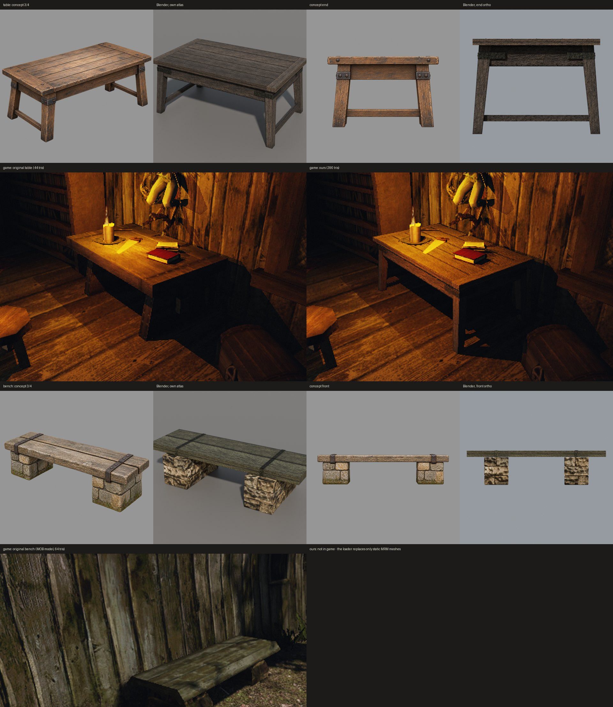

# Стол и лавка по концепту в Blender

Третий и четвёртый предметы нового пути этапа 2, 20 октября 2026 года, после [бочки](../2026-10-barrel-from-concept/README.md) и [ящика](../2026-10-crate-from-concept/README.md). Путь тот же: оригинал → задумка → концепт `image_gen` → модель по частям → свой атлас → стенд. Стол подставлен в игру. Лавку пока подставить нельзя: это модель MOB, а загрузчик GLB подменяет только статичные `.3DS/.MRM` (`Resources::implLoadMeshMain`).

## Оригиналы

[`prop-survey.cpp`](../../../scripts/content/mesh3d/prop-survey.cpp) теперь читает и модели (`.ASC/.MDL`): учитываются все вложения и soft-skin меши MDL. Снова только числа.

**Стол** — `NW_CITY_TABLE_PEASANT_01`, 44 треугольника, 52 копии.
- Текстура — атлас `OBJ_CITY_TABLEPEASANT_01` 512², используется 14%.
- Средний цвет дерева — линейный 0,0407 / 0,0300 / 0,0221. 7% тёмно-серых текселей (0,0212 / 0,0207 / 0,0153) — железо.
- В игре (копия 20448 в доме у гавани, при свече): толстая столешница на глубоком царге, четыре расставленные сужающиеся ножки, железные полосы на стыке ножки и царги.

**Лавка** — `BENCH_NW_CITY_01.ASC`, MOB, 64 треугольника, 43 копии.
- Две текстуры: сиденье — доски пола `NW_CITY_BODENDIELEN_01`, среднее 0,0611 / 0,0578 / 0,0321, серо-оливковое. Опоры — стена `NW_MISC_STRONG_STONEWALL_01`, 0,1012 / 0,0694 / 0,0330.
- В игре (копия 20649 у деревянной стены): толстая плита на двух приземистых опорах.

Опоры лавки каменные, а пилот ждал деревянную раму. Поэтому зоны лавки переопределены в настройках: `OWN_PROP_STONE_PIER` с группой `STONE`.

## Концепты

Свежие треды Codex с `image_gen`, только текст, по четыре вида. В реестре: `mesh3d-pilot-table-v3-{34,front,side,top}` и `mesh3d-pilot-bench-v3-{34,front,side,top}`.

Улучшения к задумке оригиналов:
- **у стола** — доски столешницы с торцевыми досками и гвоздями, царга, расставленные ножки, железные полосы на стыках, нижние перекладины на торцах;
- **у лавки** — сиденье из двух толстых досок на столбах из тёсаного камня в перевязку, железная скоба на каждой доске над каждым столбом.

Концепт стола ниже цели. Стол собран по цели: высота 0,9 м.

## Модели

Общие детали вынесены в [`parts.py`](../../../scripts/content/mesh3d/blender/parts.py): доска, сужающийся брус, камень, Г-уголок, полоса, гвоздь и экспорт с номерами деталей. Ящик собран тем же модулем; его GLB совпал до байта (`4ee56b61…`).

- **Стол** — [`table.py`](../../../scripts/content/mesh3d/blender/table.py) + [`table.json`](../../../scripts/content/mesh3d/blender/table.json):
  - столешница: 5 досок по 6 см между двумя торцевыми досками, под ней тёмная подложка, закрывающая щели;
  - царга 20 см, отступ 6 см;
  - ножки 12 → 9 см, развал 5,1°. Концепт просит 8°, но ноги вышли бы за bbox цели; угол считается сам;
  - перекладины на торцах;
  - на каждой ножке две железные полосы с гвоздями в середине царги. Под самым свесом столешницы их не было видно.

  **390 треугольников**, bbox точный, GLB `e28b66ff…`.
- **Лавка** — [`bench.py`](../../../scripts/content/mesh3d/blender/bench.py) + [`bench.json`](../../../scripts/content/mesh3d/blender/bench.json):
  - два каменных столба по три ряда в перевязку (2 × 3 и 1 × 2 камня), швы по 1 см, тёмный раствор внутри;
  - две доски по 9 см;
  - четыре скобы, загнутые по кромкам доски.

  **552 треугольника**, bbox до 0,2 мм, GLB `e2d7d7d7…`.

Обе сборки детерминированы.

## Атласы

[`table-atlas.json`](../../../scripts/content/mesh3d/blender/table-atlas.json):
- 2048²;
- цвета по замеру стола;
- стол стоит в доме, поэтому водорослей нет: новая настройка `algae` = 0.

[`bench-atlas.json`](../../../scripts/content/mesh3d/blender/bench-atlas.json):
- **сиденье** — та же плитка дерева;
- **камень** — материал этапа 1 `city-3-nw-city-stonewall-02`, неровные камни в растворе. При масштабе 0,4 его мелкие камни повторялись на наших камнях и выглядели пробкой; при 0,15 каждый камень показывает кусок поверхности одного. Слабое место остаётся: нужен материал тёсаного камня без швов, отдельной задачей;
- **железо** — замер обручей бочки.

## В игре

Стол на стенде `own-mesh-table`: тот же дом, та же свеча. Перепись: подменены стол, бочка и ящик (общий индекс `content-staging/mesh3d-props-atlas/`).
- Доски столешницы, торцевые доски, царга, расставленные ножки и полосы читаются.
- Свеча и книги стоят на столешнице: её верх на прежней высоте.
- Оригинал — почти сплошной тёмный короб. Под нашим столом видно пол, как под настоящим.
- Столешница при свече — 0,18 против 0,21 у оригинала, на 14% темнее.

Лавку в игре не показать, пока загрузчик не умеет подменять модели MOB. Это работа в движке: заменить меш модели, сохранив её узлы (точки, где сидят NPC).

## Дальше

- Загрузчик GLB для моделей MOB — лавка, сундук. Решение и задача для движка, отдельно.
- Материал тёсаного камня без швов для каменных деталей.
