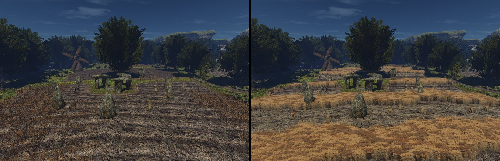
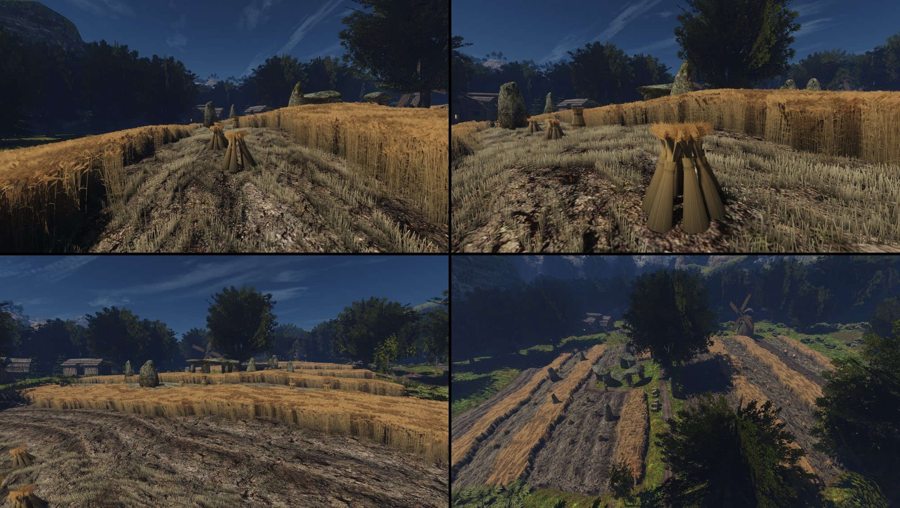

# Посевы на пашнях: исследование и замысел

Дата: 2026-11-19. Исследование без кода, по правилу «Новое — сначала исследование». Посевов как своего типа растительности в проекте ещё не делали.

Откуда вопрос: [образец объёмного слоя травы](../../engine/2026-11-18-grass-volume/README.md#опытный-образец-слоя-за-48-м) показал, что плоскими издалека выглядят не луга, а пашни. Трава там не поможет: на пашне растут хлеба.

**Решение пользователя, 2026-11-19:** образ — «Жатва полосами», пилот на поле Лобарта. Шаг 1 сделан: [карточка замысла](intent.md) и три концепта ([с края поля](concepts/lobart-eye-1.jpg), [сверху](concepts/lobart-over-1.jpg), [крупно](concepts/lobart-close-1.jpg)); концепты приняты пользователем 2026-11-19 («Принимаю, делай»). Шаги 2–4 сделаны первым образцом: [пилот на поле Лобарта](#пилот-поле-лобарта); вид ждёт пользователя.

## Коротко

- **Пашен на острове мало:** 7 полей, 14,7 тыс. м². Два поля Онара дают 9,8 тыс. м², остальные пять — у Лобарта, Секоба и Акила.
- **В оригинале на пашнях уже растёт зерно**, а не репа: 79 куп колосьев, из них 71 у Лобарта, и 13 больших групп рядов у Онара, Секоба и Акила. Репа Лобарта — 25 предметов на земле.
- **Поля Онара засеяны на шестую часть.** Остальное — голая вспаханная земля с копнами соломы. Это предел железа 2002 года, а не замысел: при поле стоит мельница, а Онар кормит город.
- **Близко колосья оригинала читаются полем, сверху и издалека — нет:** купы редкие, между ними видна земля, с 60 м поле выглядит бурым пятном.
- **Система травы для хлебов не годится как есть.** Травинка не выше 60 см, цвет берёт от земли, колоса нет, а в конце кольца трава уходит в землю. Стена хлебов высотой 1,5 м так исчезнуть не может.
- **Предлагаю строить хлеба купами — своими мешами с уровнями детализации**, как ели: ветер листвы, фронт порыва, уровни и импостер уже приняты. Первая проба не требует правок движка.
- **Замысел — жатва:** полосы стоячих хлебов, сжатые полосы со стернёй и снопами, вспаханная земля и ряды репы. Так поле читается издалека лоскутами, а открытые места остаются крестьянам и полевым хищникам.
- **Пилот — поле Лобарта:** 1 200 м² у первой фермы игры, с колосьями оригинала для пары «было | стало».

## 1. Что в игре сейчас

### Перепись

Верхняя поверхность `NEWWORLD`, клетка 2 м, текстуры `NW_NATURE_ACKER_01..04` и переход `WALDBODEN_TRANS_ACKER_01`. База `d8454d28…`.

| Поле | Площадь, м² | Размер, м | Уклон, медиана | Что стоит на нём в оригинале |
|---|---|---|---|---|
| Онар, северное | 5 804 | 112 × 68 | 7° | 9 групп рядов зерна, 8 копен соломы, 9 точек работы крестьян, 4 точки полевых хищников |
| Онар, южное (у мельницы) | 4 040 | 114 × 64 | 6° | 9 копен и снопов, 15 точек полевых хищников, травы и стрелы предметами |
| Лобарт, главное | 1 200 | 40 × 54 | 10° | 60 куп колосьев, изгородь, 14 точек работы |
| Секоб | 744 | 24 × 34 | 6° | 2 группы рядов, 2 снопа, 15 точек работы |
| Акил, нижнее | 512 | 20 × 28 | 9° | 2 группы рядов, 2 снопа, 9 точек работы |
| Лобарт, репа | 424 | 26 × 28 | 10° | 25 реп предметами (`ITPL_BEET`), 11 куп колосьев |
| Акил, верхнее | 316 | 16 × 28 | 9° | 6 копен и снопов, 4 точки работы |

Всего 14,7 тыс. м² против 187 тыс. м² луга. Точек работы `FP_PICK` на полях — 51.

### Из чего сделано зерно оригинала

| Меш | Число в мире | Размер, м | Треугольников | Что это |
|---|---|---|---|---|
| `NW_NATURE_PLANT_03` | 79 | 4,9 × 4,6, высота 1,9 | 112 | купа колосьев из плоскостей с картинкой |
| `NW_NATURE_GREAT_WEED_XGROUP` | 13 | 13,9 × 13,8, высота 2,2 | 56 | группа рядов из той же картинки |
| `NW_MISC_STRAW_01`, `_02`, `_GROUP_01` | 95 | до 1,6 × 3,6, высота до 1,9 | 72–323 | копны и снопы соломы |

Купы у Лобарта стоят через 2–4 м (медиана до соседней — 2,9 м). Картинка одна: золотисто-рыжие колосья на прозрачном фоне, 512 × 512. Земля под ними — три текстуры вспаханной земли и одна со стернёй (`ACKER_02`).

### Как это выглядит

Один прогон [`crop-fields.bench`](../../../scripts/bench/crop-fields.bench): Ryzen, 2560 × 1440, полдень, сегодняшний контент. Шесть кадров: [лист](shots/today.jpg), полные кадры — в `.bench-out/crop-fields/` вне git.

- **Лобарт с края поля.** Колосья выше героя, рыжие, между купами видна земля. Вблизи это поле хлебов.
- **Лобарт с 15 м над полем.** Колосья превращаются в редкую бурую дымку над землёй. Поле читается по изгороди, а не по хлебам.
- **Онар с края поля.** Голая земля до горизонта, полоска колосьев видна только у дальнего края.
- **Онар сверху.** Серо-бурые прямоугольники с точками копен. Рядом луг с травой и деревья выглядят живее поля.
- **Секоб.** Одна полоса колосьев поперёк голого поля.

## 2. Эталон

| Что | Число | Источник |
|---|---|---|
| Высота средневековых хлебов | около 1,6 м; к началу XIX века 1,2 м | [The Land](https://thelandmagazine.org.uk/articles/continuous-grain-cropping) |
| Сев | вразброс, потом борона; рядов нет | [датское исследование](https://core.ac.uk/download/333849203.pdf) |
| Ширина пахотной полосы | от 4,6 до 20 м, чаще 7–9 м; длина до 200 м | [Ridge and furrow](https://en.wikipedia.org/wiki/Ridge_and_furrow) |
| Высота гряды | до 0,6 м у сохранившихся | там же |
| Снопы в суслоне | 6–12, стоят шалашом, колосьями вверх | [Stook](https://en.wikipedia.org/wiki/Stook) |
| Высота стерни под серпом и густота колосьев на м² | источника не нашёл; беру 20–30 см и 200–300 как рабочую оценку | — |

Что делает поле хлебов узнаваемым:

1. **Ровный верх.** Колосья стоят на одной высоте, поле сверху — плотная светлая поверхность, а не кочки.
2. **Волна по верху.** Порыв идёт по полю светлой полосой. Это главный признак в движении.
3. **Стена у края.** С высоты глаз поле кончается стеной стеблей с тёмной глубиной внизу.
4. **Лоскуты издалека.** Полосы разного состояния дают разные тона: золото стоячих хлебов, бледная стерня, тёмная пашня, зелень ботвы.

Оригинал держит только третий признак, и только вблизи.

## 3. Как делают другие

Поиск дал мало первичных источников. Доклады Warhorse (Kingdom Come) и CD Projekt о полях не нашлись; ниже — то, что подтверждено, и общая практика.

- **Купы из плоскостей и стеблей, расставленные системой растительности.** [Поле пшеницы в UE4](https://80.lv/articles/creating-a-realistic-wheat-field-in-ue4) собрано из сканов Megascans. Ветер в три слоя: большая рябь по полю, качание растения и шум на растение. Цвет варьируется по экземплярам.
- **Дальше травинок — шире и реже.** В Ghost of Tsushima на расстоянии рисуют вдвое меньше травинок вдвое шире. Источник вторичный, пересказ доклада GDC 2021.
- **Плотность по карте, дальность уровней отдельной ручкой.** Farming Simulator хранит посевы картой плотности, а дальность уровней посевов настраивается отдельно от дальности рисования. Источники — заметки к патчам и форумы.

Ловушки:

- **Конец дальности виден.** Игроки Witcher 3 [жаловались](https://www.gog.com/forum/the_witcher_3_wild_hunt/the_witcher_3_assets_bad_texture_popping_video), что поля пшеницы и подсолнухов появляются скачком. Высокий посев нельзя убрать по расстоянию: нужен дальний уровень той же высоты и того же тона.
- **Цвет земли под посевом.** Если дальняя земля не равна тону хлебов, конец уровня читается ступенью. У травы это правило D [системы травы](../../engine/2026-11-14-grass-system/README.md).
- **Тонкие стебли мерцают** под временным сглаживанием. У плоскостей с картинкой это лечат уровни текстуры и ширина стебля не меньше пикселя.
- **Высокие хлеба прячут игру:** противников, предметы и самого героя по грудь.

## 4. Что умеет наш движок

| Средство | Что даёт хлебам | Чего не хватает |
|---|---|---|
| Система травы (`grass` в `materials.json`) | густота, ветер, фронт порыва, свет сквозь лист; луг укладывается в 1,5 мс | высота до 60 см (6 бит в записи); цвет — множитель цвета земли, а земля бурая; нет колоса; дернина и кочки не нужны; в конце кольца 48–64 м травинка уходит в землю, а стебель 1,5 м так не спрятать |
| Свои меши слоем предметов с материалом `foliage` | ветер по напору и фронт порыва приняты; так стояли пучки кромки (`rock-grass-tufts`) | расстановку надо построить скриптом |
| Уровни детализации и импостер своих мешей (`levels`) | поле видно на весь остров, цена дальнего уровня — единицы треугольников на купу | уровни меняются жёстко; у ели это принято |
| Свои слои земли (`ground`, `verge`, `track`) | полосы пашни и стерни по месту в мире | полос по маске поля ещё нет: смотреть при постройке |
| Круги предметов в траве | понижение вокруг подбираемого | у мешей такого нет: предметы в хлебах не видны |

Три пути:

1. **Хлеба травинками.** Нужны правки движка: высота, свой цвет, колос, резкий край, дальний уровень с высотой. Близко это лучший вид. Но это вторая система травы поверх принятой, и дальний уровень всё равно придётся делать мешами.
2. **Хлеба купами-мешами с уровнями.** Правок движка для пробы нет. Близко купа из плоскостей проще травинок; это лечится стеблями геометрией в ближнем уровне. Дальний вид и волна даются готовыми средствами.
3. **Смесь:** купы держат массу и даль, а система травы даёт стерню и сорняки на земле пашни обычной записью `grass` с малой высотой.

Предлагаю путь 2, а стерню из пути 3 — вторым шагом, если проба покажет голую землю между полосами.

Оценка цены пути 2, до замера. Стоячие хлеба на половине площади Онара — 4,9 тыс. м². При купе 2 × 2 м это около 1 200 куп. В 30 м от камеры их до 180; при 600 треугольниках ближнего уровня — около 110 тыс. треугольников. Одна ель весит 45 тыс. Остальные купы — на грубых уровнях и импостере.

## 5. Замысел

**Что значат пашни в игре.** Фермы кормят Хоринис, Онар — крупный землевладелец с наёмниками, при его полях мельница. Поле — рабочее место: крестьяне стоят на 51 точке сбора, Лобарт даёт первый квест на репу, на полях Онара живут полевые хищники. Солома в копнах уже лежит на всех полях: в игре время жатвы.

**Образ: жатва в разгаре.** Поле разбито на полосы шириной 7–9 м вдоль борозд:

- **стоячие хлеба** — золотисто-рыжие, как картинка оригинала, высотой 1,3–1,5 м, с ровным верхом;
- **сжатая полоса** — бледная стерня и суслоны по 6–8 снопов;
- **вспаханная полоса** — тёмная земля оригинала;
- **репа** у Лобарта — ряды зелёной ботвы на грядах, предметы квеста остаются на местах.

Почему полосами, а не сплошь:

- издалека лоскуты читаются полем лучше одного тона;
- точки работы крестьян и точки хищников попадают на сжатые и вспаханные полосы, поэтому игра не меняется;
- предметы оригинала остаются на виду;
- стоячих хлебов вдвое меньше, и цена вдвое ниже.

Высота 1,3–1,5 м ниже эталона 1,6 м: герой виден по плечи, и поле не прячет его от игрока.

**Что берём от оригинала:** цвет колосьев, копны соломы, изгороди, расположение полей и точек. **Что не повторяем:** редкие купы на голой земле и пустые поля Онара.

## 6. План и приёмка

| № | Шаг | Что делаем | Очередь Ryzen |
|---|---|---|---|
| 1 | Концепт | лист замысла и концепт `image_gen` поля Лобарта в жатву, по скиллу `object-design` — сделан: [карточка](intent.md), концепты в `concepts/`, полные PNG и промпты в `~/.local/share/gothic-ai/crop-fields/concepts/` | нет |
| 2 | Модели | купа хлебов (ближний уровень и 2–3 грубых), суслон, ботва репы — в Blender | нет |
| 3 | Расстановка | скрипт по переписи: полосы вдоль борозд, точки и предметы оригинала на открытых полосах; набор контента для поля Лобарта | нет |
| 4 | Съёмка | пары «было \| стало» с края поля и с 15 м над ним, клип прохода вдоль поля с порывом | 1 прогон, около 6 минут |
| 5 | Цена | один прогон времени на видах поля: сегодня против пробы | 1 прогон, около 8 минут |

Приёмка по виду — глазом пользователя:

- клип прохода героя вдоль поля и сквозь хлеба, с порывом: волна по верху видна, стебли не мерцают;
- пары кадров с высоты глаз и сверху: поле читается хлебами на 15, 60 и 150 м, смены уровней скачком не видно;
- крестьяне на точках работы и репа квеста видны и доступны.

Предел цены для пробы предлагаю 0,5 мс видеокарты сверх сегодняшнего кадра на видах поля. Число моё, решает пользователь.

После пилота — поля Онара тем же набором, затем Секоб и Акил.

## Пилот: поле Лобарта

Первый образец, 2026-11-19. Набор `crop-field-2` вне git (`~/.local/share/gothic-ai/content-staging/`): копия рабочего контента и посевы поверх. Правок движка нет.

**Что построено.**
- **Карточки** рисует [`crop_cards.py`](../../../scripts/content/mesh3d/blender/crop_cards.py) в Blender из чисел, без сканов и без пикселей оригинала: три ряда ржи по 105–120 стеблей, редкий ряд, две стерни и сноп. Стебель — лента по кривой: соломина, шейка, остистый колос, сухие листья. Дальние стебли ряда темнее, каждый темнеет к корню. Один атлас 2048 × 2048.
- **Меши** собирает [`crop_field_set.py`](../../../scripts/content/crop_field_set.py): ряд ржи — три карточки через 10 см длиной 1,5 м, 24 треугольника; ряд стерни — 4 треугольника; суслон — 6–8 снопов шалашом, 24–32 треугольника.
- **Материалы:** рожь и стерня — листва с ветром (`foliage`, корни на оси X меша), суслоны стоят неподвижно; обе записи двусторонние.
- **Расстановка.** Поле у Лобарта оказалось двумя участками, 712 и 497 м². Каждый режется поперёк длинной оси на полосы около 6,5 м: на первом пашня, рожь, стерня, рожь; на втором стерня, рожь, пашня. Ряды ржи стоят через 30 см вдоль полосы и через 75 см поперёк. В 1,3 м от точек работы и предметов оригинала ржи нет. 60 куп колосьев оригинала на поле сняты слоем.
- **Счёт:** 2 121 добавка, 38 тыс. треугольников на оба участка. Уровней детализации нет: ряд и так дешёвый.

**Съёмка.** [`crop-pilot.bench`](../../../scripts/bench/crop-pilot.bench), Ryzen, 2560 × 1440, полдень. [Пары «было | стало»](shots/pilot-pairs.jpg), [шесть видов](shots/pilot-views.jpg); клип порыва и полные кадры — в `~/.local/share/gothic-ai/crop-fields/pilot-1/` и `.bench-out/crop-pilot-3/` вне git.

**Что вышло.**
- **Сверху поле читается лоскутами:** светлые полосы хлебов, серая стерня, тёмная пашня. У оригинала на том же кадре бурая дымка.
- **С края поля хлеба стоят плотной массой с ровным верхом,** стерня и суслоны читаются с первого взгляда.
- **Цвет в кадре:** освещённый верх хлебов `#8e7145` при цели `#9a7a45`, стерня `#5d533d` при цели `#7a6e4c`.

**Что не так** после одного круга правки (край хлебов, верх, стерня, цвет колоса):
1. **Хлеба вблизи похожи на блок соломы.** Стена у края полосы плоская, верх выглядит причёсанной кровлей. Причина в способе: карточки с нормалями вверх освещены одинаково, отдельных стеблей у края нет.
2. **Хлеба светлее и желтее концепта.** Концепт рыжее и темнее в глубине.
3. **Суслон сбоку похож на связку досок:** сноп из двух скрещённых плоскостей не даёт объёма.
4. **Порыв** наклоняет ряды, но по кадрам клипа волна по верху слабая; глазом клип ведущий не оценивал.
5. **Малое поле с репой** не тронуто.

Второй круг подбором не начат: по правилу двух кругов сначала причина. Что предлагаю, если вид не принят:
- край полосы и ближние 10 м — стеблями геометрией (ближний уровень), карточки оставить массе и дали;
- верх — отдельный слой колосьев с наклоном по ветру вместо торцов карточек;
- суслон — сноп объёмом, 8–12 граней, а не две плоскости.

**Бюджет.** Четыре захода в очередь Ryzen, около 20 минут: первый пропал из-за повторяющихся ключей слоя (ошибка скрипта), один не получил окно. Времени кадра не мерил: шаг 5 плана.

### Второй круг

2026-11-19, по слову пользователя («Да, второй круг»). Набор `crop-field-3`. Круг шёл от причин первого образца, не подбором чисел.

| Причина | Что сделано |
|---|---|
| У края полосы нет отдельных стеблей: стена плоская | последние 90 см полосы — не ряды, а пучки по 7–15 стеблей двумя скрещёнными карточками, 7 на м², реже к краю, часть ниже, редкие оставлены в стерне |
| Сверху видны торцы карточек: «причёсанная кровля» | поверх каждого ряда пять карточек одних колосьев, наклонённых на 42–68° во все стороны |
| Хлеба светлее и желтее концепта | колос и солома темнее и рыжее, корень темнее (0,36 против 0,5) |
| Сноп из двух плоскостей — «связка досок» | сноп — тело в восемь граней от комля до перевясла и веер колосьев тремя карточками |
| Слабая волна | ветер записи 1,4 против 1,0 |

Счёт: 2 505 добавок, 57 тыс. треугольников на оба участка (ряд — 34, пучок — 16, суслон — 324–432).

[Было | первый образец | второй круг](shots/pilot-2-compare.jpg), [шесть видов](shots/pilot-2-views.jpg); клип порыва — `~/.local/share/gothic-ai/crop-fields/pilot-2/`.

**Что вышло.**
- Край полосы стал рваным, с отдельными стеблями и колосьями на фоне стерни; блока соломы с высоты глаз больше нет.
- Верх поля — колосья, а не торцы карточек; цвет рыжее: освещённый верх `#89653a` (первый образец `#8e7145`, цель `#9a7a45`), стерня `#685c43`.
- Сверху поле читается теми же лоскутами.
- В клипе стена хлебов движется: средняя разница кадров через 4 с — 12–16 из 255.

**Что осталось.**
1. **Суслон неровный по качеству.** Объём есть, но у части суслонов тело читается гладким конусом: полоса соломы с картинки растянута вокруг тела. Нужна своя плитка соломы для тела.
2. **Колосья поверх рядов крупны, когда камера стоит в хлебах** (вид `inside`): карточка у объектива размыта.
3. **Земля под хлебами и стернёй — текстура оригинала.** Борозд и гряд нет.
4. **Малое поле с репой не тронуто; цена кадра не мерена.**

**Бюджет второго круга:** один прогон, около 6 минут очереди.

### Проходимость

Рожь, пучки и стерня стоят без столкновения (`collision: none`): герой и NPC идут сквозь них, как сквозь траву; на идущего стебли не отзываются, их колышет только ветер. Суслоны — преграда: с 2026-11-19, по слову пользователя, у них `collision: mesh` (движок знает для добавки слоя только `none` и `mesh`). Набор `crop-field-4`: расстановка та же, что у `crop-field-3`, отличие — столкновение восьми суслонов. В игре проверено ниже.

### Упор в суслон в игре

[`crop-stook.bench`](../../../scripts/bench/crop-stook.bench), набор `crop-field-4`, один прогон на Ryzen: герой бежит 2,5 с с 4 м на суслон `crop-1-01154` и с того же места по трём другим курсам. На суслон он прошёл 3,4 м и встал у снопа; по свободным курсам — 7,1, 8,4 и 8,6 м. Суслон — преграда.

### Цена кадра (шаг 5)

2026-11-19, по слову пользователя («Принимаю, мерь»). `PERF_ENV='OPENGOTHIC_GPU_PASSES=1' scripts/perf-content.sh crop-control crop-field-4 crops`: сценарий [`perf-crops.bench`](../../../scripts/bench/perf-crops.bench), четыре вида съёмки пилота, полдень, 8 с замера на вид, порядок A B B A одной заявкой на одной сборке. A — `crop-control`, копия контента, с которого собран образец (поле как сегодня, с пучками оригинала); B — `crop-field-4`. Время — интервал кадра целиком, не одна видеокарта. Отчёт: `.bench/perf-content-20261119T150420Z-70814/`, на хранилище `/mnt/shared/gothic-ai/perf-content-worktrees/runs/perf-content-20261119T150420Z-70814/`.

| Вид | p50 сегодня, мс | p50 образец, мс | Разница, мс |
|---|---:|---:|---:|
| 1: с края поля | 8,11 | 7,74 | −0,37 |
| 2: с 15 м сверху | 8,64 | 8,29 | −0,35 |
| 3: внутри ржи | 7,85 | 7,69 | −0,17 |
| 4: край полосы | 7,88 | 7,68 | −0,20 |
| все четыре | 8,11 | 7,82 | −0,29 (−3,6 %) |

p95 по четырём видам: 9,35 → 8,76 мс (−6,3 %). Разброс p50 между двумя повторами: 0,008 мс у A и 0,119 мс у B, то есть разница больше шума на трёх видах из четырёх; на виде 3 повторы A расходятся на 0,27 мс, и там разница в шуме. Треугольников на кадр 1,59 млн → 1,77 млн (+177 тыс.), вызовов отрисовки 126,7 → 130,2.

Вывод: образец не дороже поля как сегодня, предел шага 5 (0,5 мс) выдержан. Почему кадр стал короче при большем числе треугольников, не разобрано; вероятная причина — слой убирает с поля пучки оригинала `NW_NATURE_PLANT_03`, большие прозрачные плоскости, но это предположение, по проходам видеокарты оно не проверено.

Чего замер не говорит: оба участка Лобарта — 1,2 тыс. м² и 2,5 тыс. предметов. Поля Онара в восемь раз больше (9,8 тыс. м², по тому же счёту около 20 тыс. предметов и 465 тыс. треугольников), и цену такой расстановки отдельными предметами этот замер не покрывает: её надо снять на первом поле Онара до остальных.

## Поле Онара

2026-11-19, по слову пользователя («Да, поле Онара»). Набор `crop-field-5`: поле Лобарта как в `crop-field-4` (запись в запись) и северное поле Онара — два участка, 2 954 и 3 130 м², точки `578.1,-75.3` и `639.3,-76.4`.

Что изменено в сборщике, [`crop_field_set.py`](../../../scripts/content/crop_field_set.py):
- поле ищется в 80 м от точки, а не в 45 м: участок Онара 55 × 68 м;
- полос до двенадцати, а не до пяти: ширина полосы остаётся около 6,5 м, на участке их восемь;
- с поля убираются и группы рядов оригинала `NW_NATURE_GREAT_WEED_XGROUP` (у Онара убрано 9), как купы `NW_NATURE_PLANT_03`.

Счёт: 11 874 предмета и 264 тыс. треугольников на 6,1 тыс. м²; из них 46 суслонов со столкновением. Менгиры, дольмен и точки работы крестьян стоят как были: вокруг точек и предметов рожь не ставится.

Кадры: [`crop-onar.bench`](../../../scripts/bench/crop-onar.bench), полные — `~/.local/share/gothic-ai/crop-fields/onar-1/`.

**Что видно.** Поле читается полосами ржи, стерни и пашни с суслонами, с высоты глаз между стенами ржи идёт проход по стерне. Сверху полосы на длинном участке прямые, как по линейке: волна края в 0,7 м на длине 68 м не видна. Суслон вблизи — гладкие конусы (известное с пилота). Земля под хлебами — текстура оригинала.

### Цена на поле Онара

`PERF_ENV='OPENGOTHIC_GPU_PASSES=1' scripts/perf-content.sh crop-control crop-field-5 crops-onar`, сценарий [`perf-crops-onar.bench`](../../../scripts/bench/perf-crops-onar.bench), порядок A B B A, p50 кадра целиком, среднее двух повторов. Отчёт: `.bench/perf-content-20261119T163751Z-35819/`, на хранилище `/mnt/shared/gothic-ai/perf-content-worktrees/runs/perf-content-20261119T163751Z-35819/`.

| Вид | Сегодня, мс | Хлеба, мс | Разница, мс |
|---|---:|---:|---:|
| 1: южный край, камера в хлебах | 7,42 | 7,50 | +0,08 |
| 2: с 15 м над западным краем | 7,23 | 7,21 | −0,02 |
| 3: внутри ржи | 7,45 | 7,56 | +0,10 |
| 4: с верхнего восточного края, всё поле в кадре | 8,25 | 8,30 | +0,06 |
| все четыре | 7,49 | 7,56 | +0,07 (+1,0 %) |

p95: 8,73 → 8,72 мс. Разброс p50 между повторами 0,09 и 0,08 мс: разница в шуме, вердикт стенда — «в шуме». Треугольников на кадр 1,11 → 1,27 млн. Предел 0,5 мс выдержан с запасом и на большом поле; расстановка отдельными предметами (12 тыс. на поле) кадр не удлиняет. Камеры видов 1, 3 и 4 встали в рожь или прямо над ней: для цены это худший случай по перекрытию, для вида они не годятся, вид снят отдельным сценарием.

Не мерено: загрузка мира и память с 14 тыс. добавок слоя; южное поле Онара, Секоб и Акил не поставлены.

## Живое поле

2026-11-19, по вопросу пользователя: почему поле выглядит мёртвым и что с этим делать — [исследование](alive.md). Шесть причин; четыре лечатся контентом (земля полос своим мешем, разброс ржи, расстановка, суслоны и следы работы), две — малыми правками движка (волна ветра светом, затенение глубины стены). Проб ещё не было.

2026-11-20: круг шага А на северном поле Онара — [что вышло](alive.md#7-круг-шага-а-что-вышло). Своя земля полос (гряды, подстилка), три тона и разная высота ржи, изгиб полос, недожатая полоса с телегой и снопами, сорняки. Вид ждёт слова пользователя; цена не снята.

2026-11-20: круг шага Б — якорь листвы `field` в движке: [что вышло](alive.md#8-круг-шага-б-что-вышло). Глубина стены ржи затенилась; волна светом слабая (5–11 % яркости), причина разобрана, третий круг ждёт слова пользователя.

## Вопросы пользователю

1. **Образ.** Жатва полосами, как описано, или сплошные стоячие хлеба? — **Жатва полосами** (пользователь, 2026-11-19).
2. **Игра.** Стоячие хлеба скрывают противника ниже 1,3 м. Полосы оставляют хищников на открытом месте. Достаточно ли этого, или хлеба должны быть ниже?
3. **Пилот.** Начать с поля Лобарта, как предложено, или сразу с полей Онара?

## Бюджет

Один прогон стенда, 6 кадров, около 5 минут очереди Ryzen. Времени не мерил.

Замер цены и упор в суслон (2026-11-19): два прогона, около 26 минут Ryzen вместе со сборкой — 6 минут упор, 20 минут цена (четыре запуска игры A B B A). Обещано было около 8 минут: в оценку не вошли сборка стенда и порядок A B B A.

Поле Онара (2026-11-19): четыре прогона, около 23 минут Ryzen — 16 минут цена (A B B A), 5 минут кадры, два прогона по минуте упали: сценарий замера под `bench.sh` не идёт (командам `perf` нужна сборка стенда цены). Обещано было около 30 минут.

2026-11-20: вид сверху — [разбор и технологии](top.md). Сверху рожь читается решёткой и черепицей: плоскости карточек. Три концепта вида сверху; проба мелких прядей разницы не дала. Выбор технологии (колос геометрией, оболочки, дальний вид в земле) ждёт слова пользователя.
