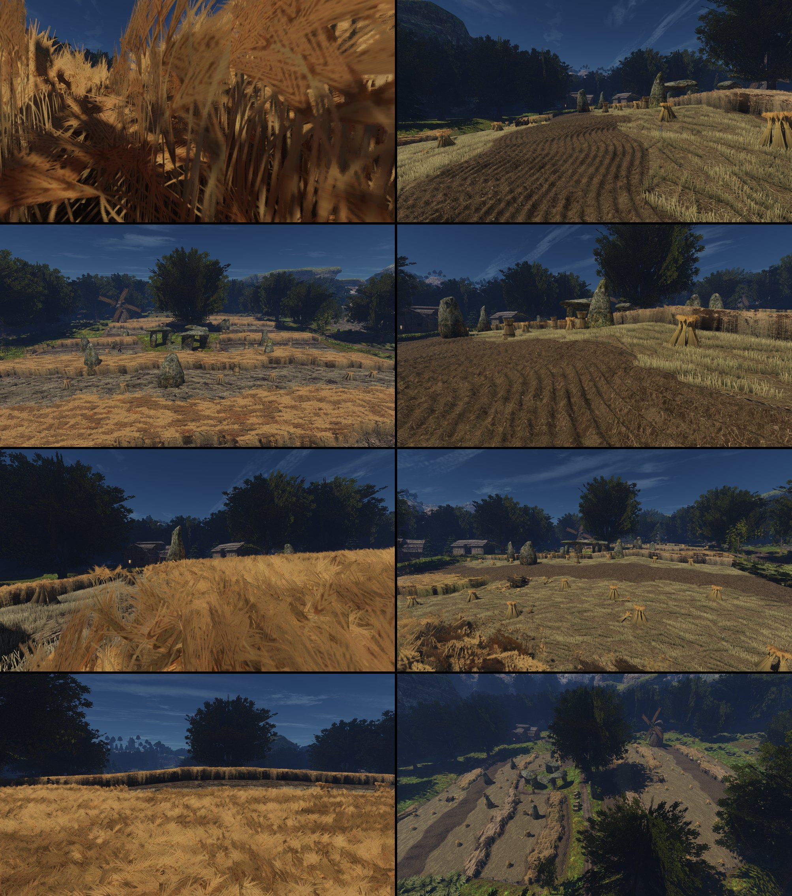
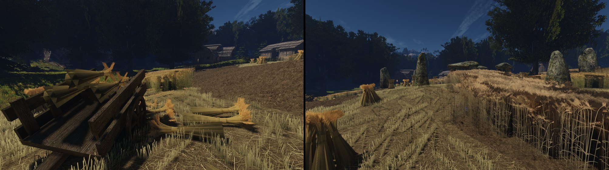
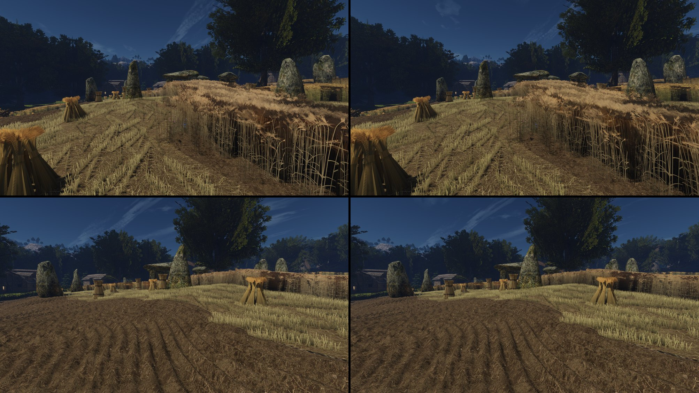

# Живое поле: почему хлеба выглядят мёртвыми и что с этим делать

Дата: 2026-11-19. Исследование без кода и без прогонов, по вопросу пользователя: «как сделать вид полей более живым и настоящим при нашем подходе, и возможно ли это». Основа — кадры [пилота Лобарта](shots/pilot-2-views.jpg) и [поля Онара](shots/onar-views.jpg), принятый [концепт](concepts/lobart-eye-1.jpg), код ветра и света листвы. [Главная заметка](README.md).

## Коротко

- **Возможно.** Способ — ряды и пучки карточек слоем предметов — жизни не мешает. Мёртвым поле делают шесть причин, и пять из них лежат не в хлебах, а вокруг них: земля, свет в массе, однообразие, расстановка по линейке, отсутствие движения и следов работы.
- **Четыре причины из шести лечатся контентом**, без правок движка: земля, разнообразие, расстановка, суслоны и следы работы.
- **Две требуют малых правок движка:** волна ветра сейчас не видна, потому что ветер двигает вершины, а нормаль и свет не меняет; стена ржи плоская по свету, потому что затенение глубины есть только у деревьев.
- **Предел способа:** в полуметре от камеры карточка остаётся карточкой, и на идущего сквозь рожь стебли не отзываются. Второе лечится отдельной правкой движка, первое — нет.

## 1. Что в кадре мёртвое

Мой разбор кадров; глазом пользователя не проверен.

| № | Что видно | Причина | Чем лечится |
|---|---|---|---|
| 1 | **Земля — серая размытая фотография.** Стерня стоит на пёстрой серо-лиловой земле, пашня от земли стерни не отличается. В концепте пашня тёмно-бурая с комьями и бороздами, под стернёй — соломенная подстилка | текстура оригинала 2002 года, растянутая под камерой; одна на все полосы | контент |
| 2 | **Стена ржи светлая сверху донизу.** Глубины нет, верх и стена одного тона. В концепте низ стены тёмный, колосья светятся | нормали карточек на 70 % смотрят вверх (`NORMAL_UP`), чтобы поле светилось одной поверхностью; затенения глубины нет | контент частично, движок |
| 3 | **Рожь — один тон и одна высота.** Верх ровный, как стриженая изгородь; пятен, полёглых мест, сорняков нет | три карточки ряда одного цвета, одна высота, один материал | контент |
| 4 | **Полосы по линейке, углы блоков прямые.** Сверху поле — штрихкод; край ряда виден ступенькой в 1,5 м | полосы равной ширины с прямыми границами; ряд — прямой отрезок | контент |
| 5 | **Поле стоит.** Ряды клонятся, но волна по верху не читается; на героя рожь не отзывается; нет пыли, насекомых, птиц | ветер не меняет свет (ниже, раздел 4); отклика на тело нет; частиц на поле нет | движок, контент |
| 6 | **Жатва без жнецов.** Суслоны — гладкие конусы одной формы; нет снопов на земле, валков, брошенного серпа, телеги | суслон — тело с растянутой полосой картинки; предметов работы не ставили | контент |

Цвета не в одном семействе: рожь рыжая, стерня серо-зелёная, земля лиловая. В концепте всё поле — в тёплой соломенной гамме, тёмная только пашня.

## 2. Эталон

| Что | Число | Источник |
|---|---|---|
| Пятно волны на хлебах | 15–20 высот стебля: при 1,5 м это 22–30 м | [Py, de Langre, Moulia, JFM 2006](https://yakari.polytechnique.fr/Django-pub/documents/py2006rp-1pp.pdf), со ссылкой на замеры в ячмене |
| Скорость волны | 1,8 скорости ветра у верха хлебов (пшеница, Finnigan 1979) | там же |
| Частота качания | совпадает с собственной частотой стебля; пример 1,05 Гц при высоте 0,69 м (культура в найденном не названа) | [Finnigan 1979](https://ui.adsabs.harvard.edu/abs/1979BoLMe..16..181F/abstract), [Dupont и др., JFM 2010](https://yakari.polytechnique.fr/Django-pub/documents/duponts2010rp-1pp.pdf) |
| Чем волна видна | не сдвигом стеблей, а сменой света: наклонённые колосья отражают иначе, по полю бежит светлое пятно | общее знание, источника с числом не нашёл |
| Рожь старых сортов | генетически заметно разнообразнее нынешних сортов — поле неровное по высоте и тону | [iScience 2025](https://doaj.org/article/20c4b3ede1b646d2adf19a9d0d026592) |
| Сорняки средневекового поля | василёк и пупавка «очень характерны», куколь; василёк и костёр ржаной — спутники озимых | [ScARF](https://scarf.scot/regional/pkarf/9-palaeoenvironment-and-science/9-4-archaeobotany/9-4-7-medieval/), [Leiden](https://scholarlypublications.universiteitleiden.nl/access/item%3A2860234/download) |
| Форма полосы | гряды и борозды, полосы слегка изогнуты (обратная S от разворота упряжки) | [Ridge and furrow](https://en.wikipedia.org/wiki/Ridge_and_furrow) |

Не нашёл: долю сорняков в поле, долю полёглых мест, частоту качания именно ржи высотой 1,5 м. Ниже для них стоят мои рабочие оценки, а не замеры.

## 3. Как делают другие

- **Ветер в три слоя и тон от места.** [Поле пшеницы в UE4](https://80.lv/articles/creating-a-realistic-wheat-field-in-ue4): крупная рябь по полю, качание растения, шум на растение — автор добавил третий слой, потому что близкие растения двигались «совершенно одинаково». Оттенок растения берётся из его места в мире. Борозды сделаны материалом земли. В воздухе летят частицы-соломинки, тени от хлебов движутся.
- **Один ветер на всё и свет толщины.** Ghost of Tsushima: общий ветер из двумерного шума, из травы выводятся просвет и затенение, чтобы масса читалась толщиной; метёлки пампасной травы — модели художников поверх процедурной травы ([блог PlayStation](https://blog.playstation.com/?p=345372); пересказы доклада GDC 2021 вторичны).
- **Отклик на тело.** CryEngine (движок Kingdom Come): трава в ячейках 16 м гнётся ветром, кусты и папоротники отжимаются игроком и NPC — [Touch Bending](https://cryengine.com/docs/static/engines/cryengine-3/categories/1114113/pages/1310750), [Merged Meshes](https://cryengine.com/docs/static/engines/cryengine-5/categories/23756816/pages/24285892). Как сделаны именно поля Kingdom Come 2, первичного источника не нашёл.
- **Жизнь — не только растение.** В Horizon Zero Dawn «экотоп» места задаёт вместе виды растений, их окраску, эффекты, звук и живность ([слайды GDC 2017](https://www.guerrilla-games.com/media/News/Files/GDC2017_VanMuijden_GPUBasedProceduralPlacementInHorizonZeroDawn.pdf)).

Общий вывод: у других поле оживляют не более подробным колосом, а четырьмя вещами — видимой волной, разбросом тона и высоты, землёй своего материала и мелочью вокруг (частицы, тени, сорняки, предметы).

## 4. Что умеет наш движок

| Нужно | Что есть | Пробел |
|---|---|---|
| Волна, видимая светом | у травы есть: порыв наклоняет нормаль и светлит тон (`GrassNormalLean`, `GrassLeanSheen`, [`grass_ground.glsl`](../../../OpenGothic/shader/grass/grass_ground.glsl)) | у листвы-пучка (`foliage`, якорь «линия») ветер двигает только вершины, нормаль стоит ([`vertex_process.glsl`](../../../OpenGothic/shader/materials/vertex_process.glsl), «The normal stays»). Рябь — 12,5 % наклона (`FoliageWaveSwing`), наклон не больше 17°. Длина волны 24 м с эталоном совпадает |
| Тёмная глубина стены | [свет кроны](../../engine/2026-11-16-modern-trees/crown-light.md): затенение по открытости из цвета вершины, у ели дало контраст вдвое | включён только у `"anchor": "tree"` (`crownlight.h`) |
| Своя земля под полосой | слои земли `ground` и колея `track` | слой привязан к текстуре оригинала, а не к полосе: у пашни и стерни текстура одна. Обход контентом — свой меш земли, уложенный по рельефу |
| Стерня и сорняки геометрией | система травы: травинки до 60 см, ветер, понижение у предметов | запись травы действует на всю текстуру `ACKER`, по полосам не делится; цвет травинки — от земли |
| Отклик на героя | — | нет ни у травы, ни у листвы |
| Пыль, мошки, соломинки | добавка слоя `kind: emitter` с записью частиц | своих записей частиц для поля нет; есть ли подходящая готовая, не проверял |
| Звук поля | — | слой предметов звука не добавляет (`mesh`, `light`, `emitter`) |
| Разброс тона на предмет | — | цвета на добавку слоя нет; обход — два-три материала одного атласа с разным тоном |

## 5. Меры по отдаче

Отдача — моя оценка по кадрам и эталону, до проб.

**Шаг А. Контент, без движка, один круг на северном поле Онара.**

1. **Земля полос своим мешем.** Сборщик уже знает треугольники поля. Он укладывает по рельефу ленту земли на 2–3 см выше: пашня — тёмная, с грядами и комьями настоящей геометрией (гряда 10–15 см, шаг около 30 см), стерня — соломенная подстилка. Край ленты рваный, с переходом в луг. Это снимает причину 1 и половину причины 4. Риск: мерцание двух поверхностей вдали и шов с землёй оригинала — смотреть на кадрах.
2. **Разброс ржи.** Высота пятнами 5–10 м (±15 см), три тона одного атласа (спелый, бледный, с прозеленью) пятнами, полёглые места на 3–5 % площади рядами под 40–70°, редкие проплешины. По краю и пятнами внутри — василёк, пупавка, куколь, чертополох у изгороди: карточки в тот же атлас.
3. **Расстановка.** Полосы разной ширины (5–9 м) с лёгким изгибом, ряды по кривой, а не отрезками одной длины. Одна полоса сжата не до конца: рваный фронт жатвы, за ним несвязанные валки и снопы на земле, дальше суслоны.
4. **Свет в массе, что можно без движка.** Нормали ближе к своим у края и у стены (доля «вверх» 0,4 вместо 0,7), внутренние ряды темнее атласом, корень темнее. Цвета стерни и земли — в гамму концепта.
5. **Суслоны и работа.** Суслон с соломинами по силуэту и своей плиткой соломы, три разных наклона, один упавший сноп. У точек работы — серп, грабли, кувшин, тележка со снопами из готовых предметов мира.

Цена: модели и сборщик — без очереди; съёмка — 2 прогона, около 12 минут Ryzen (кадры и клип). Замер цены — один прогон, около 16 минут, после приёмки вида.

**Шаг Б. Малые правки движка — код шейдеров, делает Claude.**

6. **Волна светом.** Листве-пучку: наклон нормали по ветру и осветление наклонённого, как у травы; для хлебов рябь крупнее (поле записи материала). Приёмка — клип с верхней точки: светлое пятно 20–30 м идёт по полю.
7. **Глубина стены.** Затенение по цвету вершины и для якоря «линия»: корень и внутренние ряды в тени, колосья открыты.

Цена: два прогона, около 12 минут; замер цены вместе с шагом А.

**Шаг В. Отклик на героя** — стебли расходятся в 60 см от тела и сходятся за ним. Нужны позиции героя и ближних NPC в вершинном шейдере листвы. Больше остальных правок; делать после А и Б, если поле с волной всё ещё кажется декорацией.

**Не предлагаю сейчас:** жнецов с анимацией жатвы, убывание хлебов по дням, вытоптанные следы — это правила игры, а не вид; стебли геометрией в ближнем уровне — дорого, а кадры показывают, что беда не в колосе.

## 6. Приёмка

Вид принимает пользователь, по паре «сейчас | стало» с четырёх точек съёмки Онара и по клипу: 10 с с верхней точки на порыве и 10 с прохода героя вдоль стены ржи. Стоп-кадром движение не принимается.

Если круг шага А не принят — второго круга подбором нет: сначала причина.

## 7. Круг шага А: что вышло

2026-11-20, по слову пользователя («Да, шаг А»). Набор `crop-field-7` (вне git): только северное поле Онара, два участка. Сборщик — [`crop_field_set.py`](../../../scripts/content/crop_field_set.py), числа и карты круга — [`crop_field_life.py`](../../../scripts/content/crop_field_life.py), карточки сорняков — в [`crop_cards.py`](../../../scripts/content/mesh3d/blender/crop_cards.py).

**Что сделано.**

- **Земля.** У каждой полосы свой меш на 4 см над землёй оригинала: пашня — гряды геометрией (шаг 31 см, высота 12 см), под стернёй — подстилка из резаной соломы, под рожью — земля. Земля — слой земли луга, сведённый к тёмно-бурому; подстилка нарисована из чисел, солома закрывает 27 % плитки. 67 кусков, 127 тыс. треугольников.
- **Рожь.** Три тона одного атласа пятнами (спелый, бледный, с прозеленью — три карты цвета, одна раскладка), высота пятнами 5–10 м (ряд ниже до 30 см), 13 полёглых пятен (наклон 30–55°), 19 проплешин. Ряды у края полосы освещены больше своей нормалью (доля «вверх» 0,4).
- **Расстановка.** Полосы 4,7–8,1 м, изгиб плавной S на 1,7–2,0 м, ряды идут по изгибу. На каждом участке одна полоса недожата: рваный фронт, за ним валки, лежащие снопы, дальше суслоны.
- **Следы работы.** 55 лежащих снопов, 16 валков, телега оригинала со снопами на каждом участке, грабли и серп. У снопа тело тоньше, а карточки идут во всю длину: солома выходит за силуэт. Суслоны стоят с наклоном до 7°.
- **Сорняки.** Свой атлас: василёк, куколь, пупавка, чертополох — 699 пучков по краям ржи, в проплешинах и по меже.
- **Цвет.** Рожь, стерня и снопы сведены в одну соломенную гамму. В первом прогоне рожь ушла в розовый (убрал насыщенность, а нужен был сдвиг к жёлтому) — поправлено во втором.

Счёт: 11 596 предметов и 351 тыс. треугольников против 11 874 и 264 тыс. в `crop-field-5` на тех же участках.

**Что видно на кадрах.** Гряды пашни и подстилка читаются с высоты глаз и сверху, серо-лиловой текстуры нет. Сверху полосы идут дугой и разной ширины. У стены ржи видна глубина и неровный верх.

**Что не вышло или не проверено.**

- **Сорняки на кадрах почти не видны**: тонкие стебли и цветы в 2–4 см теряются с 5 м. Нужны либо крупнее и гуще у края, либо ближний кадр.
- **Клип порыва** снят с точки, где в кадре больше стерни, чем ржи: волны на нём не видно. Это и так дело шага Б, но точку клипа надо менять.
- **Снопы в телеге** темнее лежащих на земле, на телах видны треугольники тени.
- **Полёглые пятна** вблизи читаются как смятая рожь, но с высоты глаз у края полосы выглядят неряшливо.
- **Край поля** к лугу остался прямым: рваного перехода нет.
- **Мерцания** двух поверхностей на кадрах не видно; в движении вдали не смотрел.
- **Цена не снята** — по плану после приёмки вида, один прогон около 16 минут.

Съёмка: [`crop-onar-alive.bench`](../../../scripts/bench/crop-onar-alive.bench), два прогона на Ryzen, как и обещано. Полные кадры и клипы (`gust`, `walk`) — `~/.local/share/gothic-ai/crop-fields/onar-alive-1/`.

## 8. Круг шага Б: что вышло

2026-11-20, по слову пользователя («давай б»). Набор `crop-field-9` (вне git), те же два участка Онара.

**Что сделано в движке.** У записи `foliage` третий якорь, `"anchor": "field"` — ряд поля хлебов:

- качается как пучок (`line`), но рябь двух бегущих волн на наклоне глубже: 0,6 + 0,4 вместо 0,875 + 0,125, гребень тот же, границы меша не меняются;
- получает затенение глубины, как крона ели (`BK_CROWN`): открытость вершины из альфы `COLOR_0`. Карточки сборщика несут её: у корня внутреннего ряда 0,1, у края полосы 0,4, наверху 0,68–0,74;
- **волна светом:** там, где рожь ложится (гребень волны, сильнее в порыве), нормаль вершины наклоняется против ветра (тангенс до 0,5), а открытость растёт (до +0,32). Считается по месту ряда, в вершинном шейдере ([`foliage_wind.glsl`](../../../OpenGothic/shader/materials/foliage_wind.glsl), `foliageFieldLight`).

Сорняки остались на якоре `line`. Тест `gothic-material-texture-test` на Ryzen прошёл (запись с `field`, тень кроны для неё).

**Что видно.**

- **Глубина стены получилась:** низ стены и внутренние ряды в тени, колосья светлее. Это видно на паре.
- **Волна светом слабая.** По клипу сверху яркость ржи меняется на 5–11 % (стерня рядом — на 1,5 %), и полоса светлеет и темнеет почти вся разом, а не бегущим пятном. Второй прогон, с усиленными числами, дал то же: 5–11 %.

**Почему волна слабая — разбор, без третьего прогона.**

1. Свет волны идёт через тень кроны, а она умеет только снимать затенение, не добавлять свет. Верх ржи открыт на 0,7, чтение открытости обрезает верхнюю десятую (`CrownOpenTop` 0,9), пол тени 0,25. Отсюда расчёт: тень верха 0,83 в ложбине и 1,0 на гребне порыва, между порывами 0,86–0,93. Это 8–17 % между гребнем и ложбиной — столько и намерено. Числа были выбраны робко; довести до 30 % этим каналом можно, только затемнив спокойное поле на треть.
2. Полосы ржи узкие (5–8 м), а длина главной волны 24 м: на полосе в 55 м помещаются два гребня, и глаз видит не бегущее пятно, а мигание.
3. Наклон нормали при полуденном солнце над головой почти не меняет свет: у стерни с тем же материалом — 1,5 %.

**Что из этого следует.** Волне нужен свой канал осветления, а не снятая тень (как `GrassLeanSheen` у травы: множитель тона), и проверять её надо на сплошном поле ржи и при низком солнце, а не на узких полосах в полдень. Это третий круг — по правилу он начинается с этого разбора и слова пользователя, а не с подбора чисел.

Съёмка: [`crop-onar-wave.bench`](../../../scripts/bench/crop-onar-wave.bench), два прогона на Ryzen, как обещано; сборка и тест — ещё одна заявка. Кадры и клипы (`gust-over`, `gust-wall`) — `~/.local/share/gothic-ai/crop-fields/onar-wave-1/`. Цена шагов А и Б не снята.
