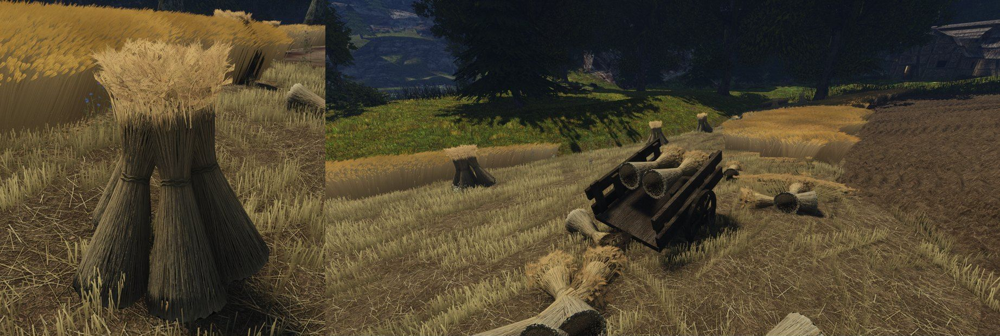

# Свой сноп: современное исполнение

Пользователь, 2026-11-20: снопы оригинала выглядят лучше наших первых, но это не значит, что свои не нужны — их надо сделать современными. Заметка — замысел, способ и что вышло. Вид ждёт слова пользователя.

## Почему первый свой сноп проиграл оригиналу

- **Наш (шаг А):** тело в восемь граней с плоской картинкой соломы и веер из трёх карточек колосьев, подкрашенных в рыжий. Тени между соломинами нет, рельефа нет, верх читался рыжими хлопьями.
- **Оригинал (`NW_MISC_STRAW_02`):** грубая форма, но на текстуре тёмные щели между соломинами, перевясла и неровный верх. Он читается нарисованным контрастом. Сам сноп при этом вдвое больше настоящего: 1,9 м высотой и 1,2 м в основании.

## Как это выглядит в жизни

- Сноп ржи — охапка стеблей длиной около 1,2–1,4 м, перевязанная жгутом из той же соломы (перевясло) выше середины; комли расходятся, колосья наверху.
- Снопы сушат в суслонах: 5–12 снопов ставят шалашом, колосьями вверх и друг к другу ([Stook](https://en.wikipedia.org/wiki/Stook)). Отдельно стоящий сноп — редкость, лежащий — только что связанный.
- Цвет: солома бледнее стоящей ржи, колос того же тона, что на поле.

## Способ

1. **Модель из соломин.** [`sheaf_model.py`](../../../scripts/content/mesh3d/blender/sheaf_model.py) в Blender строит сноп как он связан: 900 соломин от расходящихся комлей через талию под перевяслом из двух жгутов к раскрытому верху, короткие концы заполняют оба торца, внутри тёмная сердцевина. Высота тела 1,1 м, радиус комля 24,5 см, талии 8,6 см.
2. **Тело для игры** — тело вращения в 14 граней вокруг этой модели с крышками на торцах, 224 треугольника. Цвет, рельеф (карта нормалей) и тень между соломинами (AO) запечены на него с соломин, атлас 1024 × 1024.
3. **Колосья** — две карточки верхушек стеблей с шейками и колосьями (`crop_cards.ears`), запечены в тот же атлас и приведены к тону колоса ржи на поле (`#9a7a45`). Сборщик ставит девять карточек кольцом вокруг верха с наклоном наружу и три в середине. Сноп целиком — 248 треугольников.
4. **Расстановка** ([`crop_field_set.py`](../../../scripts/content/crop_field_set.py)): суслон — пять или шесть снопов, наклонённых головами друг к другу (три варианта); лежащий сноп и снопы в телеге — тот же сноп на боку. Снопы оригинала на полях (`NW_MISC_STRAW_02`, 21 штука) убираются слоем, на их месте встаёт наш суслон: дублей нет. Тюки оригинала (`_01`, `_GROUP_01`) остаются, наш сноп не ставится ближе 2,5 м к ним.
5. **Материал** `OWN_CROP_SHEAF`: цвет с вырезом, нормали, ORM; средний цвет тела — `SHEAF_MEAN`, на шаг бледнее стоящей ржи. Тень между соломинами заложена и в цвет: издалека сноп читается ею.

Концепт `image_gen` не делался: предмет простой, эталон — настоящий сноп и суслон.

## Что вышло

Набор `crop-field-17` (вне git): 140 суслонов и 107 лежащих снопов на девяти участках, 94 предмета оригинала убраны (73 купы колосьев и 21 сноп). Один прогон [`crop-sheaf.bench`](../../../scripts/bench/crop-sheaf.bench) на Mac, кадры в `.bench-out/sheaves-5/`.

- Суслон читается: соломины с тенью, перевясло, светлый венец колосьев в тон полю.
- За три прогона поправлено: тело было темнее стерни (средний цвет поднят), торец лежащего снопа был чёрной дырой (сердцевина убрана вглубь за концы соломин), по краям карточек колосьев шли тёмные линии (ячейки отодвинуты от тела в атласе).

## Не сделано

- Венец лежащего снопа с теневой стороны уходит в тёмно-бурый: нормали карточек смотрят в землю.
- Силуэт тела гладкий: отдельных соломин, выбившихся из снопа, нет.
- Снопы в телеге длиннее её кузова и лежат без просадки.
- Кадры — Mac, без лучей; на Ryzen не снято. Цена не мерилась: 140 суслонов по 1 240–1 488 треугольников против прежних 24–32.
- Ячейка старого снопа осталась в атласе карточек ржи, её никто не читает.
- В рабочий контент не включено.
