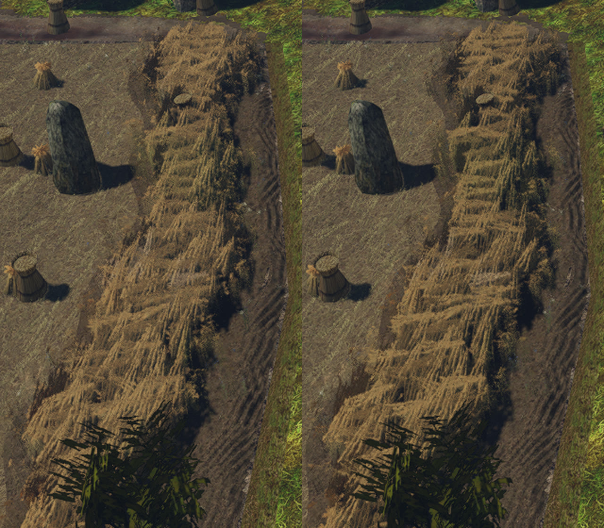

# Поле хлебов сверху: почему решётка и чем её заменить

2026-11-20. Пользователь по кадру с высоты: «колосья вдали выглядят странно», попросил концепт вида сверху и
предложил попробовать другие технологии. Продолжение [«Живого поля»](alive.md).

## 1. Что не так сейчас

Рожь собрана из карточек ([`crop_field_set.py`](../../../scripts/content/crop_field_set.py)): ряд — три вертикальные
карточки 1,5 × 1,6 м и пять наклонных «листов» колосьев 75 × 40 см поверх. Ряды стоят через 30 см, поперечные — через
75 см. Уровней детализации нет.

- **Вертикальная карточка сверху не имеет площади.** С высоты от неё остаётся линия; ряды и поперечные ряды дают
  решётку с шагом 30 × 75 см.
- **Листы колосьев читаются черепицей.** На лист нарисовано 22–30 колосьев сбоку. Положенный под 42–68° лист виден
  сверху плоскостью 75 × 35 см с полосатой картинкой; на квадратный метр таких листов около двенадцати, и они
  ложатся внахлёст.
- **Глаз ждёт другого.** Настоящая рожь сверху — ворс из тысяч колосьев, склонённых в одну сторону, с прядями
  ветра и пятнами полегания; плоскостей в ней нет.

## 2. Цель: концепты

Три концепта `image_gen` по цветам сцены (вне git, `~/.local/share/gothic-ai/crop-fields/concepts/`, промпты рядом
в `q-top-*.md`):

| Файл | Вид | Что задаёт |
|---|---|---|
| `onar-top-high-1` | с 10 м вдоль полосы, ракурс кадра пользователя | ворс без просветов земли, пряди ветра 2–5 м, пятна полегания, рваный край с тенью у подножия |
| `onar-top-plan-1` | план с 35 м | полосы как бархат с ворсом: облачные пятна тона, тёмная кайма с теневой стороны, ни рядов, ни сетки |
| `onar-top-near-1` | с 3 м у края | вблизи различим каждый колос, дальше они сливаются в ворс |

Концепты пользователь ещё не принимал.

## 3. Как решают другие

Исследование по открытым источникам; первичных докладов Ghost of Tsushima и Horizon прочитать не удалось, их
числа — из пересказов.

| Приём | Кто | Сверху и вдали | Цена и ловушки |
|---|---|---|---|
| Стебель геометрией, экземплярами по клеткам с уровнями | Ghost of Tsushima | плоскостей нет вовсе | 83 тыс. травинок за 2,5 мс на PS4; смена уровня видна без перехода |
| Вдаль — меньше стеблей, но шире | Ghost of Tsushima | покрытие не редеет | нужен плавный переход вершин |
| Дальний вид в земле: земля под посевом берёт картинку посева | Ghost of Tsushima, Farming Simulator | тёмных просветов нет, поле не кончается кольцом | тон и яркость должны совпасть с ближним видом, иначе ступень |
| Наклон карточек, когда камера смотрит вниз | Horizon Zero Dawn | закрывает просветы | только вершинный шейдер |
| Альфа, сохраняющая покрытие в мипах | NVTT, Unity | карточки не редеют вдали | у нас уже так (`glb_cards.write_cutout`) |
| Нормали вверх | общая практика | плоскости не светятся порознь | у нас уже так (`NORMAL_UP 0,7`) |
| Слои-оболочки (shell) с рёбрами (fin) | мех в играх Nintendo | сверху хорошо, сбоку видны слои | перерисовка растёт с числом слоёв; на полях готовых примеров не нашлось |

Farming Simulator для пшеницы: густая геометрия до 18 м, редкая до 80 м, дальше — текстура земли своя на каждую
стадию роста. Ни одна из найденных игр не оставляет вертикальные карточки видом сверху.

## 4. Что умеет наш движок

| Средство | Что есть | Чего нет |
|---|---|---|
| Система травы ([проект](../../engine/2026-11-14-grass-system/README.md)) | экземпляры травинок в кольце 48 м, ветер, фронт порыва, осветление лежащей травы, дальний вид земли, уровни по звеньям; луг — до 1,4 мс | высота до 60 см, колоса нет, цвет от земли; растёт только на ландшафте по текстуре, а полосы поля — свои меши |
| Свои меши с `foliage`, якорь `field` | ветер, глубина стены, свет сквозь лист | всё поле — 350 тыс. треугольников без уровней |
| Уровни своих мешей (`levels`) | приняты у елей | смена уровня жёсткая |
| Земля полос своим мешем (шаг А) | сборщик знает полосы и кладёт на них любой материал | — |

## 5. Технологии на выбор

1. **Колос геометрией** — рожь рисует система травы: стебель до 1,4 м с колосом на конце, свой цвет, рост по
   полосам поля, дальний вид в земле. Совпадает с концептом и вблизи, и сверху; волна порыва светом у травы уже
   есть. Это работа в движке на несколько дней и новая цена кадра: её надо мерить на сплошном поле.
2. **Оболочки** — 4–8 горизонтальных слоёв над землёй полосы с картинкой колосьев сверху, по краю полосы остаются
   карточки-стена. Только контент и немного шейдера; сверху даёт ворс, но с роста человека слои видны полосами, а
   перерисовка растёт.
3. **Мелкие пряди на карточках** — прежние ряды, но вместо пяти листов шестнадцать прядей по 12 см и 3–5 колосьев.
   Только сборщик. Проба — в разделе 6.
4. **Дальний вид в земле** — земля полосы ржи вдали берёт тон и картинку ворса, а карточки дальше 60–80 м не
   рисуются. Нужен при любом из путей 1–3: он убирает тёмные просветы и цену дальнего поля.

## 6. Проба: мелкие пряди

Набор `crop-field-10` (вне git), один прогон `crop-onar-top` на Ryzen, кадры —
`~/.local/share/gothic-ai/crop-fields/onar-top-1/`.

**Разницы нет.** Полоса с 30 м выглядит так же: те же косые плоскости внахлёст. Значит, «черепицу» дают не листы
колосьев, а сами ряды: вертикальные карточки шириной 1,5 м с картинкой стеблей сбоку. При взгляде под 30–50° к
земле каждая видна плоскостью, а стоят они через 30 см. Пряди поверх них теряются.

Правка сборщика в код не вошла. Камеры `high`, `plan` и `near` нового стенда попали на пашню и стерню, а не на рожь:
их надо переставить перед следующей съёмкой.

**Вывод.** Правкой карточек вид сверху не лечится: плоскость стеблей остаётся плоскостью. Нужен путь 1 или 2 из
раздела 5, и при любом — путь 4. Предложение ведущего — путь 1 с путём 4: так делают игры из раздела 3, система
травы уже умеет волну порыва светом (то, что не вышло в [шаге Б](alive.md)), и цена дальнего поля уходит в землю.
Выбор — за пользователем.

## 7. Приёмка следующего шага

- Пары «концепт | игра» с тех же трёх высот (3, 10, 35 м) над рожью, один прогон.
- Клип порыва сверху: вид движения принимается по клипу, не по кадру.
- С роста человека стена ржи не хуже принятой в шаге А.
- Цена — одним общим замером после слияния, на сплошном поле.
