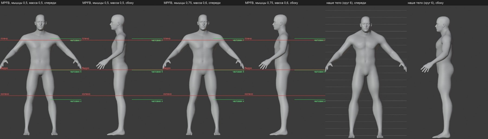
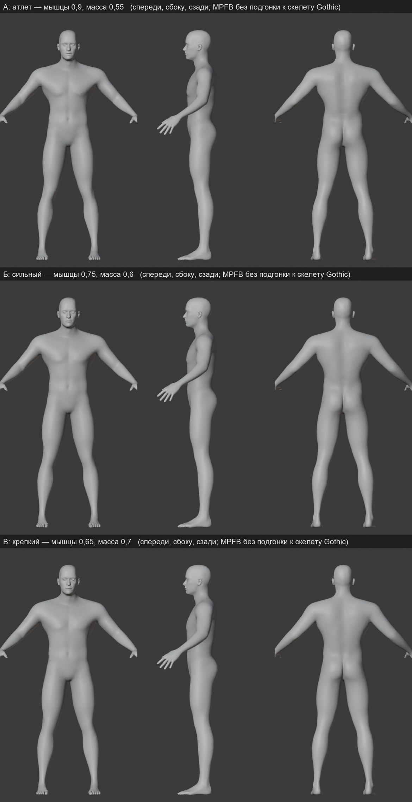

# Гармоничная мужская фигура: исследование

2026-11-08. Пользователь не принял круг 6 голого тела ([пилот](naked-body.md)): фигура «не очень гармоничная». Это второй непринятый круг пропорций после круга 2, поэтому по правилу проекта подбор остановлен. Сначала — исследование: как устроена гармоничная фигура, как её делают в Blender и что мешает нам.

## Коротко

Объёмы — не главное. Фигуру ломают три вещи:

1. **Колено Gothic стоит на 5–8 см выше человеческого.** Бедро выходит на 12% короче, голень на 12% длиннее. Мы сажали суставы MPFB на скелет Gothic, и тело переняло эту пропорцию: короткие толстые бёдра на длинных голенях.
2. **Мои местные правки поверх макросов MPFB.** Макросы MPFB сами по себе дают согласованное тело. Двадцать местных целей — V-силуэт, кольца обхвата, самодельная трапеция — эту согласованность разрушают. Круги 2–6 подбирали именно их.
3. **Подгонка шеи и торса сплайном.** Шея уходит назад до 8 см.

Родной человек MPFB без подгонки к скелету выглядит гармонично при любом сложении (листы ниже). Значит, путь такой: сложение — только макросами MPFB, а колено — решить на стороне скелета.

## Как устроено на деле

**Антропометрия.** Доли роста H у взрослого мужчины, по таблице Drillis–Contini (1966) в пересказе Winter, *Biomechanics and Motor Control of Human Movement*. Цифры приведены по памяти: поиск подтвердил источник, но не таблицу. Поэтому рядом стоит независимая сверка — родной человек MPFB с идеальными пропорциями, ростом 174 см.

| точка | доля H (Winter) | MPFB, родной | Gothic, H ≈ 184 |
|---|---|---|---|
| тазобедренный сустав | 0,530 | 0,541 | 0,543 |
| колено | 0,285 | 0,298 | **0,330** |
| лодыжка | 0,039 | 0,041 | узел стопы 0,068, на 5 см выше лодыжки |
| бедро, сустав — колено | 0,245 | 0,243 | **0,214** |
| голень, колено — лодыжка | 0,246 | 0,257 | **0,288** |

Рост героя Gothic — оценка. Узел головы на 161,2 см, плюс около 23 см черепа. При росте 180–186 см колено выше человеческого на 5–8 см. Таз, плечи, локти и запястья Gothic близки к человеку.

**Канон художников.** Идеальная фигура Лумиса — около 8 голов ([Proko](https://www.proko.com/course-lesson/human-proportions-idealistic-figures/notes)):
- соски на голову ниже подбородка, пупок ещё на голову, пах ещё на одну — середина роста;
- колено около 6-й головы;
- плечи шириной 2⅓ головы, таз — 1,5.

Реалистичный «средний» человек — 7,5 головы ([Proko, средняя фигура](https://www.proko.com/human-figure-proportions-average-richer)).

**Что делает фигуру гармоничной** (сводка разборов скульпторов: [Creative Bloq, советы Scott Eaton](https://www.creativebloq.com/10-anatomy-tips-3d-artists-3113091), разборы на [Polycount](https://polycount.com/discussion/comment/2325140) и [ZBrushCentral](https://www.zbrushcentral.com/t/my-human-anatomy-look-wrong/317773)):
- **костные ориентиры видны и стоят на местах:** ключица, акромион, гребень таза, надколенник, лодыжки; мышцы крепятся к ним;
- **дельта треугольная** и не врезается в плечо слишком высоко;
- **трапеция не раздута:** силу не показывают шеей, утолщённой до исчезновения;
- **бедро идёт от таза к колену с наклоном внутрь;**
- **контуры конечностей чередуются:** выпуклость снаружи стоит не там же, где внутри, а не так, что обе стороны вздуваются одинаково;
- **силуэт проверяют плоской заливкой** в ортогональных видах, по фото или сканам.

## Как это делают другие

- **MPFB / MakeHuman.**
  - Макросы — пол, возраст, мышцы, масса, пропорции, рост — смешивают готовые статистически согласованные формы. Это комбинации «пол-возраст-мышцы-масса-пропорции» в `macro.json`.
  - «Пропорции» 0,5 — нейтрально, 1,0 — `idealproportions`. У нас было 0,8.
  - Местные цели — для мелочей. Цели `measure-*-circ` подгоняют одно кольцо под замер лентой, на бёдрах они дали шары.
  - [Документация MakeHuman](https://static.makehumancommunity.org/makehuman/docs/modeling_the_body.html), [MPFB](https://static.makehumancommunity.org/mpfb/docs/getting_started.html).
- **Скульптинг поверх базы.** Порядок: база, затем ориентиры, массы, мышцы на multires, сверка силуэта с референсом спереди и сбоку. Это путь ручной лепки. Он даёт лучшую анатомию, но долгий.
- **Бесплатные анатомичные базы.** [Human Base Meshes](https://www.cgchannel.com/2023/06/download-blender-studios-free-human-base-meshes) от Blender Studio, CC0, 17 мешей. С Blender 4.0 реалистичный мужчина сделан по скану ([заметки к 4.0](https://developer.blender.org/docs/release_notes/4.0/asset_bundles/)). Подходит как эталон анатомии или как поверхность, на которую натягивается сетка MPFB с её весами, как с головой.
- **Платные генераторы** (Human Generator, Character Creator) и MetaHuman — не CC0 или привязаны к своему движку. Для публичного репозитория не берём.
- **Анимация на скелете другой пропорции.** В Unreal ретаргетинг берёт из анимации только повороты, а длины костей — из целевого скелета. Таз берётся из анимации с масштабом, корень и кости оружия — как есть, руки с предметами доводятся IK ([Epic, ретаргетинг](https://www.unrealengine.com/blog/intro-to-animation-retargeting-in-ue4)).

## Что умеют наш движок и инструменты

- **Длины костей зашиты в каждую анимацию.** Матрица кости в позе строится из поворота и сдвига кадра анимации ([`pose.cpp`](../../../OpenGothic/common/graphics/mesh/pose.cpp), `implMkSkeleton`; [`animmath.cpp`](../../../OpenGothic/common/graphics/mesh/animmath.cpp), `mkMatrix`). Поэтому просто поменять `HUMANS.MDH` нельзя.
- **Чтобы опустить колено, движок должен подменить сдвиги.** Для узлов ноги — бедро, голень, стопа — сдвиги из кадра заменяются длинами нашего скелета, как режим Skeleton в Unreal. Подмена нужна только визуалам, которые на этом скелете построены. Оригинальные меши NPC привязаны к старым длинам и должны остаться на них.
- **Ноги потом доводит IK стопы.** Он в движке уже есть (`footik.cpp`) и ставит стопу на землю. Длина вытянутой ноги почти не меняется: колено опускается, бедро удлиняется, голень укорачивается.
- **Конвейер тела** (`mpfb_body.py`) умеет ставить суставы MPFB на любой скелет. С человеческим коленом подгонка станет мягкой — подвинуть суставы на сантиметры, а не перекраивать ноги.

## Способ

1. **Сложение — только макросами MPFB**, пропорции 1,0. Никаких колец обхвата, самодельной трапеции и V-силуэта, только объём паха. Тип сложения выбирает пользователь по родным видам: лист А/Б/В выше или другой.
2. **Колено.** Два варианта, выбор пользователя:
   - **А, рекомендую: человеческое колено для наших тел.** Движок для визуалов на нашем скелете берёт длины костей ноги из этого скелета, повороты — из анимаций Gothic, стопу ставит IK.
     - Тело MPFB встаёт на скелет почти без деформации.
     - Каждая наша одежда строится на том же скелете, это совпадает с планом одежды.
     - Работа — модуль анимации движка, моя. Проверка — клипы шага, бега, удара, сидения и лестницы и замер проскальзывания стопы на стенде.
   - **Б: оставить скелет Gothic.** Тело — макросами плюс только подгонка суставов, без правок объёма.
     - Дёшево.
     - Колено останется высоким, голое тело — длинноногим. В одежде, штанах и сапогах, это почти не видно, так было и у оригинала.
   - **Не вариант: поменять `HUMANS.MDH` для всех людей.** Сломает все оригинальные тела и доспехи NPC, пока они не заменены своими (этап 3 плана своей игры).
3. **Анатомия глубже MPFB — по желанию, после шага 2.** Сверить фигуру с реалистичным мужчиной Human Base Meshes или натянуть на него сетку MPFB. Файл качается с blender.org; спрошу перед загрузкой.

Пользователь предложил шире — уйти от скелетов Gothic к современному: [исследование и план](../../engine/2026-11-modern-skeleton/README.md). Рендер-скелет из этого плана закрывает и колено.

## Приёмка

- **Сложение:** глаз пользователя по родным видам спереди, сбоку и сзади.
- **После шага 2:**
  - виды в Blender с линиями канона: колено 0,28–0,30 H, таз 0,53–0,54 H, бедро ≈ голень — это ориентиры, а не цель;
  - клип в игре — шаг, бег, удар, поднятая рука — на глаз пользователя;
  - проскальзывание стопы на стенде не хуже нынешнего.

Скрипт родных видов — [`mpfb_native.py`](../../../scripts/content/hero_body/mpfb_native.py), замеры — [`measure.py`](../../../scripts/content/hero_body/measure.py).
