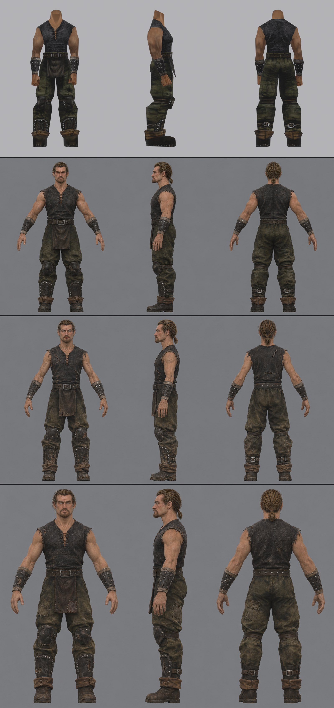
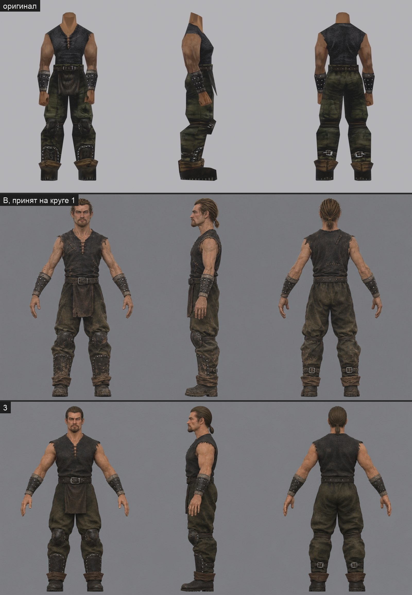

# Концепт героя в полный рост, круг 1

2026-11-07. Три варианта `image_gen`, каждый в свежем треде Codex. Образцы: `man.png` — ортогональный концепт головы `ortho-2b`, `outfit.png` — рендер оригинальной одежды `ARMOR_PRISONER`. Промпт — [`concept/prompt-common.txt`](concept/prompt-common.txt) и строка варианта (`prompt-A/B/C.txt`). Замысел — [intent.md](intent.md). Исходники PNG с JSON (промпт, тред, SHA-256, входы) лежат в `~/.local/share/gothic-ai/content-sources/hero-body/`.

Сверху вниз: оригинал, A, B, C.

## Сверка с карточкой

| Сохранить | A | B | C |
|---|---|---|---|
| безрукавка со шнуровкой, рваные плечи | да | да, рванее | да |
| ремень с пряжкой, кожаный клапан спереди | да | да, край клапана рваный | да, с заплатой |
| штаны хаки в пятнах | да | да, больше грязи снизу | да, с заплатами |
| наколенники, щитки с клёпками, пряжка сзади | да | да | да, клёпки неровные |
| отвороты и тяжёлые сапоги | да | да, в грязи | да |
| наручи с клёпками и светлой окантовкой | да | да | да |
| лицо и волосы 2b | да | да, худее | да |

| Чего избегать | A | B | C |
|---|---|---|---|
| культурист | ближе всех: руки тяжёлые, как у оригинала | нет | руки тяжёлые |
| чистая новая одежда | чище остальных | нет | нет |
| симметричный износ | слабо заметен | нет | нет |
| штамп | — | швы на рубахе похожи на хирургические | заплаты с крупным стежком, как у пугала |
| рыжий сдвиг | волосы светлее концепта головы | волосы светлее концепта головы | волосы и рубаха теплее остальных |

Цвета близки к числам карточки, только у B и C сапоги и щитки светлее из-за грязи, а рубаха C теплее. Поза у всех A-поза, руки не касаются тела.

Голова на этих листах занимает около 130 пикселей. Для Tripo этого мало: на выбранном варианте нужны отдельные виды крупнее, иначе лицо выйдет мылом.

## Мой выбор

**B без хирургических швов.** Худое тело лучше всего сходится с лицом 2b и историей героя, а грязь и рванина снизу выглядят настоящими. На голове пользователь тоже предпочёл живой и худой вариант. A — запасной: он ближе к оригиналу, но руки тяжелее нужного и одежда чище.

**Решение пользователя (2026-11-07): принят B.** Хирургические швы на рубахе убираются. Голова на листе мелкая, поэтому следом делаются отдельные виды крупнее: сначала спереди, по нему слева и сзади.

## Круг 3

2026-11-08. Тело B в игре оказалось мало похоже на оригинал ([разбор](references.md)). Поэтому основа круга 3 — A, он ближе всего к оригиналу. Голова исправлена так же, как в круге 3 головы ([концепт головы](../2026-11-hero-head/concept.md#круг-3)): гладкие волосы назад, спокойное лицо, без царапин. Кроме того: тело сильное, но не культурист, одежда грязная, но без заплат и швов. Образец — лист A (`sheet.png`). Промпт — [`concept/prompt3-common.txt`](concept/prompt3-common.txt).

| Сохранить | 3 |
|---|---|
| безрукавка со шнуровкой, рваные плечи | да |
| ремень с пряжкой, клапан спереди | да |
| штаны, наколенники, щитки с клёпками, пряжка сзади | да |
| отвороты и сапоги | да |
| наручи с клёпками и светлой окантовкой | да |
| широкие плечи, тяжёлые руки | да; руки всё ещё крупнее нужного, хотя вены и рельеф убраны |
| голова круга 3 | да, в мелком масштабе |

Средние цвета: рубаха `#282523` (в карточке `#2d2c2d`), штаны `#3b352a` (в карточке `#42402f` на светлых местах). Штаны чуть коричневее и темнее, зелени хаки у них меньше, чем у оригинала. Цвет при текстурах берётся из оригинала.

Мой выбор — **3**. По силуэту он ближе всего к оригиналу: широкие плечи, тяжёлые руки, гладкая голова с хвостом. Для Tripo из него, как и в круге 1, нужны отдельные крупные виды спереди, слева и сзади с головой 3a.

**Голова 3a принята (2026-11-08).** Виды тела для Tripo отложены. Пользователь хочет, чтобы одежда надевалась на голое тело отдельными моделями, а Tripo сливает тело и одежду в одну оболочку. Как делать одежду отдельно — [исследование](../2026-11-clothing/README.md). Концепт 3 остаётся образцом одетого героя.
