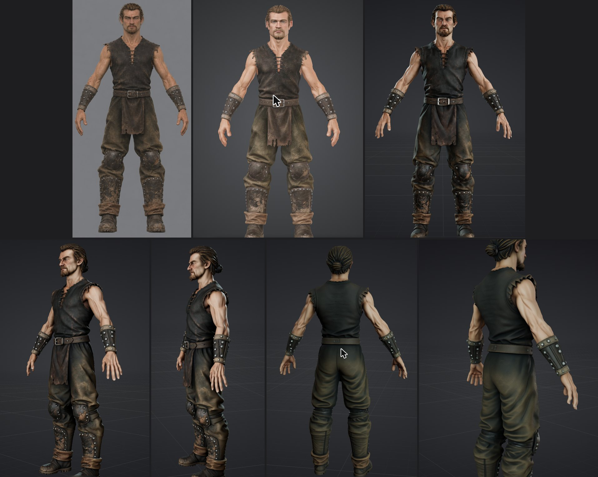
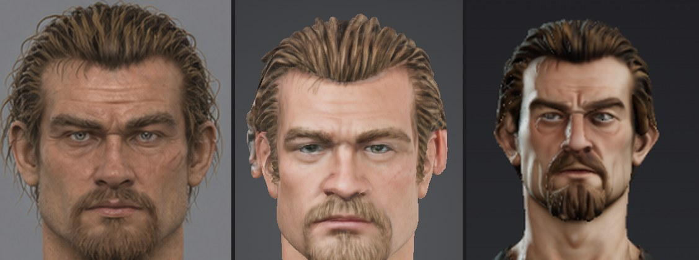

# Hi3D: что умеет и как подключён

2026-11-08, короткое исследование перед пробой. Hi3D — новое имя Hitem3D. Модель v3.0 вышла в августе 2026 года, сетка вокселей 2048³ по заявлению самой компании.

## Что умеет

- **Режимы:** картинка или 2–4 вида в 3D (вид спереди обязателен), рельеф, разрезка модели, раскраска для печати.
- **Модели:** общая v3.0 (`quality` — 45 кредитов, `master` — 145), отдельная линейка «Portrait» для людей (v2.1, 25–45 кредитов).
- **Поза:** на сайте есть приведение к A- или T-позе.
- **Сетка:** через API задаётся число полигонов, от 100 000 до 5 000 000.
- **Форматы:** glb, obj, fbx, stl, usdz, 3mf; PBR включается отдельно.
- **Скелета и анимации в генерации нет.** В документации нет ни авто-рига, ни анимации, на странице генерации есть только приведение к позе. После генерации всплывает подсказка: «Edit, build scenes, rig & more — keep creating with Agent». Но на странице Agent видны только навыки для печати, а риг я не проверял. У Tripo риг гуманоида есть прямо в студии.
- **Рейтинги:** места v3.0 в 3D Arena я не нашёл. В слепом сравнении top3d.ai за февраль 2026 Hitem3D был в первой тройке, тогда ещё на v1.5.

## Бесплатный план

Сейчас у аккаунта бесплатный план и 120 кредитов, то есть две модели v3.0 `quality`. Ограничения плана:
- **скачивать 3D-модели нельзя;**
- **несколько видов на входе и лицензия «Private» доступны только по подписке.** Без неё модель выходит под CC BY 4.0, то есть публичной;
- коммерческое использование запрещено, хранится до 7 моделей.

Pro стоит $9,95 в месяц в первый год (скидка 50%) и снимает эти ограничения.

## API и MCP

- **API** (`platform.hi3d.ai`) работает на отдельных пакетах ресурсов, 1 кредит = $0,02, и требует ключа.
- **MCP:** официальная настройка с сайта — сервер `hi3d`, Streamable HTTP, `https://agent.hi3d.ai/mcp`, OAuth. Права: `account:read`, `generation:create`, `task:read`. Сервер добавлен в пользовательский конфиг Claude Code (`claude mcp add -s user`). Вход по OAuth проходит сам пользователь через `/mcp`. Список инструментов виден только после входа.

## Проба 2026-11-08

Пользователь разрешил генерацию на бесплатном плане под CC BY 4.0. Вход — один вид спереди варианта B (`view-B-front.png`): несколько видов на бесплатном плане недоступны. Настройки: v3.0 Quality, геометрия и текстура, A-поза. Списано 45 кредитов, осталось 75. Генерация в бесплатной очереди заняла около 7,5 минуты.

| | Tripo | Hi3D |
|---|---|---|
| Вход | три вида | один вид спереди |
| Сетка | 1 910 124 треугольника | 2 000 000 граней, 1 015 735 вершин |
| Текстура | 4096² | 8192² |
| Цвет | в просмотрщике светлее и желтее концепта | ближе к концепту: тёмная рубаха, тёмно-оливковые штаны, грязь на голенях |
| Форма одежды | все части, складки | все части, лепка резче: мышцы, складки, клёпки |
| Спина | по виду сзади: хвост, пряжки | придумана: хвост стал пучком, пряжек на щиколотках нет, щитки сзади гладкие |
| Лицо | чистый красавец | стилизованное: вытянутое, узкое, брови нависают, нахмуренное; на 2b похоже слабо |
| Скачать | бесплатно | только по подписке |

Вывод: спереди Hi3D ближе к концепту по цвету и резче по форме, но сравнение неравное. Hi3D получил один вид вместо трёх, поэтому спину он придумал. Лицо у обоих ушло от 2b в разные стороны. Сетку Hi3D проверить нельзя без скачивания, то есть без подписки.

## Источники

- [FAQ API](https://docs.hi3d.ai/en/api/getting-started/faq), [цены API](https://docs.hi3d.ai/en/api/getting-started/pricing), [MCP в документации](https://docs.hi3d.ai/en/mcp-tools) (там старый адрес с Basic-авторизацией)
- [Hi3D Agent, пресс-релиз](https://www.gamespark.jp/release/prtimes/20260924/316107.html)
- [Запуск v3.0, 3Dnatives](https://www.3dnatives.com/en/hi3d-v3-2048-voxel-resolution/), [сравнение Hitem3D, Meshy и Tripo](https://www.3daistudio.com/blog/hitem3d-vs-meshy-vs-tripo-comparison)
