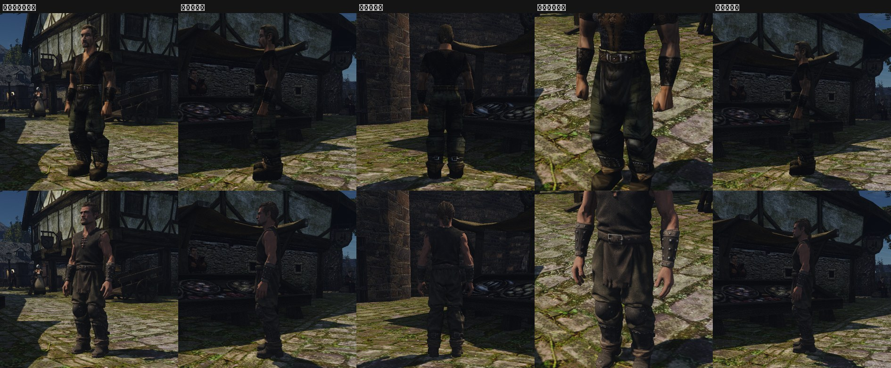
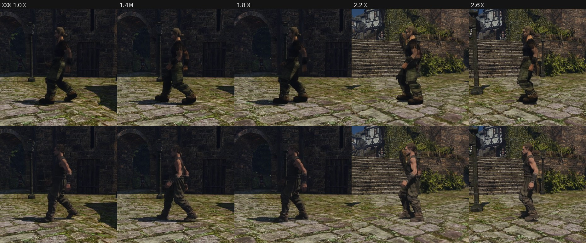
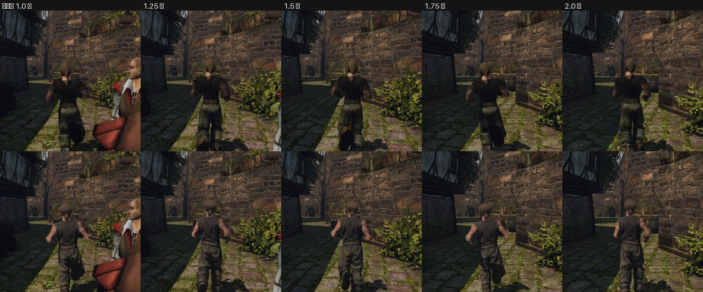
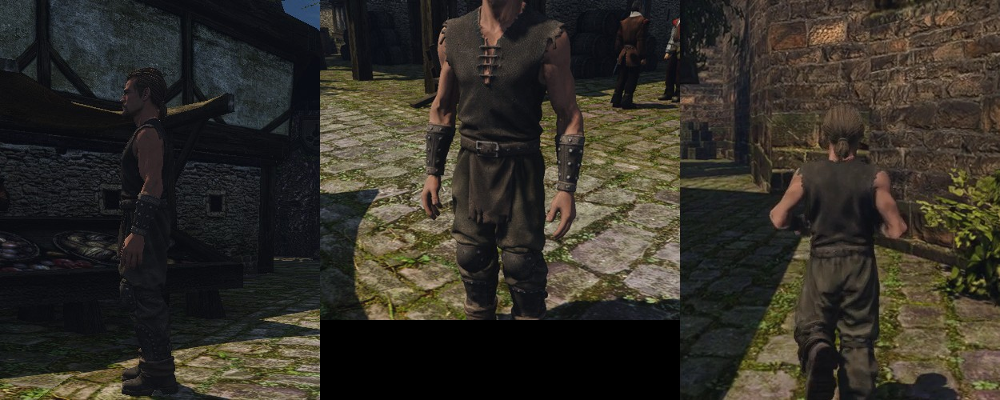
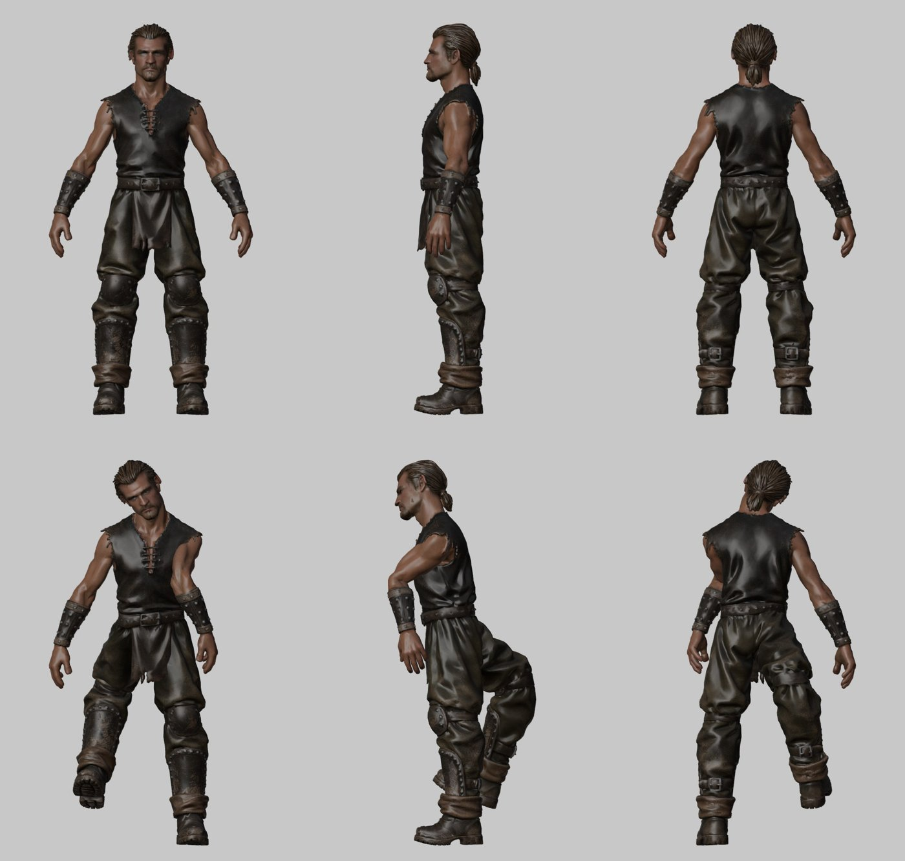

# Тело из Tripo в игре: проба вида

Пользователь попросил 2026-11-08 обработать модель героя из Tripo и посмотреть её в игре. Это проба вида, а не принятый контент. Правило «генератор 3D — только эталон формы головы» остаётся в силе. Файлы лежат вне git, в тестовой папке контента, рабочий контент не трогается.

Модель Hi3D взять нельзя: скачивание на бесплатном плане закрыто. Поэтому берётся GLB из Tripo ([tripo.md](tripo.md)).

## Что умеет движок

Проверено по коду, правка движка не нужна.

- **Подмена меша.** Записи моделей ищутся сначала в `<OPENGOTHIC_CONTENT>/models/models.json`, потом в базе. Это касается и MDM (`Resources::loadModelRecord`, `common/resources.cpp`). Своя запись `ARMOR_PRISONER.MDM` в формате базы (`kind: mesh`, `common/modeldata.cpp`) заменит одежду каторжника — предмет `ITAR_PRISONER` с визуалом `Armor_Prisoner.asc`. В новой игре на герое другой визуал, поэтому стенд надевает этот предмет сам.
- **Скин.** В формате мягкой кожи у каждой вершины до 4 весов. Каждый вес — номер узла `HUMANS.MDH` (байт) и позиция вершины в системе этого узла. Шейдер считает `Σ w·(M_кости·p_локальная)`, поэтому позу привязки можно выбрать свою: A-поза подходит.
- **Нормали скина кости не поворачивают.** В `vertex_process.glsl` нормаль берётся как есть, только с матрицей объекта. Значит, нормали надо писать в позе покоя `HUMANS.MDH`, где руки опущены, как у оригинала. При поднятой руке свет на ней будет неверным — так же, как у оригинальных моделей.
- **Карты.** У анимированных мешей есть путь с картами материала (`main_ani_orm`). Albedo, normal и ORM подключаются через `materials/materials.json` по имени текстуры. Упаковка DDS общая с `pack_materials.py`: зелёный канал нормали переворачивается, UV как в glTF.
- **Пределы записи.** Индексы позиций и wedge 16-битные: до 65 535 на меш. Треугольники в Gothic идут по часовой относительно внешней нормали; проверено на `ARMOR_PRISONER.MDM`.
- **Голова.** Голова — отдельный меш на `BIP01 HEAD`. У модели Tripo голова своя, поэтому голову героя через `characters/characters.json` заменяет скрытый треугольник в 1 мм. Узел GLB головы должен называться одной из её частей (`face`, `hair` и т. д.), иначе загрузчик отказывает.

## Скелет оригинала

`HUMANS.MDH` в позе покоя: таз в начале координат, стопы на −100 см, узел головы на +61 см, рост около 183 см. Руки опущены, кисть у бедра. Лицом к +Z, левая сторона на −X.

## Способ

1. В Blender на Mac снять виды модели с сеткой. По ним найти суставы: плечо, локоть, запястье, бедро, колено, щиколотку, шею и голову.
2. Поставить скелет Gothic в A-позу модели: повернуть кости по направлениям сегментов, длины оставить как в Gothic, потому что их задают анимации. Подогнать модель к суставам скелета гладким сдвигом (TPS).
3. На Ryzen: упростить сетку с 1,91 млн треугольников до примерно 40 тысяч, запечь нормали с полной сетки на упрощённую в 2K, посчитать веса по костям в Blender. На вершину оставить до 4 весов.
4. Записать `ARMOR_PRISONER.MDM` в формат базы, текстуры — в DDS 2K. Получится тестовая папка `content-tests/hero-body-tripo-1`.
5. Снять стенд `hero-body.bench` на Ryzen дважды — с оригиналом и с нашей моделью, одними камерами. Ракурсы: спереди, сбоку, сзади в полный рост, бег со спины в городе.

## Приёмка

Решает пользователь, по кадрам и клипу бега рядом с оригиналом. Ограничители:
- модель не пропадает и не выворачивается;
- суставы гнутся на своих местах: локти, колени, плечи без сильного излома;
- стопы стоят на земле;
- голова героя не просвечивает сквозь голову модели.

## Чего не будет в пробе

- одежды отдельно от тела: модель — одна оболочка;
- лицевой мимики и губ: у головы Tripo нет форм;
- оружия в руках и на поясе: точки `ZS_*` остаются от оригинала, поэтому меч может войти в одежду.

## Итог 2026-11-08

Модель Tripo в игре работает. Подмена прошла без правки движка, только контентом. Модель стоит на земле, на шаге и беге суставы гнутся на своих местах. Голова Gothic не просвечивает.

Проба сгибов в Blender до игры: рука поднята и согнута, нога согнута в бедре и колене, корпус наклонён, голова повёрнута.

**Что получилось:**
- безрукавка со шнуровкой, наручи, ремень с клапаном, наколенники и щитки читаются с игровой дистанции;
- лицо и хвост — уже не набор плоскостей, а голова человека;
- цвет темнее и глуше оригинала: штаны не зелёные хаки, а тёмные оливково-серые. Яркость с текстурой оригинала не сверял. По правилам контента её берут из заменяемой текстуры — это шаг на случай, если модель пойдёт дальше.

**Чего нет:**
- лицо и губы не двигаются: у головы Tripo нет форм;
- FPS не мерил. В модели 40 тысяч треугольников, у оригинала — 724, на одного героя это немного;
- поза в бою, с оружием и при поднятых руках не снималась. Нормали в этих позах неверны, это ограничение движка (см. выше);
- клипы шага и бега лежат вне git: `~/.local/share/gothic-ai/remaster/hero-body/{orig-2,tripo-2}`.

## Как сделано

Скрипты — [`scripts/content/hero_body/`](../../../scripts/content/hero_body/):
1. `views.py` и `grid.py` снимают ортогональные виды с сеткой. `landmarks.py` находит центры суставов по сечениям сетки, итог — `tripo-body-v1.landmarks.json`.
2. `fit.py`: модель увеличена в 1,9 раза до 186,3 см. Кости рук и ног повёрнуты к суставам модели, длины оставлены как в Gothic. Модель подогнана к суставам сплайном TPS. Самый большой сдвиг — 4,4 см: колени поднялись на 3,4 см, плечи и шея ушли вперёд на 2–4 см. Ботинки не двигались: щиколотка Gothic на 3 см выше щиколотки модели, поэтому стопа поворачивается чуть выше настоящего сустава.
3. `build.py` — Blender на Ryzen через `gq batch`, около минуты:
   - упрощение до 40 000 треугольников;
   - швы по островам Tripo, новая развёртка с упаковкой;
   - запекание с полной сетки в 2K: цвет, нормали, шероховатость, металл и AO с лучами 8 см;
   - веса Blender по костям (bone heat).

   Первая проба со Smart UV раздробила развёртку на тысячи островов, её заменили.
4. `write_mdm.py` — запись `ARMOR_PRISONER.MDM` и DDS через общий упаковщик `test-material.py`:
   - до 4 весов на вершину;
   - нормали переведены в позу покоя;
   - 19 970 вершин, 25 768 wedge-вершин, 40 000 треугольников.

   Тестовая папка — `~/.local/share/gothic-ai/content-tests/hero-body-tripo-2`.
5. Стенд [`hero-body.bench`](../../../scripts/bench/hero-body.bench) и `compare.py` — листы «оригинал | наше».
