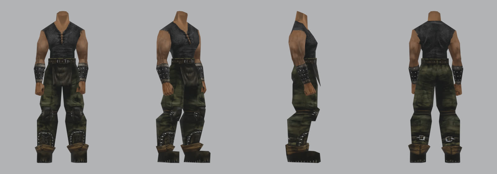

# Замысел тела героя

Карточка по скиллу [`object-design`](../../../.claude/skills/object-design/SKILL.md), до концепта. Голова — [отдельная работа](../2026-11-hero-head/README.md), её концепт 2b принят пользователем. Цель концепта в полный рост — попробовать героя целиком в Tripo. По правилам проекта генератор пока разрешён только как эталон формы головы; что делать с телом из Tripo, решает пользователь.

Снято из импортированной базы: `ARMOR_PRISONER.MDM` с телом `HUM_BODY_NAKED_V8_C0`. Это одежда каторжника, предмет `ITAR_PRISONER`. В новой игре герой начинает в другом визуале, это выяснилось 2026-11-08 на стенде ([ingame.md](ingame.md)). Без головы и в позе привязки.

## Роль в игре

Безымянный — лицо игрока. Почти всю игру его видят со спины с 3–4 м, поэтому читаются силуэт и цветовые пятна: тёмный верх, голые руки, хаки на ногах. Одежда говорит: каторжник, вышедший из колонии, бедный, но не нищий. Это остатки рабочей одежды рудника, а не доспех.

## Сохранить

Сверху вниз:
- безрукавка из грубой тёмно-серой ткани, V-вырез со шнуровкой, рукава оторваны, край рваный;
- голые руки, широкие плечи, сильные предплечья;
- широкий кожаный ремень с пряжкой и кожаный клапан спереди до середины бедра;
- широкие штаны хаки в пятнах грязи;
- кожаные наколенники;
- тёмные щитки на голени с рядом клёпок, сзади ремень с квадратной пряжкой;
- сапоги с коричневыми отворотами;
- наручи с рядами шипов-клёпок и светлой окантовкой.

## Улучшить

Всё это нарисовано на 183 + около 170 вершинах: складок, толщины ткани и кожи нет. Нужны настоящая ткань и кожа, швы, ремни с креплением, износ по месту: колени, край ремня, носки сапог.

## Происхождение

Вещи сделаны в лагере из того, что было: куски старой упряжи, железо рудничных тележек, клёпки вручную. Ничего не парное и не новое. Кожа сухая, вытертая, ткань в рудничной пыли. Герой вылез из руин после Барьера едва живым, поэтому одежда потрёпана сильнее, чем у обитателей колонии.

## Цвет

Средние цвета кадра оригинала — ограничители, не цель. Генератор светлит и теплит, поэтому они идут в промпт числами.

| Что | Цвет |
|---|---|
| безрукавка | `#2d2c2d` |
| ремень | `#27231f` |
| клапан | `#332e29` |
| штаны, светлые места | `#42402f` |
| штаны, тёмные места | `#292b23` |
| щитки голени | `#1d1c1a` |
| отвороты сапог | `#3c2f23` |
| сапоги | `#2a2620` |
| наручи | `#323131` |

Кожа — как на голове: лоб `#c09679`, щека `#b28767`.

## Поза

A-поза, руки на 40° от корпуса, ступни на ширине плеч. Tripo сам советует такую стойку для двуногих, а руки не слипнутся с телом и штанами. Виды строго ортогональные: спереди, слева, сзади.

## Чего избегать

- рыцарский или «геройский» доспех, плащ, капюшон, кольчуга;
- оружие, сумки, лишние ремни через грудь, украшения;
- культурист с рельефом;
- чистая новая одежда, симметричный износ;
- рыжий и золотой сдвиг цвета.

## Варианты круга 1

- **A** — ближе всего к оригиналу: те же части, пропорции и цвета.
- **B** — через несколько недель после руин: похудевший, одежда висит, грубые починки.
- **C** — рабочая одежда рудника: те же части, но видно, что их собрали вручную из лома и старой упряжи.
