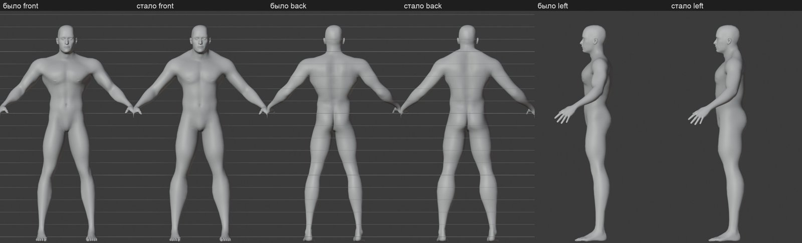
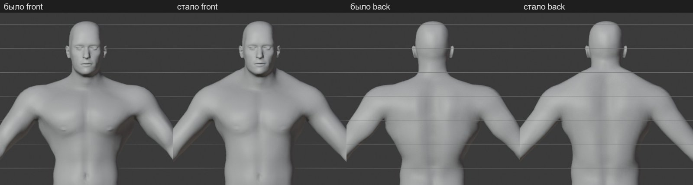
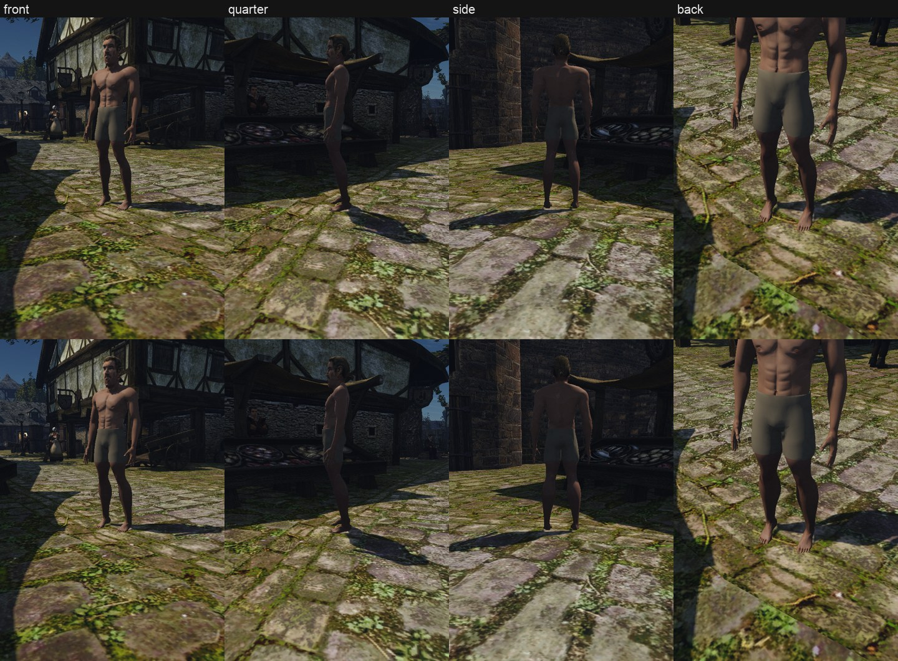
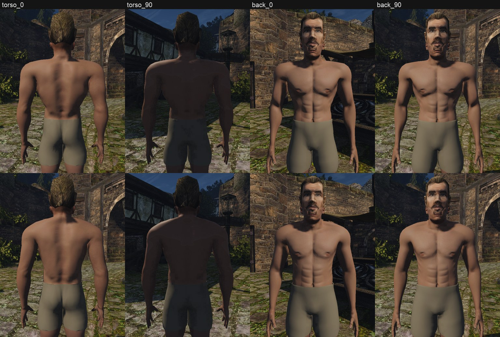
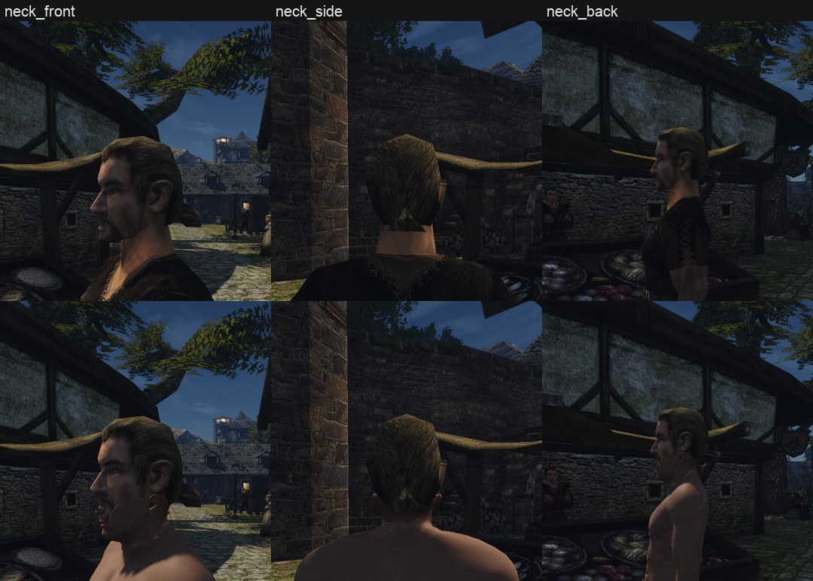
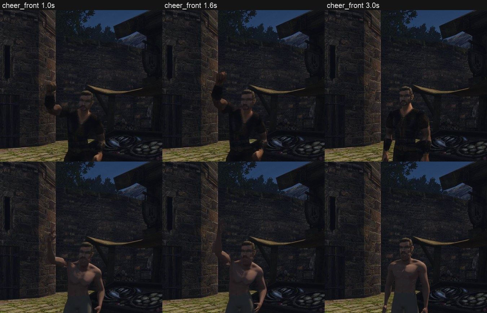
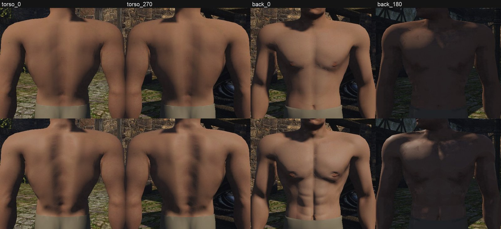

# Голое тело героя на MPFB: пилот

2026-11-08. Это шаг 2 плана [одежды отдельно от тела](../2026-11-clothing/README.md): голое тело, на которое потом надевается одежда. Пользователь одобрил путь и начало с пилота тела.

Это пилот: он проверяет, что тело MPFB работает в игре на скелете Gothic. Файлы тела лежат вне git, в тестовой папке контента, рабочий контент не тронут. В движке для пилота сделаны две правки рендера, они описаны ниже.

## Что сделано

Тело — мужчина MPFB 2 (CC0), привязанный к скелету `HUMANS.MDH`. Оно записано как `HUM_BODY_NAKED0` — голое тело, которое Gothic показывает, когда брони нет. Запись подменяется контентом, как в пробе Tripo.

**Что получилось:**
- тело стоит на земле, суставы на местах скелета Gothic, сложение — сильный мужчина без перекачки;
- на шаге, беге, ударе и с поднятой рукой колени, бёдра, плечи и локти гнутся на своих местах, разрывов и провалов нет;
- рельеф мышц читается в игре: пресс, грудь, лопатки, борозда позвоночника;
- голова Gothic садится на нашу шею без щели спереди, сбоку и сзади;
- бельё — отдельный меш поверх тела, кожа под ним удалена. Это первая проба «одежды на теле». Под бельём есть объём паха.

**Сравнение с оригиналом.** Оригинальный герой без брони — это то же голое тело, но с нарисованной на текстуре одеждой. Поэтому в кадрах оригинала он одет. Наше тело голое по-настоящему: одежда будет отдельными мешами, следующий шаг плана.

## Пропорции (круг 6)

Пользователь: ноги слишком тонкие, спина и трицепс широкие, трапеций нет, шея узкая; хочется более гармоничной фигуры.

По скелету Gothic ставятся только суставы: тело должно гнуться там, где гнутся кости. Толщину частей тела скелет не задаёт. Замеры обхватов (`measure.py`, сечение плоскостью поперёк кости, как ложится лента) подтвердили слова пользователя:

| | было | стало | канон крепкого мужчины |
|---|---|---|---|
| талия, см | 70,6 | 79,3 | ~84 |
| грудь / талия | 1,57 | 1,39 | ~1,25–1,3 |
| плечевой обхват / талия | 1,72 | 1,47 | ~1,6 у атлета |
| плечо, см | 37,2 | 36,0 | ~34–35 |
| ширина по дельтам, см | 62,1 | 60,1 | ~51–55 |
| бедро, см | 60,0 | 65,2 | ~60–63 |

Канон — классический «греческий»: шея ≈ икра ≈ расслабленное плечо + 2 см, бедро ≈ 1,5 икры, грудь ≈ 1,25 талии. Числа — ориентир, принимает глаз.

Что изменено:
- мышцы тела 0,8 вместо 1,0, широчайшие и V-силуэт уменьшены, трицепс и дельты легче, мышцы бёдер и голеней сильнее;
- обхваты шеи, плеча, бедра, икры, талии и таза решаются Гаусс — Ньютоном, как суставы. Рычаги на руках и ногах — ширина и глубина всего сегмента;
- трапеция — своя форма: у MPFB нет цели для неё. Мягкий бугор по линии шея — плечо, только на верхней и задней стороне, до 2,5 см.

Ловушка круга: цели MPFB `measure-*-circ` раздувают одно кольцо под замер лентой. На бёдрах они дали шары под пахом (прогоны 8–9), поэтому на конечностях их нет.

## Круги

1. **Худой.** Подгонка пропорций под скелет сузила таз и торс. Рядом с оригиналом тело выглядело щуплым ([кадры](naked-stills-round1.jpg)).
2. **Сильный.** Мышцы и масса MPFB подняты, отдельно — плечи, предплечья, грудь, спина. Кожа на стыке с головой была светлее.
3. **Отделка.** Ровный край белья, острова развёртки расширены, кожа темнее и теплее, под шею головы.
4. **Рельеф.** Запечена карта нормалей с усиленными мышцами, пресс и зубчатые мышцы вылеплены на плотной сетке, плюс поры и AO. В Blender пресс был виден, в игре — нет: движок давал карты нормалей и ORM только статичным мешам. После правки движка рельеф читается.
5. **Пах.** У базовой сетки MPFB нет половых органов, а цели `genitals` пустые. Объём под бельём даёт цель `bulge-incr`.
6. **Пропорции** — раздел выше.

Прежние кадры: [стоя](naked-stills.jpg), [бег](naked-run.jpg), [шаг](naked-walk.jpg), [шея](naked-neck.jpg), [Blender, круги 1–3](naked-blender.jpg).

## Правки движка

1. **Карты у скелетных моделей.** `DrawBuckets` ставил флаги карт нормалей, ORM и своих материалов только статичным мешам. Теперь их получают и скелетные, без антиповтора.
2. **Нормали поворачивают кости.** Раньше нормаль скелетной вершины оставалась нормалью позы привязки: поднятая рука освещалась как опущенная. Теперь движок находит поворот привязки каждой кости по самой коже. Нормаль хранится в кадре каждой из четырёх костей и поворачивается вместе с позицией. Кость, которая не сходится в один жёсткий кадр, оставляет прежнюю нормаль. Тени и толщина NPC берут прежнюю нормаль, поверхность не сдвигается. На оригинальном контенте сошлись все кости, у нашего тела — тоже, после того как подгонка стала брать вершины, где вес кости близок к её максимуму: у ключиц нет вершин только на одной кости.

Подробности — в [журнале своей игры](../../../docs/own-content.md#план-и-журнал), проверка — тест `gothic-skin-normal-test` и стенды ниже.

## Как устроено

Скрипты — в [`scripts/content/hero_body/`](../../../scripts/content/hero_body/), рабочая папка — `~/.local/share/gothic-ai/mpfb/work/body/run10`.

1. [`mpfb_body.py`](../../../scripts/content/hero_body/mpfb_body.py) — Blender с MPFB на Mac.
   - Мужчина около 33 лет: мышцы 0,8, масса 0,7, пропорции 0,8, плюс цели мышц по частям тела.
   - Скелет Gothic — не анатомия человека: колено на 60,7 см, бедро на 100 см, длинные руки, узкий таз. Цели пропорций MPFB двигают суставы на скелет. Подгонка — Гаусс — Ньютон с регуляризацией, масштаб 1,017, рост 178 см.
   - Затем тот же решатель доводит обхваты, затем ещё два шага суставов. Трапеция — отдельный ключ формы.
   - Тело ставится на пол: цели сдвигают стопы с уровня пола.
2. [`mpfb_bake.py`](../../../scripts/content/hero_body/mpfb_bake.py) — рельеф: мышцы усилены вдоль нормали (`RELIEF=2`), пресс и зубчатые мышцы вылеплены на сетке 856 тыс. вершин, пупок по цели MPFB, поры. Cycles запекает нормали и AO в 2048 × 2048.
3. [`mpfb_export.py`](../../../scripts/content/hero_body/mpfb_export.py):
   - остаток доводит сплайн TPS из [`fit.py`](../../../scripts/content/hero_body/fit.py), самый большой сдвиг — у шеи: голова MPFB сидит впереди головного узла Gothic;
   - голова срезается по линии шеи оригинального тела, от 162,5 см спереди до 167 см сзади;
   - веса — с рига MPFB `game_engine` на 24 узла Gothic. Пальцы, кроме большого, идут в `FINGER0`, большой — в `HAND`;
   - бельё — полоса вспомогательной сетки `helper-tights` от пояса до середины бедра, на 4,5 мм от кожи; кожа под ним удалена.
4. [`mpfb_write.py`](../../../scripts/content/hero_body/mpfb_write.py) записывает `HUM_BODY_NAKED0.MDM` с двумя мешами. Тело — 11 315 вершин и 22 376 треугольников, бельё — 483 и 888. У оригинала 296 вершин и 568 треугольников.
   - Кожа — диффузная текстура MPFB (CC0) 2048 × 2048, средний цвет сведён к шее головы оригинала. Карта нормалей и AO из запекания, AO ослаблено до 0,6.
5. [`measure.py`](../../../scripts/content/hero_body/measure.py) — обхваты и пропорции готового тела.
6. Стенды:
   - [`hero-body-naked.bench`](../../../scripts/bench/hero-body-naked.bench) — кадры, шаг, бег, удар, поднятая рука;
   - [`hero-body-relief.bench`](../../../scripts/bench/hero-body-relief.bench) — торс при низком солнце в четырёх поворотах;
   - [`hero-body-neck.bench`](../../../scripts/bench/hero-body-neck.bench) — шея вблизи.

   Листы «было | стало» собирает [`compare.py`](../../../scripts/content/hero_body/compare.py).

Тестовая папка — `~/.local/share/gothic-ai/content-tests/hero-body-mpfb-10`, клипы — `~/.local/share/gothic-ai/remaster/hero-body/naked-mpfb-10`.

## Чего нет и что не проверено

- **Стопа.** Скелет Gothic поворачивает стопу вокруг точки на 5 см выше нашей лодыжки и на 9 см позади. Стопа стоит на полу и на шаге выглядит естественно, но при сильном сгибе лодыжка немного съезжает.
- **Ноги длиннее человеческих.** Колено Gothic на 60,7 см, у человека ростом 178 см — около 50 см. Голень длинная, это задаёт скелет; толщина ног теперь своя.
- **Кожа.** Цвет подобран по кадру, а не по текстуре тела оригинала: у героя тело нарисовано одетым. Грязи и загара нет.
- **Линия на спине.** В тени на прежнем теле была тонкая светлая линия от шеи к лопатке. Это не складка сетки и не шов текстуры, на солнце её нет. На новом теле не видна; если вернётся, смотреть SSAO у края головы.
- **Голова.** Пока голова Gothic. Своя голова героя на MPFB — отдельная работа, и тогда тело и голова станут одной сеткой без шва.
- **Все мужчины.** Запись `HUM_BODY_NAKED0` общая. В тестовой папке все мужчины без брони получают это тело и эту кожу.
- **Руки.** Кисти раскрыты, как в MPFB, а у оригинала сжаты в кулаки. На рукояти меча пальцы видны растопыренными.
- **FPS не мерил:** 22 тысячи треугольников против 568 у оригинала.

## Дальше

Круг 6 пользователь не принял: фигура не гармоничная. Причины и способ — в [исследовании](anatomy.md): колено скелета Gothic стоит на 5–8 см выше человеческого, а местные правки поверх макросов MPFB ломают согласованность тела.

Шаг 3 плана — каторжная одежда из шести частей на этом теле, по концепту 3, сборкой в `ARMOR_PRISONER`.
