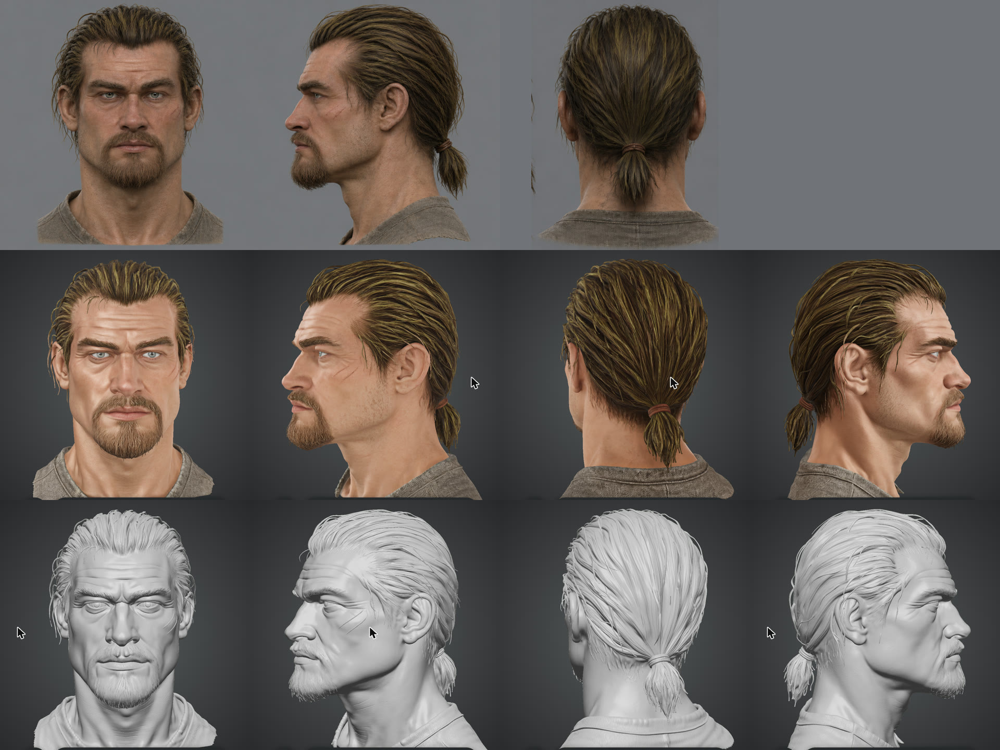
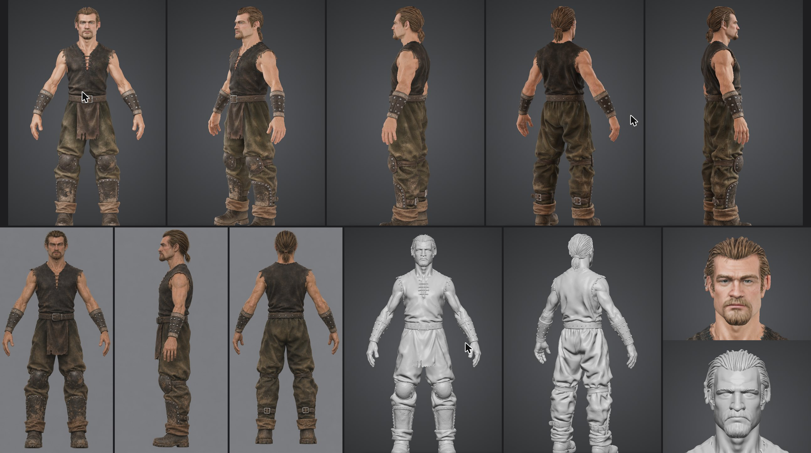
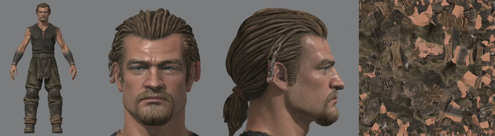

# Проба Tripo Studio: голова и герой целиком

2026-11-07. Проба по просьбе пользователя. Общие настройки: режим из нескольких картинок, модель H3.1, PBR, текстура 4K, удаление освещения, видимость «Приватный». Цена — 55 кредитов за запуск.

## Голова

Вход: вырезки концепта 2b — спереди и слева из `ortho-2b`, сзади из `concept-2b`.

- 1 874 477 треугольников, 992 361 вершина, один цельный меш.
- Форма чище эталона Pixal3D: нет глубоких борозд на шее и щеках, сохранены пряди, хвост и обе царапины.
- Цвет ушёл от концепта: кожа чистая и розоватая, волосы золотые. Лицо резче и моложе, глаза вылеплены на поверхности.

## Герой целиком

Вход: виды варианта B — `view-B-front/left/back.png`, 887 × 1774 ([лист](views-B.jpg)).

- 1 910 124 треугольника, 986 022 вершины. Те же 1,9 млн теперь на всё тело, поэтому голова заметно грубее, чем у отдельной пробы.
- **Держится:** силуэт, пропорции, A-поза, все части одежды, складки штанов, наручи и щитки с клёпками, пряжки сзади. Правый бок, которого не было на входе, достроен правдоподобно. Руки и пальцы отделены от тела.
- **Хуже концепта:**
  - лицо чище и правильнее концепта, сходство с 2b слабее;
  - волосы слиплись в крупные жгуты;
  - над правым ухом полоса цвета кожи и комок: ухо сливается с волосами. Этого бока на входе не было;
  - в просмотрщике Tripo штаны желтее, а волосы рыжее, но это во многом его свет (см. «Файл GLB»).
- **Для игры:** сетка не годится как есть, см. ниже.

## Файл GLB

Экспорт GLB с текстурой 4K прошёл без подписки и без списания кредитов, хотя кнопка помечена короной. Файл — 67 МБ, в git не кладём: `~/.local/share/gothic-ai/content-sources/hero-body/tripo-body-v1/tripo-body-v1.glb`, SHA-256 `45b92770…59b39`.

| Что | Значение |
|---|---|
| Состав | один меш, один узел, один материал |
| Сетка | 1 910 124 треугольника, 955 032 вершины после сварки швов UV |
| Топология | одна замкнутая оболочка: 0 открытых рёбер, 0 неправильных. Одежда и тело — одна поверхность, под рубахой тела нет |
| Скелет, анимация, морф-цели | нет |
| Развёртка | 305 островов, в атласе вперемешку |
| Текстуры | цвет, шероховатость-металл, нормали, все 4096² |
| Размер | рост 0,98, стоит на нуле, ось Y вверх. Модель нормирована: под рост 1,8 м нужен множитель около 1,84 |

В Blender файл открывается без ошибок. При нейтральном свете цвета ближе к концепту, чем в просмотрщике Tripo: волосы бурые, штаны тёмно-оливковые, кожа загорелая. Просмотрщик засвечивает и теплит картинку, поэтому цвет надо судить по рендеру, а не по нему. Лицо тоже выглядит лучше, но остаётся чище и правильнее 2b.

## Вывод

Как эталон формы тела и одежды проба сильная. Голову в полном росте Tripo теряет, поэтому голову и тело лучше считать раздельно. Прямо в игру модель не идёт, а правило проекта разрешает генератор только как эталон формы головы; применение к телу — решение пользователя.
