# Голова героя

Статус: исследование, 2026-11-05. Пользователь выбрал начать улучшение героя с головы. Это первый персонаж проекта: этап 5 [плана графики](../../../docs/graphics-plan.md) и первый шаг этапа 3 [своей игры](../../../docs/own-content.md#этап-3-люди). Замысел головы — [intent.md](intent.md), концепт — [concept.md](concept.md).

Цель: голова, которую узнают как Безымянного, сделанная современно. В ней настоящий объём, волосы, глаза, кожа и мимика, а скелет оригинала и все наши системы остаются как есть.

## Оригинал

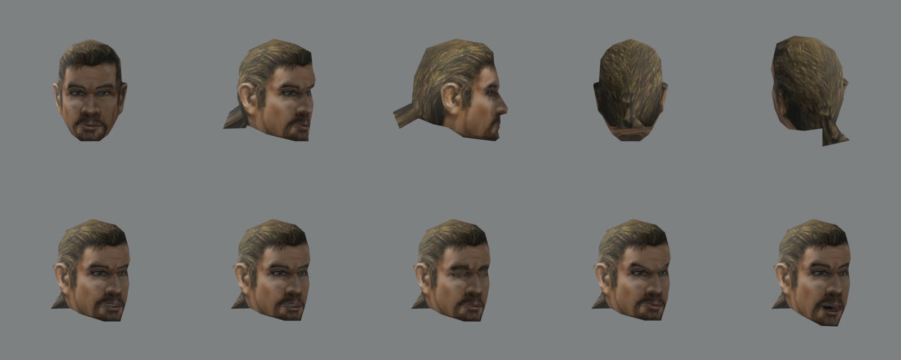

Снято [`render_original.py`](render_original.py) из импортированной базы.

| Что | Число |
|---|---|
| Меш | `HUM_HEAD_PONY.MMB`: 294 треугольника (голова 262, рот 20, зубы 12), 156 вершин |
| Размер | 27,3 см в высоту, 19,9 см в ширину с ушами, 30,7 см в глубину с хвостом |
| Лицо героя | `HUM_HEAD_V18_C0`, 256 × 128 (`FACE_N_PLAYER` = 18 в скриптах). Рот `HUM_MOUTH_V0` 128 × 128, зубы `HUM_TEETH_V0` |
| Тело героя | `HUM_BODY_NAKED_V8_C0` (`BODYTEX_PLAYER` = 8). Шеи в голове нет, её даёт тело, поэтому цвет кожи на шве задаёт тело |
| Мимика | 10 морф-анимаций: `S_NEUTRAL`, `S_FRIENDLY`, `S_ANGRY`, `S_HOSTILE`, `S_FRIGHTENED`, `S_EYESCLOSED`, `R_EYESBLINK`, `T_EAT`, `T_HURT`, `VISEME` (16 кадров от сомкнутого рта до открытого, 56 вершин) |
| Волосы, глаза | нарисованы на текстуре. Хвост — плоский треугольник сзади |

**Голова общая.** `Hum_Head_Pony` стоит в 46 вызовах скриптов: у героя и примерно у 45 NPC. Лица различаются только текстурой. Шесть мужских голов (`BALD` 288, `FATBALD` 145, `FIGHTER` 97, `THIEF` 48, `PONY` 46, `PSIONIC` 40) делят одну раскладку лица. Подмена `HUM_HEAD_PONY` по имени сменила бы голову всем этим NPC. Поэтому новая голова привязывается к герою, а не к имени меша.

Средние цвета лица `V18` (sRGB, 256 × 128) — ограничители, не цель:

| Место | Цвет |
|---|---|
| лоб | `#c09679` |
| щека | `#b28767` |
| нос | `#b79379` |
| губы | `#724e44` |
| волосы на макушке | `#5c4b2d` |
| волосы у висков | `#463825` |
| борода | `#7e5c4a` |
| усы | `#5e4535` |

Глаза серо-голубые. У текстуры свет нарисован сверху: тени под бровями и носом, у морщин лба.

## Эталон: какой бывает голова в жизни

- **Размеры головы взрослого мужчины**: длина (от переносицы до затылка) около 19,5–20 см, ширина около 15–15,5 см, высота от подбородка до макушки около 23 см. У оригинала 27 см в высоту, но с волосами и низом челюсти под шов шеи. Размеры сверим на модели по черепу, а не по бокс-рамке.
- **Глаз**: яблоко около 24 мм, радужка около 11,7 мм. Над радужкой — прозрачная роговица, у края века — влажная кромка. Отсюда живой блик: глаз без блика и без движения выглядит мёртвым.
- **Кожа** пропускает свет: красный рассеивается на несколько миллиметров, синий — меньше миллиметра. Поэтому граница света и тени на лице мягкая и красноватая, а уши и ноздри против света светятся. Без рассеяния кожа выглядит пластиковой, с чрезмерным — восковой.
- **Волосы** — тысячи прядей с двумя бликами: белым и цветным, смещённым к корню. Зализанные назад волосы, стянутые в хвост, лежат прядями по форме черепа и не держат форму шапкой.
- **Мимику проверяют в движении**: моргание, глаза, которые смотрят на собеседника, рот по звукам. По стоп-кадру не видно, жива ли голова.

## Как делают другие

- **MetaHuman** (Epic): голова LOD0 — около 24 000 вершин, 669 блендшейпов и 713 костей; на LOD7 остаются 130 вершин ([спецификация LOD](https://dev.epicgames.com/documentation/en-us/metahuman/platform-support-and-lod-specifications-for-metahumans)). Риг считает RigLogic, у нас его нет. С июня 2025 MetaHuman можно использовать и в других движках ([CG Channel](https://www.cgchannel.com/2025/06/you-can-now-sell-metahumans-or-use-them-in-unity-or-godot/)), но лицо делается в инструментах Epic и под их лицензией. Для нас это ориентир масштаба, а не источник.
- **Игровая практика**: голова героя — десятки тысяч треугольников, текстуры 2–4K. Кожа, глаза, волосы и одежда — отдельные материалы ([обсуждение на Polycount](https://polycount.com/discussion/174532/optimal-next-gen-character)). Глаз — отдельное яблоко, прозрачная роговица, кромка слезы и теневая оболочка у век. Волосы — карточки с альфой.
- **Рот по звукам**: у Meta 15 форм — `sil`, `PP`, `FF`, `TH`, `DD`, `kk`, `CH`, `SS`, `nn`, `RR`, `aa`, `E`, `ih`, `oh`, `ou` ([OVRLipSync](https://developers.meta.com/horizon/documentation/unreal/audio-ovrlipsync/)). Мимику часто задают 52 формами ARKit.
- **MPFB 2** (MakeHuman для Blender): параметрическое тело и голова. Сделанные им модели идут под CC0, код — под GPLv3. В нём есть набор из 15 форм рта Meta (`visemes02`), 22 формы Microsoft и 54 формы мимики ARKit (`faceunits01`) — готовыми шейп-кеями ([MPFB 2.0.15](https://static.makehumancommunity.org/mpfb/releases/release_2015.html), [обзор](https://www.cgchannel.com/2025/03/check-out-open-source-blender-character-generation-plugin-mpfb-2)). Это не нейросеть-генератор, а параметрическая модель с топологией под анимацию. Отдельные глаза, ресницы и брови там тоже есть. Перед работой проверить условия наборов ассетов.
- **Gothic Remake** (Alkimia): нового Безымянного ругали за вычурный вид, лицо назвали безликим. Разработчики просили фанатов не злиться и повторяли, что это тот же герой ([FictionTalk](https://fictiontalk.com/?p=4439), [Steam](https://steamcommunity.com/app/1297900/discussions/0/5350815203285798391)). Источники — форумы и колонки, то есть мнения, а не опрос. Но ловушка ясна: героя перестают узнавать.

Ловушки:
- **«Зловещая долина»**: реалистичное лицо при бедной мимике выглядит хуже грубого. Поэтому глаза и мимика входят в пилот, а не откладываются.
- **Глянцевая чистая кожа** — «лицо из рекламы», а не каторжника из колонии. Нужны грязь, загар, щетина и морщины, как на текстуре оригинала.
- **Восковая кожа** от чрезмерного рассеяния.
- **Волосы-карточки мерцают** без сглаживания по кадрам. Теперь у нас есть TAA, но клип проверит.
- **Шов шеи**: цвет и нормали головы и тела должны сходиться, а тело пока оригинальное.
- **Волосы и шлемы**: у тяжёлых доспехов (`ARMOR_PAL_H`, `ARMOR_DJG_H`) шлем входит в меш доспеха. Объёмный хвост может пройти сквозь него.

**Формы мимики с других лиц** — [сравнение MPFB, ICT-FaceKit и Mark из Audio2Face](face-shapes.md): сетка и форма головы остаются от MPFB, формы ARKit переносятся с другого лица.

## Что умеет наш движок

Сверено по коду 2026-11-05.

| Что | Как сейчас | Пробел |
|---|---|---|
| Голова | `Npc::setVisualBody` ставит `<head>.MMB` с номерами лица и зубов. Текстура лица — вариант имени `_V<n>_C<c>` (`Resources::textureVariantName`). Голова целиком сидит на кости `BIP01 HEAD` | новая голова только для героя: путь подмены не по имени меша |
| Морфы | `T_MORPH`, морф на GPU (`vertex_process.glsl`): до 4 слоёв одновременно (`MAX_MORPH_LAYERS`), между кадрами анимации — интерполяция. Морфятся только позиции | нормали не морфятся: на открытом рту и в гримасе свет останется от нейтрального лица |
| Свой меш | glTF 2.0 статичных мешей с подменой по имени (`gltfmesh.*`, `gothicglb.*`). Материал несёт карту нормалей и ORM, свет GGX | морф-цели glTF не читаются. Сам меш головы скиннинга не требует: он жёсткий на одной кости |
| Моргание | `EyeBlink` запускает `R_EYESBLINK`, не моргает при `S_EYESCLOSED` | — |
| Губы | `LipSync`: кадр `VISEME` выбирается по громкости слога, рот закрывается в паузах | формы по звукам нет. Двигаются ли губы героя, когда говорит игрок, — проверить |
| Взгляд | `Gaze` поворачивает голову, потом грудь и пояс. «Глаза в сторону», когда NPC думает, — тоже поворот головы | костей и мешей глаз нет: глаза сами не двигаются |
| Кожа | своего шейдера нет: свои материалы — GGX, оригиналы — Ламберт | рассеяния под кожей нет |
| Волосы | — | карточек волос с анизотропным бликом нет. Ткань (`ClothVisual`) и Jolt есть: пружинную цепочку для хвоста строить на них |

## Основа: MPFB 2

Поставлено 2026-11-05 с разрешения пользователя. Проверено, что работает в Blender 5.2.0 LTS.

- **Где лежит.** Всё вне git, на Mac, в `~/.local/share/gothic-ai/mpfb/`:
  - `downloads/` — архивы;
  - `blender/` — отдельный профиль Blender: обычный профиль пользователя не тронут;
  - `work/` — пробы.

  Запуск — с `BLENDER_USER_RESOURCES=~/.local/share/gothic-ai/mpfb/blender`.
- **Что скачано:**

  | Файл | Откуда | Размер | Лицензия |
  |---|---|---|---|
  | MPFB 2.0.18 | extensions.blender.org, SHA-256 `c075b3e9…2dad` сверен с каталогом | 46 МБ | GPLv3 (код) |
  | `makehuman_system_assets_cc0.zip` | files2.makehumancommunity.org | 281 МБ | CC0 |
  | `visemes02.zip` | там же | 0,1 МБ | CC0 |
  | `faceunits01.zip` | там же | 0,3 МБ | CC0 |

  У двух последних в архиве лицензии нет. CC0 для всего раздела функциональных наборов указан на [странице наборов](https://static.makehumancommunity.org/assets/assetpacks/index.html).
- **Установка.** Дополнение ставит `blender --command extension install-file`. Наборы — [`mpfb/install_packs.py`](mpfb/install_packs.py), он сначала прогоняет проверку архивов самого MPFB.
- **Проба** — [`mpfb/probe_head.py`](mpfb/probe_head.py) и [`mpfb/render_probe.py`](mpfb/render_probe.py): мужчина около 35 лет, европеец, мышцы 0,6. К нему подключены глаза `high-poly`, брови `eyebrow006`, ресницы, зубы и язык.

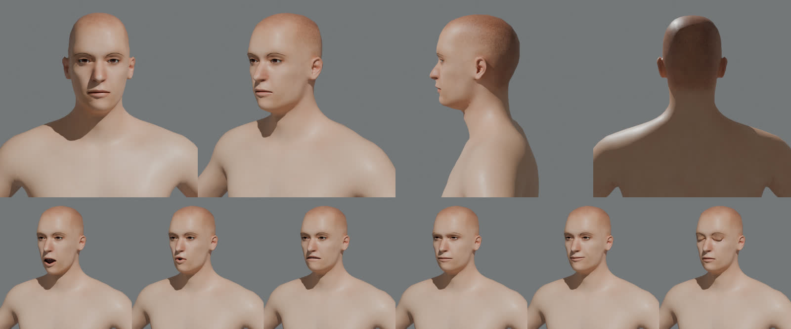

Что дала проба:
- **Формы**: 81 шейп-кей. Из них 15 форм рта (`viseme_sil`, `PP`, `FF`, `TH`, `DD`, `kk`, `CH`, `SS`, `nn`, `RR`, `aa`, `E`, `I`, `O`, `U`) и 54 формы мимики ARKit, включая моргание, прищур и взгляд каждым глазом. «Недоверие» (брови вниз, прищур, сжатые губы), усмешка и моргание собираются из них сразу.
- **Треугольники**: голова выше шейного сустава — 8 706. Отдельно:
  - глаза — 1 020 четырёхугольников;
  - брови — 96;
  - ресницы — 184;
  - язык — 224;
  - зубы — 3 560, тяжелее всего остального. Их придётся упростить: рот почти всегда закрыт.

  Вместе это в бюджете 10–15 тыс.
- **Ловушка подтвердилась**: из коробки лицо безликое и молодое, без надбровий, прищура и тяжёлой челюсти. Безымянного дают параметры лица MakeHuman (`head`, `nose`, `chin`, `cheek`, `forehead`, `eyes`, `ears`, `mouth`) и ручная доводка формы по концепту. Волосы, бороду и свою кожу делаю сам.
- **Кожа** MPFB подключается шейдером `ENHANCED_SSS`, но это только для Blender: в игру пойдут наши карты, а рассеяние даст наш шейдер.

## Подгонка формы

Принятый концепт — 2b ([concept.md](concept.md)). По нему сделаны ортогональные виды для лепки: анфас и левый профиль, лицо нейтральное. Промпт — [`concept/prompt-ortho2.txt`](concept/prompt-ortho2.txt).

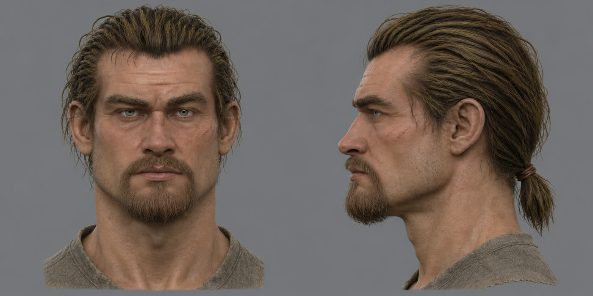

Как идёт подгонка ([`fit/fit_head.py`](fit/fit_head.py), [`fit/compare.sh`](fit/compare.sh)):
- MPFB строит мужчину с параметрами лица из JSON ([`fit/params-3.json`](fit/params-3.json));
- рендер глины идёт в ортогональной камере. Масштаб — по расстоянию между зрачками: 153 px на виде, 6,15 см на модели. Глаза ставятся на зрачки концепта, поэтому борода не сбивает отметку подбородка;
- глина накладывается на вид с прозрачностью 55 %.

Скрипты ждут виды `front_ref.png` и `profile_ref.png` рядом с собой: это половины `ortho-2b.png`, по 887 × 887.

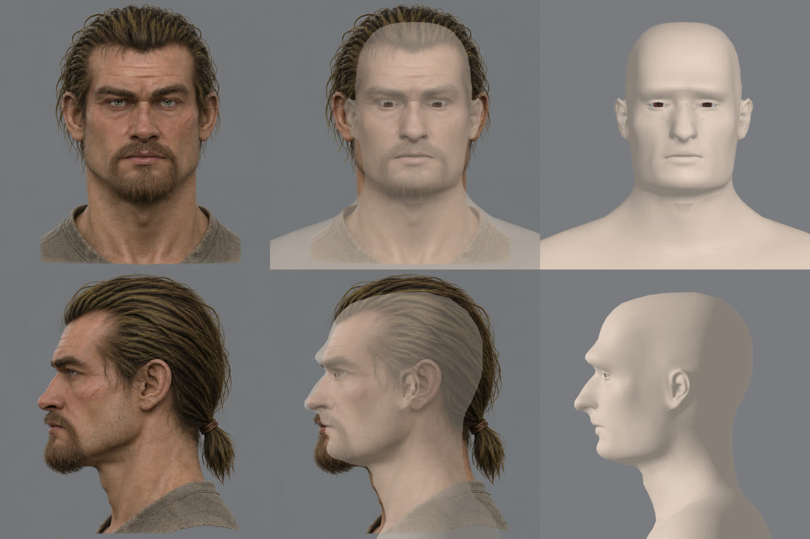

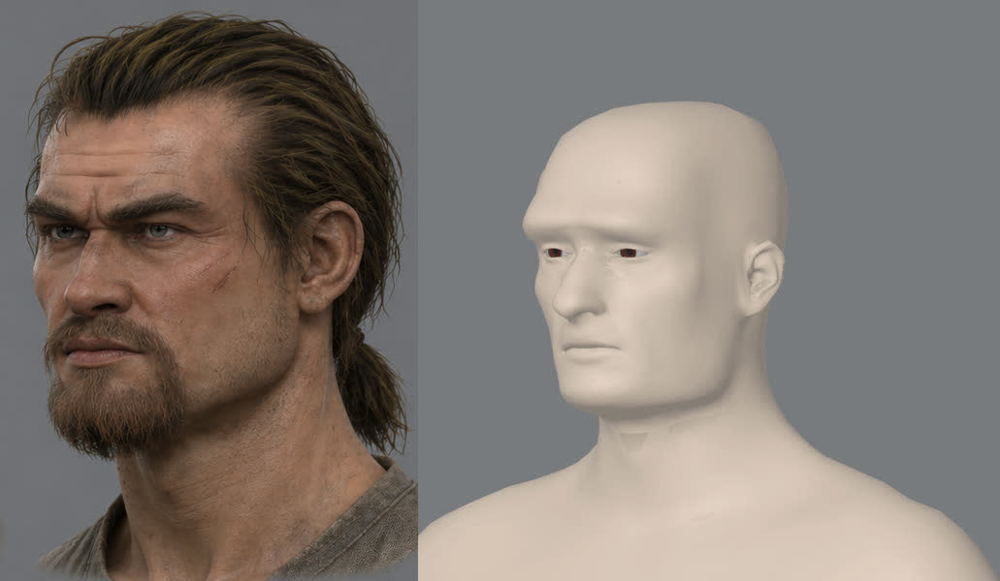

Итог трёх кругов:
- параметры MPFB дали пропорции: ширину челюсти и шеи, крупный выступающий нос, положение ушей;
- нужны ещё раздельные цели для двух сторон: глаза и скулы MPFB задаёт целями `l-` и `r-`. Скрипт ставит обе, когда имя дано без стороны, а на неизвестное имя падает, а не молчит;
- **характера лица нет**. В трёх четвертях глина — манекен: мелкие глазницы, нет нависающих надбровий, плоские скулы, нет складок у носа и рта. Это та самая ловушка «безликого среднего лица». Параметры двигают пропорции, но не лепят крупные формы.

Дальше — лепка крупных форм поверх MPFB. Это мои собственные цели-сдвиги вершин по областям лица: глазницы, надбровья, скулы, носогубные складки, линия челюсти. Они проверяются тем же наложением и видом в три четверти. Морщины и поры придут картой нормалей, а не геометрией. Цели MPFB для рта и мимики остаются: это сдвиги, и они ложатся поверх новой формы.

## Эталон формы от генератора

Решение пользователя 2026-11-05: голове героя можно взять форму у генератора 3D, но только как эталон формы. На эталон натягивается голова MPFB, а сетка, развёртка, глаза и мимика остаются её ([AGENTS.md](../../../AGENTS.md)).

Как сделано:
- **Входы.** Два вида концепта, `ortho-2b`, с вырезанным фоном. Вырезает [`fit/cutout.py`](fit/cutout.py) заливкой от краёв кадра. Простой ключ по цвету выбивал белки глаз и тени; RMBG не используется: у него лицензия CC BY-NC. Кадр — 887 px вокруг одной и той же точки головы на обоих видах. Камеры — [`fit/pixal3d-views-transforms.json`](fit/pixal3d-views-transforms.json): анфас спереди, профиль сбоку слева, угол обзора 0,349 и расстояние 3,119, как у прогонов мебели.
- **Pixal3D**, многовидовой режим, `run-mesh3d.sh --model pixal3d --views`, seed 1:
  - сетка 1024, 305 с, пик видеопамяти 16,3 ГБ, 11 млн вершин;
  - первый прогон упал на нехватке памяти: окно останавливало только Gemma. Теперь у раннера есть `--min-free-mib`, с 21000 он останавливает и Strands. Обе службы после окна снова работают;
  - сырая сетка приходит с осью +Y вверх и +Z вперёд, а не так, как написано в `meta.json`.
- **Постановка.** Эталон ставится на голову MPFB по тем же камерам, с которых сняты виды ([`fit/ref_view.py`](fit/ref_view.py)). Глаза, нос и уши легли на концепт на обоих видах.

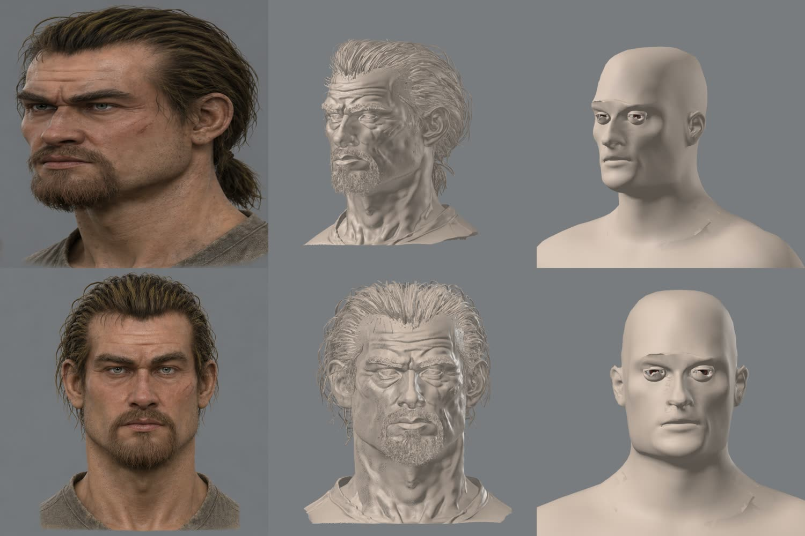

Что дал эталон: у него есть всё, чего не хватало параметрам. Нависающие надбровья, глубоко посаженные глаза, скулы, носогубные складки, уши, пряди и хвост. Но эталон грубее и старше концепта: нарисованные морщины генератор вырезал в геометрии глубокими бороздами. Поэтому с эталона переносятся только крупные формы.

**Натяжка** ([`fit/wrap_head4.py`](fit/wrap_head4.py)) — четыре прохода, ни один не сошёлся:
- от каждой вершины кожи MPFB идёт луч вдоль нормали до эталона;
- сдвиги действуют только на видимую кожу и сглаживаются по сетке;
- в итоге профиль и нос стали ближе к концепту, но лицо всё ещё манекен, а глаза выглядят как очки.

| Проход | Что меняли | Итог |
|---|---|---|
| 1 | маска без век, рта и бороды, 8 шагов сглаживания | изменения едва видны |
| 2 | 3 шага, кольцо век уже | веки ушли в глазницы эталона, глазные яблоки вылезли |
| 3 | кольцо век овальное, надбровья натянуты | на границе маски у глаз ступеньки |
| 4 | яблоки сдвинуты назад на 9 мм, веки натянуты | глаза как очки, сходства мало |

Причина, по замерам [`fit/eye_depth.py`](fit/eye_depth.py): лицо MPFB плоское. Скулы и кожа под глазами на 8–10 мм впереди эталона, а поверхность глаза у эталона на 9 мм глубже, чем передняя точка яблока MPFB. Лучи вдоль нормали и маска с кольцами — грубая замена нормальной регистрации. Они не знают, где у эталона уголки глаз, края век и губы, поэтому рвут лицо на границах маски.

Дальше, по правилу проекта, — не пятый проход подбором, а исследование. Студии делают это нежёсткой регистрацией (non-rigid ICP, R3DS Wrap) по опорным точкам: уголки глаз, края век, кончик носа, уголки рта, подбородок, уши. Заодно стоит один раз подразделить сетку лица: у головы MPFB около 2 тыс. вершин на лицо. Мелкий рельеф эталона уйдёт в карту нормалей, запечённую с него на развёртку MPFB.

## Натяжка по опорным точкам: исследование

Исследование 2026-11-05, после четырёх непринятых проходов лучами.

**Цель.** Голова MPFB с её сеткой и мимикой получает крупные формы эталона: надбровья, глубину глазниц, скулы, нос, губы, челюсть, уши. Веки при этом облегают яблоко, рот сомкнут, а формы MPFB (моргание, улыбка, звуки) работают на новой форме без разрывов.

**Как делают другие.**
- [R3DS Wrap](https://www.versluis.com/2021/11/r3ds-wrap/), стандарт студий для натяжки базовой головы на скан. Сначала задаются пары точек «база — скан». [Руководство Reallusion](https://wiki.reallusion.com/Content_Dev:Scan_to_CC3+_Wrap_Procedures) требует их на бровях, ушах, внешнем крае губ (иначе рот сжимается), по одной в каждой ноздре, на носогубной складке, по четыре на внешнем и внутреннем крае каждого века. Потом идёт натяжка от жёсткой к мягкой. Глазные яблоки и полость рта из натяжки исключают выбором полигонов и ставят после: решёткой по новым векам или вручную. Последний шаг — кисть: расслабить сетку и поправить глаза. Частая ловушка из отчётов пользователей — яблоки, выдавленные из лица после натяжки. Она же случилась у нас во втором проходе.
- [Optimal Step Non-rigid ICP](https://shapemodelling.cs.unibas.ch/gravis-literature/publications/2007/CVPR07_Amberg.pdf) (Amberg и др., 2007) — открытая основа того же приёма. У каждой вершины своё аффинное преобразование. Жёсткость между соседями снижается по шагам: сначала голова двигается целиком, к концу — местно. Опорные точки тянут сильнее всего на первых шагах. Соответствия на краю эталона и с нормалями в разные стороны отбрасываются. Реализации: [MATLAB](https://mathworks.com/matlabcentral/fileexchange/54077-optimal-step-nonrigid-icp), [PyTorch с лицевым шаблоном BFM](https://github.com/wuhaozhe/pytorch-nicp). В trimesh 5.2 есть `registration.nricp_amberg`.
- Мелкий рельеф скана в сетку не тянут, его запекают в карту нормалей. Сетка базы сохраняет свои петли вокруг глаз и рта, иначе ломается мимика.

**Что есть у нас.**
- Blender 5.2 с MPFB 2.0.18. Помощники глаз (`helper-l-eye`, `helper-r-eye`) и группы суставов дают опорные точки на стороне MPFB по номерам вершин, без ручной разметки.
- Формы мимики MPFB (лицевые цели, виземы, ARKit) — это сдвиги вершин базовой сетки. Пока число и порядок вершин те же, они ложатся на новую форму. Поэтому сетку при натяжке **не подразделяем**: подразделение сломало бы все формы. Плотность нужна только для вида, её даст подразделение при выводе, а рельеф — карта нормалей. Моё прежнее предложение подразделить лицо отменяется.
- Эталон Pixal3D: 11 млн вершин, в нужном месте после поворота `R` и фиксированного `ref_origin`.
- В Python Blender нет scipy. Поэтому отдельное окружение `~/.local/share/gothic-ai/mpfb/venv`: numpy, scipy 1.18 и trimesh 5.2 из кэша uv, без сети. Blender выгружает сетку и маски в `.npz`, регистрация считается в окружении, результат возвращается в Blender формой `hero_reg`. Готовую `nricp_amberg` не берём: она не умеет вес по вершинам, а нам он нужен. Без rtree она всё равно ищет соседей через `cKDTree`. Пишем свою по той же формуле: жёсткость, данные с весом по вершине, опорные точки.
- Опорные точки на эталоне ставлю я по рендерам анфаса и профиля с сеткой. Точку на картинке луч переносит на поверхность эталона.

**Способ.**
1. Опорные точки, около 40 пар: уголки и по два-три на краю каждого века, брови, переносица, кончик и крылья носа, ноздри, уголки и края губ, подбородок, углы челюсти, козелок и верх уха.
2. Регистрируется только кожа головы. Яблоки, зубы, язык, ресницы и брови-прокси — нет. Вес данных — ноль у внутреннего края век и губ, у ноздрей внутри, у бороды и волос эталона (там поверхность волос, а не кожи). Эти вершины ведёт жёсткость, их положение задают опорные точки.
3. Жёсткость по шагам, по Амбергу: от 100 до 1, вес опорных точек от 10 до 1. На последних шагах — порог расстояния (2 см) и отказ при нормалях больше 60°.
4. Яблоки ставятся после натяжки: сфера с радиусом MPFB так, чтобы край век лёг на неё с зазором до 0,5 мм.
5. Мелочь эталона вне формы, например вырезанные морщины, сетку не двигает: жёсткость последнего шага не опускается ниже уровня, на котором полосы шириной 3–4 мм перестают проходить в сетку.

**Приёмка** — глазом пользователя по листу: концепт 2b, эталон и наша голова в анфас, три четверти и профиль. Отдельно — та же голова с тремя формами мимики (моргание, улыбка, «о»): ничего не рвётся и не проваливается. Числа — ограничители:
- расстояние кожи лица до эталона: медиана до 1,5 мм, 95 % — до 4 мм;
- зазор между краем века и яблоком — до 0,5 мм, без пересечений;
- губы сомкнуты в покое.

## Натяжка по опорным точкам: первый результат

Скрипты — [`fit/reg/`](fit/reg/), по порядку:
1. `reg_export.py`: выгрузка кожи MPFB и эталона, кадры для разметки;
2. `lm.json`: 36 пар опорных точек, из них 4 на средней линии находятся сами;
3. `reg_solve.py`: регистрация;
4. `reg_apply.py`: форма `hero_reg` и сдвиг яблок.

Точки на эталоне я ставил не по его серой сетке, а по концепту 2b, переложенному в кадр эталона. Совпадение концепта и эталона по наложению — в пределах пикселя, а глаза и губы на концепте читаются точно. Глубину точке даёт эталон.

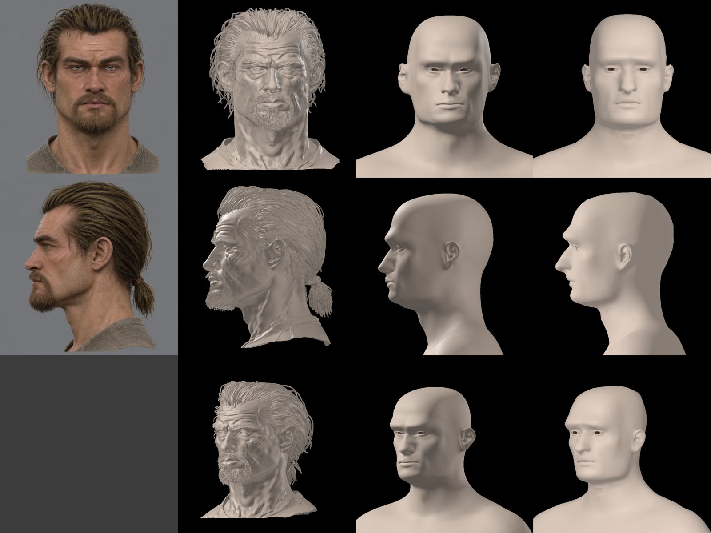

Слева направо: концепт 2b, эталон Pixal3D, натяжка r7 с одним уровнем подразделения при рендере, прежняя подгонка параметрами r3.

**Что перешло.** Тяжёлые надбровья, глубокие глазницы, широкие скулы, складки от носа, квадратная челюсть, уши на 2 см дальше назад и выше. Кожа лица в среднем в 0,45 мм от эталона, 95 % — до 3 мм: ограничитель из заметки выполнен. Опорные точки в среднем в 1 мм от цели. Сетка и число вершин MPFB те же, поэтому формы мимики ложатся на новую голову.

**Грабли, найденные по пути**, все исправлены в `reg_solve.py`:
- полость рта MPFB, преддверие между губами и дёснами и выстилка глазниц — часть кожи. В натяжке аффинные преобразования уносили их сквозь щёки на 4 см. Теперь они вне решения и идут вслед за кожей: рот — по ближайшим вершинам, глазница — вместе с яблоком;
- кубики суставов MPFB (`JointCubes`) не входят в `HelperGeometry`. Кожа — это группа `body`;
- вершины, которые смотрят внутрь головы, и складки, где луч по нормали снова упирается в голову, данных не получают;
- угловатые пятна на щеках — тени EEVEE на крупных полигонах. С подразделением их нет.

**Что не решено: глаза.** Яблоки сдвинуты туда, куда их ставят веки эталона: на 5–8 мм назад, на 2–6 мм вверх и на 3–4 мм к середине. Но веки при натяжке ломаются. При мягких веках (r7) глаза — щёлки. При сильном весе опорных точек век (r8, r9) края век складываются и проходят по яблоку: 86–102 вывернутых треугольника против 41.

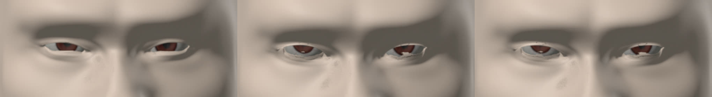

Это та же ловушка, о которой пишут пользователи Wrap: глаза после натяжки чинят отдельно. Подбирать веса в четвёртый раз не стану. Следующий шаг — глаз как отдельный блок:
- яблоко, глазница и веки до края орбиты двигаются вместе, одним сдвигом и масштабом. Так связь век с яблоком MPFB сохраняется;
- регистрация отвечает только за кожу вокруг;
- разрез глаза открывается формами век MPFB (`eye-*` и лицевые цели), а не натяжкой.

## Глаз отдельным блоком

Сделано по плану выше, решение пользователя 2026-11-05 («да, делай глаза»). Скрипты лежат в [`fit/reg/`](fit/reg/), запуск — `reg_solve.py <папка> sched7.json`.

1. **Форма разреза — целями MPFB.** Сдвиги целей линейны, поэтому их значения подбираются задачей наименьших квадратов с границами 0..1 (`lsq_linear`) по опорным точкам век. Подбор идёт в плоскости анфаса (x, z), глубину решает следующий шаг. Цели:
   - `eye-trans`, `eye-scale`, `eye-height1..3`, `eye-corner1/2` — их сдвиги снимает `eye_deltas.py`;
   - лицевые единицы ARKit `eyeBlink` и `eyeSquint` — их читает `fu_deltas.py`. Они ведут веко по яблоку, а не сквозь него;
   - `eyeWide`, `push`, мешки и складку из подбора исключил: они спорят с остальными.

   Итог подбора: моргание 0,22–0,25 и прищур 0,19 вошли в форму покоя. Это «лёгкий прищур, взгляд исподлобья» из [замысла](intent.md).
2. **Глубина — блоком.** Яблоко, глазница, веки, суставы глаза и помощники до 6 мм от яблока сдвигаются вместе, на 7,5–10 мм назад. Дальше, до 16 мм, сдвиг плавно сходит на нет. Регистрация не трогает ядро блока, а вес данных у его кромки нарастает на 8 мм. Кожу вокруг ведёт жёсткость.
3. **Опорные точки века стоят на краю века.** Прежние точки я брал по картинке: «передний слой у пикселя». На деле это была складка над краем века, поэтому глаз раскрывался на 10 мм вместо 6. Теперь края века отобраны глазами по рисунку сетки, где помечены вершины на границе разреза: вершины 6838, 7748, 13358, 7762, 7761, 7760, угол 7770 и симметричные справа. Внешний угол уходит назад за кромку, его точку я убрал. Все опорные точки хранятся номерами вершин MPFB в [`lm_fixed.json`](fit/reg/lm_fixed.json), поэтому новая подгонка их не сбивает.

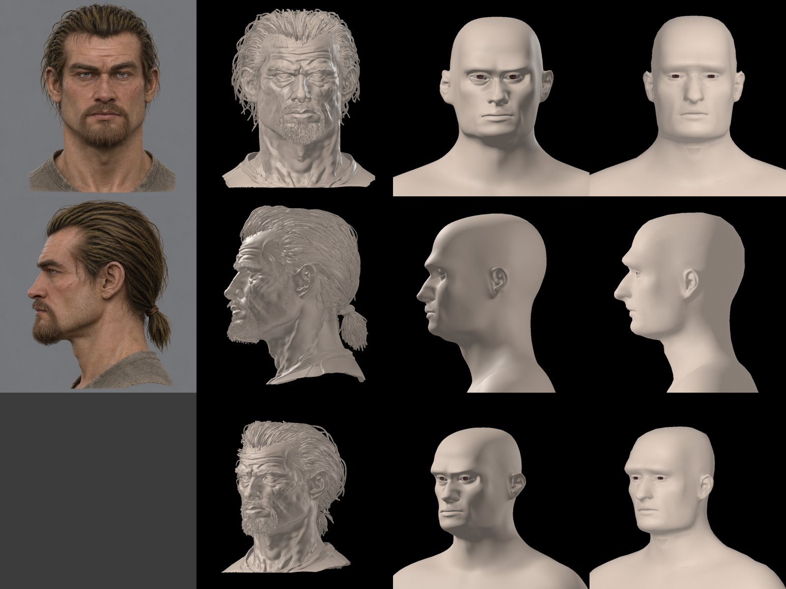

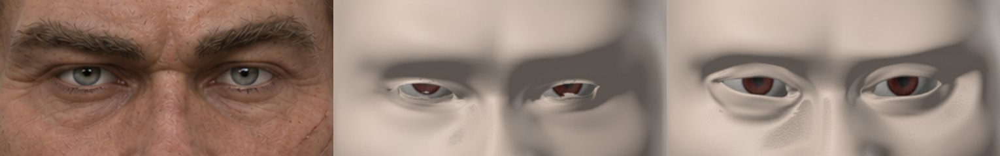

Итог r14:
- веки лежат на яблоке, кожи внутри яблока нет;
- верхнее веко прикрывает радужку сверху, как на концепте;
- вывернутых треугольников 54 против 86–102 у r8–r9, это уши, ноздри и угол рта;
- кожа лица в среднем в 0,5 мм от эталона, 95 % — до 4,6 мм;
- опорные точки вне глаз в среднем в 0,7 мм от цели.

Подбор целей глаза плохо обусловлен: при сдвиге целей на 0,005 мм решение меняется, и отдельные вершины уходят до 5 мм. На вид разницы нет (r14 и r15).

**Мимика** на новой голове — лицевые формы ARKit из MPFB поверх `hero_reg`, `expr.py`:

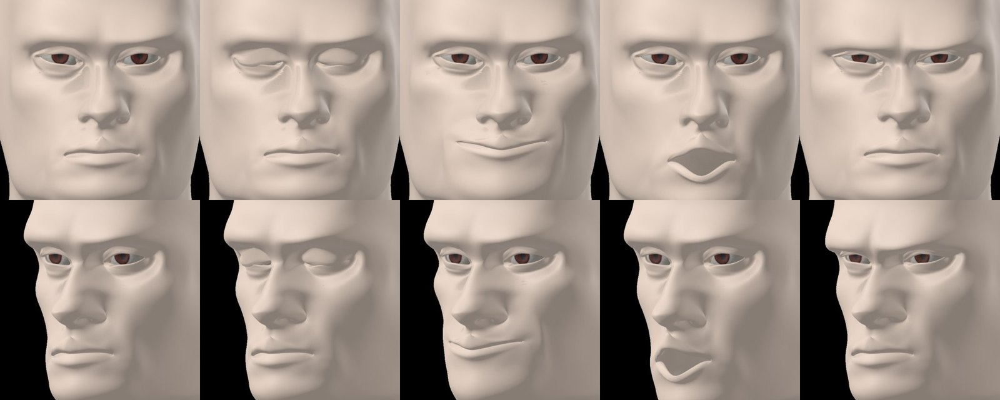

Улыбка, «о» и злость ничего не рвут. Моргание закрывает глаз, но край верхнего века у правого глаза при закрытии мнётся. Сдвиги ARKit рассчитаны на исходный разрез, а форма покоя уже несёт моргание 0,23 и подогнанный разрез.

## Моргание и глаза

Решение пользователя 2026-11-05 («моргание и глаза»).

**Моргание** собрано заново под нашу голову, скрипт [`fit/reg/blink_build.py`](fit/reg/blink_build.py):
1. Основа — `eyeBlink` из MPFB с силой `1 − b0`: `b0` = 0,22–0,25, это моргание, уже вошедшее в форму покоя.
2. Край верхнего века ложится на край нижнего по длине дуги, на 0,15 мм выше. Цепочки края сняты вручную по рисунку сетки ([`lid_chains.json`](fit/reg/lid_chains.json)), правая проверена зеркалом: сдвиг ровно 1,7 мм, это асимметрия лица. Подбор края правилом находил только куски петли. Закрытие ARKit не доводило край до низа на 5–6 мм.
3. Поправка расходится по веку гармонически. Края век и граница области стоят на месте.
4. Кожа века выталкивается из яблока, включая роговицу, до зазора 0,3 мм. Выталкивание чередуется со сглаживанием.
5. Прямая смесь «открыт — закрыт» режет яблоко. Поэтому есть промежуточные кадры 0,25, 0,5 и 0,75, каждый вытолкнут отдельно. Выстилка века идёт за кожей, а не сама по себе. Для движка это кадры морф-анимации моргания: `R_EYESBLINK` и так анимация из кадров.

Итог: во всех кадрах кожа века снаружи яблока, зазор не меньше 0,2 мм. Края смыкаются с зазором 0,17 мм. Выстилка заходит в яблоко до 0,9 мм, её не видно: в покое она и так лежит за яблоком.

Клип: [blink.mp4](blink.mp4). Кадры сверху вниз: открыт, 0,25, 0,5, 0,75, закрыт.

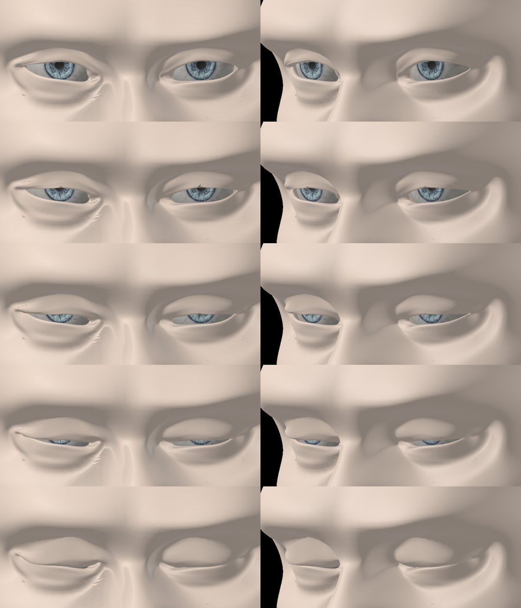

Известный огрех: в кадрах 0,25–0,5 на середине верхнего края видна тёмная точка в пару пикселей. Это выстилка, она выглядывает над краем. В игру эти кадры не идут (раздел «Голова в игре»).

**Глаза.** Серо-голубая радужка сделана из CC0-текстуры MPFB `lightblue`: радужка на 75 % сведена к холодному серому своей яркости и затемнена на 15 %, средний цвет `#616f78`. Белок и прозрачность текстуры сохранены. Без альфы роговица становится непрозрачной и чёрной — так и случилось с первой версией. Рецепт — [`fit/reg/eye_tex.py`](fit/reg/eye_tex.py). PNG как исходник ассета уйдёт в content-sources вместе с текстурами кожи.

## Голова в игре

Решение пользователя 2026-11-05 («да, ставь»): наша голова встаёт в игру вместо [тестовой](test-head.md).

**Выгрузка** — тот же [`mpfb/export_test_head.py`](mpfb/export_test_head.py) с ключом `--hero`. Он берёт пробу MPFB и превращает её в голову героя:
- форма покоя — натяжка r15 (`reg.npz`);
- `eyeBlinkLeft` и `eyeBlinkRight` — закрытый кадр нашего моргания, своя сторона у каждого;
- яблоки стоят там, где вокруг них строилось моргание;
- радужка серо-голубая;
- зубы и язык подогнаны по своей привязке MPFB.

Брови и ресницы MPFB привязаны к вспомогательной сетке, а её натяжка не формировала. С этой привязкой ресницы висели над веком и не шли за морганием. Поэтому они перепривязаны к самой коже: каждая вершина хранит ближайший треугольник кожи и сдвиг в его осях. По этой привязке они строятся на новой форме и на каждой форме мимики.

```sh
W=~/.local/share/gothic-ai/mpfb/work/reg
BLENDER_USER_RESOURCES=~/.local/share/gothic-ai/mpfb/blender \
  blender -b ~/.local/share/gothic-ai/mpfb/work/probe.blend -P export_test_head.py -- \
  ~/.local/share/gothic-ai/content-tests/hero-head-1 --hero $W/r15 $W $W/eye_greyblue.png
```

Что выходит: `characters/hero/head.glb`, 6,3 МБ, профиль лица `head.face.json` (копия профиля тестовой головы: имена форм те же) и материалы `OWN_HERO_HEAD_*`. В лице 4 151 вершина и 67 форм. Кроме того, 22 формы у бровей, 32 у ресниц, 12 у зубов и 13 у языка. Каталог тестовый, вне рабочего контента. В пакет GothicMOD голова поедет вместе со своими текстурами.

**Одна форма моргания вместо кадров.** Профиль движка смешивает формы линейно, поэтому моргание в игре — одна форма, закрытый кадр. Промежуточные кадры 0,25–0,75 в выгрузку не идут, вместе с ними ушла и точка выстилки. Цена такая: на половине пути веко заходит в яблоко на 1–2 вершинах, не глубже 0,8 мм. Для сравнения, в построенных кадрах зазор был не меньше 0,25 мм.

Если это станет заметно, есть путь лучше: промежуточные кадры можно сделать отдельными формами и пройти их кадрами анимации `R_EYESBLINK`. Профиль это уже умеет.

**Съёмка** — `hero-head.bench` на Ryzen, 1920×1080, клипы лежат вне git в `~/.local/share/gothic-ai/remaster/hero-head/hero-1/`:

```sh
TEMPEST_WINDOW_SIZE=1920x1080 BENCH_HOST=ryzen OPENGOTHIC_CONTENT=~/.local/share/gothic-ai/content-tests/hero-head-1 \
  scripts/bench.sh scripts/bench/hero-head.bench ~/.local/share/gothic-ai/remaster/hero-head/hero-1
```

В журнале игры: `loaded head for PC_HERO: 7 parts, 10004 vertices, 67 targets`, профиль на 10 анимаций.

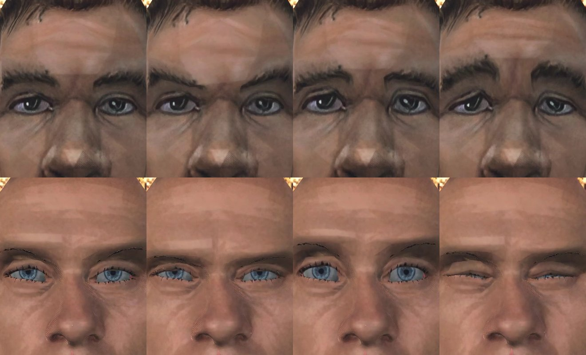

Моргание в игре: веко закрывается за 2–3 кадра при 30 кадрах в секунду и так же открывается.

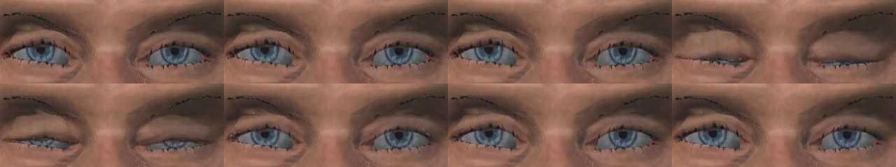

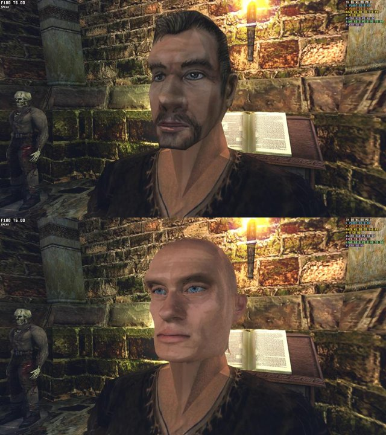

Что видно:
- форма держится: надбровья, глубокие глазницы, широкий нос и скулы те же, что на эталоне. Злость, испуг и боль читаются;
- **глаза слишком светлые и яркие**. При свете факела радужка выходит голубой, хотя карточка просит «серо-голубые, не яркие». В Blender та же текстура темнее. В игре у глаза пока нет ни роговицы, ни тени века на яблоке, это шаг 7 плана. Радужку надо затемнить уже сейчас, а окончательный цвет подбирать вместе с шейдером глаза;
- в закрытом глазу по шву видна тонкая голубая линия: зазор 0,17 мм между краями век при увеличении 1,16;
- у внутреннего угла глаза и под бровью кожа покрыта мелким точечным узором. У тестовой головы его нет. Скорее всего, это тень в глубокой глазнице, а не сетка. Проверить в движке;
- у внешнего угла правого глаза — красная точка в пару пикселей;
- кожа, брови и ресницы пока от MPFB: голова лысая, розовая и чистая, бороды нет. Пропорцию и челюсть рядом с оригиналом можно оценить только с бородой и волосами.

**Дальше:**
- **Текстуры головы** по концепту 2b: кожа с загаром, грязью и щетиной, карта нормалей с эталона (мелкий рельеф эталона в сетку не переносится, его надо запечь), брови.
- **Волосы с хвостом и бородка** — сначала исследование: карты прядей на нашем движке ещё не делали.
- **Радужка темнее**, затем глаз вместе с шейдером (шаг 7).

## Пилот

Порядок:
0. **База для сравнения.** Клипы оригинала в игре: крупный план на камере диалога (разговор с NPC, моргание, губы) и бег со спины в третьем лице. С тех же камер потом снимается наше.
1. **Замысел** — [intent.md](intent.md), его смотрит пользователь.
2. **Концепт** `image_gen`: два-три варианта лица, разворот (анфас, три четверти, профиль, со спины) и кадр в сцене диалога. Цвет — из таблицы выше.
3. **Модель в Blender** — моя работа. Основа — голова MPFB 2 (решение пользователя 2026-11-05). У неё готовая топология под анимацию, формы рта и мимика. Форму я довожу до Безымянного по концепту, текстуры делаю свои. Отвергнутый вариант — лепка с нуля по концепту, как у предметов: для реалистичного лица это новый и самый рискованный приём.

   Бюджет — ограничитель: голова 10–15 тыс. треугольников, глаза отдельно, волосы — карточками ещё 5–10 тыс. Лицо — 2048 × 2048: цвет, нормали, ORM и маска рассеяния.
4. **Морфы**: те же 10 имён, что у оригинала, тогда моргание, настроения и губы подхватят голову без правок. `VISEME` — 16 кадров по возрастанию раскрытия, собранных из форм по звукам. Губы по звукам, а не по громкости — следующий шаг, его готовят эти формы.
5. **Движок.** Загрузчик морф-целей glTF, своя голова героя по признаку игрока, кости глаз, которые ведёт `Gaze`. Загрузчик — не визуальная часть, её можно отдать исполнителю. Шейдер кожи, глаз и волос делаю я.
6. **Приёмка** — по клипам с камер шага 0, «оригинал | наше». Смотрит пользователь. Числа — только ограничители: шов шеи, цена кадра на Mac и Ryzen по `perf.sh`.

**Образец** (решение пользователя 2026-11-05): концепт делается с лицом оригинала как образцом. В `image_gen` идёт только текстура лица `HUM_HEAD_V18_C0` в виде ESRGAN ×4, 1024 × 512, PNG в пустом каталоге разведки. Кадры игры и меши не идут. Поэтому голова — производная от оригинала:
- в реестре у неё вход `original texture HUM_HEAD_V18_C0`;
- в раздаче она уходит в отдельный пакет под GothicMOD, как перерисованные оригиналы ([доставка контента](../../../docs/content-delivery.md)).
