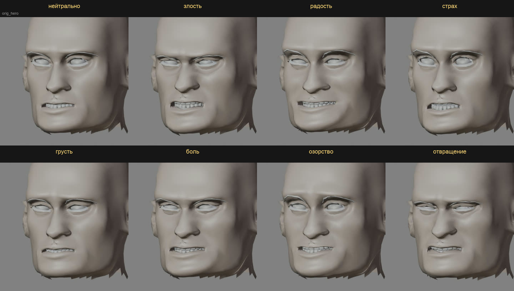

# Audio2Face-3D: сколько стоит

Короткое исследование 2026-11-05 перед тем, как ставить мимику всего лица по звуку в план. Вопрос: насколько требовательна модель и потянет ли её `dev-ubuntu` рядом с остальными моделями.

## Что это

Audio2Face-3D от NVIDIA по звуку речи считает движение кожи лица, челюсти, языка и поворот глаз. Есть две модели:

- **v2.3, регрессия** (CNN). Каждый кадр считается из окна звука 0,52 с, остальные кадры на него не влияют.
- **v3.0, диффузия** (около 180 млн параметров, HuBERT на входе, 2 шага диффузии). Каждый проход берёт секунду звука и выдаёт 30 кадров, из которых берутся средние 0,5 с. Окно сдвигается на 0,5 с.

Выход сначала идёт в вершинах их лица (Mark, Claire, James). Затем решатель форм (blendshape solve, 0,3 мс) переводит его в веса ARKit. Наша голова построена на тех же 52 формах ARKit, поэтому веса ложатся на неё без перевода. Отдельная сеть Audio2Emotion угадывает по голосу эмоцию и подаёт её на вход как метку.

Лицензии:

- SDK — MIT;
- веса — NVIDIA Open Model License, допускает коммерческое использование;
- Audio2Emotion на Hugging Face закрыта: её выдают после согласия с лицензией под своим аккаунтом.

## Требования

| | v2.3 регрессия | v3.0 диффузия |
|---|---|---|
| Видеопамять, по статье (TensorRT, 1 поток) | 0,6 ГБ на 8 потоков | 1,4 ГБ; 4,0 ГБ на 8 потоков |
| Видеопамять, по плагину Unreal | 2,9–3,0 ГиБ | 4,4 ГиБ |
| Скорость на RTX 4090, TensorRT, 1 поток | 453 кадра/с | 3269 кадров/с |
| Потоков по 30 кадров/с на RTX 4090 (NIM) | 80 | 35 |
| Задержка по устройству окна | ~0,26 с звука вперёд | до ~0,75 с звука вперёд |

Источники: [статья NVIDIA](https://arxiv.org/html/2508.16401v1), [таблица плагина Unreal](https://archive.docs.nvidia.com/ace/ace-unreal-plugin/latest/ace-unreal-plugin-support-matrix.html), [замеры NIM](https://archive.docs.nvidia.com/ace/audio2face-3d-microservice/latest/text/interacting/performance.html), [SDK](https://github.com/NVIDIA/Audio2Face-3D-SDK), [карточка v3.0](https://huggingface.co/nvidia/Audio2Face-3D-v3.0).

Чем считает:

- SDK: TensorRT ≥ 10.13 и < 11, CUDA ≥ 12.8 и < 13, Linux или Windows, 4 ГБ видеопамяти и больше;
- сервис NIM в Docker: около 9 ГБ видеопамяти. Для нас он слишком тяжёл.

RTX 3080 и 3090 есть в списке проверенных карт v3.0.

## Что это значит для нас

**Вычисления — мелочь.** Реплика длиной 5 с на диффузии — это 10 проходов, по замеру на 4090 около 0,1 с работы. На 3090 будет медленнее, но в пределах того же порядка. Видеокарта занята долями процента времени, а Gemma и Strands этого не заметят.

**Видеопамять влезает.** На `dev-ubuntu` занято 16,1 ГБ из 24 (`nvidia-smi` 2026-11-05), свободно около 8 ГБ. Один поток v3.0 займёт 1,5–4,5 ГБ. Но к цели «всё на одном ПК от 16 ГБ видеопамяти» это прибавляет ещё 1,5–4,5 ГБ, а наши модели уже заняли 16 ГБ.

**Ставится в обход системы.** На `dev-ubuntu` стоят драйвер 610 и CUDA 13.3, а SDK требует CUDA 12.x. Системную CUDA менять нельзя. Нужные 12.x и TensorRT 10 есть пип-колёсами (`nvidia-cuda-runtime-cu12`, `tensorrt-cu12`): их можно поставить в `~/gothic-ai/a2f/.venv`, а новый драйвер умеет исполнять CUDA 12. Docker и NIM не нужны.

**Задержка — главное ограничение.** Модели нужен звук на 0,26–0,75 с вперёд от кадра. Поэтому сервер должен прогнать первый кусок звука через Audio2Face и только потом отдавать его игре. Получается так:

- Если ждать всю реплику, голос NPC начнётся на 0,1–0,3 с позже, чем сейчас: Inworld отдаёт реплику быстрее реального времени, а прогон всей реплики — около 0,1 с.
- Если отдавать кусками, нужен буфер около 0,75 с на диффузии или около 0,3 с на регрессии.

**Русский язык не проверен.** Модель учили на английской и китайской речи. Губы она строит по звуку, а не по словам, поэтому русский должен работать, но замеров на русском нет. Это главный риск, и проверять его надо до любой интеграции.

**Mac и игроки без NVIDIA.** На Mac модель не работает: нужен TensorRT. Значит, это сервис на `dev-ubuntu`, а у игрока без карты NVIDIA лицо остаётся на нашей процедурной мимике и виземах из шага 6.

## Что предлагаю

1. **Проверка на наших голосах, полдня.** Поставить SDK в `~/gothic-ai/a2f/` на `dev-ubuntu`. Прогнать 5–6 русских реплик Inworld: спокойную, злую, испуганную, с паузами, с быстрой речью. Пропустить их через v2.3 и v3.0 и снять веса ARKit. В Blender наложить их на тестовую голову и собрать клипы со звуком. Замерить время прохода и видеопамять на 3090.
   - Принимается по клипу со звуком: губы попадают в слоги, брови и веки живут в такт речи. Принимает пользователь на глаз.
   - Скачивание SDK и весов (около 10 ГБ с TensorRT-движками) — с разрешения пользователя. Audio2Emotion требует аккаунта Hugging Face, поэтому пока без неё: эмоцию берём из `mood` реплики.
2. **Если клипы приняты** — сервис `gothic-a2f` на `dev-ubuntu`. Сервер шлёт ему звук реплики, а игре отдаёт звук вместе с дорожкой весов, и дорожка идёт в `FaceRig` (шаги 3–4). Это новый шаг плана после 7. Шаг 6 (виземы Inworld) остаётся запасным путём для игроков без NVIDIA и на случай, если сервис упал.

## Проверка на русской речи (2026-11-05)

Пункт 1 сделан. Ролик лежит вне git, в `~/.local/share/gothic-ai/remaster/hero-head/a2f-check-1/a2f-ru-check.mp4`: в нём оригинальная озвучка и голос с микрофона. Там же веса по кадрам. В ролике шесть реплик по 9 с на тестовой голове, у каждой три колонки:
- v2.3;
- v3.0 как есть;
- v3.0 с поправкой губ.

Реплики:
- клоны Inworld: Ксардас и герой;
- оригинальная русская озвучка: герой, Сильвио и Бифф;
- микрофон игрока из записанной сессии.

Новый платный TTS не заказывали.

**Как поставлено.** Всё лежит в `~/gothic-ai/a2f/` на `dev-ubuntu`, системное не трогали.
- SDK с GitHub, веса v3.0 и v2.3 Mark с Hugging Face. Claire, James и Audio2Emotion не качали.
- TensorRT 10.13.3 из архива NVIDIA под CUDA 13, системная CUDA 13.3. SDK формально требует CUDA 12, но собирается с двумя правками:
  - в двух файлах `*_cuda.cu` тип `thrust::pair<…> minmax` заменён на `auto`: в CCCL 3 из CUDA 13 этого типа нет;
  - для gcc 15 добавлен флаг `-include cstdint`.
- Движки TensorRT собраны `trtexec` на пачку до 4 (v2.3) и до 2 (v3.0) потоков.
- Веса по кадрам выдаёт маленькая программа [`a2f/a2f-weights.cpp`](a2f/a2f-weights.cpp): wav на входе, CSV с 52 весами ARKit и 16 весами языка на выходе. Собирается как пример внутри SDK. Решатель форм — на CPU.
- Клипы рендерит [`a2f/render_a2f.py`](a2f/render_a2f.py) (Blender, Workbench). Числа считает [`a2f/sync.py`](a2f/sync.py).

**Замеры на RTX 3090** (рядом работали Gemma, Strands, FRIDA и детектор смеха):

| | v2.3 | v3.0 |
|---|---|---|
| Сеть на один проход (`trtexec`) | 1,2 мс на кадр | 5,7 мс на окно в 1 с |
| Реплика 9 с целиком, с решателем на CPU | 0,54 с | 0,95–1,07 с |
| Загрузка модели (в сервисе — один раз) | 0,45–0,58 с | 0,8–1,0 с |
| Кадров на выходе | 30/с | 60/с |
| Видеопамять сверх занятой, пик | ≤ 1,6 ГБ (оба прогона по очереди, замер раз в 0,2 с) | |

Реплика считается в 10–17 раз быстрее, чем звучит. Время уходит в основном на решатель форм на CPU и копирование. Сама сеть v3.0 занимает около 6 мс на секунду речи, так что с решателем на GPU будет быстрее.

**Что видно.** Губы сравнивал с громкостью: раскрытие рта против огибающей звука.
- **v3.0.** Губы идут за звуком без сдвига: лучшее совпадение на нулевом сдвиге в 5 репликах из 6, на 33 мс в одной. Рот открывается до 0,5–1,0. Брови живут в такт речи: `browInnerUp` и `browOuterUp` доходят до 0,26–0,37. На громких и ударных местах лицо напрягается.
- **v2.3.** Губы отстают на 33–66 мс. Рот открывается вдвое слабее, до 0,24–0,52. Брови почти стоят на месте, не выше 0,09. На вид это аккуратный рот, а остальное лицо мёртвое.
- **Русская речь.** Явных провалов нет ни у клонов Inworld, ни у оригинальной озвучки, ни у микрофона игрока. Хуже всего совпадение у Сильвио (0,16): речь у него с придыханием, рот подвижный, но не по громкости. Это надо смотреть на глаз.
- **Моргания и взгляд.** Модель их не даёт: `eyeBlink` до 0,07, формы `eyeLook*` решатель отключает. Взгляд остаётся на шаге 5, моргание — на нашем `EyeBlink`. Повороты глаз сеть выдаёт отдельно, в проверке их не снимали.
- **Ломка губы на v3.0.** В 7–18% кадров нижняя губа проваливается внутрь: модель ставит сильные `mouthRollLower` и `mouthClose` при почти закрытой челюсти. В ARKit `mouthClose` задаётся поверх открытой челюсти, а формы MPFB глубже, чем у Mark. Поправка убирает ломку:
  - `mouthClose` не больше `jawOpen`;
  - подворот губ ×0,5.

  Это правило перевода весов в `FaceRig`. Позже его заменят корректирующие формы.

**Итог.** Технически v3.0 подходит:
- быстрая;
- около 1,5 ГБ видеопамяти;
- даёт лицо целиком, не только рот;
- русскую речь держит.

v2.3 стоит держать только как запасной путь с меньшей задержкой. Окончательное слово — за пользователем по ролику.

## Сравнение с LAM Audio2Expression (2026-11-05)

[LAM Audio2Expression](https://github.com/aigc3d/LAM_Audio2Expression) от Alibaba — единственная другая открытая модель, которая по звуку выдаёт 52 веса ARKit. Лицензия Apache 2.0 указана и у кода, и у весов на Hugging Face (`3DAIGC/LAM_audio2exp`).

Устройство:
- звук разбирает `wav2vec2-base-960h`, английская модель распознавания речи;
- поверх неё декодер, 30 кадров в секунду;
- после декодера идут сглаживание и случайные моргания.

Поставлена в `~/gothic-ai/a2f/lam/`: свой venv, PyTorch 2.1.2 под CUDA 12.1. Прогон всех реплик — [`a2f/lam_run_clips.py`](a2f/lam_run_clips.py). Ролик рядом с первым, вне git: `a2f-check-1/a2f-vs-lam.mp4`. Слева Audio2Face v3.0 с поправкой, справа LAM.

**Замеры:**

| | Audio2Face v3.0 | LAM |
|---|---|---|
| Реплика 9 с, GPU | ~1,0 с | 0,03 с (после прогрева; первый прогон 12 с) |
| Реплика 9 с, CPU, 4 потока | нет, только TensorRT | 0,31 с ([`a2f/lam_cpu_probe.py`](a2f/lam_cpu_probe.py)) |
| Видеопамять сверх занятой | ≤ 1,6 ГБ | ~1,1 ГБ, из них 0,57 ГБ сама модель |
| Загрузка | 0,8–1,0 с | ~1,0 с |

На CPU веса совпадают с GPU до 0,0001. Расходятся только моргания, потому что они случайные.

**Что видно:**
- **Рот.** LAM открывает рот шире: до 0,84–0,95. Губы сильнее привязаны к громкости: совпадение 0,46–0,81 против 0,16–0,62 у v3.0. Но сдвиг гуляет от реплики к реплике, от −66 до +231 мс. У v3.0 он стабильно 0–33 мс. На стоп-кадрах LAM чаще держит рот приоткрытым с зубами там, где v3.0 смыкает губы.
- **Брови.** У LAM они ровно 0: сеть их не двигает. В коде есть только опция случайного движения бровей по громкости, она выключена. Лицо выше рта живёт только морганиями.
- **Моргания.** LAM вставляет случайные моргания до 0,9. У нас моргание уже есть в `EyeBlink`, их надо срезать.
- **Русская речь.** Явных провалов нет. Но звук разбирает английская модель распознавания, поэтому точность формы губ на русских звуках надо судить на глаз.

**Вывод.**
- По качеству лица впереди Audio2Face v3.0: брови, стабильная синхронизация, без лишнего открытия рта.
- LAM сильна другим: в 30 раз легче и работает на процессоре быстрее реального времени. Поэтому она годится в путь для игроков без NVIDIA и для Mac: рот и челюсть по звуку, а брови, взгляд и моргание дают наши слои. Это лучше визем по громкости, но решать по ролику.
- Модель весом около 95 млн параметров на CPU — это уже вопрос правила «больших моделей на MacBook не запускаем». Ставить её в игру на Mac можно только с решения пользователя.

## Эмоции на входе (2026-11-09)

Вопрос пользователя: можно ли к лицу по звуку на формах Mark ([формы мимики](face-shapes.md)) добавить глаза, брови, прищур — чтобы на лице читалась эмоция, а не только движение рта.

**Что умеет модель.** Audio2Face v3.0 принимает на вход метку эмоции: десять эмоций, у каждой своя сила от 0 до 1 (`network_info.json`):
- удивление (`amazement`), злость (`anger`), озорство (`cheekiness`), отвращение (`disgust`), страх (`fear`);
- горе (`grief`), радость (`joy`), одышка (`outofbreath`), боль (`pain`), грусть (`sadness`).

Без метки эмоция нейтральна, и во всех прежних прогонах шли нули. Кроме метки, у лица Mark есть свои силы `upper_face_strength` и `lower_face_strength` (`model_config_Mark.json`), обе по 1,0.

**Как сделано.**
- [`a2f/a2f-weights.cpp`](a2f/a2f-weights.cpp) получил последний необязательный аргумент — метку на всю реплику: `anger=0.8,disgust=0.3`.
- Три реплики (клон Ксардаса, оригинальные герой и Бифф), каждая нейтрально и с семью эмоциями на силе 1,0. Нейтральный прогон совпал с прежним до знака.
- Ролик — на голове с формами Mark ([`a2f/emotions.sh`](a2f/emotions.sh)): по реплике сетка 4 × 2, восемь лиц под один звук.

**Что двигает каждая эмоция.** Средний вес по трём репликам:

| Область | Нейтрально | Злость | Радость | Страх | Грусть | Боль | Озорство | Отвращение |
|---|---|---|---|---|---|---|---|---|
| брови вверх (`browInnerUp`, `browOuterUp*`) | 0,15 | 0,03 | 0,49 | 0,72 | 0,16 | 0,20 | 0,46 | 0,03 |
| брови вниз (`browDown*`) | 0,01 | 0,69 | 0 | 0,48 | 0,25 | 0,39 | 0,01 | 0,61 |
| прищур (`eyeSquint*`) | 0,01 | 0,05 | 0,55 | 0,02 | 0,05 | 0,37 | 0,29 | 0,33 |
| глаза шире (`eyeWide*`) | 0,12 | 0 | 0,05 | 0,49 | 0 | 0,10 | 0,18 | 0,01 |
| веки приспущены (`eyeBlink*`) | 0 | 0,14 | 0,04 | 0 | 0,15 | 0,06 | 0 | 0,24 |
| щёки вверх (`cheekSquint*`) | 0 | 0 | 0,06 | 0,01 | 0 | 0,50 | 0,06 | 0,41 |
| улыбка (`mouthSmile*`) | 0,01 | 0,02 | 0,52 | 0,01 | 0,01 | 0,17 | 0,28 | 0,01 |
| углы рта вниз (`mouthFrown*`) | 0,08 | 0,09 | 0,10 | 0,64 | 0,07 | 0,52 | 0 | 0,13 |
| нос морщится (`noseSneer*`) | 0,01 | 0,38 | 0,01 | 0 | 0,06 | 0,20 | 0,14 | 0,61 |

Сеть рисует лица, которые знает психология эмоций:
- **радость** — улыбка вместе с прищуром: нижние веки поднимаются, как при настоящей, а не вежливой улыбке;
- **страх** — брови подняты и сведены, глаза расширены, рот растянут вниз;
- **грусть** — подняты внутренние концы бровей (0,45) при сведённых бровях (0,25), веки приспущены, подбородок поджат (`mouthShrugLower` 0,29);
- **злость и отвращение** — брови вниз; у отвращения сильнее морщится нос и поднимаются щёки.

Всё это идёт вместе с речью: губы по-прежнему следуют за звуком.

**Что видно на глаз.**
- Эмоции читаются с первого взгляда, и каждая отличается от соседних, даже грусть от боли.
- На силе 1,0 лицо утрированное: злость — оскал, боль — гримаса. Для обычного разговора, похоже, хватит 0,4–0,7; это решит ролик в игре.
- **Огрехи у глаз.** При радости и страхе в уголках век появляются тёмные надрывы, а на верхнем веке — складка. Складку сравнение форм уже нашло на поднятых бровях; с эмоциями брови работают сильнее, и её видно чаще. Прищур и широко открытые глаза в этом наборе от MPFB, брови — от Mark. Огрех на стыке их движений.
- **Глаза по этому рендеру судятся плохо.** Workbench рисует яблоки белыми, без радужки, а брови и ресницы — голыми пластинами без текстуры. Как глаза передают эмоцию, видно только с текстурами или в игре.

**Ролик** — вне git, `~/.local/share/gothic-ai/remaster/hero-head/emotions-1/a2f-emotions.mp4`: три реплики по 9 с, в каждой восемь лиц. Веса — там же, в `weights/`. На стыке второй и третьей реплики один щелчок; для рабочего ролика это допустимо.

**Что это меняет в [шаге 10 плана](engine-plan.md#10-лицо-целиком-по-звуку-после-шага-7).**
- Метка — из настроения реплики: `friendly` → радость, `angry` → злость, `hostile` → злость с отвращением, `afraid` → страх, `pain` → боль. Силу и смесь эмоций LLM может ставить и сама, из десяти.
- `eyeBlink*` дорожки — уровень век, а не моргания, и его нельзя отбрасывать. Моргания `EyeBlink` ложатся сверху.
- Выражения `S_*` не накладываются на дорожку с эмоцией, иначе выражение удвоится.

**Чего модель не даёт.** Она учила, как лицо говорит в эмоции, а не как лицо сообщает что-то без слов. Сама она не сделает:
- поднятую от недоверия одну бровь, ухмылку одним углом рта;
- поджатые губы, закатанные глаза, взгляд в сторону;
- вспышку бровей при узнавании;
- короткую вспышку настоящего чувства под показанным, когда персонаж врёт.

Метка постоянна на всю реплику, поэтому смену чувства внутри фразы модель тоже не покажет: для этого метку надо менять по времени, `IEmotionAccumulator` это позволяет. Эти мимические жесты и утечки — новый слой поверх дорожки, перед ним нужно своё исследование.
