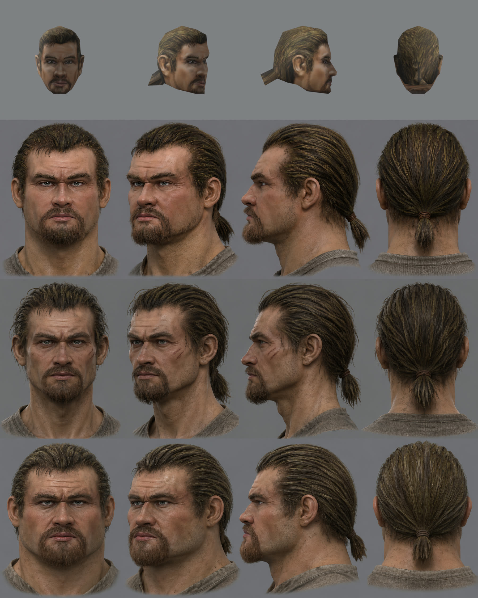
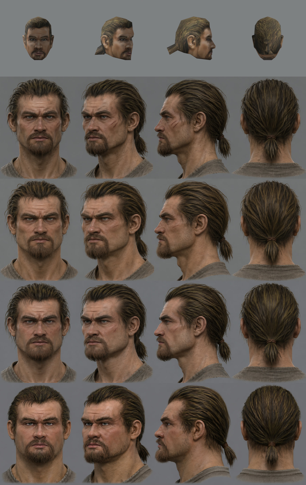
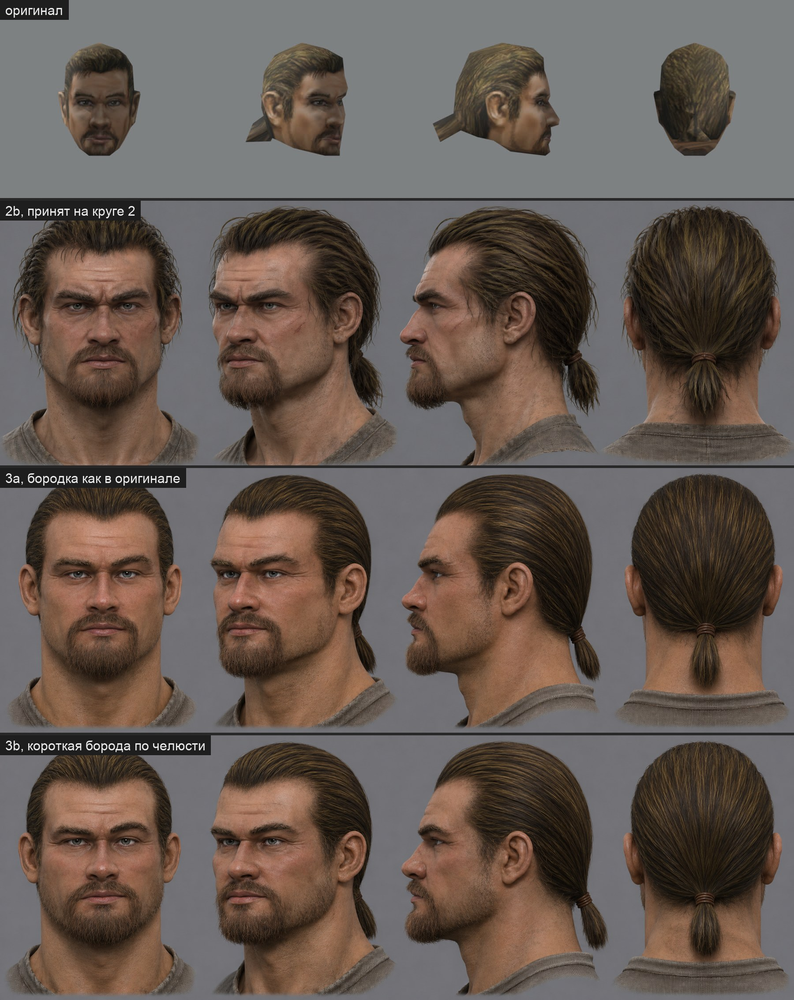
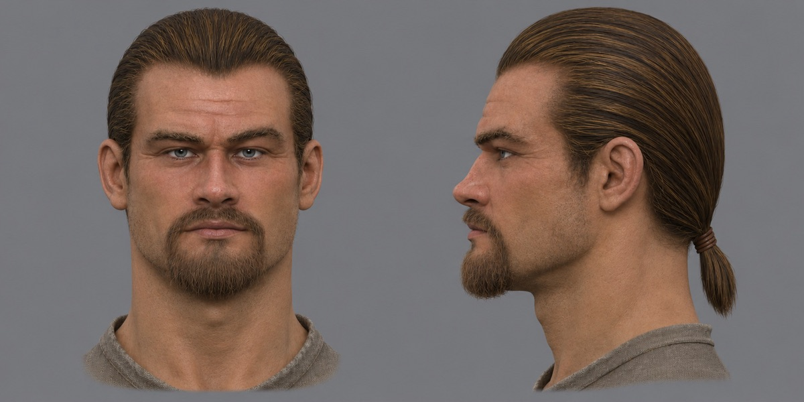
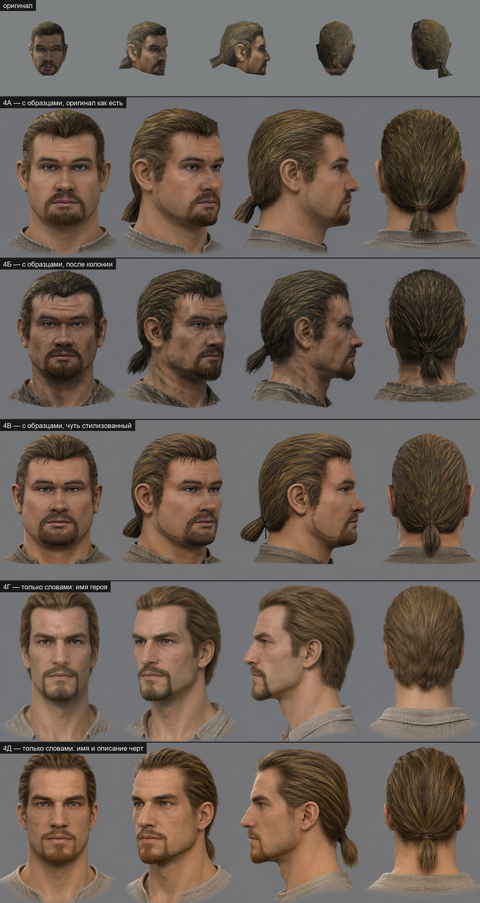
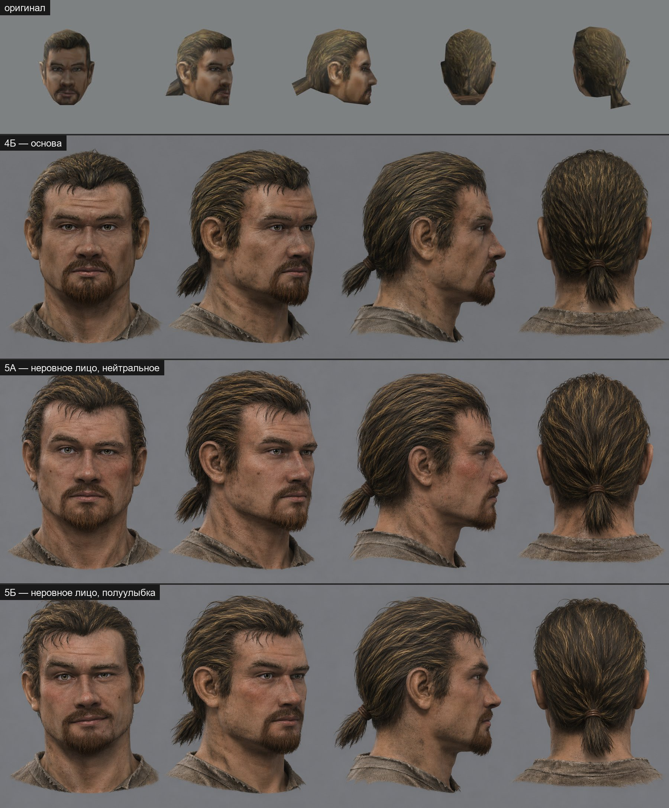
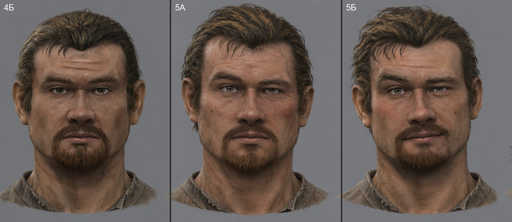
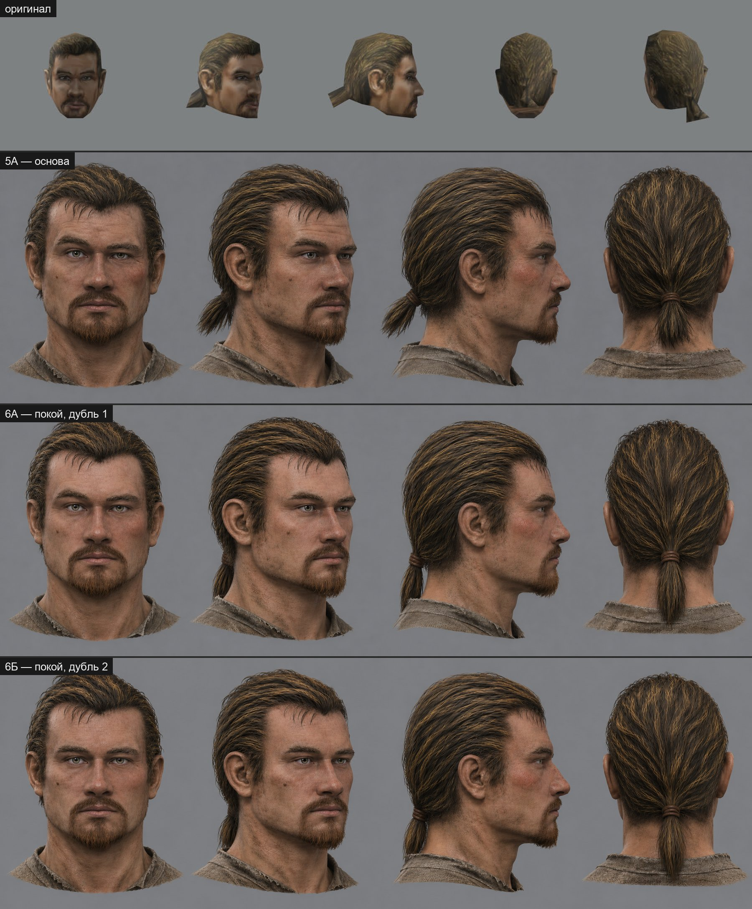
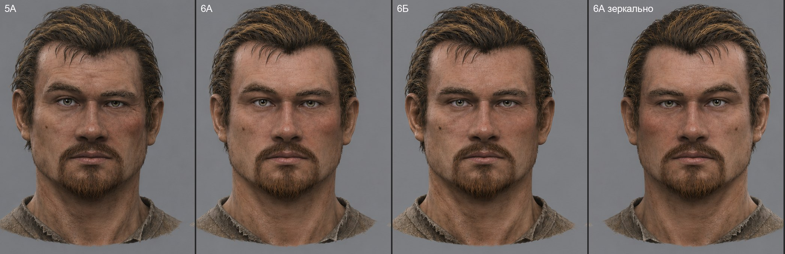
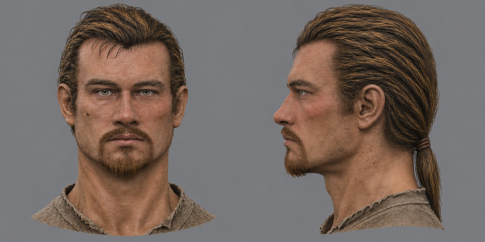

# Концепт головы героя, круг 1

2026-11-05. Три варианта `image_gen` с образцом — текстурой лица `HUM_HEAD_V18_C0`. Промпт — общая часть [`concept/prompt-common.txt`](concept/prompt-common.txt) и строка варианта (`prompt-A/B/C.txt`). Каждый вариант сделан в свежем треде Codex. Исходники PNG с JSON (промпт, тред, SHA-256, вход `original texture HUM_HEAD_V18_C0`) лежат в `~/.local/share/gothic-ai/content-sources/hero-head/`, копия на dev-ubuntu сверена по SHA-256.

Сверху вниз: оригинал, A, B, C. В каждом ряду анфас, три четверти, профиль, затылок.

## Сверка с карточкой замысла

| Сохранить | A | B | C |
|---|---|---|---|
| волосы зализаны назад без пробора, короткий хвост на шнурке | да | да, растрёпаннее | да |
| цвет волос: тёмно-русый с оливково-золотыми прядями | да, темнее оригинала | да, темнее | светлее и теплее |
| бородка с усами вокруг рта, по челюсти только щетина | нет: борода по всей челюсти | да, ближе всех | нет: борода по всей челюсти, рыжая |
| тяжёлые надбровья, густые брови, прищур исподлобья | да | да | да, сильнее всех |
| серо-голубые глаза, не яркие | да | серо-зелёные | да |
| широкий нос, широкие скулы, сильная челюсть | да | нет: лицо узкое | да, перебор: шея и челюсть борца |
| морщины лба | да | да | да |
| узкие сжатые губы, уголки вниз | да | да | да |
| загорелая обветренная кожа, грязь в складках | да, но чище нужного | да | да |

| Чего избегать | A | B | C |
|---|---|---|---|
| красавец, «ведьмак», шрамы | нет | три шрама на скуле — «заживающие царапины» прочитаны как шрам | громила |
| безликое среднее лицо | нет | ближе к типовому «суровому герою» | нет |
| тёплый рыжий сдвиг | нет | нет | борода рыжая |

Средние цвета на анфасе: лоб A `#c2907b` (у оригинала `#c09679`), B `#b08a77`, C `#b38771`. Волосы и борода у всех темнее оригинала (макушка A `#392e23` против `#5c4b2d`): их цвет при текстурах берётся из оригинала, а не из концепта.

## Мой выбор

**A как основа** — его узнают как Безымянного. Две поправки:
- **борода из B**: бородка и усы вокруг рта, челюсть открыта, по ней только щетина — как у оригинала;
- **больше грязи и меньше розового** на коже: A чище, чем просит карточка.

Узкое лицо B и массивность C не берём: оригинал широколицый, но не громила.

Для лепки нужен ещё один вид — анфас и профиль строго ортогонально, с нейтральным лицом. По ним модель MPFB доводится до формы: генератор рисует перспективу, а пропорции снимаются с ортогональных видов.

**Решение пользователя (2026-11-05): принят A с бородой из B** — и следом пересмотрено. Пользователю больше нравится B. Его просьба: добавить в B черты A, чтобы герой был больше похож на оригинал. Ещё одно замечание: лицо A слишком симметричное, а на 3D-модели оно должно быть живым и неровным.

## Круг 2

Основа — B. Из A берутся кости лица: шире скулы и челюсть, тяжелее надбровья, гуще брови, шире нос, серо-голубые глаза. Худые щёки и усталость B остаются. Лицо несимметричное: левая бровь выше, спинка носа чуть смещена, один угол рта ниже, бородка подрезана неровно. Из трёх царапин остаются одна-две слабые.

Образцы: `man.png` — B, `likeness.png` — A, `original.png` — текстура лица оригинала, только для сверки сходства. Промпт — [`concept/prompt2-common.txt`](concept/prompt2-common.txt) и строка варианта:
- 2a — в основном B, с костями лица A;
- 2b — посередине между B и A.

Виды для лепки, начатые от A, остановлены до результата.

Сверху вниз: оригинал, B, 2a, 2b, A.

| | 2a | 2b |
|---|---|---|
| сходство с оригиналом | лицо шире, чем у B, но всё ещё ближе к B | ближе: широкие скулы и нос как у A, лоб и морщины как у оригинала |
| жизнь B: худоба, усталость, растрёпанные пряди | да | да, чуть меньше худобы |
| бородка с усами, на челюсти щетина | да, на трёх четвертях бородка чуть шире | да |
| царапины | одна-две слабые | две слабые |
| несимметричность | заметна: брови и рот неровные | слабее, чем просили |

Мой выбор — **2b**: в нём больше всего оригинала и при этом сохранён характер B. Генератор держит симметрию даже по прямой просьбе, поэтому неровность лица задаётся в модели. У MPFB для этого есть группа параметров `asym` (брови, глаза, нос, рот, уши, челюсть по сторонам), а дальше — ручная доводка.

**Решение пользователя (2026-11-05): принят 2b.**

## Круг 3

2026-11-08. Тело из Tripo по 2b в игре оказалось мало похоже на оригинал ([разбор](../2026-11-hero-body/references.md)). Причины: худой и растрёпанный вариант B, хмурое лицо, мокрые пряди вместо гладко зачёсанных волос. Вышедший ремейк 2026 года держит черты оригинала и узнаётся сразу. Кадры ремейка в генератор не шли, его черты описаны словами.

Основа — A, его кости лица ближе всего к оригиналу. Образцы: `man.png` — лист A, `original.png` — текстура лица `HUM_HEAD_V18_C0` (ESRGAN ×4, сделана заново `original_view.py`). Что меняется в A:
- волосы гладко зачёсаны назад, лежат по черепу, без выбившихся прядей, уши открыты;
- лицо спокойное, как у оригинала: лёгкий прищур, без нахмуренных бровей;
- возраст около 33, без царапин;
- лицо слегка несимметричное.

Промпт — [`concept/prompt3-common.txt`](concept/prompt3-common.txt) и строка варианта:
- 3a — бородка с усами, как в оригинале ([`prompt3-a.txt`](concept/prompt3-a.txt));
- 3b — короткая борода по всей челюсти, как в ремейке ([`prompt3-b.txt`](concept/prompt3-b.txt)).

| | 3a | 3b |
|---|---|---|
| гладкие волосы назад, хвост на шнурке | да | да |
| спокойное лицо, прищур, брови не сведены | да | да |
| широкое лицо, тяжёлые надбровья, широкий нос | да | да |
| борода | бородка с усами, на челюсти щетина; на подбородке шире, чем у оригинала | короткая по всей челюсти |
| возраст | на вид 35–38 | на вид 35–38 |
| грязь и обветренность | мало: кожа чище, чем просит карточка | так же |

Средние цвета на анфасе: макушка 3a `#3d3022`, 3b `#423426` (у оригинала `#5c4b2d`), лоб 3a `#bc8972`, 3b `#b58972` (у оригинала `#c09679`). Волосы снова темнее оригинала. Цвет волос и грязь на коже задаются на шаге текстур, а не концептом.

Мой выбор — **3a**. Его узнают как Безымянного и спереди, и со спины, а бородка — как у оригинала. 3b ближе к ремейку, но борода по челюсти — уже его решение, а не оригинала. Шея у обоих толще нужного: при подгонке модели её сужает скелет Gothic.

**Решение пользователя (2026-11-08): принят 3a.** Следом делаются ортогональные виды спереди и слева для лепки и Tripo.

Виды для лепки и Tripo — `ortho-3a`, спереди и слева, промпт [`concept/prompt3-ortho.txt`](concept/prompt3-ortho.txt). Шея тоньше, чем на листе 3a, как и просили. Пряди в волосах вышли рыжее, чем на 3a, хотя средний цвет макушки почти тот же (`#423223` против `#3d3022`). Перед Tripo тон прядей поправлю: генератор и так тянет волосы в рыжий.

## Круг 4

2026-11-20. Просьба пользователя: лицо ближе к оригиналу Г2. Круг начат с нуля, листы A и 3a на вход не идут. Проверены два пути.

С образцами — промпт [`concept/prompt4-common.txt`](concept/prompt4-common.txt) и строка варианта. Образцы: `original.png` — текстура лица `HUM_HEAD_V18_C0` (ESRGAN ×4), `model.png` — верхний ряд [рендера старой головы](original.jpg), по нему берутся пропорции. Черты описаны по оригиналу, а не по карточке замысла: возраст около 30, гладкая кожа, тонкие прямые брови, маленькая бородка только на подбородке, вихор у линии волос.
- 4А — оригинал как есть, чистое лицо ([`prompt4-a.txt`](concept/prompt4-a.txt));
- 4Б — он же после колонии: загар, грязь, сальные волосы ([`prompt4-b.txt`](concept/prompt4-b.txt));
- 4В — оригинал как есть, чуть стилизованный реализм ([`prompt4-c.txt`](concept/prompt4-c.txt)).

Только словами, без картинок на входе (предложение пользователя):
- 4Г — имя героя и игры, без описания черт ([`prompt4-d.txt`](concept/prompt4-d.txt));
- 4Д — то же и короткое описание черт ([`prompt4-d.txt`](concept/prompt4-d.txt) + [`prompt4-e.txt`](concept/prompt4-e.txt)).

Каждый вариант — свежий тред Codex. Исходники PNG с JSON — в `~/.local/share/gothic-ai/content-sources/hero-head/`.

| | 4А | 4Б | 4В | 4Г | 4Д |
|---|---|---|---|---|---|
| широкое квадратное лицо, низкий лоб | да, полнее оригинала | да | да, но пухлое | нет: узкое, скулы модели | нет: узкое |
| возраст около 30 | 33–35 | около 40 | около 30 | 35–38 | около 35 |
| тонкие прямые брови, спокойный взгляд | да | да | да | нет: хмурый | почти |
| серо-голубые глаза | да | нет: карие | да | нет: зелёно-карие | да, ярче нужного |
| бородка только на подбородке, полоска щетины по челюсти | да, чуть шире | шире и рыжая | да | да, но усы длинные | да |
| волосы: оливково-русые с золотыми прядями, вихор у линии волос | да | да, темнее | да | нет: светло-русые, пышные | светлее и рыжее |
| короткий хвост на шнурке | да, торчит кистью | да | да, шарик | нет хвоста | да |
| узнаётся как Безымянный | да | да, но старше | да, но кукольный | нет | нет |

Что показал круг:
- **Костяк лица генератор берёт только с образца.** По имени героя он рисует типового красавца с бородкой (4Г, 4Д): лицо узкое, скулы высокие. Описание черт возвращает бородку и хвост, но не лицо.
- **С образцами лицо выходит шире и полнее оригинала** (4А, 4В): ширина развёртки всё же просачивается, и моё «flat full cheeks» её усилило.
- **Хвост срисован с треугольника старой модели**: торчит назад кистью, а не лежит на шее.
- Стилизация (4В) даёт пластиковую куклу, грязь колонии (4Б) старит на десять лет и увела цвет глаз.

Мой выбор — **4А как основа**, с одним кругом правок: щёки и шея суше (лицо широкое в кости, а не полное), хвост лежит вниз по шее, бородка уже — как на текстуре. Грязь и загар колонии — на шаге текстур, а не в концепте.

**Решение пользователя (2026-11-20): основа — 4Б**, но лицо сделать менее симметричным: сейчас он не похож на живого человека.

## Круг 5

2026-11-20. Образцы: `man.png` — лист 4Б, `original.png` — текстура лица, только для сверки. Промпт [`concept/prompt5-common.txt`](concept/prompt5-common.txt) называет зеркальность главной проблемой образца и расписывает неровность по чертам: глаза, брови, нос, рот, бородка, линия волос, уши, челюсть, кожа; голова в анфасе чуть повёрнута и наклонена. Заодно возвращены серо-голубые глаза и возраст 30–33.
- 5А — нейтральное лицо для лепки ([`prompt5-a.txt`](concept/prompt5-a.txt));
- 5Б — сухая полуулыбка одним углом рта ([`prompt5-b.txt`](concept/prompt5-b.txt)).

На этот раз генератор неровность дал: брови на разной высоте, один глаз уже, вихор падает набок, родинка на щеке, пятна загара, бородка подрезана неровно, голова чуть наклонена. В 5Б полуулыбка и приподнятая бровь добавляют жизни сильнее, чем сама неровность. Глаза вышли серо-зелёными, ближе к оригиналу, чем карие 4Б. Побочное: волосы стали пышнее и растрёпаннее, чем в 4Б, хвост по-прежнему торчит назад.

**Решение пользователя (2026-11-20): неровность нужна, но лицо должно быть нейтральным**, без поднятых бровей и напряжённых мышц: лист идёт в модель, на которую натягивается лицевая анимация.

## Круг 6

2026-11-20. Образцы: `man.png` — лист 5А, `original.png` — текстура лица для сверки. Промпт [`concept/prompt6.txt`](concept/prompt6.txt): поза покоя, как у скана лица (брови, веки, губы и челюсть расслаблены, голова строго прямо), а неровность — только в костях, тканях в покое, волосах и коже. Попутно: волосы ближе к черепу, хвост вниз по шее. Два дубля одного промпта, 6А и 6Б.

Оба дубля почти одинаковы. Лицо в покое, голова прямо, хвост лежит по шее, волосы прилегают. Неровность осталась, но слабее, чем в 5А: видна при сравнении 6А с его зеркалом — линия волос и вихор, форма и высота бровей, родинка, румянец на одной щеке, спинка носа. В 6Б брови чуть ниже и ближе к глазам, взгляд тяжелее; в 6А лицо расслабленнее. Мой выбор — **6А**. Остаток неровности добирается в модели: параметры `asym` MPFB и ручная доводка.

**Решение пользователя (2026-11-20): принят 6Б.** Следом — ортогональные виды спереди и слева для лепки.

Виды для лепки — `ortho-6b`, спереди и слева, промпт [`concept/prompt6-ortho.txt`](concept/prompt6-ortho.txt), образец — лист 6Б.

Лицо то же, что на 6Б, в покое, голова прямо, черты в обоих видах на близких горизонталях. Отклонения от 6Б:
- хвост длиннее: до плеч вместо короткого. Длина берётся с листа 6Б;
- пряди рыжее, чем на 6Б: генератор снова тянет волосы в рыжий, цвет задаётся на шаге текстур по оригиналу;
- на коже мелкая сетка-«кракелюр» — артефакт генератора, в текстуру не переносится.
