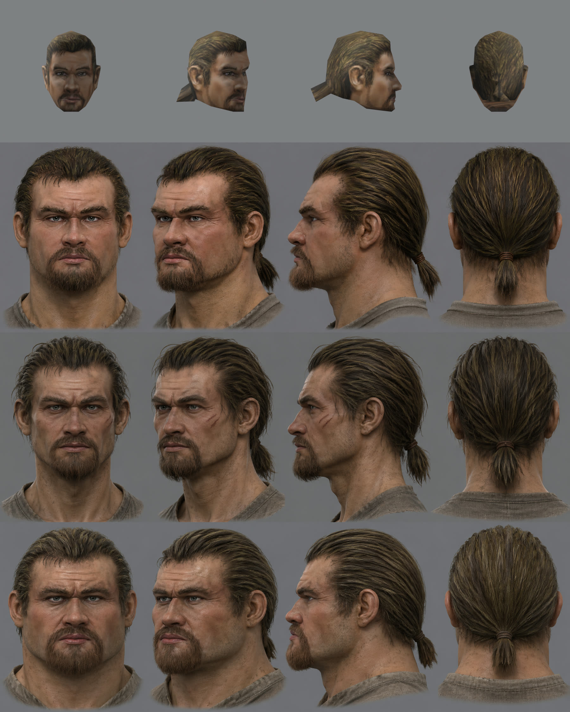

# Концепт головы героя, круг 1

2026-11-05. Три варианта `image_gen` с образцом — текстурой лица `HUM_HEAD_V18_C0`. Промпт — общая часть [`concept/prompt-common.txt`](concept/prompt-common.txt) и строка варианта (`prompt-A/B/C.txt`). Каждый вариант сделан в свежем треде Codex. Исходники PNG с JSON (промпт, тред, SHA-256, вход `original texture HUM_HEAD_V18_C0`) лежат в `~/.local/share/gothic-ai/content-sources/hero-head/`, копия на dev-ubuntu сверена по SHA-256.

Сверху вниз: оригинал, A, B, C. В каждом ряду анфас, три четверти, профиль, затылок.

## Сверка с карточкой замысла

| Сохранить | A | B | C |
|---|---|---|---|
| волосы зализаны назад без пробора, короткий хвост на шнурке | да | да, растрёпаннее | да |
| цвет волос: тёмно-русый с оливково-золотыми прядями | да, темнее оригинала | да, темнее | светлее и теплее |
| бородка с усами вокруг рта, по челюсти только щетина | нет: борода по всей челюсти | да, ближе всех | нет: борода по всей челюсти, рыжая |
| тяжёлые надбровья, густые брови, прищур исподлобья | да | да | да, сильнее всех |
| серо-голубые глаза, не яркие | да | серо-зелёные | да |
| широкий нос, широкие скулы, сильная челюсть | да | нет: лицо узкое | да, перебор: шея и челюсть борца |
| морщины лба | да | да | да |
| узкие сжатые губы, уголки вниз | да | да | да |
| загорелая обветренная кожа, грязь в складках | да, но чище нужного | да | да |

| Чего избегать | A | B | C |
|---|---|---|---|
| красавец, «ведьмак», шрамы | нет | три шрама на скуле — «заживающие царапины» прочитаны как шрам | громила |
| безликое среднее лицо | нет | ближе к типовому «суровому герою» | нет |
| тёплый рыжий сдвиг | нет | нет | борода рыжая |

Средние цвета на анфасе: лоб A `#c2907b` (у оригинала `#c09679`), B `#b08a77`, C `#b38771`. Волосы и борода у всех темнее оригинала (макушка A `#392e23` против `#5c4b2d`): их цвет при текстурах берётся из оригинала, а не из концепта.

## Мой выбор

**A как основа** — его узнают как Безымянного. Две поправки:
- **борода из B**: бородка и усы вокруг рта, челюсть открыта, по ней только щетина — как у оригинала;
- **больше грязи и меньше розового** на коже: A чище, чем просит карточка.

Узкое лицо B и массивность C не берём: оригинал широколицый, но не громила.

Для лепки нужен ещё один вид — анфас и профиль строго ортогонально, с нейтральным лицом. По ним модель MPFB доводится до формы: генератор рисует перспективу, а пропорции снимаются с ортогональных видов.

**Решение пользователя (2026-11-05): принят A с бородой из B.**
