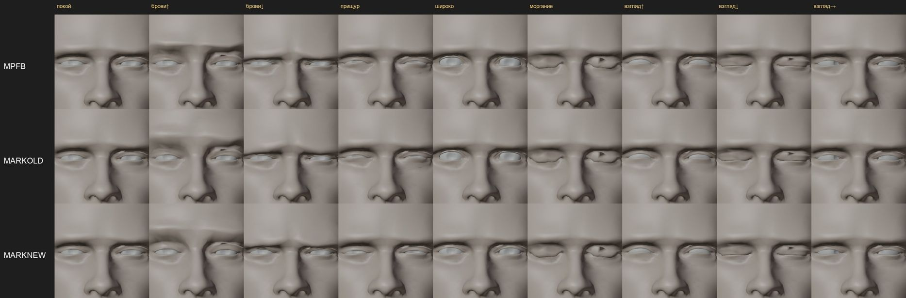
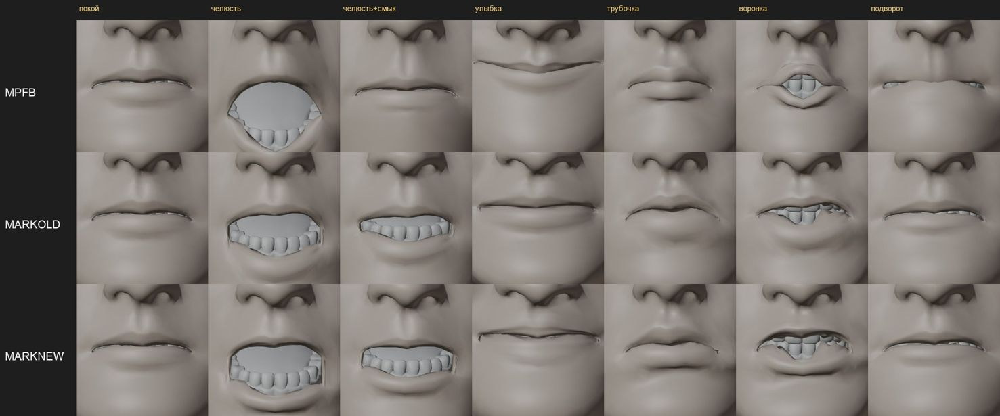

# Формы мимики: из чего их взять

2026-11-09. Вопрос пользователя: можно ли поднять качество мимики, оставив MPFB. Сетка, форма Безымянного и развёртка головы остаются от MPFB. Формы мимики — это сдвиги вершин. Их можно взять с другого лица и перенести на нашу сетку, а `FaceRig` читает формы по именам ARKit и замены не заметит.

## Цель

Лицо по звуку (Audio2Face v3.0, [шаг 10 плана](engine-plan.md#10-лицо-целиком-по-звуку-после-шага-7)) на голове героя без провала губ, а рот, щёки и брови живее, чем сейчас. Сравниваются три набора форм на одной сетке и одних весах:
- **MPFB `faceunits01`** — сейчас в игре;
- **ICT-FaceKit** (USC ICT, MIT) — 53 формы с именами ARKit на лице из сканов, 26 719 вершин ([репозиторий](https://github.com/ICT-VGL/ICT-FaceKit));
- **Mark** из Audio2Face v3.0 (NVIDIA Open Model License) — 52 формы ARKit на 24 002 вершинах. По ним решатель Audio2Face и переводит движение лица в веса.

## Как бывает

- На «м», «п», «б» губы смыкаются целиком, без щели и без заворота внутрь. Нижняя губа подворачивается только на «ф» и «в».
- На «у» и «о» губы вытягиваются трубкой вперёд, уголки сходятся.
- При улыбке поднимаются щёки, углубляются носогубные складки, нижние веки чуть поднимаются.
- Челюсть открывается поворотом: подбородок уходит вниз и назад, а не прямо вниз.

## Как делают другие

- **Перенос деформации** (Sumner, Popović 2004): соответствие двух сеток, затем каждая форма переносится на целевую сетку. Так делают студийные инструменты: R3DS Wrap, Faceit, Polywink. Они генерируют 52 формы ARKit для любой головы.
- **Ловушки**:
  - губы и веки: вершина верхней губы может найти соответствие на нижней, и тогда рот рвётся;
  - глаз: перенесённое веко уходит сквозь яблоко;
  - масштаб: сдвиги чужой головы другого размера.

  Поэтому соответствие во рту и у век ищут отдельно для верха и низа, а веки после переноса проверяют по яблоку.

## Что есть у нас

- **Голова героя** — `characters/hero/head.glb` в контенте `hero-head-1`: в лице 4 151 вершина и 67 форм, отдельно брови, ресницы, зубы и язык со своими формами.
- **Натяжка по Амбергу** уже написана ([`fit/reg/reg_solve.py`](fit/reg/reg_solve.py)). В окружении `~/.local/share/gothic-ai/mpfb/venv` есть numpy, scipy и trimesh 5.2 с `registration.nricp_amberg`.
- **Mark**: в поставке модели только вершины (нейтраль и 52 формы), треугольников нет. Соответствие ищется по ближайшим точкам, 24 002 точки на лице достаточно плотны.
- **ICT**: OBJ с гранями, формы — отдельными OBJ.
- **Веса**: прогоны Audio2Face v3.0 по шести русским репликам ([проверка](audio2face.md#проверка-на-русской-речи-2026-11-05)) лежат вне git в `~/.local/share/gothic-ai/remaster/hero-head/a2f-check-1/weights/` — без поправки (`*.v3.csv`) и с поправкой губ (`*.v3fix.csv`). Рендер — [`a2f/render_a2f.py`](a2f/render_a2f.py).

## Способ

1. **Подобие.** Опорные точки на обоих лицах: уголки глаз и рта, кончик носа, подбородок. Источник подгоняется к нашей голове поворотом, сдвигом и масштабом.
2. **Натяжка.** Кожа нашего лица натягивается на кожу источника по Амбергу, с опорными точками. Так у каждой нашей вершины появляется место на лице источника.
3. **Соответствие.** Для каждой вершины берутся ближайшие точки источника. Во рту и у век поиск идёт только в своей половине, верхней или нижней. Половины задаёт сама форма: что уходит вниз на `jawOpen` — низ.
4. **Перенос.** Сдвиг каждой формы источника умножается на масштаб подобия и ложится на нашу вершину.
   - Моргание и взгляд (`eyeBlink*`, `eyeLook*`) остаются нашими: веса Audio2Face для них и так отбрасываются. Прищур и широко открытые глаза (`eyeSquint*`, `eyeWide*`) тоже наши, а у яблока перенесённый сдвиг плавно переходит в наш: веки строились вокруг нашего яблока.
   - Брови и ресницы строятся по своей привязке к треугольнику кожи, как при выгрузке.
   - Нижние зубы и язык идут за подбородком в формах челюсти.
5. **Ролик.** Шесть реплик, четыре колонки:
   1. MPFB с поправкой губ — как сейчас в плане;
   2. MPFB без поправки;
   3. ICT без поправки;
   4. Mark без поправки.

## Приёмка

Принимает пользователь — на глаз, по ролику со звуком. Ограничители:
- провал губы: доля кадров, где нижняя губа уходит за верхнюю при почти закрытой челюсти;
- кожа века снаружи яблока во всех кадрах;
- нет разрывов и вывернутых треугольников, которых нет в покое.

Если выигрывает Mark, остаётся вопрос лицензии: формы, перенесённые с данных модели NVIDIA, — производная от неё, а NVIDIA Open Model License требует уведомления при распространении. Это решает пользователь до выгрузки в игру. Данные ICT и Mark в git не кладём, они лежат в `~/.local/share/gothic-ai/face-sources/`.

## Итог (2026-11-09)

Скрипты — [`shapes/`](shapes/):
- `dump_glb.py` — выгрузка головы в `npz`;
- `transfer.py` — перенос;
- `apply_shapes.py` — новая `head.glb`;
- `render_shapes.py` и `sheet.py` — листы форм;
- `compare.sh` и `label.py` — ролик;
- `lip_gap.py` — ограничитель губ.

Данные и головы лежат вне git, в `~/.local/share/gothic-ai/mpfb/work/shapes/`.

**Что пришлось поменять в способе:**
- **Опорные точки ищутся по самим формам**, одинаково на всех трёх лицах:
  - середина края верхнего века — по морганию;
  - уголки рта — по улыбке;
  - середины губ — по «трубочке»;
  - кончик носа — по выступу над линией «веки — губа»;
  - подбородок.

  Крылья носа по `noseSneer` отброшены: у MPFB эта форма морщит переносицу, а у ICT — крылья. Глазницы героя глубокие, плоскость «глаза — рот» у него наклонена вперёд, поэтому кончик носа ищется не по ней.
- **Mark и ICT для натяжки — облака точек.** Mark хранит только вершины. Ближайшая точка на треугольниках ICT требует `rtree`, а его нет в окружении.
- **Половины рта** (верх и низ) задаёт доля движения подбородка в `jawOpen`: больше 40 % — низ. Край верхней губы MPFB при открытии рта сдвигается на несколько миллиметров и при пороге «12 % от максимума» уходил вниз вместе с челюстью.
- **Полость рта** (мешок, преддверие, внутренние стороны губ) берёт своё движение MPFB плюс поправку от наружных вершин, которые двигались в MPFB так же. Простое «за ближайшей наружной вершиной» отрывало изнанку верхней губы вниз.

**Натяжка.** Кожа лица в среднем в 1,9 мм от кожи источника, 95 % — до 5–5,4 мм. Масштаб подобия: Mark 0,0125, ICT 0,0124 (сантиметры в метры, наша голова в 1,16 раза больше жизни).

**Главная находка: `mouthClose` значит разное.** Форма должна смыкать губы поверх открытой челюсти, но рисуют её по-разному:

| Форма, сдвиг точки, мм | MPFB | ICT | Mark |
|---|---|---|---|
| `jawOpen`: подбородок / нижняя губа | 43,6 / 44,6 | 51,2 / 49,8 | 30,7 / 22,0 |
| `mouthClose`: подбородок / нижняя губа | 7,2 / 36,7 | 8,1 / 51,5 | 2,6 / 1,3 |
| `mouthRollLower`: нижняя губа | 6,9 | 15,5 | 2,9 |

У MPFB и ICT `mouthClose` поднимает нижнюю губу почти на всю высоту открытого рта. У Mark — на 1,3 мм, и под Mark Audio2Face считает веса. Поэтому на `mouthClose` 0,3 при почти закрытой челюсти губа MPFB проходит сквозь верхнюю на сантиметр: это и есть «ломка губы» из [проверки на русской речи](audio2face.md#проверка-на-русской-речи-2026-11-05). Правило `mouthClose ≤ jawOpen` прикрывало именно это. Значит, дело не в «глубине» форм MPFB, а в смысле одной формы. ICT устроен как MPFB, поэтому в ролике он идёт с той же поправкой весов.

**Ограничитель губ** (`lip_gap.py`): веса шести реплик проигрываются на точках смыкания по средней линии. Считается доля кадров с почти закрытой челюстью (`jawOpen` < 0,15), где нижняя губа заходит за верхнюю больше чем на 2 мм.

| Набор и веса | Доля кадров | Худший кадр |
|---|---|---|
| MPFB, с поправкой (сейчас) | 9,6 % | 4,5 мм |
| MPFB, без поправки | 35,3 % | 35,6 мм |
| ICT, с поправкой | 17,1 % | 6,9 мм |
| ICT, без поправки | 39,4 % | 45,6 мм |
| **Mark, без поправки** | **3,1 %** | 4,8 мм |

Часть этих кадров — законный подворот нижней губы на «ф» и «в», поэтому это ограничитель, а не оценка.

Что видно на листах:
- **Воронка**: у MPFB рот сводится острой галочкой, у ICT и Mark — круглая «о».
- **Смыкание с подворотом**: MPFB даёт волну и складку, у Mark губы лишь чуть приоткрыты.
- **Улыбка**: MPFB тянет рот широко и ровно. ICT улыбается мягче, у Mark поднимаются щёки.
- **Челюсть**: на одном весе Mark открывает рот меньше, это его масштаб. Audio2Face под него и считает.
- **Брови вверх**: у всех трёх на верхнем веке появляется складка, у ICT и Mark она резче — там, где их сдвиг переходит в наш.
- **Огрех самой головы**: вершина под носом проваливается в покое и во всех формах, у всех трёх наборов. Это не перенос.

**Ролик** — вне git, `~/.local/share/gothic-ai/remaster/hero-head/face-shapes-1/face-shapes.mp4`. В нём шесть реплик и четыре колонки: MPFB с поправкой, MPFB без поправки, ICT с поправкой, Mark без поправки. Принимает пользователь.

**Не проверено:**
- язык (`tongueOut` и 16 весов языка Audio2Face не используются);
- шов шеи;
- вид при свете игры — листы и ролик сняты в Workbench.

Число вершин лица прежнее (4 151), чтобы сравнивались только формы.

## Решатель под наши формы (2026-11-09)

**Мысль.** Сеть Audio2Face выдаёт движение точек лица Mark. Решатель подбирает к нему смесь форм из файла `bs_skin_Mark.npz`. Поэтому веса всегда говорят на языке форм Mark, и любой другой набор играет их как чужие: отсюда и «ломка губы». Если положить в этот файл наши формы, перенесённые на сетку Mark, решатель подберёт смесь сразу под нашу голову. Тогда поправка весов не нужна, а в игру не идёт ничего от Mark.

**Как сделано.**
- Обратный перенос — шаг 6 в [`shapes/transfer.py`](shapes/transfer.py): `python transfer.py mark <work dir> mpfb,ict,mark`. Каждая точка Mark берёт сдвиг ближайших точек натянутой кожи героя, во рту и у век — только из своей половины. Затем сдвиг поворачивается обратно в систему Mark и переводится в сантиметры.
- На `dev-ubuntu` — копия модели v3.0 в `~/gothic-ai/a2f/solver-probe/v3-<набор>/`: всё ссылками на `gen/v3`, кроме `bs_skin_Mark.npz`. Служба и `gen/v3` не тронуты. Лицо — Mark (номер 2, им же считалась проверка на русской речи; повторный прогон дал те же веса до последнего знака).
- **Контроль**: формы Mark, перенесённые на героя и обратно. Решатель на них дал почти прежние веса — в среднем на 0,008 по весу. Значит, решатель читает наш файл, а обратный перенос сохраняет формы.
- Скорость прежняя: 0,8–1,1 с на реплику 9 с.

**Губы.** [`lip_gap.py`](shapes/lip_gap.py) получил вторую мерку. Эталон — то, что нарисовала сама сеть: формы Mark на нашей голове с его весами. Где у эталона губы сомкнуты (щель меньше 1 мм), набор тоже должен их сомкнуть. Набор, который никогда не заводит губу за верхнюю, может просто никогда не смыкать рот.

| Набор и веса | Губа за верхней > 2 мм, доля почти закрытых кадров | Худший кадр | Открыт > 3 мм, где Mark сомкнул | Средняя разница щели с Mark |
|---|---|---|---|---|
| MPFB, с поправкой (сейчас) | 9,6 % | 4,5 мм | 0 % | 4,5 мм |
| ICT, с поправкой | 17,1 % | 6,9 мм | 0 % | 4,7 мм |
| **Mark, без поправки** (эталон) | 3,1 % | 4,8 мм | — | — |
| MPFB, решатель под MPFB | 0 % | 0,8 мм | 27,6 % | 2,6 мм |
| ICT, решатель под ICT | 11,2 % | 5,6 мм | 0 % | 1,8 мм |

**Хватает ли форм.** Решатель упирается в предел веса, когда наших форм не хватает, чтобы повторить движение сети. Доля кадров, где хоть один вес дошёл до 1,0:
- веса Mark: 1 %;
- ICT: 2,4 %;
- MPFB: 44 %, из них `mouthLowerDown` — 41 %.

Сеть часто приоткрывает рот так, как челюсть MPFB не умеет: у Mark нижняя губа при открытии отстаёт от подбородка, у MPFB идёт вровень. Решатель добирает это `mouthLowerDown` и `jawForward`, а `mouthClose` MPFB не берёт ни разу. Брови MPFB вдвое слабее бровей Mark (`browInnerUp` 6 мм против 14), поэтому их вес в среднем 0,46 против 0,17 у Mark и тоже доходит до 1,0.

**Что видно в ролике и на листах.**
- **MPFB под своим решателем**: на «м», «п», «б» губы смыкаются, сквозь верхнюю губу нижняя не проходит. Но в речи нижняя губа оттянута, и видны нижние зубы — герой будто скалится. Это `mouthLowerDown` на пределе.
- **ICT под своим решателем**: рот ближе всех к рисунку сети (1,8 мм в среднем), смыкается там же, где Mark. Но провал под носом, огрех самой головы, на его весах разрастается в заметный острый гребень.
- **Mark** остаётся впереди по губе за верхней: 3,1 % против 11,2 % у ICT.

**Натяжка у рта.** Теперь `transfer.py` печатает, где опорные точки героя оказались после натяжки относительно тех же точек Mark:

| Точка | Кончик носа | Уголки рта | Веки | Губы | Подбородок |
|---|---|---|---|---|---|
| Расхождение, мм | 5 | 2 и 10 | 9 и 14 | 16–21 | 16 |

До кожи Mark в среднем около 2 мм, значит, сетка героя скользит вдоль лица. По профилю средней линии нижняя часть лица у героя короче, чем у Mark, и подбородок встаёт выше подбородка Mark. Часть расхождения у губ может давать разный выбор «середины губы» на двух лицах; это не разобрано. Неточность одна и та же для всех наборов, перенесённых с Mark или на Mark, включая прежний перенос форм Mark. Поэтому сравнение она не перекашивает, но точность у рта ограничивает. Натяжку с опорой на губы и подбородок стоит доделать, прежде чем выбранный набор пойдёт в игру.

**Итог.**
- Для MPFB решатель не спасает: формы MPFB не умеют двигаться так, как рисует сеть.
- Для ICT это способ взять его формы без поправки весов. Он лучше ICT с поправкой, но уступает формам Mark по губе за верхней и даёт гребень под носом.
- Выбор набора — за пользователем по ролику. Если брать ICT, нужна служба Audio2Face с файлом форм ICT вместо `bs_skin_Mark.npz` и починка провала под носом.

**Ролик** — вне git, `~/.local/share/gothic-ai/remaster/hero-head/face-shapes-2/face-shapes-solver.mp4`: шесть реплик, четыре колонки — MPFB с поправкой, Mark без поправки, MPFB под своим решателем, ICT под своим решателем. Веса всех вариантов — там же, в `weights/`. Ролик собирает [`shapes/compare.sh`](shapes/compare.sh) с `COLS="mpfb v3fix,mark v3,mpfb smpfb,ict sict"`.

## Решение (2026-11-09)

Дальше работа идёт на формах Mark. Пользователь попросил добавить к ним глаза и брови. [Эмоции Audio2Face](audio2face.md#эмоции-на-входе-2026-11-09) и [мимические жесты](face-cues.md#проба-без-движка-2026-11-09) сняты на голове с этими формами и приняты: «для нашей игры уже вполне юзабельно».

До выгрузки в игру:
- **Натяжка у рта.** Губы и подбородок героя после натяжки расходятся с точками Mark на 16–21 мм.
- **Огрехи у век.** Складка на верхнем веке при поднятых бровях и надрывы в уголках век: прищур и широко открытые глаза взяты от MPFB, брови — от Mark.
- **Лицензия.** Формы — производная от данных модели NVIDIA. При раздаче игры нужно уведомление по NVIDIA Open Model License; это решает пользователь.

## Формы Mark в игре (2026-11-13)

Пользователь подтвердил формы Mark 2026-11-13. Задача — поставить их на голову героя (`hero-3a`) и тестовую голову Вино (`hero-head-2`) без провала губы, а остальная мимика должна быть не хуже, чем сейчас.

### Что было не так с натяжкой

- **«Середина губы» на двух лицах была разной.** Опорная точка губы — вершина, которая больше всего движется в «трубочке». У Mark это внутренняя сторона губ: модель хранит полость рта, и точка лежала на 17 мм глубже передней поверхности. У героя — линия смыкания.
- **Подбородок** брался как самая передняя точка полосы под ртом. И у героя, и у Mark подбородок спереди плоский на 15–20 мм, поэтому точка гуляла по высоте.
- **Веки героя не были кожей.** Натяжка `reg_solve.py` с `eye_block` держит неподвижным всё ядро вокруг яблока и пишет его в `interior`. Перенос двигал это ядро как полость рта: своё движение MPFB плюс поправка соседей. Отсюда складка на верхнем веке при поднятых бровях. 456 вершин век головы 3a оказались «выстилкой».
- **Опорные точки век** брались по максимуму сдвига в моргании. У героя это наружный угол века, у Mark — середина края.

### Как сделано

[`shapes/transfer.py`](shapes/transfer.py), [`shapes/head_shapes.py`](shapes/head_shapes.py), запись GLB без Blender — [`shapes/head_glb.py`](shapes/head_glb.py).

- **Опорные точки одинаково на обоих лицах, 14 штук.**
  - На наружном профиле средней линии, в осях героя: кончик носа, подносовая точка, самые выступающие точки верхней и нижней губы, нижняя точка верхней губы и верхняя точка нижней (смыкание), борозда над подбородком, подбородок. Профиль — самая передняя точка в каждой 1/90 высоты «глаза — рот». Выступы и впадины ищутся от хорды между соседними точками, а не по одной оси.
  - Уголки рта — где больше всего движется улыбка.
  - Край верхнего века — нижний ряд того, что опускается в моргании, посередине глаза. У героя — кожа, лежащая на яблоке над серединой радужки. Край нижнего века — место, куда приходит закрытое верхнее.

  Оси Mark — оси героя, перенесённые подобием. Лица по-разному наклонены к плоскости «глаза — уголки рта», и выступ подбородка виден только сбоку в одних осях.
- **Натяжка.**
  1. Подобие по опорным точкам.
  2. Тонкая пластина переводит опорные точки героя в точки Mark.
  3. Амберг с удержанием точек до конца: вес 3, ещё три шага малой жёсткости.
  4. Локальная гладкая поправка (Wendland, радиус четверть расстояния между глазами) закрывает остаток у точек.
- **Веки и брови — из одного источника, Mark.** Прищур и широкие глаза тоже от Mark; моргание и взгляд остаются нашими, они строились вокруг наших яблок.
  - Сдвиг сглажен по сетке у век: до 10 мм от яблока целиком, к 20 мм — на нет. Иначе соседние вершины края века находят у Mark то край, то его заднюю сторону и рвут веко.
  - Выстилка глазницы (вершины у яблока, глядящие на него) идёт за ближайшей кожей, за краем века.
  - Кожу, которая вошла бы в яблоко, ограничитель выводит наружу по лучу от центра (выпуклая оболочка яблока).
  - Брови и ресницы — свой сдвиг MPFB плюс изменение кожи под ними, без поворота. Привязка к одному треугольнику поворачивала ресницы при подъёме века.
- **Половины век** делит линия посередине щели между краями, а не моргание. Складка над веком героя в моргании тоже движется и попадала в «верх», а соседи — нет.

### Натяжка у рта: до и после

Расхождение опорной точки героя после натяжки с той же точкой Mark, мм.

| Точка | Прежний перенос, прежние точки (3a) | Прежний перенос, новые точки (3a) | 3a: подобие → Амберг → итог | Вино: подобие → Амберг → итог |
|---|---|---|---|---|
| Кончик носа | 3,6 | 3,3 | 8,6 → 0,8 → 0 | 7,1 → 2,0 → 0 |
| Подносовая точка | — | 3,8 | 7,7 → 0,4 → 0 | 5,3 → 1,9 → 0 |
| Губа верхняя / нижняя | 9,3 / 15,3 | 4,6 / 5,7 | 3,1 / 1,4 → 0,8 / 0,5 → 0 | 5,3 / 7,2 → 1,3 / 1,0 → 0 |
| Смыкание верх / низ | — | 5,3 / 5,7 | 2,5 / 3,2 → 1,1 / 0,4 → 0 | 8,2 / 7,1 → 1,6 / 1,1 → 0 |
| Уголки рта | 6,4 / 3,1 | 6,0 / 3,2 | 14,6 / 8,1 → 1,2 / 2,1 → 0 | 14,9 / 1,5 → 2,2 / 2,7 → 0 |
| Борозда / подбородок | — / 17,1 | 16,3 / 15,7 | 8,8 / 10,2 → 0,6 / 0,3 → 0 | 11,6 / 15,7 → 1,0 / 0,5 → 0 |
| Край верхнего века | 21,1 / 20,8 | не натягивался (ядро у яблока) | 3,9 / 9,6 → 2,4 / 1,9 → 0 | 8,8 / 12,0 → 3,5 / 1,4 → 0 |
| Край нижнего века | — | не натягивался | 13,5 / 11,8 → 1,6 / 1,6 → 0 | 12,3 / 11,4 → 2,7 / 1,8 → 0 |
| Кожа лица до кожи Mark, медиана / 95 % | 1,7 / 4,1 | — | 0,95 / 2,4 | 1,21 / 2,7 |

Подобие оставляет 8–15 мм: у героя рот шире, а подбородок ближе ко рту, чем у Mark. Это пропорции, а не ошибка выбора точек.

### Листы

Голова 3a, три строки: MPFB (сейчас), прежний перенос Mark, новый. Workbench, без карточек бровей и ресниц: он рисует их альфа-карточки сплошными, и они выглядят осколками над глазом. Листы лица целиком, анфас и три четверти — вне git, `~/.local/share/gothic-ai/remaster/hero-head/mark-shapes-1/shapes/`.

- **Брови вверх.** У прежнего переноса над веком — ступенька: сдвиг Mark переходил в сдвиг MPFB у яблока. У нового веко поднимается одним листом, складки нет.
- **Прищур и широко.** Веки от Mark, без надрывов в уголках.
- **Рот.** Улыбка поднимает уголки, трубочка вытягивает губы вперёд. Воронка у Mark открывает зубы, край верхней губы неровный — так было и в прежнем переносе.
- **Огрехи самой головы**, есть и у MPFB: тёмный зубец во внутреннем углу правого (по листу) глаза при моргании и взгляде вниз.

**Веки и яблоко.** Проверка `head_shapes.py` берёт кожу у яблока и выпуклую оболочку яблока. Яблоко поворачивается на пределы `limits_deg` профиля (вверх 25°, вниз 30°, внутрь и наружу 35°) вместе с формами век этого направления из `eyes.lids`. Проверяются отдельно и вместе с выражениями, которые сильнее всего двигают веки (прищур с бровями вниз, широко с бровями вверх, моргание с прищуром, щёки с улыбкой), и каждая форма с весом 1. Кожа нигде не входит в яблоко: на 3a и на Вино — 0,00 мм. У MPFB было до 0,11 мм на «взгляд вверх + моргание с прищуром».

Растянутых больше чем вдвое рёбер у век нет. Оставшиеся 2–8 — вырожденные рёбра длиной 0–0,3 мм.

### Губы вне игры

[`shapes/lip_gap.py`](shapes/lip_gap.py), шесть реплик пробы ([веса](audio2face.md#проверка-на-русской-речи-2026-11-05)). Эталон смыкания теперь — собственное лицо Mark с теми же весами, щель от покоя в масштабе головы. Раньше эталоном были формы Mark на нашей голове.

| Голова | Набор и веса | Губа за верхней > 2 мм, доля почти закрытых кадров | Худший кадр, мм | Открыт > 1 мм, где Mark сомкнут | Средняя разница щели с Mark, мм |
|---|---|---|---|---|---|
| Вино | MPFB с поправкой (сейчас) | 9,6 % | −4,5 | 5,1 % | 4,5 |
| Вино | **Mark, новый перенос** | **1,8 %** | −4,4 | 4,2 % | **0,5** |
| 3a | MPFB с поправкой (сейчас) | 2,1 % | −3,4 | 5,3 % | 3,7 |
| 3a | Mark, прежний перенос | 2,5 % | −3,9 | 0,0 % | 1,8 |
| 3a | **Mark, новый перенос** | **1,5 %** | −4,0 | 0,2 % | **0,8** |

Прежний перенос Mark давал на старой голове 3,1 % губы за верхней. Сомкнутые у Mark губы на 3a сомкнуты. На Вино 4,2 % таких кадров приоткрыты на 1–3 мм (больше 3 мм — ни одного): губы Вино толще, чем у Mark, при той же разнице щели 0,5 мм.

### Профиль Mark

[`shapes/mark_profile.py`](shapes/mark_profile.py), итог для героя 3a — [`mpfb/mark.face.json`](mpfb/mark.face.json). Шаблон MPFB [`test-head.face.json`](mpfb/test-head.face.json) не тронут.

- **Пересчёт весов.** Веса выражений `anims` (кроме `VISEME`: визем у головы Mark прежние, MPFB), жестов `cues`, прорыва `leaks` и бровей речи `speech_brows` пересчитаны по размаху. Мера — средний сдвиг точек зоны: брови (внутри, середина, снаружи), края век, щёки, крылья и кончик носа, рот (уголки, губы, смыкание), подбородок. Сначала множитель на форму, один на обе стороны. Затем у каждого набора формы своей зоны доводятся до размаха MPFB; вес остаётся в 0..1.
- **Что не пересчитывалось.** Моргание, взгляд и `eyes.lids` — наши формы, они одни на обеих головах.
- **`speech_face`** без `cap` и `scale`: дорожка играет веса Mark как есть.
- **Свой профиль у каждой головы.** Размах MPFB у 3a и Вино разный, поэтому сборщик считает профиль для каждой головы из её собственного (`--face` у `head_shapes.py`). Таблица размаха пишется рядом.

**Размах, голова 3a** (MPFB → Mark, мм; полная таблица — `mark-shapes-1/shapes/reach-3a.md`). В своей зоне каждый набор — в пределах ±7 %:
- выражения `S_*` и `T_HURT`;
- все жесты;
- прорыв;
- брови речи.

Отклонения — в соседних зонах, где формы Mark двигают ещё что-то:
- **Подбородок**, +120–210 % в `S_ANGRY`, `S_HOSTILE`, `press`, `chin`, прорыве боли. `mouthPress` и `mouthShrugLower` Mark поднимают подбородок (подбородочная мышца), а у MPFB только сжимают губы. Рот при этом в размахе MPFB.
- **Щёки**, −50…−93 % в `squint`, `wince`, верхнем прорыве. `eyeSquint` Mark не поднимает щёку, у MPFB поднимает. Щёку дают `cheekSquint` в тех наборах, где он есть.
- **Веки**, +70…+220 % в `frown`, `S_ANGRY`, `S_HOSTILE`. `browDown` Mark опускает с бровью и верхнее веко: брови в размахе MPFB, веко нависает сильнее.
- **Нос**, +200–600 % при улыбке и еде. Улыбка Mark раздувает крылья носа на 1–2 мм, у MPFB нос неподвижен.
- **Рот в `T_EAT`**, +42–67 %. `mouthClose` Mark почти не поднимает губу (1,3 мм против 37 у MPFB): жевать с сомкнутыми губами формами Mark нельзя, губы приоткрываются.

**В игре** — ниже, раздел «Клип в игре».
