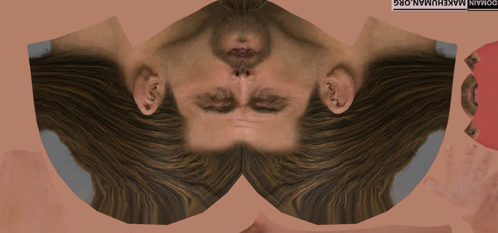
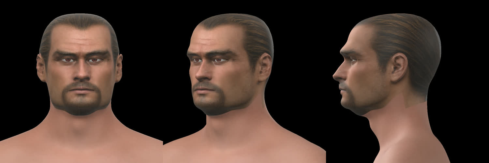
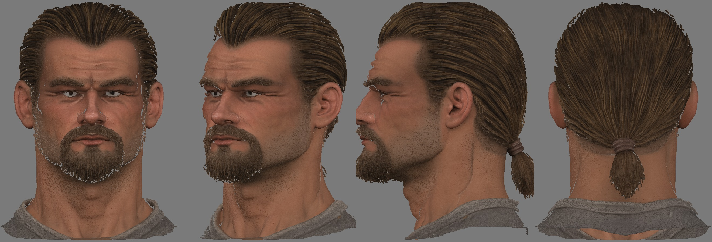
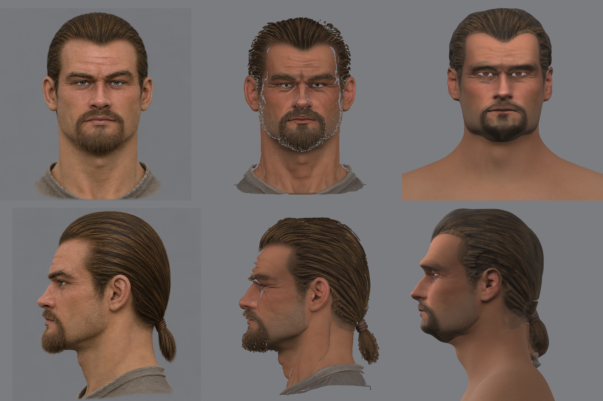

# Кожа головы по концепту 3a

2026-11-10. После [перетяжки под 3a](README.md#перетяжка-под-концепт-3a-2026-11-10) голова в игре была лысой, с розовой кожей MPFB. Задача пользователя — «текстуры и борода». Карт лица в проекте ещё не делали, поэтому сначала короткое исследование.

## Цель

Герой в игре узнаётся как концепт 3a в анфас, в три четверти и в профиль: тон и рисунок кожи, бородка с усами, щетина на челюсти, брови, линия зачёсанных волос. Мимика и моргание не тянут за собой чужие пиксели: на веках нет белка и радужки, на губах нет зубов.

## Как бывает и как делают другие

- **Проекция фотографий на сетку** — обычный путь от снимков или концепта к карте цвета: вид спереди и виды сбоку проецируются на развёртку, смешиваются по тому, как поверхность повёрнута к камере, а невидимое дорисовывается. Так работают Mari, Substance Painter и проекционная кисть Blender.
- **Ловушки:**
  - в снимке запечён свет: тени под бровями, носом и челюстью лягут в цвет, и свет игры сложится с ними;
  - открытый глаз снимка попадает на веко, которое потом закроется;
  - там, где поверхность почти вдоль луча (макушка, затылок, под подбородком), картинка растягивается полосами;
  - борода и волосы на снимке объёмные, а на коже станут плоской краской.
- **Борода в играх** — три слоя: щетина краской в карте цвета, короткий волос оболочками поверх кожи (несколько копий кожи со сдвигом по нормали и картой прозрачности), длинный волос карточками прядей.

## Что есть у нас

- **Развёртка MPFB**: одна карта на всё тело, голова — отдельный остров справа; рот, глазницы и уши внутри него. При 4096 px на лицо приходится около 0,14 мм на тексель.
- **Движок**: у головы в `materials.json` сейчас задан только `albedo`; прозрачность по порогу (`alphaMode: MASK`) работает у бровей и ресниц. Карты нормалей и ORM у своих материалов есть ([своя игра](../../../docs/own-content.md)), на голове не проверялись. Шейдера кожи, глаз и волос нет — это [шаг 7 плана](engine-plan.md#7-шейдеры-кожи-глаз-и-волос).
- **Соответствие сетки и концепта**: после натяжки эталон лежит на концепте в пределах пары пикселей, опорные точки — в 0,6 мм. Значит, пиксель концепта можно брать прямо по координатам точки головы, без ручной подгонки.

## Способ

[`skin/project.py`](skin/project.py), вход — [`skin/dump_uv.py`](skin/dump_uv.py) (развёртка, точки и нормали натянутой головы):

1. Каждый тексель острова головы получает точку и нормаль на голове.
2. Точка ищется на анфасе и на профиле концепта теми же формулами, что ставили эталон. Правая сторона берёт профиль зеркально.
3. Два вида смешиваются по нормали: вес анфаса — квадрат поворота к камере спереди, вес профиля — к камере сбоку.
4. Без веса остаются фон концепта, рубаха (ниже 13 см под глазами спереди и 16 см сзади) и раскрытый глаз: белок и радужка между веками. Эти тексели заполняются от ближайших известных и сглаживаются.
5. Остальная карта — кожа MPFB, приведённая к цвету лба героя. На линии рубахи голова плавно переходит в неё.

Брови нарисованы в карте кожи, поэтому карточки бровей MPFB скрыты прозрачной картой. Радужка затемнена: яркость 0,6 вместо 0,85 ([`fit/reg/eye_tex.py`](fit/reg/eye_tex.py)).

```sh
W=~/.local/share/gothic-ai/mpfb/work
blender -b $W/reg3a/r4/reg.blend -P skin/dump_uv.py -- $W/skin3a/uv.npz
python skin/project.py $W/skin3a/uv.npz $W/reg3a/groups.npz $W/reg3a/views.json fit/params-3a.json \
  $W/fit3a/front_ref.png $W/fit3a/profile_ref.png <кожа MPFB>.png $W/skin3a 4096
blender -b $W/probe.blend -P mpfb/export_test_head.py -- <каталог контента> --hero $W/reg3a/r4 $W/reg3a \
  $W/skin3a/eye_dark.png --skin $W/skin3a/skin.png --brows $W/skin3a/brows_none.png
```

## Приёмка

Принимает пользователь на глаз: кадры и клип из игры рядом с концептом 3a и с оригиналом, покой, настроения и реплика. Ограничители:
- на закрытых веках и на губах нет белого и голубого;
- шов между головой и телом не читается с камеры диалога;
- борода и волосы не светлее и не рыжее концепта.

## Круг 1





Известно 90 % текселей острова, остальное заполнено. Что видно в Blender:
- лицо узнаётся: бородка с усами, щетина, брови, линия волос и уши на месте;
- на макушке и затылке волосы растянуты полосами, хвоста нет: это краска на лысом черепе, а не причёска;
- борода плоская; под челюстью тёмное пятно — борода и тень концепта вместе;
- запечённый свет концепта остался: тени у глаз, под носом и под нижней губой;
- кожа шеи MPFB розовее и чище лица.

В игре круг 1 вышел темнее и краснее оригинала (лоб 119/82/75 против 158/120/104). Общее осветление цвета 1.16/1.36/1.35 сделало кожу серо-зелёной: это был не тот рычаг, круг отброшен.

**Вердикт пользователя (2026-11-10): не принято.** «Совсем не похоже на 3a». [Сверка на одной камере](likeness-3a-1.jpg) показала причины: нет объёма волос и бороды, глаза узкие, цвет с двух рисунков несёт их свет и пятна. Приёмка лысой головы по глине была ошибкой способа: с этого круга каждая сверка — концепт, модель генератора и наша голова на одной камере (`skin/likeness.py`).

## Круг 2: цвет и волосы с модели генератора

Пользователь спросил про более автоматический путь; платные сервисы он отклонил ([обзор](auto-tools.md)). Бесплатный локальный путь уже лежал у нас: модель Pixal3D по 3a несёт цвет в вершинах (`color`, линейный), а мы брали с неё только форму.



Что сделано:
- **Цвет кожи** — `skin/bake_ref.py`: тексель головы берёт цвет ближайших точек модели. Зона глаз читается по виду спереди: веки у нас глубже вылепленных глаз модели, и ближайшая точка в пространстве там — бровь или щека. Глазные яблоки и рубашка модели не берутся.
- **Волосы** — `skin/hair_cut.py`: отдельная часть головы, 17 900 треугольников. Шапка — сетка направлений вокруг центра черепа с внешним радиусом точек волос, хвост — трубка вокруг своей оси, цвет запечён с модели.

Три вещи про модель, найденные по дороге:
- грани намотаны в обе стороны, знак нормали ничего не значит;
- волосы — рваная слоёная оболочка: вырезанные как есть, они не упрощаются ниже 775 000 треугольников;
- модель не замкнута: воксельный ремеш теряет 40 % поверхности.



Что видно на сверке:
- причёска, хвост и линия волос совпали с моделью; цвет кожи и волос — её же;
- борода — только краска, без объёма, на подбородке серое пятно: бородка модели дальше 7 мм от нашей кожи, и цвет там не находится;
- хвост ниже шнурка рваный, у ушей шапка идёт уступами (там полюс сетки);
- над левой бровью наша поверхность в 7–10 мм от модели (над правой — 4 мм): надбровье зарегистрировано плохо;
- челюсть шире, чем у модели; глаза в рендере без своей текстуры.

В игру этот круг не выгружался. Команды:

```
python skin/bake_ref.py $W/skin3a/uv.npz $W/reg3a/groups.npz $W/reg3a/views.json fit/params-3a.json \
  <raw.npz модели> <кожа MPFB>.png <каталог круга> 4096
python skin/hair_cut.py $W/reg3a/views.json fit/params-3a.json <raw.npz модели> $W/hair3a 2048
blender -b $W/reg3a/r4/reg_sub.blend -P skin/render_skin.py -- $W/reg3a/views.json <круг>/skin.png <круг> s \
  $W/hair3a/hair.npz $W/hair3a/hair.png
python skin/likeness.py $W/reg3a/views.json fit/params-3a.json <raw.npz модели> $W/fit3a/front_ref.png \
  $W/fit3a/profile_ref.png <круг> <круг>/likeness.jpg
```

## Круг 3: новая голова, борода оболочкой

Сделан на голове с опущенным черепом, уже в рамках конвейера NPC: [отчёт](../2026-11-npc-pipeline/README.md#цвет-волосы-и-борода-голова-в-игре-2026-11-10). Что изменилось в инструментах этой папки:
- полная модель ставится на концепт и приводится к его тону (`--place`, `--tone`, [`skin/ref_model.py`](skin/ref_model.py), [`skin/tone_ref.py`](skin/tone_ref.py));
- полоса глаз и бровей берётся с концепта (`bake_ref.py --front`), а не с вида модели спереди;
- борода — отдельная часть, [`skin/beard_shell.py`](skin/beard_shell.py); кожа под ней красится цветом бороды (`bake_ref.py --offsets`);
- `render_skin.py` ставит камеры на точку глаз шаблона (`views.json`), берёт любое число частей и карту глаз.
