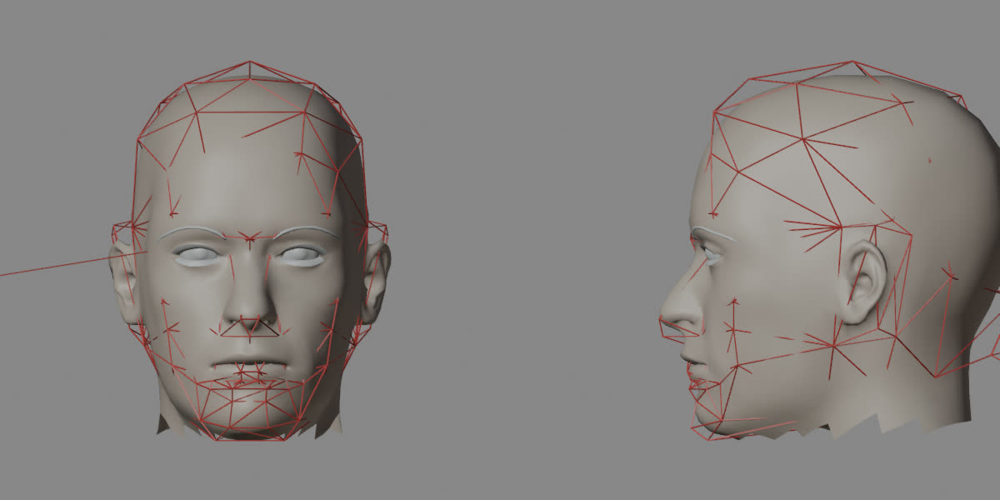
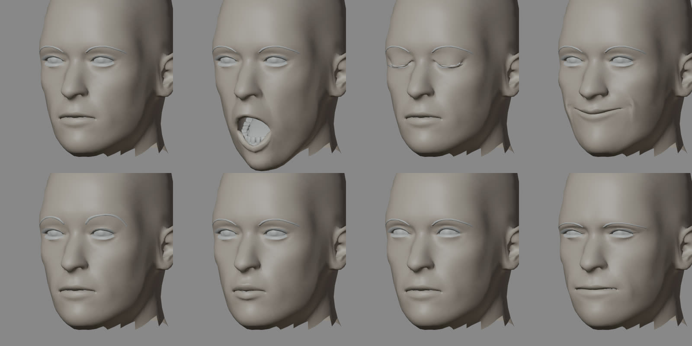
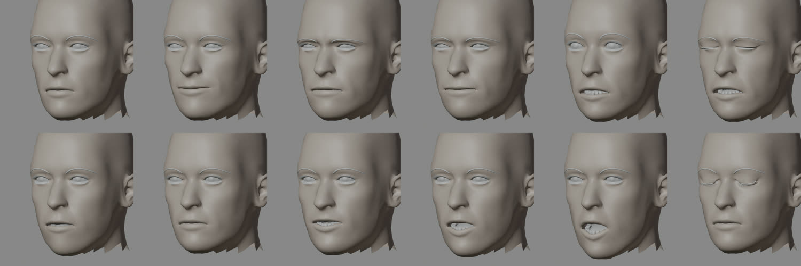
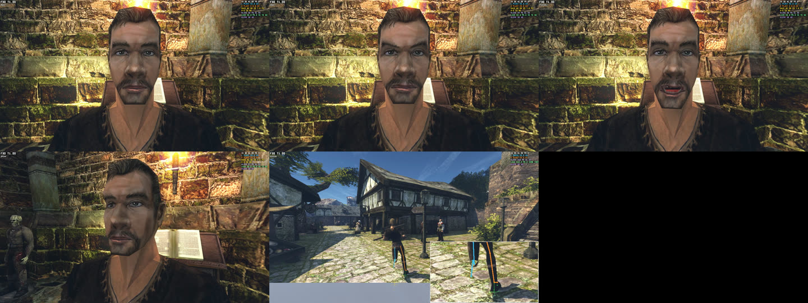

# Тестовая голова и базовые клипы

2026-11-05, шаг 0 [плана движка](engine-plan.md). Тестовая голова нужна, чтобы делать движок (шаги 1–5), пока лепится Безымянный. Это голова пробы MPFB: среднее лицо и кожа MPFB, не герой.

## Тестовая голова

[`mpfb/export_test_head.py`](mpfb/export_test_head.py) собирает один GLB из пробы MPFB (`probe.blend` из [`mpfb/probe_head.py`](mpfb/probe_head.py)):

```sh
BLENDER_USER_RESOURCES=~/.local/share/gothic-ai/mpfb/blender \
  blender -b ~/.local/share/gothic-ai/mpfb/work/probe.blend -P export_test_head.py -- ~/.local/share/gothic-ai/content-tests/hero-head
```

Что выходит:

- `characters/hero/test-head.glb`, 6,3 МБ: узлы `face`, `brows`, `lashes`, `teeth`, `tongue`, `eye_L`, `eye_R`. Части и их числа:

  | Часть | Вершин | Треугольников | Форм |
  |---|---|---|---|
  | `face` | 4 158 | 8 260 | 67 |
  | `brows` | 124 | 192 | 24 |
  | `lashes` | 250 | 368 | 27 |
  | `teeth` | 3 868 | 7 120 | 12 |
  | `tongue` | 226 | 448 | 13 |
  | `eye_L`, `eye_R` | по 532 | по 1 020 | 0 |

  Формы на лице — 15 форм рта Meta и 52 формы ARKit. Каждая форма хранит сдвиги позиций и нормалей, имена записаны в `mesh.extras.targetNames`.
- `characters/characters.json` — `{"PC_HERO": {"head": "hero/test-head.glb", "face": "hero/test-head.face.json"}}`.
- `characters/hero/test-head.face.json` — профиль лица, копия [`mpfb/test-head.face.json`](mpfb/test-head.face.json). В нём старые имена анимаций (`S_*`, `R_EYESBLINK`, `T_*`, `VISEME`) переведены в веса форм ARKit и визем. Время взято у морфов `HUM_HEAD_PONY.MMB`: слой, вход и выход, время кадра. Стороны лица немного различаются. Вид каждой анимации проверяет `render_test_head.py` с профилем третьим аргументом.
- `materials/materials.json` и `materials/test-head/*.dds` — альбедо MPFB (CC0), упакованное `scripts/hd/texpack.cpp`. Материалы `OWN_TEST_HEAD_SKIN`, `EYE`, `BROWS`, `LASHES` (альфа-тест), `TEETH`, `TONGUE`.

Каталог `content-tests/` отдельный: голова не попадает в рабочий контент игры, пока её не подключат явно через `OPENGOTHIC_CONTENT`.

**Формы переносятся на все части.** MPFB делает это сам (`FaceService.interpolate_targets`) по привязке частей к вспомогательной геометрии тела. Поэтому:
- `jawOpen` опускает нижние зубы и язык;
- `eyeBlink*` закрывает ресницы вместе с веками;
- формы бровей двигают меш бровей.

Части, которых форма не касается, её не получают: у бровей 24 формы, а не 67.

**Положение.** Голова стоит в системе кости `BIP01 HEAD` оригинала: x — вверх, y — поперёк, z — вперёд. Оси переведены так, что загрузчик движка (`gltfmesh.cpp`: X зеркалится, метры переводятся в сантиметры) возвращает их на место.

Голова оригинала примерно в 1,18 раза больше настоящей по высоте и ширине. Поэтому тестовая голова увеличена в 1,16 раза: так она заполняет объём старой, а шея обрезана по её шву. Свою пропорцию героя выберем по клипу в игре.



Проверка — [`mpfb/render_test_head.py`](mpfb/render_test_head.py): загружает сам GLB обратно и ставит формы на всех частях сразу.





Чего у тестовой головы нет:
- **Глаза не поворачиваются.** `eyeLookUp` поднимает только веки, яблоки повернёт шаг 5.
- **Зубы тяжёлые**: 7 120 треугольников. Для головы героя их упростим.
- **Волос, бороды и хвоста нет.**

## Базовые клипы

Сценарий стенда [`scripts/bench/hero-head.bench`](../../../scripts/bench/hero-head.bench):
- лицо героя крупно: покой и моргание, пять настроений моста ИИ, озвученная реплика героя в диалоге с Ксардасом;
- бег по рынку со спины.

Те же клипы потом снимаются с новой головой и сравниваются парой «оригинал | наше».

```sh
TEMPEST_WINDOW_SIZE=1920x1080 BENCH_HOST=ryzen scripts/bench.sh scripts/bench/hero-head.bench <каталог>
```

Клипы оригинала сняты 2026-11-05 на Ryzen и лежат вне git, в `~/.local/share/gothic-ai/remaster/hero-head/baseline-1/`: `quiet`, `friendly`, `angry`, `hostile`, `frightened`, `hurt`, `speak`, `behind`.



## Губы героя, когда говорит игрок

Сверено по коду: **губы героя не двигаются.**

Микрофон пишет сервер (`ptt_start` и `ptt_stop` в `aibridge.cpp`), звук до движка не доходит. Поэтому у героя нет дорожки `LipSync`. Свои озвученные реплики героя из диалогов игры рот двигают по громкости, как у NPC.

Чтобы рот двигался под голос игрока, сервер должен присылать громкость голоса игрока, например по значению на 10 мс, как считает `LipSync::Track`. Это часть шага 6 плана.
