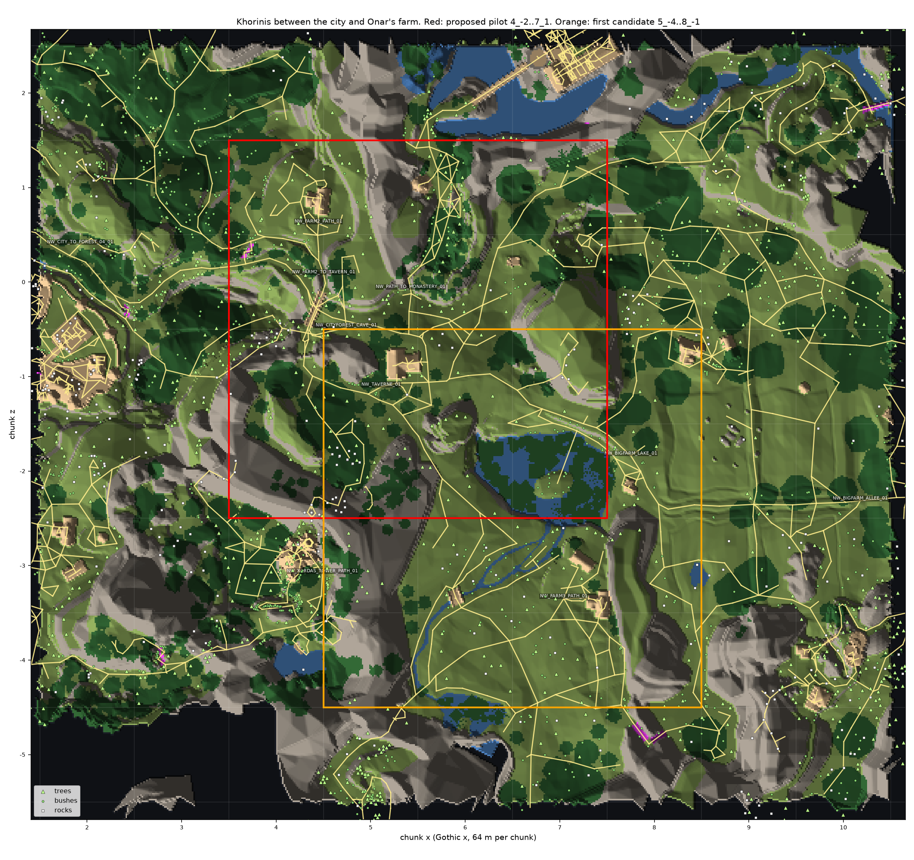
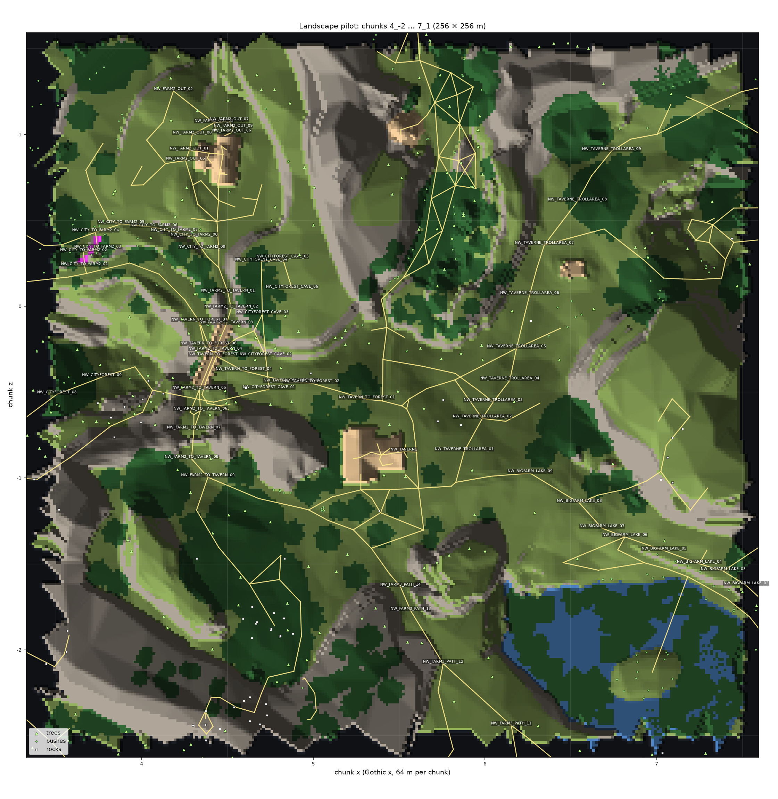

# Пилот ландшафта: участок, замысел и критерии

Шаг В1 [плана ландшафта](../../../docs/landscape-plan.md). Здесь записано, какой участок переделываем первым, что в нём от замысла оригинала и что от железа 2002 года, что обязано сохраниться и по чему пилот будет принят.

**Состояние (2026-11-13):** участок выбран пользователем; список сохранения и критерии приёмки пользователь подтвердил без правок (2026-11-13) — ворота шага В1 пройдены, дальше шаг В2. Открыты два вопроса: эталон скал и разрешение скачать эталонные фото; до ответа фото не собраны, и шаг В2 идёт по числам исследования.

## Участок

Куски `4_-2`…`7_1` мира `NEWWORLD`: квадрат 256 × 256 м вокруг таверны «Мёртвая гарпия» (x 256–512 м, z −128…128 м, кусок — 64 м). Пользователь выбрал его из двух кандидатов 2026-11-12 («Да, красный»).





Почему он: на четверти километра есть все виды земли острова, которые пойдут в тираж, — дорога с колеями, ферма с полем, скальная полка и обрыв, каменный мост, тёмный лес, луг, берег озера с водопадами и дно ущелья на 60 м ниже дороги. Через него идёт игрок в первые часы: из города к Акилу, к таверне и дальше к Онару или монастырю.

Карты рисует [`area_map.py`](area_map.py) по базе игры; подписи осей стоят в центрах кусков.

### Числа участка

Перепись `scripts/content/world/world_census.py NEWWORLD --rect 4,-2,7,1`:

| Что | Сколько |
|---|---|
| Треугольники меша мира | 39 835 |
| Земля суши | 51 253 м² |
| Скала суши | 62 255 м² |
| Оболочки растительности (плоскости крон) | 19 990 треугольников; главные материалы — `NW_NATURE_TREE_04` 97 939 м², `NW_NATURE_TREE_NEEDLE_03` 72 403 м² |
| Рукотворное (мост, дома, заборы в меше) | 3 430 треугольников |
| Высоты | −23,9…87,1 м: дно ущелья −23 м, озеро 15–20 м, дорога 38–42 м |
| Уклон земли | 62 % площади положе 15°, 90 % положе 30° |
| Уклон скалы | 37 % площади в полосе 60–90°, ещё 27 % наклонено наружу или нависает |
| Клетки природной суши в несколько слоёв | 8,3 % (5 358 из 64 220 при клетке 1 м); в три слоя и больше — 643 |
| Деревья | 161: ели `TANNE` и `HOHETANNE` — 117, большие лиственные `BIGTREE` — 12, остальное — пни и малые |
| Кусты | 140 |
| Камни-предметы | 49, из них 18 надгробий и 23 валуна `MIN_LOB_COUPLESTONES` |
| Трава, папоротники, растения | 276 |
| Рёбра сети путей внутри участка | 2 967 м |
| Плотность текселей земли | 100–125 текселей на метр (текстуры 512 × 512) |

Главные материалы: скала `NW_NATURE_STEIN_03` (48 708 м²) и `STEIN_02`; земля `NW_NATURE_WALDBODEN_03` (24 429 м², она же «луг»), `DARKWOOD_BODEN_01` (11 668 м², подстилка леса), `WBODEN_VAR_03`, дорога `PATH_06` (3 018 м²); вода `NW_MISC_SWAMPWATER_01_SEA_01` (10 776 м²), ряска и кувшинки.

## Как снято «сейчас»

Сценарий [`scripts/bench/landscape-pilot.bench`](../../../scripts/bench/landscape-pilot.bench): 13 точек по 4 кадра камеры игры (герой поворачивается на 90°, кадр 1 — вдоль тропы), 5 точек ночью по 2 кадра, два клипа бегом — `walk-road` (от дороги южнее фермы через мост и вдоль обрыва к развилке у таверны и на дорогу к Онару, 52 с) и `walk-forest` (с дороги в лес к пещере, 38 с).

```sh
TEMPEST_WINDOW_SIZE=2560x1440 BENCH_HOST=ryzen scripts/bench.sh landscape-pilot
```

Снято 2026-11-13 на Ryzen без окна, настройки по умолчанию (лучи выключены), полдень и 23:00. Исходные кадры PNG и клипы лежат на сетевом хранилище: `/mnt/shared/gothic-ai/landscape-pilot/baseline-2026-11-13/`. Ниже — листы по четыре кадра, уменьшенные.

Точки менять только вместе с этой заметкой: с этими кадрами сравниваются все следующие прогоны.

| Точка | Точка пути → куда смотрит кадр 1 | Что видно | Лист |
|---|---|---|---|
| `city-road` | `NW_CITY_TO_FARM2_04` → `_06` | подъём из города, указатель, край поля, скальная стена с куполом | [лист](shots/city-road.jpg) |
| `farm` | `NW_FARM2_PATH_02` → `_06` | двор Акила, дом, поле со стогами, скальная терраса | [лист](shots/farm.jpg) |
| `road` | `NW_FARM2_TO_TAVERN_02` → `_04` | дорога в скальной выемке, валуны, вид на город и мачты порта | [лист](shots/road.jpg) |
| `bridge` | `NW_FARM2_TO_TAVERN_05` → `_07` | каменный мост, за ним скальная арка и стоянка с костром | [лист](shots/bridge.jpg) |
| `under-bridge` | `NW_TAVERN_TO_FOREST_06` → `_04` | нижняя тропа, мост снизу, обрыв с забором | [лист](shots/under-bridge.jpg) |
| `cliff-road` | `NW_FARM2_TO_TAVERN_08` → `_10` | дорога между скалой и ельником, костёр | [лист](shots/cliff-road.jpg) |
| `tavern` | `NW_TAVERNE_CROSS` → `TAVERNE` | развилка с указателем, таверна | [лист](shots/tavern.jpg) |
| `meadow` | `NW_TAVERNE_TROLLAREA_03` → `_05` | луг с валунами, большое лиственное дерево, таверна сзади | [лист](shots/meadow.jpg) |
| `lake` | `NW_BIGFARM_LAKE_06` → `NW_LAKE__WATER_03` | берег, кувшинки, два водопада с уступа | [лист](shots/lake.jpg) |
| `forest` | `NW_FARM2_TO_TAVERNCAVE1_03` → `_05` | ельник у могил: подстилка, папоротники, грибы, надгробия | [лист](shots/forest.jpg) |
| `onar-road` | `NW_FARM3_PATH_13` → `_12` | дорога к Онару между слоистыми скалами | [лист](shots/onar-road.jpg) |
| `gorge` | `NW_CITYFOREST_10` → `_12` | дно ущелья: стены выше кадра, папоротники | [лист](shots/gorge.jpg) |
| `monastery-path` | `NW_PATH_TO_MONASTERY_03` → `_05` | узкая тропа к монастырю под скалой | [лист](shots/monastery-path.jpg) |
| ночь | `road`, `cliff-road`, `tavern`, `forest`, `lake` | что читается ночью | [лист](shots/night.jpg) |

Яркость земли на экране (нижняя половина кадра, линейная, медиана четырёх кадров): луг 0,063, ферма 0,051, озеро 0,044, лес 0,005, тропа к монастырю 0,007; ночью 0,003–0,004 везде. Лес на экране темнее луга примерно в 12 раз. Это число уже после тональной кривой, с освещённостью в жизни его напрямую сравнивать нельзя.

## Лист замысла

### Что это за место

Развилка трёх дорог на скальной полке между городом и хуторами. Путник поднимается из города мимо хутора Акила, идёт по дороге, врезанной в скалу, переходит каменный мост над нижней тропой, проходит под скальной аркой мимо чужого костра и выходит к таверне. Оттуда дороги расходятся: к Онару мимо озера, к монастырю узкой тропой, в лес к могилам и пещерам. С дороги всё время видно, откуда пришёл: город и мачты порта внизу. В стороне от дороги сразу становится темно и опасно.

Настроение: обжитая дорога через дикое место. Светлая полка с колеями и огнями — и тёмные лес и ущелье в двух шагах от неё.

### Главная деталь

**Дорога на полке между скалой и обрывом** — две тёмные колеи с травяной полосой между ними. Она связывает всё: ферму, мост, арку, развилку. От города до развилки внутри участка 176 м пути (62 м подъёма и 114 м от фермы до таверны), перепад дороги — 38–42 м, дно ущелья под ней на 60 м ниже.

### Черты

| № | Черта | Что это | Кадры |
|---|---|---|---|
| 1 | Дорога — две колеи в грязи, между ними и по бокам трава | замысел | `tavern-1`, `under-bridge-1`, `meadow-3` |
| 2 | Скала светлая, слоистая, с горизонтальными пластами и тёмными потёками | замысел | `farm-3`, `onar-road-2`, `bridge-1` |
| 3 | Скальная арка над дорогой, под ней стоянка: костёр, колья, телега | замысел | `bridge-1` |
| 4 | Каменный мост с парапетами над нижней тропой | замысел, рукотворное | `bridge-3`, `under-bridge-4` |
| 5 | Дальние виды с дороги: город, мачты порта, вершины на горизонте | замысел | `road-4`, `farm-2`, `onar-road-3` |
| 6 | Плоская вершина скалы с травой наверху, обрыв под ней | замысел | `city-road-4`, `lake-1` |
| 7 | Ельник: лес хвойный, большие лиственные деревья одиночные | замысел | `tavern-1`, `meadow-1`, перепись |
| 8 | Под ельником нет травы: бурая подстилка, папоротники, грибы | замысел | `forest-1`, `gorge-2` |
| 9 | Луг открыт, на нём валуны и одно большое дерево у дороги | замысел | `meadow-2`, `meadow-4` |
| 10 | Озеро заросло: ряска, кувшинки, тростник; два водопада с уступа | замысел | `lake-1`, `lake-4` |
| 11 | Ночью читаются только огни: костёр на дороге, окна таверны | замысел; это свет, а не ландшафт | `cliff-road-night-2`, `tavern-night-1` |
| 12 | Валуны и скалы собраны из плоских граней по 4–12 м, текстура на крутых гранях растянута | ограничение | `road-1`, `road-4`, `onar-road-4` |
| 13 | Стык скалы и земли — жёсткая линия: ни осыпи, ни грязи, ни камней у подножия | ограничение | `farm-3`, `tavern-2`, `onar-road-2` |
| 14 | Земля плоская; трава — рисунок на текстуре и редкие пучки; на лугу виден повтор текстуры | ограничение | `meadow-2`, `lake-2` |
| 15 | Граница травы и дороги идёт прямыми отрезками вдоль рёбер сетки | ограничение | `bridge-2`, `cliff-road-2` |
| 16 | Кроны — тёмные плоскости-оболочки; ветви ели — скрещённые плоскости с зубчатым краем | ограничение | `city-road-2`, `cliff-road-4`, `monastery-path-4` |
| 17 | Ели одинаковые: четыре модели на 117 деревьев | ограничение | `tavern-1`, `road-2` |
| 18 | Лес тёмный | то и другое: темнота — замысел, а даёт её крыша из оболочек | `forest-1…4`, клип `walk-forest` |
| 19 | Трава свисает с кромки обрыва | то и другое: кайма — замысел, исполнена растянутой полосой текстуры | `farm-3`, `city-road-4` |
| 20 | Пласты скалы | то и другое: слои нарисованы на гладких гранях; в жизни пласты — это уступы и полки | `onar-road-2`, `gorge-3` |

### Напряжения

- **Рельеф скал против силуэтов и прохода.** Уступы и осыпь меняют контур арки, полки, обрыва; дорога идёт вплотную к стене, и осыпь у подножия может её сузить.
- **Настоящие кроны против темноты леса.** Крона из веток пропускает больше света, чем сплошная плоскость. Темноту придётся держать сомкнутостью и числом крон.
- **Объёмная трава против читаемости земли.** В траве не должны теряться колеи, грибы, травы для сбора и надгробия.
- **Смешение материалов против колеи.** Мягкий переход трава–дорога не должен размыть колеи в бурое пятно.

### Список сохранения

Каждый пункт проверяется по паре кадров «сейчас | пилот» с той же точки или числом.

1. Дорога лежит там же: на кадрах `*-1` дорожных точек колеи проходят через те же места кадра.
2. Колей две, между ними полоса травы.
3. Развилка у таверны: два рукава расходятся у указателя (`tavern-1`).
4. Мост и его парапеты не изменены (`bridge-3`).
5. Мост читается снизу, с нижней тропы (`under-bridge-4`).
6. Скальная арка над дорогой стоит с тем же просветом; костёр виден сквозь неё (`bridge-1`).
7. С дороги видны город и мачты порта (`road-4`, `farm-2`, `under-bridge-4`).
8. Контур вершин и скал на горизонте тот же (`road-1`, `city-road-4`, `onar-road-3`).
9. Скала остаётся светлой и слоистой, пласты лежат горизонтально.
10. Вершины скал плоские и травяные, трава свисает с кромки.
11. Под ельником бурая подстилка без травы.
12. Надгробия, папоротники и грибы в лесу видны с тропы (`forest-1`, `forest-4`).
13. Лес остаётся тёмным: земля в лесу на экране темнее земли луга не меньше чем в 8 раз (сейчас в 12).
14. Лес хвойный: ели — не меньше девяти из десяти больших деревьев.
15. Луг открыт: с `meadow-3` таверна видна целиком.
16. Валуны луга и большое лиственное дерево у дороги — на своих местах (`meadow-2`, `meadow-4`).
17. Озеро: кувшинки, ряска, тростник, оба водопада и уступ за ними видны с `lake-1`.
18. Ущелье: стены уходят за верх кадра, дно в подстилке и папоротниках (`gorge-1`).
19. Ферма Акила: дом, поле, стога и скальная терраса за полем видны с тех же точек (`farm-1`, `farm-3`).
20. Ночью костёр на дороге и окна таверны — единственные огни (`cliff-road-night-2`, `tavern-night-1`).
21. Все предметы, растения для сбора, костры и NPC стоят на земле и доступны: список сдвинутых предметов проверки проходимости пуст или разобран.

**Отступления: нет.** Уже согласовано пользователем 2026-11-12 и отступлением не считается: оболочки заменяются настоящими деревьями; поверхность проходимой земли может уйти до ±0,3 м, тропы и места квестов закреплены.

## Эталон из жизни

Ориентир для физики вида — реальность, не числа оригинала.

**Гипотеза (Claude, не подтверждена пользователем):** скалы участка — песчаник с горизонтальной слоистостью, как в Эльбских Песчаниковых горах (Саксонская и Чешская Швейцария). Совпадает набор форм: пласты и полки, отвесные стены, нависающие карнизы (27 % площади скалы участка наклонено наружу или нависает), столовые вершины с травой, природная арка, тесные сырые ущелья с папоротником и ельник вокруг. Хутор, поле и луг — обычное среднегорье Центральной Европы.

Что эталон должен дать работе:

- как выглядит подножие стены: осыпь, упавшие блоки, песок и корни вместо линии;
- как пласты выходят на грань: уступы, ниши, вертикальные трещины, скруглённые кромки;
- как трава и мох переходят в камень на кромке и на полках;
- как лежит колея: глубина, лужи, камни, край травы;
- как выглядит земля ельника и сколько на ней света.

Числа из [исследования](../../engine/2026-11-12-world-detail/README.md), ограничители, а не цели: осыпь 35–40°, лесной склон до 41°, свет под сомкнутым пологом 1–3 % дневного.

**Фото не собраны.** План: около десяти снимков с Wikimedia Commons под CC0 или CC BY, с авторами в подписи, вне git. Нужно разрешение пользователя на скачивание.

## Критерии приёмки пилота

Вид принимает пользователь по клипам; числа ниже только ловят провалы.

| Что | Чем | Порог |
|---|---|---|
| Раскладка | `scripts/content/world/world_walk_check.py NEWWORLD --content DIR` | код 0: пути в пределах 0,05 м, проходимая земля в пределах 0,3 м, нет новых непроходимых рёбер, список сдвинутых предметов пуст или разобран |
| Сохранение | пары «сейчас \| пилот» со всех 13 точек и 5 ночных | каждый пункт списка сохранения — «да»; пары смотрит рецензент `remaster-reviewer` в чистом контексте, затем пользователь |
| Вид в движении | клипы `walk-road` и `walk-forest` днём и ночью, «сейчас \| пилот» | принимает пользователь |
| Грани | кадры `road-1`, `road-4`, `onar-road-2`, `gorge-3` | на скале у дороги не читаются плоские грани длиннее 1 м; на линии горизонта нет прямых отрезков граней |
| Стыки | крупные планы подножий на `farm-3`, `tavern-2`, `onar-road-2` | вместо линии — полоса осыпи, камней или грязи; ширина дороги не уменьшилась |
| Материалы | `meadow-2`, `lake-2`, `bridge-2`, `cliff-road-2` | повтор текстуры не читается с тропы; граница травы и дороги не идёт прямыми отрезками; колеи читаются |
| Лес | `forest-1…4`, `walk-forest` | пункты 11–14 списка; в движении нет мерцания крон и теней (шаг В5) |
| Цена | `scripts/perf-content.sh` против нынешнего набора, стенд облёта, зонд загрузки | порог Ц1 плана; без новых рывков на облёте |

## Что в пилот не входит

- Дома, мост, заборы и прочее рукотворное: это ассеты [конвейера ремастера](../../../docs/remaster-pipeline.md).
- Вода озера и водопады как эффект.
- Свет ночи и адаптация глаза: это [план графики](../../../docs/graphics-plan.md).
- Пещеры изнутри: вход остаётся на месте, нутро — после пилота.

## Вопросы пользователю

1. ~~Список сохранения — полон? Что лишнее, чего не хватает?~~ Подтверждён без правок 2026-11-13, вместе с критериями приёмки.
2. Эталон скал — песчаник Эльбских гор — годится как ориентир?
3. Можно ли скачать около десяти эталонных фото с Wikimedia Commons (CC0 и CC BY, вне git)?
