# В3: материал скал

Заметка о приёме к шагу В3 [плана ландшафта](../../../docs/landscape-plan.md). Пользователь выбрал его первым шагом вида 2026-11-13 («Да, материал первым») по кадрам и клипу [пробы слоёв](layers-probe.md).

**Состояние (2026-11-13):** задача 1 (проекция по миру) принята ведущим по кадрам 2026-11-13 ([что вышло](#задача-1-что-вышло)); приёмка пользователя — по клипу всего шага. Задача 2 (трава по кромке): слой влит, [что вышло](#задача-2-что-вышло); его материал с глубиной прошёл три круга, [что вышло](#трава-слоя-материал-с-глубиной): это трава с рваным краем, листья матовые, цвет и разброс в ограждениях на обоих видах; [что ещё не так](#что-ещё-не-так) — светлые листья вблизи желтее и ярче мазков оригинала, тень темнее на 9–16 %, повтор 4 м ослаблен, но виден. Приёмка — за ведущим и пользователем. Сканы для задачи 4 выбраны и скачаны; задача 3 впереди.

## Цель

Скалы острова читаются как камень с любого расстояния, место остаётся собой: трава и мох по кромкам, тёплый серо-бурый тон. Проба показала, что это даёт материал, а не форма. Шаг превращает пробный набор в настоящий: без швов и растяжения развёртки оригинала, без читаемого повтора, с травой по кромкам, по цене, которую держит кадр.

Земля — вторая половина В3 — идёт после скал и вместе с травой (шаг В5): плоский скан земли без травы издалека проигрывает оригиналу ([пилот сканов](../remaster/megascans-pilot/README.md)).

## Эталон и числа

| Что | Значение | Откуда |
|---|---|---|
| Плотность у камеры | 500–1000 пикселей на метр; сейчас 43–58 | проба слоёв |
| Скала острова | 1,68 км², 35 текстур; пять покрывают 95 %: `NW_NATURE_STEIN_07` 58 %, `_03` 27 %, `_02` 5 %, `_06` 3 %, `_01` 1,5 % | подсчёт по кускам `NEWWORLD` |
| `STEIN_07` | 977 тыс. м² на 11,9 тыс. треугольников: дальние горы, вблизи почти не встречается | там же |
| Крутизна | 55–81 % площади каждой из пяти круче 50° | там же |
| Полосы с травой | `STEIN_02`, `STEIN_04`: v от 0 до 1 по высоте, трава у v = 0 (у `_04` и у v = 1) | проба слоёв |
| Цвет | равные средние текстур дают на солнце стену в 1,4–1,5 раза ярче оригинала; поправка по кадрам 0,78 / 0,72 / 0,56 | проба слоёв |
| Порода | слоистый обрыв скана `marble_cliff_03`; отдельного подтверждения эталона породы от пользователя нет, направление принято по кадрам с этим сканом | проба слоёв |

## Как решают другие и ловушки

Источник — [заметка о материалах](../../engine/2026-11-12-world-detail/research/terrain_materials.md) исследования.

- **Крутое — проекцией по миру.** Трёхплоскостная проекция стоит 3 выборки на карту, двухплоскостная (Quilez) — 2: берутся две главные оси нормали. Производные считают сами, иначе на смене плоскости мипы скачут. У нормалей (±1, ±1, ±1) двухплоскостная даёт мелкие изъяны.
- **Нормали при проекции** поворачивают в каждой плоскости отдельно и складывают; общая касательная база для них неверна.
- **Повторы** прячут крупной картой оттенка, той же текстурой в крупном масштабе на расстоянии и случайным сдвигом ячеек. Последнее у слоистой породы режет пласты (проба: укладка `offset`).
- **Сверху трава и мох, сбоку камень** — правило по наклону и высоте, общее для Witcher 3, Call of Duty, UE.
- **Смешивание по высоте** даёт рваную, а не размытую границу слоёв.

## Что умеет движок

- Материал по имени текстуры: `materials/materials.json` — карты цвета, нормалей и ORM, `scale`, `antitile`. Данные материала в шейдере — `Bucket` (`OpenGothic/shader/scene.glsl`), заполняет `drawbuckets.cpp`.
- Шейдер `OpenGothic/shader/materials/main.frag` пишет G-буфер; нормаль из карты строится по экранным производным позиции и UV (`mappedNormal`), касательных в вершине нет. Мировая позиция пикселя в этом проходе есть.
- Чего нет: проекции по миру, второго слоя материала, крупной вариации. Цвет вершины меша мира свободен (в кадре не используется), но формат кусков сейчас меняется шагом Д3 — новые данные в вершину этим шагом не добавляем.
- Отражённый свет берёт цвет материала по развёртке меша; как он поведёт себя с проекцией, выясняет задача 1.

## Способ

Три задачи движка и одна контента. Код рендера пишет и принимает Claude.

1. **Проекция по миру.** Поле записи материала, например `"projection": {"tile_m": 5.75}`: карты берутся по мировой позиции в двух главных плоскостях нормали. В боковых плоскостях V — высота мира, поэтому пласты горизонтальны на любой грани; сверху — плоскость XZ. Нормали поворачиваются по плоскостям, производные заданы явно. Работает на меше мира и на статичных мешах с тем же материалом. Снимает швы и растяжение развёртки оригинала и раскладку полосой.
2. **Трава по кромке.** Поле `"fringe"`: второй набор карт (трава, мох) поверх камня. Где ему быть, говорит развёртка оригинала: у полос `STEIN_02/04` координата v — это высота над кромкой, художник оригинала уже отметил ею траву. Вес — полоса по v с рваным краем по маске; сам слой берётся проекцией по миру. Новых данных в меше не нужно. Настоящие свисающие пучки добавит растительность (В5).
3. **Вариация без разрыва пластов.** Крупный шум оттенка по миру (несколько процентов яркости, десятки метров) и подмешивание тех же карт в масштабе ×4 с расстоянием. Сдвигов ячеек нет.
4. **Набор сканов.** Материалы для пяти текстур и их родни (`STEIN_01…08`, `DARKWOOD_FELS`, `CAVEWALL`): 2–3 скана CC0 одной породы, чтобы соседние стены не были одинаковыми; для `STEIN_07` — тот же камень в крупном масштабе. Цвет каждого калибруется по кадрам игры отдельным скриптом (отношение «оригинал / новое» на тех же пикселях). Трава кромки — свой материал. Сборка — потомок [`landscape_probe.py`](../../../scripts/content/landscape_probe.py); новые загрузки CC0 — с разрешения пользователя.

Порядок: 1 → 2 → 3; задача 4 идёт рядом, её цвет окончательно калибруется после задачи 1.

### Задача 4: выбранные сканы

Пользователь разрешил загрузку 2026-11-13. Всё с Poly Haven, CC0, 4096 px, вне git в `~/.local/share/gothic-ai/content-sources/landscape-probe/` (818 МБ вместе с пробой, список — `credits.json` там же). Выбор по превью, до кадров игры он предварительный.

| Скан | Размер | Куда |
|---|---|---|
| `marble_cliff_03` | 5,75 м | ближние стены: `STEIN_03`, `_02`, `_04` (уже в пробе) |
| `marble_cliff_01` | 4,3 м | та же порода с вертикальными блоками: вторая стена, чтобы соседние не были одинаковыми (`STEIN_01`, `_06`, `_08`) |
| `marble_cliff_05` | 20 м | дальние горы `STEIN_07`: крупный масштаб, без мелких блоков |
| `mossy_rock` | 3 м | замшелый камень: верхи уступов и сырые места |
| `sparse_grass` | 2 м | трава слоя кромки (задача 2) |
| `grass_medium_01` (модель) | — | пучки травы карточками с картой прозрачности: рваный край кромки сейчас, свисающие пучки в В5 |

Запасные с пробы: `rock_face_03` (камень без слоёв), набор валунов `rock_moss_set_01`.

## Приёмка

- **Задача 1:** кадры пробы слоёв на том же месте: пласты горизонтальны на каждой грани, тёмного прямоугольника на валуне нет, растянутых граней нет; пара с развёрткой оригинала. Цена кадра на этом месте против нынешнего набора.
- **Задача 2:** уступ издали ([кадр пробы](shots/layers-ledge.jpg)) и стена у дороги: трава по кромкам на месте, край рваный, без пикселей оригинала.
- **Задача 3:** арка у лагеря бандитов с 30–60 м: повтор не читается.
- **Шаг целиком:** пользователь по клипу прохода пилота «сейчас | материал», день и вечер, ближние стены и дальние горы; цена по `perf-content.sh`; Mac измерен.

## Чего не знаем

- Цену двухплоскостной проекции с тремя картами и вторым слоем в кадре на RTX 3080 и на Mac.
- Хватит ли одного семейства сканов на весь остров или у тёмного леса и пещер своя порода.
- Память: один материал 4096 — 44 МБ трёх карт.

## Задача 1: что вышло

2026-11-13. Поле записи `"projection": {"tile_m": 5.75}`: карты записи берутся по мировой позиции, `tile_m` метров мира на повтор; `scale` не действует. Код — [`material_projection.glsl`](../../../OpenGothic/shader/materials/material_projection.glsl), разбор и отказ — `resources_textures.cpp`, `Material`, флаг `BK_PROJECTION` в `drawbuckets.cpp`; как это устроено — пункт «Проекция по миру» в [своих материалах](../../../docs/own-content-textures.md#карты-и-рендер).

**Способ.**
- Две плоскости (Quilez): главная и средняя оси нормали, доли `clamp((|n| − 0,577)/0,423)` в квадрате; доля ниже 1/64 обнуляется, обе доли пересчитываются одинаково (на 45° — ровно 0,5 и 0,5), поэтому вторая плоскость выбирается только на гранях 37–53° от оси, иначе одна выборка на карту.
- Плоскости и их доли выбираются по нормали вершины, удержанной в пределах 20° от нормали самой грани (`cross(dFdx(pos), dFdy(pos))`; постоянная `ProjectionLimit*`). Решение ведущего после двух проб ([лист](shots/projection-plane-choice.jpg)): по одной нормали грани доли постоянны на треугольнике и скачут на его рёбрах — лоскуты на гранях почти одного наклона; по одной нормали вершины доли непрерывны, но у скал Gothic она на острых рёбрах отходит от грани до 45°, плоскость ложится поперёк грани и размазывает её. В пределах 20° берётся нормаль вершины: доли непрерывны, грани до 40° друг к другу продолжают рисунок без обрыва; дальше — нормаль грани, повёрнутая к ней на 20°: плоскость не дальше 20° от грани, растяжение ограничено, обрыв остаётся только на остром ребре. Базисы нормали по-прежнему на нормали затенения.
- В боковых плоскостях v = −высота мира (вниз, как v движка), u — вдоль грани, так что cross(u, v) смотрит наружу и рисунок не зеркалится; сверху и снизу — плоскость XZ.
- Градиенты выборок — `dot(dFdx(pos), ось)·k·mipGradScale`, общие для обеих плоскостей: скачка мипа на смене плоскости нет.
- Нормаль: в каждой плоскости базис `mappedNormal` этой плоской развёртки — поверхностные градиенты u и v, `ось − n(n·ось)`, со знаком экранного определителя и общей нормировкой по большей длине; затем две нормали смешиваются. На грани вдоль оси базис совпадает с тем, что `mappedNormal` строит по UV меша, уложенной так же.
- Трассировка лучей: пробы GI (`probe_trace.comp`) и трассировщик путей берут цвет попадания `textureLod(..., uv меша, 0)` — по развёртке оригинала, без `scale`. Для проекции так и оставлено: та же текстура в других координатах — правдоподобный цвет отскока.

**Кадры**, Ryzen, 2560×1440, без экрана, один бинарник; слева — набор пробы как есть (развёртка оригинала, `scale` 2/2/1), справа — его копия с проекцией на трёх записях `NW_NATURE_STEIN_02/03/04`, `tile_m` 5,75.


- **`road-2`, `road-3`, `eve-3` — стена у дороги.** Пласты горизонтальны по всей стене, швов развёртки нет. Наклонные полосы оригинала ушли. Ближний валун слева на `road-3` и `eve-3`: большая грань идёт через свои треугольники одним рисунком; грань справа видна почти с ребра, рисунок сжат ракурсом. Рисунок меняется на остром гребне между ними.
- **`road-4` — валун** ([три способа выбора](shots/projection-plane-choice.jpg)). Полос на левой грани нет (были по нормали вершины). Лоскутов-треугольников в середине валуна нет (были по нормали грани): от прогона по нормали грани кадр отличается только на пяти гранях, каждая меняется целиком, в части грани ничего не поменялось. Где рисунок ещё меняется: длинное ребро между наклонным верхом и отвесной стороной, рёбра левой наклонной грани и гребень над ней — рёбра, на которых меняется и свет, то есть грани расходятся заметно больше 40°. Внутри одной грани линии смены долей не видно ни на одном кадре.
- **`ledge` — уступ издали.** Пласты горизонтальны на обеих гранях, угол стыкуется. Читается повтор рисунка с шагом 5,75 м по ширине стены — это задача 3.
- **`arch` — арка.** Единый слоистый камень вместо лоскутов разной плотности; тот же повтор крупных блоков на большой стене.
- **Стена и арка против прошлых листов.** На `road-2`, `road-3`, `eve-3`, `ledge` кадр от прогона по нормали грани отличается на 0,3–2 % пикселей (порог 24 из 255) — отдельные грани; на вид без изменений. `arch` отличается на 21 %, но так же отличаются земля и трава: ракурс `arch` сдвигается от прогона к прогону (между двумя прошлыми прогонами — те же 21 %).
- **Яркость.** Средняя яркость скалы на кадре против развёртки оригинала: `road-2` 1,00, `road-3` 0,99, `ledge` 0,99, `road-4` 1,02, `arch` 1,00.

**Что не так.** На валуне рисунок меняется по острым рёбрам (больше 40° между гранями); их скругление под новым материалом — дело геометрии (В2 как вспомогательный шаг), не этой задачи. Повтор 5,75 м на больших стенах — задача 3. Задача принята ведущим по кадрам 2026-11-13; пользователь принимает шаг целиком по клипу.

**Цена.** Выборок на пиксель: по UV меша — 3 (цвет, нормаль, ORM), с проекцией — 3, на гранях 37–53° от оси — 6. Время видеокарты на вид `road-3` — место `rock` стенда `scripts/perf.sh` ([`perf-rock.bench`](../../../scripts/bench/perf-rock.bench)): RTX 3080, 1920×1080, полное разрешение, VSM, заявки `gq quiet`, 8 с `perf sample` (970–1048 кадров), медиана `gpu_ns`. Скала — около половины кадра.

| Прогон | По UV меша | Проекция |
|---|---|---|
| Кадр, 1-я пара | 2,45 (кадры в два уровня, p95 3,23 — прогрев) | 2,79 |
| Кадр, 2-я пара | 2,78 | 2,83 |
| Кадр, пара с `OPENGOTHIC_GPU_PASSES=1` | 2,75 | 2,98 |
| Проход `GBuffer` в той же паре | 0,358 | 0,418 |

Проекция добавляет проходу G-буфера 0,06 мс (+16 %); остальные проходы в этой паре расходятся на величину шума (−0,13…+0,03 мс). По кадру целиком разница 0,01–0,05 мс у второй пары, у пар с разбивкой — 0,23 мс, из которых 0,06 — G-буфер; повторов по одному, разброс между запусками того же набора — до 0,3 мс. Разрешение 1920×1080, а не 2560×1440 кадров: экран Ryzen 1920×1080.

Как мерили: окно стенда на рабочем столе Ryzen шло кадр в секунду (мир за 300 с не загрузился), поэтому `PERF_ENV` нёс `TEMPEST_OFFSCREEN=1`. Без показа кадра стенд браковал прогон по `appcadence` (частота показа без экрана смысла не имеет), но `gpu_ns` командных буферов от показа не зависит, числа выше — из `frameprofile.csv`. Сборка стенда с профайлером не линковала `content-convert` (Tempest со счётчиками кадра, а `frameprofile.cpp` в конвертере нет) — на прогонах стенд собирался с той же правкой, что `main` получил параллельно (`883ae3226`).

## Задача 2: что вышло

2026-11-13. Поле записи рядом с `projection`:

```json
"fringe": {"albedo": "landscape_fringe/albedo.dds", "normal": "landscape_fringe/normal.dds",
           "orm": "landscape_fringe/orm.dds", "tile_m": 2, "top": [0.20, 0.40], "bottom": [0.14, 0.26]}
```

`top` и `bottom` — доли v от верхней кромки (v = 0) и от подножия (v = 1): сплошь до первой, пучками до второй; можно одну. Числа — `STRIPS` пробы: у `STEIN_02` только `top` 0,20/0,40, у `STEIN_04` `top` 0,17/0,33 и `bottom` 0,14/0,26. Код — [`material_projection.glsl`](../../../OpenGothic/shader/materials/material_projection.glsl), разбор — `resources_textures.cpp`, `Material::Fringe`, флаг `BK_FRINGE` в `drawbuckets.cpp`; как устроено — пункт «Трава по кромке» в [своих материалах](../../../docs/own-content-textures.md#карты-и-рендер).

**Вес.**
- Где: d — доля v от кромки. `t = (d − сплошь)/(конец − сплошь)`: меньше 0 — трава, от 0 до 1 — зона пучков, дальше — камень.
- Перелёт v. В вершинах полос острова v выходит за 0..1: у кромки до −0,1, у подножия до 1,39 (по 37,9 тыс. вершин `STEIN_02/04` в кусках `NEWWORLD`). По `fract` перелёт у кромки давал полоску голого камня над травой, у подножия — траву у стены без нижней полосы. Поэтому v от −0,05 до 1,5 считается той же полосой и прижимается к 0..1, дальше — повтор, как у текстуры.
  - У подножия допуск широкий: целиком выше 1 не лежит ни один треугольник, так что любой v > 1 — перелёт.
  - У кромки допуск узкий: полосы, повторённые в −1..0, подходят к 0 своим подножием (68 треугольников в пределах 0,1). Допуск 0,05 покрывает 341 из 379 перелётов кромки и задевает подножия 24 таких треугольников.
  - В видах съёмки перелёты крошечные: в 40 м от `road-*` 25 треугольников, у подножия до 1,022, у кромки до −0,012. В кадрах до и после правки меняется не больше 14 пикселей травы на вид (0,00–0,14 % кадра) — артефакт был, но не виден, листы не переснимались.
- В зоне пучков пиксель — трава, где высота слоя больше `t`. **Высота — синий канал ORM слоя** (металла у травы нет, шейдер пишет металл 0). Сборка ранжирует её **на каждом мипе отдельно**, поэтому доля травы при пороге `t` — `1 − t` на любом расстоянии. Без этого мипы усредняли высоту к середине, и издали порог резал ровную линию на `t ≈ 0,5` (круг 1, `road-2`).
- Блуждание: обе доли умножаются на `1 − 0,45·(0,5 + 0,5·n)`, n — гладкий шум мира по XZ (9 м и 2,25 м, веса 0,8 и 0,2). Полоса только сужается, до 0,55 записи, и никогда не шире записи.
- Пиксель — трава или камень целиком: цвет, нормаль (те же плоскости и базисы, что у камня), ORM. Полосы размытия нет, край сглаживает TAA.
- Выборки: камень — 3 (6 на гранях 37–53°), как в задаче 1. Пиксель травы берёт карты травы вместо карт камня. В зоне пучков добавляется ORM слоя (1–2 выборки), он же идёт в G-буфер, если пиксель — трава.

**Как карты доходят до шейдера.**
- **Bindless** (Vulkan и Metal Tempest — один путь массивов дескрипторов): три карты слоя идут в те же массивы `textureMain`/`textureNormal`/`textureOrm` после ведер и кадров анимации, под одним номером во всех трёх (`DrawBuckets::fringeMaps`, одна запись на набор карт). Номер — в `fringeTex` ведра. Массивы нормалей и ORM добиваются пустыми слотами до этого номера.
- **Слоты** (без bindless или у материала с анимацией кадров): три новые привязки 23–25 в G-буфере материалов с картами; без слоя туда идёт запасная текстура.
- Ведро выросло с 96 до 128 байт: номер, отношение повторов, четыре доли и выравнивание.
- Стриминг просит карты слоя по плотности камня (`implTextureDemand`): при 2 м против 5,75 м это мельче, чем слою нужно, но не грубее.

**Где работает.**
- Vulkan, bindless — все кадры ниже.
- Vulkan, слоты (`-bl 0`): кадр `road-3` стенда с травой на месте, от bindless отличается на 1,4 % пикселей (качается ёлка).
- Metal Tempest: в игре не проверено — игру на Mac в этой задаче не запускали. По коду путь тот же: массивы — аргумент-буферы tier 2, как у кадров анимации; слоты разводит SPIRV-Cross сам. Все 85 вариантов `main.frag` и проходы видимости собираются `glslangValidator`, в слотовых вариантах слои объявлены, в bindless — нет.

**Материал слоя** — `sparse_grass` (Poly Haven, CC0), 2048 px, 2 м: [`landscape_fringe.py`](../../../scripts/content/landscape_fringe.py) копирует набор с проекцией задачи 1 и дописывает поле двум полосам. Пикселей оригинала в картах нет: из оригинала берётся только средний цвет его нарисованной травы (пиксели маски пробы).
- Цвет = скан × (средняя трава оригинала / средняя скана) × экранная поправка.
- Круг 1, поправка камня 0,78 / 0,72 / 0,56. На тех же пикселях травы (`ledge` и `road-3`, линейный RGB) оригинал / новое = 1,246 / 1,328 / 1,422: новое темнее и желтее.
- Круг 2, поправка 0,97 / 0,96 / 0,80 (итоговые множители скана 0,913 / 1,54 / 0,935): 1,06 / 1,08 / 1,27 — по R и G расхождение 6–8 %, синий у оригинала на 27 % выше (его трава серее). Третьего круга цвета не было.

**Кадры**, Ryzen, 2560×1440, один бинарник; «сейчас» — без своего контента, «проекция» — набор задачи 1, «проекция и кромка» — `rock-fringe-2` (поправка круга 2) на финальном шейдере.

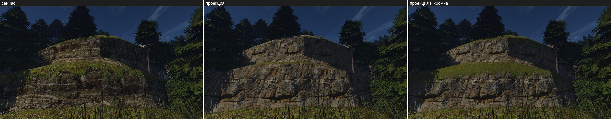
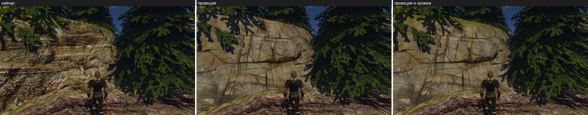
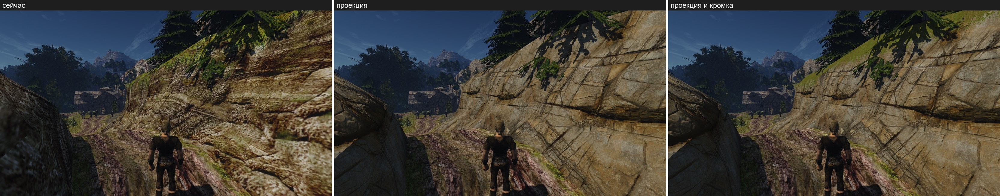
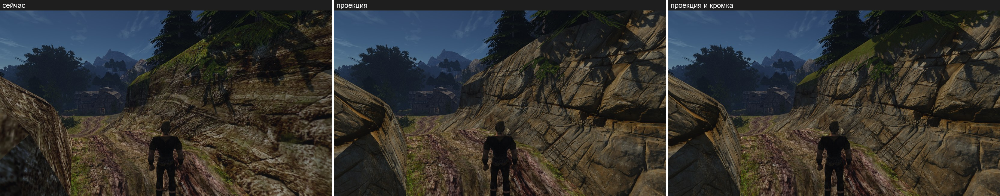
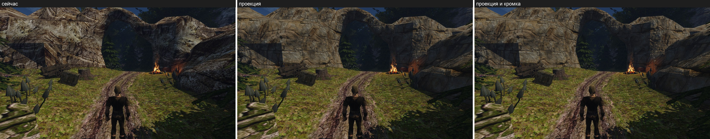

Место травы сверено с макетом пробы (пиксели оригинала по тем же строкам v, кроме кадров не идут) и три круга на `road-3`:

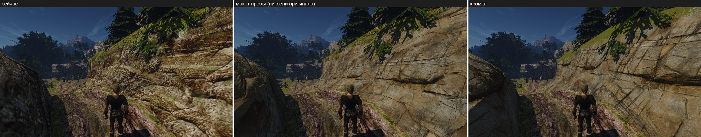
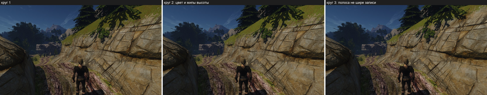

**Мой разбор, по видам.**
- **`ledge`.** Трава на верхе нижнего уступа и узкой полосой по кромке верхнего — там же, где у оригинала. **Что не так:** скат читается ровным оливковым ковром, светлее и площе нарисованной травы с её яркими стеблями и тёмными просветами. Нижний край идёт по ребру между скатом и стеной и издали почти прямой: рваные клочья мелкие, пучков, свисающих через кромку, нет (это В5).
- **`road-2`.** Трава у кромки стены — рваные клочья по камню, как тонкая полоса макета; в тени ёлки.
- **`road-3`.** Слева у кромки трава, как у оригинала; правая часть ската — камень с клочьями травы. Край рваный и блуждает. Растянутых пучков нет, шва на смене плоскости нет. **Что не так:** островки травы на отвесе вблизи читаются скорее пятнами мха, чем травой: скан снят сверху и на стене остаётся видом сверху. Освещённый верх стены у дома чуть светлее и желтее травы земли рядом.
- **`eve-3`** (17:30). Скат тёмно-оливковый, рядом с землёй не светится и не чернеет.
- **`arch`.** Травы нет: у арки не полосы `STEIN_02/04` — так и должно быть.
- **Круги места.**
  - Круг 1: вид светлее и желтее, издали ровная линия.
  - Круг 2: цвет и высота по мипам.
  - Круг 3, после разбора причины, а не подбором. Блуждание расширяло полосу до 1,55 доли записи, и трава ложилась ниже конца нарисованной травы: на `road-3` справа макет и оригинал показывают камень, а было сплошь зелено. Развёртку проверил по кускам `3_-2…6_1`: v полос почти везде в 0..1 (от −0,03 до 1,12), так что место по v совпадает с текстурой оригинала. Причина — множитель больше 1, его убрал: полоса только сужается.

**Цена.** Место `rock` стенда (`road-3`): RTX 3080, 1920×1080, без экрана (`TEMPEST_OFFSCREEN=1`, стенд бракует прогон по `appcadence`, числа — из `frameprofile.csv`), заявки `gq quiet`, медиана `gpu_ns` за 8 с (1001–1042 кадра). «Проекция» — с ограниченной нормалью выбора задачи 1, её цена здесь снята впервые.

| Прогон | По UV меша | Проекция | Проекция и кромка |
|---|---|---|---|
| Кадр, `OPENGOTHIC_GPU_PASSES=1` | 2,52 | 2,65; 2,54 | 2,57; 2,53 |
| Проход `GBuffer` там же | 0,315 | 0,380; 0,364 | 0,379; 0,375 |
| Кадр без разбивки | 2,54 | 2,58 | 2,44 |
| Слоты (`-bl 0`): кадр / `GBuffer` | — | 4,03 / 1,020 | 4,14 / 0,942 |

- Проекция с ограниченной нормалью выбора добавляет проходу G-буфера 0,05–0,065 мс (+16–21 %), как и прогон задачи 1 по нормали грани (+0,06).
- Кромка — ещё 0,00–0,01 мс: пиксели травы берут карты травы вместо карт камня, лишние выборки — только в зоне пучков.
- Кадр целиком у трёх наборов в пределах шума повторов (2,44–2,65 мс).
- Путь со слотами вдвое медленнее сам по себе (340 кадров за 8 с); кромка в нём не видна на фоне шума.

## Трава слоя: материал с глубиной

2026-11-13, ступень 1 [исследования травы](../../engine/2026-11-13-grass/README.md#6-способ-для-нас). Движок и шейдер не тронуты, место слоя (`top`, `bottom`) прежнее: меняются только три карты слоя и его повтор.

**Итог.** Сделано три круга. Слой читается травой с объёмом: листья, кочки, тёмные просветы, край рваный языками по 0,3–0,8 м. В круге 3 листья матовые: бледность на солнце и свечение в 17:30 ушли, трава зелёная. Средний цвет и разброс на `ledge` и `road-3` — в ограждениях: яркость оригинал / слой 0,94 и 1,07, разброс 0,90 и 1,14. [Что ещё не так](#что-ещё-не-так): вблизи светлые листья желтее и на пятую часть ярче мазков оригинала, в тени слой темнее на 9–16 %, скат `road-2` темнее на 20 %, повтор 4 м на длинной грани ослаблен, но не убран.

**Как собрано.**
- **Запекание** — [`grass_patch.py`](../../../scripts/content/mesh3d/blender/grass_patch.py), Blender 5.2 без окна, Cycles на GPU Mac. Заплатка 4 × 4 м, тор: пучок у границы повторён с другой стороны. Камера ортогональная, смотрит строго вниз ровно на один повтор.
  - Пучки — 17 штук `grass_medium_01` (Poly Haven, CC0), земля под ними — `sparse_grass`. Вырез листьев — отдельная карта `…_alpha_4k.png`: в glTF её нет, без неё карточки колосков пекутся чёрными пятнами.
  - Расстановку ведут четыре поля, повторяющиеся с заплаткой: сила (высокие кочки против короткой дернины), сухость, плеши, тон пучка. Кочки — пучки в 1,5–2,3 раза крупнее с листьями, вытянутыми в 1,3–2 раза и наклонёнными на 15–45°, пятая часть лежит на 45–68°. Наклон чаще направлен к низу картинки: на стене слой лежит строками вниз, там листья свисают.
  - Всего 2716 пучков (4481 объект с повторами у границ), из них 53 колоска и 1466 одиночных листьев. Сухая травинка — каждая четырнадцатая, в сухом пятне — до трети.
  - Пять проходов, каждый отдельным рендером: цвет, высота, нормаль, шероховатость скана и доля белого неба, которую получает травинка (с переотражением и просветом листа 0,2).
  - 4096 px, по 4 сэмпла на цвет, высоту, нормаль и шероховатость (7–10 с каждый), 16 на свет (285 с). Всего 5,3 мин.
- **Сборка** — [`landscape_grass_layer.py`](../../../scripts/content/landscape_grass_layer.py): копирует `rock-projection-world` и дописывает поле `fringe` двум полосам.
  - **Затемнение в цвете.** Цвет = альбедо × доля неба × (0,22 + 0,78 × доля высоты^1,5). Доля высоты — высота травинки против верха травы в 12 см вокруг. AO движка гасит только рассеянный свет, поэтому тень между травинками на солнце видна, только если она в цвете.
  - **Пятна** запечены, а не посчитаны шейдером: кочки и дернина, плеши до земли, тон пучка 0,62–1,12, сухие травинки. Повтор вырос с 2 до 4 м, чтобы пятна в него поместились.
  - **Мипы цвета усредняются в линейном свете.** Общий писатель DDS усредняет закодированные значения. У травы со светлыми кончиками над тёмными просветами это темнит мипы: 0,88 на втором, 0,79 на четвёртом, 0,75 на последних. Со своим писателем — 0,99–1,00 на всех.
  - **Высота для края** (синий ORM) — высота травинок плюс 0,6 от верха травы со шлейфом вниз по картинке, затухающим в e раз за 0,5 м. Под кочкой порог шейдера оставляет язык травы, а не бахрому из отдельных травинок. Ранжируется на каждом мипе, как у прежнего слоя.
  - **AO** — доля неба в степени 0,3 (среднее по весу цвета 0,88 вместо 0,67): тень уже в цвете, и в тени движок накладывал бы её второй раз.
  - **Кочки, которые выделяются из повтора, приглушены** (круг 3). Яркость, размытая на 0,15 м, ограничена 1,45 среднего по повтору. Две самые светлые кочки запекания были 1,97 и 1,78 среднего, стали 1,64 и 1,62: ограничено размытие, середина кочки остаётся яркой. Третья — 1,53. Запекание не менялось.
  - **Разброс** — показатель 1,17 над яркостью вокруг её среднего. С ним разброс повтора при текселе оригинала (1 см) — 0,80 среднего, как у нарисованной травы оригинала: 0,803 на 144 417 пикселях её маски в обеих полосах (те же пиксели, с которых берётся её средний цвет).
  - **Нормаль** — запечённая, на 0,35 довёрнутая к плоскости.
  - **Шероховатость** — пол 0,85 плюс 0,15 от скана, в среднем 0,96 (круг 3). У скана как есть — 0,70, у травинок от 0,44: в нашем рендере такие листья дают белый блик, это [причина бледности](#круги-1-и-2-причина-бледности-и-проба) кругов 1 и 2.
- **Замер** — [`landscape_grass_measure.py`](../../../scripts/content/landscape_grass_measure.py). Набор-маска (`--mask`) красит сплошную полосу слоя пурпурным; её пиксели без каймы в 2 px и есть общие пиксели травы. По ним — среднее по каналам и разброс яркости (стандартное отклонение) в линейном RGB кадра.
  - **В круге 3 исправлен отбор полосы.** В тени небо делает пурпурный синим: красный — около половины синего. Прежняя проверка «красный и синий различаются меньше чем вдвое» резала теневые пиксели посередине, и в замер попадала их часть, зависящая от шероховатости маски. Теперь берётся вся полоса: 130 524 пикселя на `ledge` вместо 122 061, 55 572 на `road-3` вместо 40 973.
- Пикселей оригинала в картах нет: из оригинала взят только средний цвет его нарисованной травы.

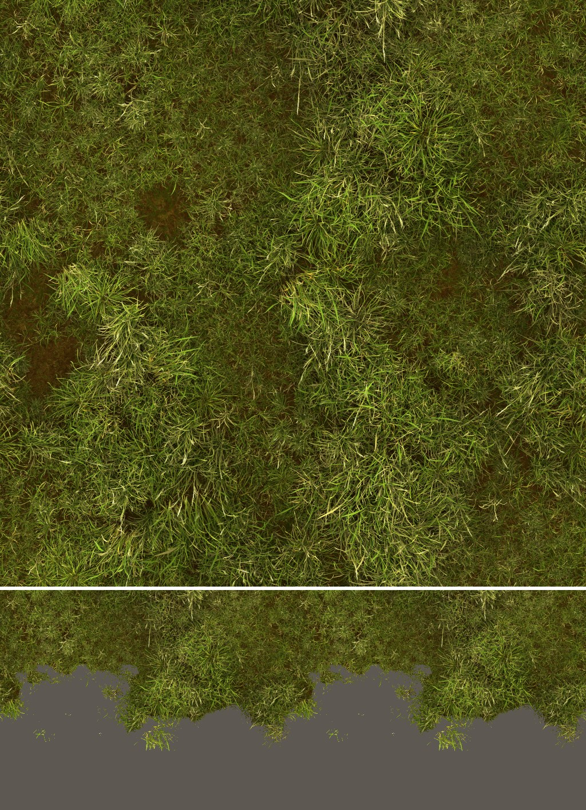

Сверху — один повтор, 4 × 4 м. Снизу — макет стены 8 м: сплошная полоса 1 м и зона пучков 1,2 м.

**Размеры.** Повтор 4 м, 1024 px на метр, как у прежнего слоя. Цвет и ORM — DXT1 4096 px по 11,2 МБ, нормаль — DXT5 4096 px, 22,4 МБ. Набор `rock-grass-3` — 85 МиБ: `rock-projection-world` 43 МиБ и слой 43 МиБ. У `rock-fringe-2` — 53 МиБ.

### Калибровка цвета

Оригинал — `OPENGOTHIC_CONTENT=`, «сейчас» — `rock-fringe-2`. Среднее R / G / B и яркость — в линейном RGB кадра, отношения — оригинал / слой. Ограждения: средняя яркость в пределах 10 %, разброс — 25 %. Таблица снята в круге 3 на всей полосе, все наборы — заново. Числа кругов 1 и 2 сняты на части полосы и лежат [ниже](#круги-1-и-2-причина-бледности-и-проба) как история: с этой таблицей их не сравнивать.

| Вид, пикселей | Набор | Среднее R / G / B | Яркость | Разброс | Оригинал / слой, R / G / B | Яркость | Разброс |
|---|---|---|---|---|---|---|---|
| `ledge`, 130 524 | оригинал | 0,0504 / 0,0519 / 0,0131 | 0,0487 | 0,0411 | | | |
| | сейчас | 0,0465 / 0,0479 / 0,0108 | 0,0449 | 0,0244 | 1,083 / 1,083 / 1,214 | 1,085 | 1,682 |
| | круг 3, первая сборка | 0,0509 / 0,0523 / 0,0120 | 0,0491 | 0,0434 | 0,990 / 0,991 / 1,094 | 0,993 | 0,947 |
| | **круг 3** | 0,0541 / 0,0553 / 0,0132 | 0,0520 | 0,0460 | 0,931 / 0,937 / 0,997 | 0,937 | 0,895 |
| `road-3`, 55 572 | оригинал | 0,0708 / 0,0685 / 0,0140 | 0,0650 | 0,0695 | | | |
| | сейчас | 0,0651 / 0,0647 / 0,0112 | 0,0609 | 0,0475 | 1,087 / 1,058 / 1,246 | 1,067 | 1,462 |
| | круг 3, первая сборка | 0,0623 / 0,0607 / 0,0114 | 0,0575 | 0,0579 | 1,136 / 1,128 / 1,232 | 1,131 | 1,201 |
| | **круг 3** | 0,0661 / 0,0642 / 0,0125 | 0,0609 | 0,0608 | 1,071 / 1,067 / 1,118 | 1,069 | 1,142 |
| оба вида, 186 096 | оригинал | 0,0565 / 0,0568 / 0,0134 | 0,0536 | 0,0518 | | | |
| | сейчас | 0,0521 / 0,0529 / 0,0109 | 0,0497 | 0,0339 | 1,084 / 1,074 / 1,224 | 1,078 | 1,529 |
| | круг 3, первая сборка | 0,0543 / 0,0548 / 0,0118 | 0,0516 | 0,0483 | 1,040 / 1,036 / 1,134 | 1,039 | 1,072 |
| | **круг 3** | 0,0577 / 0,0580 / 0,0130 | 0,0547 | 0,0510 | 0,979 / 0,980 / 1,032 | 0,981 | 1,015 |

- **Первая сборка круга 3.** Пол шероховатости 0,85, показатель 1,17, поправка 1,104 / 1,141 / 0,898: поправка круга 2, умноженная на отношения матовой пробы, поровну между видами (среднее геометрическое `ledge` и `road-3`). Поровну не вышло: `ledge` 0,99, `road-3` 1,13 — за ограждением на 3 пункта. Отношения пробы были сняты на части полосы, без половины тени; на всей полосе виды расходятся иначе.
- **Круг 3, итог.** Та же сборка с поправкой 1,183 / 1,218 / 1,070: первая, умноженная на среднее геометрическое двух видов (1,061 / 1,057 / 1,161) в степени 1 / 0,85 на кривую тона. Множители запечённого цвета 5,88 / 6,05 / 2,65. Кадр ответил на +7 % в цвете ростом яркости на 6 %. Это вторая сборка и вторая съёмка нового слоя в круге вместо одной заказанной: без неё `road-3` оставался за ограждением.
- **Ограждения выдержаны** на каждом виде и вместе. Яркость: на `ledge` слой на 6 % светлее оригинала, на `road-3` на 7 % темнее, вместе на 2 % светлее. Разброс: на `ledge` на 12 % выше оригинала, на `road-3` на 12 % ниже, вместе на 1,5 % ниже.
- **Одной поправкой оба вида к оригиналу не свести.** Между `ledge` и `road-3` остаётся 14 % (0,937 против 1,069), разница поделена поровну. У прежнего слоя разрыва нет (1,085 и 1,067). Причину разрыва я не измерял.
- **Синий** сошёлся: 1,00 на `ledge`, 1,12 на `road-3`, 1,03 вместе; у прежнего слоя 1,21–1,25.
- **Разброс** прежнего слоя — 0,59–0,68 от оригинала, нового — 0,88–1,12. Разброс в пределах 16 px (травинки без света и тени): у прежнего слоя 0,39–0,49 от оригинала, у нового 0,81–1,13.

Те же пиксели, поделённые на освещённые и теневые, яркость оригинал / слой:

| Вид, пикселей | Сейчас: свет / тень | Круг 3: свет / тень | Круг 3, весь вид |
|---|---|---|---|
| `ledge`, 130 524 | 1,08 / 1,14 | 0,93 / 1,10 | 0,94 |
| `ledge-near`, 341 993 | 1,08 / 1,20 | 0,93 / 1,16 | 0,94 |
| `road-3`, 55 572 | 1,06 / 1,13 | 1,06 / 1,16 | 1,07 |
| `road-2`, 39 162 | 1,19 / 1,05 | 1,20 / 1,09 | 1,19 |
| `eve-3`, 54 773 | 1,04 / 1,12 | 1,00 / 1,16 | 1,04 |

Оттенок по яркости: четверть самых светлых и четверть самых тёмных пикселей полосы каждого кадра, красный к зелёному (R / G), оригинал / круг 3:

| Вид | Светлая четверть, R / G | Её яркость, слой к оригиналу | Тёмная четверть, R / G |
|---|---|---|---|
| `ledge` | 0,92 / 0,97 | +7 % | 0,84 / 0,78 |
| `ledge-near` | 0,92 / 0,97 | +21 % | 1,16 / 1,10 |
| `road-3` | 0,98 / 1,02 | −12 % | 0,84 / 0,79 |

### Кадры

Ryzen, 2560×1440, один бинарник. В каждом листе сверху кадр целиком, снизу вырезка с травой: «оригинал | слой сейчас | новый слой». Новый слой — `rock-grass-3`, круг 3. Вид `ledge-near` добавлен в сценарий: камера в 5 м от полосы травы наверху нижней стены уступа.

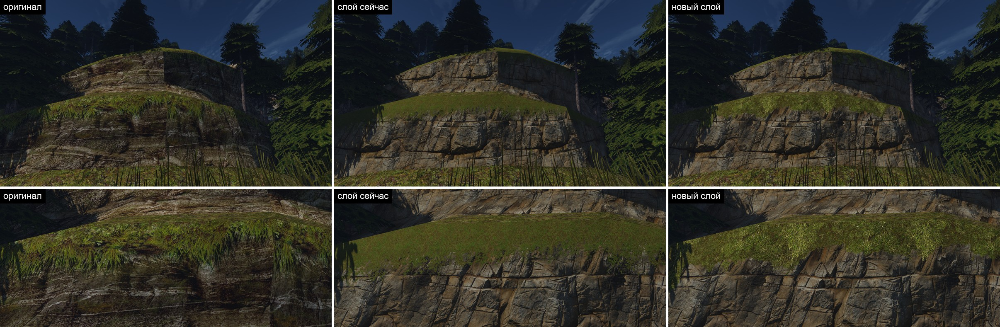
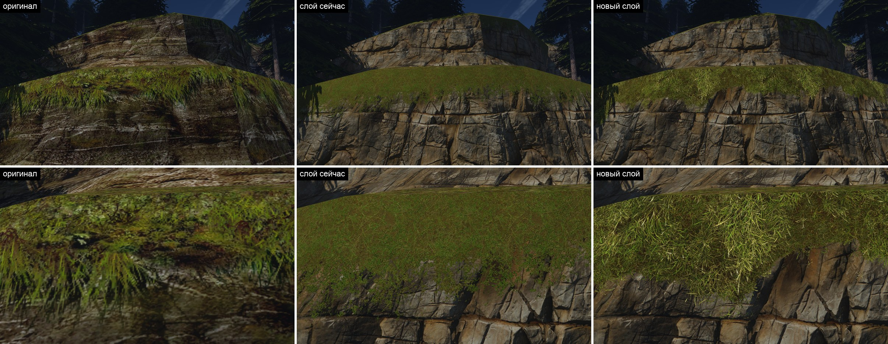
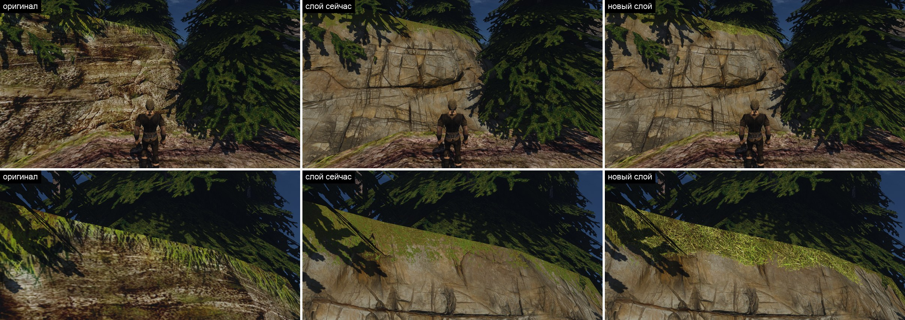
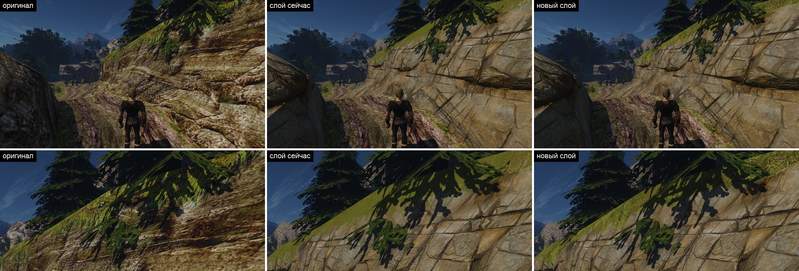
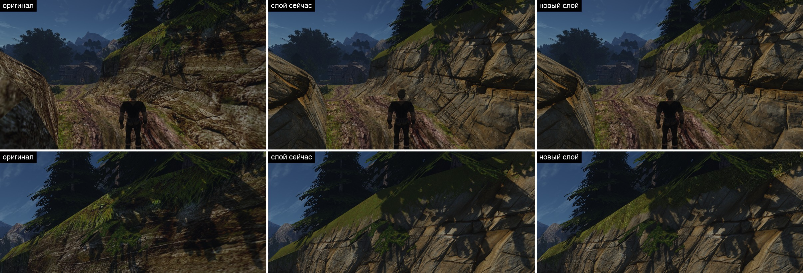
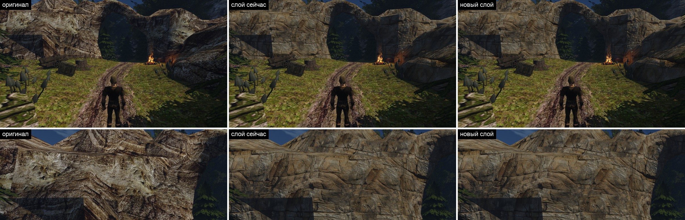

### Мой разбор, по видам

- **`ledge-near`, 5 м.** Это трава: видны отдельные листья, кочки, тёмные просветы до земли и светлые кончики. С мхом и газоном не спутать. Прежний слой рядом — ровный ковёр. Трава зелёная, серого налёта круга 2 нет. Край свисает языками до 0,8 м, по краю языка — отдельные травинки. **Что не так:** светлые листья тонкие и жёлто-соломенные, между ними тёмно-зелёное. У оригинала наоборот: мазки зелёные, между ними бурая земля. Вблизи слой контрастнее оригинала: разброс вида выше на 41 %, светлая четверть ярче на 21 %.
- **`ledge`, 14 м.** Край рваный и издали: языки и выемки по 0,3–0,8 м, прямой линии по ребру нет. Тон не один: светлые кочки, тёмные провалы. Цвет зелёный с жёлто-зелёными кочками, по среднему на 6 % светлее оригинала. **Что не так:** светлые кочки идут по длинной грани с шагом повтора — три похожих через 4 м. Приглушение сняло самую яркую, ритм остался и виден тому, кто ищет. Языки короче и шире мазков оригинала, свисающих на 0,5–1 м.
- **`road-2`.** На скате под ёлкой видны травинки и рваный нижний край с языками. **Что не так:** под острым углом снизу листья — сетка тонких ярких соломин по тёмному, у оригинала там сплошные зелёные мазки. В среднем освещённая трава темнее оригинала на 20 %, как у прежнего слоя (1,19). Этот скат в круг не входил.
- **`road-3`.** Полоса у кромки жёлто-зелёная с тёмными просветами, край рваный; издали по тону близка к оригиналу, на 7 % темнее. **Что не так:** освещённый скат оригинала ярче и ровнее по цвету: светлая четверть у нас темнее на 12 %. Справа вверху, в упор к солнцу, пятно соломенное.
- **`eve-3`, 17:30.** Свечения нет: освещённое пятно по яркости равно оригиналу (1,00), серебра нет. В тени трава тёмная, не чёрная. **Что не так:** в тени она темнее оригинала на 16 %.
- **`arch`.** Слоя в кадре нет, как и у прежнего: три кадра совпадают.

**Против списка исследования.** Тёмные просветы и светлые кончики есть. Трава, а не мох и не газон. Нижний край рваный издали. Пятна ломают один тон. В полдень и в 17:30 слой не светится и не чернеет. Повтор 4 м на `ledge` ослаблен, но заметен тому, кто ищет.

### Что ещё не так

1. **Оттенок по яркости перевёрнут.** У оригинала светлое зеленее, тёмное бурее; у слоя светлые листья желтее (R / G выше на 4–5 %), тёмные просветы зеленее (ниже на 5–8 %). Отсюда «солома по тёмной зелени» вблизи. Множитель на канал этого не правит. Правит наклон оттенка по яркости в сборке: красный, умноженный на (яркость / средняя)^−0,05, по числам `ledge-near` даёт 0,96 в светлой четверти и 1,07 в тёмной при нужных 0,95 и 1,05. Не делал: это новая ручка, а не поправка среднего, и в кадре она не проверена.
2. **Вблизи слой контрастнее оригинала**: на `ledge-near` разброс выше на 41 %, светлые листья ярче на 21 %. Показатель разброса подобран при текселе оригинала (1 см); слой с текселем 1 мм вблизи показывает каждую травинку. На `ledge` и `road-3` разброс в ограждениях.
3. **В тени слой темнее оригинала на 9–16 %** на всех видах; у прежнего слоя 5–20 %.
4. **Освещённый скат `road-2` темнее на 20 %**, как у прежнего слоя. В круг не входил.
5. **Между `ledge` и `road-3` 14 % яркости**: одна поправка делит их поровну, но не сводит. Причина не измерена.
6. **Повтор 4 м** на длинной грани `ledge`: самая светлая кочка приглушена в сборке, ритм светлых кочек остался. Убрать его совсем — это другая расстановка пучков, то есть новое запекание; в круг не входило.
7. **Языки короче и шире мазков оригинала, листья лежат, а не свисают.** Это предел вида сверху; свисающие листья — ступень 2, пучки.

### Круги 1 и 2: причина бледности и проба

Числа этого раздела сняты на части полосы (122 061 пиксель на `ledge`, 40 973 на `road-3`): прежний отбор полосы терял часть тени. Между собой они сравнимы, с таблицей круга 3 — нет.

| Вид, пикселей | Набор | Среднее R / G / B | Яркость | Разброс | Оригинал / слой, R / G / B | Яркость | Разброс |
|---|---|---|---|---|---|---|---|
| `ledge`, 122 061 | оригинал | 0,0531 / 0,0545 / 0,0134 | 0,0512 | 0,0415 | | | |
| | сейчас | 0,0490 / 0,0503 / 0,0110 | 0,0472 | 0,0236 | 1,083 / 1,083 / 1,222 | 1,085 | 1,756 |
| | круг 1 | 0,0541 / 0,0522 / 0,0181 | 0,0502 | 0,0456 | 0,981 / 1,043 / 0,740 | 1,021 | 0,911 |
| | **круг 2** | 0,0554 / 0,0579 / 0,0173 | 0,0544 | 0,0486 | 0,958 / 0,941 / 0,778 | 0,941 | 0,855 |
| | проба без блеска | 0,0455 / 0,0482 / 0,0107 | 0,0449 | 0,0371 | 1,167 / 1,131 / 1,260 | 1,141 | 1,118 |
| `road-3`, 40 973 | оригинал | 0,0910 / 0,0868 / 0,0164 | 0,0826 | 0,0714 | | | |
| | сейчас | 0,0843 / 0,0828 / 0,0130 | 0,0781 | 0,0434 | 1,080 / 1,048 / 1,260 | 1,058 | 1,647 |
| | круг 1 | 0,0799 / 0,0748 / 0,0174 | 0,0717 | 0,0600 | 1,139 / 1,161 / 0,940 | 1,152 | 1,191 |
| | **круг 2** | 0,0715 / 0,0721 / 0,0144 | 0,0678 | 0,0521 | 1,273 / 1,205 / 1,140 | 1,219 | 1,370 |
| | проба без блеска | 0,0684 / 0,0682 / 0,0112 | 0,0641 | 0,0488 | 1,330 / 1,273 / 1,457 | 1,289 | 1,462 |
| оба вида, 163 034 | оригинал | 0,0627 / 0,0626 / 0,0142 | 0,0591 | 0,0525 | | | |
| | сейчас | 0,0579 / 0,0585 / 0,0115 | 0,0550 | 0,0327 | 1,082 / 1,070 / 1,233 | 1,075 | 1,605 |
| | круг 1 | 0,0606 / 0,0579 / 0,0180 | 0,0556 | 0,0505 | 1,034 / 1,081 / 0,789 | 1,063 | 1,040 |
| | **круг 2** | 0,0595 / 0,0614 / 0,0165 | 0,0578 | 0,0498 | 1,053 / 1,019 / 0,857 | 1,023 | 1,054 |
| | проба без блеска | 0,0513 / 0,0532 / 0,0108 | 0,0497 | 0,0412 | 1,222 / 1,177 / 1,312 | 1,189 | 1,273 |

- **Круг 1.** Экранная поправка 1,03 / 1,04 / 1,02, показатель разброса 1. Множители запечённого цвета 5,40 / 5,82 / 2,80.
- **Круг 2.** Поправка 0,886 / 0,951 / 0,663, показатель 1,06, множители 4,89 / 5,27 / 1,87. Поправка — оттенок круга 1 на `ledge` и 0,895 на то, что добавят линейные мипы и слабое AO.
- **Ограждения у круга 2.** По двум видам вместе выдержаны: яркость 2 %, разброс 5 %. По видам порознь — нет: на `ledge` слой на 6 % светлее оригинала, на `road-3` на 18 % темнее, и разброс там ниже на 27 %.

Свет и тень, яркость оригинал / слой:

| Вид | Круг 1: свет / тень | Круг 2: свет / тень | Проба без блеска: свет / тень |
|---|---|---|---|
| `ledge` | 1,01 / 1,32 | 0,93 / 1,12 | 1,14 / 1,24 |
| `ledge-near` | 0,97 / 1,38 | 0,95 / 1,04 | 1,15 / 1,21 |
| `road-3` | 1,15 / 1,43 | 1,22 / 1,18 | 1,29 / 1,31 |
| `road-2` | 1,20 / 1,37 | 1,40 / 1,07 | 1,47 / 1,18 |
| `eve-3` | 0,84 / 1,30 | 0,80 / 1,16 | 1,22 / 1,30 |

Круг 1 показал четыре дефекта. Солома крупными светлыми пятнами читалась сеном и выдавала повтор. В тени слой был в 1,3–1,4 раза темнее оригинала. Синий канал был на 27 % выше. Дальние виды были темнее ближних. Круг 2 убавил солому (сухих травинок меньше, их цвет к цвету зелёной — 1,5 / 1,28 / 0,6 вместо 1,9 / 1,45 / 0,62), ослабил AO, усреднил мипы в линейном свете, удлинил языки и снизил синий в цвете на 35 %.

Тень исправилась: 1,04–1,18. Остальное — нет. Синий в кадре почти не изменился (0,0181 → 0,0173 на `ledge`), хотя в текстуре его стало на треть меньше. Разрыв между `ledge` и `road-3` вырос с 13 до 30 %. Значит, синий и яркость на стене шли не от цвета текстуры.

Сравнение карт показало разницу: шероховатость прежнего слоя 0,945 с разбросом 0,02, нового — 0,70, у травинок от 0,44. Нормали по силе одинаковы. Гладкие травинки дают блик неба и солнца: он белый, поэтому поднимает синий, обесцвечивает траву и зависит от угла между солнцем, стеной и камерой.

**Проба.** Набор круга 2 с одной правкой: `--rough-floor .85`, шероховатость 0,96 в среднем (набор `rock-grass-2r`, цвет байт в байт тот же). На этом листе «новый слой» — круг 2, не круг 3:

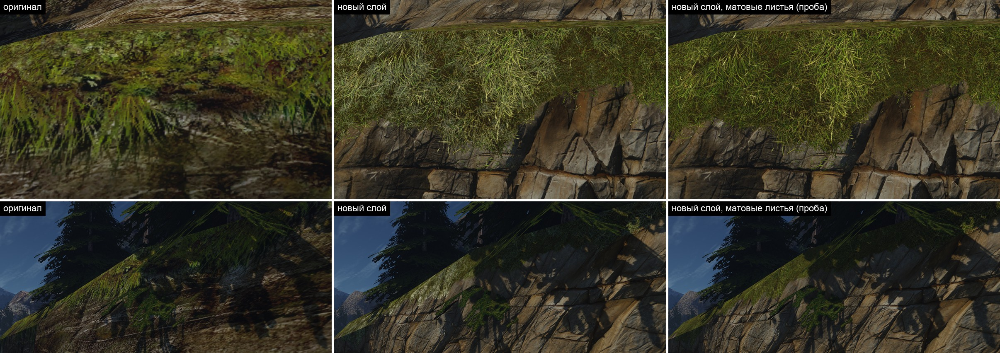

- Трава стала зелёной, бледность и серебристое пятно в 17:30 ушли.
- Синий на `ledge`: оригинал / слой 1,26 — столько же, сколько у прежнего слоя (1,22). Лишний синий был бликом.
- Освещённая трава в 17:30: с 0,80 до 1,22 — свечения нет.
- Без блика слой был темнее оригинала на всех видах: 1,14–1,29. Блик давал на стене около пятой части яркости, и поправка круга 2, снятая по `ledge`, её вычла.

Круг 3 — эта проба с пересчитанной поправкой цвета: [калибровка](#калибровка-цвета).
