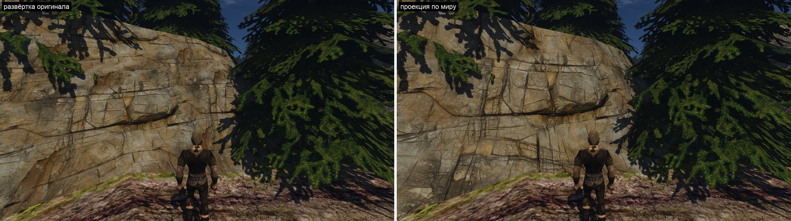
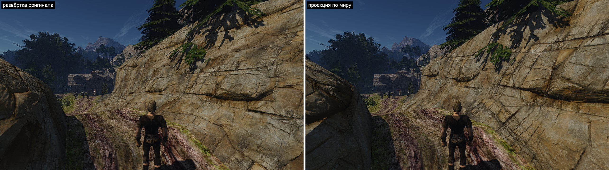
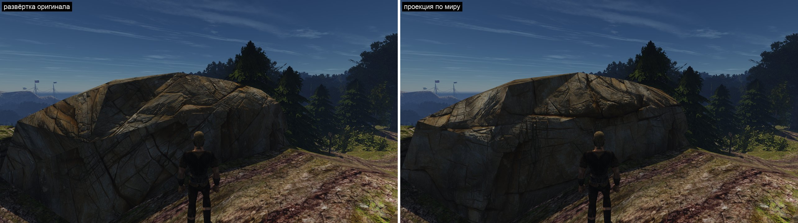
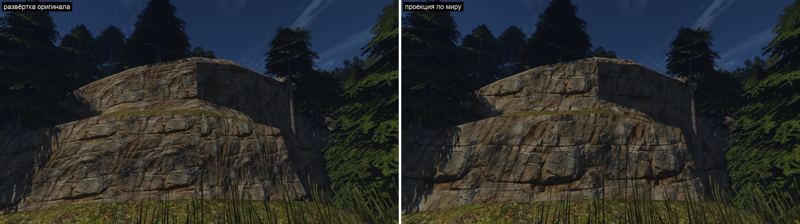
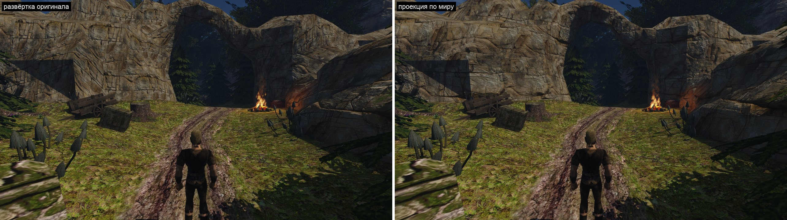
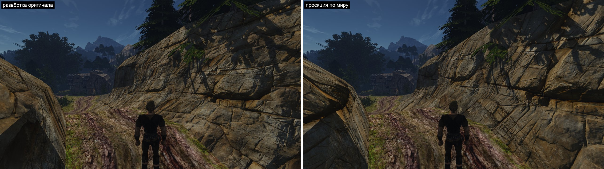

# В3: материал скал

Заметка о приёме к шагу В3 [плана ландшафта](../../../docs/landscape-plan.md). Пользователь выбрал его первым шагом вида 2026-11-13 («Да, материал первым») по кадрам и клипу [пробы слоёв](layers-probe.md).

**Состояние (2026-11-13):** задача 1 (проекция по миру): код и кадры есть, [что вышло](#задача-1-что-вышло), ждёт приёмки по кадрам; сканы для задачи 4 выбраны и скачаны; задачи 2–3 впереди.

## Цель

Скалы острова читаются как камень с любого расстояния, место остаётся собой: трава и мох по кромкам, тёплый серо-бурый тон. Проба показала, что это даёт материал, а не форма. Шаг превращает пробный набор в настоящий: без швов и растяжения развёртки оригинала, без читаемого повтора, с травой по кромкам, по цене, которую держит кадр.

Земля — вторая половина В3 — идёт после скал и вместе с травой (шаг В5): плоский скан земли без травы издалека проигрывает оригиналу ([пилот сканов](../remaster/megascans-pilot/README.md)).

## Эталон и числа

| Что | Значение | Откуда |
|---|---|---|
| Плотность у камеры | 500–1000 пикселей на метр; сейчас 43–58 | проба слоёв |
| Скала острова | 1,68 км², 35 текстур; пять покрывают 95 %: `NW_NATURE_STEIN_07` 58 %, `_03` 27 %, `_02` 5 %, `_06` 3 %, `_01` 1,5 % | подсчёт по кускам `NEWWORLD` |
| `STEIN_07` | 977 тыс. м² на 11,9 тыс. треугольников: дальние горы, вблизи почти не встречается | там же |
| Крутизна | 55–81 % площади каждой из пяти круче 50° | там же |
| Полосы с травой | `STEIN_02`, `STEIN_04`: v от 0 до 1 по высоте, трава у v = 0 (у `_04` и у v = 1) | проба слоёв |
| Цвет | равные средние текстур дают на солнце стену в 1,4–1,5 раза ярче оригинала; поправка по кадрам 0,78 / 0,72 / 0,56 | проба слоёв |
| Порода | слоистый обрыв скана `marble_cliff_03`; отдельного подтверждения эталона породы от пользователя нет, направление принято по кадрам с этим сканом | проба слоёв |

## Как решают другие и ловушки

Источник — [заметка о материалах](../../engine/2026-11-12-world-detail/research/terrain_materials.md) исследования.

- **Крутое — проекцией по миру.** Трёхплоскостная проекция стоит 3 выборки на карту, двухплоскостная (Quilez) — 2: берутся две главные оси нормали. Производные считают сами, иначе на смене плоскости мипы скачут. У нормалей (±1, ±1, ±1) двухплоскостная даёт мелкие изъяны.
- **Нормали при проекции** поворачивают в каждой плоскости отдельно и складывают; общая касательная база для них неверна.
- **Повторы** прячут крупной картой оттенка, той же текстурой в крупном масштабе на расстоянии и случайным сдвигом ячеек. Последнее у слоистой породы режет пласты (проба: укладка `offset`).
- **Сверху трава и мох, сбоку камень** — правило по наклону и высоте, общее для Witcher 3, Call of Duty, UE.
- **Смешивание по высоте** даёт рваную, а не размытую границу слоёв.

## Что умеет движок

- Материал по имени текстуры: `materials/materials.json` — карты цвета, нормалей и ORM, `scale`, `antitile`. Данные материала в шейдере — `Bucket` (`OpenGothic/shader/scene.glsl`), заполняет `drawbuckets.cpp`.
- Шейдер `OpenGothic/shader/materials/main.frag` пишет G-буфер; нормаль из карты строится по экранным производным позиции и UV (`mappedNormal`), касательных в вершине нет. Мировая позиция пикселя в этом проходе есть.
- Чего нет: проекции по миру, второго слоя материала, крупной вариации. Цвет вершины меша мира свободен (в кадре не используется), но формат кусков сейчас меняется шагом Д3 — новые данные в вершину этим шагом не добавляем.
- Отражённый свет берёт цвет материала по развёртке меша; как он поведёт себя с проекцией, выясняет задача 1.

## Способ

Три задачи движка и одна контента. Код рендера пишет и принимает Claude.

1. **Проекция по миру.** Поле записи материала, например `"projection": {"tile_m": 5.75}`: карты берутся по мировой позиции в двух главных плоскостях нормали. В боковых плоскостях V — высота мира, поэтому пласты горизонтальны на любой грани; сверху — плоскость XZ. Нормали поворачиваются по плоскостям, производные заданы явно. Работает на меше мира и на статичных мешах с тем же материалом. Снимает швы и растяжение развёртки оригинала и раскладку полосой.
2. **Трава по кромке.** Поле `"fringe"`: второй набор карт (трава, мох) поверх камня. Где ему быть, говорит развёртка оригинала: у полос `STEIN_02/04` координата v — это высота над кромкой, художник оригинала уже отметил ею траву. Вес — полоса по v с рваным краем по маске; сам слой берётся проекцией по миру. Новых данных в меше не нужно. Настоящие свисающие пучки добавит растительность (В5).
3. **Вариация без разрыва пластов.** Крупный шум оттенка по миру (несколько процентов яркости, десятки метров) и подмешивание тех же карт в масштабе ×4 с расстоянием. Сдвигов ячеек нет.
4. **Набор сканов.** Материалы для пяти текстур и их родни (`STEIN_01…08`, `DARKWOOD_FELS`, `CAVEWALL`): 2–3 скана CC0 одной породы, чтобы соседние стены не были одинаковыми; для `STEIN_07` — тот же камень в крупном масштабе. Цвет каждого калибруется по кадрам игры отдельным скриптом (отношение «оригинал / новое» на тех же пикселях). Трава кромки — свой материал. Сборка — потомок [`landscape_probe.py`](../../../scripts/content/landscape_probe.py); новые загрузки CC0 — с разрешения пользователя.

Порядок: 1 → 2 → 3; задача 4 идёт рядом, её цвет окончательно калибруется после задачи 1.

### Задача 4: выбранные сканы

Пользователь разрешил загрузку 2026-11-13. Всё с Poly Haven, CC0, 4096 px, вне git в `~/.local/share/gothic-ai/content-sources/landscape-probe/` (818 МБ вместе с пробой, список — `credits.json` там же). Выбор по превью, до кадров игры он предварительный.

| Скан | Размер | Куда |
|---|---|---|
| `marble_cliff_03` | 5,75 м | ближние стены: `STEIN_03`, `_02`, `_04` (уже в пробе) |
| `marble_cliff_01` | 4,3 м | та же порода с вертикальными блоками: вторая стена, чтобы соседние не были одинаковыми (`STEIN_01`, `_06`, `_08`) |
| `marble_cliff_05` | 20 м | дальние горы `STEIN_07`: крупный масштаб, без мелких блоков |
| `mossy_rock` | 3 м | замшелый камень: верхи уступов и сырые места |
| `sparse_grass` | 2 м | трава слоя кромки (задача 2) |
| `grass_medium_01` (модель) | — | пучки травы карточками с картой прозрачности: рваный край кромки сейчас, свисающие пучки в В5 |

Запасные с пробы: `rock_face_03` (камень без слоёв), набор валунов `rock_moss_set_01`.

## Приёмка

- **Задача 1:** кадры пробы слоёв на том же месте: пласты горизонтальны на каждой грани, тёмного прямоугольника на валуне нет, растянутых граней нет; пара с развёрткой оригинала. Цена кадра на этом месте против нынешнего набора.
- **Задача 2:** уступ издали ([кадр пробы](shots/layers-ledge.jpg)) и стена у дороги: трава по кромкам на месте, край рваный, без пикселей оригинала.
- **Задача 3:** арка у лагеря бандитов с 30–60 м: повтор не читается.
- **Шаг целиком:** пользователь по клипу прохода пилота «сейчас | материал», день и вечер, ближние стены и дальние горы; цена по `perf-content.sh`; Mac измерен.

## Чего не знаем

- Цену двухплоскостной проекции с тремя картами и вторым слоем в кадре на RTX 3080 и на Mac.
- Хватит ли одного семейства сканов на весь остров или у тёмного леса и пещер своя порода.
- Память: один материал 4096 — 44 МБ трёх карт.

## Задача 1: что вышло

2026-11-13. Поле записи `"projection": {"tile_m": 5.75}`: карты записи берутся по мировой позиции, `tile_m` метров мира на повтор; `scale` не действует. Код — [`material_projection.glsl`](../../../OpenGothic/shader/materials/material_projection.glsl), разбор и отказ — `resources_textures.cpp`, `Material`, флаг `BK_PROJECTION` в `drawbuckets.cpp`; как это устроено — пункт «Проекция по миру» в [своих материалах](../../../docs/own-content-textures.md#карты-и-рендер).

**Способ.**
- Две плоскости (Quilez): главная и средняя оси нормали, доли `clamp((|n| − 0,577)/0,423)` в квадрате; доля ниже 1/64 обнуляется, обе доли пересчитываются одинаково (на 45° — ровно 0,5 и 0,5), поэтому вторая плоскость выбирается только на гранях 37–53° от оси, иначе одна выборка на карту.
- Плоскости и их доли выбираются по нормали вершины, удержанной в пределах 20° от нормали самой грани (`cross(dFdx(pos), dFdy(pos))`; постоянная `ProjectionLimit*`). Решение ведущего после двух проб ([лист](shots/projection-plane-choice.jpg)): по одной нормали грани доли постоянны на треугольнике и скачут на его рёбрах — лоскуты на гранях почти одного наклона; по одной нормали вершины доли непрерывны, но у скал Gothic она на острых рёбрах отходит от грани до 45°, плоскость ложится поперёк грани и размазывает её. В пределах 20° берётся нормаль вершины: доли непрерывны, грани до 40° друг к другу продолжают рисунок без обрыва; дальше — нормаль грани, повёрнутая к ней на 20°: плоскость не дальше 20° от грани, растяжение ограничено, обрыв остаётся только на остром ребре. Базисы нормали по-прежнему на нормали затенения.
- В боковых плоскостях v = −высота мира (вниз, как v движка), u — вдоль грани, так что cross(u, v) смотрит наружу и рисунок не зеркалится; сверху и снизу — плоскость XZ.
- Градиенты выборок — `dot(dFdx(pos), ось)·k·mipGradScale`, общие для обеих плоскостей: скачка мипа на смене плоскости нет.
- Нормаль: в каждой плоскости базис `mappedNormal` этой плоской развёртки — поверхностные градиенты u и v, `ось − n(n·ось)`, со знаком экранного определителя и общей нормировкой по большей длине; затем две нормали смешиваются. На грани вдоль оси базис совпадает с тем, что `mappedNormal` строит по UV меша, уложенной так же.
- Трассировка лучей: пробы GI (`probe_trace.comp`) и трассировщик путей берут цвет попадания `textureLod(..., uv меша, 0)` — по развёртке оригинала, без `scale`. Для проекции так и оставлено: та же текстура в других координатах — правдоподобный цвет отскока.

**Кадры**, Ryzen, 2560×1440, без экрана, один бинарник; слева — набор пробы как есть (развёртка оригинала, `scale` 2/2/1), справа — его копия с проекцией на трёх записях `NW_NATURE_STEIN_02/03/04`, `tile_m` 5,75.

- **`road-2`, `road-3`, `eve-3` — стена у дороги.** Пласты горизонтальны по всей стене, швов развёртки нет. Наклонные полосы оригинала ушли. Ближний валун слева на `road-3` и `eve-3`: большая грань идёт через свои треугольники одним рисунком; грань справа видна почти с ребра, рисунок сжат ракурсом. Рисунок меняется на остром гребне между ними.
- **`road-4` — валун** ([три способа выбора](shots/projection-plane-choice.jpg)). Полос на левой грани нет (были по нормали вершины). Лоскутов-треугольников в середине валуна нет (были по нормали грани): от прогона по нормали грани кадр отличается только на пяти гранях, каждая меняется целиком, в части грани ничего не поменялось. Где рисунок ещё меняется: длинное ребро между наклонным верхом и отвесной стороной, рёбра левой наклонной грани и гребень над ней — рёбра, на которых меняется и свет, то есть грани расходятся заметно больше 40°. Внутри одной грани линии смены долей не видно ни на одном кадре.
- **`ledge` — уступ издали.** Пласты горизонтальны на обеих гранях, угол стыкуется. Читается повтор рисунка с шагом 5,75 м по ширине стены — это задача 3.
- **`arch` — арка.** Единый слоистый камень вместо лоскутов разной плотности; тот же повтор крупных блоков на большой стене.
- **Стена и арка против прошлых листов.** На `road-2`, `road-3`, `eve-3`, `ledge` кадр от прогона по нормали грани отличается на 0,3–2 % пикселей (порог 24 из 255) — отдельные грани; на вид без изменений. `arch` отличается на 21 %, но так же отличаются земля и трава: ракурс `arch` сдвигается от прогона к прогону (между двумя прошлыми прогонами — те же 21 %).
- **Яркость.** Средняя яркость скалы на кадре против развёртки оригинала: `road-2` 1,00, `road-3` 0,99, `ledge` 0,99, `road-4` 1,02, `arch` 1,00.

**Что не так.** На валуне рисунок меняется по острым рёбрам (больше 40° между гранями); их скругление под новым материалом — дело геометрии (В2 как вспомогательный шаг), не этой задачи. Повтор 5,75 м на больших стенах — задача 3. Задача ждёт приёмки по кадрам.

**Цена.** Выборок на пиксель: по UV меша — 3 (цвет, нормаль, ORM), с проекцией — 3, на гранях 37–53° от оси — 6. Время видеокарты на вид `road-3` — место `rock` стенда `scripts/perf.sh` ([`perf-rock.bench`](../../../scripts/bench/perf-rock.bench)): RTX 3080, 1920×1080, полное разрешение, VSM, заявки `gq quiet`, 8 с `perf sample` (970–1048 кадров), медиана `gpu_ns`. Скала — около половины кадра.

| Прогон | По UV меша | Проекция |
|---|---|---|
| Кадр, 1-я пара | 2,45 (кадры в два уровня, p95 3,23 — прогрев) | 2,79 |
| Кадр, 2-я пара | 2,78 | 2,83 |
| Кадр, пара с `OPENGOTHIC_GPU_PASSES=1` | 2,75 | 2,98 |
| Проход `GBuffer` в той же паре | 0,358 | 0,418 |

Проекция добавляет проходу G-буфера 0,06 мс (+16 %); остальные проходы в этой паре расходятся на величину шума (−0,13…+0,03 мс). По кадру целиком разница 0,01–0,05 мс у второй пары, у пар с разбивкой — 0,23 мс, из которых 0,06 — G-буфер; повторов по одному, разброс между запусками того же набора — до 0,3 мс. Разрешение 1920×1080, а не 2560×1440 кадров: экран Ryzen 1920×1080.

Как мерили: окно стенда на рабочем столе Ryzen шло кадр в секунду (мир за 300 с не загрузился), поэтому `PERF_ENV` нёс `TEMPEST_OFFSCREEN=1`. Без показа кадра стенд браковал прогон по `appcadence` (частота показа без экрана смысла не имеет), но `gpu_ns` командных буферов от показа не зависит, числа выше — из `frameprofile.csv`. Сборка стенда с профайлером не линковала `content-convert` (Tempest со счётчиками кадра, а `frameprofile.cpp` в конвертере нет) — на прогонах стенд собирался с той же правкой, что `main` получил параллельно (`883ae3226`).
